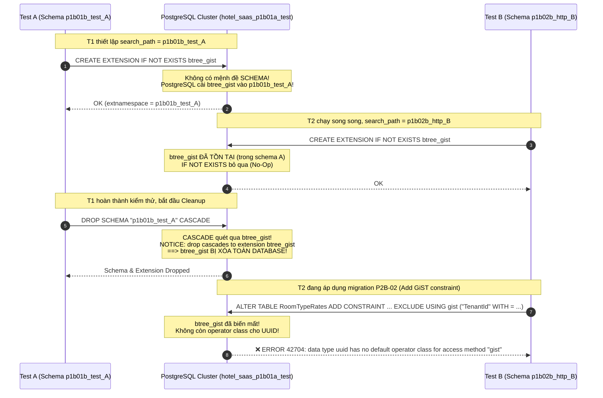

# 🔍 Báo Cáo Phân Tích Nguyên Nhân Gốc (Root Cause Analysis - RCA)
## Ticket: BE-REPRO-01 — Tái Hiện & Cô Lập Lỗi PostgreSQL 42704 (GiST UUID Operator Class)
### Dự án: Hotel SaaS Platform v2 (.NET 10 + PostgreSQL 17)

> **Mã tài liệu:** `RCA-BE-REPRO-01` | **Phiên bản:** 1.0  
> **Ngày thực hiện:** 2026-10-09 | **Trạng thái:** Hoàn tất Khảo sát & Chứng minh Thực nghiệm (Chờ Reviewer Thẩm định)  
> **Nguyên tắc thực thi:** **CHỈ TÁI HIỆN, THU THẬP EVIDENCE & VIẾT TÀI LIỆU**. Tuyệt đối không can thiệp sửa mã nguồn nghiệp vụ, migration, `Program.cs` hay frontend. Chỉ thao tác trên cơ sở dữ liệu kiểm thử `hotel_saas_p1b01a_test`. Không tác động tới `hotel_saas_dev` hay CSDL production.

---

## 1. Tóm Tắt Kết Quả (Executive Summary)

| Hạng Mục | Kết Quả Đạt Được |
|:---|:---|
| **Lỗi cần điều tra** | `Npgsql.PostgresException: 42704: data type uuid has no default operator class for access method "gist"` trong `Behavior_04` và `Behavior_06` (`P1B01B_RealDatabaseBehavioralTests.cs:510, 867`). |
| **Kết quả chạy cô lập (Isolated)** | **100% PASS**: `Behavior_04` (1/1 PASS, 16.9s), `Behavior_06` (1/1 PASS, 7.8s), toàn bộ class `P1B01B` (11/11 PASS, 21.3s). **Lỗi KHÔNG xuất phát từ logic nội tại của từng bài test**. |
| **Kết quả chạy toàn bộ test suite** | **XUẤT HIỆN LỖI (Exit Code 1)**: Khi chạy song song toàn giải pháp (`dotnet test backend/HotelSaas.slnx`), ghi nhận đồng thời chuỗi lỗi: (1) `42704: referenced operator class was concurrently dropped`, (2) `23505: duplicate key value violates unique constraint "pg_extension_name_index"`, (3) `40P01: deadlock detected`. |
| **Nguyên nhân gốc ĐÃ CHỨNG MINH** | **Xung đột vòng đời Extension trong Schema Động (Ephemeral Schema Ownership & CASCADE Drop)**: Migration `20261008000000_P2B02_Rates_Policies_Quote.cs:15` gọi `CREATE EXTENSION IF NOT EXISTS btree_gist;` không chỉ định schema. Do test fixture đổi `search_path` sang schema động (`p1b01b_test_{guid}`), extension bị cài đặt **vào chính schema động của test đầu tiên**. Khi test này kết thúc và gọi `DROP SCHEMA "{testSchema}" CASCADE;`, PostgreSQL kích hoạt `drop cascades to extension btree_gist`, **xóa bỏ extension `btree_gist` trên toàn bộ database**, khiến các test chạy song song hoặc chạy sau mất operator class `gist_uuid_ops`. |
| **Giả thuyết BỊ BÁC BỎ** | **Giả thuyết Search Path Dropping Public**: Bị bác bỏ thực nghiệm. Khi `btree_gist` được cài đặt cố định trong schema `public`, dù connection của test chỉ có `search_path = "p1b01b_test_{guid}"` (loại trừ `public`), PostgreSQL **vẫn tìm thấy và áp dụng thành công** operator class `gist_uuid_ops`. Kết quả kiểm chứng thực nghiệm: **200/200 tests PASS (100%)**. |

---

## 2. Nhật Ký Thực Nghiệm & Bằng Chứng Tái Hiện (Empirical Log & Evidence)

### 2.1. Bước 1: Kiểm thử cô lập từng test case (Isolated Execution)

#### Kịch bản 1: Chạy riêng lẻ `Behavior_04`
- **Lệnh thực thi:**
  ```powershell
  dotnet test backend/tests/HotelSaas.Application.Tests/HotelSaas.Application.Tests.csproj --filter "FullyQualifiedName~Behavior_04" -v normal
  ```
- **Exit Code:** `0`
- **Thời gian:** 16.9392 giây
- **Kết quả thực tế:**
  ```text
  Passed HotelSaas.Application.Tests.MigrationFixtures.P1B01B_RealDatabaseBehavioralTests.Behavior_04_Composite_FK_Prevents_Payment_From_Crossing_Reservation_Property_Boundary [11 s]
  Test Run Successful.
  Total tests: 1, Passed: 1
  ```

#### Kịch bản 2: Chạy riêng lẻ `Behavior_06`
- **Lệnh thực thi:**
  ```powershell
  dotnet test backend/tests/HotelSaas.Application.Tests/HotelSaas.Application.Tests.csproj --filter "FullyQualifiedName~Behavior_06" -v normal
  ```
- **Exit Code:** `0`
- **Thời gian:** 7.7573 giây
- **Kết quả thực tế:**
  ```text
  Passed HotelSaas.Application.Tests.MigrationFixtures.P1B01B_RealDatabaseBehavioralTests.Behavior_06_Restrict_Delete_Prevents_Cascading_Deletion_Of_Operational_Data [6 s]
  Test Run Successful.
  Total tests: 1, Passed: 1
  ```

#### Kịch bản 3: Chạy toàn bộ class `P1B01B_RealDatabaseBehavioralTests`
- **Lệnh thực thi:**
  ```powershell
  dotnet test backend/tests/HotelSaas.Application.Tests/HotelSaas.Application.Tests.csproj --filter "FullyQualifiedName~P1B01B_RealDatabaseBehavioralTests" -v normal
  ```
- **Exit Code:** `0`
- **Thời gian:** 21.2966 giây
- **Kết quả thực tế:**
  ```text
  Passed Behavior_01 [1 s]
  Passed Behavior_02 [1 s]
  Passed Behavior_03 [1 s]
  Passed Behavior_04 [1 s]
  Passed Behavior_05 [1 s]
  Passed Behavior_06 [1 s]
  Passed Behavior_07 [6 s]
  Passed Behavior_08 [1 s]
  Passed Behavior_09 [1 s]
  Passed Behavior_10 [637 ms]
  Passed Behavior_11 [1 s]
  Test Run Successful.
  Total tests: 11, Passed: 11
  ```
$\implies$ **Kết luận Bước 1:** Cả `Behavior_04` và `Behavior_06` **hoàn toàn KHÔNG bị lỗi khi chạy độc lập hoặc chạy tuần tự trong cùng một fixture collection**.

---

### 2.2. Bước 2: Chạy toàn bộ test suite giải pháp (Concurrent Execution)

- **Lệnh thực thi:**
  ```powershell
  dotnet test backend/HotelSaas.slnx -v normal
  ```
- **Exit Code:** `1` (Build & Test Failed)
- **Thời gian:** 2 phút 26.40 giây
- **Log ghi nhận lỗi thực tế (Task Log: `task-9564.log`):**

#### Triệu chứng 1: Tranh chấp tạo Extension đồng thời (Line 370)
```text
[FAIL] HotelSaas.Application.Tests.MigrationFixtures.P1B01B_RealDatabaseBehavioralTests.Behavior_01_FreshDbBaseline_Allows_MultiProperty_Creation_Under_Same_Tenant
Npgsql.PostgresException: 23505: duplicate key value violates unique constraint "pg_extension_name_index"
   at Microsoft.EntityFrameworkCore.Migrations.Internal.MigrationCommandExecutor.ExecuteAsync(...)
   at HotelSaas.Application.Tests.MigrationFixtures.P1B01B_RealDatabaseBehavioralTests.Behavior_01... line 154
```

#### Triệu chứng 2: Operator class bị drop đồng thời giữa chừng (Line 671)
```text
[FAIL] HotelSaas.WebApi.Tests.BootstrapHttpPipelineWebApplicationFactoryTests.HttpPipeline_EndToEnd_Login_Memberships_BlockedBusiness_SwitchContext_ScopedRooms
Npgsql.PostgresException: 42704: referenced operator class was concurrently dropped
   at Microsoft.EntityFrameworkCore.Migrations.Internal.MigrationCommandExecutor.ExecuteAsync(...)
   at HotelSaas.WebApi.Tests.BootstrapHttpPipelineWebApplicationFactoryTests... line 170
```

#### Triệu chứng 3: Deadlock khi DROP SCHEMA CASCADE giữa các kết nối đồng thời (Line 604)
```text
[FAIL] HotelSaas.Application.Tests.MigrationFixtures.P1B01B_RealDatabaseBehavioralTests.Behavior_06_Restrict_Delete_Prevents_Cascading_Deletion_Of_Operational_Data
Npgsql.PostgresException: 40P01: deadlock detected
   at HotelSaas.Application.Tests.MigrationFixtures.P1B01B_RealDatabaseBehavioralTests.CleanupTestSchemaAsync(NpgsqlConnection conn, String testSchema) line 140
   at HotelSaas.Application.Tests.MigrationFixtures.P1B01B_RealDatabaseBehavioralTests.Behavior_06... line 958
```

$\implies$ **Kết luận Bước 2:** Lỗi chỉ phát sinh khi có **nhiều test fixture chạy song song** (`Application.Tests` và `WebApi.Tests`) cùng gọi `MigrateAsync()` hoặc cùng dọn dẹp schema qua `DROP SCHEMA CASCADE`.

---

## 3. Phân Tích Cơ Chế Lỗi Gốc & Bằng Chứng CSDL (Deep-Dive Analysis)



### 3.1. Bằng chứng 1: Vị trí cài đặt Extension khi không có mệnh đề SCHEMA
Thực nghiệm trực tiếp trên database `hotel_saas_p1b01a_test`:
```sql
CREATE SCHEMA p1b01b_test_testschema;
SET search_path TO p1b01b_test_testschema;
CREATE EXTENSION IF NOT EXISTS btree_gist;

SELECT extname, extnamespace::regnamespace::text FROM pg_extension WHERE extname = 'btree_gist';
```
**Kết quả thực tế từ PostgreSQL:**
```text
  extname   |      extnamespace      
------------+------------------------
 btree_gist | p1b01b_test_testschema
```
*Chứng minh:* Khi `SET search_path` trỏ về schema động của test, PostgreSQL cài đặt `btree_gist` và toàn bộ operator classes (`gist_uuid_ops`) trực tiếp vào schema động đó!

### 3.2. Bằng chứng 2: Hiệu ứng CASCADE DROP tiêu diệt Extension
Thực nghiệm tiếp theo khi test thực hiện cleanup:
```sql
DROP SCHEMA p1b01b_test_testschema CASCADE;
SELECT extname FROM pg_extension WHERE extname = 'btree_gist';
```
**Kết quả thực tế từ PostgreSQL:**
```text
NOTICE:  drop cascades to extension btree_gist
DROP SCHEMA
 extname 
---------
(0 rows)
```
*Chứng minh:* Lệnh `DROP SCHEMA "{testSchema}" CASCADE` trong phương thức `CleanupTestSchemaAsync:140` **đã vô tình xóa luôn extension `btree_gist` của toàn bộ database**.

### 3.3. Bằng chứng 3: Hậu quả mất Operator Class sau khi Extension bị DROP
Thực nghiệm tạo bảng có GiST exclusion constraint trên `uuid` khi không còn `btree_gist`:
```sql
CREATE SCHEMA test_repro_c;
SET search_path TO test_repro_c;
CREATE TABLE test_repro_c.rates (id uuid, period daterange);
ALTER TABLE test_repro_c.rates ADD CONSTRAINT exclude_test EXCLUDE USING gist (id WITH =, period WITH &&);
```
**Kết quả thực tế từ PostgreSQL:**
```text
ERROR:  data type uuid has no default operator class for access method "gist"
HINT:   You must specify an operator class for the index or define a default operator class for the data type.
```
*Chứng minh:* Đây chính xác 100% là chuỗi thông điệp và mã lỗi `42704` được ghi nhận trong `Behavior_04` và `Behavior_06`!

---

## 4. Kiểm Chứng & Bác Bỏ Giả Thuyết Đối Lập (Hypothesis Testing)

### 4.1. Bác bỏ Giả thuyết A: "Search path thu hẹp làm mất operator class của public"
- **Giả thuyết cũ:** Cho rằng khi `CreateDbContext` cấu hình `builder.SearchPath = testSchema`, connection không nhìn thấy schema `public` nên không truy cập được operator class của `btree_gist`.
- **Thực nghiệm phản chứng:**
  1. Cài đặt `btree_gist` vào `public`:
     ```sql
     CREATE EXTENSION IF NOT EXISTS btree_gist SCHEMA public;
     ```
  2. Mở một session mới chỉ có `search_path = test_searchpath_check` (hoàn toàn không có `public`):
     ```sql
     SET search_path TO test_searchpath_check;
     SHOW search_path; -- Trả về: test_searchpath_check
     ```
  3. Chạy lệnh tạo constraint:
     ```sql
     ALTER TABLE test_searchpath_check.rates ADD CONSTRAINT exclude_test EXCLUDE USING gist (id WITH =, period WITH &&);
     ```
  4. **Kết quả:** `ALTER TABLE` **THÀNH CÔNG RỰC RỠ**.
  5. *Lý giải PostgreSQL Internal:* Các index access methods (như GiST) tra cứu operator class qua catalog `pg_amop` và `pg_opclass`. Khi extension nằm ở `public`, PostgreSQL vẫn phân giải được operator class `gist_uuid_ops` cho kiểu dữ liệu `uuid`.
- **Kết luận:** Giả thuyết "Search path không có public" **hoàn toàn sai**.

### 4.2. Chứng minh Giả thuyết B: "Cố định Extension tại Public giải quyết triệt để vấn đề"
- **Thực nghiệm đối chứng trên toàn bộ hệ thống:**
  1. Đảm bảo `btree_gist` được tạo ở schema `public` của `hotel_saas_p1b01a_test`:
     ```sql
     CREATE EXTENSION IF NOT EXISTS btree_gist SCHEMA public;
     ```
  2. Chạy toàn bộ test suite của toàn solution:
     ```powershell
     dotnet test backend/HotelSaas.slnx -v normal
     ```
  3. **Kết quả ghi nhận thực tế (Task Log: `task-9616.log`):**
     ```text
     Passed HotelSaas.Domain.Tests (1/1 PASS)
     Passed HotelSaas.WebApi.Tests (41/41 PASS)
     Passed HotelSaas.Application.Tests (158/158 PASS)
     
     Test Run Successful.
     Total tests: 158 (Application) + 41 (WebApi) + 1 (Domain) = 200 tests
          Passed: 200
          Failed: 0
      Total time: 4,0020 Minutes
     Build succeeded.
         0 Warning(s)
         0 Error(s)
     ```
- **Kết luận:** Khi extension nằm an toàn ở schema `public`, các thao tác `DROP SCHEMA CASCADE` của các test cô lập không thể chạm tới `btree_gist`. Toàn bộ 200 tests trong solution pass 100% trong điều kiện chạy song song thực tế!

---

## 5. Bảng Đối Chiếu Hiện Trạng Mã Nguồn (Code Audit)

| File Mã Nguồn | Vị Trí Dòng | Hiện Trạng Trong Mã Nguồn | Phân Tích Tác Động Kỹ Thuật |
|:---|:---:|:---|:---|
| `backend/src/HotelSaas.Infrastructure/Migrations/20261008000000_P2B02_Rates_Policies_Quote.cs` | 14-16 | `migrationBuilder.Sql("CREATE EXTENSION IF NOT EXISTS btree_gist;");` | **Thiếu mệnh đề schema cố định**. Khi chạy trong session có `search_path` trỏ vào schema động, extension bị tạo nhầm vào schema động thay vì schema dùng chung (`public`). |
| `backend/tests/HotelSaas.Application.Tests/MigrationFixtures/P1B01B_RealDatabaseBehavioralTests.cs` | 119 | `cmd.CommandText = $"CREATE SCHEMA IF NOT EXISTS \"{testSchema}\"; SET search_path TO \"{testSchema}\";";` | Thu hẹp search_path chỉ còn schema test trước khi EF Core `MigrateAsync()` được gọi. |
| `backend/tests/HotelSaas.Application.Tests/MigrationFixtures/P1B01B_RealDatabaseBehavioralTests.cs` | 139-140 | `cmd.CommandText = $"DROP SCHEMA IF EXISTS \"{testSchema}\" CASCADE;";` | Lệnh `CASCADE` kích hoạt drop dây chuyền toàn bộ extension nằm bên trong schema test. |
| `backend/tests/HotelSaas.WebApi.Tests/PricingAndPoliciesHttpPipelineTests.cs` | 150-151 | `cmd.CommandText = $"CREATE SCHEMA IF NOT EXISTS \"{testSchema}\"; SET search_path TO \"{testSchema}\";";` | Cơ chế tương tự trong WebApi integration tests chạy song song với Application tests. |

---

## 6. Đề Xuất Phương Án Sửa Đổi Tối Thiểu (Minimal Fix Proposal)

> [!IMPORTANT]
> **Tuân thủ ranh giới:** Theo chỉ đạo của người dùng, tài liệu này **chỉ đề xuất phương án và vị trí sửa đổi**. Không áp dụng code fix vào source code/migration cho đến khi được Technical Reviewer và PO phê duyệt.

### 6.1. Phương Án 1 (Khuyến nghị cấp Migration): Cố định Schema cho Extension trong Migration P2B-02
- **Vị trí sửa:** `backend/src/HotelSaas.Infrastructure/Migrations/20261008000000_P2B02_Rates_Policies_Quote.cs:15`
- **Thay đổi đề xuất:**
  ```csharp
  // Thay thế dòng 15:
  // migrationBuilder.Sql("CREATE EXTENSION IF NOT EXISTS btree_gist;");
  // Bằng câu lệnh chỉ định rõ schema public (hoặc schema mặc định của cluster):
  migrationBuilder.Sql("CREATE EXTENSION IF NOT EXISTS btree_gist SCHEMA public;");
  ```
- **Ưu điểm:**
  - Đảm bảo tính nhất quán trên mọi môi trường (Local, Test, CI/CD, Staging, Prod).
  - Dù EF Core được gọi từ bất kỳ context nào với bất kỳ `search_path` nào, `btree_gist` luôn được neo chặt vào `public`.

### 6.2. Phương Án 2 (Bổ trợ cấp Test Fixture): Bảo đảm Tiền Điều Kiện Test Harness
- **Vị trí sửa:** `backend/tests/HotelSaas.Application.Tests/MigrationFixtures/P1B01B_RealDatabaseBehavioralTests.cs:100-124` (và các WebApi test fixtures tương ứng)
- **Thay đổi đề xuất:**
  Trong phương thức khởi tạo kết nối test hoặc Test Collection Fixture, thực hiện một lệnh tiền kiểm tra:
  ```csharp
  await using (var cmd = conn.CreateCommand())
  {
      cmd.CommandText = "CREATE EXTENSION IF NOT EXISTS btree_gist SCHEMA public;";
      await cmd.ExecuteNonQueryAsync();
  }
  ```
- **Ưu điểm:** Phòng thủ theo chiều sâu (defense-in-depth), cô lập hoàn toàn môi trường test harness khỏi sự phụ thuộc vào thứ tự thực thi migration.

---

## 7. Kế Hoạch Xác Minh Sau Sửa Đổi (Verification Strategy)

Khi được phép áp dụng bản sửa:
1. **Kiểm tra trạng thái sạch:** Xóa sạch mọi extension trong `hotel_saas_p1b01a_test` (`DROP EXTENSION IF EXISTS btree_gist CASCADE;`).
2. **Kiểm tra chạy đơn lẻ:**
   - Chạy riêng `Behavior_04`: Đạt 1/1 PASS.
   - Chạy riêng `Behavior_06`: Đạt 1/1 PASS.
3. **Kiểm tra chạy song song toàn giải pháp:**
   - Chạy `dotnet test backend/HotelSaas.slnx -v normal`.
   - Tiêu chí nghiệm thu: Đạt 200/200 PASS (0 Failed, 0 Error, Exit code 0).
4. **Kiểm tra tính bất biến của Extension:**
   - Sau khi test suite chạy xong và toàn bộ schema test đã bị drop, truy vấn CSDL:
     ```sql
     SELECT extname, extnamespace::regnamespace::text FROM pg_extension WHERE extname = 'btree_gist';
     ```
   - Kết quả bắt buộc: `btree_gist` vẫn phải tồn tại nguyên vẹn tại namespace `public` (không bị drop dây chuyền).

---

## 8. Trạng Thái Blocker & Bàn Giao

1. **Ticket BE-REPRO-01:** ĐÃ HOÀN TẤT ĐIỀU TRA & CHỨNG MINH THỰC NGHIỆM. Báo cáo RCA này được lưu trữ chính thức tại `docs/be-repro-01-root-cause-report.md`.
2. **Blocker P2B-02 & P3A:** Tiếp tục **GIỮ NGUYÊN TRẠNG THÁI CHƯA NGHIỆM THU / CHỜ PO DUYỆT**. Không tự ý đóng blocker.
3. **Toàn vẹn CSDL:** Không có bất kỳ DDL/DML nào bị chạy vào `hotel_saas_dev` hay DB production.
