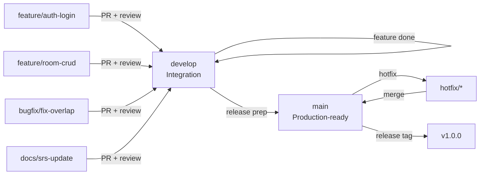
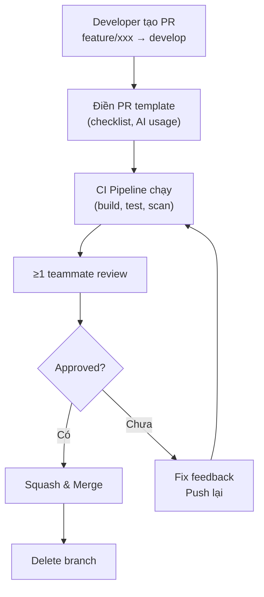

# Git Workflow & Branch Strategy

> **Tài liệu:** DOCS/Git Workflow | **Ngày:** 2026-10-03

---

## Branch Strategy



## Branch Naming

| Type | Pattern | Ví dụ |
|------|---------|-------|
| Feature | `feature/TASK-ID-description` | `feature/US-1.2-login-jwt` |
| Bugfix | `bugfix/TASK-ID-description` | `bugfix/BR-R01-overlap-check` |
| Hotfix | `hotfix/description` | `hotfix/security-jwt-leak` |
| Docs | `docs/description` | `docs/srs-user-stories` |
| Chore | `chore/description` | `chore/upgrade-primeng-22` |

## Commit Message (Conventional Commits)

```
<type>(<scope>): <subject>

Types: feat | fix | docs | style | refactor | test | chore | ci
Scope: auth | rbac | room | reservation | payment | housekeeping |
       invoice | report | pricing | notification | ai | ui | api | infra

Ví dụ:
feat(auth): implement JWT login with refresh token
fix(reservation): prevent double booking on same room
docs(srs): add user stories for housekeeping
test(rbac): add permission bitmask unit tests
ci(pipeline): add security scanning stage
```

## Pull Request Process



### PR Rules
1. Mọi thay đổi qua PR — không push thẳng develop/main
2. CI pipeline PHẢI pass
3. ≥ 1 reviewer approve
4. Squash merge (clean history)
5. Delete branch sau merge
6. PR description ghi rõ AI tools sử dụng

## Release Process

```
1. develop đủ features cho sprint → tạo PR: develop → main
2. Review tổng hợp + smoke test
3. Merge → auto tag (v1.0.0, v1.1.0...)
4. Deploy staging → smoke test → deploy production
```

---

*Tài liệu này phục vụ TC2.4 (quản lý Git chuẩn, PR có review).*
