# 📊 Tự đánh giá Rubric — Bảng chấm điểm & Tiến độ

> **Tài liệu:** EVAL-01 | **Phiên bản:** 1.0 | **Ngày:** 2026-10-03
> **Mục đích:** Tự đánh giá hiện trạng project so với rubric trường,
> xác định điểm mạnh và khoảng trống cần bổ sung.
>
> ⚠️ **Lưu ý:** Đây là tự đánh giá (self-assessment), không phải điểm chính thức.
> Điểm chính thức do hội đồng chấm.
>
> ⚠️ **Trạng thái:** Bảng dưới đây là snapshot cũ, chưa được tái kiểm chứng sau các thay đổi trong repo và lộ trình MVP. Các số liệu/nhận định hiện trạng không được xem là bằng chứng cho đến khi cập nhật lại từ build, test, CI và chức năng chạy thật.

---

## 1. Bảng tổng hợp tự đánh giá

| STT | Tiêu chí | Điểm tối đa | Mức tự đánh giá | Khoảng điểm | Minh chứng hiện có | Còn thiếu |
|:---:|----------|:----------:|:---------------:|:-----------:|-------------------|-----------|
| 1 | **TC1** — Tính thực tiễn, hiểu biết vấn đề | 10 | ⏳ Mức 4 | 7.5–8.5 | Market research 5 PMS, 4 personas, 13 KPIs | Chưa có phỏng vấn 3 bên liên quan thực tế / ≥30 phiếu khảo sát |
| 2.1 | **TC2.1** — Phân tích & thiết kế | 10 | ✅ Mức 5 | 9.0–10 | 21 user stories 100% AC, 9 loại sơ đồ (27 diagrams), 9 NFR, 60+ business rules, data dictionary, 5 ADR | Cần đối chiếu sơ đồ ↔ code khi implement xong |
| 2.2 | **TC2.2** — Hoàn thiện sản phẩm | 10 | ⏳ Chưa bắt đầu | — | Code scaffold build OK, chưa có chức năng hoạt động | Cần implement 18 chức năng cam kết |
| 2.3 | **TC2.3** — Làm chủ AI | 5 | ✅ Mức 4-5 | 3.75–5.0 | AI Usage Log template, AI usage ghi tuần 1, prompt tracking | Cần ghi log đầy đủ mỗi tuần, ≥5 lỗi AI đã phát hiện |
| 2.4 | **TC2.4** — Chất lượng mã nguồn | 10 | ⏳ Mức 3-4 | 6.0–8.5 | Coding convention, .editorconfig, .gitignore, 0 secret, Git workflow | Cần: commits đều ≥90% tuần, PRs có review, 0 lint errors, SonarQube |
| 2.5 | **TC2.5** — Kiểm thử | 5 | ⏳ Chưa bắt đầu | — | Test plan 4 tầng, 3 test projects scaffold | Cần implement tests, coverage ≥70%, 0 Critical defects |
| 2.6 | **TC2.6** — CI/CD | 5 | ⏳ Mức 3-4 | 3.0–4.25 | CI pipeline 6 stages (build→lint→test→security→docker→deploy) | Cần: pipeline chạy thật, ≥10 deploys, staging URL, monitoring |
| 2.7 | **TC2.7** — Thực nghiệm người dùng | 5 | ⏳ Chưa bắt đầu | — | Kịch bản SUS đã lên plan | Cần: ≥10 users thực, SUS ≥80, ≥1 vòng cải tiến |
| 3 | **TC3** — Thuyết trình | 10 | ⏳ Chưa chuẩn bị | — | — | Slides, demo trực tiếp trên staging |
| 4 | **TC4** — Luận văn & tài liệu tham khảo | 10 | ✅ Mức 4-5 | 7.5–10 | 43 tài liệu tham khảo thực (100% ngoại ngữ), có sách chuyên khảo, tiêu chuẩn | Cần: viết báo cáo đồ án hoàn chỉnh, trùng lặp ≤20% |
| 5 | **TC5** — Trả lời câu hỏi | 15 | ⏳ Phụ thuộc kiến thức | — | — | Hiểu rõ mọi code & thiết kế |
| 6 | **TC6** — Kết quả nổi bật | 5 | ⏳ Tùy thuộc | 0–5 | — | Có thể: deploy production có user thật, open source |
| | **TỔNG DỰ KIẾN** | **100** | | **~70-85** | | |

---

## 2. Chi tiết từng tiêu chí — Minh chứng & Gap Analysis

### TC1 — Tính thực tiễn (10đ)

| Metric rubric | Mức 5 cần | Hiện có | Gap |
|--------------|----------|---------|-----|
| Số bên liên quan phỏng vấn/khảo sát | ≥3 (hoặc ≥30 phiếu) | 0 (mới có market research online) | ❌ **Cần phỏng vấn 3 chủ nhà nghỉ/KS hoặc tạo Google Form ≥30 phiếu** |
| Số giải pháp so sánh | ≥3 | 5 (Cloudbeds, Mews, ezCloudhotel, HotelRunner, Frontdesk Anywhere) | ✅ Đạt |
| Số KPI nghiệp vụ đã chốt | ≥5 | 13 (8 business + 5 dev) | ✅ Đạt |
| **Tự đánh giá** | **Mức 4** (7.5-8.5đ) | Thiếu phỏng vấn thực tế | Bổ sung phỏng vấn/khảo sát → lên Mức 5 |

**Hành động:** Tạo Google Form khảo sát nhu cầu PMS, gửi cho ≥30 người (chủ nhà nghỉ, nhân viên khách sạn, khách du lịch)

### TC2.1 — Phân tích & Thiết kế (10đ)

| Metric rubric | Mức 5 cần | Hiện có | Gap |
|--------------|----------|---------|-----|
| User story có AC | 100% | 100% (21/21 stories) | ✅ Đạt |
| Số loại sơ đồ | ≥4 | **9 loại** (ERD, Context, Container, Component, Sequence, Class, Flowchart, Deployment, Security) | ✅ Vượt |
| NFR có ràng buộc định lượng | ≥5 | 9 NFR, 40+ ràng buộc | ✅ Vượt |
| Sơ đồ khớp mã nguồn | 100% | Chưa đối chiếu (code scaffold mới) | ⏳ Kiểm tra khi implement |
| Business rules + từ điển dữ liệu | Đầy đủ | 60+ rules, 11 chính sách, 7 entities + 12 enums | ✅ Đạt |
| Giải thích lựa chọn kiến trúc | Có phương án cân nhắc | 5 ADR, bảng so sánh 17 công nghệ | ✅ Vượt |
| **Tự đánh giá** | **Mức 5** (9.0-10đ) | Chờ đối chiếu code | ✅ Ready |

### TC2.2 — Hoàn thiện sản phẩm (10đ)

| Metric rubric | Mức 5 cần | Hiện có | Gap |
|--------------|----------|---------|-----|
| Chức năng cam kết hoạt động | 100% | 0% (chưa implement) | ❌ **PHẢI implement** |
| Lỗi demo | 0 | N/A | ⏳ |
| Môi trường | Production có user thật | Local build OK | ❌ Cần staging + production |
| Khối lượng vs cam kết | ≥100% | ~30% (docs + scaffold) | ❌ Cần hoàn thành Phase 1-5 |
| **Tự đánh giá** | **Chưa bắt đầu** | | Đây là phần CẦN NHIỀU EFFORT NHẤT |

### TC2.3 — Làm chủ AI (5đ)

| Metric rubric | Mức 5 cần | Hiện có | Gap |
|--------------|----------|---------|-----|
| AI Usage Log | Đầy đủ, đối chiếu được commit | Template + tuần 1 log | ⏳ Cần log hàng tuần |
| Giải thích code AI sinh | 100% (5 vị trí random) | Nhóm phải hiểu mọi code | ⏳ Học & hiểu |
| Lỗi AI phát hiện | ≥5 kèm phân tích | 1 (TenantStaffMember → TenantStaff) | ⏳ Cần ghi thêm |
| Quy trình kiểm soát AI | Thành hệ thống | Checklist trong convention | ⏳ Cần cụ thể hơn |
| **Tự đánh giá** | **Mức 4** (3.75-4.25đ) | | Cần thêm lỗi AI + quy trình |

### TC2.4 — Chất lượng mã nguồn (10đ)

| Metric rubric | Mức 5 cần | Hiện có | Gap |
|--------------|----------|---------|-----|
| Lint errors / 1000 LOC | 0 | N/A (chưa có code) | ⏳ |
| Blocker/Critical issues | 0 | N/A | ⏳ |
| Code duplication | ≤3% | N/A | ⏳ |
| Tuần có commit | ≥90% | 0% (chưa init git) | ❌ **Init git ngay** |
| PR có review | ≥90% | 0% | ❌ Cần thực hiện PR workflow |
| Secret lộ | 0 | 0 (dùng .env + .gitignore) | ✅ Đạt |
| README + hướng dẫn | Có | README.md có | ✅ Đạt |
| **Tự đánh giá** | **Chưa đủ minh chứng** | | Init git + commit đều đặn |

### TC2.5 — Kiểm thử (5đ)

| Metric rubric | Mức 5 cần | Hiện có | Gap |
|--------------|----------|---------|-----|
| Coverage core modules | ≥70% | 0% (chưa có tests) | ❌ |
| Test tự động hóa | ≥70% | 0% | ❌ |
| Test pass CI cuối | 100% | N/A | ❌ |
| Critical/Blocker defects | 0 | N/A | ⏳ |
| Số tầng kiểm thử | ≥4 | Plan: 4 (Unit/Integration/API/E2E) | ⏳ Cần triển khai |
| **Tự đánh giá** | **Chưa bắt đầu** | | Implement tests từ Phase 1 |

### TC2.6 — CI/CD (5đ)

| Metric rubric | Mức 5 cần | Hiện có | Gap |
|--------------|----------|---------|-----|
| Số chặng pipeline | ≥6 | 6 (config file có) | ✅ Đạt (config) |
| Build xanh | ≥90% | N/A (chưa push) | ⏳ |
| Deploy tự động | ≥10 lần | 0 | ❌ |
| Commit → staging ≤15 phút | | N/A | ⏳ |
| Monitoring | Health check + log + alert | Seq (config) | ⏳ Cần health check + alert |
| **Tự đánh giá** | **Mức 3-4** | Config OK, chưa chạy thật | Push + chạy pipeline |

### TC2.7 — Thực nghiệm người dùng (5đ)

| Metric rubric | Mức 5 cần | Hiện có | Gap |
|--------------|----------|---------|-----|
| Số user thực | ≥10 (đúng đối tượng) | 0 | ❌ |
| Task success rate | ≥90% | N/A | ❌ |
| SUS score | ≥80 | N/A | ❌ |
| Vòng cải tiến đo lại | ≥1 có so sánh trước-sau | 0 | ❌ |
| **Tự đánh giá** | **Chưa bắt đầu** | | Phase 5 — user testing |

### TC4 — Luận văn & Tài liệu tham khảo (10đ)

| Metric rubric | Mức 5 cần | Hiện có | Gap |
|--------------|----------|---------|-----|
| Tài liệu ngoại ngữ chất lượng | ≥5 | **43 tài liệu** (100% English) | ✅ Vượt xa |
| Sách chuyên khảo | Có | 3 sách (Robert C. Martin, Eric Evans, Martin Kleppmann) | ✅ |
| Tiêu chuẩn (ISO/IEEE/OWASP) | Có | OWASP Top 10, SUS, Conventional Commits, SemVer, 12-Factor | ✅ |
| Trùng lặp đạo văn | ≤20% | Chưa kiểm tra (chưa viết báo cáo) | ⏳ |
| Lỗi chính tả/định dạng | 0 | N/A | ⏳ |
| Hình/bảng đánh số dẫn chiếu | 100% | Tất cả docs có đánh số | ✅ |
| **Tự đánh giá** | **Mức 4-5** (7.5-10đ) | | Viết báo cáo + kiểm trùng lặp |

---

## 3. Quy tắc chặn điểm — Checklist

| Mã | Trường hợp | Hiện trạng | Hành động |
|:--:|-----------|:----------:|-----------|
| G1 | Chốt sản phẩm trước 50% thời gian | ⏳ | Ký bản cam kết với GVHD |
| G2 | Báo cáo tiến độ ≥0.5 lần/tuần | ✅ Template ready | Báo cáo đúng tuần |
| G3 | AI Usage Log hoặc cam kết không dùng AI | ✅ Log template + tuần 1 | Tiếp tục log mỗi tuần |
| G4 | Log AI nhất quán với Git history | ⏳ | Đối chiếu khi commit |
| G5 | Có kiểm thử tự động HOẶC kiểm thử thủ công có tài liệu | ⏳ | Phase 1+ |
| G6 | Pipeline CI/CD chạy được khi bảo vệ | ⏳ | Push code + verify |
| G7 | Có thực nghiệm người dùng thực | ⏳ | Phase 5 |
| G8 | Repository cấp quyền cho hội đồng, build được | ⏳ | Push lên GitHub |
| G9 | Sản phẩm tương xứng khối lượng/thời gian/SV | ⏳ | Phase 1-5 |
| G10 | Không vi phạm đạo văn V2+ | ✅ | Hiểu rõ mọi code |

---

## 4. Roadmap để đạt Mức 5 tối đa

```mermaid
flowchart LR
    subgraph NOW["✅ ĐÃ CÓ"]
        A1["TC2.1 ✅<br/>Phân tích & Thiết kế<br/>9.0-10đ"]
        A2["TC4 ✅<br/>Tài liệu tham khảo<br/>7.5-10đ"]
        A3["TC2.3 ⏳<br/>AI Usage Log<br/>3.75-4.25đ"]
    end

    subgraph NEXT["📋 CẦN LÀM"]
        B1["TC1<br/>Khảo sát 30 phiếu<br/>→ 9.0-10đ"]
        B2["TC2.2<br/>Implement 18 features<br/>→ 9.0-10đ"]
        B3["TC2.4<br/>Git + PR + Lint<br/>→ 9.0-10đ"]
        B4["TC2.5<br/>Tests ≥70% coverage<br/>→ 4.5-5.0đ"]
        B5["TC2.6<br/>Pipeline chạy thật<br/>→ 4.5-5.0đ"]
        B6["TC2.7<br/>10 users SUS ≥80<br/>→ 4.5-5.0đ"]
        B7["TC3<br/>Demo trực tiếp<br/>→ 9.0-10đ"]
        B8["TC5<br/>Trả lời vấn đáp<br/>→ 13.5-15đ"]
    end

    NOW --> NEXT

    style NOW fill:#e8f5e9
    style NEXT fill:#fff3e0
```

### Ước tính điểm tối đa nếu hoàn thành tất cả

| TC | Mức 5 max | Khả thi? |
|:--:|:---------:|:--------:|
| TC1 | 10 | ✅ Cần khảo sát 30 phiếu |
| TC2.1 | 10 | ✅ Đã đạt |
| TC2.2 | 10 | ⚠️ Phụ thuộc effort implement |
| TC2.3 | 5 | ✅ Tiếp tục log AI |
| TC2.4 | 10 | ✅ Git commit đều + PR review |
| TC2.5 | 5 | ✅ Write tests mỗi feature |
| TC2.6 | 5 | ✅ Pipeline + deploy |
| TC2.7 | 5 | ⚠️ Cần tìm 10 user thực |
| TC3 | 10 | ✅ Chuẩn bị slides + demo |
| TC4 | 10 | ✅ 43 references + viết báo cáo |
| TC5 | 15 | ⚠️ Phụ thuộc kiến thức |
| TC6 | 5 | ⚠️ Optional |
| **TỔNG** | **100** | **Target: 85-95đ** |

---

*Tài liệu này giúp nhóm theo dõi gap giữa hiện trạng và yêu cầu rubric, ưu tiên hành động để tối đa hóa điểm.*
