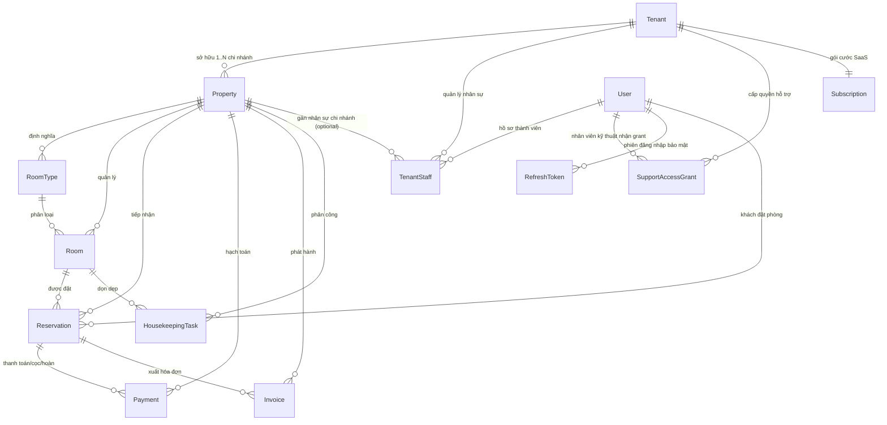
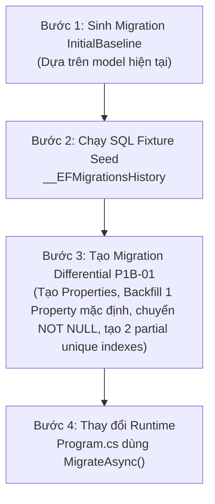

# P1A — Thiết kế Nền tảng Doanh nghiệp, Chi nhánh, Membership & Phân quyền

> **Tài liệu:** P1A-SDD-Foundation | **Phiên bản:** 2.1 (Cập nhật chuẩn hóa toàn diện theo Reviewer Findings — 2026-10-06)  
> **Nguyên tắc cốt lõi:** Thiết kế trước, chưa triển khai code nghiệp vụ; bảo toàn mã nguồn và tài liệu hiện có; giữ vững Modular Monolith; tuyệt đối không sửa code hay chạy migration trong đợt này.

---

## 1. Phân định Quyết định Đã Duyệt vs Tham số Đang Mở

Để đảm bảo tính minh bạch tuyệt đối và tuân thủ chặt chẽ quản trị dự án, các nội dung kỹ thuật được phân định rõ ràng thành hai nhóm:

### 1.1. Quyết định Đã Duyệt (Ground Truth từ P0 & SRS/SDD)
1. **Mô hình Doanh nghiệp – Chi nhánh:** `Tenant` là doanh nghiệp/pháp nhân kinh doanh; `Property` là chi nhánh/khách sạn vật lý. Khách sạn độc lập có đúng 1 `Property` mặc định.
2. **Tài khoản cá nhân duy nhất:** Không dùng tài khoản chung. Người dùng (`User`) sở hữu một danh tính toàn cục và được phân quyền theo từng doanh nghiệp hoặc từng chi nhánh qua hồ sơ thành viên `TenantStaff`.
3. **Phân cấp quản trị:** `Tenant Owner/Admin` quản lý toàn chuỗi chi nhánh; Quản lý/nhân viên chi nhánh chỉ thao tác trong phạm vi chi nhánh được giao.
4. **Chính sách Fail-Closed tuyệt đối:** Mọi truy vấn trên tài nguyên Property-scoped khi thiếu `TenantId` hoặc `PropertyId` đều phải bị từ chối ngay lập tức (`HTTP 400 Bad Request` hoặc `HTTP 403 Forbidden`). Không bao giờ fallback sang mở toàn bộ dữ liệu.
5. **Bảo vệ dữ liệu khách hàng (Platform Zero-Trust — D24):** Quản trị viên nền tảng (`PlatformSuperAdmin`) không có quyền mặc định đọc dữ liệu vận hành. Quyền hỗ trợ chỉ được kích hoạt khi Tenant Owner cấp `SupportAccessGrant` có thời hạn, phạm vi và lý do rõ ràng.
6. **Thẩm quyền Duyệt Hoàn tiền (D23):** Lễ tân (`Receptionist`) chỉ được tạo yêu cầu hoàn tiền (`PAYMENTS:Create`, bitmask 2). Chỉ **`Property Manager`** (bitmask 51) hoặc **`Tenant Owner / Admin`** (bitmask 127) mới có quyền duyệt hoàn tiền (`PAYMENTS:Approve`, bitmask 16). **`Tenant Accountant` bị loại hoàn toàn khỏi quyền duyệt hoàn tiền** (chỉ có quyền `33 = Read 1 + Export 32` để đối soát và xuất báo cáo).
7. **Khung giờ Nhận phòng & Timestamps (D06, D11):** Giờ nhận phòng mặc định theo đêm là **12:00** (thay cho mốc 14:00 cũ), trả phòng 12:00 ngày kế tiếp. Bảng `Reservation` lưu mốc thời gian thực theo chuẩn UTC (`StartAtUtc`, `EndAtUtc`, `StayType`), chuyển đổi sang local date (`CheckInDate`, `CheckOutDate`) theo timezone cơ sở (Asia/Ho_Chi_Minh).
8. **Phân loại Dữ liệu Bảo vệ:** `RefreshToken` (quản lý phiên xác thực, chống tấn công đánh cắp phiên) được phân loại vào `[Protected / Security Data]`. `Notification` (chứa PII, mã đặt phòng, cảnh báo nội bộ) được phân loại vào `[Protected / User Data]`.

### 1.2. Các Tham số & Quy tắc Đang Mở (Open Decisions theo p0-decisions.md)
1. **Quy tắc D14 (Mức trần thời gian thuê theo giờ):** Theo `docs/p0-decisions.md`, Product Owner **chưa chốt mức giới hạn thuê giờ** (không tự ý đặt 6h, 12h hay 24h). **Hệ thống KHÔNG tự ý áp dụng quy tắc sau 6 giờ đổi sang giá ngày**. Tham số này sẽ được cấu hình linh hoạt theo policy từng cơ sở hoặc chờ PO quyết định chính thức trước khi làm logic tính giá ở Phase P2/P3.
2. **Quy tắc Biểu giá Phụ thu (D19):** Biểu phí nhận phòng sớm / trả phòng muộn theo giờ và qua đêm tiếp tục chờ cấu hình chi tiết từ cơ sở lưu trú.
3. **Quy tắc Midpoint Rounding (D25):** Quy tắc làm tròn số tiền lẻ VND (làm tròn 1 đồng) cần chốt contract cụ thể trước khi cài đặt.

---

## 2. Thống nhất Mô hình Dữ liệu (ERD), Timestamps & Phân loại Scopes

### 2.1. Ma trận Phân định 6 Phạm vi Dữ liệu (Scopes)
| Phạm vi (Scope) | Định nghĩa & Nguyên tắc Cách ly | Danh sách Thực thể |
|---|---|---|
| **`[Platform / System]`** | Toàn bộ nền tảng SaaS dùng chung; chỉ luồng hệ thống hoặc SuperAdmin truy cập quản trị. | `User`, `AccessRole`, `PermissionFunction`, `RolePermission`, `SubscriptionPlan`, `SystemBanner`, `PlatformSupportRecipientAllowlist` |
| **`[Tenant-wide]`** | Cấp Doanh nghiệp / Pháp nhân sở hữu; quản lý gói cước và toàn chuỗi chi nhánh. | `Tenant`, `TenantStaff` (khi `PropertyId IS NULL`), `Subscription`, `SubscriptionPayment`, `SupportAccessGrant` |
| **`[Property-scoped]`** | Cấp Chi nhánh khách sạn vật lý; bắt buộc có `PropertyId`. Thiếu context -> **Fail-Closed**. | `Property`, `TenantStaff` (khi `PropertyId IS NOT NULL`), `RoomType`, `RoomTypeRate`, `Room`, `Reservation`, `Payment`, `Invoice`, `InvoiceItem`, `HousekeepingTask`, `GuestReview`, `Promotion` |
| **`[Protected / Security Data]`**| Dữ liệu bảo mật nhạy cảm cao; kiểm soát phiên xác thực, mã hóa và bảo vệ nghiêm ngặt. | `RefreshToken` (Quản lý phiên đăng nhập, chống chiếm đoạt tài khoản) |
| **`[Protected / User Data]`**    | Dữ liệu thông tin cá nhân và thông báo riêng tư của người dùng; cách ly theo User/Tenant. | `Notification` (Chứa PII, mã đơn đặt phòng, cảnh báo phân công việc) |
| **`[Public / Ephemeral]`**       | Dữ liệu công khai cho khách tra cứu hoặc dữ liệu viễn trắc/nhật ký nặc danh. | Danh mục phòng xuất bản, Đánh giá công khai (`GuestReview`), `AiUsageLog` (Telemetry nặc danh) |

### 2.2. ERD Chi nhánh, Phòng, Đặt phòng & Thanh toán


### 2.3. Cấu trúc Thực thể Chuẩn hóa (Entity Contracts)
- **`Property`:** `Id` (UUID PK), `TenantId` (UUID FK), `Name` (varchar), `Code` (varchar, Unique per Tenant), `Slug` (varchar, Unique global), `CheckInTime` (time, default 12:00 theo D06), `CheckOutTime` (time, default 12:00), `BufferMinutes` (int, default 30, min 30 theo D07), `Status` (Active, Maintenance, Closed).
- **`Reservation`:** `Id` (UUID PK), `TenantId` (UUID FK), `PropertyId` (UUID FK), `RoomId` (UUID FK), `StartAtUtc` (datetime UTC), `EndAtUtc` (datetime UTC), `StayType` (enum: Hourly = 1, Overnight = 2 theo D11/D04), `CheckInDate` (date local), `CheckOutDate` (date local), `TotalAmount` (decimal), `Currency` (char(3) = "VND"), `PricingSnapshot` (jsonb bất biến), `ConfirmationCode` (varchar(6), Unique per Property), `Status` (PendingPayment, Confirmed, CheckedIn, CheckedOut, Cancelled, NoShow).
- **`Payment`:** `Id` (UUID PK), `TenantId` (UUID FK), `PropertyId` (UUID FK), `ReservationId` (UUID FK), `Amount` (decimal), `Method` (Cash, BankTransfer, VNPay, CreditCard), `Status` (Pending, Completed, Failed, Refunded), `IdempotencyKey` (varchar, Unique), `RefundApprovedById` (UUID FK nullable - **Chỉ Owner/Admin hoặc Manager theo D23; Accountant KHÔNG có quyền**), `RefundReason` (text nullable), `PaidAtUtc` (datetime UTC nullable).

---

## 3. Hoàn thiện Cơ chế Membership Đa Chi nhánh & Quản lý Ngữ cảnh (Context)

### 3.1. Thiết kế Membership Đa Chi nhánh (`TenantStaff`)
Một người dùng (`User`) sở hữu một danh tính toàn cục duy nhất. Quan hệ giữa người dùng và doanh nghiệp/chi nhánh được quản lý qua thực thể `TenantStaff`:
- `TenantId` (UUID, NOT NULL): Doanh nghiệp chủ quản.
- `UserId` (UUID, NOT NULL): Tài khoản người dùng.
- `PropertyId` (UUID, NULLABLE):
  - `PropertyId IS NULL`: Phân quyền cấp **Doanh nghiệp (Tenant-wide)**. Áp dụng cho: `Owner`, `Admin`, `Tenant Accountant`. Có hiệu lực xuyên suốt toàn bộ các chi nhánh trực thuộc Tenant.
  - `PropertyId IS NOT NULL`: Phân quyền cấp **Chi nhánh cụ thể (Property-scoped)**. Áp dụng cho: `Property Manager`, `Receptionist`, `Housekeeper`. Chỉ có hiệu lực duy nhất tại chi nhánh được chỉ định.
- `RoleId` (UUID, NOT NULL): Vai trò RBAC tương ứng.
- `IsActive` (bool): Trạng thái kích hoạt của nhân sự.

#### Ràng buộc Chỉ mục Duy nhất (Partial Unique Indexes DDL):
```sql
-- 1. Mỗi người dùng chỉ có tối đa 1 vai trò Tenant-wide trên một Doanh nghiệp
CREATE UNIQUE INDEX uq_tenant_staff_tenant_wide
ON "TenantStaffMembers" ("TenantId", "UserId")
WHERE "PropertyId" IS NULL;

-- 2. Mỗi người dùng chỉ có tối đa 1 vai trò trên mỗi Chi nhánh cụ thể
CREATE UNIQUE INDEX uq_tenant_staff_property_scoped
ON "TenantStaffMembers" ("TenantId", "UserId", "PropertyId")
WHERE "PropertyId" IS NOT NULL;
```

#### Quy tắc Nghiệp vụ Membership:
- Không cho phép gán trùng vai trò trên cùng một chi nhánh (chặn bằng `uq_tenant_staff_property_scoped`, ném `409 Conflict` `ERR_MEMBERSHIP_DUPLICATE_BRANCH`).
- Không cho phép gán vai trò chi nhánh lẻ nếu người dùng đã có quyền cấp Tenant-wide.
- Kiểm tra tính toàn vẹn: Bắt buộc `Property.TenantId == TenantStaff.TenantId`. Nếu sai lệch ném lỗi `403 Forbidden` (`ERR_PROPERTY_NOT_IN_TENANT`).

### 3.2. Thứ tự Ưu tiên Ngữ cảnh & Xử lý Xung đột Header vs JWT
1. **Trường hợp Token chứa `propertyId`:**
   - Client gửi header `X-Property-Id`:
     - Nếu `header.X-Property-Id == jwt.propertyId`: Hợp lệ.
     - Nếu `header.X-Property-Id != jwt.propertyId`: **FAIL-CLOSED NGAY LẬP TỨC**, trả HTTP 400 Bad Request với mã lỗi `ERR_CONTEXT_MISMATCH`. Tuyệt đối không tự ý ghi đè hay chọn một trong hai.
2. **Trường hợp Token là Tenant-wide (`propertyId` trong JWT là NULL):**
   - Áp dụng khi Tenant Owner hoặc Tenant Admin đang đăng nhập và gọi API thuộc Property-scoped:
   - Client **BẮT BUỘC** phải truyền header `X-Property-Id: <Guid>`.
   - Backend thẩm định `X-Property-Id` có thuộc `TenantId` trong token hay không:
     - Nếu thuộc: Thiết lập context `ICurrentPropertyService.PropertyId = X-Property-Id`.
     - Nếu không thuộc: Trả HTTP 403 với mã lỗi `ERR_PROPERTY_NOT_IN_TENANT`.
3. **Trường hợp API Property-scoped nhưng thiếu cả Claim lẫn Header:**
   - Trả HTTP 400 Bad Request với mã lỗi `ERR_MISSING_PROPERTY_CONTEXT`.
4. **Chuyển đổi Ngữ cảnh Rõ ràng (Explicit Context Switching):**
   - Client gọi `POST /api/v1/auth/switch-context` kèm `{ "targetPropertyId": "..." }`.
   - Backend kiểm tra tính hợp lệ và trạng thái hoạt động của nhân sự tại chi nhánh đó, cấp phát JWT mới chứa claim `propertyId` và permissions được tính toán lại tương ứng.

---

## 4. Tách biệt Support Recipient Allowlist & Support Action Allowlist (Zero-Trust)

### 4.1. Thiết kế Bãi bỏ SuperAdmin Bypass
- **Lưu ý hiện trạng:** Trong file [`PermissionAuthorizationHandler.cs`](file:///C:/Dev/hotel-saas-v2/backend/src/HotelSaas.WebApi/Authorization/PermissionAuthorizationHandler.cs), tồn tại đoạn code tự động bypass permission cho `GlobalRole == SuperAdmin`.
- **Trạng thái P1A:** Nhóm kỹ thuật đã **thiết kế phương án bãi bỏ hoàn toàn SuperAdmin bypass** trên dữ liệu khách hàng.
- **Kế hoạch triển khai:** Việc xóa bỏ đoạn code bypass này sẽ được **thực hiện chính thức trong gói code P1B-01**. Trong đợt P1A này, toàn bộ tài liệu đã đồng bộ theo hướng Zero-Trust, **tuyệt đối chưa sửa code**.

### 4.2. Support Recipient Allowlist (Ai được phép nhận quyền hỗ trợ?)
Hệ thống duy trì danh mục nhân sự kỹ thuật / CSKH của Platform đã qua thẩm định lý lịch an ninh (`PlatformSupportRecipientAllowlist`):
- `UserId`: UUID nhân viên kỹ thuật (FK -> `User`).
- `StaffEmail`: Email nội bộ @hotelplatform.com.
- `Department`: Bộ phận kỹ thuật / CSKH (`L2_Support`, `L3_CoreEngineering`).
- `SecurityClearedAtUtc`: Thời điểm hoàn thành xác minh an ninh.
- `IsActive`: Trạng thái sẵn sàng tiếp nhận hỗ trợ.

> **Ràng buộc kiểm tra khi tạo Grant:** Khi Tenant Owner tạo grant (`POST /api/v1/tenants/current/support-grants`), trường `GrantedToUserId` **BẮT BUỘC** phải nằm trong `PlatformSupportRecipientAllowlist` và có `IsActive = true`. Nếu không, hệ thống từ chối ngay với mã lỗi `ERR_SUPPORT_USER_NOT_IN_ALLOWLIST` (400).

### 4.3. Support Action Allowlist (Được làm gì & Bị cấm những gì?)
Nhân sự hỗ trợ dù có grant hợp lệ cũng chỉ được thực thi các hành động nằm trong Action Allowlist tương ứng với `Scope` được cấp:

| Phạm vi Cấp quyền (`Scope`) | Các Hành động ĐƯỢC PHÉP (Action Allowlist) | Mục đích Kỹ thuật |
|---|---|---|
| **`READ_ONLY`** | • `GET /room-types`, `GET /room-types/{id}`<br/>• `GET /rooms`, `GET /rooms/{id}`<br/>• `GET /housekeeping`<br/>• `GET /reservations/{id}` (chỉ đọc thông tin đơn cần hỗ trợ) | Đọc cấu hình buồng phòng và thông tin booking cụ thể để giải thích thắc mắc hoặc hỗ trợ khách vận hành. |
| **`DIAGNOSTIC`** | • Toàn bộ quyền của `READ_ONLY`<br/>• `GET /telemetry/sync-logs` (nhật ký đồng bộ)<br/>• `GET /payments/{id}/metadata` (chỉ log mã phản hồi gateway, không có PII/thẻ)<br/>• `GET /audit-logs/system` | Chẩn đoán lỗi kỹ thuật, lỗi kết nối webhook cổng thanh toán hoặc xung đột dữ liệu. |

#### Danh mục Hành vi BỊ CẤM TUYỆT ĐỐI (Blacklisted Operations — Bất kể Scope):
Nhân viên Platform Support **KHÔNG BAO GIỜ** được thực hiện các thao tác sau:
1. ❌ **CẤM ĐỘT BIẾN NGHIỆP VỤ (No Mutation):** Nghiêm cấm tất cả các lệnh HTTP `POST`, `PUT`, `PATCH`, `DELETE` trên dữ liệu kinh doanh của khách: không tạo/sửa/hủy phòng, không tạo/hủy booking, không tạo hóa đơn.
2. ❌ **CẤM DUYỆT TÀI CHÍNH / HOÀN TIỀN (No Financial Actions):** Tuyệt đối cấm thao tác duyệt hoàn tiền (`POST /payments/{id}/refund`), xuất phiếu chi hoặc thay đổi trạng thái thanh toán.
3. ❌ **CẤM XUẤT DỮ LIỆU HÀNG LOẠT (No Bulk Export):** Bị chặn toàn bộ các API có bitmask `Export` (32) (VD: `/reports/export-excel`, `/invoices/monthly-summary`, `/customers/export`) để ngăn ngừa rò rỉ dữ liệu (data exfiltration).
4. ❌ **CẤM TRUY CẬP DỮ LIỆU BẢO MẬT & PII NHẠY CẢM:** Không được truy cập bảng `RefreshToken`, trường mật khẩu `PasswordHash`, mã cấu hình Secret Key cổng thanh toán hoặc danh sách nhân sự nội bộ (`/staff`).
5. ❌ **CẤM THAY ĐỔI CẤU HÌNH BẢO MẬT & TÀI KHOẢN:** Không được đổi thông tin chủ sở hữu, số tài khoản ngân hàng thụ hưởng hoặc thay đổi phân quyền nhân viên.

> **Cơ chế cưỡng chế (Enforcement):** Nếu nhân sự Support cố tình gọi endpoint ngoài Action Allowlist hoặc thuộc danh mục cấm, `SupportAuthorizationMiddleware` trả về **`403 Forbidden`** với mã lỗi `ERR_SUPPORT_ACTION_NOT_PERMITTED` và kích hoạt cảnh báo an ninh nội bộ.

### 4.4. Cơ chế Thu hồi Tức thì (Real-time Revocation Enforcement)
- Request của Platform Support **BẮT BUỘC** phải truyền header `X-Support-Grant-Id: <Guid>`.
- `SupportAuthorizationMiddleware` kiểm tra trạng thái grant trong Database/Distributed Cache (Redis) trên **TỪNG REQUEST**:
  - Nếu `RevokedAtUtc != null`: Chặn ngay lập tức với HTTP 403 `ERR_SUPPORT_GRANT_REVOKED`.
  - Nếu `ExpiresAtUtc < DateTime.UtcNow`: Chặn với HTTP 403 `ERR_SUPPORT_GRANT_EXPIRED`.
- Mọi request thực hiện dưới Support Grant đều được ghi vết Audit Log bất biến (`SupportAuditLogs`: GrantId, ActorUserId, Endpoint, Method, ActionName, ClientIp, RequestPayload, Timestamp).

---

## 5. Thiết kế Gói Triển khai P1B-01: Multi-Property Foundation & Migration Fixture

Để kiểm soát rủi ro và tuân thủ nguyên tắc triển khai theo đợt nhỏ, giai đoạn P1B được chia thành các gói nhỏ, bắt đầu với **Gói P1B-01**:

### 5.1. Phạm vi (Scope) của Gói P1B-01
- **Domain Entities & Interfaces:**
  - Tạo `IPropertyScopedEntity.cs` (`public Guid PropertyId { get; set; }`).
  - Tạo entity `Property.cs` (Kế thừa `BaseEntity, ITenantScopedEntity`).
  - Tạo entity `SupportAccessGrant.cs` và `PlatformSupportRecipientAllowlist.cs`.
  - Thêm property `PropertyId` (nullable trong giai đoạn chuyển đổi) vào các entity: `Room.cs`, `RoomType.cs`, `Reservation.cs`, `Payment.cs`, `TenantStaff.cs`.
- **Context & Middleware:**
  - Tạo `ICurrentPropertyService` và `CurrentPropertyService`.
  - Nâng cấp `TenantMiddleware` để xử lý header `X-Property-Id` và `X-Support-Grant-Id`.
  - Tạo `PropertyScopeValidationBehavior` trong MediatR pipeline.
  - Tạo `SupportAuthorizationMiddleware` để thực thi Recipient Allowlist, Action Allowlist và Real-time Revocation.
  - **Loại bỏ đoạn code bypass SuperAdmin** trong `PermissionAuthorizationHandler.cs`.
- **Web API Endpoints:**
  - `PropertiesController.cs`: CRUD chi nhánh (chỉ dành cho Tenant Owner/Admin).
  - `AuthController.cs`: Bổ sung endpoint `POST /api/v1/auth/switch-context`.
  - `SupportGrantsController.cs`: Cấp và thu hồi quyền hỗ trợ.

### 5.2. Kế hoạch Migration Fixture (Chuyển đổi An toàn từ EnsureCreated)
Dự án hiện tại gọi `EnsureCreatedAsync()` trong `Program.cs` và chưa có thư mục `Migrations/`. Để chuyển đổi sang EF Core Migrations mà không bị lỗi PostgreSQL `42P07: relation already exists`, kế hoạch fixture gồm 4 bước:



#### Chi tiết SQL Fixture Seed `__EFMigrationsHistory` (Bước 2):
```sql
CREATE TABLE IF NOT EXISTS "__EFMigrationsHistory" (
    "MigrationId" character varying(150) NOT NULL CONSTRAINT "PK___EFMigrationsHistory" PRIMARY KEY,
    "ProductVersion" character varying(32) NOT NULL
);

-- Đánh dấu InitialBaseline đã được áp dụng cho DB hiện tại
INSERT INTO "__EFMigrationsHistory" ("MigrationId", "ProductVersion")
VALUES ('20261006000000_InitialBaseline', '10.0.12')
ON CONFLICT DO NOTHING;
```

#### Chi tiết Script Backfill trong Migration P1B-01 (Bước 3):
```csharp
// Trong migration Up():
// 1. Tạo bảng Properties
migrationBuilder.CreateTable(name: "Properties", ...);

// 2. Backfill 1 Property mặc định cho mỗi Tenant hiện hữu
migrationBuilder.Sql(@"
    INSERT INTO ""Properties"" (""Id"", ""TenantId"", ""Name"", ""Code"", ""Slug"", ""Address"", ""City"", ""CheckInTime"", ""CheckOutTime"", ""BufferMinutes"", ""IsPublished"", ""Status"", ""CreatedAtUtc"", ""UpdatedAtUtc"")
    SELECT 
        gen_random_uuid(),
        t.""Id"",
        CONCAT(t.""Name"", ' - Chi nhánh chính'),
        'MAIN',
        CONCAT(t.""Slug"", '-main'),
        COALESCE(t.""Address"", 'Chưa cập nhật địa chỉ'),
        'Hà Nội',
        '12:00:00'::time,
        '12:00:00'::time,
        30,
        true,
        1,
        NOW() AT TIME ZONE 'UTC',
        NOW() AT TIME ZONE 'UTC'
    FROM ""Tenants"" t
    WHERE NOT EXISTS (SELECT 1 FROM ""Properties"" p WHERE p.""TenantId"" = t.""Id"");
");

// 3. Thêm cột PropertyId nullable vào các bảng con
migrationBuilder.AddColumn<Guid>(name: "PropertyId", table: "Rooms", nullable: true);
migrationBuilder.AddColumn<Guid>(name: "PropertyId", table: "RoomTypes", nullable: true);
migrationBuilder.AddColumn<Guid>(name: "PropertyId", table: "Reservations", nullable: true);
migrationBuilder.AddColumn<Guid>(name: "PropertyId", table: "Payments", nullable: true);
migrationBuilder.AddColumn<Guid>(name: "PropertyId", table: "TenantStaffMembers", nullable: true);

// 4. Backfill PropertyId từ Property mặc định vừa tạo
migrationBuilder.Sql(@"
    UPDATE ""Rooms"" r SET ""PropertyId"" = (SELECT p.""Id"" FROM ""Properties"" p WHERE p.""TenantId"" = r.""TenantId"" LIMIT 1);
    UPDATE ""RoomTypes"" rt SET ""PropertyId"" = (SELECT p.""Id"" FROM ""Properties"" p WHERE p.""TenantId"" = rt.""TenantId"" LIMIT 1);
    UPDATE ""Reservations"" res SET ""PropertyId"" = (SELECT p.""Id"" FROM ""Properties"" p WHERE p.""TenantId"" = res.""TenantId"" LIMIT 1);
    UPDATE ""Payments"" pay SET ""PropertyId"" = (SELECT res.""PropertyId"" FROM ""Reservations"" res WHERE res.""Id"" = pay.""ReservationId"");
");

// 5. Chuyển PropertyId thành NOT NULL (trừ TenantStaffMembers cho phép NULL nếu là Tenant-wide)
migrationBuilder.AlterColumn<Guid>(name: "PropertyId", table: "Rooms", nullable: false);
migrationBuilder.AlterColumn<Guid>(name: "PropertyId", table: "RoomTypes", nullable: false);
migrationBuilder.AlterColumn<Guid>(name: "PropertyId", table: "Reservations", nullable: false);
migrationBuilder.AlterColumn<Guid>(name: "PropertyId", table: "Payments", nullable: false);

// 6. Tạo Khóa ngoại (Foreign Keys)
migrationBuilder.AddForeignKey(name: "FK_Rooms_Properties_PropertyId", table: "Rooms", column: "PropertyId", principalTable: "Properties", principalColumn: "Id", onDelete: ReferentialAction.Cascade);
migrationBuilder.AddForeignKey(name: "FK_RoomTypes_Properties_PropertyId", table: "RoomTypes", column: "PropertyId", principalTable: "Properties", principalColumn: "Id", onDelete: ReferentialAction.Cascade);

// 7. Tạo 2 Partial Unique Indexes cho TenantStaffMembers
migrationBuilder.Sql(@"
    CREATE UNIQUE INDEX uq_tenant_staff_tenant_wide ON ""TenantStaffMembers"" (""TenantId"", ""UserId"") WHERE ""PropertyId"" IS NULL;
    CREATE UNIQUE INDEX uq_tenant_staff_property_scoped ON ""TenantStaffMembers"" (""TenantId"", ""UserId"", ""PropertyId"") WHERE ""PropertyId"" IS NOT NULL;
");
```

---

## 6. Kế hoạch Kiểm thử Toàn diện cho Gói P1B-01 (Test Plan & Matrix)

### 6.1. Ma trận Kiểm thử Âm tính (Negative Test Matrix)
| Mã Test | Phân hệ | Tình huống kiểm thử âm tính | Dữ liệu đầu vào giả định | Kết quả mong đợi (Expected) | Cơ chế bảo vệ kỹ thuật |
|---|---|---|---|---|---|
| **TC-MB-01** | Membership | Gán trùng 1 user vào cùng 1 chi nhánh | 2 bản ghi `TenantStaff` cùng `(TenantId, UserId, PropertyId)` | `409 Conflict`<br/>`ERR_MEMBERSHIP_DUPLICATE_BRANCH` | Bắt lỗi từ index `uq_tenant_staff_property_scoped` |
| **TC-MB-02** | Membership | Tạo 2 bản ghi Tenant-wide cho cùng 1 user | 2 bản ghi `TenantStaff` cùng `(TenantId, UserId)` với `PropertyId = null` | `409 Conflict`<br/>`ERR_MEMBERSHIP_DUPLICATE_TENANT_WIDE`| Bắt lỗi từ index `uq_tenant_staff_tenant_wide` |
| **TC-MB-03** | Membership | Gán nhân viên vào chi nhánh của doanh nghiệp khác | `TenantId = Tenant_A`, `PropertyId = Prop_B` (thuộc `Tenant_B`) | `403 Forbidden`<br/>`ERR_PROPERTY_NOT_IN_TENANT` | `PropertyScopeValidationBehavior` kiểm tra ownership |
| **TC-MB-04** | Membership | Nhân viên bị vô hiệu hóa cố tình gọi API | `TenantStaff.IsActive = false` gọi API Property | `403 Forbidden`<br/>`ERR_MEMBERSHIP_INACTIVE` | Chặn tại `PermissionAuthorizationHandler` |
| **TC-CTX-01** | Context | Header `X-Property-Id` mâu thuẫn với JWT claim `propertyId` | JWT `propertyId = Prop_A`, Header `X-Property-Id = Prop_B` | `400 Bad Request`<br/>`ERR_CONTEXT_MISMATCH` | `TenantMiddleware` so khớp và fail-closed |
| **TC-CTX-02** | Context | Gọi API Property-scoped nhưng thiếu cả header lẫn claim | Token Tenant-wide gọi `GET /api/v1/rooms` không truyền `X-Property-Id` | `400 Bad Request`<br/>`ERR_MISSING_PROPERTY_CONTEXT` | Pipeline behavior kiểm tra `ICurrentPropertyService` |
| **TC-CTX-03** | Context | Truy cập chi nhánh trái phép không được phân công | User có quyền tại Prop_A gửi request với header `X-Property-Id = Prop_B` | `403 Forbidden`<br/>`ERR_FORBIDDEN_PROPERTY_SCOPE` | Handler thẩm định membership của user trên Prop_B |
| **TC-SUP-01** | Support | Platform Staff gọi API khách hàng thiếu header grant | Platform SuperAdmin gọi `GET /api/v1/rooms` không truyền `X-Support-Grant-Id` | `403 Forbidden`<br/>`ERR_SUPPORT_GRANT_REQUIRED` | Bãi bỏ SuperAdmin bypass, chặn tại `SupportAuthorizationMiddleware` |
| **TC-SUP-02** | Support | Cấp grant cho nhân viên ngoài Recipient Allowlist | `POST /support-grants` với `GrantedToUserId` không có trong allowlist | `400 Bad Request`<br/>`ERR_SUPPORT_USER_NOT_IN_ALLOWLIST`| Thẩm định tại command validator |
| **TC-SUP-03** | Support | Support Staff gọi API nằm ngoài Action Allowlist | Support Staff gọi `POST /api/v1/rooms` (Mutation) | `403 Forbidden`<br/>`ERR_SUPPORT_ACTION_NOT_PERMITTED` | Kiểm tra Action Allowlist & Blacklisted Operations |
| **TC-SUP-04** | Support | Support Staff cố tình gọi API Export hàng loạt | Support Staff gọi `GET /api/v1/invoices/monthly-summary` | `403 Forbidden`<br/>`ERR_SUPPORT_ACTION_NOT_PERMITTED` | Chặn hành động có bitmask `Export` (32) |
| **TC-SUP-05** | Support | Sử dụng grant đã bị Tenant Owner thu hồi | Header `X-Support-Grant-Id` có `RevokedAtUtc != null` | `403 Forbidden`<br/>`ERR_SUPPORT_GRANT_REVOKED` | Middleware kiểm tra DB/Cache realtime trên từng request |
| **TC-REF-01** | Financial | Kế toán doanh nghiệp (`Accountant`) duyệt hoàn tiền | Accountant gọi `POST /api/v1/payments/{id}/refund` | `403 Forbidden`<br/>`ERR_FORBIDDEN_INSUFFICIENT_PERMISSIONS`| Accountant chỉ có bitmask 33, thiếu Approve (16) theo D23 |
| **TC-REF-02** | Financial | Lễ tân (`Receptionist`) tự ý duyệt hoàn tiền | Receptionist gọi `POST /api/v1/payments/{id}/refund` | `403 Forbidden`<br/>`ERR_FORBIDDEN_INSUFFICIENT_PERMISSIONS`| Lễ tân chỉ có bitmask 3, thiếu Approve (16) theo D23 |
| **TC-MIG-01** | Migration | Chạy migration trên DB EnsureCreated có sẵn dữ liệu | Khởi chạy `MigrateAsync()` sau khi nạp SQL Fixture Baseline | Migration thành công 100%, không bị lỗi `42P07` | Kiểm chứng `__EFMigrationsHistory` fixture |
| **TC-MIG-02** | Migration | Kiểm chứng dữ liệu sau backfill chi nhánh mặc định | Kiểm tra phòng cũ sau migration | Tất cả phòng cũ đều có `PropertyId` hợp lệ trỏ về chi nhánh chính |

### 6.2. Cam kết Thực hiện
- **Không sửa bất kỳ dòng code ứng dụng (.cs, .ts) nào** trong giai đoạn P1A.
- Gói P1B-01 đã được chuẩn bị đầy đủ về spec, migration fixture và test matrix. Toàn bộ việc tạo file code mới và sửa code chỉ được tiến hành sau khi Reviewer chính thức phê duyệt gói này.
