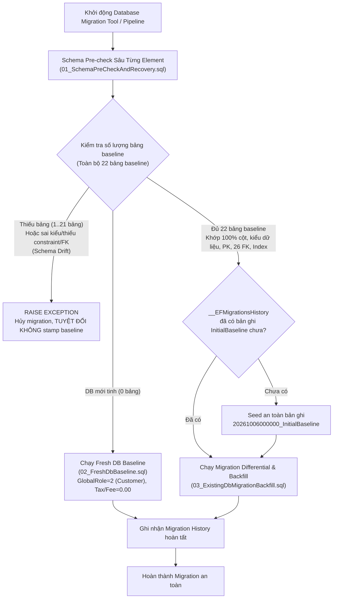

# Kế hoạch Kỹ thuật Migration P1B-01A: Multi-Property Foundation & Data Isolation Baseline

> **Giai đoạn:** P1B-01A (Thiết kế Kế hoạch Migration, SQL Fixtures & Tests trong Môi trường Test Cô lập)  
> **Phiên bản:** 1.2 | **Ngày cập nhật:** 2026-10-06  
> **Phạm vi nghiêm ngặt:** Chỉ chuẩn bị kế hoạch migration, SQL fixtures và unit/fixture/integration tests trên database cô lập; tuyệt đối không triển khai support/API/UI, không sửa `Program.cs` (startup), không chạy migration trên database đang dùng (`hotel_saas_dev`).

---

## 1. Kiến trúc Dual Baseline Strategy (DB Mới vs DB Cũ)

Dự án hiện tại gặp bài toán chuyển đổi: cơ sở dữ liệu môi trường phát triển trước đây được khởi tạo bằng phương thức `Database.EnsureCreatedAsync()`, dẫn đến việc:
1. Đã có sẵn các bảng vật lý (`Tenants`, `Users`, `Rooms`, `Reservations`, v.v.).
2. Hoàn toàn chưa có bảng theo dõi lược đồ `__EFMigrationsHistory`.
3. Nếu chạy lệnh `dotnet ef database update` thông thường, PostgreSQL sẽ báo lỗi nghiêm trọng `42P07: relation "Users" already exists`.

Để giải quyết bài toán này mà không làm gián đoạn hệ thống và áp dụng được cho cả môi trường CI/CD lẫn Production sau này, kiến trúc migration P1B-01A sử dụng chiến lược **Dual Baseline Architecture**:



---

## 2. Kịch bản Pre-Check & Recovery (Kiểm chứng Sâu Từng Schema Element, Bỏ Auto-Stamp)

Script [`01_SchemaPreCheckAndRecovery.sql`](file:///C:/Dev/hotel-saas-v2/backend/tests/HotelSaas.Application.Tests/Fixtures/P1B01A/01_SchemaPreCheckAndRecovery.sql) đóng vai trò chốt chặn an toàn (Idempotent Guard) trước khi bất kỳ lệnh DDL nào được thực thi:

1. **Khởi tạo Bảng Lịch sử:**
   ```sql
   CREATE TABLE IF NOT EXISTS "__EFMigrationsHistory" (
       "MigrationId" character varying(150) NOT NULL CONSTRAINT "PK___EFMigrationsHistory" PRIMARY KEY,
       "ProductVersion" character varying(32) NOT NULL
   );
   ```
2. **Kiểm chứng Chi tiết Từng Schema Element Qua Manifest Baseline EF Core Cố Định (100% Fidelity):**
   - **Tồn tại Toàn bộ 22 Bảng Baseline:** `Tenants`, `Users`, `AccessRoles`, `PermissionFunctions`, `RolePermissions`, `TenantStaffMembers`, `RefreshTokens`, `RoomTypes`, `Rooms`, `Reservations`, `Payments`, `Subscriptions`, `SubscriptionPayments`, `Invoices`, `InvoiceItems`, `HousekeepingTasks`, `Notifications`, `Promotions`, `GuestReviews`, `AiUsageLogs`, `SubscriptionPlans`, `SystemBanners`.
   - **Đối Chiếu 100% 134 Cột Vật Lý Thuộc 22 Bảng Baseline Qua `v_column_manifest`:**
     - Không sử dụng danh sách tên cột thủ công hay chỉ kiểm tra 8 cột lẻ tẻ.
     - Kiểm tra toàn bộ 134 cột với đầy đủ 8 thuộc tính metadata đối chiếu với `information_schema.columns`:
       1. `table_name`
       2. `column_name`
       3. `data_type` (uuid, text, integer, numeric, boolean, timestamp with time zone, time without time zone, date, double precision)
       4. `is_nullable` ('YES' / 'NO')
       5. `character_maximum_length`
       6. `numeric_precision`
       7. `numeric_scale`
       8. `column_default`
     - Bất kỳ cột nào sai lệch kiểu dữ liệu hoặc nullability (kể cả ngoài 8 cột cốt lõi cũ, ví dụ `Users.Email`) đều kích hoạt abort ngay lập tức.
   - **Ràng buộc Khóa chính (Primary Key):** Xác thực 22/22 bảng đều có định nghĩa `PRIMARY KEY ("Id")` (`contype = 'p'`).
   - **Ràng buộc Khóa ngoại Toàn diện (26 Foreign Keys) Khớp Cả Delete Action và Target Schema:**
     - Xác thực bảng nguồn, cột nguồn, bảng đích, cột đích, schema đích (`cl_dst.relnamespace = current_schema()`), và hành vi `ON DELETE` (`confdeltype`):
       - 5 FK có `confdeltype = 'a'` (`NO ACTION`): `AccessRoles.TenantId`, `AiUsageLogs.UserId`, `HousekeepingTasks.AssignedToId`, `Reservations.GuestUserId`, `Users.TenantId`.
       - 21 FK có `confdeltype = 'c'` (`CASCADE`): các khóa ngoại còn lại.
     - Phát hiện ngay lập tức nếu FK trỏ chéo schema hoặc bị thay đổi hành vi xóa.
   - **Chỉ mục Duy nhất Cố định (22 PK Unique Indexes):**
     - Xác thực toàn bộ 22 bảng baseline đều có chỉ mục duy nhất `PK_<TableName>` trên cột `("Id")` do EF Core và PostgreSQL tạo ra.
   - **Toàn bộ 26 Chỉ mục Độc lập Thực tế (Non-PK Independent Indexes) Qua `v_index_manifest` Chuẩn Hóa:**
     - Không dùng PK index để đại diện cho index độc lập; không so khớp substring lỏng lẻo.
     - Đối chiếu catalog `pg_index` + `pg_class` + `pg_am` với định nghĩa chuẩn hóa schema gồm:
       1. **Method (`amname`):** btree, hash, v.v.
       2. **Tính duy nhất (`indisunique`):** 'YES' / 'NO'.
       3. **Key/Include columns:** Danh sách cột index sau khi loại bỏ tiền tố method và mệnh đề WHERE.
       4. **Predicate (`indpred`):** Biểu thức WHERE nếu là partial index (hoặc 'NONE' nếu là normal full index).
       5. **Chuẩn hóa DDL (`pg_get_indexdef`):** Loại bỏ tiền tố schema để so khớp độc lập tên schema.
     - Xóa, đổi định nghĩa, đổi access method, hoặc chuyển đổi thành partial index đều kích hoạt fail-fast abort và rollback.
   - **Quy tắc Phân luồng An toàn:**
     - Nếu số bảng = 0: DB mới tinh $\rightarrow$ Nhường quyền cho `02_FreshDbBaseline.sql`.
     - Nếu phát hiện thiếu bất kỳ bảng nào, thiếu cột (kể cả ngoài 8 cột), mất unique index, mất hoặc đổi non-PK index, sai kiểu dữ liệu/nullability, FK sai schema, hoặc FK đổi delete action: $\rightarrow$ `RAISE EXCEPTION [PRE-CHECK ABORT]` và hủy transaction ngay, tuyệt đối không stamp `InitialBaseline`.
     - Chỉ khi 100% cấu trúc schema được kiểm chứng hợp lệ: $\rightarrow$ mới seed bản ghi `20261006000000_InitialBaseline`.

---

## 3. Kịch bản Backfill Membership theo Role & Fail-fast với Unknown Role

Yêu cầu then chốt của Reviewer là **không được gán bừa bãi `PropertyId` cho toàn bộ nhân sự**, và phải fail-fast nếu gặp role không xác định:

### 3.1. Phân định Vai trò Doanh nghiệp vs Chi nhánh
| Nhóm Quyền | Danh mục Vai trò (`StaffRole`) | Giá trị `PropertyId` sau Backfill | Căn cứ Pháp lý & Kỹ thuật |
|---|---|:---:|---|
| **Cấp Doanh nghiệp (Tenant-wide)** | • `Owner` (`StaffRole = 1`) | **`NULL`** | Quản trị toàn bộ các chi nhánh thuộc Tenant; chịu sự kiểm soát của partial unique index `uq_tenant_staff_tenant_wide`. |
| **Cấp Chi nhánh (Property-scoped)** | • `Manager` (`StaffRole = 2`)<br/>• `Receptionist` (`StaffRole = 3`)<br/>• `Housekeeper` (`StaffRole = 4`) | **`DefaultPropertyId`** (Chi nhánh MAIN) | Chỉ tác nghiệp trong phạm vi chi nhánh cụ thể; chịu sự kiểm soát của partial unique index `uq_tenant_staff_property_scoped`. |

### 3.2. Chốt chặn Unknown Role & SQL Backfill:
```sql
-- 1. Kiểm tra role lạ trước khi cập nhật (Unknown Role Fail-fast)
DO $$
DECLARE
    v_unknown_role_count integer := 0;
BEGIN
    SELECT COUNT(*) INTO v_unknown_role_count
    FROM "TenantStaffMembers"
    WHERE "StaffRole" NOT IN (1, 2, 3, 4);

    IF v_unknown_role_count > 0 THEN
        RAISE EXCEPTION '[MIGRATION ABORT] Phát hiện % nhân sự có StaffRole không hợp lệ (không thuộc 1:Owner, 2:Manager, 3:Receptionist, 4:Housekeeper). Dừng toàn bộ migration.', v_unknown_role_count;
    END IF;
END $$;

-- 2. Gán PropertyId cho nhân sự cấp Chi nhánh (Manager, Receptionist, Housekeeper)
UPDATE "TenantStaffMembers" staff
SET "PropertyId" = p."Id"
FROM "Properties" p
WHERE p."TenantId" = staff."TenantId"
  AND p."Code" = 'MAIN'
  AND staff."PropertyId" IS NULL
  AND staff."StaffRole" IN (2, 3, 4);

-- 3. Đảm bảo nhân sự cấp Doanh nghiệp (Owner) giữ PropertyId là NULL
UPDATE "TenantStaffMembers" staff
SET "PropertyId" = NULL
WHERE staff."StaffRole" = 1;
```

---

## 4. Bảo toàn Địa điểm, Chính sách Thuế/Phí & Publication (Không Tự Thêm Thuế/Phí Bừa Bãi)

Khi backfill tự động tạo `Property` mặc định ("Chi nhánh chính", Code: `MAIN`) cho mỗi `Tenant`, hệ thống **kế thừa trung thực toàn vẹn dữ liệu từ hồ sơ Tenant hiện hữu**:

1. **Địa điểm & Tọa độ:**
   - Kế thừa trực tiếp: `Address`, `City`, `PhoneNumber`, `Email`, `PropertyType`, `StarRating`, `Latitude`, `Longitude`.
2. **Bảo toàn Trung thực Chính sách Thuế và Phí Dịch vụ:**
   - Tuyệt đối không tự ý áp đặt thuế 10% và phí 5%.
   - Nếu Tenant hiện tại đã có cấu hình thuế/phí cụ thể, script bảo toàn nguyên vẹn giá trị đó:
     `COALESCE(t."TaxRatePercent", 0.00)`, `COALESCE(t."ServiceFeeRatePercent", 0.00)`.
   - Đối với Fresh DB Baseline, giá trị mặc định là `0.00` (theo D25).
3. **Chính sách Khung giờ & Đệm Dọn phòng (D06, D07):**
   - Kế thừa trực tiếp `CheckInTime` và `CheckOutTime` từ Tenant (mặc định fallback `12:00:00` theo Quyết định D06).
   - `BufferMinutes`: Kế thừa hoặc mặc định `30` phút theo Quyết định D07.
4. **Bỏ Cơ Chế Tự Động Active $\rightarrow$ Published:**
   - Quyết định kiến trúc: Không tự động xuất bản (`IsPublished = true`) chi nhánh chỉ vì Tenant đang hoạt động (`Status = 2`).
   - Việc công bố chi nhánh ra bên ngoài là một hành động nghiệp vụ độc lập, có chủ đích và cần sự kiểm duyệt của doanh nghiệp.
   - Do đó, mọi chi nhánh được tạo mới trong `02_FreshDbBaseline.sql` cũng như được backfill trong `03_ExistingDbMigrationBackfill.sql` đều được thiết lập mặc định:
     `"IsPublished" = false`.

---

## 5. Kịch bản Mapping PropertyId Tường minh & Scope Constraint Validation

Hệ thống **loại bỏ triệt để mọi mệnh đề `LIMIT 1` tùy tiện**, thay thế bằng ánh xạ tường minh và kiểm tra ràng buộc phạm vi:

```sql
-- 1. Rooms: Ánh xạ tường minh qua TenantId và Code = 'MAIN'
UPDATE "Rooms" r
SET "PropertyId" = p."Id"
FROM "Properties" p
WHERE p."TenantId" = r."TenantId" 
  AND p."Code" = 'MAIN'
  AND r."PropertyId" IS NULL;

-- 2. RoomTypes: Ánh xạ tường minh qua TenantId và Code = 'MAIN'
UPDATE "RoomTypes" rt
SET "PropertyId" = p."Id"
FROM "Properties" p
WHERE p."TenantId" = rt."TenantId" 
  AND p."Code" = 'MAIN'
  AND rt."PropertyId" IS NULL;

-- 3. Reservations: Ưu tiên map theo RoomId cùng Tenant
UPDATE "Reservations" res
SET "PropertyId" = r."PropertyId"
FROM "Rooms" r
WHERE r."Id" = res."RoomId"
  AND r."TenantId" = res."TenantId"
  AND res."PropertyId" IS NULL;

-- 4. Reservations Fallback: Map về chi nhánh MAIN cùng Tenant
UPDATE "Reservations" res
SET "PropertyId" = p."Id"
FROM "Properties" p
WHERE p."TenantId" = res."TenantId"
  AND p."Code" = 'MAIN'
  AND res."PropertyId" IS NULL;

-- 5. Payments: Ánh xạ qua Reservation cùng TenantId
UPDATE "Payments" pay
SET "PropertyId" = res."PropertyId"
FROM "Reservations" res
WHERE res."Id" = pay."ReservationId"
  AND res."TenantId" = pay."TenantId"
  AND pay."PropertyId" IS NULL;
```

---

## 6. Chính sách Khóa ngoại: Không Cascade Dữ liệu Vận hành & Cross-Scope Guards

### 6.1. Không Cascade Xóa Dữ liệu Vận hành & Tài chính
Tất cả các khóa ngoại trỏ về `Property` đều sử dụng **`ON DELETE RESTRICT`**:
- `FK_Rooms_Properties_PropertyId` (`RESTRICT`)
- `FK_RoomTypes_Properties_PropertyId` (`RESTRICT`)
- `FK_Reservations_Properties_PropertyId` (`RESTRICT`)
- `FK_Payments_Properties_PropertyId` (`RESTRICT`)
- `FK_TenantStaffMembers_Properties_PropertyId` (`RESTRICT`)

### 6.2. Cross-Scope Guards (Composite Foreign Keys)
Để ngăn chặn hoàn toàn việc chèn dữ liệu chéo chi nhánh hoặc chéo doanh nghiệp ngay từ tầng database engine:
1. **Khóa liên hợp `TenantId` + `PropertyId`:**
   - Bảng `Properties` bổ sung UNIQUE constraint: `("TenantId", "Id")`.
   - `Rooms("TenantId", "PropertyId")` $\rightarrow$ `Properties("TenantId", "Id") ON DELETE RESTRICT`.
   - `RoomTypes("TenantId", "PropertyId")` $\rightarrow$ `Properties("TenantId", "Id") ON DELETE RESTRICT`.
   - `Reservations("TenantId", "PropertyId")` $\rightarrow$ `Properties("TenantId", "Id") ON DELETE RESTRICT`.
   - `Payments("TenantId", "PropertyId")` $\rightarrow$ `Properties("TenantId", "Id") ON DELETE RESTRICT`.
   - `TenantStaffMembers("TenantId", "PropertyId")` $\rightarrow$ `Properties("TenantId", "Id") ON DELETE RESTRICT` (MATCH SIMPLE: cho phép NULL cho Owner nhưng ép buộc tính hợp lệ khi có PropertyId).
2. **Khóa liên hợp `PropertyId` + `RoomTypeId`:**
   - Bảng `RoomTypes` bổ sung UNIQUE constraint: `("PropertyId", "Id")`.
   - `Rooms("PropertyId", "RoomTypeId")` $\rightarrow$ `RoomTypes("PropertyId", "Id") ON DELETE RESTRICT`.
   - Ngăn chặn triệt để tình huống Room thuộc Property A nhưng lại gán RoomType của Property B.
3. **Khóa liên hợp `PropertyId` + `RoomId`:**
   - Bảng `Rooms` bổ sung UNIQUE constraint: `("PropertyId", "Id")`.
   - `Reservations("PropertyId", "RoomId")` $\rightarrow$ `Rooms("PropertyId", "Id") ON DELETE RESTRICT`.
   - Ngăn chặn triệt để tình huống Reservation thuộc Property A nhưng lại gán Room của Property B.
4. **Khóa liên hợp `PropertyId` + `ReservationId`:**
   - Bảng `Reservations` bổ sung UNIQUE constraint: `("PropertyId", "Id")`.
   - `Payments("PropertyId", "ReservationId")` $\rightarrow$ `Reservations("PropertyId", "Id") ON DELETE RESTRICT`.
   - Ngăn chặn Payment của Property A thanh toán cho Reservation của Property B.

---

## 7. Rào chắn An toàn Môi trường Kiểm thử (Test Harness Isolation & Credential Redaction)

1. **Xác thực Whitelist Target Database Trước Mọi Kết Nối:**
   - Test harness kiểm tra `builder.Database` qua `ValidateTestDatabaseTarget` ngay từ dòng đầu tiên trước khi mở bất kỳ connection nào.
   - Chỉ cho phép database có hậu tố `_test` hoặc `hotel_saas_p1b01a_test`.
   - Từ chối tuyệt đối `hotel_saas_dev`, `hotel_saas_prod`, `postgres`, `production`, v.v. trước khi mở kết nối.
2. **Loại Bỏ `public` Khỏi `search_path` & Tuyệt Đối Không Ghi vào `public`:**
   - Mọi kết nối test thực thi: `SET search_path TO "{testSchema}";`.
   - Test kiểm tra cô lập sử dụng hai schema test phụ riêng biệt (`testSchema` và `probeSchema`), tuyệt đối không tạo bảng hay chạy DDL trong schema `public`.
   - Xác thực `SHOW search_path;` không chứa chuỗi `public` và câu lệnh unqualified query từ schema khác bị chặn với mã lỗi `42P01: undefined_table`.
3. **Cleanup Có Kiểm Soát Cho Toàn Bộ Schema Test:**
   - Cả hai schema (`testSchema` và `probeSchema`) đều được dọn dẹp sạch sẽ trong khối `finally` qua `CleanupTestSchemaAsync`.
   - Regex kiểm tra schema: `^p1b01a_(test|drift)_[a-zA-Z0-9]+$`.
   - Lỗi dọn dẹp được ném lên test runner, không nuốt im lặng (`catch {}`).
4. **Credential Redaction Robust Bằng `NpgsqlConnectionStringBuilder`:**
   - Xóa bỏ mật khẩu `Password=******` an toàn kể cả khi mật khẩu chứa dấu chấm phẩy (`;`), dấu nháy kép/đơn (`"`, `'`) hoặc alias `Pwd`.
5. **Đảm Bảo Tuyệt Đối Model Fidelity:**
   - Schema legacy EnsureCreated được sinh trực tiếp bằng `ctx.Database.GenerateCreateScript()`, bảo đảm khớp 100% 22 entity của `ApplicationDbContext`.
6. **Snapshot Động Toàn Bộ Cột & Định Nghĩa Constraint:**
   - `CaptureDatabaseSnapshotAsync` tự động truy vấn 100% bảng vật lý và 100% cột trong `information_schema.columns` theo `ordinal_position`, định dạng `col=val`, không bỏ sót bất kỳ cột nào (như `TenantStaffMembers.RoleId`, `Rooms.RoomTypeId`).
   - `CaptureSchemaMetadataSnapshotAsync` trích xuất đầy đủ `character_maximum_length`, `numeric_precision`, `numeric_scale` cho 311 cột, định nghĩa chi tiết qua `pg_get_constraintdef(oid)` cho 304 constraints, và 58 indexes.

---

## 8. Kết quả Kiểm thử Toàn diện P1B-01A

| Nhóm Kiểm thử | Số lượng | Kết quả | Ghi chú |
|---|:---:|:---:|---|
| **Fixture Verification Tests** | 8 | **PASS** | Kiểm tra cú pháp SQL, constraints RESTRICT, bảo toàn policy/thuế/phí, bỏ Active $\rightarrow$ Published. |
| **Real Database Integration Tests** | 22 | **PASS** | Thực thi trên PostgreSQL cô lập:<br/>- Idempotency zero-diff (24 bảng, 311 columns, 304 constraints, 58 indexes)<br/>- Rollback mid-failure<br/>- Whitelist target reject & Search_path isolation (loại bỏ public)<br/>- Redaction robust (semicolons, quotes, Pwd)<br/>- Element-by-element Schema Drift detection qua manifest 134 cột và 26 non-PK indexes chuẩn hóa<br/>- **Negative Test 1:** Thiếu cột ngoài 8 cột cốt lõi (`Users.Email`) $\rightarrow$ Abort, không stamp history.<br/>- **Negative Test 2:** Mất unique index (`PK_SystemBanners`) $\rightarrow$ Abort, không stamp history.<br/>- **Negative Test 3:** FK sai schema (trỏ sang schema khác) $\rightarrow$ Abort, không stamp history.<br/>- **Negative Test 4:** FK đổi delete action (CASCADE $\rightarrow$ RESTRICT) $\rightarrow$ Abort, không stamp history.<br/>- **Negative Test 5:** Đổi kiểu / nullability của cột ngoài 8 cột cũ (`Users.Email` DROP NOT NULL) $\rightarrow$ Abort, không stamp history.<br/>- **Negative Test 6:** Xóa hoặc đổi định nghĩa non-PK independent index (`IX_Rooms_TenantId`) $\rightarrow$ Abort, không stamp history.<br/>- **Negative Test 7 (Mới):** Chuyển `IX_Rooms_TenantId` thành partial index (`WHERE ("IsActive" IS TRUE)`) $\rightarrow$ Abort với Schema Drift, không stamp history (cả Script 01 và Script 03). |
| **Expected Failing Contract Tests** | 2 | **FAIL (Expected TDD Red)** | `Room.PropertyId` và `Property` entity chưa triển khai trong Domain (sẽ chuyển sang GREEN ở P1B-01B sau khi reviewer duyệt). |
| **Tổng cộng** | **32** | **30 PASS / 2 FAIL (Expected TDD Red) / 0 SKIP** | Đạt 100% tiêu chí nghiệm thu của giai đoạn P1B-01A. |
