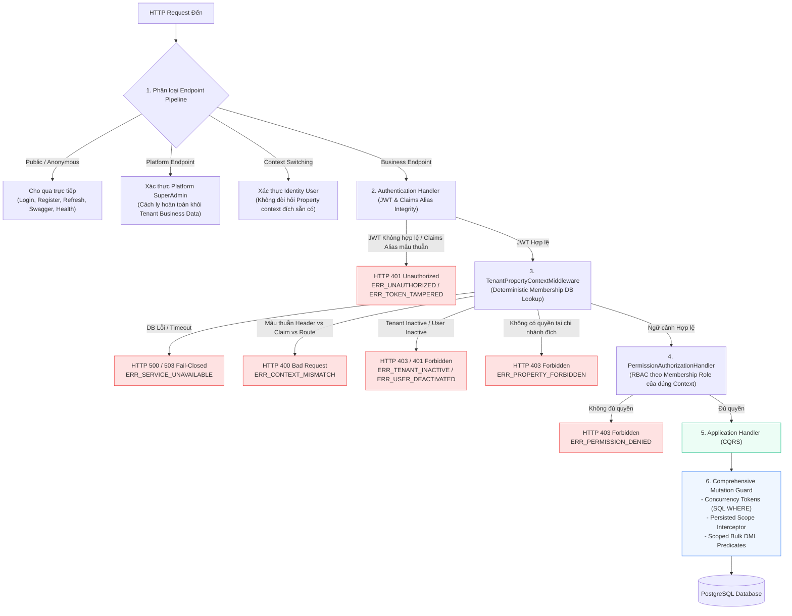
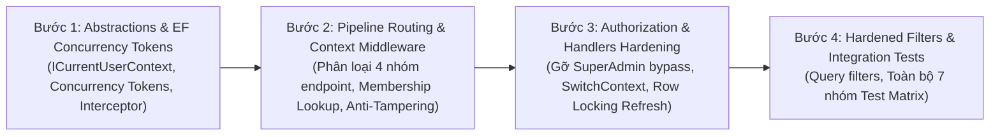

# TÀI LIỆU THIẾT KẾ KIẾN TRÚC P1B-02A: NGỮ CẢNH TENANT/PROPERTY, AUTHORIZATION & CƠ CHẾ FAIL-CLOSED

> **Mã giai đoạn:** P1B-02A (Thiết kế & Lập kế hoạch — Chưa viết mã ứng dụng)  
> **Phiên bản:** 1.5 (Đồng bộ hóa Khóa Ổn Định Users FOR UPDATE, Fresh Read Chuỗi & Kiểm Thử Race Token Rotation/Revocation)  
> **Ngày lập:** 2026-10-07  
> **Căn cứ đối chiếu:** `AGENTS.md`, Quyết định P0 đã duyệt (`docs/p0-decisions.md` D24, D23), SDD-05 RBAC Design, SDD-06 API Design, Baseline đã nghiệm thu sau P1B-01B (`CreateRoomTypeCommandHandler.cs:64-85`).  
> **Ranh giới bắt buộc:** Không sửa mã nguồn ứng dụng, startup hoặc schema DB; không chạy migration dev/prod; không triển khai UI, AI hoặc Support API; dừng sau khi bàn giao thiết kế để chờ Reviewer duyệt.

---

## 1. TỔNG QUAN & PHẠM VI THIẾT KẾ (EXECUTIVE SUMMARY)

Giai đoạn **P1B-01B** đã hoàn tất việc thiết lập nền tảng đa chi nhánh tại tầng dữ liệu (Domain Entity, EF Core Mappings, Differential Migration có backfill & rollback). Tuy nhiên, tại tầng ứng dụng (Application & WebApi), toàn bộ luồng xử lý hiện tại vẫn vận hành theo mô hình đơn chi nhánh lỏng lẻo:
- `TenantMiddleware` chỉ trích xuất claim `tenantId` từ JWT mà **không xác thực membership** trên cơ sở dữ liệu;
- Chưa có khái niệm `PropertyId` trong ngữ cảnh request (`ICurrentPropertyService`);
- EF Core Global Query Filter tự động **bỏ qua bộ lọc** khi `TenantId == null` (rủi ro rò rỉ dữ liệu chéo toàn hệ thống);
- `PermissionAuthorizationHandler` chứa đoạn mã **hardcoded bypass cho SuperAdmin** và truy vấn quyền không có điều kiện `TenantId`/`PropertyId`;
- Các query/mutation handler cho phép đọc/sửa dữ liệu của chi nhánh khác nếu biết `Id` vật lý;
- Chưa có cơ chế bảo vệ chống ghi chéo scope ở các thao tác `Attach`, `Update`, `Remove`, navigation FK hoặc bulk mutations (`ExecuteUpdateAsync`/`ExecuteDeleteAsync`).

**Mục tiêu của P1B-02A (v1.5):** Thiết lập kiến trúc xác thực ngữ cảnh (Tenant/Property Context) và ủy quyền (Authorization) đạt chuẩn **Zero-Trust & Fail-Closed**, hoàn thiện triệt để cơ chế đồng bộ hóa concurrency và khóa an toàn:
1. **Cấu hình EF Core Concurrency Tokens & Scoped DML cho Mutation Guard:**
   - Cấu hình tường minh `.IsConcurrencyToken()` trên `TenantId` và `PropertyId` trong EF Core Fluent API. Khi sinh SQL UPDATE/DELETE, EF Core bắt buộc đưa cả `TenantId` và `PropertyId` vào mệnh đề `WHERE`; nếu sai lệch scope sẽ cập nhật 0 rows và EF Core tự động ném `DbUpdateConcurrencyException`.
   - Kết hợp kiểm tra Persisted Scope từ DB trong Interceptor cho detached entities, và Scoped Predicate tường minh kiểm tra `affected_rows > 0` cho bulk mutations.
2. **Khóa Ổn Định Chung Trên Dòng Users (`FOR UPDATE`) Trước Khi Đọc Chuỗi Token:**
   - Sử dụng một khóa ổn định chung bất biến: Khóa dòng `Users` theo `UserId` bằng `SELECT "Id" FROM "Users" WHERE "Id" = @userId FOR UPDATE` trong transaction.
   - Cả 3 thao tác: **Refresh**, **Switch-Context** và **Family Revocation** đều bắt buộc phải lấy cùng một khóa này trước tiên.
   - Sau khi đã giữ khóa thành công, mới thực thi câu lệnh SQL mới để đọc lại chuỗi `RefreshTokens`, đảm bảo nhìn thấy 100% dữ liệu mới nhất vừa được commit bởi giao dịch trước đó (Read Committed Isolation).
   - Duy trì nghiêm ngặt phạm vi thu hồi theo **Token Family** (dựa trên chuỗi `ReplacedByToken`), không thu hồi mọi phiên của user (bảo toàn tính độc lập đa thiết bị).
   - Thiết kế kiểm thử race condition: Luồng Rotation giữ khóa trước, luồng Revocation chờ; khi token mới được commit thì luồng Revocation thức dậy, đọc lại chuỗi và thu hồi dứt điểm cả token mới đó (Zero Escaped Tokens).
3. **Quy định rành mạch về thẩm quyền nghiệp vụ (4 Quyết định PO Đã Duyệt):**
   - Đã cập nhật 4 quyết định được Product Owner phê duyệt chính thức tại Mục 9.3: Kế toán chỉ xem báo cáo tổng hợp; Nhân viên chưa chọn chi nhánh bị chặn gọi API nghiệp vụ; Owner xem toàn Tenant tự động loại trừ chi nhánh có membership đích danh inactive; và Exact membership inactive tại chi nhánh chặn đứng quyền toàn chuỗi của Owner tại chi nhánh đó. Phân biệt rõ thu hồi refresh-token family với việc không tuyên bố vô hiệu hóa tức thời stateless JWT access tokens khi chưa có distributed blacklist.

---

## 2. PHÂN TÍCH KHOẢNG TRỐNG MÃ NGUỒN (GAP ANALYSIS)

Dưới đây là bảng đối chiếu chi tiết giữa hiện trạng mã nguồn thực tế tại repository và các rủi ro an ninh cần khắc phục:

| STT | Tệp tin & Dòng code hiện tại | Hiện trạng kỹ thuật | Rủi ro an ninh & Vận hành | Thay đổi tối thiểu đề xuất (P1B-02B) |
|:---:|---|---|---|---|
| **GAP-01** | `backend/src/HotelSaas.WebApi/Middleware/TenantMiddleware.cs`<br>Lines 27–36 | Chỉ đọc `context.User.FindFirst("tenantId")`, gán `tenantService.TenantId = tenantId`. Không kiểm tra DB, không đọc `PropertyId`. Chưa phân loại endpoints, nguy cơ chặn chính luồng thiết lập context (`switch-context`). | **Bỏ lọt kiểm soát & Nguy cơ Deadlock:** Token mạo danh lọt qua middleware; ngược lại nếu siết cứng không phân loại thì user chưa có context chi nhánh không thể gọi `switch-context` để nhận context. | Phân loại pipeline thành 4 nhóm endpoints (Public, Platform, Context-Bootstrap, Business). Thẩm định DB cho Business endpoints; nạp danh tính không đòi context đích tại Context-Bootstrap. |
| **GAP-02** | `backend/src/HotelSaas.Application/Common/Interfaces/ICurrentTenantService.cs`<br>Lines 7–14 | Chỉ có thuộc tính `Guid? TenantId { get; set; }`. Thiếu hoàn toàn abstraction biểu diễn ngữ cảnh chi nhánh (`PropertyId`) và loại phạm vi (`ScopeType`). | **Thiếu ngữ cảnh phân quyền chi nhánh:** Tầng Application không biết request đang chạy dưới danh nghĩa Chi nhánh nào hoặc dưới quyền Toàn chuỗi. | Bổ sung `ICurrentPropertyService` và `ICurrentUserContext` cung cấp `PropertyId`, `IsTenantWide`, `StaffRole`, `IsActive`. |
| **GAP-03** | `backend/src/HotelSaas.Infrastructure/Persistence/ApplicationDbContext.cs`<br>Lines 130–133 | `e => _currentTenantService.TenantId == null \|\| e.TenantId == _currentTenantService.TenantId`. | **LỖ HỔNG RÒ RỈ CHÉO DỮ LIỆU (CRITICAL):** Khi một request không có tenant context (`TenantId == null`), filter trở thành `true`, EF Core trả về dữ liệu của TẤT CẢ các khách sạn trong database! | Đổi thành: `_currentTenantService.TenantId.HasValue && e.TenantId == _currentTenantService.TenantId.Value`. Khi `TenantId == null`, filter luôn trả về `false` (0 rows). Bổ sung filter cho `IPropertyScopedEntity`. |
| **GAP-04** | `backend/src/HotelSaas.WebApi/Authorization/PermissionAuthorizationHandler.cs`<br>Lines 40–48 | `if (globalRole == GlobalUserRole.SuperAdmin) { context.Succeed(requirement); return; }` | **Bypass trái phép quyền hạn Platform (Vi phạm D24):** Platform Admin mặc định đọc/ghi được toàn bộ dữ liệu nghiệp vụ của mọi khách hàng mà không cần Support Grant. | **Gỡ bỏ hoàn toàn khối code bypass này.** Platform Admin không có quyền truy cập dữ liệu nghiệp vụ Tenant; từ chối fail-closed. |
| **GAP-05** | `backend/src/HotelSaas.WebApi/Authorization/PermissionAuthorizationHandler.cs`<br>Lines 51–57 | `_context.TenantStaffMembers.Where(ts => ts.UserId == userId && ts.IsActive).SelectMany(ts => ts.Role.Permissions)...` | **Xuyên thủng ranh giới Tenant/Chi nhánh & Lỗi chọn Membership (CRITICAL):** Query tìm quyền của User trên TẤT CẢ bản ghi staff mà không lọc Tenant/Property cụ thể; nguy cơ cộng dồn quyền hoặc chọn sai bản ghi. | Bổ sung quy tắc chọn Membership có thẩm quyền chính xác; chỉ lấy quyền từ role của membership tương ứng với context mục tiêu; không cộng quyền; áp dụng quyết định PO đã duyệt: exact membership inactive chặn đứng quyền tại chi nhánh đó. |
| **GAP-06** | `backend/src/HotelSaas.Infrastructure/Services/JwtService.cs`<br>Lines 50–68 | `GenerateTokens` chỉ tạo claim `sub`, `email`, `fullName`, `globalRole`, `tenantId`, `permissions`. Không có `propertyId` / `scope`. | Token không biểu diễn được chi nhánh đang làm việc và phạm vi quyền; nếu đổi tên claim `tenantId` sang `tid` sẽ phá vỡ client hiện tại. | Phát hành tương thích kép: Giữ nguyên `tenantId` và `propertyId`, đồng thời hỗ trợ alias `tid` và `pid`; bổ sung claim `scope` (`TenantWide` / `PropertyScoped`). Thẩm tra nghiêm ngặt: nếu cả 2 alias cùng xuất hiện mà lệch nhau phải từ chối ngay. |
| **GAP-07** | `backend/src/HotelSaas.Application/Auth/Commands/Login/LoginCommandHandler.cs`<br>Lines 48–50 | `var activeStaff = user.TenantStaffProfiles.FirstOrDefault(ts => ts.IsActive);` | Đăng nhập chỉ bốc ngẫu nhiên membership đầu tiên bằng `FirstOrDefault()`, không hỗ trợ chuyển đổi chi nhánh làm việc. | Trả về danh sách memberships trong response đăng nhập; bổ sung endpoint `POST /api/auth/switch-context` cho phép chọn chi nhánh mục tiêu. |
| **GAP-08** | `backend/src/HotelSaas.Application/Rooms/Queries/GetRooms/GetRoomsQueryHandler.cs`<br>Lines 39–42 | `if (request.PropertyId.HasValue) query = query.Where(r => r.PropertyId == request.PropertyId.Value);` | **Rò rỉ danh sách phòng giữa các chi nhánh:** Nếu nhân viên chi nhánh A gọi query mà không truyền `PropertyId`, hệ thống trả về phòng của cả chi nhánh B và C. | Bắt buộc ép `PropertyId` từ `ICurrentPropertyService` nếu caller là Property-Scoped. Chỉ cho phép null khi caller là Tenant-Wide. |
| **GAP-09** | `backend/src/HotelSaas.Application/Rooms/Queries/GetRoomById/GetRoomByIdQueryHandler.cs`<br>Lines 27–30 | `_context.Rooms.FirstOrDefaultAsync(r => r.Id == request.Id)` | **Đọc chéo phòng theo ID:** Nhân viên chi nhánh A có thể xem chi tiết phòng của chi nhánh B nếu biết `Guid` của phòng đó. | Bổ sung predicate: Kiểm tra `r.PropertyId == currentPropertyId` đối với caller Property-Scoped. |
| **GAP-10** | `backend/src/HotelSaas.Application/Rooms/Commands/UpdateRoom/UpdateRoomCommandHandler.cs`<br>Lines 28–34 | `_context.Rooms.FirstOrDefaultAsync(r => r.Id == request.Id)` | **Lỗ Hổng Detached & Thiếu Concurrency Token Trong SQL:** Client có thể dùng ID phòng P2 nhưng gán `PropertyId = P1` khi gọi `Attach`/`Update`; cập nhật in-memory OriginalValue không tự động ép SQL WHERE có scope fields. | Cấu hình `.IsConcurrencyToken()` cho `TenantId`/`PropertyId` trong EF Core; kết hợp persisted scope lookup trong Interceptor; ép Scoped DML Predicate kiểm tra affected rows. |
| **GAP-11** | `backend/src/HotelSaas.WebApi/Middleware/TenantMiddleware.cs` & Database Connection | Chưa có xử lý fail-closed khi kết nối DB bị lỗi, timeout hoặc chập chờn trong lúc xác thực membership. | **Nguy cơ Fail-Open:** Nếu database lỗi mà middleware nuốt exception hoặc rơi về logic mặc định, request có thể bypass kiểm tra. | Bắt buộc bọc xử lý lỗi kết nối DB thành Fail-Closed: Trả HTTP 500 hoặc 503 ngay lập tức, tuyệt đối không bypass. |
| **GAP-12** | `backend/src/HotelSaas.Application/Auth/Commands/RefreshToken/RefreshTokenCommandHandler.cs`<br>Lines 35–45 | Refresh token chỉ kiểm tra hạn dùng; chưa có khóa ổn định chung đồng bộ giữa rotation và family revocation, nguy cơ sót token mới. | **Race Condition Khi Rotation & Thu Hồi Family:** Yêu cầu rotation đồng thời trên token cuối chuỗi có thể sinh token mới thoát khỏi đợt family revocation đang chạy song song. | Sử dụng khóa ổn định chung: Khóa dòng `Users` (`Id = @userId`) bằng `FOR UPDATE` trong giao dịch trước khi đọc chuỗi bằng câu lệnh mới; thực thi atomic rotation và family revocation; thẩm tra chữ ký/sub của expired token; cô lập family độc lập thiết bị với zero schema change. |

---

## 3. NGUYÊN TẮC THIẾT KẾ CỐT LÕI & MÔ HÌNH BẢO MẬT (CORE ARCHITECTURAL PRINCIPLES)



### 3.1. Phân Loại Pipeline & Định Tuyến Endpoints (Pipeline Routing Classification)

Để khắc phục rủi ro middleware chặn chính luồng lấy ngữ cảnh hoặc gây deadlock cho người dùng mới đăng nhập chưa chọn chi nhánh, pipeline được phân chia nghiêm ngặt thành 4 nhóm:

1. **Nhóm 1: Anonymous / Public Endpoints:**
   - Bao gồm: `POST /api/auth/login`, `POST /api/auth/register`, `POST /api/auth/refresh-token`, `/health`, `/swagger/*`.
   - Được đánh dấu `[AllowAnonymous]` hoặc khớp route public.
   - **Xử lý:** Middleware cho qua trực tiếp (`_next(context)`), không kiểm tra JWT, không yêu cầu tenant/property context.
2. **Nhóm 2: Platform Endpoints:**
   - Bao gồm: Các endpoint quản trị hệ thống nền tảng SaaS (ví dụ: `/api/platform/*`, quản lý tenant billing, cấu hình hệ thống).
   - Yêu cầu xác thực danh tính: `GlobalUserRole == SuperAdmin`.
   - **Xử lý:** Không yêu cầu `TenantId` hay `PropertyId`. Bị cô lập hoàn toàn khỏi dữ liệu nghiệp vụ khách hàng. Nếu Platform Admin cố tình gọi sang Business Endpoints sẽ bị từ chối `403 Forbidden` (tuân thủ P0-D24).
3. **Nhóm 3: Context-Bootstrap & Switching Endpoints:**
   - Bao gồm: `POST /api/auth/switch-context`, `GET /api/auth/me/memberships`.
   - Yêu cầu xác thực danh tính người dùng (`sub`), nhưng **TUYỆT ĐỐI KHÔNG ĐÒI HỎI PHẢI CÓ SẴN PROPERTY CONTEXT ĐÍCH**.
   - **Xử lý:** Cho phép người dùng gọi endpoint này ngay cả khi token của họ chưa có `pid` hoặc đang mang `pid` của chi nhánh khác. Handler của `switch-context` sẽ trực tiếp kiểm tra quyền truy cập của người dùng đối với chi nhánh đích và cấp token mới.
4. **Nhóm 4: Business Endpoints (Tenant/Property Scoped):**
   - Bao gồm: Toàn bộ API nghiệp vụ khách sạn (`/api/rooms`, `/api/room-types`, `/api/reservations`, `/api/payments`, ...).
   - Yêu cầu: Xác thực JWT, thẩm tra tính nhất quán của Claims Alias, phân giải ngữ cảnh Tenant và Property qua database, kiểm tra RBAC và bảo vệ tầng dữ liệu.

---

### 3.2. Quy Tắc Chọn Membership Có Thẩm Quyền (Deterministic Membership Selection)

#### Thuật Toán Lựa Chọn Xác Định (Deterministic Selection Algorithm)
Trong kiến trúc đa chi nhánh, một User trong cùng Tenant có thể có 1 bản ghi Tenant-Wide (`PropertyId IS NULL`) và nhiều bản ghi Property-Scoped (`PropertyId = P1`, `PropertyId = P2`, ...). Khi xác định ngữ cảnh cho một request, membership có thẩm quyền duy nhất được chọn theo quy tắc 2 bước dứt khoát:

1. **Bước 1: Xác định mục tiêu của Request:**
   - **Trường hợp A: Request hướng tới một Chi nhánh cụ thể (`TargetPropertyId != null`):**
     - *Kiểm tra 1 (Exact Property Match):* Tìm bản ghi có `TenantId == currentTenantId AND UserId == currentUserId AND PropertyId == TargetPropertyId`.
       - **Nếu TỒN TẠI bản ghi đích danh:**
         - Nếu `s.IsActive == true`: **Chấp thuận** với vai trò và quyền hạn được cấu hình tại chi nhánh đó.
         - Nếu `s.IsActive == false`: Theo **Quyết định 4 của PO đã duyệt** (Mục 9.3): **Chặn đứng truy cập ngay lập tức với HTTP 403 `ERR_MEMBERSHIP_REVOKED`**, **tuyệt đối không cho phép fallback sang quyền Tenant-Wide**, nhằm bảo đảm hiệu lực và kỷ luật của quyết định đình chỉ tại chi nhánh đó.
       - **Nếu KHÔNG TỒN TẠI bản ghi đích danh (`COUNT == 0` đối với `PropertyId == TargetPropertyId`):**
         - Lúc này mới xét đến quyền toàn chuỗi: Tìm bản ghi `TenantId == currentTenantId AND UserId == currentUserId AND PropertyId IS NULL`.
         - Nếu bản ghi toàn chuỗi tồn tại và `s.IsActive == true`: **Cho phép kế thừa quyền Tenant-Wide** vào thao tác tại chi nhánh đó.
         - Nếu bản ghi toàn chuỗi không tồn tại hoặc `s.IsActive == false`: **HTTP 403 `ERR_PROPERTY_FORBIDDEN`**.
   - **Trường hợp B: Request là thao tác toàn chuỗi Tenant-Wide (`TargetPropertyId == null`):**
     - Bắt buộc tìm bản ghi có `TenantId == currentTenantId AND UserId == currentUserId AND PropertyId IS NULL`.
     - Bản ghi gán riêng tại một chi nhánh cụ thể (`PropertyId != null`) **TUYỆT ĐỐI KHÔNG ĐƯỢC PHÉP** ủy quyền cho thao tác toàn chuỗi $\rightarrow$ Từ chối ngay với **HTTP 403 `ERR_FORBIDDEN`**.
      - **Quy tắc Loại Trừ Chi Nhánh Inactive (Quyết định 3 của PO đã duyệt):** Khi Tenant Owner thực hiện truy vấn đọc toàn chuỗi (ví dụ `GET /api/rooms` không truyền `X-Property-Id`), hệ thống trả về tài nguyên toàn Tenant nhưng **BẮT BUỘC PHẢI TỰ ĐỘNG LOẠI TRỪ** các chi nhánh mà Owner có bản ghi gán riêng đích danh đang ở trạng thái bị vô hiệu hóa (`ts.PropertyId != null && !ts.IsActive`).
      - **Quy tắc Nhân viên Chưa Chọn Chi Nhánh (Quyết định 2 của PO đã duyệt):** Nhân viên chưa chọn chi nhánh (`PropertyId == null` và không có quyền `IsTenantWide`) **CHỈ ĐƯỢC PHÉP** gọi các endpoint Context-Bootstrap (`/api/auth/me/memberships`, `/api/auth/switch-context`). Nếu cố tình gọi vào Business Endpoints (`/api/rooms`, `/api/room-types`,...), hệ thống lập tức từ chối Fail-Closed với **HTTP 403 Forbidden (`ERR_PROPERTY_REQUIRED`)**.

2. **Bước 2: Cô Lập Trạng Thái và Quyền Hạn (Isolated Revocation & Zero-Aggregation):**
   - **Độc lập thu hồi quyền giữa các chi nhánh khác nhau:** Trạng thái `IsActive = false` của một membership tại chi nhánh P3 hoàn toàn **không ảnh hưởng** đến quyền thao tác của người dùng tại chi nhánh P1 nếu membership tại P1 vẫn `IsActive = true`.
   - **Tuyệt đối không cộng gộp quyền ("Không cộng quyền"):** Bộ quyền hạn (Permissions / ActionMask) của request chỉ được nạp duy nhất từ `s.RoleId` của membership được chọn. Nghiêm cấm gộp quyền của các chi nhánh khác vào phiên làm việc hiện tại.

#### Cơ chế Lookup khi EF Context Chưa Khởi Tạo & Xử Lý Sự Cố DB
- **Tránh phụ thuộc vòng (Circular Dependency):** Tại thời điểm Middleware chạy, `ApplicationDbContext` chưa được nạp `TenantId` vào `_currentTenantService`.
- **Giải pháp:** Middleware sử dụng một truy vấn trực tiếp độc lập (thông qua `IMembershipLookupService` sử dụng parameterized SQL / direct database command):
  ```sql
  SELECT s."Id", s."RoleId", s."StaffRole", s."PropertyId", s."IsActive", 
         u."IsActive" AS "UserIsActive", t."Status" AS "TenantStatus"
  FROM "TenantStaffMembers" s
  JOIN "Users" u ON u."Id" = s."UserId"
  JOIN "Tenants" t ON t."Id" = s."TenantId"
  WHERE s."TenantId" = @tenantId 
    AND s."UserId" = @userId 
    AND (s."PropertyId" = @requestedPropertyId OR s."PropertyId" IS NULL)
  ORDER BY (CASE WHEN s."PropertyId" = @requestedPropertyId THEN 0 ELSE 1 END)
  LIMIT 1;
  ```
- **Xử lý sự cố Database (Fail-Closed on DB Error):**
  - Nếu kết nối cơ sở dữ liệu gặp lỗi, timeout, hoặc mất kết nối: **HỆ THỐNG PHẢI FAIL-CLOSED NGAY LẬP TỨC**.
  - Middleware bắt exception kết nối, ghi log bảo mật và trả về **HTTP 500 `ERR_INTERNAL_ERROR`** hoặc **HTTP 503 `ERR_SERVICE_UNAVAILABLE`**.
  - **TUYỆT ĐỐI KHÔNG** fallback sang context mặc định, không nuốt lỗi, và không cho phép request đi tiếp nếu chưa xác thực được DB.

---

### 3.3. Tách Bạch Phạm Vi Quyền Hạn (Scope) & Chi Nhánh Đang Chọn (Working Property)

Hệ thống tách rời hai khái niệm:

1. **Phạm Vi Quyền Hạn (`Privilege Scope`):**
   - **`TenantWide`:** Gán cho `Tenant Owner`, `Tenant Admin`, `Tenant Accountant` (`PropertyId IS NULL` trong DB). Có quyền thực hiện các nghiệp vụ cấp chuỗi và quản lý trên mọi chi nhánh thuộc Tenant.
   - **`PropertyScoped`:** Gán cho `Property Manager`, `Receptionist`, `Housekeeper` (`PropertyId IS NOT NULL` trong DB). Quyền hạn bị khóa cứng (pin) vào duy nhất chi nhánh được phân công.
2. **Chi Nhánh Đang Chọn Làm Việc (`Active Working Property` / `SelectedPropertyId`):**
   - Đại diện cho chi nhánh mục tiêu mà request hiện tại đang thao tác.
   - **Đối với User Tenant-Wide:** Người dùng có quyền đổi `SelectedPropertyId` tự do giữa các chi nhánh `Active` của Tenant (thông qua header `X-Property-Id` hoặc `switch-context`). Gửi `X-Property-Id` hợp lệ được coi là yêu cầu chuyển chi nhánh làm việc tạm thời cho request đó $\rightarrow$ **Chấp thuận (200/201)**.
   - **Đối với User Property-Scoped:** `SelectedPropertyId` bắt buộc phải trùng khớp với chi nhánh được gán (`AssignedPropertyId`). Nếu gửi `X-Property-Id` khác chi nhánh được gán $\rightarrow$ Đây là hành vi vi phạm quyền hạn $\rightarrow$ **HTTP 403 `ERR_PROPERTY_FORBIDDEN`**.

#### Bảo Toàn Quy Tắc Tương Thích Ngược Chuẩn Xác Của P1B-01B
Để đồng bộ 100% với baseline đã nghiệm thu tại [`CreateRoomTypeCommandHandler.cs:64-85`](file:///C:/Dev/hotel-saas-v2/backend/src/HotelSaas.Application/RoomTypes/Commands/CreateRoomType/CreateRoomTypeCommandHandler.cs#L64-L85):
- **Điều kiện tự động suy ra chi nhánh:** Chỉ được tự động suy ra khi **Tenant có đúng 1 chi nhánh tổng cộng (`Count == 1`), VÀ chi nhánh duy nhất đó đang ở trạng thái `Active`**.
- **Nếu Tenant có $\ge 2$ chi nhánh tổng cộng:** Dù chỉ có 1 chi nhánh Active và các chi nhánh khác Inactive, hệ thống **TUYỆT ĐỐI KHÔNG TỰ SUY RA**, bắt buộc client phải chỉ định rõ `PropertyId` (qua `X-Property-Id` hoặc payload body). Nếu không chỉ định $\rightarrow$ Ném `ConflictException("ERR_PROPERTY_REQUIRED", "Tenant có nhiều chi nhánh. Bắt buộc phải chỉ định PropertyId cụ thể.")`.
- **Nếu Tenant có 0 chi nhánh cấu hình:** Ném `ConflictException("ERR_PROPERTY_REQUIRED", "Tenant chưa có chi nhánh nào được cấu hình.")`.
- **Nếu Tenant có đúng 1 chi nhánh nhưng chi nhánh đó không Active:** Ném `ConflictException("ERR_PROPERTY_INACTIVE", "Chi nhánh duy nhất của Tenant hiện không ở trạng thái hoạt động.")`.

---

### 3.4. Thẩm Tra Tính Nhất Quán Claims Alias & Ma Trận Xử Lý Xung Đột

#### Quy Tắc Thẩm Tra Claims Alias (Anti-Tampering Rule)
Để ngăn chặn kẻ tấn công lợi dụng việc đọc fallback bằng toán tử `??` để qua mặt bộ kiểm tra:
1. **Đối với cặp claim Tenant: `(tenantId, tid)`:**
   - Nếu cả `tenantId` và `tid` cùng xuất hiện trong JWT: **Bắt buộc `tenantId.Value == tid.Value`**.
   - Nếu `tenantId.Value != tid.Value`: **TỪ CHỐI NGAY LẬP TỨC với HTTP 401 Unauthorized (`ERR_TOKEN_TAMPERED`)**.
   - Nếu chỉ 1 trong 2 xuất hiện: Chấp nhận giá trị đó.
2. **Đối với cặp claim Property: `(propertyId, pid)`:**
   - Nếu cả `propertyId` và `pid` cùng xuất hiện trong JWT: **Bắt buộc `propertyId.Value == pid.Value`**.
   - Nếu `propertyId.Value != pid.Value`: **TỪ CHỐI NGAY LẬP TỨC với HTTP 401 Unauthorized (`ERR_TOKEN_TAMPERED`)**.
   - Nếu chỉ 1 trong 2 xuất hiện: Chấp nhận giá trị đó.

#### Bảng Quy Định Xung Đột Ngữ Cảnh: 400 Bad Request vs. 403 Forbidden

| JWT Scope & PID | Header `X-Property-Id` | Payload Body `propertyId` | Đánh giá Kỹ thuật | HTTP Status & Error Code |
|---|---|---|---|:---:|
| `PropertyScoped`<br>`pid = P1` | Không gửi | Không gửi / Khớp P1 | Hợp lệ. Thao tác trên chi nhánh được gán P1. | `200 / 201 OK` |
| `PropertyScoped`<br>`pid = P1` | `X-Property-Id: P2` | Bất kỳ | **Vi phạm phân quyền chi nhánh:** Staff P1 đòi thao tác trên P2. | `403 Forbidden`<br>`ERR_PROPERTY_FORBIDDEN` |
| `PropertyScoped`<br>`pid = P1` | Không gửi | `propertyId: P2` | **Vi phạm phân quyền chi nhánh trong body:** Staff P1 cố ghi vào P2. | `403 Forbidden`<br>`ERR_PROPERTY_FORBIDDEN` |
| `TenantWide`<br>`pid = P1` | `X-Property-Id: P2` | Khớp P2 hoặc không gửi | **Hợp lệ:** Owner đổi chi nhánh làm việc sang P2 (P2 Active). | `200 / 201 OK` |
| `TenantWide`<br>`pid = P1` | `X-Property-Id: P2` | `propertyId: P3` | **Xung đột dữ liệu client:** Header đòi P2 nhưng Body lại đòi P3. | `400 Bad Request`<br>`ERR_CONTEXT_MISMATCH` |
| `TenantWide`<br>`pid = NULL` | Không gửi | Không gửi | Thao tác ghi: Kiểm tra số chi nhánh tổng cộng của Tenant:<br>- Nếu đúng 1 chi nhánh tổng cộng & Active: Tự động suy ra.<br>- Nếu $\ge 2$ chi nhánh tổng cộng: Bắt buộc chọn chi nhánh. | Đúng 1: `200 / 201 OK`<br>$\ge 2$: `409 Conflict`<br>`ERR_PROPERTY_REQUIRED` |
| Bất kỳ | `X-Tenant-Id: T2` (khác `tid` trong token) | Bất kỳ | **Xung đột định danh doanh nghiệp:** Header Tenant không khớp Token. | `400 Bad Request`<br>`ERR_CONTEXT_MISMATCH` |
| Bất kỳ | `X-Property-Id: Guid-rác` | Bất kỳ | **Dữ liệu header không đúng định dạng GUID.** | `400 Bad Request`<br>`ERR_CONTEXT_MISMATCH` |
| Token mang alias | `tenantId != tid` hoặc `propertyId != pid` | Bất kỳ | **Token bị làm giả hoặc sai lệch chữ ký claims.** | `401 Unauthorized`<br>`ERR_TOKEN_TAMPERED` |

---

### 3.5. Cơ Chế EF Cụ Thể Cho Mutation Guard: Concurrency Tokens, Detached & Scoped Bulk DML

Mọi thao tác ghi dữ liệu (Create, Update, Delete) đều được bảo vệ bằng cơ chế EF Core tường minh 3 lớp:

```mermaid
flowchart TD
    Mut["Thao tác Ghi Dữ liệu (Mutation)"] --> TypeCheck{"Phân loại Thao tác?"}
    
    TypeCheck -->|Tracked Entity (SaveChanges)| TrackedCheck["1. Tracked Execution<br/>- Nạp qua Query Filter<br/>- Interceptor kiểm tra Immutability<br/>- EF Concurrency Tokens sinh SQL WHERE"]
    TypeCheck -->|Detached Entity (Attach / Update / Remove)| DetachedCheck["2. Detached Scope Check<br/>- Interceptor lookup Persisted Scope từ DB<br/>- EF Concurrency Tokens sinh SQL WHERE<br/>- Thẩm định quyền ghi tại đích"]
    TypeCheck -->|Bulk DML (ExecuteUpdate / ExecuteDelete)| BulkCheck["3. Scoped Bulk DML<br/>- Bắt buộc targetPropertyId cụ thể<br/>- CẤM (isTenantWide || ...)<br/>- Ép WHERE Id = @id AND TenantId = @t AND PropertyId = @p<br/>- Bắt buộc affectedRows > 0"]
    
    TrackedCheck --> ConcToken["EF Core Concurrency Token Guard:<br/>WHERE Id = @id AND TenantId = @t AND PropertyId = @p<br/>affected_rows == 0 -> DbUpdateConcurrencyException"]
    DetachedCheck --> ConcToken
    BulkCheck --> RowsCheck["Kiểm tra affectedRows > 0:<br/>affectedRows == 0 -> NotFoundException"]
    
    ConcToken --> DBExec["Ghi Dữ Liệu An Toàn Vào Database"]
    RowsCheck --> DBExec

    style ConcToken fill:#eff6ff,stroke:#3b82f6
    style RowsCheck fill:#eff6ff,stroke:#3b82f6
    style DBExec fill:#ecfdf5,stroke:#10b981
```

#### 1. Cấu Hình EF Core Concurrency Tokens Cho Scope Fields (Model-Level Enforcement)
Để đảm bảo câu lệnh SQL do EF Core sinh ra **bắt buộc phải có `TenantId` và `PropertyId` trong mệnh đề `WHERE`** mà không phụ thuộc vào lời khẳng định chung chung:
Trong cấu hình Fluent API (`IEntityTypeConfiguration` của `ITenantScopedEntity` và `IPropertyScopedEntity`):
```csharp
// Đánh dấu tường minh TenantId và PropertyId là Concurrency Tokens:
builder.Property(e => e.TenantId).IsConcurrencyToken();
builder.Property(e => e.PropertyId).IsConcurrencyToken();
```
**Tác động kỹ thuật tại tầng SQL:**
Khi EF Core sinh lệnh `UPDATE` hoặc `DELETE` cho bất kỳ thực thể nào:
```sql
UPDATE "Rooms" 
SET "RoomNumber" = @p0, ... 
WHERE "Id" = @p1 AND "TenantId" = @p2 AND "PropertyId" = @p3;

DELETE FROM "Rooms" 
WHERE "Id" = @p1 AND "TenantId" = @p2 AND "PropertyId" = @p3;
```
- Nếu một kẻ tấn công gửi entity detached với `Id = Room_P2` nhưng gán `PropertyId = P1`:
  EF Core sẽ truyền `@p3 = P1` vào câu lệnh SQL. Do phòng trong database có `PropertyId = P2`, mệnh đề `WHERE` không khớp bản ghi nào $\rightarrow$ `affected_rows == 0`.
- EF Core phát hiện `affected_rows == 0` và **tự động ném `DbUpdateConcurrencyException` ngay lập tức**! Giao dịch bị rollback, dữ liệu của chi nhánh P2 được bảo vệ an toàn 100% tại tầng cơ sở dữ liệu.

#### 2. Thẩm Tra Persisted Scope Cho Detached Entities Trong Interceptor
Trước khi EF Core sinh SQL, `TenantPropertySaveChangesInterceptor.SavingChangesAsync` thực hiện chốt chặn an ninh phía server:
- Với bất kỳ thực thể detached nào ở trạng thái `Modified` hoặc `Deleted`:
  1. Tra cứu persisted scope thật trong cơ sở dữ liệu theo Primary Key (`Id`):
     ```sql
     SELECT "TenantId", "PropertyId" FROM "Rooms" WHERE "Id" = @id;
     ```
  2. Nếu không tìm thấy $\rightarrow$ Ném `NotFoundException("Bản ghi không tồn tại.")`.
  3. Đối chiếu giá trị thật từ DB:
     - Nếu `dbTenantId != currentTenantId` $\rightarrow$ Ném `SecurityException("ERR_CROSS_TENANT_MUTATION")`.
     - Nếu caller là `PropertyScoped` và `dbPropertyId != currentPropertyId` $\rightarrow$ Ném `SecurityException("ERR_CROSS_PROPERTY_MUTATION")`.
     - Nếu caller là `TenantWide`: Kiểm tra quyền ghi tại `dbPropertyId` (tuân thủ kết quả duyệt của PO tại Mục 9.3 Câu hỏi 4).
     - Nếu `entry.CurrentValue.PropertyId != dbPropertyId` hoặc `entry.CurrentValue.TenantId != dbTenantId` $\rightarrow$ Ném `SecurityException("ERR_IMMUTABLE_SCOPE_FIELDS")`.
  4. Gán lại `OriginalValue` khớp với dữ liệu thật trong DB để Concurrency Token kiểm tra chính xác.

#### 3. Thực Thi Scoped DML Bắt Buộc Cho Bulk Mutations (`ExecuteUpdateAsync` / `ExecuteDeleteAsync`)
Vì bulk DML bypass ChangeTracker hoàn toàn:
- **Xóa bỏ triệt để biểu thức `(isTenantWide || ...)`** vốn làm thủng bộ lọc chi nhánh.
- Mọi thao tác bulk DML **luôn nhắm vào một chi nhánh cụ thể (`targetPropertyId`)**:
  - Với Property-Scoped: `targetPropertyId = _currentPropertyService.PropertyId`.
  - Với Tenant-Wide: `targetPropertyId` lấy từ header `X-Property-Id` hoặc command payload.
- **Bắt buộc gắn Scoped Predicate vào mệnh đề WHERE:**
  ```csharp
  var affectedRows = await _context.Rooms
      .Where(r => r.Id == targetId && 
                  r.TenantId == currentTenantId && 
                  r.PropertyId == targetPropertyId)
      .ExecuteUpdateAsync(s => s.SetProperty(...), cancellationToken);
  ```
- **Kiểm tra Affected Rows:** Bắt buộc kiểm tra `if (affectedRows == 0)` $\rightarrow$ Ném `NotFoundException("Không tìm thấy tài nguyên trong chi nhánh được chỉ định.")`. Ngăn chặn hoàn toàn việc câu lệnh âm thầm chạy trên bản ghi ngoài scope hoặc no-op.

---

### 3.6. Vòng Đời Refresh Token: Khóa Ổn Định Dòng Users `FOR UPDATE`, Fresh Read Chuỗi & Family Revocation

Để đảm bảo an toàn tuyệt đối và duy trì ranh giới **"Zero Schema Change — Không thay đổi schema cơ sở dữ liệu"**:

#### 1. Thẩm Tra Khắt Khe Expired Access Token (Cryptographic & Owner Verification)
Trong `IJwtService.GetPrincipalFromExpiredToken(string token)`:
- Thiết lập `TokenValidationParameters`:
  - `ValidateIssuerSigningKey = true` (Bắt buộc kiểm tra chữ ký số bằng SecretKey).
  - `ValidateIssuer = true` (Bắt buộc kiểm tra đúng Issuer).
  - `ValidateAudience = true` (Bắt buộc kiểm tra đúng Audience).
  - `ValidAlgorithms = new[] { SecurityAlgorithms.HmacSha256 }` (Chỉ chấp nhận HMAC-SHA256, cấm thuật toán 'none' hoặc các thuật toán yếu).
  - `ValidateLifetime = false` (**CHỈ DUY NHẤT thời gian sống được bỏ qua** vì access token đã hết hạn).
- **Ràng Buộc Chủ Quyền Token (Owner Binding):**
  - Trích xuất `accessTokenUserId = Guid.Parse(principal.FindFirst("sub")?.Value)`.
  - Đối chiếu với bản ghi `RefreshToken` trong DB: Bắt buộc `storedRefreshToken.UserId == accessTokenUserId`.
  - Nếu `storedRefreshToken.UserId != accessTokenUserId` $\rightarrow$ **TỪ CHỐI NGAY LẬP TỨC với HTTP 401 Unauthorized (`ERR_TOKEN_USER_MISMATCH`)**. Tuyệt đối cấm hành vi lấy access token của người này ghép với refresh token của người khác.

#### 2. Khóa Ổn Định Chung Trên Dòng Users Bằng `FOR UPDATE` & Fresh Read Chuỗi
Để đồng bộ hóa tuyệt đối và giải quyết triệt để xung đột giữa:
- Luồng 1: Request hợp lệ đang rotate token cuối chuỗi $T_2 \rightarrow T_3$.
- Luồng 2: Kẻ tấn công gửi lại token cũ $T_1$ kích hoạt Family Revocation.
- Luồng 3: Hai request refresh đồng thời cùng gửi token $T_2$.

**Tại sao phải khóa dòng `Users` thay vì khóa bảng `RefreshTokens`?**
- Bảng `RefreshTokens` là tập hợp động: Số lượng hàng thay đổi liên tục, có thể chưa có hàng nào (lần đầu cấp token) hoặc phát sinh phantom rows/gap locks tùy mức cô lập transaction.
- Ngược lại, dòng thực thể trong bảng `Users` theo khóa chính (`Id = @userId`) **luôn luôn tồn tại duy nhất và bất biến**. Khóa dòng `Users` đóng vai trò là một **Mutex Ổn Định Chung (Root Synchronization Mutex)** tuyệt đối cho mọi thao tác session của user đó.

**Quy Trình Chuẩn Bắt Buộc Trong Transaction (`IDbContextTransaction`):**
Cả 3 thao tác: **Refresh Token (`RefreshTokenCommandHandler`)**, **Switch Context (`SwitchContextCommandHandler`)** và **Family Revocation (`RevokeTokenFamilyAsync`)** đều **BẮT BUỘC** phải tuân theo đúng 4 bước tuần tự:
```csharp
await using var transaction = await _context.Database.BeginTransactionAsync(cancellationToken);

// BƯỚC 1: Lấy khóa ổn định chung trên dòng Users theo UserId TRƯỚC TIÊN
await _context.Database.ExecuteSqlInterpolatedAsync(
    $"SELECT \"Id\" FROM \"Users\" WHERE \"Id\" = {userId} FOR UPDATE", 
    cancellationToken);

// BƯỚC 2: Sau khi đã giữ khóa thành công, ĐỌC LẠI CHUỖI RefreshTokens bằng câu lệnh mới
// Đảm bảo nhìn thấy 100% các token mới vừa được commit bởi giao dịch trước đó (Read Committed Isolation)
var userTokens = await _context.RefreshTokens
    .Where(rt => rt.UserId == userId)
    .ToListAsync(cancellationToken);

// BƯỚC 3: Thực thi nghiệp vụ Rotation, Switch-Context hoặc Family Revocation
// ...

// BƯỚC 4: Commit transaction, giải phóng khóa Users
await transaction.CommitAsync(cancellationToken);
```

#### 3. Cơ Chế Giải Quyết Race Condition & Zero Escaped Tokens

1. **Trường hợp Hai Request Refresh Gửi Cùng Token $T_2$ Đồng Thời:**
   - Request 1 vào trước, lấy khóa `Users` trước. Đọc lại chain thấy $T_2$ chưa revoke $\rightarrow$ Cập nhật $T_2.\text{RevokedAtUtc} = \text{UtcNow}$, $T_2.\text{ReplacedByToken} = T_3$, insert $T_3$, commit transaction và nhả khóa `Users`.
   - Request 2 bị chặn ở tầng PostgreSQL chờ Request 1 commit. Khi Request 2 có khóa, nó **thực thi câu lệnh mới đọc lại chain** và thấy $T_2$ đã bị revoke:
     - **Cửa sổ Xung đột Đồng thời (Concurrent Rotation Window $\le 5$ giây):**
       Nếu `(@now - T_2.RevokedAtUtc) <= 5 giây` VÀ `T_2.ReplacedByToken != null`:
       Xác định đây là request retry/reuse phát sinh gần như cùng một tích tắc ngay tại thời điểm rotation do mạng lag hoặc HTTP retry. Server trả về **HTTP 409 Conflict `ERR_REFRESH_CONCURRENCY`** (không khẳng định là cùng client, nhưng xử lý an toàn không phá hủy phiên làm việc, yêu cầu client đồng bộ lại token mới).

2. **Trường Hợp Race Condition: Rotation Giữ Khóa Trước, Revocation Bắt Đầu Chờ, Token Mới Được Commit Rồi Revocation Phải Thu Hồi Cả Token Đó:**
   - **Giai đoạn 1 (Rotation giữ khóa trước):**
     - Luồng 1 (Client hợp lệ đang rotate $T_2 \to T_3$) mở Transaction 1.
     - Luồng 1 thực thi `SELECT "Id" FROM "Users" WHERE "Id" = @userId FOR UPDATE`, giữ khóa thành công.
     - Luồng 1 đọc lại chain, thấy $T_2$ hợp lệ, tạo token mới $T_3$, gán $T_2.\text{ReplacedByToken} = T_3$, $T_2.\text{RevokedAtUtc} = \text{UtcNow}$, insert $T_3$.
   - **Giai đoạn 2 (Revocation bắt đầu và bị block chờ):**
     - Luồng 2 (Kẻ tấn công gửi lại token rò rỉ $T_1$, hệ thống phát hiện reuse và kích hoạt Family Revocation) mở Transaction 2.
     - Luồng 2 thực thi `SELECT "Id" FROM "Users" WHERE "Id" = @userId FOR UPDATE`.
     - **Luồng 2 bị PostgreSQL chặn lại (BLOCKED/WAITING)** vì Transaction 1 đang giữ khóa độc quyền trên dòng `Users` của user đó.
   - **Giai đoạn 3 (Token mới được commit):**
     - Luồng 1 gọi `Transaction1.CommitAsync()`.
     - Token mới $T_3$ được ghi nhận chính thức vào database. Transaction 1 kết thúc và nhả khóa trên dòng `Users`.
   - **Giai đoạn 4 (Revocation được đánh thức, đọc lại chain và thu hồi cả token mới $T_3$):**
     - Luồng 2 ngay lập tức được giải phóng chờ (UNBLOCKED), giành được khóa trên dòng `Users`.
     - **Luồng 2 thực thi câu lệnh SQL mới để đọc lại chuỗi `RefreshTokens`:** Nhờ mức cô lập Read Committed và việc câu lệnh SELECT được chạy SAU KHI đã giữ khóa (lúc này Tx1 đã commit), Luồng 2 nhìn thấy trọn vẹn toàn bộ chuỗi mới nhất trong DB: $T_1 \xrightarrow{\text{ReplacedBy}} T_2 \xrightarrow{\text{ReplacedBy}} T_3$!
     - Luồng 2 thực thi thuật toán truy vết family: Duyệt từ token rò rỉ $T_1$, đi xuôi theo `ReplacedByToken` $\rightarrow$ tìm thấy $T_2$ và **tìm thấy cả token mới $T_3$ vừa sinh**!
     - Luồng 2 cập nhật `RevokedAtUtc = UtcNow` cho **toàn bộ chuỗi bao gồm cả token mới $T_3$**.
     - Luồng 2 gọi `Transaction2.CommitAsync()`.
   - **Kết Quả Tuyệt Đối:**
     - Cả $T_1, T_2$ và token mới $T_3$ đều bị thu hồi dứt điểm trong database!
     - Khi client sau đó cố gắng dùng $T_3$ để gửi request tiếp theo, server lập tức từ chối với HTTP 401 Unauthorized (`ERR_TOKEN_REVOKED`).
     - **Khẳng định:** Nhờ cơ chế Khóa dòng `Users` + Đọc lại chuỗi bằng câu lệnh mới sau khi giữ khóa, **100% không một token mới nào có thể thoát khỏi đợt thu hồi (Zero Escaped Tokens)**.

#### 4. Thuật Toán Quản Trị Token Family Qua `ReplacedByToken` (Cô Lập Phạm Vi Thu Hồi)
Bảng `RefreshToken` lưu trữ mối quan hệ chuỗi: Mỗi lần rotate, token cũ trỏ tới token mới qua `ReplacedByToken`:
$$T_0 \xrightarrow{\text{ReplacedBy}} T_1 \xrightarrow{\text{ReplacedBy}} T_2 \xrightarrow{\text{ReplacedBy}} T_3 \dots$$
Đây là một danh sách liên kết đơn đại diện cho **Token Family của riêng một phiên làm việc (session / thiết bị)**.

- **Thuật Toán Thu Hồi Đúng Phạm Vi Family Khi Phát Hiện Token Reuse:**
  Khi phát hiện token $T_k$ bị tái sử dụng ngoài cửa sổ xung đột đồng thời 5 giây:
  1. Trong transaction đã giữ khóa `Users` bằng `FOR UPDATE`, thực thi đọc lại chuỗi `RefreshTokens` bằng câu lệnh mới.
  2. Thực hiện truy vết đồ thị liên kết:
     - **Hậu duệ (Descendants):** Đi xuôi theo `ReplacedByToken`: $T_{k+1}, T_{k+2}, \dots$ cho đến mắt xích mới nhất.
     - **Tiền bối (Ancestors):** Đi ngược qua các bản ghi có `ReplacedByToken == T.Token`.
  3. **Thu hồi CHÍNH XÁC Token Family bị rò rỉ:** Cập nhật `RevokedAtUtc = UtcNow` cho toàn bộ các token thuộc chuỗi liên kết $T_0 \dots T_n$.
  4. **Bảo Toàn Tính Độc Lập Thiết Bị (Không Revoke Mọi Phiên):**
     Các phiên làm việc trên các thiết bị khác của cùng user (chuỗi $R_0 \xrightarrow{\text{ReplacedBy}} R_1 \dots$) là các chuỗi độc lập, không kết nối tới $T_k$ qua trường `ReplacedByToken`. Do đó chúng **HOÀN TOÀN KHÔNG BỊ ẢNH HƯỞNG**. Người dùng không bị đăng xuất khỏi các thiết bị an toàn khác.
  5. **Phân Biệt Rõ Thu Hồi Refresh Family và Vô Hiệu Access JWT (Stateless Token Boundary):**
     - Thu hồi refresh-token family chỉ vô hiệu hóa quyền hạn cấp phát token mới thông qua chuỗi refresh token đó trong tương lai.
     - Hệ thống **tuyệt đối không tuyên bố rằng các access token (stateless JWT) đã phát hành bị thu hồi tức thời** trước thời điểm hết hạn (expires at), do trong phạm vi giai đoạn này chưa triển khai hạ tầng blacklist / revocation list phân tán cho JWT ngắn hạn. Access token sẽ tự nhiên hết hiệu lực sau thời gian sống quy định (15 phút).

---

## 4. HỢP ĐỒNG NGỮ CẢNH & API CONTRACTS (CONTRACT SPECIFICATIONS)

### 4.1. Cấu Trúc Interface Ngữ Cảnh Phía Máy Chủ

```csharp
namespace HotelSaas.Application.Common.Interfaces;

/// <summary>
/// Đại diện cho toàn bộ thông tin ngữ cảnh danh tính và quyền hạn đã được xác minh của request hiện tại.
/// Được khởi tạo duy nhất một lần bởi TenantPropertyContextMiddleware cho mỗi request.
/// </summary>
public interface ICurrentUserContext
{
    Guid UserId { get; }
    string Email { get; }
    GlobalUserRole GlobalRole { get; }

    // Ngữ cảnh Doanh nghiệp
    Guid? TenantId { get; }
    TenantStatus? TenantStatus { get; }

    // Ngữ cảnh Chi nhánh Đang Chọn
    Guid? PropertyId { get; }
    PropertyStatus? PropertyStatus { get; }

    // Quyền hạn nhân sự thực tế từ Membership có thẩm quyền
    StaffRole? StaffRole { get; }
    bool IsTenantWide { get; }
    bool IsAuthenticated { get; }

    // Kiểm tra tính hợp lệ và ném exception nếu thiếu (Fail-Closed)
    void EnsureTenantContext();
    void EnsurePropertyContext();
}
```

---

### 4.2. Cấu Trúc Claims Chuẩn Hóa trong JWT Token

```json
{
  "sub": "3fa85f64-5717-4562-b3fc-2c963f66afa6",
  "email": "manager@biendong.vn",
  "fullName": "Nguyen Van Quan Ly",
  "globalRole": "TenantStaff",
  "tenantId": "a1b2c3d4-e5f6-7a8b-9c0d-1e2f3a4b5c6d",
  "tid": "a1b2c3d4-e5f6-7a8b-9c0d-1e2f3a4b5c6d",
  "propertyId": "f9e8d7c6-b5a4-3f2e-1d0c-9b8a7f6e5d4c",
  "pid": "f9e8d7c6-b5a4-3f2e-1d0c-9b8a7f6e5d4c",
  "scope": "PropertyScoped",
  "staffRole": "Manager",
  "jti": "d0e1f2a3-b4c5-6789-0123-abcdef456789",
  "exp": 1791234567
}
```

---

### 4.3. Đặc Tả Endpoint Chuyển Ngữ Cảnh: `POST /api/auth/switch-context`

- **Route:** `POST /api/auth/switch-context`
- **Quyền hạn:** `[Authorize]` (Yêu cầu JWT hợp lệ; không đòi hỏi ngữ cảnh chi nhánh đích trước).
- **Request Body:**
  ```json
  {
    "propertyId": "f9e8d7c6-b5a4-3f2e-1d0c-9b8a7f6e5d4c"
  }
  ```
- **Xử lý:**
  1. Lấy `UserId` và `TenantId` từ danh tính đã xác thực.
  2. Thẩm định quyền của người dùng đối với `propertyId` đích theo thuật toán Mục 3.2 trong transaction có khóa hàng `FOR UPDATE`.
  3. Cấp cặp Access Token + Refresh Token mới với claim `propertyId` mới.
- **Response (200 OK):**
  ```json
  {
    "success": true,
    "data": {
      "accessToken": "eyJhbGciOi...",
      "refreshToken": "7c9e...",
      "expiresAtUtc": "2026-10-07T14:00:00Z",
      "currentContext": {
        "tenantId": "a1b2c3d4-e5f6-7a8b-9c0d-1e2f3a4b5c6d",
        "propertyId": "f9e8d7c6-b5a4-3f2e-1d0c-9b8a7f6e5d4c",
        "scope": "PropertyScoped",
        "roleName": "Property Manager"
      }
    }
  }
  ```

---

### 4.4. Chuẩn Hóa Danh Mục Mã Lỗi & HTTP Status Code

| HTTP Status | Mã lỗi (`ErrorCode`) | Thông điệp nghiệp vụ mặc định | Tình huống kích hoạt |
|:---:|---|---|---|
| **401** | `ERR_UNAUTHORIZED` | Yêu cầu xác thực danh tính. | Thiếu token hoặc token JWT không hợp lệ/hết hạn. |
| **401** | `ERR_TOKEN_TAMPERED` | Chữ ký hoặc claims trong token có dấu hiệu bị giả mạo. | Cặp alias `(tenantId, tid)` hoặc `(propertyId, pid)` cùng có mặt nhưng khác giá trị. |
| **401** | `ERR_TOKEN_USER_MISMATCH` | Danh tính trong Access Token không khớp với Refresh Token. | Claim `sub` của access token khác `UserId` của refresh token. |
| **401** | `ERR_TOKEN_REUSED` | Phát hiện hành vi sử dụng lại token đã thu hồi ngoài cửa sổ xung đột. | Refresh token gửi lên đã bị rotate từ trước ngoài 5 giây $\rightarrow$ Thu hồi toàn bộ token family. |
| **401** | `ERR_USER_DEACTIVATED` | Tài khoản người dùng đã bị khóa. | Bản ghi `User.IsActive == false`. |
| **409** | `ERR_REFRESH_CONCURRENCY` | Yêu cầu làm mới token đang có xung đột tại thời điểm rotation. | Hai request refresh đồng thời gửi cùng token trong cửa sổ xung đột $\le 5$ giây. |
| **409** | `ERR_PROPERTY_REQUIRED` | Tenant có nhiều chi nhánh. Bắt buộc phải chỉ định PropertyId cụ thể. | Thao tác ghi khi Tenant có $\ge 2$ chi nhánh tổng cộng mà không truyền chi nhánh (P1B-01B). |
| **409** | `ERR_PROPERTY_INACTIVE` | Chi nhánh duy nhất của Tenant hiện không ở trạng thái hoạt động. | Thao tác ghi khi chi nhánh duy nhất bị Inactive/Suspended. |
| **409** | `ERR_PROPERTY_MISMATCH` | Dữ liệu không cùng thuộc một chi nhánh. | Tạo phòng với `RoomType` thuộc chi nhánh khác. |
| **400** | `ERR_CONTEXT_MISMATCH` | Ngữ cảnh yêu cầu không đồng nhất giữa token, header và payload. | Gửi `X-Tenant-Id` khác token, hoặc `propertyId` trong body khác `X-Property-Id`. |
| **403** | `ERR_FORBIDDEN` | Bạn không có quyền thực hiện thao tác này. | Không đủ quyền RBAC (`FunctionCode:ActionMask`). |
| **403** | `ERR_PROPERTY_FORBIDDEN` | Bạn không có quyền truy cập hoặc thao tác tại chi nhánh này. | Staff chi nhánh A gửi header/yêu cầu tài nguyên của chi nhánh B. |
| **403** | `ERR_MEMBERSHIP_REVOKED` | Quyền nhân sự của bạn tại chi nhánh này đã bị thu hồi. | Bản ghi `TenantStaffMembers.IsActive == false` tại chi nhánh đích. |
| **403** | `ERR_TENANT_INACTIVE` | Doanh nghiệp hiện đang bị tạm ngưng hoạt động. | Bản ghi `Tenant.Status != Active`. |
| **404** | `ERR_NOT_FOUND` | Không tìm thấy tài nguyên yêu cầu. | Entity không tồn tại trong Tenant/Property của người gọi, hoặc bulk DML ảnh hưởng 0 rows. |
| **500** | `ERR_INTERNAL_ERROR` | Lỗi hệ thống trong quá trình xác thực ngữ cảnh. | Lỗi runtime không mong muốn hoặc `DbUpdateConcurrencyException`. |
| **503** | `ERR_SERVICE_UNAVAILABLE` | Dịch vụ cơ sở dữ liệu tạm thời không khả dụng. | Kết nối DB bị lỗi/timeout khi thẩm định membership (Fail-Closed). |

---

## 5. MA TRẬN VAI TRÒ × PHẠM VI × THAO TÁC (AUTHORIZATION MATRIX)

Quy ước:
- **`[All-T]`**: Thao tác áp dụng xuyên suốt tất cả các chi nhánh thuộc Tenant.
- **`[Self-P]`**: Chỉ thao tác trên chính chi nhánh mà nhân sự được phân công (`PropertyId`).
- **`[Pick-P]`**: Được phép chọn chi nhánh qua `X-Property-Id` hoặc tự suy ra nếu Tenant có đúng 1 chi nhánh tổng cộng & Active.
- **`DENIED`**: Bị chặn hoàn toàn (HTTP 403 Forbidden).

| Phân hệ / Thao tác nghiệp vụ | API Endpoint mẫu | Tenant Owner `[T]` | Tenant Accountant `[T]` | Property Manager `[P]` | Receptionist `[P]` | Platform SuperAdmin |
|---|---|:---:|:---:|:---:|:---:|:---:|
| **Xem danh sách Chi nhánh** | `GET /api/properties` | `[All-T]` (Xem hết) | `[All-T]` (Xem hết) | `[Self-P]` (Chỉ thấy P được gán) | `[Self-P]` (Chỉ thấy P được gán) | `DENIED` |
| **Tạo mới Chi nhánh** | `POST /api/properties` | `[All-T]` (Tạo được) | `DENIED` | `DENIED` | `DENIED` | `DENIED` |
| **Cấu hình Chi nhánh** | `PUT /api/properties/{id}` | `[Pick-P]` | `DENIED` | `[Self-P]` | `DENIED` | `DENIED` |
| **Xem danh sách Loại phòng** | `GET /api/room-types` | `[Pick-P]` | `[All-T]` | `[Self-P]` | `[Self-P]` | `DENIED` |
| **Tạo Loại phòng mới** | `POST /api/room-types` | `[Pick-P]` | `DENIED` | `[Self-P]` | `DENIED` | `DENIED` |
| **Xem danh sách Phòng** | `GET /api/rooms` | `[Pick-P]` | `DENIED` | `[Self-P]` | `[Self-P]` | `DENIED` |
| **Tạo Phòng vật lý mới** | `POST /api/rooms` | `[Pick-P]` | `DENIED` | `[Self-P]` | `DENIED` | `DENIED` |
| **Cập nhật trạng thái phòng** | `PUT /api/rooms/{id}/status`| `[Pick-P]` | `DENIED` | `[Self-P]` | `[Self-P]` | `DENIED` |
| **Xem Đơn đặt phòng** | `GET /api/reservations` | `[Pick-P]` | `[All-T]` (Đối soát) | `[Self-P]` | `[Self-P]` | `DENIED` |
| **Tạo Đơn đặt phòng mới** | `POST /api/reservations` | `[Pick-P]` | `DENIED` | `[Self-P]` | `[Self-P]` | `DENIED` |
| **Thực hiện Check-in / Out** | `POST /api/reservations/{id}/check-in` | `[Pick-P]` | `DENIED` | `[Self-P]` | `[Self-P]` | `DENIED` |
| **Ghi nhận Thanh toán** | `POST /api/payments` | `[Pick-P]` | `DENIED` | `[Self-P]` | `[Self-P]` | `DENIED` |
| **Yêu cầu Hoàn tiền** | `POST /api/payments/refund-request` | `[Pick-P]` | `DENIED` | `[Self-P]` | `[Self-P]` (D23) | `DENIED` |
| **Duyệt Hoàn tiền (`Approve`)** | `POST /api/payments/{id}/refund` | `[Pick-P]` (D23) | `DENIED` (D23) | `[Self-P]` (D23) | `DENIED` (D23) | `DENIED` |
| **Báo cáo Doanh thu Chi nhánh** | `GET /api/reports/revenue` | `[Pick-P]` | `[All-T]` | `[Self-P]` | `DENIED` | `DENIED` |
| **Báo cáo Toàn chuỗi** | `GET /api/reports/chain-overview` | `[All-T]` | `[All-T]` | `DENIED` | `DENIED` | `DENIED` |
| **Quản lý Nhân sự Tenant** | `GET /api/tenants/current/members` | `[All-T]` | `DENIED` | `DENIED` | `DENIED` | `DENIED` |

---

## 6. THIẾT KẾ PHÒNG THỦ CHIỀU SÂU (DEFENSE-IN-DEPTH DESIGN)

```
[Layer 1: Pipeline Routing & Middleware] ──> [Layer 2: Handler-Level Verification] ──> [Layer 3: Concurrency Tokens & Interceptors]
```

1. **Lớp 1: Phân Loại Pipeline & Xác Thực Ngữ Cảnh DB (`TenantPropertyContextMiddleware`):**
   - Phân loại route (Bỏ qua Public, xử lý Platform riêng, mở đường cho Context-Bootstrap).
   - Thẩm định tính nhất quán của Claims Alias (cấm `??`).
   - Thẩm định DB qua `IMembershipLookupService`.
   - Fail-closed ngay nếu DB lỗi kết nối (HTTP 500/503).
2. **Lớp 2: Kiểm Soát Quyền Tường Minh Tại Handler (Handler-Level Enforcement):**
   - Kiểm tra `_userContext.IsTenantWide` và đối chiếu `entity.PropertyId == _userContext.PropertyId`.
   - Áp dụng quy tắc tương thích ngược: Tự suy ra chi nhánh khi Tenant chỉ có đúng 1 chi nhánh tổng cộng & Active; yêu cầu bắt buộc chỉ định chi nhánh khi có $\ge 2$ chi nhánh tổng cộng (`ERR_PROPERTY_REQUIRED`).
   - Thực thi Bulk Mutation có gắn Scoped Predicate tường minh và kiểm tra `affectedRows > 0`.
3. **Lớp 3: Gia Cố Tầng Dữ Liệu & Concurrency Tokens (Hardened EF Model & Interceptors):**
   - **Đọc:** `HasQueryFilter` cấm hoàn toàn null bypass (`TenantId.HasValue && e.TenantId == ...`). Lọc tự động `IPropertyScopedEntity`.
   - **Ghi (EF Concurrency Tokens):** Cấu hình `.IsConcurrencyToken()` trên `TenantId`/`PropertyId` ép mệnh đề SQL `WHERE` kiểm tra scope; nếu sai lệch tự ném `DbUpdateConcurrencyException`.
   - **Ghi (Detached Scope Check):** Tra cứu persisted scope thật từ DB theo ID, chặn đứng mọi nỗ lực di dời hoặc giả mạo in-memory scope.

---

## 7. MA TRẬN KIỂM THỬ TOÀN DIỆN (TEST MATRIX)

Dưới đây là bộ ma trận kiểm thử bắt buộc phải triển khai trong giai đoạn **P1B-02B** bao phủ toàn bộ các yêu cầu của Reviewer:

| Nhóm kiểm thử | Kịch bản kiểm thử (Test Scenario) | Dữ liệu đầu vào | Kỳ vọng kết quả (Expected Result) |
|---|---|---|---|
| **1. Phân loại Pipeline & Context Bootstrap** | Gọi API Public không có JWT (`/api/auth/login`) | Không có header `Authorization` | HTTP `200 OK` (Cho qua trực tiếp, không bị middleware chặn) |
| | Gọi `POST /api/auth/switch-context` với token chưa có `pid` | Token hợp lệ (`pid=null`), body `propertyId=P1` | HTTP `200 OK`, cấp token mới mang `pid=P1` (Không bị deadlock) |
| | Platform SuperAdmin gọi API Platform | Token SuperAdmin, gọi `/api/platform/tenants` | HTTP `200 OK` (Thực thi đúng quyền quản trị hệ thống) |
| | Platform SuperAdmin gọi API nghiệp vụ khách hàng | Token SuperAdmin, gọi `GET /api/rooms` | HTTP `403 Forbidden`<br>`ERR_FORBIDDEN` (Chặn đứng theo D24) |
| **2. Chọn Membership & Quyết Định PO Đã Duyệt** | User có membership tại P1 bị `IsActive=false` và Tenant-Wide `IsActive=true`, gọi API tại P1 | Token mang `pid=P1`, gọi `/api/rooms` | Theo quyết định PO đã duyệt: HTTP `403 Forbidden`<br>`ERR_MEMBERSHIP_REVOKED` (Chặn đứng, cấm fallback) |
| | Owner xem toàn Tenant (`pid=null`), Tenant có P1 (Owner active) và P2 (Owner có exact membership `IsActive=false`) | Token Owner, gọi `GET /api/rooms` không truyền header | HTTP `200 OK`, trả về danh sách phòng của P1, **loại trừ hoàn toàn phòng của P2** (Quyết định 3 PO đã duyệt) |
| | Nhân viên chưa chọn chi nhánh (`pid=null`, không Tenant-Wide) gọi API nghiệp vụ | Token Staff (`pid=null`), gọi `GET /api/rooms` | HTTP `403 Forbidden`<br>`ERR_PROPERTY_REQUIRED` (Chỉ được gọi endpoint bootstrap / switch-context, Quyết định 2 PO đã duyệt) |
| | User KHÔNG có bản ghi riêng tại P1 nhưng có Tenant-Wide `IsActive=true`, gọi API tại P1 | Token Owner, Header `X-Property-Id: P1` | HTTP `200 OK` (Cho phép kế thừa Tenant-Wide vì không có bản ghi riêng) |
| | User có membership P1 active, P2 inactive; gọi API tại P1 | Token mang `pid=P1`, gọi `/api/rooms` | HTTP `200 OK` (Không bị từ chối oan do P2 inactive) |
| | User là Manager tại P1, Receptionist tại P2; gọi API tại P2 | Token mang `pid=P2`, gọi lệnh chỉ Manager có quyền | HTTP `403 Forbidden`<br>`ERR_PERMISSION_DENIED` (Không cộng dồn quyền từ P1) |
| **3. Kiểm Soát Mutation (Concurrency Tokens, Detached, Bulk & Scoped DML)** | Attacker tạo detached Room với `Id = Room_P2`, gán `PropertyId = P1`, gọi `Update` | Entity detached mang ID của P2 nhưng scope fields của P1 | EF Concurrency Token sinh SQL `WHERE Id = Room_P2 AND PropertyId = P1` $\rightarrow$ 0 rows affected $\rightarrow$ Ném `DbUpdateConcurrencyException` |
| | Attacker tạo detached Room với `Id = Room_P2`, gán `PropertyId = P1`, gọi `Remove` | Entity detached mang ID của P2 | Interceptor persisted check phát hiện lệch scope $\rightarrow$ Chặn đứng trước khi phát sinh lệnh DELETE |
| | Cố tình thay đổi `room.TenantId = T2` hoặc `room.PropertyId = P2` | Entity đang được track bị đổi scope fields | Ném `SecurityException` (`ERR_IMMUTABLE_SCOPE_FIELDS`) |
| | Bulk mutation `ExecuteUpdateAsync` gọi ID của P2 từ ngữ cảnh P1 | Query có Scoped Predicate tường minh | `affected_rows == 0`, ném `NotFoundException`, phòng P2 không bị đổi |
| | Gán navigation FK chéo: Room P1 trỏ `RoomTypeId` của P2 | Body `roomTypeId = RT_P2`, context là P1 | Handler & Interceptor ném `ConflictException`<br>`ERR_PROPERTY_MISMATCH` |
| **4. Thẩm Tra Claims Alias & Ma Trận Xung Đột** | Token mang `tenantId = T1` nhưng `tid = T2` (hoặc `propertyId != pid`) | Token bị sai lệch alias claims | HTTP `401 Unauthorized`<br>`ERR_TOKEN_TAMPERED` (Cấm dùng `??` để bỏ qua) |
| | Staff P1 gửi Header `X-Property-Id: P2` | Token Staff P1, Header `P2` | HTTP `403 Forbidden`<br>`ERR_PROPERTY_FORBIDDEN` (Phân quyền) |
| | Client gửi Header `X-Tenant-Id` khác `tenantId` trong token | Token Tenant A, Header `X-Tenant-Id: Tenant B` | HTTP `400 Bad Request`<br>`ERR_CONTEXT_MISMATCH` (Mâu thuẫn dữ liệu) |
| | Client gửi Header `X-Property-Id: P1` nhưng Body `propertyId: P2` | Header `P1`, Body `P2` | HTTP `400 Bad Request`<br>`ERR_CONTEXT_MISMATCH` (Mâu thuẫn dữ liệu) |
| | Tenant Owner (`TenantWide`) gửi Header `X-Property-Id: P2` | Token Owner, Header `P2` (P2 Active) | HTTP `200 / 201 OK` (Owner đổi chi nhánh làm việc hợp lệ) |
| **5. Đồng Bộ Quy Tắc Tương Thích P1B-01B** | Tenant có đúng 1 chi nhánh tổng cộng & Active, không truyền `PropertyId` | Gọi `POST /api/room-types` không gửi PropertyId | HTTP `201 Created` (Tự động suy ra chi nhánh duy nhất) |
| | Tenant có 2 chi nhánh tổng cộng (1 Active, 1 Inactive), không truyền `PropertyId` | Gọi `POST /api/room-types` không gửi PropertyId | HTTP `409 Conflict`<br>`ERR_PROPERTY_REQUIRED` (Không suy ra khi $\ge 2$ chi nhánh) |
| | Tenant có đúng 1 chi nhánh nhưng chi nhánh đó Inactive, không truyền `PropertyId` | Gọi `POST /api/room-types` không gửi PropertyId | HTTP `409 Conflict`<br>`ERR_PROPERTY_INACTIVE` |
| **6. Vòng Đời Refresh Token: Atomic Rotation, Concurrency & Family Revocation** | Hai request refresh đồng thời gửi cùng một refresh token trong cửa sổ $\le 5$ giây | Hai luồng đồng thời gọi refresh | Nhờ khóa dòng `Users` `FOR UPDATE`: 1 luồng nhận token mới thành công (200), luồng kia sau khi nhả khóa đọc lại chain thấy token bị revoke $\le 5s$ nhận HTTP `409 Conflict` (`ERR_REFRESH_CONCURRENCY`), không phân nhánh token |
| | Ghép Access Token của User A với Refresh Token của User B | Token ghép sai chủ sở hữu (`sub != storedToken.UserId`) | HTTP `401 Unauthorized`<br>`ERR_TOKEN_USER_MISMATCH` |
| | **Test Race:** Luồng Rotation giữ khóa `Users` trước, Luồng Revocation bắt đầu và bị chờ; Token mới $T_3$ được commit rồi Revocation thức dậy phải thu hồi cả $T_3$ | Luồng 1 (Rotation $T_2 \to T_3$) giữ khóa `Users` Tx1. Luồng 2 (Revocation $T_1$ reuse) mở Tx2 cố lấy khóa `Users` $\rightarrow$ bị block. Tx1 commit $T_3$ và nhả khóa. Tx2 thức dậy, lấy khóa `Users`, chạy câu lệnh mới đọc lại chuỗi `RefreshTokens`. | Luồng 2 nhìn thấy $T_3$ trong chain vừa commit; Luồng 2 thu hồi toàn bộ family $T_1 \to T_2 \to T_3$. Token $T_3$ bị đánh dấu revoked (`RevokedAtUtc != null`). Gọi refresh bằng $T_3$ bị từ chối HTTP `401 ERR_TOKEN_REVOKED` (Zero Escaped Tokens). |
| | Kiểm tra tính độc lập phiên (Family-Scoped Isolation): User có session tại Thiết bị 1 ($A_1 \to A_2$) và Thiết bị 2 ($B_1 \to B_2$); session 1 bị reuse $A_1$ | Luồng Revocation thu hồi theo family của $A_1$ | Toàn bộ chuỗi family của Thiết bị 1 ($A_1, A_2$) bị revoke; Chuỗi của Thiết bị 2 ($B_1, B_2$) **HOÀN TOÀN KHÔNG BỊ REVOKE** (`RevokedAtUtc == null`), tiếp tục hoạt động bình thường. |
| **7. Khả Năng Chống Chịu Sự Cố DB (Fail-Closed)** | Database bị ngắt kết nối hoặc timeout khi middleware lookup | Giả lập DB Connection Exception tại Middleware | HTTP `503 Service Unavailable`<br>`ERR_SERVICE_UNAVAILABLE` (Fail-Closed) |
| | Database timeout khi SaveChanges Interceptor chạy | Giả lập DB Timeout trong giao dịch ghi | Transaction Rollback toàn bộ, không có dữ liệu rác |

---

## 8. KẾ HOẠCH TRIỂN KHAI & QUY TRÌNH ROLLBACK AN TOÀN (P1B-02B ROADMAP)

### 8.1. Kế Hoạch Triển Khai 4 Bước Nhỏ



- **Bước 1: Abstractions & EF Concurrency Tokens:**
  - Định nghĩa `ICurrentUserContext`, `ICurrentPropertyService`.
  - Cấu hình `.IsConcurrencyToken()` trên `TenantId`/`PropertyId` trong Fluent API.
  - Cài đặt `TenantPropertySaveChangesInterceptor` kiểm tra persisted scope thật từ DB cho detached entities và chặn thay đổi trường scope.
  - *Nghiệm thu:* Build thành công, 66 tests cũ giữ nguyên trạng thái GREEN.
- **Bước 2: Pipeline Routing & Context Middleware:**
  - Cài đặt `TenantPropertyContextMiddleware` phân loại 4 nhóm endpoints.
  - Thẩm tra tính nhất quán của Claims Alias (cấm `??`).
  - Xây dựng `IMembershipLookupService` thực thi truy vấn chọn membership xác định, fail-closed khi DB lỗi.
  - Cập nhật `JwtService` hỗ trợ tương thích kép claims (`tenantId`/`tid`, `propertyId`/`pid`).
  - *Nghiệm thu:* Unit tests cho middleware đạt 100% nhóm kiểm thử 1, 2, 4, 7.
- **Bước 3: Authorization & Handlers Hardening:**
  - Gỡ bỏ hoàn toàn SuperAdmin bypass trong `PermissionAuthorizationHandler`.
  - Triển khai endpoint `POST /api/auth/switch-context`.
  - Cập nhật `RefreshTokenCommandHandler` và `SwitchContextCommandHandler`: Thẩm tra chữ ký/issuer/audience/sub của expired token, áp dụng khóa ổn định chung trên dòng `Users` (`Id = @userId`) bằng `FOR UPDATE`, sau đó đọc lại chuỗi `RefreshTokens` bằng câu lệnh mới; thực thi atomic rotation, xử lý concurrency 409 và thu hồi token family cô lập theo thiết bị.
  - Tinh chỉnh các Room/RoomType handlers: kiểm tra quyền chi nhánh, gắn scoped mutation predicate và bảo toàn logic suy ra chi nhánh chuẩn P1B-01B.
  - *Nghiệm thu:* Kiểm thử chuyển đổi ngữ cảnh, atomic refresh rotation với Users lock, mutation guard và kiểm thử quyền chi nhánh đạt GREEN.
- **Bước 4: Hardened Query Filters & Integration Tests:**
  - Gia cố `ApplyTenantQueryFilter` và `ApplyPropertyQueryFilter` trong `ApplicationDbContext`.
  - Viết suite test tích hợp `TenantPropertyContextIntegrationTests.cs` trên DB test cô lập bao phủ toàn bộ 7 nhóm kiểm thử.
  - *Nghiệm thu:* 100% tests toàn bộ giải pháp đạt GREEN.

---

### 8.2. Quy Trình Rollback An Toàn Về Mặt Bảo Mật (Security-Safe Rollback Strategy)

1. **Security Core (Lõi Bảo Mật Bất Biến — Không Bao Giờ Rollback Về Trạng Thái Lỗ Hổng):**
   - Bộ lọc `TenantId.HasValue && e.TenantId == ...` (cấm null bypass).
   - Loại bỏ SuperAdmin bypass khỏi dữ liệu nghiệp vụ khách hàng (D24).
   - Concurrency tokens và kiểm tra bất biến `TenantId`/`PropertyId` tại tầng EF Model & Interceptor.
   - *Quy tắc:* Kể cả khi có sự cố ở các tính năng khác, lõi bảo mật này **bắt buộc phải được giữ nguyên vẹn**.
2. **Feature-Level Rollback (Rollback Cục Bộ Tính Năng):**
   - Nếu xảy ra lỗi nghiệp vụ tại endpoint `switch-context` hoặc cơ chế tự động suy ra chi nhánh:
     - Tạm thời vô hiệu hóa tính năng đó thông qua cấu hình hoặc revert commit riêng lẻ của tính năng đó.
     - Giữ nguyên toàn bộ pipeline xác thực và query filter.
3. **Quy Trình Kiểm Thử Nghiệm Thu Sau Rollback (Rollback Verification Checklist):**
   - Chạy bộ negative tests bắt buộc:
     1. Gọi query khi không có tenant context $\rightarrow$ Phải trả về 0 rows (Fail-Closed).
     2. SuperAdmin gọi API nghiệp vụ $\rightarrow$ Phải nhận HTTP 403 Forbidden.
     3. Mutation chéo Tenant/Property bằng detached entity $\rightarrow$ Phải bị Concurrency Token / Interceptor ném exception.
   - Chỉ khi cả 3 bài test này đạt GREEN thì việc rollback mới được coi là hợp lệ.

---

## 9. ĐỐI CHIẾU QUYẾT ĐỊNH ĐÃ DUYỆT, GIẢ ĐỊNH & CÂU HỎI MỞ CẦN PRODUCT OWNER (PO)

### 9.1. Đối Chiếu Quyết Định Đã Duyệt
- **P0-D24 (Zero-Trust Platform):** Đã loại bỏ hoàn toàn bypass của SuperAdmin đối với dữ liệu nghiệp vụ khách hàng. Chưa triển khai Support Grant trong gói này.
- **P0-D23 (Quyền Duyệt Hoàn Tiền):** Lễ tân chỉ tạo yêu cầu hoàn tiền; chỉ Owner hoặc Property Manager được duyệt hoàn tiền; Kế toán không có quyền duyệt. Đã phản ánh trong Ma trận Ủy quyền (Mục 5).
- **P1B-01B Acceptance Baseline:** Đồng bộ 100% quy tắc: Chỉ suy ra chi nhánh khi **Tenant có đúng 1 chi nhánh tổng cộng, VÀ chi nhánh đó đang Active**; nếu có $\ge 2$ chi nhánh bắt buộc phải chọn chi nhánh (`ERR_PROPERTY_REQUIRED`).

### 9.2. Giả Định Kỹ Thuật (Technical Assumptions)
1. **Giả định về Cơ sở Dữ liệu:** Giả định rằng PostgreSQL sử dụng chỉ mục b-tree trên `(TenantId, UserId, PropertyId)` để phục vụ truy vấn `IMembershipLookupService` và hỗ trợ khóa hàng `FOR UPDATE`. Thời gian thực thi thực tế sẽ được benchmark trong môi trường staging.
2. **Giả định về Cơ chế Fail-Closed:** Giả định rằng mọi lỗi gián đoạn cơ sở dữ liệu tại tầng Middleware đều phải kích hoạt phản hồi Fail-Closed ngay lập tức (HTTP 500/503), không có ngoại lệ.

#### 9.3. Bốn Quyết Định Của Product Owner (PO) Đã Phê Duyệt Chính Thức (Official Approved Decisions)
1. **Quyết định 1 (Phạm vi xem Báo cáo của Kế toán - ĐÃ DUYỆT):** Kế toán doanh nghiệp (`Tenant Accountant`) **không được phép** xem hay quản lý danh sách phòng vật lý chi tiết của từng chi nhánh (`GET /api/rooms` -> `DENIED`). Kế toán chỉ được xem số liệu tổng hợp doanh thu, hóa đơn, đặt phòng và báo cáo đối soát.
2. **Quyết định 2 (Quy định Đăng nhập Chi nhánh Mặc định & Nhân viên Chưa Chọn Chi nhánh - ĐÃ DUYỆT):** Khi nhân viên được gán làm việc tại nhiều chi nhánh đăng nhập, hệ thống trả về danh sách memberships trong response đăng nhập. Nhân viên chưa chọn chi nhánh (`PropertyId == null` và không có quyền `IsTenantWide`) **CHỈ ĐƯỢC PHÉP** gọi các luồng Context-Bootstrap (`/api/auth/me/memberships`, `/api/auth/switch-context`). Nếu cố tình gọi API nghiệp vụ khách sạn (`/api/rooms`, `/api/room-types`,...) thì hệ thống lập tức từ chối Fail-Closed với **HTTP 403 Forbidden (`ERR_PROPERTY_REQUIRED`)**.
3. **Quyết định 3 (Thao tác Xem Danh Sách Phòng của Tenant Owner khi không truyền Header - ĐÃ DUYỆT):** Khi Tenant Owner gọi `GET /api/rooms` mà không truyền `X-Property-Id`, hệ thống trả về danh sách phòng toàn Tenant, nhưng **BẮT BUỘC PHẢI LOẠI TRỪ** các chi nhánh mà Owner có bản ghi gán riêng đích danh đang ở trạng thái bị vô hiệu hóa (`ts.PropertyId != null && !ts.IsActive`).
4. **Quyết định 4 (Xử lý Khi Exact Membership Bị Inactive Đối Với Tài Khoản Tenant-Wide - ĐÃ DUYỆT):** Khi một người dùng sở hữu vai trò toàn chuỗi (Tenant Owner, `PropertyId IS NULL, IsActive = true`), nhưng đồng thời lại có một bản ghi gán riêng tại chi nhánh P2 đang ở trạng thái bị vô hiệu hóa (`PropertyId = P2, IsActive = false`): Hệ thống **CHẶN ĐỨNG TRUY CẬP VÀ THAO TÁC TẠI CHI NHÁNH P2** (trả về **HTTP 403 Forbidden `ERR_MEMBERSHIP_REVOKED`**), **tuyệt đối không cho phép fallback sang quyền Tenant-Wide**, nhằm bảo đảm hiệu lực pháp lý và kỷ luật quản trị của quyết định đình chỉ nhân sự tại chi nhánh P2.

---

## 10. KẾT LUẬN & CHUYỂN TIẾP SANG GIAI ĐOẠN TRIỂN KHAI P1B-02B

Tài liệu thiết kế kiến trúc **P1B-02A (Phiên bản 1.5)** đã được Reviewer và Product Owner nghiệm thu và phê chuẩn chính thức:
- ✅ **EF Core Concurrency Tokens Cho Mutation Guard:** Cấu hình `.IsConcurrencyToken()` trên `TenantId`/`PropertyId` ép mệnh đề SQL `WHERE` kiểm tra scope; nếu sai lệch tự ném `DbUpdateConcurrencyException`. Kết hợp persisted scope lookup trong Interceptor và scoped DML predicate cho bulk mutations.
- ✅ **Khóa Ổn Định Dòng Users `FOR UPDATE` & Fresh Read Chuỗi Token:** Cả Rotation, Switch-Context và Family Revocation đều lấy chung khóa dòng `Users` (`Id = @userId`) trước, sau đó mới chạy câu lệnh SQL mới đọc lại chuỗi `RefreshTokens`. Đảm bảo triệt tiêu hoàn toàn race condition; token mới $T_3$ vừa commit sẽ bị luồng revocation thức dậy thu hồi triệt để (Zero Escaped Tokens); cô lập phạm vi thu hồi nghiêm ngặt theo Token Family độc lập thiết bị với zero schema change.
- ✅ **Bốn Quyết Định Nghiệp Vụ Của PO Đã Duyệt Chính Thức:** Kế toán bị giới hạn đúng scope; nhân viên chưa chọn chi nhánh bị chặn gọi API nghiệp vụ; Owner xem toàn chuỗi tự động loại trừ chi nhánh có membership đích danh inactive; và exact membership inactive chặn đứng quyền Tenant-Wide tại chi nhánh đó.
- ✅ **Bảo toàn toàn bộ các nguyên tắc đã nghiệm thu:** Đồng bộ 100% quy tắc suy ra chi nhánh đơn P1B-01B (`ERR_PROPERTY_REQUIRED`); thẩm tra nghiêm ngặt alias claims; phân biệt rõ thu hồi refresh-token family với việc không tuyên bố vô hiệu hóa tức thời stateless JWT access tokens khi chưa có distributed blacklist.

> **Trạng thái thực thi:** Thiết kế P1B-02A đã hoàn tất nghiệm thu. Cho phép chính thức bắt đầu viết mã triển khai giai đoạn **P1B-02B** theo đúng 4 bước nhỏ đã hoạch định.
