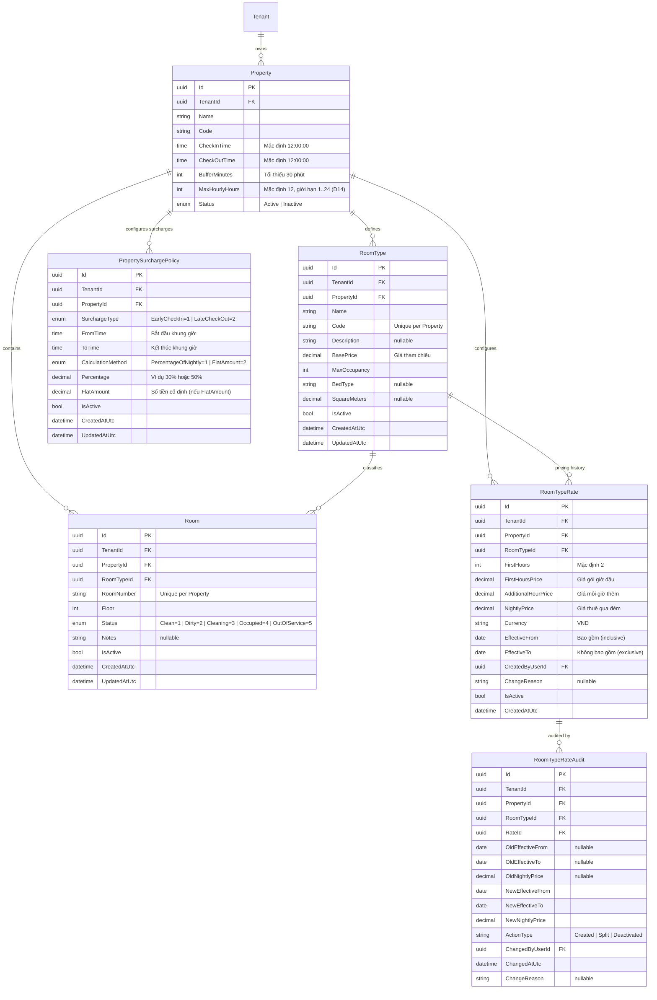
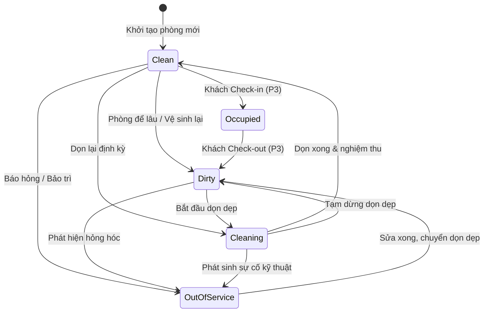
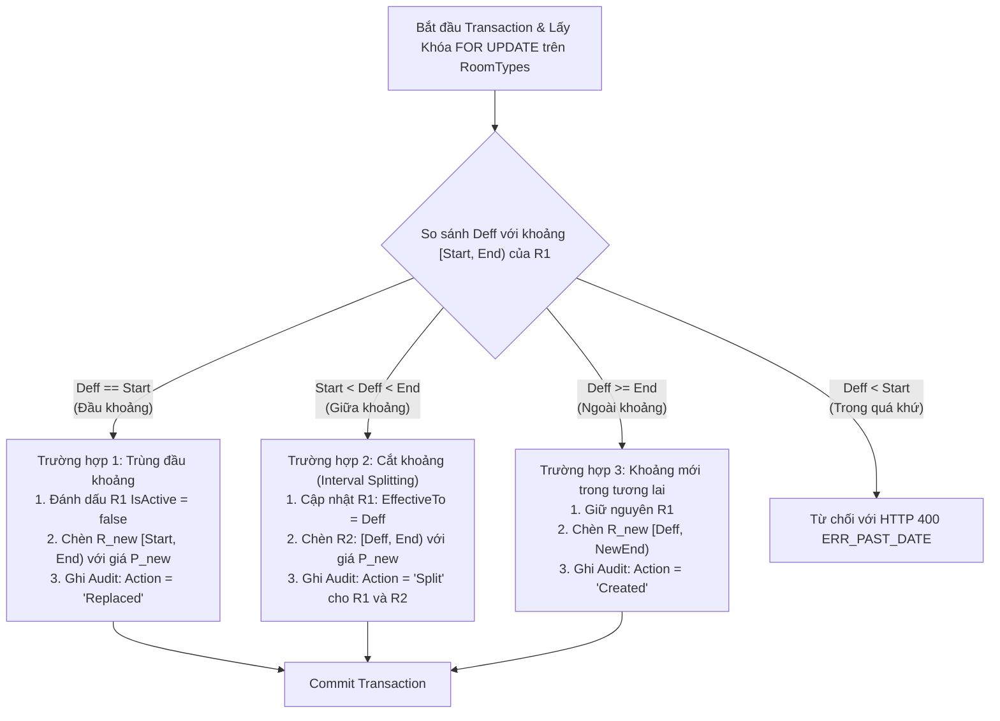
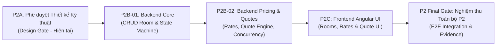

# Tài liệu Thiết kế Kỹ thuật P2A: Quản lý Phòng theo Chi nhánh, Phân hệ Bảng giá Giờ/Đêm & Động cơ Báo giá (Quote Engine)

> **Tài liệu:** P2A Design Specification | **Phiên bản:** 2.3 (Hoàn thiện Thiết kế Quản lý Chính sách Cơ sở, Pricing / Quote Engine & Đề xuất Chốt Giới hạn Thuê giờ P2B-02)  
> **Ngày cập nhật:** 2026-10-08  
> **Trạng thái:** 🎯 **P2B-01 ĐÃ NGHIỆM THU (176/176 TESTS GREEN) — TRÌNH PO DUYỆT CHỐT GIỚI HẠN THUÊ GIỜ TRƯỚC KHI CODE P2B-02**  
> **Ranh giới:** Chưa viết code/migration cho gói P2B-02; giữ nguyên hiện trạng solution và CSDL dev/prod; tập trung thẩm định thiết kế chính sách cơ sở và Quote Engine.

---

## 0. Bảng Mapping Xử lý Các Quyết định của PO & Findings của Reviewer

| STT | Quyết định PO / Finding Reviewer | Vị trí trong tài liệu | Giải pháp Kỹ thuật Đã Hoàn thiện | Trạng thái |
|:---:|---|:---:|---|:---:|
| **1** | **Rollback fail-closed: Kiểm tra cả `RoomTypeRates` và `RoomTypeRateAudits` trong `current_schema()`.** | Mục 5.2 & Mục 7.2 | • Script `Down()` kiểm tra cả hai bảng `RoomTypeRates` và `RoomTypeRateAudits` trong `current_schema()`.<br>• Nếu tồn tại bất kỳ bảng nào có `count > 0`, lập tức `RAISE EXCEPTION` chặn đứng rollback.<br>• Idempotent an toàn khi bảng rỗng. | **APPROVED & RESOLVED** |
| **2** | **Composite FK bảo vệ TenantId/PropertyId cho cả Audits với `ON DELETE RESTRICT`.** | Mục 4.1 & Mục 4.8 | • Bảng `RoomTypeRateAudits` liên kết bằng composite FK `("TenantId", "PropertyId", "RoomTypeId")` đến `RoomTypes("TenantId", "PropertyId", "Id")` với `ON DELETE RESTRICT`.<br>• Ngăn chặn 100% việc ghép sai scope chi nhánh hoặc xóa loại phòng đang có lịch sử audit. | **APPROVED & RESOLVED** |
| **3** | **Midpoint rounding: AwayFromZero, VND làm tròn 1 đồng.** | Mục 2 (D25) | Sử dụng `MidpointRounding.AwayFromZero`, làm tròn đến 1 đồng cho tiền tệ VND, không làm tròn ngân hàng `ToEven`. | **APPROVED & RESOLVED** |
| **4** | **Bảng giá lưu bằng bảng version riêng `RoomTypeRates`, thiếu giá thì fail-closed.** | Mục 2 & Mục 4.1 | • Tách bảng `RoomTypeRates` riêng biệt để bảo toàn lịch sử theo `[EffectiveFrom, EffectiveTo)`.<br>• Thiếu giá hiệu lực trả HTTP 422 `ERR_PRICING_NOT_CONFIGURED`, tuyệt đối không fallback `BasePrice`. | **APPROVED & RESOLVED** |
| **5** | **Thuê giờ cho phép mọi thời lượng dương (> 0), thu tối thiểu bằng gói đầu.** | Mục 2 (D04/D12) | Cho phép thời lượng $> 0$, ở dưới thời lượng gói đầu vẫn thu trọn giá của gói đầu tiên (`FirstHoursPrice`). | **APPROVED & RESOLVED** |
| **6** | **Dung sai walk-in: Cho phép lùi tối đa 30 phút.** | Mục 2 & Mục 4.6 | Đặt phòng walk-in cho phép `StartAtUtc >= DateTime.UtcNow.AddMinutes(-30)` giải quyết trễ tác vụ lễ tân. | **APPROVED & RESOLVED** |
| **7** | **Turnover buffer tối thiểu 30 phút, cơ sở chỉ được tăng; hết buffer không tự chuyển Clean.** | Mục 2 (D07) | Buffer $\ge 30$ phút giữa 2 lượt; hết buffer không tự đổi phòng sang `Clean` (cần nhân viên kiểm tra). | **APPROVED & RESOLVED** |
| **8** | **Quy tắc tính đêm 12:00-12:00, cộng giá hiệu lực từng đêm, nhận muộn không giảm giá.** | Mục 2 (D06) | Nhận ngày 10 trả ngày 13 = 3 đêm; cộng đơn giá hiệu lực từng đêm. Nhận muộn không tự trừ tiền. | **APPROVED & RESOLVED** |
| **9** | **Nhận sớm/trả muộn thiếu cấu hình phụ thu: Fail-closed dứt khoát.** | Mục 4.6 | Không cấu hình phụ thu trả HTTP 422 `ERR_SURCHARGE_NOT_CONFIGURED`, không tự tính 0 hay lấy giá giờ. | **APPROVED & RESOLVED** |
| **10** | **Giới hạn thuê giờ tối đa (12h vs 24h): PO chưa chốt, ghi nhận là Blocker cho P2B-02.** | Mục 3 | Ghi nhận blocker cho gói P2B-02 Pricing & Quotes. Khẳng định KHÔNG BLOCK gói P2B-01. | **RECORDED BLOCKER** |
| **11** | **P2B-01 là gate backend, không phải nghiệm thu toàn P2.** | Mục 1.1 & Mục 6 | P2B-01 là delivery gate cho CRUD Room/RoomType và State Machine; toàn bộ P2 bao gồm cả UI và E2E gate. | **APPROVED & RESOLVED** |

---

## 1. Mục tiêu, In-Scope & Out-of-Scope (Định vị trong Roadmap P2)

### 1.1. Mục tiêu Tổng thể của Phase P2
Theo Roadmap đã phê duyệt (`docs/implementation-phases.md`), Phase P2 có tên là **"Phòng và giá giờ/đêm"**, bao gồm cả Backend API và Frontend UI:
> *Dependency: P1. Files: Application/Rooms/RoomTypes, Domain Room/RoomType, persistence; frontend app.routes.ts/features/shared; tests.*  
> *Gate: UI đúng quyền, giá fixture xác định, lịch sử không bị ghi đè.*

Để thực thi an toàn và kiểm soát chất lượng chặt chẽ theo từng bước nhỏ:
- **P2A (Hiện tại):** Thiết kế Kỹ thuật Toàn diện (Technical Design Specification) cho Backend & Frontend.
- **P2B-01 (Backend Gate 1):** Triển khai Hardening CRUD Phòng, Loại phòng & State Machine Buồng phòng (Đang thực hiện).
- **P2B-02 (Backend Gate 2):** Triển khai Bảng giá Versioning (`RoomTypeRate`), Động cơ Báo giá (`Quote Engine`) và Concurrency Tests.
- **P2C (Frontend Gate):** Triển khai giao diện Angular UI quản lý phòng, bảng giá và tra cứu báo giá theo đúng quyền RBAC và ngữ cảnh chi nhánh.
- **P2 Final Gate (Nghiệm thu toàn bộ P2):** Kiểm thử E2E tích hợp đầy đủ Backend + Frontend; UI đúng quyền, giá fixture xác định, lịch sử không bị ghi đè.

⚠️ **Lưu ý cốt lõi:** Các gói `P2B-01` và `P2B-02` chỉ là các **kỹ thuật delivery gates của tầng Backend**, tuyệt đối **không thay thế và không phải là nghiệm thu hoàn thành toàn bộ Phase P2**.

### 1.2. In-Scope của Giai đoạn Triển khai P2B-01
1. **Chuẩn hóa CRUD Phòng (`Room`) & Loại phòng (`RoomType`) theo Ngữ cảnh Chi nhánh:**
   - Kế thừa toàn bộ nền tảng P1B-02B: bắt buộc xác thực context chi nhánh, gọi `IMembershipLookupService.ResolveMembershipAsync`, cấm ghi đè bởi quyền Tenant-Wide nếu membership chi nhánh đích bị thu hồi (`IsActive = false`).
   - Bất biến phạm vi (Scope Immutability): `TenantId` và `PropertyId` của `Room` và `RoomType` không được phép thay đổi sau khi tạo.
   - Kiểm tra liên kết loại phòng: Khi tạo hoặc cập nhật phòng, `RoomTypeId` phải tồn tại và thuộc đúng `TenantId` và `PropertyId` của chi nhánh đó.
   - Ràng buộc duy nhất theo chi nhánh: `RoomNumber` duy nhất trong cùng một `PropertyId`; `RoomType.Code` duy nhất trong cùng một `PropertyId`.
2. **State Machine Buồng phòng (Room Readiness State Machine):**
   - Khớp 100% với enum thực tế: `Clean = 1`, `Dirty = 2`, `Cleaning = 3`, `Occupied = 4`, `OutOfService = 5`.
   - Transition guards chặt chẽ: `Occupied` chỉ được kích hoạt bởi quy trình Check-in/Check-out của P3 (cấm cập nhật thủ công sang/từ `Occupied`); `Dirty` và `OutOfService` cấm chuyển thẳng sang `Clean`.
   - Update phòng thông thường (`UpdateRoomCommand`) không được phép thay đổi `Status` buồng phòng.
   - Cập nhật trạng thái phòng nguyên tử bằng Raw SQL độc lập (`UpdateRoomStatusAtomicAsync`) có điều kiện `ExpectedOldStatus`, `@TenantId`, `@PropertyId` trong mệnh đề `WHERE` để chống stale state update (HTTP 409 `ERR_STALE_STATE`).
3. **Chính sách Xóa An toàn (Safe Deletion & Historical Integrity):**
   - Phòng có đặt phòng đang hoạt động (`Confirmed`, `CheckedIn`, `PendingPayment`): Từ chối xóa với HTTP 409 `ERR_ROOM_HAS_ACTIVE_BOOKINGS`.
   - Phòng đã có lịch sử đặt phòng trong quá khứ: Chuyển sang Soft-Delete (`IsActive = false`) để bảo toàn toàn vẹn dữ liệu kế toán và lịch sử lưu trú.
   - Phòng chưa từng có đặt phòng nào: Cho phép Hard-Delete (`Remove`).
   - Loại phòng đang có phòng liên kết: Từ chối xóa với HTTP 409 `ERR_ROOMTYPE_IN_USE`.

### 1.3. Out-of-Scope (Không thực hiện trong P2B-01)
- Bảng giá `RoomTypeRate`, Động cơ Báo giá `Quote Engine`, Migration DB: Thuộc **P2B-02**.
- Giao diện người dùng Angular: Thuộc **P2C**.
- Vòng đời đơn đặt phòng `Reservation`: Thuộc **P3**.
- Thanh toán, hóa đơn: Thuộc **P4**.

---

## 2. Các Quyết định P0 & PO Đã Phê Duyệt Chính Thức (Authoritative Decisions)

Nguồn đối chiếu: [`docs/p0-decisions.md`](file:///C:/Dev/hotel-saas-v2/docs/p0-decisions.md) (D01–D13, D15–D25) và các quyết định PO phê duyệt ngày 2026-10-08:

| Mã Quyết định | Nội dung Đã Duyệt Chính thức | Ứng dụng Cụ thể trong Thiết kế P2 & Thực thi |
|---|---|---|
| **D01** | Nội bộ chọn phòng cụ thể; Online chọn loại phòng (server phân phòng khi hold). | Quản lý phòng vật lý theo loại phòng; Quote Engine hỗ trợ tính giá theo `RoomTypeId` hoặc phòng cụ thể `RoomId`. |
| **D02** | MVP hỗ trợ 2 hình thức: Theo giờ (Hourly) và Theo ngày/đêm (Overnight). | Không triển khai gói qua đêm ngắn riêng hoặc thuê tháng trong MVP. |
| **D04** | Giá gói giờ đầu, sau đó giá từng giờ phát sinh; số giờ gói và giá do chi nhánh cấu hình. | Bảng giá lưu trữ `FirstHours`, `FirstHoursPrice`, `AdditionalHourPrice` theo từng loại phòng của chi nhánh. |
| **D05** | Giờ phát sinh làm tròn lên mỗi 60 phút. Không mặc định grace period. | Đúng cuối gói không tính thêm; vượt 1 phút tính 1 giờ; vượt 60 phút tính 1 giờ; vượt 61 phút tính 2 giờ. Công thức: `CEILING(extraMinutes / 60.0)`. |
| **D06** | Theo ngày/đêm: check-in/check-out mặc định 12:00, cấu hình riêng theo cơ sở; không tính 24 giờ từ lúc khách đến. | Sử dụng `Property.CheckInTime` và `Property.CheckOutTime` (mặc định 12:00:00). Nhận ngày 10 trả ngày 13 = 3 đêm; cộng giá hiệu lực từng đêm. Nhận muộn không tự giảm giá một đêm. |
| **D07** | Khoảng cách giữa checkout lượt trước và check-in lượt sau trên cùng phòng tối thiểu 30 phút, áp dụng giờ/đêm; chi nhánh được tăng nhưng không giảm dưới 30 phút. | Ràng buộc `Property.BufferMinutes >= 30`. Hết buffer không tự chuyển phòng thành `Clean` (bắt buộc nhân viên kiểm tra đạt). |
| **D11** | MVP timezone `Asia/Ho_Chi_Minh`, tiền tệ `VND`; lưu thời điểm UTC, hiển thị/tính ngày theo giờ cơ sở. | Input/Output thời gian quy đổi chuẩn hóa qua timezone Việt Nam; lưu trữ UTC trong CSDL. |
| **D12** | Gói giờ đầu mặc định 2 giờ, sau đó giá từng giờ phát sinh. | Thiết lập giá trị mặc định `FirstHours = 2` cho các bảng giá thuê giờ demo. |
| **D13** | Fixture Standard: 150.000đ/2 giờ đầu, 50.000đ/giờ thêm, 400.000đ/đêm; là cấu hình demo, không hardcode. | Dữ liệu mẫu cố định cho integration tests: 3 giờ = 200.000đ; 3 giờ 1 phút = 250.000đ; 1 đêm = 400.000đ. |
| **D19 / Surcharge** | Nhận sớm/trả muộn dùng chính sách phụ thu riêng; thiếu cấu hình không tự đoán phí. | Nếu thiếu biểu phí phụ thu: Fail-closed từ chối báo giá ngay với HTTP 422 `ERR_SURCHARGE_NOT_CONFIGURED`. |
| **D20** | Quote TTL 5 phút, khác hold TTL 15 phút. | Kết quả báo giá mang thuộc tính `ExpiresAtUtc = RequestTime + 5 phút`. Không giữ phòng và không pin giá trước thay đổi chính sách. |
| **D25** | Midpoint rounding: AwayFromZero, VND làm tròn 1 đồng. | Sử dụng `MidpointRounding.AwayFromZero` làm tròn đến 1 đồng cho VND, lưu quy tắc trong snapshot. |
| **BR-PRICE01** | Bảng giá có hiệu lực theo khoảng ngày `[EffectiveFrom, EffectiveTo)`; không ghi đè; không để khoảng ngày chồng lấn. | Lưu vết lịch sử giá bằng bảng version riêng `RoomTypeRates`; sửa giá active dùng cơ chế cắt khoảng (Interval Splitting). |
| **BR-PRICE02** | Thay đổi giá có kiểm toán người thực hiện, thời điểm, lý do. | Lưu `CreatedByUserId`, `CreatedAtUtc`, `ChangeReason` trên từng bản ghi giá; audit table có composite FK với `ON DELETE RESTRICT`. |
| **BR-PRICE03** | Thiếu bảng giá hiệu lực: fail-closed, không fallback BasePrice. | Trả về HTTP 422 `ERR_PRICING_NOT_CONFIGURED` khi không tìm thấy bảng giá hợp lệ tại ngày lưu trú. |
| **BR-PRICE04** | Thuê giờ cho phép mọi thời lượng dương (> 0), vẫn thu tối thiểu bằng gói giờ đầu. | Cho phép đặt bất kỳ thời lượng $> 0$, thời lượng dưới gói đầu thu đủ `FirstHoursPrice`. |
| **BR-PRICE05** | Walk-in cho phép tạo booking lùi tối đa 30 phút. | Nhân viên có quyền `RESERVATIONS (Create)` được phép tạo booking với `StartAtUtc >= DateTime.UtcNow.AddMinutes(-30)`. |
| **BR-PRICE06** | Rollback fail-closed: Kiểm tra cả `RoomTypeRates` và `RoomTypeRateAudits` trong `current_schema()`. | Nếu `count > 0` trên bất kỳ bảng nào trong `current_schema()`, chặn đứng rollback bằng ngoại lệ fail-closed. |

---

## 3. Quyết định Giới hạn Thuê theo Giờ Tối đa (Quyết định D14 — Trạng thái: ĐÃ ĐƯỢC PO PHÊ DUYỆT / PO Approved)

### 3.1. Bối cảnh Nghiệp vụ & Quyết định Đã Chốt
> [!NOTE]
> **Trạng thái Quyết định:** Quyết định D14 **ĐÃ ĐƯỢC PO PHÊ DUYỆT CHÍNH THỨC (PO Approved)** theo Phương án C: Tham số `MaxHourlyHours` được cấu hình riêng theo từng cơ sở (1–24 giờ, mặc định 12 giờ). Khi thời lượng thuê vượt quá giới hạn này, hệ thống trả về HTTP 422 `ERR_HOURLY_LIMIT_EXCEEDED` và yêu cầu khách hàng/lễ tân chọn hình thức lưu trú khác (thuê theo đêm), tuyệt đối không tự động chuyển đổi sang thuê theo đêm.

Quyết định P0 mã **D14** đã được PO chốt phương án chính thức theo Phương án C.
Khi khách hàng yêu cầu thuê theo giờ:
- Nếu khách ở thời gian dài (ví dụ: 10 tiếng, 14 tiếng, 18 tiếng), chi phí cộng dồn theo giờ phát sinh (`FirstHoursPrice + ExtraHours * AdditionalHourPrice`) sẽ tăng tuyến tính.
- *Ví dụ thực tế với Fixture Standard:* Gói 2 giờ đầu 150.000đ, mỗi giờ thêm 50.000đ; giá 1 đêm là 400.000đ:
  - Ở 7 giờ: $150.000 + 5 \times 50.000 = 400.000đ$ (bằng đúng giá 1 đêm).
  - Ở 12 giờ: $150.000 + 10 \times 50.000 = 650.000đ$ (cao hơn 162% giá 1 đêm).
  - Ở 18 giờ: $150.000 + 16 \times 50.000 = 950.000đ$ (cao hơn 237% giá 1 đêm).
  - Ở 24 giờ: $150.000 + 22 \times 50.000 = 1.250.000đ$ (gấp hơn 3 lần giá 1 đêm).
- Do đó, hệ thống xác lập một **rào chắn giới hạn thời lượng thuê theo giờ tối đa** để:
  1. Ngăn chặn việc lạm dụng hình thức thuê giờ để chiếm dụng phòng qua đêm hoặc nhiều ngày mà không tính theo giá đêm.
  2. Tránh khiếu nại của khách hàng khi hóa đơn cộng dồn theo giờ vượt xa giá trọn gói theo đêm.
  3. Xác định ranh giới rõ ràng cho thuật toán kiểm tra tính hợp lệ (Validation) và Động cơ Báo giá (Quote Engine).

---

### 3.2. Ma trận So sánh 3 Phương án Đã Trình PO

| Tiêu chí Đánh giá | Phương án A: Cố định Cứng 12 Giờ | Phương án B: Cố định Cứng 24 Giờ | Phương án C (ĐÃ ĐƯỢC PO DUYỆT): Cấu hình Theo Từng Chi nhánh (`Property.MaxHourlyHours`) |
|:---|:---|:---|:---|
| **Đặc tả Kỹ thuật** | Bắt buộc thời lượng thuê giờ $\le 12$ tiếng (720 phút). Thuê $> 12$ tiếng trả HTTP 422 `ERR_HOURLY_LIMIT_EXCEEDED`. | Cho phép thuê giờ tối đa $\le 24$ tiếng (1440 phút). Thuê $> 24$ tiếng trả HTTP 422 `ERR_HOURLY_LIMIT_EXCEEDED`. | Bổ sung `MaxHourlyHours` vào `Property` ($1 \le MaxHourlyHours \le 24$, cấu hình mặc định 12 giờ). Chi nhánh tự quyết định trần thuê giờ theo mô hình vận hành của mình. |
| **Phù hợp Nghiệp vụ Khách sạn VN** | **Rất cao**: Đa số khách sạn/nhà nghỉ giờ tại Việt Nam quy định thuê giờ tối đa 6–12 tiếng ban ngày; qua mốc này chuyển sang tính theo đêm. | **Thấp**: Rất hiếm khách sạn tính giờ đến 24 tiếng vì giá giờ 24 tiếng (1.250.000đ) cao phi lý so với giá đêm (400.000đ). | **Tối ưu nhất**: Linh hoạt tuyệt đối cho từng chi nhánh: nhà nghỉ ngắn hạn có thể đặt 4–6 giờ, khách sạn thương mại đặt 8–12 giờ, mô hình căn hộ/studio đặt tối đa 24 giờ. |
| **Trải nghiệm Khách hàng & Minh bạch Giá** | Rõ ràng, dứt khoát; hướng dẫn khách chuyển sang thuê theo đêm nếu có nhu cầu lưu trú dài. | Nguy cơ khách bất ngờ/khiếu nại khi hóa đơn thuê giờ 18–20 tiếng cao gấp 3 lần giá đêm. | Minh bạch theo chính sách công bố của từng chi nhánh; thông báo rõ ràng lý do từ chối kèm giới hạn của cơ sở. |
| **Độ Phức tạp Triển khai (P2B-02)** | Rất thấp (hardcoded constant `12`). | Rất thấp (hardcoded constant `24`). | **Vừa phải, kiến trúc sạch**: Trường `MaxHourlyHours` trong `Property`, validation đọc theo cơ sở. |
| **Tính Khả chuyển & Mở rộng Tương lai** | Kém linh hoạt; muốn đổi cho resort/chi nhánh đặc thù phải sửa code backend. | Kém linh hoạt; không đáp ứng được các chi nhánh chỉ muốn cho thuê tối đa 4–6 tiếng. | **Cao nhất**: Hoàn toàn đồng bộ với triết lý đa cơ sở (Multi-property / Branch isolation) của kiến trúc SaaS P1. |

---

### 3.3. Quyết định PO Đã Phê duyệt & Ràng buộc Kỹ thuật
> **QUYẾT ĐỊNH ĐÃ DUYỆT (PO APPROVED):**
> 1. Thiết lập trường `Property.MaxHourlyHours` kiểu `int`, giá trị mặc định là **12 giờ**, với ràng buộc kiểm tra hợp lệ: $1 \le MaxHourlyHours \le 24$.
> 2. Khi client gọi báo giá hoặc tạo đặt phòng thuê giờ:
>    - Tính toán: $Duration = EndAtUtc - StartAtUtc$.
>    - Nếu $Duration > TimeSpan.FromHours(Property.MaxHourlyHours)$: Hệ thống fail-closed từ chối ngay lập tức với HTTP 422 Unprocessable Entity kèm mã lỗi:
>      ```json
>      {
>        "success": false,
>        "errorCode": "ERR_HOURLY_LIMIT_EXCEEDED",
>        "message": "Thời gian thuê theo giờ (14.5 giờ) vượt quá giới hạn tối đa cho phép của chi nhánh (12 giờ). Vui lòng chọn hình thức thuê theo đêm (Overnight)."
>      }
>      ```
> 3. Tuyệt đối không tự động chuyển đổi gói thuê giờ sang thuê đêm nếu khách hàng chưa chủ động yêu cầu, bảo đảm tính minh bạch và tránh tự suy diễn sai lệch ý muốn của khách hàng.
> 4. **Trạng thái:** **ĐÃ PHÊ DUYỆT (Approved)** bởi PO. Ràng buộc đã được chuẩn hóa trong cấu hình cơ sở và Quote Engine.


## 4. Thiết kế Kỹ thuật Chi tiết

### 4.1. Sơ đồ Thực thể Dữ liệu (ERD) & Cấu trúc Audit



---

### 4.2. Khớp Nối Enum & State Machine Buồng phòng (Room Readiness)

Khớp chính xác 100% với định nghĩa C# tại `HotelSaas.Domain.Enums.RoomStatus`:
```csharp
public enum RoomStatus
{
    Clean = 1,        // Phòng sạch, sẵn sàng đón khách
    Dirty = 2,        // Phòng bẩn, cần dọn dẹp
    Cleaning = 3,     // Đang dọn dẹp
    Occupied = 4,     // Đang có khách lưu trú
    OutOfService = 5  // Hỏng hóc / Đang bảo trì / Ngừng phục vụ
}
```

#### Ma trận Chuyển đổi Trạng thái Hợp lệ (Transition Matrix)

| Trạng thái hiện tại | Được phép chuyển sang | Bị cấm tuyệt đối | Quyền hạn / Trigger nghiệp vụ |
|---|---|---|---|
| **Clean (1)** | `Occupied (4)`, `Cleaning (3)`, `OutOfService (5)`, `Dirty (2)` | — | • `Occupied`: Chỉ kích hoạt qua Check-in (P3).<br>• `OutOfService`: Báo hỏng (`ROOMS (Update)`).<br>• `Dirty`: Phòng để lâu cần vệ sinh lại. |
| **Dirty (2)** | `Cleaning (3)`, `OutOfService (5)` | **CẤM chuyển thẳng sang `Clean (1)`**, `Occupied (4)` | • `Cleaning`: Nhân viên buồng phòng bắt đầu dọn (`HOUSEKEEPING (Update)`).<br>• `OutOfService`: Phát hiện hư hỏng (`ROOMS (Update)`). |
| **Cleaning (3)** | `Clean (1)`, `Dirty (2)`, `OutOfService (5)` | `Occupied (4)` | • `Clean`: Dọn xong và kiểm tra đạt (`HOUSEKEEPING (Update)`).<br>• `Dirty`: Dọn dở dang/bị hủy.<br>• `OutOfService`: Hư hỏng phát sinh. |
| **Occupied (4)** | `Dirty (2)` | **CẤM chuyển sang `Clean (1)`**, `Cleaning (3)`, `OutOfService (5)` | • `Dirty`: Chỉ kích hoạt khi khách Check-out (P3). Cấm nhân viên đổi trực tiếp sang bất kỳ trạng thái nào khác. |
| **OutOfService (5)**| `Dirty (2)` | **CẤM chuyển thẳng sang `Clean (1)`**, `Occupied (4)` | • `Dirty`: Bảo trì xong, chuyển về chờ buồng phòng dọn dẹp. Cấm chuyển thẳng sang `Clean` vì phòng bảo trì luôn có bụi bẩn/dụng cụ. |



---

### 4.3. Raw SQL Concurrency & Locking với Bắt buộc Ràng buộc Scope (TenantId & PropertyId)

> ⚠️ **NGUYÊN TẮC BẢO MẬT BẮT BUỘC:**  
> **Global Query Filter của EF Core và `TenantPropertySaveChangesInterceptor` CHỈ ÁP DỤNG CHO LINQ VÀ ENTITY TRACKING. CHÚNG KHÔNG TỰ ĐỘNG BỔ SUNG ĐIỀU KIỆN VÀO RAW SQL (`FromSqlRaw`, `ExecuteSqlRawAsync`, Dapper)!**  
> Do đó, mọi câu lệnh Raw SQL thực thi trực tiếp trên CSDL bắt buộc phải:
> 1. Gọi `IMembershipLookupService.ResolveMembershipAsync` trước tiên để xác minh quyền hạn của caller tại chi nhánh đích.
> 2. Truyền tham số và ràng buộc tường minh cả `@TenantId` và `@PropertyId` trong mệnh đề `WHERE`.

#### A. Câu lệnh Khóa Hàng Nguyên tử trên Bảng Cha `RoomTypes`
```sql
-- Bắt buộc ràng buộc TenantId và PropertyId trong câu lệnh FOR UPDATE
SELECT "Id" 
FROM "RoomTypes" 
WHERE "Id" = @RoomTypeId 
  AND "TenantId" = @TenantId 
  AND "PropertyId" = @PropertyId 
FOR UPDATE;
```
- Nếu không tìm thấy dòng (do sai `TenantId` hoặc `PropertyId`), truy vấn trả về 0 dòng $\rightarrow$ Handler lập tức ném `NotFoundException("Loại phòng không tồn tại trong chi nhánh này.")`, ngăn chặn hoàn toàn việc khóa tài nguyên của chi nhánh khác.

#### B. Câu lệnh Cập nhật Trạng thái Phòng Nguyên tử (Optimistic Concurrency)
```sql
-- Ràng buộc TenantId, PropertyId và ExpectedOldStatus
UPDATE "Rooms"
SET "Status" = @NewStatus, 
    "UpdatedAtUtc" = @NowUtc
WHERE "Id" = @RoomId 
  AND "TenantId" = @TenantId 
  AND "PropertyId" = @PropertyId 
  AND "Status" = @ExpectedOldStatus;
```
- Nếu `Rows Affected == 0`: Handler kiểm tra xem phòng có tồn tại thuộc chi nhánh hay không. Nếu có tồn tại nhưng trạng thái khác `@ExpectedOldStatus`, ném `ConflictException("ERR_STALE_STATE", "Trạng thái phòng đã thay đổi trước đó. Vui lòng làm mới trang.")` (HTTP 409 Conflict).

---

### 4.4. Cơ chế Chống Rate Overlap, Pre-check `btree_gist` & Mapping SQLSTATE `23P01`

#### A. Pre-check Extension `btree_gist` và Quyền Tạo Extension
PostgreSQL Exclusion Constraint trên kiểu dữ liệu hỗn hợp (UUID + Daterange) yêu cầu extension `btree_gist`.
- **Thực tế phân quyền môi trường:** Trên các dịch vụ đám mây (AWS RDS, Azure Database for PostgreSQL, GCP Cloud SQL), tài khoản ứng dụng thường không có quyền `SUPERUSER`.
- **Quy trình triển khai:**
  1. Trong script kiểm tra lược đồ trước migration (`01_SchemaPreCheckAndRecovery.sql`):
     ```sql
     DO $$
     BEGIN
         IF NOT EXISTS (SELECT 1 FROM pg_extension WHERE extname = 'btree_gist') THEN
             BEGIN
                 CREATE EXTENSION IF NOT EXISTS btree_gist;
             EXCEPTION WHEN insufficient_privilege THEN
                 RAISE EXCEPTION 'DATABASE PRE-CHECK FAILED: Extension "btree_gist" chưa được cài đặt và user hiện tại không có quyền CREATE EXTENSION. Vui lòng yêu cầu DBA/Superuser chạy: CREATE EXTENSION btree_gist;';
             END;
         END IF;
     END $$;
     ```
  2. Bổ sung ghi chú rõ ràng trong tài liệu triển khai để quản trị viên CSDL kích hoạt extension trước khi chạy migration.

#### B. Định nghĩa Exclusion Constraint
```sql
ALTER TABLE "RoomTypeRates"
ADD CONSTRAINT "EXCLUDE_RoomTypeRates_NoOverlap"
EXCLUDE USING gist (
    "TenantId" WITH =,
    "PropertyId" WITH =,
    "RoomTypeId" WITH =,
    daterange("EffectiveFrom", "EffectiveTo", '[)') WITH &&
) WHERE ("IsActive" = true);
```

#### C. Mapping Mã Lỗi CSDL SQLSTATE `23P01` thành `ERR_RATE_OVERLAP`
Khi có hai transaction đồng thời cố tình chèn khoảng ngày chồng lấn, câu lệnh vi phạm sẽ bị PostgreSQL từ chối với mã lỗi SQLSTATE chuẩn: **`23P01` (`exclusion_violation`)**.
- Trong `ExceptionHandlingMiddleware` của WebApi:
  ```csharp
  if (exception is DbUpdateException dbEx && 
      dbEx.InnerException is PostgresException pgEx && 
      pgEx.SqlState == PostgresErrorCodes.ExclusionViolation) // "23P01"
  {
      context.Response.StatusCode = StatusCodes.Status409Conflict;
      await context.Response.WriteAsJsonAsync(new ErrorResponse(
          "ERR_RATE_OVERLAP", 
          "Khoảng ngày hiệu lực bị chồng lấn với bảng giá hiện có của loại phòng này."));
      return;
  }
  ```

---

### 4.5. Thuật toán Cắt Khoảng (Interval Splitting) với Audit Đầy Đủ trong Cùng Transaction

Khi người quản lý thiết lập mức giá mới $P_{new}$ áp dụng từ ngày $D_{eff}$ cho một loại phòng đang có bảng giá active $R_1$: `[Start, End)` với mức giá cũ $P_{old}$:

Toàn bộ quy trình phải được thực thi trong **CÙNG MỘT TRANSACTION NGUYÊN TỬ** có khóa `FOR UPDATE` trên `RoomTypes`:



#### Chi tiết 3 Trường hợp:
1. **Trường hợp 1: $D_{eff} == Start$ (Bằng đầu khoảng):**
   - Không thể chia cắt vì không có khoảng thời gian trước $D_{eff}$.
   - Cập nhật bản ghi $R_1$: Nếu chưa có booking nào tham chiếu, cập nhật giá mới; nếu đã có booking tham chiếu, đánh dấu $R_1.IsActive = false$ và chèn bản ghi mới `[Start, End)` với $P_{new}$.
   - Ghi audit: `ActionType = "Replaced"`, lưu chi tiết giá cũ $P_{old}$ và giá mới $P_{new}$.
2. **Trường hợp 2: $Start < D_{eff} < End$ (Giữa khoảng - Chia cắt):**
   - Bản ghi cũ $R_1$ được thu hẹp khoảng hiệu lực: `EffectiveTo = D_{eff}`. Bản ghi này trở thành `[Start, D_{eff})` với mức giá cũ $P_{old}$.
   - Chèn bản ghi mới $R_2$: `[D_{eff}, End)` với mức giá mới $P_{new}$.
   - Ghi audit:
     - Audit 1: `RateId = R1.Id`, `ActionType = "Split_Shortened"`, `OldEffectiveTo = End`, `NewEffectiveTo = Deff`.
     - Audit 2: `RateId = R2.Id`, `ActionType = "Split_Created"`, `NewEffectiveFrom = Deff`, `NewEffectiveTo = End`, `NewNightlyPrice = P_new`.
3. **Trường hợp 3: $D_{eff} \ge End$ (Ngoài khoảng):**
   - Khoảng mới nằm hoàn toàn sau $R_1$. Giữ nguyên $R_1$, chèn bản ghi mới độc lập sau khi kiểm tra không overlap với các khoảng tương lai khác.

---

### 4.6. Chốt Contract Duy nhất: Overnight, Nhận Sớm/Trả Muộn & Hourly

#### A. Contract Thuê theo Đêm (Overnight)
- Tính theo ngày lưu trú địa phương cơ sở (`Asia/Ho_Chi_Minh` theo D11).
- Mốc nhận/trả chuẩn: `Property.CheckInTime` đến `Property.CheckOutTime` (mặc định 12:00–12:00 hôm sau theo D06).
- Số đêm = `CheckOutDate - CheckInDate` (tối thiểu 1 đêm).
- Tiền phòng tiêu chuẩn = Tổng đơn giá `NightlyPrice` của từng đêm lưu trú (truy vấn theo `RoomTypeRate` tương ứng từng đêm).
- Phụ thu nhận sớm / trả muộn: Tính toán theo biểu phí phụ thu `PropertySurchargePolicies` của chi nhánh (nếu phát sinh ngoài mốc 12:00).
- Tổng tiền = Tiền phòng tiêu chuẩn + Phụ thu nhận sớm + Phụ thu trả muộn.

#### B. Chốt Hành vi Duy nhất khi Thiếu Phụ thu Nhận Sớm / Trả Muộn (Fail-Closed)
Căn cứ quyết định D19 và D25:
> **HÀNH VI DUY NHẤT ĐƯỢC XÁC LẬP:**  
> Khi yêu cầu báo giá theo đêm có thời điểm nhận phòng sớm hơn `CheckInTime` hoặc trả phòng muộn hơn `CheckOutTime`:  
> Nếu cơ sở **chưa cấu hình biểu phí phụ thu (Early Check-in / Late Check-out Policy)**:  
> $\rightarrow$ Hệ thống **FAIL-CLOSED TỪ CHỐI BÁO GIÁ NGAY LẬP TỨC** với mã lỗi HTTP 422 Unprocessable Entity `ERR_SURCHARGE_NOT_CONFIGURED` ("Chi nhánh chưa cấu hình biểu phí phụ thu nhận sớm/trả muộn. Không thể xuất báo giá ngoài khung giờ chuẩn").  
> **Tuyệt đối cấm:** (1) Không tự ý gán phí = 0đ; (2) Không tự ý lấy bảng giá thuê giờ làm phụ thu đêm; (3) Không âm thầm bỏ qua khoảng thời gian nhận sớm/trả muộn để báo giá khung chuẩn gây hiểu lầm cho khách.

#### C. Thuê theo Giờ (Hourly) & Ràng buộc Giới hạn Thời lượng Tối đa (D14 - Đã được PO Phê duyệt)
- Bảng giá của một phiên thuê theo giờ được xác định tại thời điểm bắt đầu phiên (`StartAtUtc`), quy đổi sang ngày địa phương cơ sở (`Asia/Ho_Chi_Minh` / UTC+7).
- Áp dụng thống nhất bản ghi `RoomTypeRate` đó cho cả gói giờ đầu và toàn bộ các giờ phát sinh của phiên, bảo đảm tính trọn gói của sản phẩm (D04).
- Thời lượng chính xác: $Duration = EndAtUtc - StartAtUtc$ (dùng `TimeSpan`, tuyệt đối không làm tròn trung gian `Math.Round` trên số phút).
- **Kiểm tra giới hạn tối đa:** Nếu $Duration > TimeSpan.FromHours(Property.MaxHourlyHours)$, lập tức từ chối với HTTP 422 `ERR_HOURLY_LIMIT_EXCEEDED` ("Thời gian thuê theo giờ vượt quá giới hạn tối đa cho phép của chi nhánh ({MaxHourlyHours} giờ). Vui lòng chọn hình thức thuê theo đêm.").
- **Công thức tính tiền thuê giờ:**
  - Nếu $Duration \le TimeSpan.FromHours(FirstHours)$: Tính trọn gói giờ đầu `FirstHoursPrice` (cho phép mọi thời lượng $> 0$, D04/BR-PRICE04).
  - Nếu $Duration > TimeSpan.FromHours(FirstHours)$:
    - $ExtraDuration = Duration - TimeSpan.FromHours(FirstHours)$.
    - $ExtraHours = \lceil ExtraDuration.TotalHours \rceil$ (làm tròn lên trực tiếp theo giờ, tuyệt đối không làm tròn phút trước khi ceil, D05).
    - $TotalAmount = FirstHoursPrice + ExtraHours \times AdditionalHourPrice$.
- **Làm tròn tiền VND (Decision D25):** Toàn bộ đơn giá (`UnitPrice`), thành tiền từng dòng (`Amount`), phụ thu và tổng tiền (`TotalAmount`) làm tròn 1 đồng VND theo nguyên tắc `MidpointRounding.AwayFromZero`.

#### D. Kiểm soát Quyền hạn & Các Khoảng Thời Gian Không Hợp Lệ (Invalid Boundaries)
1. **Kiểm tra Quyền hạn & Membership (Fail-Closed):**
   - Quote Engine bắt buộc ngữ cảnh xác thực (`TenantId`, `UserId`). Thiếu ngữ cảnh trả HTTP 401 `UnauthorizedAccessException`.
   - Ngữ cảnh chi nhánh (`X-Property-Id`, Token) không khớp nội dung trả HTTP 400 `ERR_CONTEXT_MISMATCH`.
   - Chỉ trạng thái `MembershipLookupStatus.Success` mới được tiếp tục. Mọi trạng thái khác (Revoked, Inactive, Forbidden, v.v.) lập tức fail-closed với HTTP 403 / 404 / 409.
2. **Khớp Ngày theo Múi giờ Chi nhánh (Timezone Date Matching):**
   - `StartAtUtc` và `EndAtUtc` được quy đổi sang múi giờ chi nhánh (`Asia/Ho_Chi_Minh` / UTC+7) thành `startDateLocal` và `endDateLocal`.
   - Đối với thuê theo đêm (`RentalType.Overnight`), `CheckInDate` bắt buộc phải khớp `startDateLocal` và `CheckOutDate` bắt buộc phải khớp `endDateLocal`.
   - Nếu có sự sai lệch (ví dụ khách ở 3 đêm nhưng gửi `CheckOutDate` chỉ tính 1 đêm), hệ thống lập tức từ chối với HTTP 400 `ERR_DATE_TIMEZONE_MISMATCH` ("Ngày nhận/trả phòng không khớp với thời điểm bắt đầu/kết thúc theo múi giờ chi nhánh"), bảo vệ toàn vẹn số đêm và doanh thu cơ sở.
3. **Từ chối RentalType Ngoài Enum & Cấm Báo Giá 0đ:**
   - Chỉ chấp nhận `RentalType.Hourly` (1) và `RentalType.Overnight` (2). Mọi giá trị khác (ví dụ: 0, 99) bị từ chối ngay với HTTP 400 `ERR_INVALID_RENTAL_TYPE`.
   - Tuyệt đối cấm trả về báo giá 0đ (`TotalAmount <= 0` lập tức fail-closed với HTTP 422 `ERR_INVALID_QUOTE_TOTAL`).
4. **Các Ranh giới Thời gian Bị Chặn:**
   - `EndAtUtc <= StartAtUtc`: `ERR_INVALID_DURATION` (HTTP 400).
   - Thuê theo đêm có `CheckOutDate <= CheckInDate`: `ERR_INVALID_OVERNIGHT` (HTTP 400).
   - Ngày bắt đầu trong quá khứ vượt quá dung sai walk-in 30 phút (`StartAtUtc < UtcNow - 30 minutes`): `ERR_PAST_DATE` (HTTP 400).

---

### 4.7. Bản Chất của Báo Giá (Quote Specification & Boundary)

1. **Quote là Báo giá Tham khảo Được Backend Xác minh (Verified Price Estimate):**
   - API `POST /api/quotes/calculate` thực hiện kiểm tra loại phòng, chi nhánh, khoảng thời gian và bảng giá tại thời điểm gọi.
   - Trả về tổng tiền, breakdown chi tiết và `ExpiresAtUtc = RequestTime + 5 phút` (theo D20).
   - Làm tròn tiền tệ: `MidpointRounding.AwayFromZero` đến 1 đồng cho VND (D25).
2. **Ranh giới Tuyệt đối về TTL của Quote:**
   - **TTL 5 phút KHÔNG ĐỒNG NGHĨA VỚI GIỮ PHÒNG (Room Hold):** Báo giá không khóa phòng, không chiếm tồn kho phòng. Tồn phòng chỉ được giữ khi tạo Hold online (P5 - Hold 15 phút) hoặc tạo Reservation nội bộ (P3).
   - **TTL 5 phút KHÔNG ĐỒNG NGHĨA VỚI PIN/GIỮ GIÁ CỐ ĐỊNH TRƯỚC BIẾN ĐỘNG CHÍNH SÁCH:** Nếu trong 5 phút đó, người quản lý cập nhật bảng giá mới, khi tiến hành đặt phòng (P3/P5), backend bắt buộc phải revalidate lại giá. Nếu giá đã thay đổi, hệ thống yêu cầu xác nhận lại giá mới (theo D20 và BR-PRICE01).
   - Giá chỉ trở thành bất biến (Immutable Pricing Snapshot) một khi đơn đặt phòng (`Reservation`) đã được ghi nhận thành công vào cơ sở dữ liệu.

#### API Contract: `POST /api/quotes/calculate`
- **Request Body:**
  ```json
  {
    "propertyId": "3fa85f64-5717-4562-b3fc-2c963f66afa6",
    "roomTypeId": "7ca85f64-5717-4562-b3fc-2c963f66afa7",
    "rentalType": "Hourly", // "Hourly" | "Overnight"
    "startAtUtc": "2026-10-15T08:00:00Z",
    "endAtUtc": "2026-10-15T11:00:00Z",
    "checkInDate": null, // "2026-10-15" (Bắt buộc nếu Overnight)
    "checkOutDate": null  // "2026-10-18" (Bắt buộc nếu Overnight)
  }
  ```
- **Success Response (HTTP 200 OK):**
  ```json
  {
    "success": true,
    "data": {
      "propertyId": "3fa85f64-5717-4562-b3fc-2c963f66afa6",
      "roomTypeId": "7ca85f64-5717-4562-b3fc-2c963f66afa7",
      "roomTypeName": "Deluxe Sea View",
      "rentalType": "Hourly",
      "totalAmount": 200000.0,
      "currency": "VND",
      "expiresAtUtc": "2026-10-15T08:05:00Z",
      "breakdown": [
        {
          "description": "Gói 2 giờ đầu tiên",
          "unitPrice": 150000.0,
          "quantity": 1,
          "amount": 150000.0
        },
        {
          "description": "Giờ phát sinh (1 giờ thêm)",
          "unitPrice": 50000.0,
          "quantity": 1,
          "amount": 50000.0
        }
      ],
      "appliedPolicies": {
        "maxHourlyHours": 12,
        "bufferMinutes": 30,
        "checkInTime": "12:00:00",
        "checkOutTime": "12:00:00"
      }
    }
  }
  ```

---

### 4.8. Khóa Ngoại Phức Hợp (Composite Foreign Key) Bảo Vệ Tenant/Property Cho Cả Bảng Bảng Giá & Audit

Định nghĩa Composite Unique Key trên `RoomTypes`:
```sql
ALTER TABLE "RoomTypes"
ADD CONSTRAINT "UQ_RoomTypes_Tenant_Property_Id"
UNIQUE ("TenantId", "PropertyId", "Id");
```

Bảng `RoomTypeRates` và bảng `RoomTypeRateAudits` đều liên kết bằng Composite Foreign Key với `ON DELETE RESTRICT`:
```sql
-- Khóa ngoại phức hợp cho bảng giá
ALTER TABLE "RoomTypeRates"
ADD CONSTRAINT "FK_RoomTypeRates_RoomTypes_Composite"
FOREIGN KEY ("TenantId", "PropertyId", "RoomTypeId")
REFERENCES "RoomTypes" ("TenantId", "PropertyId", "Id")
ON DELETE RESTRICT;

-- Khóa ngoại phức hợp cho bảng audit giá
ALTER TABLE "RoomTypeRateAudits"
ADD CONSTRAINT "FK_RoomTypeRateAudits_RoomTypes_Composite"
FOREIGN KEY ("TenantId", "PropertyId", "RoomTypeId")
REFERENCES "RoomTypes" ("TenantId", "PropertyId", "Id")
ON DELETE RESTRICT;
```
Bảo đảm 100% ở tầng CSDL không thể xuất hiện tình trạng bảng giá hoặc audit mang `PropertyId = P1` nhưng `RoomTypeId` thuộc `P2`, đồng thời ngăn chặn xóa loại phòng khi đang có dữ liệu giá hoặc audit lịch sử.

---

### 4.9. Đặc tả Quản lý Chính sách Từng Cơ sở (Property Policies Management Specification)

Hệ thống cho phép người quản lý từng chi nhánh (Owner/Manager) cấu hình và tùy biến các chính sách vận hành độc lập theo từng `PropertyId`.

#### A. Danh mục Chính sách Từng Cơ sở
1. **Khung giờ Nhận / Trả phòng Chuẩn theo Đêm (`CheckInTime`, `CheckOutTime`):**
   - Mặc định: `12:00:00` – `12:00:00` hôm sau (theo D06).
   - Cơ sở có thể tùy chỉnh: ví dụ nhận 14:00, trả 12:00.
2. **Thời gian Dọn phòng (Turnover Buffer - `BufferMinutes`):**
   - Mặc định: `30` phút (theo D07).
   - **Ràng buộc bất biến:** $BufferMinutes \ge 30$. Chi nhánh chỉ có quyền tăng, tuyệt đối cấm cấu hình $< 30$ phút. Vi phạm trả HTTP 400 `ERR_BUFFER_TOO_SHORT`.
3. **Giới hạn Thời lượng Thuê theo Giờ Tối đa (`MaxHourlyHours` - D14):**
   - Mặc định: `12` giờ.
   - Ràng buộc: $1 \le MaxHourlyHours \le 24$.
4. **Biểu phí Phụ thu Nhận sớm / Trả muộn (`PropertySurchargePolicy`):**
   - Khung giờ nhận sớm: ví dụ 05:00–09:00 (50%), 09:00–12:00 (30%).
   - Khung giờ trả muộn: ví dụ 12:00–15:00 (30%), 15:00–18:00 (50%).
   - Ràng buộc: Các khung giờ trong cùng loại phụ thu không được chồng lấn nhau.
   - Thiếu cấu hình cho khung giờ phát sinh: Fail-closed HTTP 422 `ERR_SURCHARGE_NOT_CONFIGURED`.
5. **Dung sai Đặt phòng Walk-in:**
   - Cho phép nhân viên lễ tân ghi nhận lùi tối đa 30 phút (`StartAtUtc >= UtcNow - 30 minutes`).

#### B. API Contract: `GET /api/properties/{propertyId}/policies`
- **Quyền yêu cầu:** `PROPERTIES (Read)`
- **Response (HTTP 200 OK):**
  ```json
  {
    "success": true,
    "data": {
      "propertyId": "3fa85f64-5717-4562-b3fc-2c963f66afa6",
      "checkInTime": "12:00:00",
      "checkOutTime": "12:00:00",
      "bufferMinutes": 30,
      "maxHourlyHours": 12,
      "surcharges": [
        {
          "id": "11a85f64-5717-4562-b3fc-2c963f66afa1",
          "surchargeType": "EarlyCheckIn",
          "fromTime": "05:00:00",
          "toTime": "09:00:00",
          "calculationMethod": "PercentageOfNightly",
          "percentage": 50.0,
          "flatAmount": null,
          "isActive": true
        },
        {
          "id": "12a85f64-5717-4562-b3fc-2c963f66afa2",
          "surchargeType": "EarlyCheckIn",
          "fromTime": "09:00:00",
          "toTime": "12:00:00",
          "calculationMethod": "PercentageOfNightly",
          "percentage": 30.0,
          "flatAmount": null,
          "isActive": true
        },
        {
          "id": "13a85f64-5717-4562-b3fc-2c963f66afa3",
          "surchargeType": "LateCheckOut",
          "fromTime": "12:00:00",
          "toTime": "15:00:00",
          "calculationMethod": "PercentageOfNightly",
          "percentage": 30.0,
          "flatAmount": null,
          "isActive": true
        },
        {
          "id": "14a85f64-5717-4562-b3fc-2c963f66afa4",
          "surchargeType": "LateCheckOut",
          "fromTime": "15:00:00",
          "toTime": "18:00:00",
          "calculationMethod": "PercentageOfNightly",
          "percentage": 50.0,
          "flatAmount": null,
          "isActive": true
        }
      ]
    }
  }
  ```

#### C. API Contract: `PUT /api/properties/{propertyId}/policies`
- **Quyền yêu cầu:** `PROPERTIES (Update)` (Chỉ Owner và Branch Manager)
- **Validation Rules:**
  - `bufferMinutes >= 30` (vi phạm $\to$ 400 `ERR_BUFFER_TOO_SHORT`).
  - `1 <= maxHourlyHours <= 24` (vi phạm $\to$ 400 `ERR_INVALID_HOURLY_LIMIT`).
  - Surcharge time ranges không được overlap (vi phạm $\to$ 400 `ERR_SURCHARGE_OVERLAP`).
  - `percentage > 0 && percentage <= 100` nếu tính theo Percentage (vi phạm $\to$ 400 `ERR_INVALID_SURCHARGE_VALUE`).
  - Bắt buộc gọi `ResolveMembershipAsync` xác thực quyền tại chi nhánh đích (Fail-closed).

---

## 5. Tác động Dữ liệu, Migration & Chiến Lược Rollback Fail-Closed

### 5.1. Tác động Lược đồ (Schema Changes)
- Thêm cột `MaxHourlyHours` (integer, NOT NULL, DEFAULT 12) vào bảng `Properties` với check constraint `("MaxHourlyHours" >= 1 AND "MaxHourlyHours" <= 24)`.
- Thêm 3 bảng mới:
  1. `RoomTypeRates`: Quản lý giá giờ và giá đêm có hiệu lực theo daterange.
  2. `RoomTypeRateAudits`: Lưu vết lịch sử thay đổi giá và thao tác cắt khoảng (Interval Splitting).
  3. `PropertySurchargePolicies`: Lưu biểu phí phụ thu nhận sớm và trả muộn theo từng chi nhánh.
- Thêm Composite Unique Constraint trên `RoomTypes(TenantId, PropertyId, Id)`.
- Thêm Composite Foreign Keys:
  - Trên `RoomTypeRates` và `RoomTypeRateAudits` liên kết đến `RoomTypes(TenantId, PropertyId, Id)` với `ON DELETE RESTRICT`.
  - Trên `PropertySurchargePolicies` liên kết đến `Properties(TenantId, Id)` với `ON DELETE RESTRICT`.
- Thêm Exclusion Constraint `EXCLUDE_RoomTypeRates_NoOverlap` trên `RoomTypeRates` sử dụng extension `btree_gist`.
- Tuân thủ Dual Baseline Migration (P1B-01A): Chạy trên schema cô lập của test DB, tuyệt đối không chạm vào `hotel_saas_dev`.

### 5.2. Chiến Lược Rollback Fail-Closed & Quy Trình Khôi Phục (Recovery/Reapply)

> ⚠️ **NGUYÊN TẮC BẢO VỆ DỮ LIỆU KINH DOANH:**  
> Tuyệt đối không sử dụng lệnh drop tự động hoặc tạo bảng backup tạm thời bằng `CREATE TABLE IF NOT EXISTS ... DROP TABLE` vì tiềm ẩn nguy cơ ghi đè backup hoặc mất dữ liệu âm thầm khi downgrade schema.

#### Script Rollback Fail-Closed trong Phương thức `Down()`
```sql
DO $$
DECLARE
    v_rates_count bigint := 0;
    v_audits_count bigint := 0;
    v_surcharges_count bigint := 0;
BEGIN
    IF EXISTS (SELECT 1 FROM information_schema.tables WHERE table_schema = current_schema() AND table_name = 'RoomTypeRates') THEN
        SELECT count(*) INTO v_rates_count FROM "RoomTypeRates";
    END IF;
    IF EXISTS (SELECT 1 FROM information_schema.tables WHERE table_schema = current_schema() AND table_name = 'RoomTypeRateAudits') THEN
        SELECT count(*) INTO v_audits_count FROM "RoomTypeRateAudits";
    END IF;
    IF EXISTS (SELECT 1 FROM information_schema.tables WHERE table_schema = current_schema() AND table_name = 'PropertySurchargePolicies') THEN
        SELECT count(*) INTO v_surcharges_count FROM "PropertySurchargePolicies";
    END IF;
    
    -- NGUYÊN TẮC FAIL-CLOSED: Có dữ liệu kinh doanh thì KHÔNG ĐƯỢC DROP!
    IF v_rates_count > 0 OR v_audits_count > 0 OR v_surcharges_count > 0 THEN
        RAISE EXCEPTION 'MIGRATION ROLLBACK ABORTED (FAIL-CLOSED): Schema "%" đang chứa dữ liệu kinh doanh (RoomTypeRates: % bản ghi, RoomTypeRateAudits: % bản ghi, PropertySurchargePolicies: % bản ghi). Tuyệt đối không drop bảng tự động để tránh mất dữ liệu. Vui lòng thực hiện quy trình sao lưu và dọn dẹp thủ công có phê duyệt trước khi hạ cấp schema.', current_schema(), v_rates_count, v_audits_count, v_surcharges_count;
    END IF;
    
    -- Chỉ cho phép drop khi toàn bộ các bảng mới hoàn toàn rỗng trong current_schema()
    DROP TABLE IF EXISTS "PropertySurchargePolicies";
    DROP TABLE IF EXISTS "RoomTypeRateAudits";
    DROP TABLE IF EXISTS "RoomTypeRates";
    
    -- Gỡ bỏ cột MaxHourlyHours trên Properties nếu tồn tại
    IF EXISTS (SELECT 1 FROM information_schema.columns WHERE table_schema = current_schema() AND table_name = 'Properties' AND column_name = 'MaxHourlyHours') THEN
        ALTER TABLE "Properties" DROP COLUMN "MaxHourlyHours";
    END IF;
END $$;
```

#### Quy Trình Khôi Phục & Tái Áp Dụng (Recovery / Reapply Flow)
1. **Bước 1 (Phát hiện & Chặn đứng):** Khi lệnh rollback chạy trên môi trường có dữ liệu, script fail-closed lập tức ngắt quá trình và ghi log cảnh báo rõ ràng số lượng bản ghi hiện có.
2. **Bước 2 (Sao lưu có kiểm toán):** Quản trị viên/DBA xuất toàn bộ dữ liệu bảng `RoomTypeRates` và `RoomTypeRateAudits` ra tệp lưu trữ nén độc lập (Cold Storage) có chữ ký số và biên bản phê duyệt của Tenant Owner.
3. **Bước 3 (Thực hiện Hạ cấp):** Sau khi sao lưu thành công, thực hiện `TRUNCATE TABLE "RoomTypeRateAudits", "RoomTypeRates";`, sau đó chạy lại lệnh rollback `Down()` thành công.
4. **Bước 4 (Tái áp dụng & Nhập lại):** Khi cần nâng cấp lại (`Up()`), chạy migration để tái tạo cấu trúc bảng, sau đó chạy script import phục hồi lại dữ liệu từ tệp lưu trữ.

---

## 6. Lộ trình Phân kỳ Triển khai & Các Delivery Gates



1. **Gate 1: P2A (Thiết kế Kỹ thuật - Hiện tại):** PO & Reviewer phê duyệt tài liệu thiết kế v2.1 và chốt 6 câu hỏi mở tại Mục 3.
2. **Gate 2: P2B-01 (Backend Delivery Gate 1):**
   - Triển khai transition guards và optimistic concurrency cho `RoomStatus` (`Clean`, `Dirty`, `Cleaning`, `Occupied`, `OutOfService`) với ràng buộc tường minh `@TenantId` và `@PropertyId`.
   - Hardening `UpdateRoom`, `DeleteRoom`, `UpdateRoomType`, `DeleteRoomType` với `ResolveMembershipAsync` và `OriginalValue` concurrency tokens.
   - Kiểm thử đơn vị và tích hợp PostgreSQL cô lập.
3. **Gate 3: P2B-02 (Backend Delivery Gate 2):**
   - Triển khai Entity `RoomTypeRate`, `RoomTypeRateAudit`, migration Dual Baseline trên test DB, Composite FK, pre-check `btree_gist`.
   - Triển khai thuật toán chống rate overlap với `FOR UPDATE` (ràng buộc Tenant/Property) và `EXCLUDE USING gist`, map SQLSTATE `23P01`.
   - Triển khai thuật toán Interval Splitting và `QuoteCalculationService` với fail-closed phụ thu.
   - Chạy bộ kiểm thử concurrency 2 kết nối song song trên PostgreSQL.
4. **Gate 4: P2C (Frontend Delivery Gate):**
   - Triển khai giao diện quản lý danh sách phòng, trạng thái buồng phòng, bảng giá và công cụ tính báo giá trong Angular frontend theo đúng quyền và branch selector.
5. **Gate 5: P2 Final Gate (Nghiệm thu Toàn bộ Phase P2):**
   - Chạy toàn bộ E2E tests kiểm chứng: UI đúng quyền, giá fixture xác định, lịch sử không bị ghi đè.

---

## 7. Tiêu chí Nghiệm thu & Ma trận Kiểm thử

### 7.1. Tiêu chí Nghiệm thu Kỹ thuật (Acceptance Criteria)
- [ ] 100% mutation trên `Room` và `RoomType` đều gọi `ResolveMembershipAsync`, cấm ghi đè nếu membership chi nhánh đích bị revoke.
- [ ] Mọi câu lệnh Raw SQL locking/update đều có điều kiện tường minh `TenantId = @tenantId AND PropertyId = @propertyId`.
- [ ] Số phòng (`RoomNumber`) và mã loại phòng (`Code`) duy nhất trong phạm vi từng chi nhánh (`PropertyId`).
- [ ] Trạng thái phòng tuân thủ nghiêm ngặt Ma trận chuyển đổi 5 trạng thái: cấm chuyển `Occupied` sang `Clean`; cấm chuyển `OutOfService` sang `Clean` mà không qua `Dirty`.
- [ ] Stale state update bị chặn và trả về HTTP 409 Conflict `ERR_STALE_STATE`.
- [ ] Concurrent rate overlap bị chặn bằng khóa nguyên tử và exclusion constraint, map SQLSTATE `23P01` thành HTTP 409 Conflict `ERR_RATE_OVERLAP`.
- [ ] Báo giá theo giờ tính đúng quy tắc: đúng 2h tính giá gói; vượt 1 đến 60 phút tính 1h thêm; vượt 61 phút tính 2h thêm.
- [ ] Báo giá theo đêm tính đúng theo múi giờ cơ sở `Asia/Ho_Chi_Minh` và mốc 12:00–12:00; nhận sớm/trả muộn chưa có biểu phí phụ thu bị fail-closed từ chối báo giá ngay lập tức với HTTP 422 `ERR_SURCHARGE_NOT_CONFIGURED`.
- [ ] Báo giá trả về đúng breakdown chi tiết và `ExpiresAtUtc` đúng 5 phút.
- [ ] Rollback migration ném lỗi fail-closed nếu bảng có dữ liệu; rollback thành công khi bảng rỗng; rollback lần hai idempotent.
- [ ] Toàn bộ bộ test giải pháp duy trì 100% Green (không có regression từ 126 tests của P1B-02B).

### 7.2. Ma trận Kiểm thử Chi tiết (Test Matrix)

| Nhóm Kiểm thử | Kịch bản Test | Dữ liệu đầu vào & Ngữ cảnh | Kết quả mong đợi |
|---|---|---|---|
| **Room CRUD** | Tạo, sửa phòng trong chi nhánh | Staff có quyền `ROOMS (Manage)` tại $P_1$ | HTTP 200/201, dữ liệu cập nhật chính xác |
| **State Machine** | Chuyển `Dirty` $\rightarrow$ `Cleaning` $\rightarrow$ `Clean` | Nhân viên buồng phòng thực hiện dọn dẹp | HTTP 200 OK |
| **State Invalid 1** | Cố tình chuyển `Occupied` sang `Clean` | Nhân viên gọi patch status | HTTP 400 BadRequest: Vi phạm transition |
| **State Invalid 2** | Cố tình chuyển `OutOfService` sang `Clean` | Nhân viên gọi patch status | HTTP 400 BadRequest: Phải qua Dirty để dọn dẹp |
| **Stale State Concurrency** | Hai kết nối `conn1`, `conn2` cùng patch status từ `Dirty` | `conn1` đổi sang `Cleaning`, `conn2` đổi sang `OutOfService` | `conn1` thành công, `conn2` nhận HTTP 409 `ERR_STALE_STATE` |
| **Raw SQL Scope Guard** | Cố tình gọi Raw SQL lock phòng $P_2$ nhưng truyền $P_1$ | Payload truyền chéo Tenant/Property | 0 rows affected $\rightarrow$ HTTP 404 NotFound |
| **Rates Overlap Concurrency** | Hai kết nối `conn1`, `conn2` cùng chèn rate overlap | `conn1` chèn `[10/11, 20/11)`, `conn2` chèn `[15/11, 25/11)` | `conn1` thành công, `conn2` nhận HTTP 409 `ERR_RATE_OVERLAP` |
| **SQLSTATE 23P01 Map** | Chèn trực tiếp bản ghi vi phạm exclusion constraint | Câu lệnh SQL chèn overlap | Bắt được `23P01`, map thành HTTP 409 `ERR_RATE_OVERLAP` |
| **Interval Splitting Head** | Thay giá trùng ngày bắt đầu ($D_{eff} == Start$) | Sửa giá ngày 10/11 cho khoảng `[10/11, 20/11)` | Cập nhật giá mới, lưu audit `Replaced` |
| **Interval Splitting Mid** | Thay giá giữa khoảng ($Start < D_{eff} < End$) | Sửa giá ngày 15/11 cho khoảng `[10/11, 20/11)` | Khoảng cũ thu hẹp `[10/11, 15/11)`, khoảng mới `[15/11, 20/11)`, audit lưu cả hai |
| **Quote Hourly Exact** | Thuê đúng 2 giờ tròn | 08:00 đến 10:00 (120 phút) | 150.000đ (1 gói 2h) |
| **Quote Hourly +1m** | Thuê 2 giờ 1 phút | 08:00 đến 10:01 (121 phút) | 200.000đ (gói 2h + 1h thêm làm tròn theo D05) |
| **Quote Hourly +60m** | Thuê 3 giờ tròn | 08:00 đến 11:00 (180 phút) | 200.000đ (gói 2h + 1h thêm) |
| **Quote Hourly +61m** | Thuê 3 giờ 1 phút | 08:00 đến 11:01 (181 phút) | 250.000đ (gói 2h + 2h thêm làm tròn theo D05) |
| **Quote Overnight Standard** | Thuê 1 đêm chuẩn | 12:00 ngày 15/10 đến 12:00 ngày 16/10 | 400.000đ |
| **Quote Early Without Fee** | Thuê đêm nhận phòng sớm lúc 09:00 khi chưa có bảng phụ thu | 09:00 ngày 15/10 đến 12:00 ngày 16/10 | HTTP 422 `ERR_SURCHARGE_NOT_CONFIGURED` (Fail-closed) |
| **Rollback With Data** | Chạy migration rollback khi bảng có dữ liệu | Bảng `RoomTypeRates` có 5 dòng | Ném ngoại lệ, chặn rollback, 5 dòng nguyên vẹn |
| **Rollback Second Time** | Chạy rollback khi bảng rỗng, rồi chạy lại lần 2 | Bảng rỗng $\rightarrow$ Drop $\rightarrow$ Chạy lại lần 2 | Lần 1 drop thành công, lần 2 idempotent không lỗi |
| **Composite FK Protection** | Cố tình chèn rate mang $P_1$ nhưng `RoomTypeId` của $P_2$ | Payload ghép sai Tenant/Property | CSDL từ chối với vi phạm Foreign Key |
| **Security - Revoked Staff** | Staff bị revoke tại $P_2$ cố sửa phòng $P_2$ | Staff có `IsActive = false` tại $P_2$ | HTTP 403 `ERR_MEMBERSHIP_REVOKED` |
| **Security - Context Mismatch**| Header $P_1$ nhưng body sửa phòng $P_2$ | Header `X-Property-Id: P1`, Body `PropertyId: P2` | HTTP 400 `ERR_CONTEXT_MISMATCH` |

---

## 8. Rủi ro & Điều kiện Chuyển Giai đoạn (Definition of Ready for P2B-01)

- [ ] Tài liệu thiết kế P2A phiên bản 2.1 được PO và Reviewer phê duyệt chính thức.
- [ ] PO lựa chọn rõ ràng các phương án tại Mục 3 (đặc biệt là 6 câu hỏi A/B/C).
- [ ] Đảm bảo 100% không ảnh hưởng hoặc mở lại bất kỳ phần mã nguồn nào của P1B-02B đã nghiệm thu (126 tests giữ nguyên).
