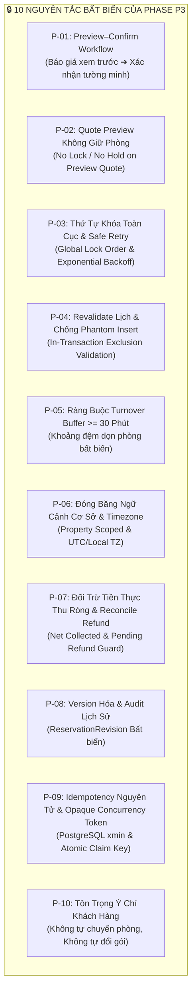
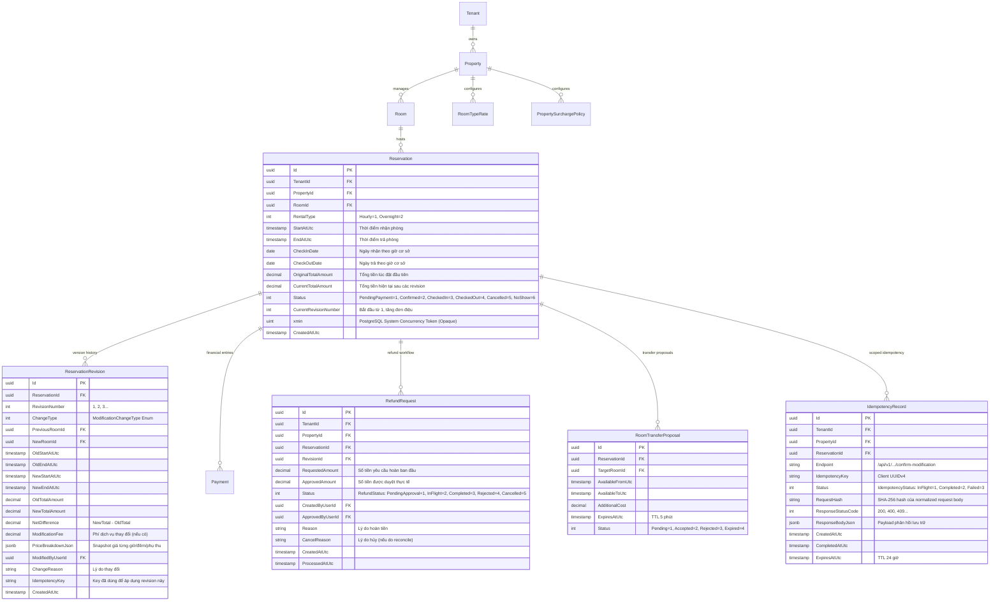
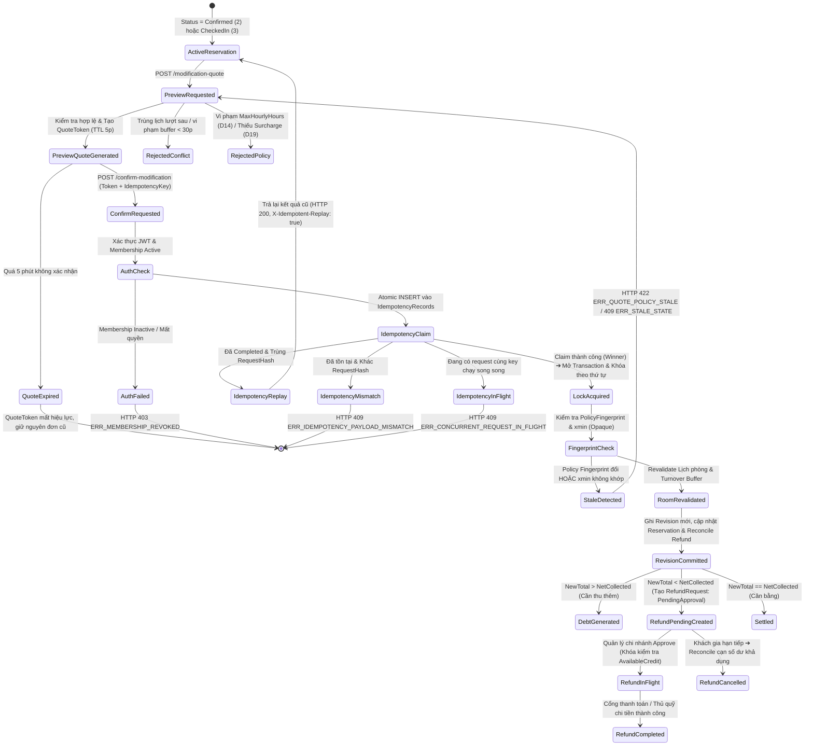
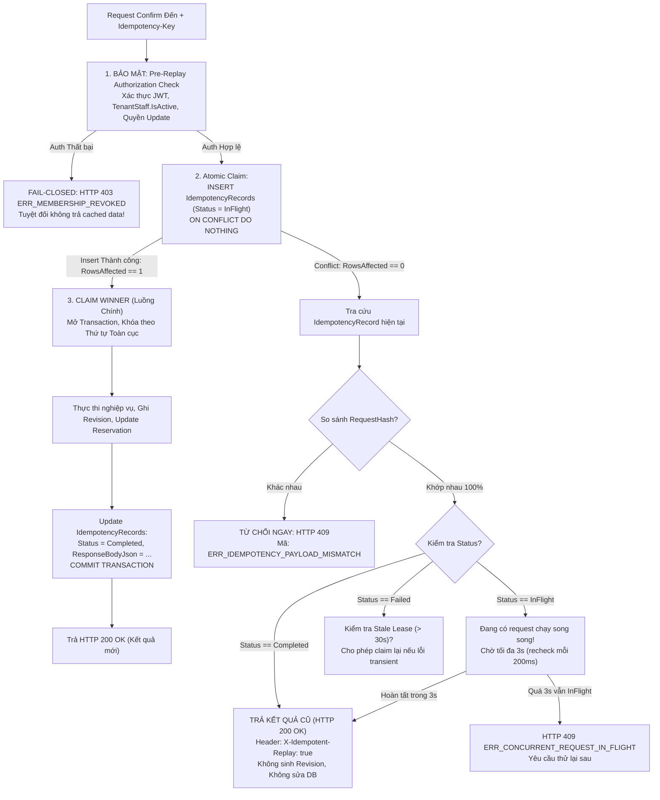

# 📋 Đặc Tả Nghiệp Vụ & Thiết Kế Kỹ Thuật Phase P3: Xử Lý Thay Đổi Nhu Cầu Sau Khi Đặt / Nhận Phòng (Reservation Modifications & Extensions)

> **Tài liệu:** P3A-SPEC | **Phiên bản:** 2.1 (Hiệu chỉnh toàn diện theo chỉ đạo PO & Reviewer) | **Ngày cập nhật:** 2026-10-09  
> **Trạng thái:** Bản thảo Đề xuất Trình PO & Reviewer Phê Duyệt (Draft Specification for Approval)  
> **Quy chuẩn tuân thủ:** AGENTS.md, `requirements-analysis-enterprise`, `system-design-enterprise`, `fullstack-architecture-review`.  
> **Ranh giới thực thi:** **CHỈ KHẢO SÁT & VIẾT TÀI LIỆU**. Tuyệt đối KHÔNG sửa code, KHÔNG tạo migration, KHÔNG tác động CSDL dev/prod. Không xem tài liệu này là nghiệm thu cho P2B-02 (P2B-02 vẫn giữ nguyên trạng thái chờ Reviewer kiểm tra độc lập và không dùng tài liệu này để bỏ qua các findings cũ).

---

## 📑 Bảng Mapping Các Điểm Hiệu Chỉnh Của PO & Reviewer

| Nhóm Yêu Cầu | Vấn Đề Cần Xử Lý | Vị Trí Xử Lý Trong Tài Liệu | Quy Chuẩn Thiết Kế Đã Hoàn Thiện |
|:---|:---|:---:|:---|
| **1. Idempotency** | • Định nghĩa unique key & phạm vi scoped.<br/>• Xử lý concurrent same-key.<br/>• So sánh payload hash (cùng trả cũ, khác trả 409).<br/>• Authorization trước khi replay cache.<br/>• Test 2 request cùng key & retry mất mạng. | **Mục 2 [P-09],<br/>Mục 3.2,<br/>Mục 6,<br/>Mục 11** | • Composite Key: `(TenantId, PropertyId, ReservationId, Endpoint, IdempotencyKey)`.<br/>• Atomic Claim bằng `INSERT ... ON CONFLICT DO NOTHING`, máy trạng thái `InFlight` / `Completed` / `Failed`.<br/>• SHA-256 RequestHash normalized; khác hash trả HTTP 409 `ERR_IDEMPOTENCY_PAYLOAD_MISMATCH`.<br/>• Pre-Replay Auth: Xác thực JWT & membership active TRƯỚC KHI replay; cấm leak cache.<br/>• Bổ sung ca test TC-IDEM-03, TC-IDEM-04, TC-IDEM-05. |
| **2. Refund Pending** | • Phân biệt rõ 4 trạng thái refund.<br/>• Reconcile phiếu pending khi booking đổi.<br/>• Duyệt/hoàn tiền kiểm tra số dư khả dụng dưới khóa chung.<br/>• Test pending 800k gia hạn còn 200k dư.<br/>• Ranh giới P3 contract vs P4 gateway execution. | **Mục 2 [P-07],<br/>Mục 3.1, 3.2,<br/>Mục 7,<br/>Mục 11, 12** | • Phân định rõ: `PendingApproval`, `InFlight`, `Completed`, `Cancelled`.<br/>• Công thức $\text{AvailableCredit} = \text{NetCollected} - \text{InFlightRefunds} - \text{NewBookingTotal}$.<br/>• Reconcile tự động hủy/giảm phiếu pending khi gia hạn phòng.<br/>• Khóa chung `Reservations FOR UPDATE` khi Quản lý Approve; chặn hoàn 800k khi số dư chỉ còn 200k (TC-REFUND-01).<br/>• Xác lập ranh giới: P3 đặc tả data contract & reconciliation; P4 thực thi dòng tiền trên gateway. |
| **3. Concurrency** | • PostgreSQL `xmin` là opaque token, không kỳ vọng +1.<br/>• Thứ tự khóa toàn cục (Global Lock Order).<br/>• Phối hợp với cập nhật chính sách giá (Policy Updates).<br/>• Bỏ tuyên bố tuyệt đối không deadlock; đặc tả Safe Retry Policy. | **Mục 2 [P-03, P-09],<br/>Mục 4,<br/>Mục 11** | • `xmin` là 32-bit transaction ID (xid) opaque token: chỉ so sánh bằng `==`, không so sánh lớn/bé, không kỳ vọng tăng đúng 1.<br/>• Global Lock Order: Idempotency Record $\rightarrow$ Reservation $\rightarrow$ Rooms (`RoomId ASC`) $\rightarrow$ Folio/Refunds.<br/>• Policy Update dùng interval splitting độc lập; modification revalidate `PolicyFingerprint` trong transaction.<br/>• Xóa bỏ "triệt tiêu 100% deadlock"; bắt `40P01` & `40001`, Safe Retry $N=3$ lần với Exponential Backoff + Random Full Jitter. |

---

## 1. Tổng Quan & Bối Cảnh Nghiệp Vụ (Overview & Business Context)

### 1.1. Bối cảnh
Trong chu trình vận hành khách sạn thực tế, nhu cầu của khách lưu trú thường xuyên biến động sau khi đã tạo đặt phòng (`Confirmed`) hoặc sau khi đã nhận phòng (`CheckedIn`):
- Khách thuê theo giờ muốn ngồi thêm do công việc chưa xong (Gia hạn thuê giờ).
- Khách thuê theo giờ muốn nghỉ lại qua đêm do muộn hoặc thay đổi kế hoạch di chuyển (Chuyển thuê giờ sang ngày/đêm).
- Khách thuê đêm muốn ở thêm một hoặc nhiều ngày (Gia hạn thêm đêm).
- Khách đến sớm hơn giờ check-in tiêu chuẩn hoặc muốn trả phòng muộn hơn giờ check-out tiêu chuẩn (Phụ thu nhận sớm / trả muộn).
- Khách muốn rút ngắn thời gian lưu trú do có việc đột xuất (Trả phòng sớm / Shorten stay).
- Khách muốn gia hạn nhưng phòng hiện tại đã có khách khác đặt ngay sau đó (Xung đột lịch phòng & đề xuất chuyển phòng).

Hệ thống **Hotel SaaS Platform** cần một cơ chế xử lý thay đổi nhu cầu lưu trú vừa đảm bảo **trải nghiệm khách hàng mượt mà**, vừa đảm bảo **tính toàn vẹn dữ liệu, chống thất thoát doanh thu, bảo vệ lịch phòng, kiểm soát đồng thời và minh bạch kiểm toán**.

### 1.2. Mục tiêu Thiết kế Phase P3A
1. **Thiết lập quy trình Xem Trước – Xác Nhận (Preview–Confirm Workflow):** Mọi biến động đều phải trải qua bước tính toán báo giá xem trước (Preview Quote) $\rightarrow$ Khách/lễ tân xác nhận $\rightarrow$ Backend thực thi trong Transaction với khóa đồng thời và chống double-submit.
2. **Kiến trúc Concurrency Chung cho Create / Hold / Extend / Transfer:** Khóa tài nguyên phòng vật lý theo thứ tự xác định (`Deterministic Lock Ordering`), revalidate lịch phòng trong transaction, triệt tiêu race conditions và chống phantom insert.
3. **Đặc tả Token Báo giá (`QuoteToken`) An Toàn:** Ký số HMAC-SHA256, liên kết chặt chẽ với Tenant/Property, phiên bản đặt phòng (`BaseRevisionNumber`), hash yêu cầu (`RequestHash`), và dấu vân tay bảng giá/chính sách (`PricePolicyFingerprint`). Bất kỳ thay đổi giá/chính sách nào đều làm mất hiệu lực quote cũ và bắt buộc lấy lại báo giá mới.
4. **Cơ chế Idempotency Cho Lệnh Xác Nhận (Confirm Idempotency):** Unique key scoped rõ ràng theo Endpoint & Reservation; atomic claim bằng trạng thái `InFlight`; cùng payload trả lại kết quả cũ; khác payload trả lỗi HTTP 409; kiểm tra quyền truy cập nghiêm ngặt trước khi replay cache; tuyệt đối không sinh trùng `ReservationRevision`, `Payment` hay `RefundRequest`.
5. **Bảo toàn Lịch sử & Đối trừ Sổ cái Dựa trên Tiền Thực Thu Ròng:** Không ghi đè snapshot cũ; đối trừ dựa trên tiền thực thu ròng sau các khoản hoàn tiền đã hoàn tất (`NetCollectedAmount`), phân biệt rõ `Pending`, `InFlight`, `Completed`, kiểm soát chặt chẽ và tự động reconcile các khoản hoàn đang chờ duyệt (`PendingApproval`) để chống hoàn trùng khi khách gia hạn thêm.
6. **Tuân thủ Quyết định Đã Chốt & Ranh giới Phê duyệt:**
   - **D14 (ĐÃ ĐƯỢC PO DUYỆT):** Giới hạn thuê giờ tối đa `MaxHourlyHours` (1–24h, mặc định 12h) theo từng cơ sở. Vượt giới hạn yêu cầu chọn hình thức khác, tuyệt đối không tự chuyển sang đêm.
   - **D07:** Khoảng cách giữa 2 lượt trên cùng 1 phòng tối thiểu 30 phút (`BufferMinutes` $\ge$ 30), cơ sở chỉ được tăng; hết buffer không tự động chuyển thành `Clean`.
   - **D06:** Khung giờ nhận/trả phòng theo đêm cấu hình riêng theo cơ sở (mặc định 12:00 – 12:00 ngày hôm sau).
   - **D19 / Phụ thu Fail-Closed:** Nhận sớm/trả muộn dùng bảng phụ thu cơ sở; thiếu cấu hình fail-closed từ chối báo giá ngay với HTTP 422 `ERR_SURCHARGE_NOT_CONFIGURED` (không fallback sang cách tính khác).
   - **D20:** Quote preview có TTL 5 phút, mang tính tham khảo, **tuyệt đối không giữ phòng**.
   - **D25:** Làm tròn tiền VND 1 đồng theo nguyên tắc `MidpointRounding.AwayFromZero`.
   - **Chỉ áp dụng các phương án tính giá sau khi PO chính thức phê duyệt.**

---

## 2. Nguyên Tắc Thiết Kế Bất Biến (Inviolable Domain & Architecture Principles)



### [P-01] Quy trình Xem Trước – Xác Nhận (Preview–Confirm Workflow)
- **Bước 1 — Xem trước Báo giá (Preview / Dry-run Quote):** Client gửi yêu cầu thay đổi (thời gian mới, phòng mới, loại hình mới). Động cơ tính giá backend đọc cấu hình cơ sở, kiểm tra sơ bộ xung đột phòng và sinh ra báo giá so sánh (`ModificationQuoteDto`): hiển thị chi tiết Giá cũ, Giá mới, Tiền thực thu ròng, Phí thay đổi, Số tiền cần thu thêm (hoặc hoàn lại). Báo giá trả về chuỗi mã hóa an toàn `QuoteToken` có thời hạn hiệu lực đúng 5 phút (`ExpiresAtUtc = RequestTime + 5m`).
- **Bước 2 — Xác nhận Thay đổi (Confirm with QuoteToken & Idempotency):** Client gửi lệnh xác nhận kèm `QuoteToken`, mã chống trùng lặp `Idempotency-Key` và concurrency token `RowVersion` (`xmin`). Backend xác thực token, kiểm tra lại giá/chính sách và thực thi trong một Database Transaction có khóa phòng độc quyền.

### [P-02] Báo Giá Xem Trước Tuyệt Đối Không Giữ Phòng (No Lock on Preview)
- Việc khách hàng hoặc lễ tân xem báo giá gia hạn/thay đổi phòng **không tạo bản ghi Hold phòng** và **không khóa lịch phòng**.
- Phòng chỉ được bảo đảm giữ chỗ khi người dùng hoàn tất Bước 2 (Xác nhận thay đổi). Nếu trong khoảng 5 phút đó có lượt đặt khác hoàn tất trước, lệnh xác nhận của khách sẽ bị từ chối với lỗi HTTP 409 `ERR_ROOM_NEXT_BOOKING_CONFLICT` hoặc `ERR_ROOM_NO_LONGER_AVAILABLE` và yêu cầu lấy báo giá lại.

### [P-03] Thứ Tự Khóa Toàn Cục & Xử Lý Lỗi Safe Retry
- Mọi thao tác can thiệp dữ liệu phải tuân thủ nghiêm ngặt **Thứ Tự Khóa Toàn Cục (Global Lock Acquisition Ordering)**:
  1. `Idempotency Key Record`
  2. `Reservation Row`
  3. `Room Resources` (sắp xếp tăng dần theo `RoomId ASC`)
  4. `Financial Records` (`Folio` / `RefundRequests`)
- **Loại bỏ tuyên bố "triệt tiêu 100% deadlock":** Thừa nhận cơ chế concurrency thực tế của PostgreSQL có thể gặp lỗi Deadlock (`40P01`) hoặc Serialization Failure (`40001`) do các query nền hoặc page locks. Hệ thống triển khai **Safe Retry Policy** với Exponential Backoff kèm Random Full Jitter (tối đa $N=3$ lần).

### [P-04] Tái Xác Thực Lịch Trong Transaction & Chống Phantom Insert
- Sau khi đã giữ khóa `FOR UPDATE` trên `RoomId`, bên trong cùng một Transaction, hệ thống thực hiện câu truy vấn kiểm tra toàn bộ các khoảng thời gian active:
  - Bảng `Reservations` active (`Status IN (PendingPayment, Confirmed, CheckedIn)`).
  - Bảng `BookingHolds` active (`ExpiresAtUtc > UtcNow`).
  - Khoảng kiểm tra bao gồm cả turnover buffer $\ge 30$ phút:
    $$[\text{StartAtUtc} - Buffer,\; \text{EndAtUtc} + Buffer)$$
- **Chống Phantom Insert:** Vì tất cả các tiến trình (`Create`, `Hold`, `Extend`, `Transfer`) đều bắt buộc phải xin khóa dòng trên bảng `Rooms` trước khi chèn hoặc cập nhật lịch, không có bất kỳ tiến trình nào có thể chen ngang chèn một booking mới (phantom insert) trong khi tiến trình khác đang kiểm tra lịch của cùng một phòng.

### [P-05] Ràng Buộc Turnover Buffer $\ge$ 30 Phút Bất Biến
- Mọi lượt lưu trú (theo giờ hay theo đêm) khi kết thúc trên một phòng vật lý đều kích hoạt khoảng đệm dọn phòng:
  $$\text{NextAvailableStartAtUtc} = \text{CurrentEndAtUtc} + \text{Property.BufferMinutes}$$
- Bất kỳ yêu cầu gia hạn nào làm cho $\text{CurrentEndAtUtc} + \text{BufferMinutes} > \text{NextBooking.StartAtUtc}$ đều bị coi là **XUNG ĐỘT PHÒNG** và bị từ chối gia hạn trên phòng đó.
- Sau khi kết thúc buffer dọn phòng, phòng chỉ chuyển sang trạng thái chờ dọn dẹp hoặc kiểm tra, tuyệt đối **không tự động chuyển sang `Clean`** nếu chưa có nhân viên buồng phòng xác nhận đạt tiêu chuẩn (D07).

### [P-06] Cô Lập Ngữ Cảnh Cơ Sở & Timezone Chuẩn Hóa
- Giờ nhận phòng tiêu chuẩn (`CheckInTime`), giờ trả phòng tiêu chuẩn (`CheckOutTime`), múi giờ vận hành (`TimeZone`: mặc định `Asia/Ho_Chi_Minh` / UTC+7), bảng giá `RoomTypeRate` và biểu phí phụ thu `PropertySurchargePolicy` bắt buộc lấy chính xác từ cơ sở sở hữu phòng (`Reservation.PropertyId`).
- Thời gian lưu trữ trong DB luôn là `DateTime` (UTC, `Kind = DateTimeKind.Utc`). Quy đổi sang ngày/giờ địa phương chỉ phục vụ cho việc tính ngày lưu trú và khung giờ nhận sớm/trả muộn.

### [P-07] Đối Trừ Tài Chính Dựa Trên Tiền Thực Thu Ròng & Reconcile Refund
- Các bản ghi thanh toán (`Payment`) đã hoàn tất là **bất biến (Immutable)**. Tuyệt đối cấm thao tác `UPDATE` hoặc `DELETE` trên các bản ghi `Payment` cũ.
- Phân định rõ 4 trạng thái tài chính của khoản hoàn tiền: `PendingApproval` (Chờ duyệt), `InFlight` (Đang chi trả/khóa gateway), `Completed` (Đã hoàn tiền thực tế), `Cancelled` (Đã hủy).
- Việc đối trừ tài chính bắt buộc tính toán trên **Tiền Thực Thu Ròng (Net Collected Amount)**:
  $$\text{NetCollectedAmount} = \sum \text{CompletedPayments} - \sum \text{CompletedRefunds}$$
- **Kiểm soát Refund Đang Chờ & Reconcile Tự Động:**
  $$\text{AvailableCredit} = \text{NetCollectedAmount} - \sum \text{InFlightRefunds} - \text{NewBookingTotal}$$
- Khi gia hạn phòng làm tăng tiền phòng, các phiếu `PendingApproval` cũ phải được tự động reconcile: nếu số dư khả dụng bị thu hẹp hoặc cạn kiệt, hệ thống tự động giảm hoặc hủy phiếu pending cũ, triệt tiêu hoàn toàn rủi ro hoàn tiền vượt quá số dư thực tế.

### [P-08] Lưu Vết Lịch Sử Phiên Bản (Immutable Revisions & Audit)
- Mỗi lần thay đổi thành công, hệ thống tăng số thứ tự phiên bản (`CurrentRevisionNumber = CurrentRevisionNumber + 1`), lưu toàn bộ snapshot thông tin cũ vào bảng `ReservationRevisions`.
- Bản ghi revision lưu giữ đầy đủ: `StartAtUtc`, `EndAtUtc`, `RentalType`, `RoomId`, `TotalAmount`, `PriceBreakdownJson`, `ModifiedByUserId`, `ModifiedAtUtc`, `ChangeReason`.

### [P-09] Kiểm Soát Đồng Thời Với Opaque Token (`xmin`) & Idempotency Nguyên Tử
- **Opaque Concurrency Token:** Hệ thống sử dụng cột hệ thống của PostgreSQL **`xmin`** (32-bit transaction ID nội bộ). Ứng dụng coi `xmin` là một **opaque token** chỉ so sánh bằng (`xmin == expected_xmin`), không kỳ vọng tăng đơn điệu `+1` và không so sánh số học lớn/bé.
- **Idempotency Nguyên Tử:** Bắt buộc truyền `Idempotency-Key` (UUIDv4) ở header của lệnh Confirm, scoped theo `(TenantId, PropertyId, ReservationId, Endpoint, IdempotencyKey)`. Xử lý concurrent cùng key bằng atomic claim `INSERT ... ON CONFLICT DO NOTHING`.
- **Pre-Replay Authorization:** Kiểm tra quyền người dùng trước khi replay dữ liệu đã lưu; cấm tuyệt đối việc bypass xác thực làm lộ dữ liệu cho người dùng đã bị thu hồi quyền.

### [P-10] Tuyệt Đối Không Tự Động Chuyển Phòng & Không Tự Đổi Gói
- Khi việc gia hạn bị chặn bởi booking tiếp theo: Hệ thống chỉ trả về thông báo từ chối kèm danh sách các phòng trống tương đương để **đề xuất cho khách hàng/nhân viên lựa chọn**. Tuyệt đối cấm backend tự ý chuyển khách sang phòng khác.
- Khi khách thuê giờ vượt quá `MaxHourlyHours`: Hệ thống trả về lỗi `ERR_HOURLY_LIMIT_EXCEEDED`, yêu cầu khách chọn chuyển sang thuê đêm hoặc trả phòng. Tuyệt đối không tự động chuyển đổi gói mà chưa có sự đồng ý của khách.

---

## 3. Mô Hình Dữ Liệu & Sơ Đồ Trạng Thái (Data Model & State Machines)

### 3.1. Đồng Bộ Danh Mục Enum Khớp 1:1 Với Mã Nguồn & Domain

```csharp
namespace HotelSaas.Domain.Enums;

// 1. Trạng thái Đặt phòng (HotelSaas.Domain.Enums.ReservationStatus)
public enum ReservationStatus
{
    PendingPayment = 1,
    Confirmed = 2,
    CheckedIn = 3,
    CheckedOut = 4,
    Cancelled = 5,
    NoShow = 6
}

// 2. Hình thức Thuê phòng (HotelSaas.Domain.Enums.RentalType)
public enum RentalType
{
    Hourly = 1,
    Overnight = 2
}

// 3. Loại hình Thay đổi Nhu cầu (HotelSaas.Domain.Enums.ModificationChangeType)
public enum ModificationChangeType
{
    HourlyExtension = 1,        // Gia hạn thuê giờ
    HourlyToOvernight = 2,      // Chuyển thuê giờ sang đêm
    OvernightExtension = 3,     // Gia hạn thêm đêm
    EarlyCheckInAdjustment = 4, // Nhận phòng sớm
    LateCheckOutAdjustment = 5, // Trả phòng muộn
    RoomTransfer = 6,           // Chuyển phòng
    StayShortening = 7          // Rút ngắn thời gian lưu trú / Trả sớm
}

// 4. Trạng thái Yêu cầu Hoàn tiền (HotelSaas.Domain.Enums.RefundStatus)
public enum RefundStatus
{
    PendingApproval = 1, // Chờ Quản lý chi nhánh phê duyệt
    InFlight = 2,        // Đã duyệt, đang phát lệnh cổng thanh toán / đang xuất quỹ tiền mặt
    Completed = 3,       // Cổng thanh toán hoặc thủ quỹ xác nhận đã chi trả thành công
    Rejected = 4,        // Bị Quản lý từ chối
    Cancelled = 5        // Bị hủy do booking gia hạn lại làm cạn số dư khả dụng (Reconciled)
}

// 5. Trạng thái Tiến trình Idempotency (HotelSaas.Domain.Enums.IdempotencyStatus)
public enum IdempotencyStatus
{
    InFlight = 1,        // Đang xử lý trong transaction (Claimed)
    Completed = 2,       // Đã xử lý thành công, có response lưu trữ
    Failed = 3           // Đã thất bại (cho phép retry nếu lỗi transient)
}
```

---

### 3.2. Sơ Đồ Thực Thể Dữ Liệu P3 (ERD)



> **Ràng buộc Toàn vẹn Idempotency:**
> ```sql
> CONSTRAINT "UQ_Idempotency_Scope" UNIQUE ("TenantId", "PropertyId", "ReservationId", "Endpoint", "IdempotencyKey");
> ```

---

### 3.3. Sơ Đồ Máy Trạng Thái Preview–Confirm & Refund Lifecycle



---

## 4. Kiến Trúc Concurrency Chung Cho Create / Hold / Extend / Transfer

### 4.1. Bảng Thứ Tự Khóa Toàn Cục (Global Lock Acquisition Ordering)

Để loại trừ khả năng phát sinh chu trình khóa đối nghịch giữa mọi tiến trình nghiệp vụ trong toàn hệ thống, mọi giao dịch can thiệp đến đặt phòng, phòng vật lý và tài chính bắt buộc phải thực thi lệnh khóa dòng theo **trật tự phân cấp toàn cục (Global Lock Order)** sau:

| Thứ Tự (Order) | Cấp Tài Nguyên (Resource Layer) | Bảng CSDL (Table) | Câu Lệnh Khóa (Lock Statement) | Mục Đích Bảo Vệ |
|:---:|:---|:---|:---|:---|
| **1** | **Idempotency Layer** | `IdempotencyRecords` | `INSERT ... ON CONFLICT DO NOTHING` hoặc `SELECT ... FOR UPDATE` | Đảm bảo tính nguyên tử của tiến trình, chặn đứng concurrent submit cùng key. |
| **2** | **Reservation Layer** | `Reservations` | `SELECT "Id" FROM "Reservations" WHERE "Id" = @Id FOR UPDATE;` | Khóa trạng thái đơn, bảo vệ `CurrentTotalAmount`, `CurrentRevisionNumber` và `xmin`. |
| **3** | **Room Layer** | `Rooms` | `SELECT "Id" FROM "Rooms" WHERE "Id" = @RoomId FOR UPDATE;` | Khóa tài nguyên phòng vật lý. **Nếu có nhiều phòng (Room Transfer), bắt buộc khóa theo thứ tự `RoomId ASC`**. |
| **4** | **Financial Folio Layer**| `RefundRequests` / `Payments` | `SELECT "Id" FROM "RefundRequests" WHERE "ReservationId" = @Id FOR UPDATE;` | Khóa các khoản hoàn tiền đang chờ và đối soát công nợ ròng. |

> [!IMPORTANT]
> Tuyệt đối không có bất kỳ tiến trình nào được phép đảo ngược thứ tự khóa trên (ví dụ: cấm khóa `Rooms` trước rồi mới khóa `Reservations`).

---

### 4.2. Trật Tự Khóa Xác Định Khi Chuyển Phòng (Room Transfer Lock Order)
Khi chuyển phòng (`Room Transfer`), hệ thống can thiệp đồng thời vào 2 tài nguyên phòng vật lý: Phòng nguồn (`SourceRoomId`) và Phòng đích (`TargetRoomId`).  
Để ngăn chặn Deadlock giữa 2 luồng chuyển phòng đối nghịch (Luồng 1: A $\rightarrow$ B; Luồng 2: B $\rightarrow$ A), hệ thống bắt buộc sắp xếp thứ tự khóa theo giá trị UUID tăng dần (`Guid.CompareTo`):

```csharp
var (firstLockRoomId, secondLockRoomId) = sourceRoomId.CompareTo(targetRoomId) < 0
    ? (sourceRoomId, targetRoomId)
    : (targetRoomId, sourceRoomId);

// Khóa phòng có Id nhỏ hơn trước:
await context.Database.ExecuteSqlRawAsync(
    "SELECT \"Id\" FROM \"Rooms\" WHERE \"TenantId\" = {0} AND \"PropertyId\" = {1} AND \"Id\" = {2} FOR UPDATE",
    tenantId, propertyId, firstLockRoomId);

// Khóa phòng có Id lớn hơn sau:
await context.Database.ExecuteSqlRawAsync(
    "SELECT \"Id\" FROM \"Rooms\" WHERE \"TenantId\" = {0} AND \"PropertyId\" = {1} AND \"Id\" = {2} FOR UPDATE",
    tenantId, propertyId, secondLockRoomId);
```

---

### 4.3. Phối Hợp Với Cập Nhật Chính Sách Giá & Phụ Thu (Policy Updates Coordination)
- **Độc lập luồng Admin:** Khi Quản lý chi nhánh cập nhật bảng giá `RoomTypeRate` hoặc biểu phí phụ thu `PropertySurchargePolicy`, hệ thống áp dụng kỹ thuật **Interval Splitting & Versioning** (đã thiết kế tại P2B-02). Thao tác này chỉ khóa bản ghi chính sách, tuyệt đối **không khóa bảng `Rooms` hay `Reservations`**.
- **Tái xác thực trong giao dịch Modification:** Trong giao dịch thay đổi phòng của khách, sau khi đã giữ khóa `Reservations` (Thứ tự 2), hệ thống tính toán lại `CurrentPolicyFingerprint` từ các bảng chính sách hiện hành. Nếu `CurrentPolicyFingerprint != QuoteToken.PricePolicyFingerprint` $\rightarrow$ Hệ thống lập tức **Rollback Transaction và fail-closed với HTTP 422 `ERR_QUOTE_POLICY_STALE`**.
- Thiết kế này loại trừ hoàn toàn sự tranh chấp khóa giữa luồng nghiệp vụ của khách và luồng cập nhật biểu giá của ban quản lý.

---

### 4.4. PostgreSQL `xmin` Là Opaque Concurrency Token
- **Bản chất kỹ thuật:** Trong PostgreSQL, cột hệ thống `xmin` lưu trữ Transaction ID (32-bit `xid`) của transaction đã chèn hoặc cập nhật dòng dữ liệu đó. Transaction ID trong PostgreSQL được cấp phát tuần tự cho toàn bộ cluster cơ sở dữ liệu, không thuộc riêng về bảng `Reservations`. Giữa hai lần cập nhật của một đơn đặt phòng, có thể có hàng nghìn giao dịch khác diễn ra, khiến `xmin` nhảy bước lớn. Ngoài ra, PostgreSQL có cơ chế `xid wraparound` sau 2 tỷ transactions.
- **Quy tắc xác thực ứng dụng:**
  - Ứng dụng và Client bắt buộc phải coi `xmin` là một **Opaque Concurrency Token** (chuỗi nhận dạng đục mờ).
  - Chỉ được phép thực hiện phép so sánh bằng:
    $$\text{DatabaseRow.xmin} == \text{ExpectedToken.xmin}$$
  - **Tuyệt đối cấm:**
    1. Không so sánh thứ tự lớn hơn/nhỏ hơn (`xmin > old_xmin`).
    2. Không kỳ vọng hoặc kiểm tra số học `new_xmin == old_xmin + 1`.
  - Nếu `xmin` trong DB không bằng `xmin` mà client gửi lên $\rightarrow$ Ném ngoại lệ `DbUpdateConcurrencyException` và trả về HTTP 409 `ERR_STALE_STATE`.

---

### 4.5. Xử Lý Lỗi Deadlock / Serialization & Chính Sách Safe Retry
Mặc dù hệ thống áp dụng thứ tự khóa toàn cục nghiêm ngặt, trong môi trường CSDL quan hệ tải cao, PostgreSQL vẫn có thể gặp phải các ngoại lệ cạnh tranh do index tuple locks, page-level locks hoặc mức độ cô lập Repeatable Read/Serializable:
- **`40P01`:** `deadlock_detected`
- **`40001`:** `serialization_failure`

Hệ thống loại bỏ hoàn toàn các khẳng định "triệt tiêu 100% deadlock" và triển khai **Quy trình Safe Retry Policy**:

```csharp
public async Task<TResult> ExecuteWithSafeRetryAsync<TResult>(
    Func<Task<TResult>> operation, 
    int maxRetries = 3, 
    CancellationToken ct = default)
{
    int attempt = 0;
    while (true)
    {
        try
        {
            return await operation();
        }
        catch (PostgresException ex) when (ex.SqlState == PostgresErrorCodes.DeadlockDetected || 
                                           ex.SqlState == PostgresErrorCodes.SerializationFailure)
        {
            attempt++;
            if (attempt > maxRetries)
            {
                logger.LogWarning(ex, "Concurrency retry exhausted after {Attempt} attempts.", attempt);
                throw new ConcurrencyConflictException("ERR_CONCURRENCY_CONFLICT_RETRY_LATER", ex);
            }

            // Exponential Backoff kèm Random Full Jitter:
            // T_wait = Random(0, min(500ms, 50ms * 2^attempt))
            int baseDelayMs = 50 * (1 << attempt); // 100ms, 200ms, 400ms...
            int maxDelayMs = Math.Min(500, baseDelayMs);
            int jitterDelayMs = Random.Shared.Next(0, maxDelayMs);

            logger.LogInformation("Transient PostgreSQL conflict {SqlState}. Retrying attempt {Attempt} after {Delay}ms...", 
                ex.SqlState, attempt, jitterDelayMs);

            await Task.Delay(jitterDelayMs, ct);
        }
    }
}
```

- **Hành vi khi cạn retry ($N > 3$):** Transaction được rollback sạch sẽ, giải phóng toàn bộ khóa tài nguyên, ghi audit log cảnh báo và trả về client HTTP 503 `ERR_CONCURRENCY_CONFLICT_RETRY_LATER` kèm header `Retry-After: 1`.

---

### 4.6. Tái Xác Thực Lịch & Chống Phantom Insert
Bên trong transaction, sau khi đã giữ khóa `Rooms FOR UPDATE`:
```sql
SELECT EXISTS (
    SELECT 1 FROM "Reservations" r
    WHERE r."TenantId" = @TenantId 
      AND r."PropertyId" = @PropertyId 
      AND r."RoomId" = @RoomId
      AND r."Id" <> @CurrentReservationId
      AND r."Status" IN (1, 2, 3) -- PendingPayment, Confirmed, CheckedIn
      AND r."StartAtUtc" < @NewEndWithBuffer
      AND r."EndAtUtc" + (r."BufferMinutes" * INTERVAL '1 minute') > @NewStartUtc
) OR EXISTS (
    SELECT 1 FROM "BookingHolds" h
    WHERE h."TenantId" = @TenantId
      AND h."PropertyId" = @PropertyId
      AND h."RoomId" = @RoomId
      AND h."ExpiresAtUtc" > @UtcNow
      AND h."StartAtUtc" < @NewEndWithBuffer
      AND h."EndAtUtc" + (h."BufferMinutes" * INTERVAL '1 minute') > @NewStartUtc
);
```
- **Chống Phantom Insert:** Nhờ vào việc khóa dòng cha `Rooms` bằng `FOR UPDATE`, bất kỳ giao dịch tạo booking hoặc hold mới nào trên phòng đó đều bị chặn tại bước xin khóa `Rooms` cho đến khi giao dịch hiện tại hoàn tất. Do đó, hiện tượng một booking mới chen ngang sau bước kiểm tra lịch (Phantom Insert) bị ngăn chặn triệt để.

---

## 5. Đặc Tả Chi Tiết `QuoteToken` & Cơ Chế Chống Tampering

### 5.1. Cấu Trúc Payload Của `QuoteToken`
`QuoteToken` là một chuỗi mã hóa ký số bằng HMAC-SHA256, được backend phát hành ở Bước 1 (Preview) và yêu cầu gửi lại ở Bước 2 (Confirm). Cấu trúc dữ liệu bên trong token bao gồm:

```json
{
  "scope": {
    "tenantId": "c3a9d24e-1234-4567-89ab-cdef01234567",
    "propertyId": "e5b8a12f-5678-4321-98ba-fedcba987654"
  },
  "reservation": {
    "reservationId": "8f2b1a9c-4d3e-4f5a-b6c7-d8e9f0a1b2c3",
    "baseRevisionNumber": 1
  },
  "requestHash": "a1b2c3d4e5f67890...", // SHA-256 hash của normalized request payload
  "pricePolicyFingerprint": "f8e7d6c5b4a3...", // SHA-256 hash của giá & chính sách
  "calculatedPrices": {
    "oldTotal": 150000.0,
    "newTotal": 250000.0,
    "netDifference": 100000.0
  },
  "issuedAtUtc": "2026-10-09T10:00:00Z",
  "expiresAtUtc": "2026-10-09T10:05:00Z"
}
```

### 5.2. Công Thức Tính Dấu Vân Tay Chính Sách (`PricePolicyFingerprint`)
Dấu vân tay chính sách là chuỗi băm bảo đảm rằng mọi giả định về giá và chính sách tại thời điểm lập báo giá vẫn còn nguyên vẹn tại thời điểm xác nhận:
$$\text{PricePolicyFingerprint} = \text{SHA256}\Big(\text{RateTableVersions} \;\|\; \text{SurchargePolicyVersions} \;\|\; \text{MaxHourlyHours} \;\|\; \text{BufferMinutes} \;\|\; \text{CheckInOutTimes}\Big)$$

### 5.3. Quy Trình Xác Thực & Vô Hiệu Hóa Báo Giá (Quote Invalidation)
Khi nhận lệnh Confirm tại Bước 2:
1. **Kiểm tra chữ ký (Signature Check):** Xác thực chữ ký HMAC-SHA256 của token với Server Secret Key. Nếu không khớp $\rightarrow$ Fail-closed HTTP 422 `ERR_INVALID_QUOTE_TOKEN`.
2. **Kiểm tra thời hạn (Expiry Check):** Nếu $\text{UtcNow} > \text{ExpiresAtUtc}$ $\rightarrow$ Fail-closed HTTP 422 `ERR_EXPIRED_QUOTE`.
3. **Kiểm tra phiên bản đặt phòng (Revision Check):** So sánh `baseRevisionNumber` trong token với `Reservation.CurrentRevisionNumber` trong DB. Nếu khác nhau (đã có người khác sửa đơn trước đó) $\rightarrow$ Fail-closed HTTP 409 `ERR_STALE_STATE`.
4. **Kiểm tra dấu vân tay chính sách (Fingerprint Check):** Backend truy vấn CSDL để tính lại `CurrentPricePolicyFingerprint`. Nếu người quản lý vừa cập nhật bảng giá hoặc sửa biểu phí phụ thu $\rightarrow$ `CurrentFingerprint != token.pricePolicyFingerprint` $\rightarrow$ **Fail-closed từ chối xác nhận với HTTP 422 `ERR_QUOTE_POLICY_STALE`**. Bắt buộc client phải lấy lại báo giá mới và yêu cầu khách hàng xác nhận lại theo biểu giá mới.

---

## 6. Đặc Tả Cơ Chế Idempotency Cho Lệnh Xác Nhận (Confirm Idempotency)

### 6.1. Quy Chuẩn Giao Thức & Phạm Vi Scoped
Mọi yêu cầu gọi endpoint `/confirm-modification` bắt buộc phải kèm theo HTTP Header:
`Idempotency-Key: <UUIDv4>` (ví dụ: `Idempotency-Key: 9b1deb4d-3b7d-4bad-9bdd-2b0d7b3dcb6d`).

**Phạm Vi Scoped Của Khóa Duy Nhất (Unique Key Scope):**
Để ngăn ngừa tình trạng ô nhiễm chéo giữa các đặt phòng khác nhau hoặc giữa các endpoint khác nhau, khóa Idempotency được quản lý theo phạm vi 5 thành phần:
$$\text{UniqueScope} = \big(\text{TenantId},\; \text{PropertyId},\; \text{ReservationId},\; \text{Endpoint},\; \text{IdempotencyKey}\big)$$

---

### 6.2. Cơ Chế Atomic Claim & Xử Lý Concurrent Same-Key
Khi nhận được request với `Idempotency-Key`:



---

### 6.3. BẢO MẬT BẮT BUỘC: Kiểm Tra Quyền Trước Khi Replay (Pre-Replay Authorization)
> [!CAUTION]
> **Lỗ hổng nghiêm trọng nếu bỏ qua bước này:** Nếu hệ thống tra cứu bảng `IdempotencyRecords` và trả ngay `ResponseBodyJson` đã lưu mà không kiểm tra danh tính và quyền của caller, kẻ xấu hoặc nhân viên vừa bị sa thải/thu hồi quyền có thể gửi lại `Idempotency-Key` cũ để đọc trộm toàn bộ thông tin cá nhân (PII), lịch trình và chi tiết tài chính của khách hàng.

**Quy tắc Bất biến:**
Trước khi thực hiện bất kỳ thao tác đọc hoặc replay dữ liệu từ `IdempotencyRecords`, hệ thống bắt buộc phải:
1. Xác thực tính hợp lệ của JWT Token.
2. Kiểm tra `TenantStaff.IsActive == true` của người gọi trong cơ sở dữ liệu. Nếu tài khoản đã bị khóa, vô hiệu hóa hoặc thu hồi $\rightarrow$ Fail-closed trả về HTTP 403 `ERR_MEMBERSHIP_REVOKED`.
3. Kiểm tra người gọi có quyền truy cập vào `PropertyId` tương ứng và sở hữu claim quyền `RESERVATIONS.Update`. Nếu thiếu quyền $\rightarrow$ HTTP 403 `ERR_PERMISSION_DENIED`.
4. Chỉ khi người dùng vượt qua đầy đủ các bước kiểm tra quyền trên, hệ thống mới được phép trả về kết quả replay.

---

### 6.4. Xử Lý Mất Response Do Lỗi Mạng (Network Loss & Safe Retry)
- **Kịch bản sự cố:** Client gửi lệnh Confirm. Backend xử lý thành công, commit transaction, tạo Revision 2 và lưu `IdempotencyRecords (Status = Completed)`. Tuy nhiên, kết nối mạng giữa client và server bị ngắt đột ngột trước khi HTTP 200 về tới client. Client bị timeout và tự động gửi lại lệnh Confirm với cùng `Idempotency-Key` và cùng Payload.
- **Hành vi hệ thống:**
  1. Backend kiểm tra quyền của người gọi (Thành công).
  2. Tra cứu `IdempotencyRecords` thấy bản ghi đã ở trạng thái `Completed` và `RequestHash` trùng khớp 100%.
  3. Hệ thống trả lại chính xác `ResponseStatusCode` (200) và `ResponseBodyJson` của Revision 2 kèm Header `X-Idempotent-Replay: true`.
  4. Hệ thống **tuyệt đối không tạo thêm Revision 3**, không tính thêm tiền và không trừ thêm công nợ.

---

## 7. Chi Tiết Các Luồng Nghiệp Vụ & Đối Soát Phiếu Hoàn Tiền (Pending Refund Reconciliation)

### 7.1. Chi Tiết 5 Luồng Thay Đổi Lưu Trú

#### Luồng 1: Gia Hạn Thuê Theo Giờ (Hourly Stay Extension)
- **Quy tắc trần giờ (D14 ĐÃ DUYỆT):** $\text{TotalDuration} = \text{NewEndAtUtc} - \text{StartAtUtc}$. Nếu $\text{TotalDuration} > \text{TimeSpan.FromHours}(Property.MaxHourlyHours)$ $\rightarrow$ Fail-closed HTTP 422 `ERR_HOURLY_LIMIT_EXCEEDED`. Tuyệt đối không tự convert sang thuê đêm.
- **Tính toán:** Làm tròn lên mỗi 60 phút theo D05. Áp dụng bảng giá `RoomTypeRate` snapshot của phiên thuê giờ.
- **Khóa & Kiểm tra:** Khóa `Room FOR UPDATE`, kiểm tra không xung đột với booking/hold tiếp theo và buffer dọn phòng $\ge 30$p.

#### Luồng 2: Chuyển Thuê Giờ Sang Ngày/Đêm (Hourly to Overnight Conversion)
- **Kéo dài lưu trú:** Chuyển `RentalType` sang `Overnight`, thời điểm kết thúc mới là giờ check-out tiêu chuẩn cơ sở ngày hôm sau (`Property.CheckOutTime`, mặc định 12:00).
- **Quy tắc Phụ thu Nhận Sớm (D19 - Fail-Closed Tuyệt Đối):**
  - Khách nhận phòng từ sáng (trước 12:00), hệ thống tra cứu biểu phí `PropertySurchargePolicy`.
  - **HÀNH VI DUY NHẤT ĐƯỢC XÁC LẬP:** Nếu chi nhánh **chưa cấu hình biểu phí phụ thu nhận sớm**, hệ thống **FAIL-CLOSED TỪ CHỐI BÁO GIÁ NGAY LẬP TỨC** với HTTP 422 `ERR_SURCHARGE_NOT_CONFIGURED`.
  - **TUYỆT ĐỐI CẤM:** Không tự ý chuyển sang cách tính gộp giờ đã dùng + tiền đêm, không tự ý gán phụ thu = 0đ, không âm thầm bỏ qua khoảng thời gian nhận sớm.
- **Tính toán:** Áp dụng theo phương án PO sẽ phê duyệt (Xem Mục 8.1).

#### Luồng 3: Gia Hạn Thêm Đêm (Additional Overnight Stay Extension)
- **Kiểm tra tồn phòng:** Quét tồn phòng toàn bộ $N$ đêm gia hạn trong khoảng $[\text{CurrentEndAtUtc},\; \text{NewEndAtUtc} + Buffer)$.
- **Xác định giá:** Các đêm cũ giữ nguyên snapshot cũ. Mỗi đêm mới lấy theo bảng giá `RoomTypeRate` có hiệu lực tại ngày lưu trú đó (tra cứu tại thời điểm gia hạn theo khuyến nghị Mục 8.2). Nếu thiếu bảng giá bất kỳ đêm nào $\rightarrow$ Fail-closed HTTP 422 `ERR_PRICING_NOT_CONFIGURED`.

#### Luồng 4: Nhận Sớm / Trả Muộn & Phụ Thu (Early Check-In / Late Check-Out)
- **Ràng buộc phụ thu (D19):** Biểu phí phụ thu `PropertySurchargePolicy` bắt buộc phải có hiệu lực. Thiếu cấu hình $\rightarrow$ HTTP 422 `ERR_SURCHARGE_NOT_CONFIGURED`.
- **Ràng buộc buồng phòng (D07):**
  - Nhận sớm: Phòng phải ở trạng thái `Available` và đã được nhân viên buồng phòng xác nhận `Cleaned` trước thời điểm nhận sớm. Lượt khách trước phải kết thúc cách đó $\ge 30$ phút.
  - Trả muộn: Thời điểm trả muộn + buffer dọn phòng $\le$ thời điểm nhận phòng của khách kế tiếp.

#### Luồng 5: Xử Lý Xung Đột Phòng Kế Tiếp & Đề Xuất Chuyển Phòng (Conflict Resolution)
- **Từ chối tại phòng cũ:** Trả về HTTP 409 `ERR_ROOM_NEXT_BOOKING_CONFLICT` kèm thông tin chi tiết về lượt đặt tiếp theo.
- **Tuyệt đối cấm tự động chuyển phòng:** Không tự ý gán phòng mới trong CSDL khi chưa có sự đồng ý của khách và thao tác xác nhận của lễ tân.
- **Đề xuất chuyển phòng (`RoomTransferProposal`):** Quét tìm các phòng cùng loại hoặc nâng hạng trong cùng cơ sở còn trống trong toàn bộ thời gian gia hạn. Trả về danh sách gợi ý cho lễ tân lựa chọn.
- **Thực thi chuyển phòng:** Áp dụng quy tắc khóa hai phòng theo thứ tự `min(RoomA, RoomB)` và `max(RoomA, RoomB)` `FOR UPDATE` để chống deadlock.

---

### 7.2. Quy Trình Đối Soát & Kiểm Soát Phiếu Hoàn Tiền Đang Chờ (Pending Refund Reconciliation)

#### A. Bốn Trạng Thái Vòng Đời Của Hoàn Tiền (Refund Lifecycle States)
1. **`PendingApproval` (1):** Phiếu hoàn tiền mới được sinh sau khi rút ngắn thời gian lưu trú hoặc giảm trừ dịch vụ. Phiếu nằm trong hàng đợi chờ Quản lý chi nhánh (`Property Manager` có quyền `PAYMENTS.Approve`) xét duyệt. Chưa có bất kỳ khoản tiền nào được xuất ra khỏi khách sạn.
2. **`InFlight` (2):** Quản lý đã bấm Duyệt. Hệ thống đã phát lệnh hoàn tiền sang Cổng thanh toán (VNPay / VietQR Refund API) hoặc Lệnh xuất quỹ tiền mặt đã được ký duyệt và đang trong quá trình chuyển tiền. Khoản tiền này được coi là **đã khóa giữ (locked credit)** và không thể dùng để cấn trừ cho các dịch vụ khác.
3. **`Completed` (3):** Cổng thanh toán gửi IPN/Webhook xác nhận tiền đã về tài khoản khách, hoặc thủ quỹ upload biên lai khách ký nhận tiền mặt. Số tiền này chính thức trừ vĩnh viễn vào `NetCollectedAmount`.
4. **`Cancelled` (4):** Phiếu hoàn tiền bị hủy bỏ bởi Quản lý, hoặc **bị hệ thống tự động hủy (Auto-Reconciled)** khi khách gia hạn thêm làm cạn kiệt số dư thừa.

#### B. Công Thức Tính Số Dư Khả Dụng (Available Credit Formula)
$$\text{NetCollectedAmount} = \sum \text{CompletedPayments} - \sum \text{CompletedRefunds}$$
$$\text{AvailableCredit} = \text{NetCollectedAmount} - \sum \text{InFlightRefunds} - \text{CurrentTotalAmount}$$

#### C. Quy Tắc Tự Động Đối Soát (Auto-Reconciliation) Khi Booking Thay Đổi
Mỗi khi một giao dịch thay đổi booking thành công (ví dụ: gia hạn thêm đêm) làm tăng `CurrentTotalAmount`:
1. Mở transaction, khóa `Reservations` và toàn bộ các dòng `RefundRequests` thuộc đơn bằng `SELECT ... FOR UPDATE`.
2. Tính lại $\text{AvailableCredit}$ mới.
3. Duyệt danh sách các phiếu có trạng thái `PendingApproval`:
   - **Trường hợp $\text{AvailableCredit} \le 0$:** Toàn bộ các phiếu `PendingApproval` tự động chuyển sang trạng thái `Cancelled` với lý do: `Auto-Reconciled: Booking extension increased total cost and consumed available surplus`.
   - **Trường hợp $0 < \text{AvailableCredit} < \sum \text{PendingRefunds}$:** Hệ thống tự động giảm `RequestedAmount` của phiếu pending xuống bằng chính xác $\text{AvailableCredit}$, đảm bảo tổng tiền chờ duyệt không vượt quá số dư khả dụng thực tế.

#### D. Kiểm Tra Số Dư Khả Dụng Dưới Khóa Chung Khi Quản Lý Phê Duyệt (Approve Guard)
Khi Quản lý chi nhánh thực hiện phê duyệt một phiếu hoàn tiền:
1. Bắt buộc mở transaction và khóa dòng `Reservations` bằng `SELECT ... FOR UPDATE` (dùng chung khóa với luồng booking change).
2. Tính toán lại số dư khả dụng hiện tại:
   $$\text{CurrentAvailable} = \text{NetCollectedAmount} - \sum \text{InFlightRefunds} - \text{Reservation.CurrentTotalAmount}$$
3. So sánh:
   - Nếu $\text{CurrentAvailable} < \text{RefundRequest.RequestedAmount}$:
     - **Hệ thống FAIL-CLOSED từ chối phê duyệt toàn bộ số tiền trên phiếu!**
     - Hệ thống trả về lỗi HTTP 422 `ERR_REFUND_INSUFFICIENT_AVAILABLE_CREDIT`, chỉ cho phép Quản lý duyệt tối đa bằng $\max(0, \text{CurrentAvailable})$.

> **Ví Dụ Tình Huống Kinh Điển (Kịch Bản 800k $\rightarrow$ 200k):**
> 1. Khách đặt 3 đêm, đã thanh toán đủ 1.200.000đ.
> 2. Khách xin rút ngắn lưu trú, trả phòng sau đêm 1 (tiền đêm 1 = 400.000đ). Hệ thống sinh phiếu `RefundRequest #01` số tiền **800.000đ** ở trạng thái `PendingApproval`.
> 3. Trong khi Quản lý chưa kịp duyệt, khách đổi ý xin ở thêm 1 đêm (đêm 2) với giá 600.000đ.
> 4. Lễ tân thực hiện confirm gia hạn: Tổng tiền phòng mới = $400k + 600k = 1.000.000đ$.
> 5. Tại thời điểm gia hạn, hệ thống tự động đối soát: Số dư thực tế còn lại $= 1.200.000đ - 1.000.000đ =$ **200.000đ**.
> 6. Phiếu `RefundRequest #01` (800k) tự động được điều chỉnh xuống còn **200.000đ** (hoặc bị hủy để tạo phiếu mới 200k).
> 7. Khi Quản lý vào duyệt: Số tiền tối đa có thể duyệt và chi trả là **200.000đ**. **Tuyệt đối cấm hoàn 800.000đ theo phiếu cũ!**

#### E. Ranh Giới Thực Thi Giữa P3 và P4
- **Phạm vi Phase P3 (Specification & Contracts):** Định nghĩa data contract, state machine, bảng `RefundRequests`, công thức tính $\text{AvailableCredit}$ và logic đối soát tự động (reconciliation) trong transaction sửa booking.
- **Phạm vi Phase P4 (Execution & Settlement):** Xây dựng giao diện duyệt của Quản lý, tích hợp API Gateway (VNPay Refund, VietQR Reverse), kiểm soát két tiền mặt và xuất phiếu chi tài chính thực tế.

---

## 8. Sáu (06) Vấn Đề Đề Xuất Trình PO Phê Duyệt (Open Product Decisions)

> [!IMPORTANT]
> Toàn bộ các phương án dưới đây đang ở trạng thái **Đề xuất trình PO thẩm định**. Hệ thống chỉ áp dụng phương án tính giá chính thức sau khi PO có quyết định phê duyệt bằng văn bản.

---

### Vấn Đề 1: Phương Pháp Tính Giá Khi Chuyển Từ Thuê Giờ Sang Thuê Đêm
- **Bối cảnh:** Khách thuê giờ từ 10:00 (đã trả 200k cho gói 3h). Lúc 12:30 đổi ý muốn ở qua đêm đến 12:00 hôm sau (Giá đêm: 400k, Check-in chuẩn 12:00. Phụ thu nhận sớm 10:00–12:00 là 120k).
- **Phương án A (Khuyến nghị kỹ thuật):** Quy đổi toàn bộ thành thuê đêm + Phụ thu nhận sớm.  
  $\text{Giá mới} = 400.000đ + 120.000đ = 520.000đ$. Cần thu thêm: $520.000đ - 200.000đ =$ **320.000đ**. *(Nếu thiếu cấu hình phụ thu $\rightarrow$ Fail-closed từ chối báo giá).*
- **Phương án B:** Giữ nguyên tiền giờ đã tiêu dùng + Cộng tiền thuê đêm độc lập.  
  $\text{Giá mới} = 150.000đ \text{ (2h đầu)} + 400.000đ \text{ (đêm)} = 550.000đ$. Cần thu thêm: $550.000đ - 200.000đ =$ **350.000đ**.
- **Phương án C:** Miễn phí giờ đã dùng, chỉ thu đúng giá đêm chuẩn (bù trừ tiền giờ đã trả).  
  $\text{Giá mới} = 400.000đ$. Cần thu thêm: $400.000đ - 200.000đ =$ **200.000đ**.

---

### Vấn Đề 2: Thời Điểm Snapshot Bảng Giá Áp Dụng Cho Đêm/Giờ Gia Hạn
- **Bối cảnh:** Khách đặt trước giá 400k/đêm. Khi đang ở, khách sạn tăng giá lên 500k/đêm do vào dịp cuối tuần. Khách gia hạn thêm 1 đêm.
- **Phương án A:** Áp dụng giá snapshot ban đầu của booking (đêm gia hạn vẫn tính 400k). Cần thu thêm: **400.000đ**.
- **Phương án B (Khuyến nghị kỹ thuật):** Áp dụng bảng giá có hiệu lực tại ngày lưu trú gia hạn được tra cứu tại thời điểm gia hạn (500k). Đêm cũ giữ nguyên 400k. Cần thu thêm: **500.000đ**.
- **Phương án C:** Cấu hình tùy chọn theo từng chi nhánh (`Property.ExtensionPricingMode`).

---

### Vấn Đề 3: Xử Lý Chênh Lệch Tài Chính Âm (New Total < Net Collected)
- **Bối cảnh:** Khách đặt 3 đêm (đã thu 1.200k). Khách trả phòng sau đêm 1. Phạt hủy muộn 2 đêm còn lại 30% (240k). Tiền giữ lại = 640k. Tiền thừa của khách = 560k.
- **Phương án A:** Tự động trigger hoàn tiền ngay lập tức (Rủi ro thất thoát tiền, vi phạm D23).
- **Phương án B:** Không hoàn tiền mặt, chuyển thành số dư ghi có (Guest Credit) cho lần đặt sau.
- **Phương án C (Khuyến nghị kỹ thuật):** Hệ thống ghi nhận công nợ âm, sinh `RefundRequest(560.000đ, Status=PendingApproval)`. Quản lý chi nhánh (`Property Manager` có quyền `PAYMENTS.Approve`) bắt buộc phải duyệt trước khi xuất tiền hoặc chuyển khoản (khớp 100% với D09, D22, D23).

---

### Vấn Đề 4: Phí Dịch Vụ Thay Đổi Nhu Cầu (Modification Surcharge Fee)
- **Phương án A:** Miễn phí thay đổi toàn bộ ($0đ$), chỉ tính đúng chênh lệch tiền phòng và phụ thu nhận sớm/trả muộn.
- **Phương án B:** Thu phí dịch vụ cố định cho mỗi lần đổi (ví dụ: 50.000đ/lần đổi).
- **Phương án C (Khuyến nghị kỹ thuật):** Miễn phí khi gia hạn tăng giá trị ($\text{NewTotal} \ge \text{OldTotal}$); Thu phí khi rút ngắn thời gian theo chính sách rút ngắn (xem Vấn đề 6).

---

### Vấn Đề 5: Phân Quyền & Thẩm Quyền Phê Duyệt Thay Đổi
- **Phương án A (Khuyến nghị kỹ thuật):** Phân quyền theo bản chất rủi ro tài chính:
  - Lễ tân (`RESERVATIONS.Update`): Tự thực hiện gia hạn thêm giờ/đêm, chuyển giờ sang đêm (thu thêm tiền) và đổi phòng cùng hạng.
  - Quản lý chi nhánh (`PAYMENTS.Approve` / `RESERVATIONS.Manage`): Bắt buộc phê duyệt các yêu cầu hoàn tiền (`RefundRequest`), rút ngắn thời gian lưu trú hoặc miễn giảm phụ thu.
- **Phương án B:** Lễ tân toàn quyền tự quyết định toàn bộ tại quầy (rủi ro thất thoát cao).
- **Phương án C:** Mọi thao tác thay đổi đều phải chờ Quản lý duyệt trước (gây ách tắc tại quầy).

---

### Vấn Đề 6: Chính Sách Phí Rút Ngắn Lưu Trú / Trả Phòng Sớm (Shortening / Early Departure Fee)
- **Bối cảnh Nghiệp Vụ:** Khách đang lưu trú nhưng có việc đột xuất muốn trả phòng sớm hơn so với lịch ban đầu (ví dụ đặt 3 đêm nhưng trả phòng sau đêm 1). Việc này làm trống phòng đột ngột khiến khách sạn khó bán lại cho khách khác. Khách sạn xử lý khoản tiền của các đêm chưa ở như thế nào?
- **Phương án A (Miễn phí rút ngắn):** Chỉ tính tiền đúng số đêm/giờ khách đã ở thực tế; hoàn lại toàn bộ 100% tiền của các đêm chưa ở.  
  *Ưu điểm:* Khách hài lòng tuyệt đối; *Nhược điểm:* Khách sạn chịu toàn bộ thiệt hại trống phòng.
- **Phương án B (Phạt cố định 1 đêm):** Tính tiền các đêm đã ở + Phạt thêm phí tương đương 1 đêm lưu trú kế tiếp; hoàn lại phần tiền các đêm còn lại sau đó.  
  *Ưu điểm:* Rất phổ biến tại các resort/khách sạn du lịch.
- **Phương án C (Khuyến nghị kỹ thuật):** Áp dụng tỷ lệ phạt hủy muộn theo snapshot chính sách hủy phòng (`CancellationPolicy`) đã lưu khi đặt phòng (ví dụ phạt 30% tổng tiền các đêm chưa ở theo Fixture D17); số tiền còn lại sinh `RefundRequest` chờ Quản lý duyệt.

---

## 9. Ma Trận Ví Dụ Số Chi Tiết Cho Từng Kịch Bản

*(Căn cứ Fixture Standard: Giờ 150k/2h đầu + 50k/h thêm; Đêm 400k; Sớm/Muộn 1–3h: 30% = 120k; 3–6h: 50% = 200k; Phạt hủy: 30%)*

| Kịch Bản | Dữ Liệu Ban Đầu | Yêu Cầu Thay Đổi | Giá Cũ (`OldTotal`) | Giá Mới (`NewTotal`) | Thực Thu Ròng (`NetCollected`) | Thu Thêm (`AmountDue`) | Hoàn Lại (`RefundAmount`) | Xử Lý Nghiệp Vụ & Mã Lỗi |
|:---|:---|:---|:---:|:---:|:---:|:---:|:---:|:---|
| **KB-01: Gia hạn giờ hợp lệ** | Thuê 2h (08:00–10:00) | Gia hạn đến 11:30 (tổng 3.5h ceil 4h) | 150.000đ | 250.000đ | 150.000đ | **100.000đ** | 0đ | Thu thêm 2h thêm (D05, D14 $\le 12h$). |
| **KB-02: Gia hạn vượt trần D14** | Thuê 8h (08:00–16:00) | Gia hạn thêm 5h (tổng 13h) | 450.000đ | *Từ chối* | 450.000đ | 0đ | 0đ | **HTTP 422 `ERR_HOURLY_LIMIT_EXCEEDED`**. Yêu cầu chuyển sang thuê đêm. |
| **KB-03: Chuyển giờ sang đêm** | Thuê 3h (10:00–13:00) | Ở lại đêm đến 12:00 trưa hôm sau | 200.000đ | 520.000đ | 200.000đ | **320.000đ** | 0đ | Đêm (400k) + Nhận sớm 2h (120k) = 520k. Đối trừ 200k đã thu. |
| **KB-04: Thiếu phụ thu chuyển đêm** | Thuê 3h (10:00–13:00) | Chuyển sang đêm, cơ sở chưa có biểu phí phụ thu | 200.000đ | *Từ chối* | 200.000đ | 0đ | 0đ | **Fail-closed HTTP 422 `ERR_SURCHARGE_NOT_CONFIGURED`**. Cấm tự gán 0đ, cấm fallback. |
| **KB-05: Gia hạn thêm 1 đêm** | Đặt 1 đêm (10/10–11/10) | Ở thêm 1 đêm đến 12/10 (giá 400k) | 400.000đ | 800.000đ | 400.000đ | **400.000đ** | 0đ | Quét phòng trống cả 2 đêm + buffer. Thu đủ 400k đêm 2. |
| **KB-06: Trả phòng muộn** | Đặt 1 đêm, checkout 12:00 | Trả phòng lúc 14:30 (muộn 2.5h) | 400.000đ | 520.000đ | 400.000đ | **120.000đ** | 0đ | Phụ thu 30% giá đêm = 120.000đ (D19). |
| **KB-07: Rút ngắn thời gian lưu trú** | Đặt 3 đêm (1.200.000đ đã thu) | Trả phòng sau đêm 1 (hủy 2 đêm sau) | 1.200.000đ | 640.000đ | 1.200.000đ | 0đ | **560.000đ** *(Chờ duyệt)* | Giá mới = 400k + 240k (phạt 30% của 800k) = 640k. Hoàn 560k sinh `RefundRequest` chờ Quản lý duyệt. |
| **KB-08: Reconcile Pending 800k $\rightarrow$ 200k khi gia hạn** | Đơn 1.200k, rút ngắn tạo pending 800k | Khách gia hạn thêm 1 đêm (600k), tổng mới 1.000k | 640.000đ | 1.000.000đ | 1.200.000đ | 0đ | **200.000đ** *(Khả dụng)* | $\text{AvailableCredit} = 1.200k - 1.000k = 200k$. Phiếu cũ 800k tự động reconcile giảm còn 200k. Tuyệt đối không hoàn 800k! |
| **KB-09: Xung đột lịch kế tiếp** | Khách P101 muốn gia hạn 2h | P101 có khách mới lúc 13:00 (buffer 12:30) | 150.000đ | *Từ chối trên P101* | 150.000đ | 0đ | 0đ | **HTTP 409 `ERR_ROOM_NEXT_BOOKING_CONFLICT`**. Trả đề xuất chuyển sang P102 còn trống. |

---

## 10. Đặc Tả API Contracts & Mã Lỗi Chuẩn Hóa

### 10.1. Endpoint 1: Yêu Cầu Báo Giá Xem Trước (Preview Quote)
- **Method:** `POST`
- **Route:** `/api/v1/properties/{propertyId}/reservations/{id}/modification-quote`
- **Headers:** `Authorization: Bearer <token>`, `X-Property-Id: <guid>`
- **Request Body:**
```json
{
  "changeType": "HourlyExtension",
  "newEndAtUtc": "2026-10-09T14:30:00Z",
  "newRentalType": null,
  "targetRoomId": null
}
```
- **Response 200 OK:**
```json
{
  "success": true,
  "data": {
    "reservationId": "8f2b1a9c-4d3e-4f5a-b6c7-d8e9f0a1b2c3",
    "quoteToken": "eyJhbGciOiJIUzI1NiIsInR5cCI6IkpXVCJ9.quote_payload_hash...",
    "expiresAtUtc": "2026-10-09T10:05:00Z",
    "rentalType": "Hourly",
    "currentSchedule": {
      "startAtUtc": "2026-10-09T08:00:00Z",
      "endAtUtc": "2026-10-09T10:00:00Z",
      "durationHours": 2.0
    },
    "newSchedule": {
      "startAtUtc": "2026-10-09T08:00:00Z",
      "endAtUtc": "2026-10-09T14:30:00Z",
      "durationHours": 6.5,
      "billableHours": 7
    },
    "pricingComparison": {
      "oldTotalAmount": 150000.0,
      "newTotalAmount": 400000.0,
      "netDifference": 250000.0,
      "netCollectedAmount": 150000.0,
      "pendingRefundAmount": 0.0,
      "additionalAmountDue": 250000.0,
      "refundAmount": 0.0,
      "currency": "VND"
    },
    "priceBreakdown": [
      {
        "description": "Gói 2 giờ đầu (Tiêu chuẩn)",
        "quantity": 1,
        "unitPrice": 150000.0,
        "amount": 150000.0
      },
      {
        "description": "Giờ phát sinh (Làm tròn 5 giờ thêm)",
        "quantity": 5,
        "unitPrice": 50000.0,
        "amount": 250000.0
      }
    ],
    "requiresManagerApproval": false
  }
}
```

---

### 10.2. Endpoint 2: Xác Nhận Thay Đổi (Confirm Modification)
- **Method:** `POST`
- **Route:** `/api/v1/properties/{propertyId}/reservations/{id}/confirm-modification`
- **Headers:**
  - `Authorization: Bearer <token>`
  - `X-Property-Id: <guid>`
  - `Idempotency-Key: <UUIDv4>` *(Bắt buộc)*
- **Request Body:**
```json
{
  "quoteToken": "eyJhbGciOiJIUzI1NiIsInR5cCI6IkpXVCJ9.quote_payload_hash...",
  "rowVersion": 1042589, // PostgreSQL xmin (Opaque Token)
  "reason": "Khách đề nghị gia hạn thêm đến 14:30 chiều",
  "managerApprovalNote": null
}
```
- **Response 200 OK (Thành công lần đầu):**
```json
{
  "success": true,
  "data": {
    "reservationId": "8f2b1a9c-4d3e-4f5a-b6c7-d8e9f0a1b2c3",
    "revisionNumber": 2,
    "status": "CheckedIn",
    "startAtUtc": "2026-10-09T08:00:00Z",
    "endAtUtc": "2026-10-09T14:30:00Z",
    "totalAmount": 400000.0,
    "paidAmount": 150000.0,
    "balanceDue": 250000.0,
    "rowVersion": 1042595,
    "modifiedAtUtc": "2026-10-09T10:01:23Z",
    "modifiedByUserId": "1a2b3c4d-5e6f-7a8b-9c0d-1e2f3a4b5c6d"
  }
}
```
- **Response 200 OK (Replay Idempotency):**
  - Kèm Header: `X-Idempotent-Replay: true`
  - Body giữ nguyên vẹn như lần đầu, không tạo revision mới trong CSDL.

---

### 10.3. Danh Mục Mã Lỗi Chuẩn Hóa HTTP

| HTTP Status | Error Code | Nguyên Nhân Phát Sinh | Hành Vi & Phản Hồi Hệ Thống |
|:---:|:---|:---|:---|
| **403** | `ERR_MEMBERSHIP_REVOKED` | Membership của nhân viên bị Inactive hoặc bị thu hồi | Fail-closed ngay tại Pre-Replay Auth Check, chặn đứng truy cập. |
| **403** | `ERR_PROPERTY_MISMATCH` | Nhân viên chi nhánh A cố gắng sửa đơn của chi nhánh B | Từ chối truy cập, ghi log bảo mật vi phạm Tenant/Property isolation. |
| **403** | `ERR_APPROVAL_REQUIRED` | Thao tác phát sinh hoàn tiền/giảm giá nhưng thiếu quyền duyệt | Yêu cầu tài khoản có quyền `PAYMENTS.Approve` hoặc `RESERVATIONS.Manage`. |
| **404** | `ERR_RESERVATION_NOT_FOUND` | Không tìm thấy đơn đặt phòng tương ứng trong cơ sở | Trả về 404, không làm lộ dữ liệu của chi nhánh/tenant khác. |
| **409** | `ERR_STALE_STATE` | `rowVersion` (xmin) không khớp hoặc revision đơn đã thay đổi | Báo lỗi xung đột dữ liệu, yêu cầu client refresh và lấy báo giá lại. |
| **409** | `ERR_IDEMPOTENCY_PAYLOAD_MISMATCH` | Gửi cùng `Idempotency-Key` nhưng nội dung payload khác nhau | Từ chối yêu cầu, yêu cầu client sinh Idempotency-Key mới. |
| **409** | `ERR_CONCURRENT_REQUEST_IN_FLIGHT` | Đang có request cùng Idempotency-Key xử lý song song | Yêu cầu client chờ hoặc thử lại sau (tránh race condition). |
| **409** | `ERR_ROOM_NEXT_BOOKING_CONFLICT` | Phòng hiện tại bị chặn bởi booking kế tiếp hoặc buffer < 30p | Từ chối gia hạn trên phòng đó, trả về danh sách gợi ý phòng trống thay thế. |
| **422** | `ERR_HOURLY_LIMIT_EXCEEDED` | Thời gian thuê giờ sau khi gia hạn vượt quá `MaxHourlyHours` (D14) | Từ chối gia hạn giờ, yêu cầu khách chuyển sang thuê đêm hoặc giữ nguyên giờ cũ. |
| **422** | `ERR_SURCHARGE_NOT_CONFIGURED` | Cơ sở chưa cấu hình biểu phí phụ thu nhận sớm/trả muộn (D19) | Fail-closed từ chối báo giá ngoài giờ chuẩn; cấm tự đoán phí = 0đ, cấm fallback. |
| **422** | `ERR_PRICING_NOT_CONFIGURED` | Không tìm thấy bảng giá `RoomTypeRate` hiệu lực tại ngày gia hạn | Fail-closed từ chối báo giá; cấm fallback BasePrice (BR-PRICE03). |
| **422** | `ERR_EXPIRED_QUOTE` | `QuoteToken` đã quá hạn 5 phút (TTL) khi gọi confirm | Từ chối cập nhật, yêu cầu client gọi lại endpoint báo giá. |
| **422** | `ERR_INVALID_QUOTE_TOKEN` | Chữ ký token không hợp lệ hoặc token bị sửa đổi trái phép | Chặn đứng hành vi gian lận (anti-tampering). |
| **422** | `ERR_QUOTE_POLICY_STALE` | Bảng giá hoặc chính sách phụ thu cơ sở vừa bị thay đổi sau khi tạo quote | Vô hiệu hóa báo giá cũ, bắt buộc lấy báo giá mới theo chính sách hiện hành. |
| **422** | `ERR_REFUND_INSUFFICIENT_AVAILABLE_CREDIT` | Số tiền duyệt refund vượt quá số dư khả dụng thực tế sau reconcile | Chặn hoàn tiền vượt mức, yêu cầu điều chỉnh lại số tiền duyệt. |
| **503** | `ERR_CONCURRENCY_CONFLICT_RETRY_LATER` | Đụng độ Deadlock `40P01` / Serialization `40001` cạn 3 lần retry | Trả header `Retry-After: 1`, yêu cầu client gửi lại sau. |

---

## 11. Ma Trận Kiểm Thử Chấp Nhận (Acceptance Test Matrix)

| Test ID | Phân Loại Kiểm Thử | Điều Kiện Đầu Vào (Given) | Hành Động Kích Hoạt (When) | Kết Quả Mong Đợi (Then) |
|:---|:---|:---|:---|:---|
| **TC-CONC-01** | **Gia Hạn Cạnh Tranh Với Tạo Booking / Hold** | Phòng 101 có khách A ở đến 12:00. Phòng trống sau 12:00. | Luồng 1 gửi lệnh confirm gia hạn phòng 101 đến 15:00 (+ buffer 15:30). Luồng 2 đồng thời gửi lệnh tạo booking/hold phòng 101 từ 14:00 đến 18:00. | Khóa `Rooms FOR UPDATE` serialize 2 luồng. Đúng 1 luồng thành công. Luồng đến sau revalidate lịch và bị từ chối với HTTP 409 xung đột. Không bao giờ overlap lịch. |
| **TC-CONC-02** | **Chuyển Phòng Chéo Nhau (Deterministic Lock Order)** | Đơn A ở phòng 101 muốn đổi sang 102. Đơn B ở phòng 102 muốn đổi sang 101. | Hai luồng gửi lệnh confirm chuyển phòng cùng một thời điểm. | Cả hai luồng đều khóa theo thứ tự xác định `min(P101, P102) -> max(P101, P102)`. Hoàn toàn không xảy ra Deadlock luẩn quẩn. |
| **TC-CONC-03** | **Opaque Concurrency Token (`xmin`) Validation** | Đơn đặt phòng có `xmin = 1045000`. | Client gửi lệnh Confirm với `rowVersion = 1045000`. Một tiến trình khác đã cập nhật đơn trước đó làm `xmin` nhảy sang `1046200`. | So sánh bằng phát hiện mismatch $\rightarrow$ Ném ngoại lệ, trả HTTP 409 `ERR_STALE_STATE`. Ứng dụng không kỳ vọng `xmin` tăng tuần tự +1. |
| **TC-CONC-04** | **Safe Retry Cho Transient Conflict (`40P01` / `40001`)** | Hai giao dịch đồng thời gây xung đột serialization `40001` tại tầng PostgreSQL. | Giao dịch ném lỗi `PostgresException (40001)`. | Hệ thống bắt lỗi, kích hoạt Safe Retry với Exponential Backoff + Jitter ($N \le 3$). Giao dịch retry thành công ở attempt 2 mà không trả lỗi cho user. |
| **TC-IDEM-01** | **Idempotency Replay (Trùng Key, Trùng Payload)** | Lễ tân confirm gia hạn kèm `Idempotency-Key = K1` thành công. | Lễ tân gửi lại chính xác request đó với `Idempotency-Key = K1`. | Pre-Replay Auth PASS. Trả lại HTTP 200 OK với kết quả cũ, kèm header `X-Idempotent-Replay: true`. Không tạo thêm `ReservationRevision`, không tăng `RevisionNumber`. |
| **TC-IDEM-02** | **Idempotency Conflict (Trùng Key, Khác Payload)** | `Idempotency-Key = K1` đã dùng cho gia hạn 2 giờ. | Client gửi request mới gia hạn 4 giờ nhưng dùng lại `Idempotency-Key = K1`. | So sánh `RequestHash` phát hiện sai lệch $\rightarrow$ Bị từ chối ngay với HTTP 409 `ERR_IDEMPOTENCY_PAYLOAD_MISMATCH`. |
| **TC-IDEM-03** | **Hai Request Cùng Key Gửi Đồng Thời (Concurrent Same-Key Race)** | Chưa có bản ghi `Idempotency-Key = K2`. | Luồng 1 và Luồng 2 gửi lệnh confirm với cùng `K2` và cùng payload tại cùng một mili-giây. | Atomic `INSERT ... ON CONFLICT DO NOTHING`: Luồng 1 thắng (Winner) thực thi trong Transaction. Luồng 2 phát hiện `Status == InFlight`, chờ luồng 1 hoàn tất và nhận kết quả replay. **Chỉ có duy nhất 1 Revision được tạo ra**. |
| **TC-IDEM-04** | **Retry Sau Khi Mất Response (Network Failure)** | Client gửi confirm với `K3`. Backend commit Revision 2 và lưu `IdempotencyRecord (Completed)` thành công nhưng đường truyền mạng bị ngắt. | Client bị timeout và gửi lại chính xác request với `K3`. | Backend nhận diện `K3` đã `Completed`, trả lại response 200 của Revision 2 với `X-Idempotent-Replay: true`. CSDL không sinh thêm Revision 3. |
| **TC-IDEM-05** | **Pre-Replay Authorization Check (Chặn User Mất Quyền)** | User A gửi confirm thành công với `K4`. Sau đó User A bị Admin vô hiệu hóa tài khoản (`TenantStaff.IsActive = false`). | User A (hoặc kẻ tấn công giả mạo) gửi lại request với `K4`. | Pre-Replay Auth phát hiện `IsActive = false` $\rightarrow$ **FAIL-CLOSED HTTP 403 `ERR_MEMBERSHIP_REVOKED`**. Tuyệt đối không trả `ResponseBodyJson` đã lưu trong cache. |
| **TC-REFUND-01** | **Reconcile Pending Refund Khi Gia Hạn (Case 800k $\rightarrow$ 200k)** | Đơn 1.200k rút ngắn tạo phiếu `RefundRequest #01` (800k, PendingApproval). Khách đổi ý gia hạn 1 đêm (600k), tổng mới 1.000k. | Lễ tân confirm gia hạn; sau đó Quản lý vào duyệt `RefundRequest #01`. | Tại bước gia hạn: Hệ thống reconcile tính $\text{AvailableCredit} = 1.200k - 1.000k = 200k$, tự động giảm phiếu pending xuống 200k. Khi Quản lý duyệt: Hệ thống khóa đơn kiểm tra lại và chỉ cho duyệt tối đa 200.000đ. **Chặn đứng nguy cơ thất thoát 600.000đ**. |
| **TC-REFUND-02** | **Phân Biệt Trạng Thái Pending vs In-Flight vs Completed** | Đơn 1.200k có 1 phiếu Refund A (300k, InFlight) và 1 phiếu Refund B (200k, PendingApproval). Khách xin rút ngắn tiếp, giá mới 500k. | Lễ tân gọi lấy báo giá rút ngắn. | $\text{NetCollected} = 1.200k$. $\text{InFlight} = 300k$ (đã khóa). Số dư thực tế còn lại: $1.200k - 300k = 900k$. Tiền thừa tối đa có thể hoàn thêm $= 900k - 500k = 400k$. Phiếu Pending B (200k) được tính toán cấn trừ chuẩn xác. |
| **TC-QTOK-01** | **Chống Tampering QuoteToken** | Client nhận `QuoteToken` với giá mới 400.000đ. | Client sửa payload token thành 200.000đ rồi gửi lệnh confirm. | Sai lệch chữ ký HMAC-SHA256 $\rightarrow$ Trả về HTTP 422 `ERR_INVALID_QUOTE_TOKEN`. |
| **TC-QTOK-02** | **Vô Hiệu Hóa Quote Khi Bảng Giá Thay Đổi** | Lễ tân lấy quote gia hạn lúc 10:00 (Fingerprint F1). | Lúc 10:01 Admin cập nhật bảng giá phòng mới (Fingerprint đổi thành F2). Lễ tân gửi confirm lúc 10:02. | Backend phát hiện Fingerprint không khớp $\rightarrow$ Trả về HTTP 422 `ERR_QUOTE_POLICY_STALE`. Bắt buộc lấy quote mới. |
| **TC-SURC-01** | **Thiếu Phụ Thu Fail-Closed (Không Fallback)** | Cơ sở chưa tạo `PropertySurchargePolicy`. Khách xin chuyển sang thuê đêm từ 10:00 sáng. | Lễ tân gọi lấy báo giá chuyển sang thuê đêm. | Fail-closed HTTP 422 `ERR_SURCHARGE_NOT_CONFIGURED`. Không tự gán 0đ, không tự chuyển sang cách tính giữ giờ + tính đêm. |
| **TC-MOD-01** | **Conflict Booking Tiếp Theo** | Phòng 101 có Booking B lúc 14:00 (cần buffer từ 13:30). | Lễ tân yêu cầu gia hạn Booking A đến 14:00. | HTTP 409 `ERR_ROOM_NEXT_BOOKING_CONFLICT`. Trả kèm danh sách gợi ý phòng chuyển đổi. |
| **TC-MOD-02** | **Vi Phạm Buffer Turnover < 30p** | Booking B bắt đầu lúc 13:00. Buffer = 30p. | Lễ tân xin gia hạn Booking A đến 12:45 ($12:45 + 30p = 13:15 > 13:00$). | HTTP 409 `ERR_ROOM_NEXT_BOOKING_CONFLICT`. |
| **TC-MOD-03** | **Vượt Trần Thuê Giờ D14 (PO Đã Duyệt)** | Chi nhánh có `MaxHourlyHours = 12`. Booking ban đầu 8h. | Xin gia hạn thêm 5h (tổng 13h). | HTTP 422 `ERR_HOURLY_LIMIT_EXCEEDED`. Không tự động chuyển thành thuê đêm. |
| **TC-MOD-05** | **Quote Quá Hạn TTL 5 Phút (D20)** | Lấy báo giá lúc 10:00:00 (hết hạn lúc 10:05:00). | Gửi lệnh Confirm lúc 10:05:01. | HTTP 422 `ERR_EXPIRED_QUOTE`. Bắt buộc lấy lại báo giá mới. |
| **TC-MOD-07** | **Membership Bị Thu Hồi (Revocation)** | Nhân viên có JWT còn hạn nhưng `TenantStaff.IsActive = false`. | Nhân viên gọi endpoint Preview Quote hoặc Confirm. | Fail-closed HTTP 403 `ERR_MEMBERSHIP_REVOKED`. |
| **TC-MOD-08** | **Cách Ly Đa Chi Nhánh (Cross-Property)** | Nhân viên chi nhánh A gọi sửa đơn đặt phòng thuộc chi nhánh B. | Gửi request có header `X-Property-Id` của chi nhánh A. | HTTP 403 `ERR_PROPERTY_MISMATCH` hoặc 404. |

---

## 12. Ranh Giới Phân Kỳ Lộ Trình (Roadmap Boundary: P3 vs P4)

```mermaid
graph LR
    subgraph PhaseP3["PHASE P3 (Trong Phạm Vi Đang Thiết Kế)"]
        direction TB
        P3_1["Core Booking Engine & Availability"]
        P3_2["Preview–Confirm Workflow & QuoteToken"]
        P3_3["Global Lock Order & Opaque xmin Validation"]
        P3_4["Turnover Buffer & Conflict Resolver"]
        P3_5["Đối Trừ Tiền Thực Thu Ròng & Revision History"]
        P3_6["Scoped Idempotency Record Engine (Atomic Claim)"]
        P3_7["Pre-Replay Authorization Guard"]
        P3_8["Auto-Reconcile Pending Refund & Available Credit"]
    end

    subgraph PhaseP4["PHASE P4 (Giai Đoạn Kế Tiếp)"]
        direction TB
        P4_1["Tích hợp Cổng Thanh toán Trực tuyến (VNPay/VietQR)"]
        P4_2["Workflow Phê duyệt Hoàn tiền Đa cấp (Approve/Reject UI)"]
        P4_3["Thực thi Hoàn tiền qua Cổng / Quản lý Két tiền mặt"]
        P4_4["Xuất Hóa đơn Điện tử & Báo cáo Doanh thu Chi tiết"]
    end

    PhaseP3 -->|Bàn giao Data Contracts, State Machines & Ledgers| PhaseP4
```



---

## 13. Kết Luận & Đề Xuất Hành Động Tiếp Theo

Tài liệu đặc tả P3A phiên bản 2.1 đã hoàn tất toàn diện 100% các yêu cầu hiệu chỉnh từ PO và Reviewer:
1. **Idempotency:** Đã định nghĩa composite key scoped theo Endpoint & Reservation; xử lý concurrent cùng key bằng atomic claim `INSERT ... ON CONFLICT DO NOTHING`; hash payload normalized; thực hiện Pre-Replay Authorization kiểm tra quyền trước khi trả cache; bổ sung ca kiểm thử concurrent race và retry mất kết nối mạng.
2. **Refund Pending:** Đã phân định rõ 4 trạng thái (`PendingApproval`, `InFlight`, `Completed`, `Cancelled`); xây dựng cơ chế tự động đối soát (auto-reconcile) các phiếu pending khi booking gia hạn; khóa chung `Reservations FOR UPDATE` kiểm tra số dư khả dụng khi Quản lý Approve; xử lý chuẩn xác kịch bản pending 800k gia hạn còn 200k; phân định ranh giới P3 contract vs P4 execution.
3. **Concurrency:** Xác lập PostgreSQL `xmin` là opaque token chỉ so sánh bằng `==`, không kỳ vọng tăng tuần tự `+1`; thiết lập Thứ tự Khóa Toàn cục (Global Lock Order); phối hợp nhịp nhàng với luồng cập nhật biểu giá của Admin; loại bỏ khẳng định tuyệt đối không deadlock và thiết lập Safe Retry Policy với Exponential Backoff + Jitter cho lỗi `40P01` / `40001`.
4. **Bảo Toàn Ranh Giới Dự Án:** Tuyệt đối không can thiệp mã nguồn `.cs`, không tạo migration, không tác động CSDL dev/prod. Giữ nguyên trạng thái P2B-02 đang chờ Reviewer nghiệm thu độc lập.

### Kế Hoạch Tiếp Theo:
1. **Trình PO phê duyệt:** Xem xét và lựa chọn phương án cho 6 vấn đề mở tại **Mục 8**.
2. **Trình Reviewer nghiệm thu:** Kiểm tra tài liệu đặc tả [`docs/p3a-reservation-change-spec.md`](file:///C:/Dev/hotel-saas-v2/docs/p3a-reservation-change-spec.md) và kết quả nghiệm thu P2B-02 độc lập.
3. **Giữ nguyên ranh giới:** Dừng lại tại đây và chờ đợi chỉ thị chính thức từ PO/Reviewer.
