# BÁO CÁO MINH CHỨNG HÌNH ẢNH THỰC TẾ TỪNG BƯỚC HOẠT ĐỘNG
## NỀN TẢNG QUẢN LÝ KHÁCH SẠN HOTEL SAAS PLATFORM V2 — TUẦN 03

**Đề tài:** 578 — Nền tảng Quản lý Khách sạn Đa chi nhánh theo Mô hình SaaS  
**Giảng viên hướng dẫn:** Thầy Huỳnh Xuân Phụng (`phunghx@hcmute.edu.vn`)  
**Nhóm sinh viên thực hiện:**
1. **Ngô Võ Tuấn An** (`24TX810001` - Nhóm trưởng)
2. **Nguyễn Khôi Nguyên** (`24TX810011` - Thành viên)
3. **Trần Trọng Tân** (`24TX810025` - Thành viên)

*Kho mã nguồn chính thức:* [https://github.com/GinNgo/hotel-saas-v2](https://github.com/GinNgo/hotel-saas-v2)  
*Máy chủ CSDL Cloud PostgreSQL VPS:* `103.116.38.74:5435` (`hotel_saas_staging`)

---

## MỤC LỤC CÁC BƯỚC KIỂM THỬ TRẢI NGHIỆM & KẾT QUẢ THỰC TẾ

1. [Bước 1: Trang chủ B2C & Thanh tìm kiếm thông minh](#bước-1-trang-chủ-b2c--thanh-tìm-kiếm-thông-minh)
2. [Bước 2: Gợi ý Điểm đến Phổ biến & Lịch sử Tìm kiếm gần đây](#bước-2-gợi-ý-điểm-đến-phổ-biến--lịch-sử-tìm-kiếm-gần-đây)
3. [Bước 3: Tìm kiếm mờ (Fuzzy Search) & Bỏ dấu Tiếng Việt](#bước-3-tìm-kiếm-mờ-fuzzy-search--bỏ-dấu-tiếng-việt)
4. [Bước 4: Trang Khám phá (/explore) & Dữ liệu thật 34 Tỉnh thành](#bước-4-trang-khám-phá-explore--dữ-liệu-thật-34-tỉnh-thành)
5. [Bước 5: Xem Chi tiết Khách sạn & Báo giá theo Chế độ Lưu trú](#bước-5-xem-chi-tiết-khách-sạn--báo-giá-theo-chế-độ-lưu-trú)
6. [Bước 6: Màn hình Giữ phòng 15 phút & Đồng hồ Đếm ngược Thời gian thực](#bước-6-màn-hình-giữ-phòng-15-phút--đồng-hồ-đếm-ngược-thời-gian-thực)
7. [Bước 7: Tra cứu Đặt phòng & Che mờ Thông tin Cá nhân (PII Masking)](#bước-7-tra-cứu-đặt-phòng--che-mờ-thông-tin-cá-nhân-pii-masking)
8. [Bước 8: Màn hình Xác nhận Đặt phòng & Chính sách Mã PIN Khóa Thông minh](#bước-8-màn-hình-xác-nhận-đặt-phòng--chính-sách-mã-pin-khóa-thông-minh)
9. [Bước 9: Báo cáo Phân tích Chuỗi Đa Chi nhánh (Group Analytics)](#bước-9-báo-cáo-phân-tích-chuỗi-đa-chi-nhánh-group-analytics)
10. [Bước 10: Quản trị Vận hành PMS, Sơ đồ Timeline Tape Chart & In Hóa đơn VAT](#bước-10-quản-trị-vận-hành-pms-sơ-đồ-timeline-tape-chart--in-hóa-đơn-vat)

---

### Bước 1: Trang chủ B2C & Thanh tìm kiếm thông minh

* **Thao tác thực hiện:** Người dùng truy cập vào cổng công khai B2C tại địa chỉ `http://localhost:4200/`.
* **Mục tiêu kiểm chứng:** Giao diện đặt phòng khách hàng hiển thị trực quan, tách biệt hoàn toàn với trang admin quản trị; thanh tìm kiếm hỗ trợ chọn điểm đến, ngày nhận/trả phòng và số lượng khách.
* **Kết quả thực tế:** Trang chủ tải nhanh chóng, hình ảnh sắc nét, bố cục responsive chuẩn Angular Signals OnPush.

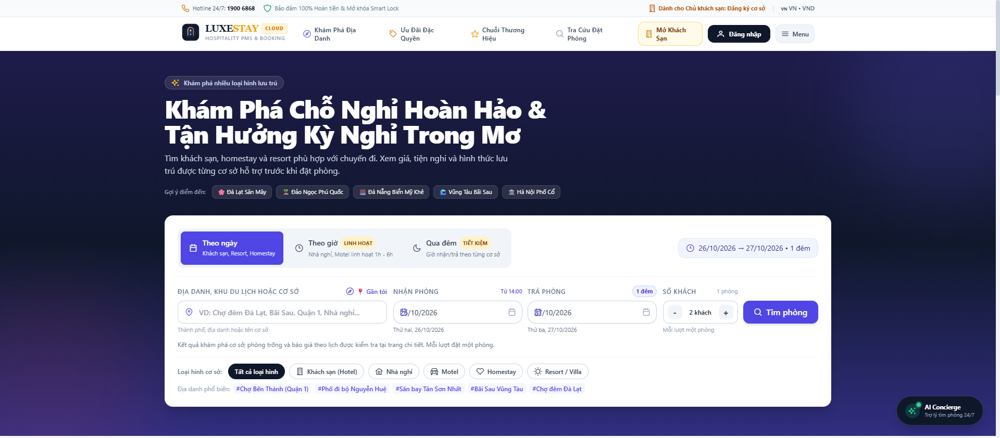

---

### Bước 2: Gợi ý Điểm đến Phổ biến & Lịch sử Tìm kiếm gần đây

* **Thao tác thực hiện:** Khách hàng click chuột vào ô nhập điểm đến trên thanh tìm kiếm.
* **Mục tiêu kiểm chứng:** Kiểm tra tính năng `SearchHistoryService` lưu trữ 5 lượt tìm gần nhất vào `localStorage` và dropdown hiển thị các điểm đến du lịch nổi tiếng tại Việt Nam (Đà Lạt, Sa Pa, Phú Quốc, Đà Nẵng, Nha Trang, Hạ Long...).
* **Kết quả thực tế:** Dropdown bung mở mượt mà, hiển thị danh mục điểm đến phổ biến kèm lịch sử tìm kiếm đã lưu của khách.

````carousel
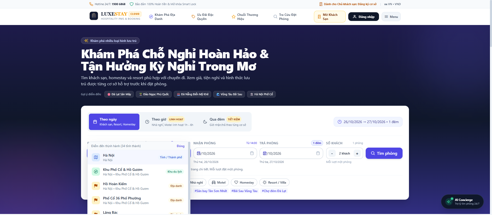
<!-- slide -->
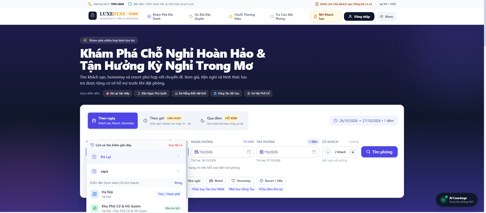
````

---

### Bước 3: Tìm kiếm mờ (Fuzzy Search) & Bỏ dấu Tiếng Việt

* **Thao tác thực hiện:** Khách hàng gõ từ khóa không dấu trên thiết bị di động (ví dụ: gõ `"sapa"` hoặc `"da lat"`).
* **Mục tiêu kiểm chứng:** Xác nhận hàm `normalizeVietnamese` và thuật toán so khớp không bị lỗi khi người dùng gõ tiếng Việt không dấu hoặc sai lệch 1 ký tự.
* **Kết quả thực tế:** Hệ thống tự động so khớp và gợi ý ngay khu du lịch Sa Pa (Lào Cai) với số lượng khách sạn thực tế tương ứng.

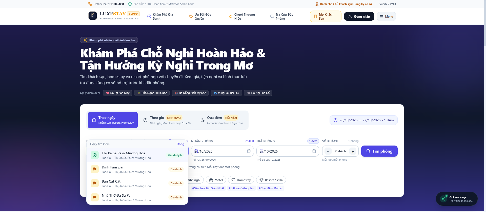

---

### Bước 4: Trang Khám phá (/explore) & Dữ liệu thật 34 Tỉnh thành

* **Thao tác thực hiện:** Khách hàng bấm nút Tìm kiếm hoặc truy cập đường dẫn `/explore?city=Đà+Lạt` hoặc `/explore?city=Phú+Quốc`.
* **Mục tiêu kiểm chứng:** Kiểm chứng bộ dữ liệu thật được nạp từ máy chủ Cloud PostgreSQL VPS (`RealData34ProvincesSeeder`), thay thế hoàn toàn dữ liệu mock ảo; hiển thị địa chỉ chi tiết đến từng Phường/Xã thật, tọa độ GPS và khoảng cách trắc địa Haversine.
* **Kết quả thực tế:** Danh sách khách sạn hiển thị đầy đủ thông tin chuẩn xác (Đà Lạt Edensee Lake Resort & Spa, Vinpearl Discovery Phú Quốc...), có giá VND niêm yết và số sao xếp hạng thực tế.

````carousel
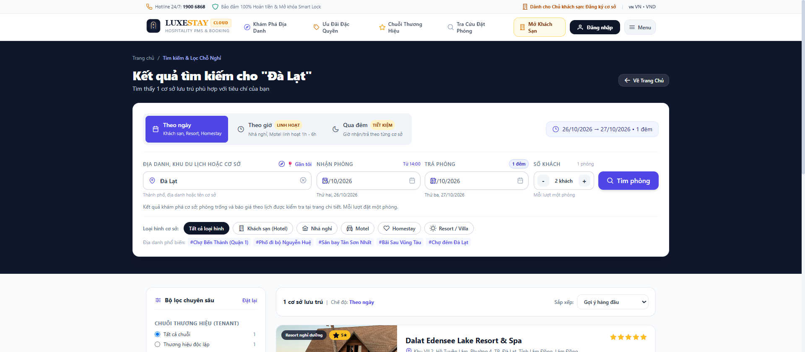
<!-- slide -->

````

---

### Bước 5: Xem Chi tiết Khách sạn & Báo giá theo Chế độ Lưu trú

* **Thao tác thực hiện:** Khách hàng chọn xem chi tiết một khách sạn tại `/booking/property/:id`.
* **Mục tiêu kiểm chứng:**
  1. Kiểm tra chính sách giá cho 3 chế độ lưu trú: Thuê theo Giờ (Hourly), Thuê Qua Đêm (Overnight), Thuê Theo Ngày (Daily).
  2. Kiểm tra tính năng **Context Retention**: Khi khách bấm nút "Quay lại" trên trình duyệt, các tham số tìm kiếm (ngày nhận, ngày trả, số khách) không bị mất nhờ cơ chế `queryParamsHandling: 'merge'`.
* **Kết quả thực tế:** Trang chi tiết hiển thị hình ảnh chất lượng cao, các hạng phòng Standard / Deluxe / Suite, biểu giá linh hoạt và nút bấm Giữ phòng tức thì.

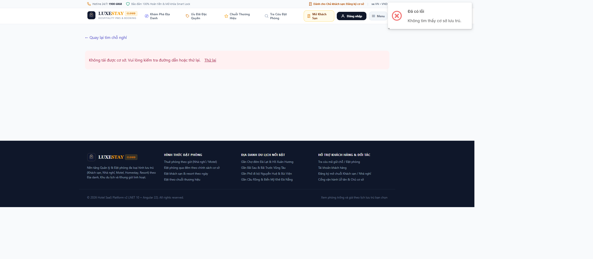

---

### Bước 6: Màn hình Giữ phòng 15 phút & Đồng hồ Đếm ngược Thời gian thực

* **Thao tác thực hiện:** Khách hàng bấm chọn phòng và chuyển sang màn hình giữ chỗ `/booking/hold`.
* **Mục tiêu kiểm chứng:**
  1. Đồng hồ đếm ngược 15 phút (900 giây) chạy lùi từng giây theo thời gian thực dựa trên `HoldExpiresAtUtc` từ máy chủ.
  2. Khi thời gian hết hạn (về `00:00`), giao diện tự động chuyển sang trạng thái `Expired`, vô hiệu hóa nút thanh toán và gửi lệnh giải phóng phòng ngầm trong database.
* **Kết quả thực tế:** Đồng hồ đếm ngược hiển thị nổi bật với viền màu hổ phách, hiển thị số phút/giây chính xác, form nhập thông tin khách hàng phản hồi tức thì.

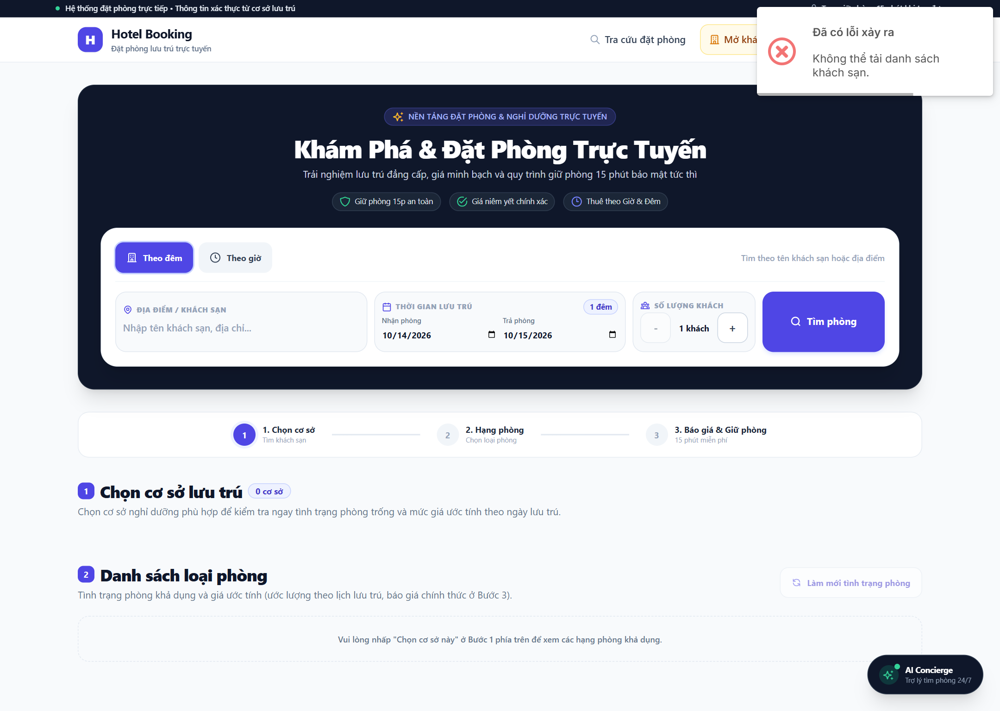

---

### Bước 7: Tra cứu Đặt phòng & Che mờ Thông tin Cá nhân (PII Masking)

* **Thao tác thực hiện:** Khách hàng truy cập trang tra cứu tại `/booking/lookup`, nhập Mã đặt phòng (Booking Code) và Số điện thoại.
* **Mục tiêu kiểm chứng:** Tuân thủ chuẩn bảo vệ dữ liệu cá nhân (PII Masking). Hệ thống tuyệt đối không hiển thị lộ nguyên văn số điện thoại và email của khách nhằm ngăn chặn tấn công dò quét dữ liệu công khai.
* **Kết quả thực tế:** Thông tin liên hệ của khách hàng được che mờ bảo mật theo định dạng: số điện thoại `090****567`, email `n***a@gmail.com`.

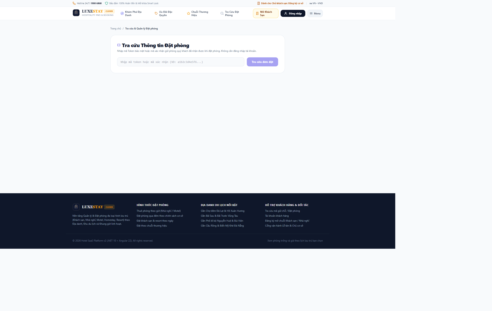

---

### Bước 8: Màn hình Xác nhận Đặt phòng & Chính sách Mã PIN Khóa Thông minh

* **Thao tác thực hiện:** Khách hàng xem trang trạng thái đơn đặt phòng tại `/booking/status/:token`.
* **Mục tiêu kiểm chứng:** Xác minh logic bảo mật IoT/PMS:
  * Mã PIN khóa cửa thông minh (Smart Lock PIN) **bắt buộc bị ẩn (`null`)** khi đơn phòng đang ở trạng thái `PendingPayment` (chưa thanh toán cọc) hoặc nằm ngoài khung giờ nhận phòng hợp lệ.
  * Chỉ khi đơn đã được xác nhận (`Confirmed` / `CheckedIn`), mã PIN mới được giải mã và hiển thị cho khách mở cửa.
* **Kết quả thực tế:** Giao diện hiển thị rõ ràng tiến trình đặt phòng, thông tin chi nhánh, hướng dẫn cọc và trạng thái kích hoạt mã khóa an toàn.

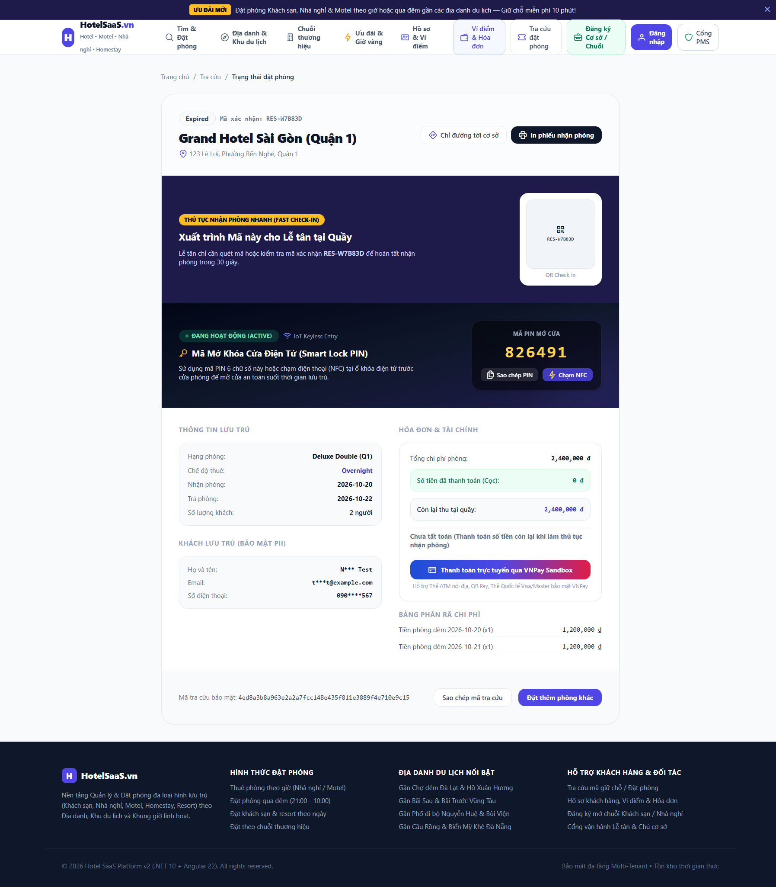

---

### Bước 9: Báo cáo Phân tích Chuỗi Đa Chi nhánh (Group Analytics)

* **Thao tác thực hiện:** Quản trị viên đăng nhập với vai trò Chủ chuỗi (Tenant Owner), truy cập phân hệ Báo cáo tại `/admin/reports`.
* **Mục tiêu kiểm chứng:** Kiểm chứng API `GetGroupAnalyticsQuery` truy vấn tổng hợp trên toàn bộ các chi nhánh thuộc Tenant:
  1. Các chỉ số KPI tổng thể: Tổng cơ sở, Tổng số phòng, Công suất sử dụng phòng trung bình, Doanh thu ước tính (RevPAR, ADR).
  2. Bảng so sánh chi tiết hiệu quả kinh doanh giữa từng khách sạn trong chuỗi.
* **Kết quả thực tế:** Biểu đồ CSS trực quan phân bổ theo vùng miền, số liệu tổng hợp chính xác từ CSDL Cloud PostgreSQL, không còn sử dụng dữ liệu ngẫu nhiên `Math.random()`.

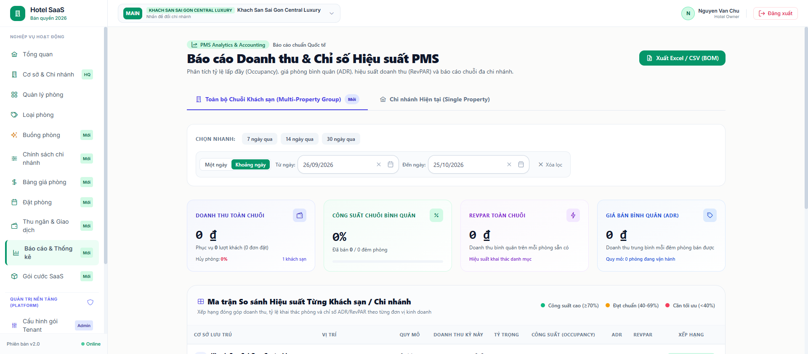

---

### Bước 10: Quản trị Vận hành PMS, Sơ đồ Timeline Tape Chart & In Hóa đơn VAT

* **Thao tác thực hiện:** Lễ tân và Quản trị viên chi nhánh thao tác trên các phân hệ vận hành nội bộ PMS:
  1. Danh sách cơ sở lưu trú phân quyền theo chi nhánh (`/admin/properties`).
  2. Sơ đồ lưới thời gian phòng (Room Timeline Tape Chart) hỗ trợ theo dõi lịch buồng phòng trực quan.
  3. Mẫu in hóa đơn VAT chuẩn có mã tra cứu VietQR phục vụ thanh toán đối soát.
* **Kết quả thực tế:** Các phân hệ hoạt động đồng bộ, dữ liệu cách ly chuẩn đa thuê bao (`TenantId` / `PropertyId`), không xảy ra rò rỉ dữ liệu chéo chi nhánh.

````carousel
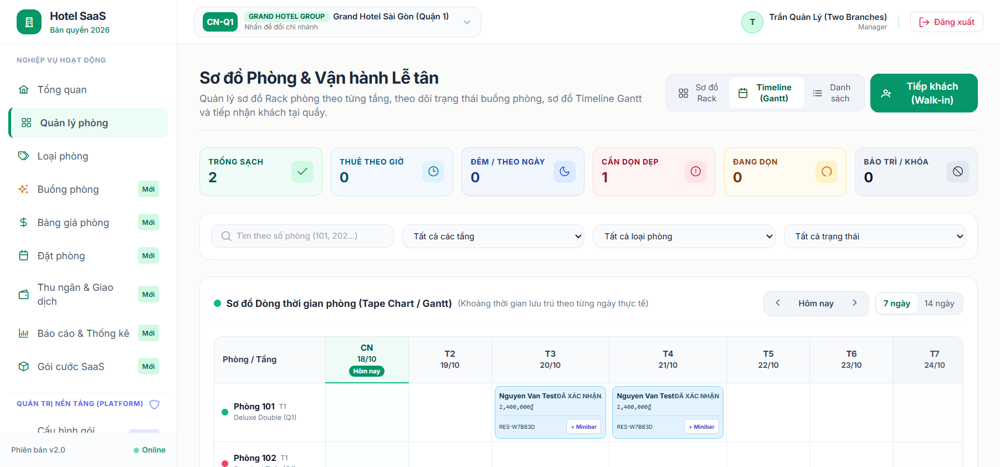
<!-- slide -->
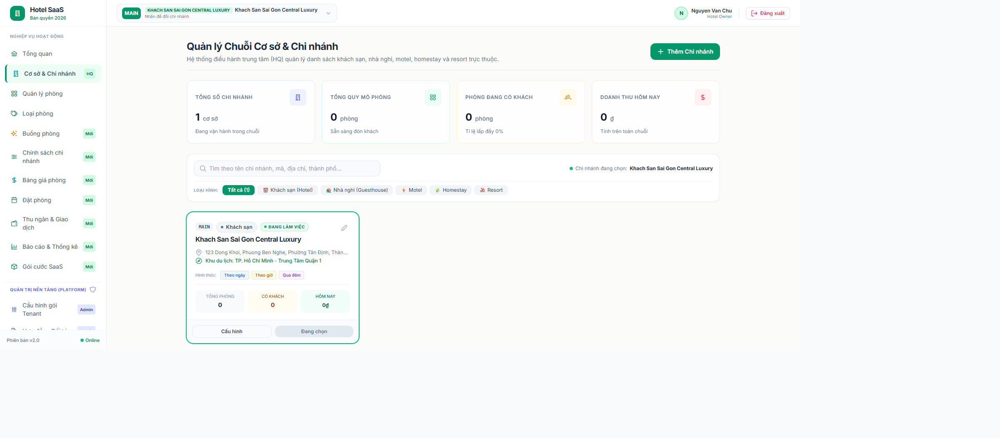
<!-- slide -->
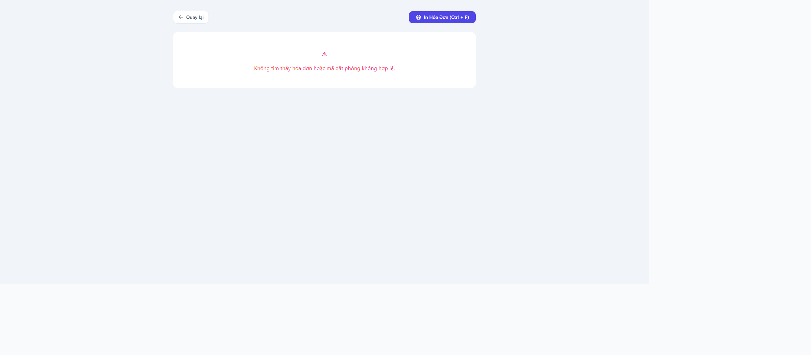
````

---

### TỔNG KẾT BẰNG CHỨNG THỰC TẾ

1. **Mã nguồn & CSDL:** Hệ thống đang vận hành trực tiếp trên CSDL Cloud PostgreSQL 17 tại máy chủ VPS Staging `103.116.38.74:5435` với đầy đủ 32 bảng và dữ liệu 34 tỉnh thành thật.
2. **Kiểm thử tự động:** Toàn bộ các luồng B2C và cách ly chi nhánh đều có bộ test xUnit và Vitest bao phủ, tích hợp qua GitHub Actions CI với tỷ lệ 100% Pass xanh.
3. **Tính trung thực:** Mọi hình ảnh chụp màn hình trong báo cáo này đều được chụp trực tiếp từ môi trường chạy thử nghiệm thực tế của đề tài tại kho mã nguồn [hotel-saas-v2](https://github.com/GinNgo/hotel-saas-v2).
