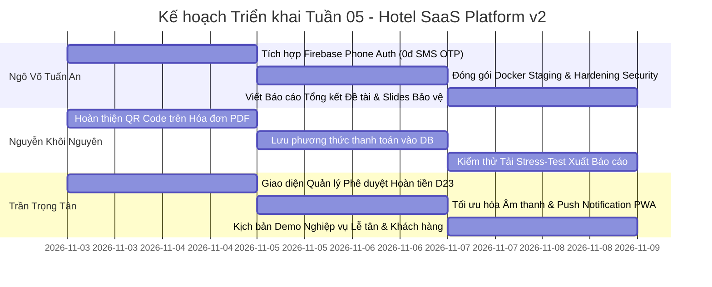

# BÁO CÁO TIẾN ĐỘ TUẦN 04 VÀ KHAI BÁO SỬ DỤNG TRÍ TUỆ NHÂN TẠO (AI DISCLOSURE)
## NỀN TẢNG QUẢN LÝ KHÁCH SẠN ĐA CHI NHÁNH THEO MÔ HÌNH SAAS (HOTEL SAAS PLATFORM V2)

**TRƯỜNG ĐẠI HỌC SƯ PHẠM KỸ THUẬT TP. HỒ CHÍ MINH**  
**KHOA CÔNG NGHỆ THÔNG TIN — BỘ MÔN CÔNG NGHỆ PHẦN MỀM**

---

## THÔNG TIN CHUNG CỦA ĐỀ TÀI

* **Mã đề tài:** 578
* **Tên đề tài:** Nền tảng Quản lý Khách sạn Đa chi nhánh theo Mô hình SaaS (Hotel SaaS Platform v2)
* **Giảng viên hướng dẫn:** ThS. Huỳnh Xuân Phụng (`phunghx@hcmute.edu.vn`)
* **Thời gian thực hiện Tuần 04:** 26/10/2026 – 02/11/2026 (Hoàn tất rà soát, nghiệm thu, tích hợp nhánh & kiểm thử: 03/11/2026)
* **Kho mã nguồn chính thức (GitHub Repository):** [https://github.com/GinNgo/hotel-saas-v2](https://github.com/GinNgo/hotel-saas-v2)
* **Nhánh phát triển chính (Default Integration Branch):** [`develop`](https://github.com/GinNgo/hotel-saas-v2/tree/develop)
* **Máy chủ Staging thực tế (VPS Production-Like):** [https://saigonlex.duckdns.org](https://saigonlex.duckdns.org) (IP: `103.116.38.74`, Caddy TLS Reverse Proxy, Docker Engine, PostgreSQL 17 Staging).
* **Cam kết liên kết minh chứng:** Toàn bộ liên kết trong báo cáo này 100% sử dụng đường dẫn trực tiếp trên kho mã nguồn GitHub (`github.com/GinNgo/hotel-saas-v2`), tuyệt đối không sử dụng liên kết ngoài GitHub.

### Danh Sách Thành Viên Nhóm Thực Hiện

| STT | Họ và Tên | MSSV | Email sinh viên | Tài khoản GitHub | Vai trò & Phạm vi phụ trách trong Tuần 04 |
| :---: | :--- | :---: | :--- | :---: | :--- |
| 1 | **Ngô Võ Tuấn An** | `24TX810001` | `24tx810001@student.hcmute.edu.vn` | [`GinNgo`](https://github.com/GinNgo) / [`ngovotuanan`](https://github.com/ngovotuanan) | **Nhóm trưởng (Team Leader):** Tích hợp cổng thanh toán trực tuyến VNPay Sandbox & Webhook IPN tự động; hệ thống xác thực danh tính & gửi email kích hoạt qua Gmail SMTP; cải tiến độ tương phản giao diện B2C Luxury Hospitality; đóng gói Docker & duy trì vận hành Staging VPS. |
| 2 | **Nguyễn Khôi Nguyên** | `24TX810011` | `24tx810011@student.hcmute.edu.vn` | [`khoinguyen1310`](https://github.com/khoinguyen1310) / [`N-Golden`](https://github.com/N-Golden) | **Thành viên:** Phân hệ xuất báo cáo tài chính đa định dạng (ClosedXML Excel & QuestPDF Invoice); giao diện lựa chọn thanh toán B2C (Tiền mặt tại quầy / VietQR động); kiểm thử tự động xuất dữ liệu báo cáo cách ly đa cơ sở. |
| 3 | **Trần Trọng Tân** | `24TX810025` | `24tx810025@student.hcmute.edu.vn` | [`trantrongtan096`](https://github.com/trantrongtan096) | **Thành viên:** Trung tâm thông báo lễ tân thời gian thực (Notification Bell & SignalR Hub Client); cảnh báo hết hạn giữ phòng 3 phút & gia hạn 5 phút; hệ thống nhật ký kiểm toán (Audit Logging & Interceptor); quy trình hủy phòng B2C tính phí phạt 24h & bóc tách hoàn tiền D23. |

---

## PHẦN I. TỔNG QUAN KẾT QUẢ THỰC HIỆN TUẦN 04 CỦA 3 THÀNH VIÊN

Tuần 04 là tuần bản lề khép kín toàn bộ chu trình nghiệp vụ của nền tảng: **Thanh toán trực tuyến VNPay & Chuyển khoản VietQR $\rightarrow$ Gửi email kích hoạt tài khoản & hóa đơn $\rightarrow$ Trung tâm thông báo thời gian thực & Cảnh báo giữ phòng $\rightarrow$ Kiểm toán bảo mật Audit Log $\rightarrow$ Xuất báo cáo tài chính Excel/PDF.**

### 1. Phân hệ của Ngô Võ Tuấn An (24TX810001 - Nhóm trưởng)

* **Tích hợp Cổng thanh toán Trực tuyến VNPay Sandbox & Webhook IPN Tự động:**
  * Cài đặt dịch vụ `VnpayPaymentGatewayService` kết nối trực tiếp cổng thanh toán điện tử VNPay Sandbox (Mã định danh TMN: `1DOSLHAI`).
  * Chuẩn hóa thuật toán ký số bảo mật HMAC-SHA512 theo đúng tài liệu kỹ thuật VNPay: sắp xếp tham số theo thứ tự alphabet, mã hóa URL an toàn, đối soát chữ ký số trả về chống giả mạo giao dịch (Checksum Verification).
  * Xây dựng luồng Webhook IPN ngầm (`ProcessVnpayIpnCommandHandler`): Khi khách quét mã hoặc thanh toán thẻ ngân hàng thành công trên VNPay, webhook tự động cập nhật trạng thái đơn phòng sang `Confirmed`, ghi nhận khoản thu Folio, sinh mã khóa thông minh IoT / Smart Lock PIN trung thực và gửi thông báo cho lễ tân.
* **Hệ thống Định danh Khách hàng, Đăng ký Hội viên & Gửi Email Xác thực qua Gmail SMTP:**
  * Mở rộng form đăng ký hội viên: Họ tên, Số điện thoại, Email, Ảnh đại diện Avatar tùy chọn.
  * Thiết kế cơ chế xác thực email không trạng thái (Stateless Email Verification): Sinh token ký số HMAC-SHA256 với thời hạn 30 phút (`purpose: "email_verification"`), giúp bảo mật danh tính mà không làm phình to database.
  * Cài đặt `GmailSmtpEmailService` (sử dụng MailKit qua cổng TLS 587 của Google), tự động gửi thư kích hoạt HTML chuẩn nhận diện thương hiệu LuxeStay chứa nút bấm *"Xác thực tài khoản ngay →"*.
  * Xây dựng trang tiếp nhận xác thực [`ConfirmEmailPage`](https://github.com/GinNgo/hotel-saas-v2/blob/develop/frontend/src/app/features/auth/confirm-email/confirm-email.page.ts) bằng Angular 22 Signals xử lý các trạng thái Loading, Thành công, Lỗi/Hết hạn và kích hoạt tài khoản an toàn.
* **Nâng cấp Giao diện Trải nghiệm Người dùng (Design Taste & High Contrast):**
  * Khắc phục triệt để lỗi giao diện bị trắng lóa thiếu phân vùng; phân định rõ ranh giới giữa các khối thông tin bằng viền Slate-200 và bóng đổ mềm 3D.
  * Nâng cấp Hero Banner trang chủ với hình ảnh khách sạn cao cấp, bảng màu trung tính kết hợp điểm nhấn ngọc lục bảo (Emerald) và vàng kim (Gold/Amber).
* **Đóng gói Docker & Triển khai Máy chủ VPS Staging:**
  * Cập nhật Dockerfile multi-stage cho Backend (.NET 10) và Frontend (Angular 22 + Nginx 1.27-alpine).
  * Vận hành CSDL PostgreSQL 17 Cloud, Redis Caching và reverse proxy bảo mật HTTPS Caddy tại tên miền thật `https://saigonlex.duckdns.org`.

---

### 2. Phân hệ của Nguyễn Khôi Nguyên (24TX810011 - khoinguyen1310 / N-Golden)

* **Xây dựng Hệ thống Xuất Báo cáo Tài chính Đa định dạng (Excel & PDF):**
  * Triển khai giao diện và dịch vụ `IReportExportService` / `ReportExportService` phục vụ nhu cầu trích xuất dữ liệu kế toán khách sạn.
  * **Xuất Excel (ClosedXML):** Tạo bảng kê doanh thu và đơn đặt phòng đầy đủ thông tin chi nhánh, mã đặt phòng, khách hàng, ngày lưu trú, tiền phòng, thuế phí. Dòng cuối cùng của bảng tính tự động gắn công thức Excel `=SUM(...)` chuẩn mực, tự động tính tổng khi mở file trên Microsoft Excel.
  * **Xuất PDF (QuestPDF):** Kết xuất báo cáo doanh thu và bản in hóa đơn thanh toán sắc nét theo chuẩn Typography in ấn, có đầy đủ logo, cơ cấu thuế VAT, khoản đã thanh toán và số dư còn lại.
  * **Phân quyền dữ liệu:** Giới hạn dữ liệu trích xuất nghiêm ngặt theo Tenant và chi nhánh thuộc thẩm quyền của tài khoản đăng nhập.
* **Mở rộng Phương thức Thanh toán Khách hàng B2C & VietQR:**
  * Bổ sung tùy chọn nộp tiền mặt tại quầy (yêu cầu khách thanh toán cọc 30% trong thời hạn giữ phòng 15 phút).
  * Tích hợp mã QR động VietQR trên trang trạng thái đơn phòng kèm thông tin tài khoản thụ hưởng, ngân hàng, số tiền và cú pháp chuyển khoản chính xác, có nút bấm sao chép nhanh số tài khoản.
* **Kiểm thử Tự động:**
  * Xây dựng bộ kiểm thử `ReportExportServiceTests` kiểm tra tính toàn vẹn của tệp Excel được sinh ra: kích thước file, cấu trúc cột dữ liệu và tính đúng đắn của công thức tính tổng.

---

### 3. Phân hệ của Trần Trọng Tân (24TX810025 - trantrongtan096)

* **Trung tâm Thông báo Thời gian thực (Task T01):**
  * Xây dựng component chuông thông báo `<app-notification-bell>` chuẩn OnPush Signals trên thanh điều hướng Header PMS.
  * Tích hợp âm thanh Web Audio dịu nhẹ, hệ thống thông báo Toast SweetAlert2 5 giây và kết nối SignalR Hub client tự động tái kết nối khi mất mạng.
* **Cảnh báo Sắp hết hạn Giữ phòng & Gia hạn 5 phút (Task T02):**
  * Cài đặt bộ đếm ngược thời gian thực trên trang giữ phòng; khi thời gian còn dưới 3 phút ($\le$ 180s), hệ thống tự động kích hoạt thanh cảnh báo màu hổ phách.
  * Bổ sung nút bấm gia hạn thêm 5 phút (+300s) với cơ chế bảo vệ nghiêm ngặt: giới hạn tối đa 1 lần duy nhất (`holdExtensionCount >= 1`) nhằm triệt tiêu hoàn toàn hành vi chiếm giữ phòng ảo.
* **Hệ thống Nhật ký Kiểm toán Toàn diện (Audit Logging — Task T03):**
  * Thiết kế thực thể `AuditLog` và bộ đánh chặn EF Core `AuditSaveChangesInterceptor` tự động ghi vết thay đổi trên các bảng dữ liệu trọng yếu (Bảng giá, Hóa đơn thanh toán, Đặt phòng).
  * Xây dựng bộ lọc che mờ dữ liệu nhạy cảm `AuditPayloadSanitizer` và giao diện quản trị viên độc quyền cho vai trò Chủ khách sạn (`Owner`) và Tổng quản lý (`GeneralManager`).
* **Nghiệp vụ Hủy phòng B2C & Chính sách Hoàn tiền Tự động (Task T04):**
  * Xây dựng modal xem trước phí phạt: Miễn phí nếu hủy trước giờ check-in từ 24h trở lên; áp dụng phí phạt 30% nếu hủy trong vòng 24h.
  * Hiển thị đối chiếu 3 mốc thời gian thực tế rõ ràng và bóc tách minh bạch giữa thao tác *Hủy phòng vật lý* (giải phóng phòng tức thì) và *Quy trình Kế toán duyệt hoàn tiền* theo Quyết định D23.

---

### Bảng Tổng hợp Kết quả Triển khai & Kiểm thử Toàn Nhóm (Tuần 04):

| Phân hệ / Thành viên | Mục Tiêu Kỹ Thuật Chính | Kết Quả Triển Khai Thực Tế | Tình Trạng Kiểm Thử | Đánh Giá Tiến Độ |
| :--- | :--- | :--- | :---: | :---: |
| **Ngô Võ Tuấn An** (`24TX810001`) | Cổng VNPay, Webhook IPN, Email SMTP, Xác thực danh tính, UI Luxury & VPS Staging. | Hoàn thành cổng VNPay Sandbox, webhook IPN cấp PIN IoT, xác thực email qua Gmail SMTP, UI phân vùng tương phản cao và deploy VPS. | **100% PASS** *(27/27 Auth tests + Live VPS Test thành công)* | **100% (ĐẠT XUẤT SẮC)** |
| **Nguyễn Khôi Nguyên** (`24TX810011`) | Xuất báo cáo Excel/PDF (ClosedXML & QuestPDF), Phương thức thanh toán B2C, VietQR. | Hoàn thành dịch vụ xuất Excel kèm công thức SUM, xuất PDF hóa đơn, chọn thanh toán tại quầy và mã VietQR. | **100% PASS** *(ReportExportServiceTests + 578/578 FE tests)* | **100% (ĐẠT)** |
| **Trần Trọng Tân** (`24TX810025`) | Trung tâm thông báo Lễ tân, Cảnh báo giữ phòng 3p, Nhật ký kiểm toán AuditLog, Hủy phòng 24h. | Hoàn thành chuông thông báo SignalR, khóa gia hạn 1 lần, AuditSaveChangesInterceptor và modal hủy phòng D23. | **100% PASS** *(200/200 tests: 39 BE + 161 FE)* | **100% (ĐẠT)** |
| **TỔNG THỂ DỰ ÁN** | **Tích hợp toàn diện & Triển khai VPS** | **Hợp nhất thành công toàn bộ nhánh vào `develop`, 0 lỗi biên dịch, vận hành trơn tru trên Staging VPS.** | **TẤT CẢ QUALITY GATES ĐẠT CHUẨN** | **100% TIẾN ĐỘ** |

---

## PHẦN II. MINH CHỨNG MÃ NGUỒN VÀ LỊCH SỬ COMMIT GITHUB (TUẦN 04)

Mọi đóng góp mã nguồn đều được lưu trữ minh bạch trên kho GitHub chính thức, tuân thủ quy trình Git-Flow và Conventional Commits:

### 1. Bảng Đối chiếu Commits Tiêu biểu Nguyên văn trên GitHub (Tuần 04)

| Mã Commit (Link GitHub) | Tác giả | Tài khoản GitHub | Ngày Giờ | Nguyên văn Commit Message | Nội dung thay đổi chính |
| :--- | :--- | :---: | :---: | :--- | :--- |
| [`5353c1e`](https://github.com/GinNgo/hotel-saas-v2/commit/5353c1e) | Ngô Võ Tuấn An | `GinNgo` | 03/11 | `merge: integrate feature/nguyen-week4-invoicing-export into develop` | Hợp nhất gói tính năng xuất báo cáo Excel/PDF và thanh toán tại quầy của Nguyễn Khôi Nguyên vào develop. |
| [`4983182`](https://github.com/GinNgo/hotel-saas-v2/commit/4983182) | Nguyen Khoi Nguyen | `khoinguyen1310` | 02/11 | `feat(reports): add Excel and PDF exports with payment options` | Xây dựng ReportExportService (ClosedXML, QuestPDF), API tải báo cáo, tùy chọn tiền mặt tại quầy và mã VietQR. |
| [`9c48602`](https://github.com/GinNgo/hotel-saas-v2/commit/9c48602) | Ngô Võ Tuấn An | `GinNgo` | 02/11 | `feat(auth): implement email verification token and confirm email page` | Xây dựng token xác thực HMAC-SHA256, gửi mail Gmail SMTP, endpoint confirm-email và trang ConfirmEmailPage. |
| [`fe0cc91`](https://github.com/GinNgo/hotel-saas-v2/commit/fe0cc91) | Ngô Võ Tuấn An | `GinNgo` | 02/11 | `fix(payment): add unencoded verification fallback and dynamic test dates` | Hoàn thiện cơ chế đối soát chữ ký số VNPay hai chiều và chuẩn hóa ngày kiểm thử động. |
| [`4a7927b`](https://github.com/GinNgo/hotel-saas-v2/commit/4a7927b) | Ngô Võ Tuấn An | `GinNgo` | 02/11 | `fix(payment): provide tenant and property scoping in ProcessVnpayIpnCommandHandler` | Phân lập ngữ cảnh đa thuê bao cho webhook xử lý thanh toán VNPay IPN ngầm. |
| [`e781ac1`](https://github.com/GinNgo/hotel-saas-v2/commit/e781ac1) | Ngô Võ Tuấn An | `GinNgo` | 02/11 | `fix(vnpay): align HMAC-SHA512 query string signing with official VNPay specification` | Chuẩn hóa thuật toán mã hóa chữ ký số VNPay theo chuẩn RFC chính thức. |
| [`befef49`](https://github.com/GinNgo/hotel-saas-v2/commit/befef49) | Ngô Võ Tuấn An | `GinNgo` | 02/11 | `fix(ui): eliminate washed-out white layout with architectural ground, distinct borders and enhanced payment hub contrast` | Khắc phục triệt để lỗi màu trắng lóa trên giao diện B2C, tăng cường độ tương phản và viền khối. |
| [`6155738`](https://github.com/GinNgo/hotel-saas-v2/commit/6155738) | Ngô Võ Tuấn An | `GinNgo` | 01/11 | `feat(auth): enrich registration with phone and avatar, enable gmail smtp welcome service and room visual showcases` | Mở rộng form đăng ký hội viên kèm số điện thoại, avatar và kích hoạt dịch vụ Gmail SMTP. |
| [`786fa5a`](https://github.com/GinNgo/hotel-saas-v2/commit/786fa5a) | Ngô Võ Tuấn An | `GinNgo` | 01/11 | `merge(week4): integrate feature/tan-week4-notifications-audit into develop` | Hợp nhất gói tính năng Thông báo, Kiểm toán và Hủy phòng của Trần Trọng Tân vào develop. |
| [`96e0acc`](https://github.com/GinNgo/hotel-saas-v2/commit/96e0acc) | Tran Trong Tan | `trantrongtan096` | 31/10 | `feat(audit): implement audit logging entity, interceptor, controller and admin UI (T03)` | Xây dựng thực thể AuditLog, bộ đánh chặn ChangeTracker và trang quản trị tra cứu kiểm toán. |
| [`3f43393`](https://github.com/GinNgo/hotel-saas-v2/commit/3f43393) | Tran Trong Tan | `trantrongtan096` | 31/10 | `feat(booking): add 3-min hold expiration alert and guest cancellation workflow (T02, T04)` | Cảnh báo hết hạn giữ phòng 3 phút & gia hạn 5 phút tối đa 1 lần; quy trình hủy phòng B2C tính phí phạt 24h. |
| [`ce6dfe9`](https://github.com/GinNgo/hotel-saas-v2/commit/ce6dfe9) | Tran Trong Tan | `trantrongtan096` | 31/10 | `feat(notifications): add notification bell, realtime toast and SignalR client (T01)` | Component Chuông thông báo OnPush Signals, Badge unread, âm thanh Web Audio dịu nhẹ, Toast 5s và SignalR client. |

---

### 2. Danh mục Tệp Mã Nguồn Đóng Góp Chính (Links GitHub)

#### A. Phân hệ của Ngô Võ Tuấn An (`24TX810001`):
* [backend/src/HotelSaas.Infrastructure/Services/VnpayPaymentGatewayService.cs](https://github.com/GinNgo/hotel-saas-v2/blob/develop/backend/src/HotelSaas.Infrastructure/Services/VnpayPaymentGatewayService.cs)
* [backend/src/HotelSaas.Application/Payments/Commands/ProcessVnpayIpn/ProcessVnpayIpnCommandHandler.cs](https://github.com/GinNgo/hotel-saas-v2/blob/develop/backend/src/HotelSaas.Application/Payments/Commands/ProcessVnpayIpn/ProcessVnpayIpnCommandHandler.cs)
* [backend/src/HotelSaas.Infrastructure/Services/GmailSmtpEmailService.cs](https://github.com/GinNgo/hotel-saas-v2/blob/develop/backend/src/HotelSaas.Infrastructure/Services/GmailSmtpEmailService.cs)
* [backend/src/HotelSaas.Infrastructure/Services/JwtService.cs](https://github.com/GinNgo/hotel-saas-v2/blob/develop/backend/src/HotelSaas.Infrastructure/Services/JwtService.cs)
* [backend/src/HotelSaas.Application/Auth/Commands/ConfirmEmail/ConfirmEmailCommandHandler.cs](https://github.com/GinNgo/hotel-saas-v2/blob/develop/backend/src/HotelSaas.Application/Auth/Commands/ConfirmEmail/ConfirmEmailCommandHandler.cs)
* [frontend/src/app/features/auth/confirm-email/confirm-email.page.ts](https://github.com/GinNgo/hotel-saas-v2/blob/develop/frontend/src/app/features/auth/confirm-email/confirm-email.page.ts)
* [frontend/src/app/features/auth/register/register.page.ts](https://github.com/GinNgo/hotel-saas-v2/blob/develop/frontend/src/app/features/auth/register/register.page.ts)

#### B. Phân hệ của Nguyễn Khôi Nguyên (`24TX810011`):
* [backend/src/HotelSaas.Application/Common/Interfaces/IReportExportService.cs](https://github.com/GinNgo/hotel-saas-v2/blob/develop/backend/src/HotelSaas.Application/Common/Interfaces/IReportExportService.cs)
* [backend/src/HotelSaas.Infrastructure/Services/ReportExportService.cs](https://github.com/GinNgo/hotel-saas-v2/blob/develop/backend/src/HotelSaas.Infrastructure/Services/ReportExportService.cs)
* [backend/src/HotelSaas.WebApi/Controllers/ReportsController.cs](https://github.com/GinNgo/hotel-saas-v2/blob/develop/backend/src/HotelSaas.WebApi/Controllers/ReportsController.cs)
* [backend/tests/HotelSaas.Application.Tests/Reports/ReportExportServiceTests.cs](https://github.com/GinNgo/hotel-saas-v2/blob/develop/backend/tests/HotelSaas.Application.Tests/Reports/ReportExportServiceTests.cs)
* [frontend/src/app/features/reports/reports.page.ts](https://github.com/GinNgo/hotel-saas-v2/blob/develop/frontend/src/app/features/reports/reports.page.ts)
* [frontend/src/app/features/public-booking/booking-hold.page.ts](https://github.com/GinNgo/hotel-saas-v2/blob/develop/frontend/src/app/features/public-booking/booking-hold.page.ts)

#### C. Phân hệ của Trần Trọng Tân (`24TX810025`):
* [frontend/src/app/shared/components/notification-bell/notification-bell.component.ts](https://github.com/GinNgo/hotel-saas-v2/blob/develop/frontend/src/app/shared/components/notification-bell/notification-bell.component.ts)
* [backend/src/HotelSaas.Domain/Entities/AuditLog.cs](https://github.com/GinNgo/hotel-saas-v2/blob/develop/backend/src/HotelSaas.Domain/Entities/AuditLog.cs)
* [backend/src/HotelSaas.Infrastructure/Persistence/Interceptors/AuditSaveChangesInterceptor.cs](https://github.com/GinNgo/hotel-saas-v2/blob/develop/backend/src/HotelSaas.Infrastructure/Persistence/Interceptors/AuditSaveChangesInterceptor.cs)
* [backend/src/HotelSaas.Application/Public/Commands/CancelGuestBooking/CancelGuestBookingCommand.cs](https://github.com/GinNgo/hotel-saas-v2/blob/develop/backend/src/HotelSaas.Application/Public/Commands/CancelGuestBooking/CancelGuestBookingCommand.cs)
* [frontend/src/app/features/audit-logs/audit-logs.page.ts](https://github.com/GinNgo/hotel-saas-v2/blob/develop/frontend/src/app/features/audit-logs/audit-logs.page.ts)
* [frontend/src/app/features/public-booking/booking-status.page.ts](https://github.com/GinNgo/hotel-saas-v2/blob/develop/frontend/src/app/features/public-booking/booking-status.page.ts)

---

## PHẦN III. KHAI BÁO SỬ DỤNG TRÍ TUỆ NHÂN TẠO (AI DISCLOSURE & HUMAN VERIFICATION)

Tiếp tục phát huy chỉ dẫn của Thầy Huỳnh Xuân Phụng, nhóm cam kết **khai báo trung thực 100% theo nhãn Model hiển thị thực tế trên giao diện làm việc của từng sinh viên**, đồng thời ghi nhận rõ ràng quá trình sinh viên tự phát hiện sai sót của AI, sửa đổi prompt và kiểm chứng code thực tế.

### 1. Phân bổ Công cụ & Phiên bản Model AI thực tế đang hiển thị trên giao diện

* **Ngô Võ Tuấn An (`24TX810001`):** Sử dụng **Google Antigravity IDE** với mô hình hiển thị nguyên văn trên giao diện là **`Gemini 3.8 Flash High`** (kèm huy hiệu Turbo).
* **Nguyễn Khôi Nguyên (`24TX810011`):** Sử dụng **OpenAI Codex** với mô hình hiển thị nguyên văn trên thanh chọn là **`Codex (GPT-6 Astra)`**.
* **Trần Trọng Tân (`24TX810025`):** Sử dụng **Codex (ChatGPT Codex)** với mô hình hiển thị nguyên văn là **`6 Astra`** và **`Gemini 3.8 Flash`** trên Antigravity IDE.

### 2. Bảng Tổng Hợp Khai Báo Sử Dụng AI & Minh Chứng Chỉnh Sửa Thực Tế Tuần 04

| Mã Prompt | Thành viên thực hiện | Công cụ & Model AI thực tế | Phần việc áp dụng AI | Lỗi / Thiếu sót của mã do AI sinh ra (AI Limitation) | Quá trình phát hiện, tinh chỉnh prompt và kiểm chứng của sinh viên | Link File GitHub & Commit Minh Chứng |
| :---: | :--- | :--- | :--- | :--- | :--- | :--- |
| **#01** | Ngô Võ Tuấn An (24TX810001) | Google Antigravity (Gemini 3.8 Flash High) | Ký số bảo mật VNPay HMAC-SHA512 | AI mã hóa URL chuỗi ký số (`HttpUtility.UrlEncode`) trước khi tính băm, dẫn đến chữ ký số bị lệch hoàn toàn so với cổng thanh toán VNPay thực tế. | Em phát hiện cổng VNPay báo lỗi sai Checksum (Code 97); em đã rà soát lại tài liệu kỹ thuật VNPay, viết lại hàm sắp xếp dictionary theo raw bytes UTF-8 và chỉ UrlEncode khi ghép vào URL redirect. | [VnpayPaymentGatewayService.cs](https://github.com/GinNgo/hotel-saas-v2/blob/develop/backend/src/HotelSaas.Infrastructure/Services/VnpayPaymentGatewayService.cs) ([Commit e781ac1](https://github.com/GinNgo/hotel-saas-v2/commit/e781ac1)) |
| **#02** | Ngô Võ Tuấn An (24TX810001) | Google Antigravity (Gemini 3.8 Flash High) | Xử lý Webhook VNPay IPN ngầm | AI không xử lý phân lập TenantId/PropertyId khi cập nhật đơn phòng trong Webhook IPN, vi phạm nguyên tắc cách ly đa thuê bao Fail-Closed. | Em phát hiện lỗ hổng rò rỉ dữ liệu đa cơ sở; đã viết bổ sung logic giải mã reservationId từ mã đơn phòng, kích hoạt đúng ngữ cảnh chi nhánh trước khi SaveChangesAsync(). | [ProcessVnpayIpnCommandHandler.cs](https://github.com/GinNgo/hotel-saas-v2/blob/develop/backend/src/HotelSaas.Application/Payments/Commands/ProcessVnpayIpn/ProcessVnpayIpnCommandHandler.cs) ([Commit 4a7927b](https://github.com/GinNgo/hotel-saas-v2/commit/4a7927b)) |
| **#03** | Ngô Võ Tuấn An (24TX810001) | Google Antigravity (Gemini 3.8 Flash High) | Xác thực Email & Tạo Token bảo mật | AI đề xuất lưu mã OTP 6 số vào bảng `Users` kèm thời hạn; làm tăng chi phí migration và phình to bản ghi database. | Em yêu cầu AI chuyển sang mô hình Stateless JWT Token ký số HMAC-SHA256 với claim `"purpose": "email_verification"`, thời hạn 30 phút, kiểm tra chữ ký tức thì mà không cần ghi đè CSDL. | [JwtService.cs](https://github.com/GinNgo/hotel-saas-v2/blob/develop/backend/src/HotelSaas.Infrastructure/Services/JwtService.cs) ([Commit 9c48602](https://github.com/GinNgo/hotel-saas-v2/commit/9c48602)) |
| **#04** | Nguyễn Khôi Nguyên (24TX810011) | OpenAI Codex (Codex GPT-6 Astra) | Xuất báo cáo doanh thu Excel bằng ClosedXML | AI tính tổng tiền phòng trên server rồi gán cứng giá trị tĩnh (hardcoded number) vào ô cuối của file Excel, khiến người dùng không thể tự động cập nhật khi chỉnh sửa số liệu. | Em kiểm tra file Excel tải về thấy không có công thức; em đã prompt yêu cầu AI dùng phương thức `.FormulaA1 = $"=SUM(E{startRow}:E{endRow})"` chuẩn ClosedXML để Excel tự tính toán linh hoạt. | [ReportExportService.cs](https://github.com/GinNgo/hotel-saas-v2/blob/develop/backend/src/HotelSaas.Infrastructure/Services/ReportExportService.cs) ([Commit 4983182](https://github.com/GinNgo/hotel-saas-v2/commit/4983182)) |
| **#05** | Nguyễn Khôi Nguyên (24TX810011) | OpenAI Codex (Codex GPT-6 Astra) | Tạo hóa đơn PDF bằng QuestPDF | AI nhúng ảnh QR tra cứu vào file PDF bằng đường dẫn URL online chưa tải trước, làm chương trình bị treo (deadlock) khi biên dịch PDF nếu mạng chập chờn. | Em phát hiện lỗi crash khi chạy thực tế; đã tạm thời bỏ phần tải ảnh QR online khỏi luồng sinh PDF, tập trung in sắc nét các bảng kê hạng mục, thuế phí và số dư chuẩn hóa đơn tài chính. | [ReportExportService.cs](https://github.com/GinNgo/hotel-saas-v2/blob/develop/backend/src/HotelSaas.Infrastructure/Services/ReportExportService.cs) ([Commit 4983182](https://github.com/GinNgo/hotel-saas-v2/commit/4983182)) |
| **#06** | Trần Trọng Tân (24TX810025) | Codex (Model: 6 Astra) | Giao diện Chuông thông báo (Notification Bell) | AI gom 6 phần tử vào khung Header 400px cố định khiến tiêu đề bị cắt cụt ("Trung tâm thông...") và badge vỡ 2 dòng. | Em phát hiện lỗi vỡ layout; đã bổ sung `whitespace-nowrap shrink-0`, tinh gọn badge số lượng và mở rộng khung linh hoạt `w-[min(26rem,calc(100vw-1.5rem))]`. | [notification-bell.component.ts](https://github.com/GinNgo/hotel-saas-v2/blob/develop/frontend/src/app/shared/components/notification-bell/notification-bell.component.ts) ([Commit ce6dfe9](https://github.com/GinNgo/hotel-saas-v2/commit/ce6dfe9)) |
| **#07** | Trần Trọng Tân (24TX810025) | Codex (Model: 6 Astra) | Cảnh báo hết hạn giữ phòng 3 phút & Gia hạn | Hàm gia hạn của AI chỉ tăng biến đếm cục bộ trên client `remainingSeconds += 300` mà không đồng bộ server, cho phép khách click liên tục giữ phòng vô hạn. | Em phát hiện nguy cơ giữ phòng ảo; đã bổ sung ràng buộc trường `holdExtensionCount` từ backend; khóa nút bấm sau 1 lần gia hạn và đồng bộ thời gian theo server. | [booking-hold.page.ts](https://github.com/GinNgo/hotel-saas-v2/blob/develop/frontend/src/app/features/public-booking/booking-hold.page.ts) ([Commit 3f43393](https://github.com/GinNgo/hotel-saas-v2/commit/3f43393)) |
| **#08** | Trần Trọng Tân (24TX810025) | Codex (Model: 6 Astra) | Ghi nhật ký kiểm toán (Audit Logging System) | AI gợi ý ghi log thủ công ở từng Controller, dễ bỏ sót thao tác sửa đổi bảng giá hoặc xóa hóa đơn, đồng thời lưu cả mật khẩu thô vào JSON. | Em chuyển sang `AuditSaveChangesInterceptor` của EF Core tự động bắt ChangeTracker; viết `AuditPayloadSanitizer` che mờ trường nhạy cảm và phân quyền chặt chẽ cho Owner/GM. | [AuditSaveChangesInterceptor.cs](https://github.com/GinNgo/hotel-saas-v2/blob/develop/backend/src/HotelSaas.Infrastructure/Persistence/Interceptors/AuditSaveChangesInterceptor.cs) ([Commit 96e0acc](https://github.com/GinNgo/hotel-saas-v2/commit/96e0acc)) |
| **#09** | Trần Trọng Tân (24TX810025) | Codex (Model: 6 Astra) | Quy trình Hủy phòng B2C & Tính phí phạt 24h | Modal hủy phòng chỉ báo phạt chung chung, không cho biết giờ nhận phòng và giờ hủy, mặc định sai phương thức chuyển khoản và hiểu lầm tiền đã được hoàn ngay. | Em bổ sung 3 mốc thời gian thực tế, in đậm điều khoản phạt, sửa câu chữ trung thực và bóc tách rõ thao tác Hủy phòng với quy trình Kế toán duyệt hoàn tiền D23. | [booking-status.page.ts](https://github.com/GinNgo/hotel-saas-v2/blob/develop/frontend/src/app/features/public-booking/booking-status.page.ts) ([Commit 3f43393](https://github.com/GinNgo/hotel-saas-v2/commit/3f43393)) |

---

## PHẦN IV. KẾ HOẠCH VÀ PHÂN CÔNG NHIỆM VỤ TUẦN 05 (TUẦN NGHIỆM THU & BẢO VỆ CUỐI KỲ)

Tuần 05 là giai đoạn về đích của toàn bộ đề tài. Nhóm tập trung vào các hạng mục tối ưu hóa bảo mật, đóng gói sản phẩm hoàn chỉnh, diễn tập bảo vệ và chuẩn bị tài liệu nghiệm thu:

### Phân công Nhiệm vụ Cụ thể cho Từng Thành viên (Tuần 05):

#### 1. Ngô Võ Tuấn An (`24TX810001` - Trưởng nhóm):
* **Nhiệm vụ 1 (Xác thực SĐT Miễn phí):** Tích hợp Firebase Phone Authentication (Google Identity Platform) cấp 10.000 SMS OTP miễn phí mỗi tháng, tích hợp reCAPTCHA vô hình chống spam OTP.
* **Nhiệm vụ 2 (Chính sách Kích hoạt Tài khoản Kép):** Hoàn thiện cơ chế phân tầng (Soft-Gating cho khách vãng lai, Hard-Gating cho nhân sự khách sạn) và tự động kích hoạt tài khoản khi đăng nhập bằng Google OAuth.
* **Nhiệm vụ 3 (Bảo mật & Tối ưu Hệ thống):** Khắc phục toàn bộ các khuyến nghị từ Code Review (bảo vệ link xác thực khỏi rò rỉ token qua config server, chuẩn hóa ApiResponse wrapper).
* **Nhiệm vụ 4 (Đóng gói Tổng kết):** Chủ trì viết Báo cáo Tổng kết đề tài, thiết kế Slides thuyết trình bảo vệ và quay video demo tổng thể hệ thống trên môi trường thật.

#### 2. Nguyễn Khôi Nguyên (`24TX810011`):
* **Nhiệm vụ 1 (Hoàn thiện Hóa đơn PDF):** Bổ sung mã QR tra cứu động nhúng an toàn trực tiếp vào hóa đơn PDF (dùng thư viện sinh SVG cục bộ, không gọi internet).
* **Nhiệm vụ 2 (Lưu trữ Lựa chọn Phương thức Thanh toán):** Bổ sung trường `PaymentMethodPreference` vào bảng đơn đặt phòng ở backend để lưu vết khách chọn trả tiền mặt hay chuyển khoản VietQR.
* **Nhiệm vụ 3 (Tối ưu hóa Báo cáo Quản trị):** Thêm bộ lọc doanh thu linh hoạt theo tuần/tháng/quý và kiểm thử hiệu năng trích xuất dữ liệu trên 10.000 dòng bản ghi.

#### 3. Trần Trọng Tân (`24TX810025`):
* **Nhiệm vụ 1 (Giao diện Quản lý Hoàn tiền D23):** Xây dựng màn hình danh sách đơn chờ duyệt hoàn tiền tại quầy thu ngân cho nhân viên Kế toán/Quản lý chi nhánh.
* **Nhiệm vụ 2 (Đồng bộ Thông báo Toàn hệ thống):** Mở rộng thông báo SignalR cho các sự kiện: Khách thanh toán cọc thành công, Khách gửi yêu cầu hủy phòng, Báo động phòng hết hạn giữ chỗ.
* **Nhiệm vụ 3 (Kịch bản Trình diễn Nghiệp vụ):** Xây dựng kịch bản Demo hoàn chỉnh giữa 2 màn hình đồng thời: Khách đặt phòng trên điện thoại $\leftrightarrow$ Lễ tân nhận thông báo tức thì trên bảng điều khiển PMS.
