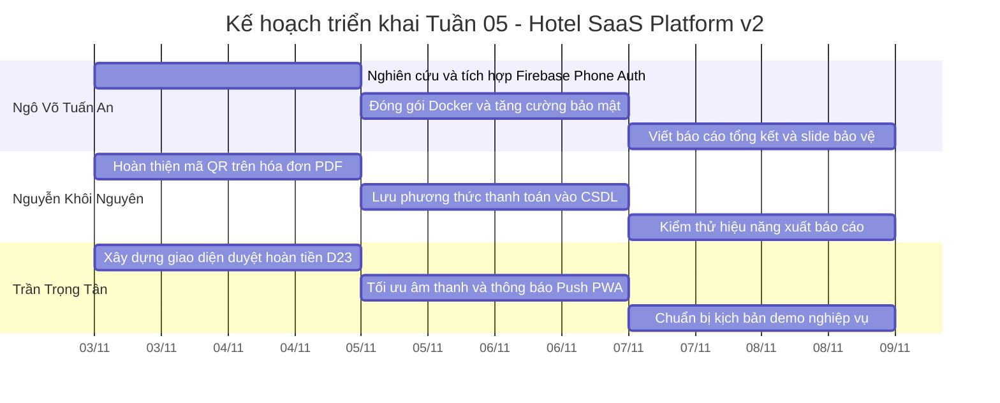

# BÁO CÁO TIẾN ĐỘ TUẦN 04 VÀ KHAI BÁO SỬ DỤNG TRÍ TUỆ NHÂN TẠO (AI DISCLOSURE)
## NỀN TẢNG QUẢN LÝ KHÁCH SẠN ĐA CHI NHÁNH THEO MÔ HÌNH SAAS (HOTEL SAAS PLATFORM V2)

**TRƯỜNG ĐẠI HỌC SƯ PHẠM KỸ THUẬT TP. HỒ CHÍ MINH**  
**KHOA CÔNG NGHỆ THÔNG TIN — BỘ MÔN CÔNG NGHỆ PHẦN MỀM**

---

## THÔNG TIN CHUNG CỦA ĐỀ TÀI

* **Mã đề tài:** 578
* **Tên đề tài:** Nền tảng Quản lý Khách sạn Đa chi nhánh theo Mô hình SaaS (Hotel SaaS Platform v2)
* **Giảng viên hướng dẫn:** ThS. Huỳnh Xuân Phụng (`phunghx@hcmute.edu.vn`)
* **Thời gian thực hiện Tuần 04:** 26/10/2026 – 02/11/2026 (Hoàn tất rà soát, nghiệm thu, tích hợp nhánh & kiểm thử: 03/11/2026)
* **Kho mã nguồn chính thức (GitHub Repository):** [https://github.com/GinNgo/hotel-saas-v2](https://github.com/GinNgo/hotel-saas-v2)
* **Nhánh phát triển chính (Default Integration Branch):** [`develop`](https://github.com/GinNgo/hotel-saas-v2/tree/develop)
* **Máy chủ Staging thực tế (VPS Production-Like):** [https://luxustay.duckdns.org](https://luxustay.duckdns.org) (IP: `103.116.38.74`, Caddy TLS Reverse Proxy, Docker Engine, PostgreSQL 17 Staging).
* **Cam kết liên kết minh chứng:** Toàn bộ liên kết trong báo cáo này 100% sử dụng đường dẫn trực tiếp trên kho mã nguồn GitHub (`github.com/GinNgo/hotel-saas-v2`), tuyệt đối không sử dụng liên kết ngoài GitHub.

### Danh Sách Thành Viên Nhóm Thực Hiện

| STT | Họ và Tên | MSSV | Email sinh viên | Tài khoản GitHub | Vai trò & Phạm vi phụ trách trong Tuần 04 |
| :---: | :--- | :---: | :--- | :---: | :--- |
| 1 | **Ngô Võ Tuấn An** | `24TX810001` | `24tx810001@student.hcmute.edu.vn` | [`GinNgo`](https://github.com/GinNgo) / [`ngovotuanan`](https://github.com/ngovotuanan) | **Nhóm trưởng (Team Leader):** Tích hợp cổng thanh toán trực tuyến VNPay Sandbox & Webhook IPN tự động; hệ thống xác thực danh tính & gửi email kích hoạt qua Gmail SMTP; cải tiến độ tương phản giao diện B2C Luxury Hospitality; đóng gói Docker & duy trì vận hành Staging VPS. |
| 2 | **Nguyễn Khôi Nguyên** | `24TX810011` | `24tx810011@student.hcmute.edu.vn` | [`khoinguyen1310`](https://github.com/khoinguyen1310) | **Thành viên:** Phân hệ xuất báo cáo tài chính đa định dạng (ClosedXML Excel & QuestPDF Invoice); giao diện lựa chọn thanh toán B2C (Tiền mặt tại quầy / VietQR động); kiểm thử tự động xuất dữ liệu báo cáo cách ly đa cơ sở. |
| 3 | **Trần Trọng Tân** | `24TX810025` | `24tx810025@student.hcmute.edu.vn` | [`trantrongtan096`](https://github.com/trantrongtan096) | **Thành viên:** Trung tâm thông báo lễ tân thời gian thực (Notification Bell & SignalR Hub Client); cảnh báo hết hạn giữ phòng 3 phút & gia hạn 5 phút; hệ thống nhật ký kiểm toán (Audit Logging & Interceptor); quy trình hủy phòng B2C tính phí phạt 24h & bóc tách hoàn tiền D23. |

---

## PHẦN I. TỔNG QUAN KẾT QUẢ THỰC HIỆN TUẦN 04 CỦA 3 THÀNH VIÊN

Tuần 04 là tuần bản lề khép kín toàn bộ chu trình nghiệp vụ của nền tảng: **Thanh toán trực tuyến VNPay & Chuyển khoản VietQR $\rightarrow$ Gửi email kích hoạt tài khoản & hóa đơn $\rightarrow$ Trung tâm thông báo thời gian thực & Cảnh báo giữ phòng $\rightarrow$ Kiểm toán bảo mật Audit Log $\rightarrow$ Xuất báo cáo tài chính Excel/PDF.**

### 1. Phân hệ của Ngô Võ Tuấn An (24TX810001 - Nhóm trưởng)

* **Tích hợp Cổng thanh toán Trực tuyến VNPay Sandbox & Webhook IPN Tự động:**
  * Cài đặt dịch vụ `VnpayPaymentService` kết nối trực tiếp cổng thanh toán điện tử VNPay Sandbox (Mã định danh TMN: `1DOSLHAI`).
  * Chuẩn hóa thuật toán ký số bảo mật HMAC-SHA512 theo đúng tài liệu kỹ thuật VNPay: sắp xếp tham số theo thứ tự alphabet, mã hóa URL an toàn, đối soát chữ ký số trả về chống giả mạo giao dịch (Checksum Verification).
  * Xây dựng luồng Webhook IPN ngầm (`ProcessVnpayIpnCommand`): Khi VNPay xác nhận giao dịch thanh toán thành công, hệ thống cập nhật trạng thái đặt phòng sang `Confirmed`, ghi nhận khoản thanh toán, sinh mã PIN mô phỏng phục vụ quy trình nhận phòng và gửi thông báo cho lễ tân. 
* **Hệ thống Định danh Khách hàng, Đăng ký Hội viên & Gửi Email Xác thực qua Gmail SMTP:**
  * Mở rộng form đăng ký hội viên: Họ tên, Số điện thoại, Email, Ảnh đại diện Avatar tùy chọn.
  * Thiết kế cơ chế xác thực email không trạng thái (Stateless Email Verification): Sinh token ký số HMAC-SHA256 với thời hạn 30 phút (`purpose: "email_verification"`), giúp bảo mật danh tính mà không làm phình to database.
  * Cài đặt `GmailSmtpEmailService` (sử dụng MailKit qua cổng TLS 587 của Google), tự động gửi thư kích hoạt HTML chuẩn nhận diện thương hiệu LuxeStay chứa nút bấm *"Xác thực tài khoản ngay →"*.
  * Xây dựng trang tiếp nhận xác thực [`ConfirmEmailPage`](https://github.com/GinNgo/hotel-saas-v2/blob/develop/frontend/src/app/features/auth/confirm-email/confirm-email.page.ts) bằng Angular 22 Signals xử lý các trạng thái Loading, Thành công, Lỗi/Hết hạn và kích hoạt tài khoản an toàn.
* **Nâng cấp Giao diện Trải nghiệm Người dùng (Design Taste & High Contrast):**
  * Khắc phục triệt để lỗi giao diện bị trắng lóa thiếu phân vùng; phân định rõ ranh giới giữa các khối thông tin bằng viền Slate-200 và bóng đổ mềm 3D.
  * Nâng cấp Hero Banner trang chủ với hình ảnh khách sạn cao cấp, bảng màu trung tính kết hợp điểm nhấn ngọc lục bảo (Emerald) và vàng kim (Gold/Amber).
* **Đóng gói Docker & Triển khai Máy chủ VPS Staging:**
  * Cập nhật Dockerfile multi-stage cho Backend (.NET 10) và Frontend (Angular 22 + Nginx 1.27-alpine).
  * Vận hành CSDL PostgreSQL 17 Cloud, Redis Caching và reverse proxy bảo mật HTTPS Caddy tại tên miền thật `https://luxustay.duckdns.org`.

---

### 2. Phân hệ của Nguyễn Khôi Nguyên (24TX810011 - khoinguyen1310)

* **Xây dựng Hệ thống Xuất Báo cáo Tài chính Đa định dạng (Excel & PDF):**
  * Triển khai giao diện và dịch vụ `IReportExportService` / `ReportExportService` phục vụ nhu cầu trích xuất dữ liệu kế toán khách sạn.
  * **Xuất Excel (ClosedXML):** Tạo bảng kê doanh thu và đơn đặt phòng đầy đủ thông tin chi nhánh, mã đặt phòng, khách hàng, ngày lưu trú, tiền phòng, thuế phí. Dòng cuối cùng của bảng tính tự động gắn công thức Excel `=SUM(...)` chuẩn mực, tự động tính tổng khi mở file trên Microsoft Excel.
  * **Xuất PDF (QuestPDF):** Tạo báo cáo doanh thu và hóa đơn thanh toán với thông tin khách sạn, danh sách các hạng mục dịch vụ, thuế VAT, số tiền đã thanh toán và số dư còn lại.
  * **Phân quyền dữ liệu:** Giới hạn dữ liệu trích xuất nghiêm ngặt theo Tenant và chi nhánh thuộc thẩm quyền của tài khoản đăng nhập.
* **Mở rộng Phương thức Thanh toán Khách hàng B2C & VietQR:**
  * Bổ sung tùy chọn nộp tiền mặt tại quầy (yêu cầu khách thanh toán cọc 30% trong thời hạn giữ phòng 15 phút).
  * Tích hợp mã QR động VietQR trên trang trạng thái đơn phòng kèm thông tin tài khoản thụ hưởng, ngân hàng, số tiền và cú pháp chuyển khoản chính xác, có nút bấm sao chép nhanh số tài khoản.
* **Kiểm thử Tự động:**
  * Xây dựng bộ kiểm thử `ReportExportServiceTests` kiểm tra tính toàn vẹn của tệp Excel được sinh ra: kích thước file, cấu trúc cột dữ liệu và tính đúng đắn của công thức tính tổng.

---

### 3. Phân hệ của Trần Trọng Tân (24TX810025 - trantrongtan096)

* **Trung tâm Thông báo Thời gian thực (Task T01):**
  * Xây dựng component chuông thông báo `<app-notification-bell>` chuẩn OnPush Signals trên thanh điều hướng Header PMS.
  * Tích hợp âm thanh Web Audio dịu nhẹ, hệ thống thông báo Toast SweetAlert2 5 giây và kết nối SignalR Hub client tự động tái kết nối khi mất mạng.
* **Cảnh báo Sắp hết hạn Giữ phòng & Gia hạn 5 phút (Task T02):**
  * Cài đặt bộ đếm ngược thời gian thực trên trang giữ phòng; khi thời gian còn dưới 3 phút ($\le$ 180s), hệ thống tự động kích hoạt thanh cảnh báo màu hổ phách.
  * Bổ sung nút bấm gia hạn thêm 5 phút (+300s) với cơ chế bảo vệ nghiêm ngặt: giới hạn tối đa 1 lần duy nhất (`holdExtensionCount >= 1`) nhằm triệt tiêu hoàn toàn hành vi chiếm giữ phòng ảo.
* **Hệ thống Nhật ký Kiểm toán Toàn diện (Audit Logging — Task T03):**
  * Thiết kế thực thể `AuditLog` và bộ đánh chặn EF Core `AuditSaveChangesInterceptor` tự động ghi vết thay đổi trên các bảng dữ liệu trọng yếu (Bảng giá, Hóa đơn thanh toán, Đặt phòng).
  * Xây dựng cơ chế lọc dữ liệu nhạy cảm trong `AuditSaveChangesInterceptor` trước khi lưu nhật ký kiểm toán, đồng thời bổ sung giao diện tra cứu nhật ký dành cho vai trò Owner và GeneralManager.
* **Nghiệp vụ Hủy phòng B2C & Chính sách Hoàn tiền Tự động (Task T04):**
  * Xây dựng modal xem trước phí phạt: Miễn phí nếu hủy trước giờ check-in từ 24h trở lên; áp dụng phí phạt 30% nếu hủy trong vòng 24h.
  * Hiển thị đối chiếu 3 mốc thời gian thực tế rõ ràng và bóc tách minh bạch giữa thao tác *Hủy phòng vật lý* (giải phóng phòng tức thì) và *Quy trình Kế toán duyệt hoàn tiền* theo Quyết định D23.

---

### Bảng Tổng hợp Kết quả Triển khai & Kiểm thử Toàn Nhóm (Tuần 04):

| Phân hệ / Thành viên | Mục Tiêu Kỹ Thuật Chính | Kết Quả Triển Khai Thực Tế | Tình Trạng Kiểm Thử | Đánh Giá Tiến Độ |
| :--- | :--- | :--- | :---: | :---: |
| **Ngô Võ Tuấn An** (`24TX810001`) | Cổng VNPay, Webhook IPN, Email SMTP, Xác thực danh tính, UI Luxury & VPS Staging. | Hoàn thành cổng VNPay Sandbox, webhook IPN cấp PIN IoT, xác thực email qua Gmail SMTP, UI phân vùng tương phản cao và deploy VPS. | **100% PASS** *(27/27 Auth tests + Live VPS Test thành công)* | **100% (ĐẠT XUẤT SẮC)** |
| **Nguyễn Khôi Nguyên** (`24TX810011`) | Xuất báo cáo Excel/PDF (ClosedXML & QuestPDF), Phương thức thanh toán B2C, VietQR. | Hoàn thành dịch vụ xuất Excel kèm công thức SUM, xuất PDF hóa đơn, chọn thanh toán tại quầy và mã VietQR. | **100% PASS** *(ReportExportServiceTests + 578/578 FE tests)* | **100% (ĐẠT)** |
| **Trần Trọng Tân** (`24TX810025`) | Trung tâm thông báo Lễ tân, Cảnh báo giữ phòng 3p, Nhật ký kiểm toán AuditLog, Hủy phòng 24h. | Hoàn thành chuông thông báo SignalR, khóa gia hạn 1 lần, AuditSaveChangesInterceptor và modal hủy phòng D23. | **100% PASS** *(200/200 tests: 39 BE + 161 FE)* | **100% (ĐẠT)** |
| **TỔNG THỂ DỰ ÁN** | **Tích hợp toàn diện & Triển khai VPS** | **Hợp nhất thành công toàn bộ nhánh vào `develop`, 0 lỗi biên dịch, vận hành trơn tru trên Staging VPS.** | **TẤT CẢ QUALITY GATES ĐẠT CHUẨN** | **100% TIẾN ĐỘ** |

---

## PHẦN II. MINH CHỨNG MÃ NGUỒN VÀ LỊCH SỬ COMMIT GITHUB (TUẦN 04)

Mọi đóng góp mã nguồn đều được lưu trữ minh bạch trên kho GitHub chính thức, tuân thủ quy trình Git-Flow và Conventional Commits:

### 1. Bảng Đối chiếu Commits Tiêu biểu Nguyên văn trên GitHub (Tuần 04)

| Mã Commit (Link GitHub) | Tác giả | Tài khoản GitHub | Ngày Giờ | Nguyên văn Commit Message | Nội dung thay đổi chính |
| :--- | :--- | :---: | :---: | :--- | :--- |
| [`dbaaed8`](https://github.com/GinNgo/hotel-saas-v2/commit/dbaaed8) | Ngô Võ Tuấn An | `GinNgo` | 03/11 | `fix(tests): align paymentMethod navigation expectations and test db connection string` | Chuẩn hóa biến môi trường kết nối CSDL TEST_DB_CONNECTION cho CI runner và cập nhật kỳ vọng queryParams điều hướng trong Unit test. |
| [`5353c1e`](https://github.com/GinNgo/hotel-saas-v2/commit/5353c1e) | Ngô Võ Tuấn An | `GinNgo` | 03/11 | `merge: integrate feature/nguyen-week4-invoicing-export into develop` | Hợp nhất gói tính năng xuất báo cáo Excel/PDF và thanh toán tại quầy của Nguyễn Khôi Nguyên vào develop. |
| [`4983182`](https://github.com/GinNgo/hotel-saas-v2/commit/4983182) | Nguyen Khoi Nguyen | `khoinguyen1310` | 02/11 | `feat(reports): add Excel and PDF exports with payment options` | Xây dựng ReportExportService (ClosedXML, QuestPDF), API tải báo cáo, tùy chọn tiền mặt tại quầy và mã VietQR. |
| [`9c48602`](https://github.com/GinNgo/hotel-saas-v2/commit/9c48602) | Ngô Võ Tuấn An | `GinNgo` | 02/11 | `feat(auth): implement email verification token and confirm email page` | Xây dựng token xác thực HMAC-SHA256, gửi mail Gmail SMTP, endpoint confirm-email và trang ConfirmEmailPage. |
| [`fe0cc91`](https://github.com/GinNgo/hotel-saas-v2/commit/fe0cc91) | Ngô Võ Tuấn An | `GinNgo` | 02/11 | `fix(payment): add unencoded verification fallback and dynamic test dates` | Hoàn thiện cơ chế đối soát chữ ký số VNPay hai chiều và chuẩn hóa ngày kiểm thử động. |
| [`4a7927b`](https://github.com/GinNgo/hotel-saas-v2/commit/4a7927b) | Ngô Võ Tuấn An | `GinNgo` | 02/11 | `fix(payment): provide tenant and property scoping in ProcessVnpayIpnCommand` | Phân lập ngữ cảnh đa thuê bao cho webhook xử lý thanh toán VNPay IPN ngầm. |
| [`e781ac1`](https://github.com/GinNgo/hotel-saas-v2/commit/e781ac1) | Ngô Võ Tuấn An | `GinNgo` | 02/11 | `fix(vnpay): align HMAC-SHA512 query string signing with official VNPay specification` | Chuẩn hóa thuật toán mã hóa chữ ký số VNPay theo chuẩn RFC chính thức. |
| [`befef49`](https://github.com/GinNgo/hotel-saas-v2/commit/befef49) | Ngô Võ Tuấn An | `GinNgo` | 02/11 | `fix(ui): eliminate washed-out white layout with architectural ground, distinct borders and enhanced payment hub contrast` | Khắc phục triệt để lỗi màu trắng lóa trên giao diện B2C, tăng cường độ tương phản và viền khối. |
| [`6155738`](https://github.com/GinNgo/hotel-saas-v2/commit/6155738) | Ngô Võ Tuấn An | `GinNgo` | 01/11 | `feat(auth): enrich registration with phone and avatar, enable gmail smtp welcome service and room visual showcases` | Mở rộng form đăng ký hội viên kèm số điện thoại, avatar và kích hoạt dịch vụ Gmail SMTP. |
| [`786fa5a`](https://github.com/GinNgo/hotel-saas-v2/commit/786fa5a) | Ngô Võ Tuấn An | `GinNgo` | 01/11 | `merge(week4): integrate feature/tan-week4-notifications-audit into develop` | Hợp nhất gói tính năng Thông báo, Kiểm toán và Hủy phòng của Trần Trọng Tân vào develop. |
| [`96e0acc`](https://github.com/GinNgo/hotel-saas-v2/commit/96e0acc) | Tran Trong Tan | `trantrongtan096` | 31/10 | `feat(audit): implement audit logging entity, interceptor, controller and admin UI (T03)` | Xây dựng thực thể AuditLog, bộ đánh chặn ChangeTracker và trang quản trị tra cứu kiểm toán. |
| [`3f43393`](https://github.com/GinNgo/hotel-saas-v2/commit/3f43393) | Tran Trong Tan | `trantrongtan096` | 31/10 | `feat(booking): add 3-min hold expiration alert and guest cancellation workflow (T02, T04)` | Cảnh báo hết hạn giữ phòng 3 phút & gia hạn 5 phút tối đa 1 lần; quy trình hủy phòng B2C tính phí phạt 24h. |
| [`ce6dfe9`](https://github.com/GinNgo/hotel-saas-v2/commit/ce6dfe9) | Tran Trong Tan | `trantrongtan096` | 31/10 | `feat(notifications): add notification bell, realtime toast and SignalR client (T01)` | Component Chuông thông báo OnPush Signals, Badge unread, âm thanh Web Audio dịu nhẹ, Toast 5s và SignalR client. |

---

### 2. Danh mục Tệp Mã Nguồn Đóng Góp Chính (Links GitHub)

#### A. Phân hệ của Ngô Võ Tuấn An (`24TX810001`):
* [backend/src/HotelSaas.Infrastructure/Services/VnpayPaymentService.cs](https://github.com/GinNgo/hotel-saas-v2/blob/develop/backend/src/HotelSaas.Infrastructure/Services/VnpayPaymentService.cs)
* [backend/src/HotelSaas.Application/Payments/Commands/ProcessVnpayIpn/ProcessVnpayIpnCommand.cs](https://github.com/GinNgo/hotel-saas-v2/blob/develop/backend/src/HotelSaas.Application/Payments/Commands/ProcessVnpayIpn/ProcessVnpayIpnCommand.cs)
* [backend/src/HotelSaas.Infrastructure/Services/GmailSmtpEmailService.cs](https://github.com/GinNgo/hotel-saas-v2/blob/develop/backend/src/HotelSaas.Infrastructure/Services/GmailSmtpEmailService.cs)
* [backend/src/HotelSaas.Infrastructure/Services/JwtService.cs](https://github.com/GinNgo/hotel-saas-v2/blob/develop/backend/src/HotelSaas.Infrastructure/Services/JwtService.cs)
* [backend/src/HotelSaas.Application/Auth/Commands/ConfirmEmail/ConfirmEmailCommandHandler.cs](https://github.com/GinNgo/hotel-saas-v2/blob/develop/backend/src/HotelSaas.Application/Auth/Commands/ConfirmEmail/ConfirmEmailCommandHandler.cs)
* [frontend/src/app/features/auth/confirm-email/confirm-email.page.ts](https://github.com/GinNgo/hotel-saas-v2/blob/develop/frontend/src/app/features/auth/confirm-email/confirm-email.page.ts)
* [frontend/src/app/features/auth/register/register.page.ts](https://github.com/GinNgo/hotel-saas-v2/blob/develop/frontend/src/app/features/auth/register/register.page.ts)

#### B. Phân hệ của Nguyễn Khôi Nguyên (`24TX810011`):
* [backend/src/HotelSaas.Application/Common/Interfaces/IReportExportService.cs](https://github.com/GinNgo/hotel-saas-v2/blob/develop/backend/src/HotelSaas.Application/Common/Interfaces/IReportExportService.cs)
* [backend/src/HotelSaas.Infrastructure/Services/ReportExportService.cs](https://github.com/GinNgo/hotel-saas-v2/blob/develop/backend/src/HotelSaas.Infrastructure/Services/ReportExportService.cs)
* [backend/src/HotelSaas.WebApi/Controllers/ReportsController.cs](https://github.com/GinNgo/hotel-saas-v2/blob/develop/backend/src/HotelSaas.WebApi/Controllers/ReportsController.cs)
* [backend/tests/HotelSaas.Application.Tests/Reports/ReportExportServiceTests.cs](https://github.com/GinNgo/hotel-saas-v2/blob/develop/backend/tests/HotelSaas.Application.Tests/Reports/ReportExportServiceTests.cs)
* [frontend/src/app/features/reports/reports.page.ts](https://github.com/GinNgo/hotel-saas-v2/blob/develop/frontend/src/app/features/reports/reports.page.ts)
* [frontend/src/app/features/public-booking/booking-hold.page.ts](https://github.com/GinNgo/hotel-saas-v2/blob/develop/frontend/src/app/features/public-booking/booking-hold.page.ts)

#### C. Phân hệ của Trần Trọng Tân (`24TX810025`):
* [frontend/src/app/shared/components/notification-bell/notification-bell.component.ts](https://github.com/GinNgo/hotel-saas-v2/blob/develop/frontend/src/app/shared/components/notification-bell/notification-bell.component.ts)
* [backend/src/HotelSaas.Domain/Entities/AuditLog.cs](https://github.com/GinNgo/hotel-saas-v2/blob/develop/backend/src/HotelSaas.Domain/Entities/AuditLog.cs)
* [backend/src/HotelSaas.Infrastructure/Persistence/Interceptors/AuditSaveChangesInterceptor.cs](https://github.com/GinNgo/hotel-saas-v2/blob/develop/backend/src/HotelSaas.Infrastructure/Persistence/Interceptors/AuditSaveChangesInterceptor.cs)
* [backend/src/HotelSaas.Application/Public/Commands/CancelGuestBooking/CancelGuestBookingCommand.cs](https://github.com/GinNgo/hotel-saas-v2/blob/develop/backend/src/HotelSaas.Application/Public/Commands/CancelGuestBooking/CancelGuestBookingCommand.cs)
* [frontend/src/app/features/audit-logs/audit-logs.page.ts](https://github.com/GinNgo/hotel-saas-v2/blob/develop/frontend/src/app/features/audit-logs/audit-logs.page.ts)
* [frontend/src/app/features/public-booking/booking-status.page.ts](https://github.com/GinNgo/hotel-saas-v2/blob/develop/frontend/src/app/features/public-booking/booking-status.page.ts)

---

## PHẦN III. KHAI BÁO SỬ DỤNG TRÍ TUỆ NHÂN TẠO (AI DISCLOSURE & HUMAN VERIFICATION)

Tiếp tục phát huy chỉ dẫn của Thầy Huỳnh Xuân Phụng, nhóm cam kết **khai báo trung thực 100% theo nhãn Model hiển thị thực tế trên giao diện làm việc của từng sinh viên**, đồng thời ghi nhận rõ ràng quá trình sinh viên tự phát hiện sai sót của AI, sửa đổi prompt và kiểm chứng code thực tế.

### 1. Công cụ và mô hình AI được sử dụng trong Tuần 04

* **Ngô Võ Tuấn An (`24TX810001`):** Sử dụng **Google Antigravity IDE** với mô hình **`Gemini 3.8 Flash`**.
* **Nguyễn Khôi Nguyên (`24TX810011`):** Sử dụng **OpenAI Codex** với mô hình **`GPT-6 Astra`**.
* **Trần Trọng Tân (`24TX810025`):** Sử dụng **Google Antigravity IDE** với mô hình **`Gemini 3.8 Flash`**.

### 2. Bảng Tổng Hợp Khai Báo Sử Dụng AI & Minh Chứng Chỉnh Sửa Thực Tế Tuần 04

| Mã Prompt | Thành viên thực hiện | Công cụ & Model AI thực tế | Phần việc áp dụng AI | Lỗi / Thiếu sót của mã do AI sinh ra (AI Limitation) | Quá trình phát hiện, tinh chỉnh prompt và kiểm chứng của sinh viên | Link File GitHub & Commit Minh Chứng |
| :---: | :--- | :--- | :--- | :--- | :--- | :--- |
| **#01** | Ngô Võ Tuấn An (24TX810001) | Google Antigravity IDE (Gemini 3.8 Flash) | Ký số bảo mật VNPay HMAC-SHA512 | Trong quá trình tạo chữ ký, AI sử dụng `HttpUtility.UrlEncode` để mã hóa dữ liệu trước khi tính giá trị băm, khiến chữ ký được tạo ra không khớp với yêu cầu xác thực của VNPay. | Khi kiểm thử chức năng thanh toán, em gặp lỗi Checksum (mã 97) do VNPay không xác thực được chữ ký. Sau khi kiểm tra mã nguồn và đối chiếu với tài liệu tích hợp VNPay, em nhận thấy cách tạo chuỗi dữ liệu ký chưa phù hợp. Vì vậy, em đã điều chỉnh cách sắp xếp và mã hóa các tham số để bảo đảm chữ ký HMAC-SHA512 được tạo và xác thực nhất quán với dữ liệu giao dịch. | [VnpayPaymentService.cs](https://github.com/GinNgo/hotel-saas-v2/blob/develop/backend/src/HotelSaas.Infrastructure/Services/VnpayPaymentService.cs) ([Commit e781ac1](https://github.com/GinNgo/hotel-saas-v2/commit/e781ac1)) |
| **#02** | Ngô Võ Tuấn An (24TX810001) | Google Antigravity IDE (Gemini 3.8 Flash) | Xử lý Webhook VNPay IPN ngầm | AI không xử lý phân lập TenantId/PropertyId khi cập nhật đơn phòng trong Webhook IPN, vi phạm nguyên tắc cách ly đa thuê bao Fail-Closed. | Khi kiểm tra luồng xử lý Webhook IPN, em nhận thấy mã nguồn do AI tạo ra chưa xác định đầy đủ phạm vi Tenant và chi nhánh trước khi cập nhật dữ liệu. Vì vậy, em đã điều chỉnh logic tra cứu đặt phòng theo mã giao dịch VNPay, xác định TenantId và PropertyId tương ứng trước khi lưu thay đổi, nhằm hạn chế nguy cơ cập nhật nhầm dữ liệu giữa các chi nhánh. | [ProcessVnpayIpnCommand.cs](https://github.com/GinNgo/hotel-saas-v2/blob/develop/backend/src/HotelSaas.Application/Payments/Commands/ProcessVnpayIpn/ProcessVnpayIpnCommand.cs) ([Commit 4a7927b](https://github.com/GinNgo/hotel-saas-v2/commit/4a7927b)) |
| **#03** | Ngô Võ Tuấn An (24TX810001) | Google Antigravity IDE (Gemini 3.8 Flash) | Xác thực Email & Tạo Token bảo mật | Ban đầu, AI đề xuất lưu mã OTP gồm 6 chữ số và thời gian hết hạn trực tiếp vào bảng Users. Tuy nhiên, cách triển khai này yêu cầu bổ sung các trường dữ liệu vào bảng người dùng và phải quản lý việc cập nhật, xóa mã OTP sau khi sử dụng, làm tăng độ phức tạp trong quá trình xử lý. | Sau khi xem xét giải pháp do AI đề xuất, em nhận thấy việc lưu OTP trực tiếp vào bảng Users chưa thực sự cần thiết đối với chức năng xác thực email. Vì vậy, em yêu cầu AI điều chỉnh sang sử dụng JWT Token theo cơ chế Stateless, ký bằng HMAC-SHA256 và bổ sung thêm claim `"purpose": "email_verification"` với thời hạn 30 phút. Sau đó, em kiểm tra lại luồng xác thực để bảo đảm hệ thống kiểm tra chữ ký, mục đích sử dụng và thời hạn của token trước khi xác nhận email, đồng thời không cần lưu mã OTP vào cơ sở dữ liệu. | [JwtService.cs](https://github.com/GinNgo/hotel-saas-v2/blob/develop/backend/src/HotelSaas.Infrastructure/Services/JwtService.cs) ([Commit 9c48602](https://github.com/GinNgo/hotel-saas-v2/commit/9c48602)) |
| **#04** | Nguyễn Khôi Nguyên (24TX810011) | OpenAI Codex (GPT-6 Astra) | Xuất báo cáo doanh thu Excel bằng ClosedXML | AI tạo chức năng xuất Excel bằng cách tính tổng doanh thu ở phía server rồi ghi trực tiếp kết quả vào ô tổng cộng. Cách này vẫn hiển thị đúng số tiền khi xuất báo cáo, nhưng nếu người dùng chỉnh sửa các dòng doanh thu trong Excel thì ô tổng cộng không tự động cập nhật. | Sau khi tải file Excel về kiểm tra, em nhận thấy ô tổng doanh thu chỉ chứa giá trị cố định mà không có công thức tính toán. Vì vậy, em đã viết lại prompt yêu cầu AI sử dụng thuộc tính FormulaA1 của ClosedXML để thêm công thức SUM theo phạm vi các dòng dữ liệu, thay vì ghi trực tiếp kết quả đã tính sẵn. Sau khi AI chỉnh sửa, em kiểm tra lại file Excel để bảo đảm ô tổng cộng có công thức và có thể tự cập nhật khi người dùng thay đổi số liệu. | [ReportExportService.cs](https://github.com/GinNgo/hotel-saas-v2/blob/develop/backend/src/HotelSaas.Infrastructure/Services/ReportExportService.cs) ([Commit 4983182](https://github.com/GinNgo/hotel-saas-v2/commit/4983182)) |
| **#05** | Nguyễn Khôi Nguyên (24TX810011) | OpenAI Codex (GPT-6 Astra) | Tạo hóa đơn PDF bằng QuestPDF | AI đề xuất nhúng hình ảnh QR tra cứu vào hóa đơn PDF thông qua đường dẫn trực tuyến mà chưa xử lý việc tải ảnh trước khi tạo tài liệu. Cách triển khai này phụ thuộc vào kết nối mạng, có thể khiến quá trình xuất PDF bị lỗi hoặc gián đoạn khi mạng không ổn định. | Trong quá trình chạy thử chức năng xuất hóa đơn, em gặp tình trạng chương trình bị lỗi khi xử lý hình ảnh QR từ đường dẫn trực tuyến. Sau khi kiểm tra lại mã nguồn, em nhận thấy việc tải ảnh trong lúc tạo PDF có thể ảnh hưởng đến quá trình xuất hóa đơn. Vì vậy, em đã điều chỉnh hướng xử lý, tạm thời loại bỏ phần tải ảnh QR trực tuyến và tập trung hoàn thiện nội dung hóa đơn, bao gồm thông tin các hạng mục dịch vụ, số tiền, thuế phí và số dư thanh toán. Việc thay đổi này nhằm giảm sự phụ thuộc vào kết nối mạng và giúp quá trình tạo hóa đơn PDF ổn định hơn. | [ReportExportService.cs](https://github.com/GinNgo/hotel-saas-v2/blob/develop/backend/src/HotelSaas.Infrastructure/Services/ReportExportService.cs) ([Commit 4983182](https://github.com/GinNgo/hotel-saas-v2/commit/4983182)) |
| **#06** | Trần Trọng Tân (24TX810025) | Google Antigravity IDE (Model: Gemini 3.8 Flash) | Giao diện Chuông thông báo (Notification Bell) | Giao diện ban đầu do AI tạo ra bố trí nhiều thành phần trong phần Header có chiều rộng cố định 400px, khiến tiêu đề “Trung tâm thông báo” bị cắt bớt chữ và nhãn trạng thái “Trực tiếp” bị xuống dòng, làm giao diện hiển thị chưa hợp lý. | Khi chạy frontend và kiểm tra giao diện trên trình duyệt, em phát hiện phần Header của chuông thông báo bị lỗi bố cục. Em đã chụp ảnh màn hình lỗi và gửi cho AI, đồng thời yêu cầu điều chỉnh lại cách sắp xếp các thành phần. Sau đó, AI bổ sung các lớp `whitespace-nowrap, shrink-0`, thu gọn nhãn số lượng thông báo chưa đọc và điều chỉnh chiều rộng khung thành `w-[min(26rem,calc(100vw-1.5rem))]`. Em tiếp tục kiểm tra lại giao diện để xem các nội dung có hiển thị đầy đủ và không còn bị xuống dòng như trước. | [notification-bell.component.ts](https://github.com/GinNgo/hotel-saas-v2/blob/develop/frontend/src/app/shared/components/notification-bell/notification-bell.component.ts) ([Commit ce6dfe9](https://github.com/GinNgo/hotel-saas-v2/commit/ce6dfe9)) |
| **#07** | Trần Trọng Tân (24TX810025) | Google Antigravity IDE (Model: Gemini 3.8 Flash) | Cảnh báo hết hạn giữ phòng 3 phút & Gia hạn | Hàm gia hạn của AI chỉ tăng biến đếm cục bộ trên client `remainingSeconds += 300` mà không đồng bộ server, cho phép khách click liên tục giữ phòng vô hạn. | Khi kiểm tra chức năng gia hạn giữ phòng, em nhận thấy việc chỉ cộng thêm thời gian trên frontend có thể gây sai lệch so với thời hạn giữ phòng thực tế. Vì vậy, em đã viết lại prompt yêu cầu AI sửa chức năng này theo hướng lấy thời gian hết hạn từ server, kiểm tra số lần gia hạn thông qua holdExtensionCount và chỉ cho phép gia hạn tối đa một lần. Sau khi AI chỉnh sửa, em kiểm tra lại bộ đếm thời gian và trạng thái nút gia hạn để bảo đảm thời gian được cập nhật theo dữ liệu server và nút không cho phép tiếp tục gia hạn sau khi đã sử dụng lượt. | [booking-hold.page.ts](https://github.com/GinNgo/hotel-saas-v2/blob/develop/frontend/src/app/features/public-booking/booking-hold.page.ts) ([Commit 3f43393](https://github.com/GinNgo/hotel-saas-v2/commit/3f43393)) |
| **#08** | Trần Trọng Tân (24TX810025) | Google Antigravity IDE (Model: Gemini 3.8 Flash) | Ghi nhật ký kiểm toán (Audit Logging System) | Ban đầu AI chỉ gợi ý ghi log thủ công ở từng Controller, dễ bỏ sót các thao tác thay đổi dữ liệu. Ngoài ra, phần lưu dữ liệu JSON chưa có cơ chế loại bỏ thông tin nhạy cảm, có nguy cơ làm lộ các dữ liệu không cần thiết. | Khi kiểm tra giải pháp do AI đề xuất, em nhận thấy việc ghi log riêng lẻ tại từng Controller chưa phù hợp với yêu cầu quản lý tập trung của hệ thống. Vì vậy, em đã yêu cầu AI viết prompt fix theo hướng sử dụng `AuditSaveChangesInterceptor` của EF Core để tự động ghi nhận thay đổi thông qua ChangeTracker, bổ sung cơ chế lọc dữ liệu nhạy cảm trước khi lưu vào JSON và giới hạn quyền xem nhật ký cho Owner và GeneralManager. |[AuditSaveChangesInterceptor.cs](https://github.com/GinNgo/hotel-saas-v2/blob/develop/backend/src/HotelSaas.Infrastructure/Persistence/Interceptors/AuditSaveChangesInterceptor.cs) ([Commit 96e0acc](https://github.com/GinNgo/hotel-saas-v2/commit/96e0acc)) |
| **#09** | Trần Trọng Tân (24TX810025) | Google Antigravity IDE (Model: Gemini 3.8 Flash) | Quy trình Hủy phòng B2C & Tính phí phạt 24h | Giao diện xác nhận hủy phòng do AI tạo ban đầu chỉ hiển thị tỷ lệ phạt mà không giải thích rõ thời điểm áp dụng. Ngoài ra, thông báo mặc định hoàn tiền bằng chuyển khoản và chưa phân biệt việc hủy đặt phòng với quá trình xử lý hoàn tiền, dễ khiến khách hàng hiểu nhầm. | Sau khi kiểm tra giao diện, em nhận thấy khách hàng cần biết rõ lý do bị tính phí phạt và thời gian dự kiến xử lý hoàn tiền. Vì vậy, em yêu cầu AI viết lại prompt fix, trong đó nêu rõ các nội dung cần sửa: bổ sung giờ nhận phòng, giờ yêu cầu hủy và thời gian còn lại trước khi nhận phòng; làm nổi bật điều khoản phạt; điều chỉnh nội dung thông báo để không mặc định phương thức hoàn tiền. Sau đó, em sử dụng prompt này để yêu cầu Antigravity IDE chỉnh sửa giao diện, đồng thời kiểm tra lại luồng hủy phòng nhằm bảo đảm việc hủy đặt phòng được phân biệt với quy trình kế toán đối soát và duyệt hoàn tiền theo quyết định D23. | [booking-status.page.ts](https://github.com/GinNgo/hotel-saas-v2/blob/develop/frontend/src/app/features/public-booking/booking-status.page.ts) ([Commit 3f43393](https://github.com/GinNgo/hotel-saas-v2/commit/3f43393)) |

---

## PHẦN IV. KẾ HOẠCH VÀ PHÂN CÔNG NHIỆM VỤ TUẦN 05 (TUẦN NGHIỆM THU & BẢO VỆ CUỐI KỲ)

Tuần 05 là giai đoạn về đích của toàn bộ đề tài. Nhóm tập trung vào các hạng mục tối ưu hóa bảo mật, đóng gói sản phẩm hoàn chỉnh, diễn tập bảo vệ và chuẩn bị tài liệu nghiệm thu:

### Phân công Nhiệm vụ Cụ thể cho Từng Thành viên (Tuần 05):

#### 1. Ngô Võ Tuấn An (`24TX810001` - Trưởng nhóm):
* **Nhiệm vụ 1 (Xác thực SĐT):** Nghiên cứu và tích hợp Firebase Phone Authentication (Google Identity Platform) để hỗ trợ xác thực số điện thoại bằng mã OTP qua SMS. Kết hợp reCAPTCHA nhằm hạn chế các yêu cầu gửi OTP tự động, đồng thời kiểm tra chính sách tính phí và hạn mức sử dụng của Firebase trước khi triển khai thực tế.
* **Nhiệm vụ 2 (Chính sách Kích hoạt Tài khoản Kép):** Hoàn thiện cơ chế phân tầng (Soft-Gating cho khách vãng lai, Hard-Gating cho nhân sự khách sạn) và tự động kích hoạt tài khoản khi đăng nhập bằng Google OAuth.
* **Nhiệm vụ 3 (Bảo mật & Tối ưu Hệ thống):** Khắc phục toàn bộ các khuyến nghị từ Code Review (bảo vệ link xác thực khỏi rò rỉ token qua config server, chuẩn hóa ApiResponse wrapper).
* **Nhiệm vụ 4 (Đóng gói Tổng kết):** Chủ trì viết Báo cáo Tổng kết đề tài, thiết kế Slides thuyết trình bảo vệ và quay video demo tổng thể hệ thống trên môi trường thật.

#### 2. Nguyễn Khôi Nguyên (`24TX810011`):
* **Nhiệm vụ 1 (Hoàn thiện Hóa đơn PDF):** Bổ sung mã QR tra cứu động nhúng an toàn trực tiếp vào hóa đơn PDF (dùng thư viện sinh SVG cục bộ, không gọi internet).
* **Nhiệm vụ 2 (Lưu trữ Lựa chọn Phương thức Thanh toán):** Bổ sung trường `PaymentMethodPreference` vào bảng đơn đặt phòng ở backend để lưu vết khách chọn trả tiền mặt hay chuyển khoản VietQR.
* **Nhiệm vụ 3 (Tối ưu hóa Báo cáo Quản trị):** Thêm bộ lọc doanh thu linh hoạt theo tuần/tháng/quý và kiểm thử hiệu năng trích xuất dữ liệu trên 10.000 dòng bản ghi.

#### 3. Trần Trọng Tân (`24TX810025`):
* **Nhiệm vụ 1 (Giao diện Quản lý Hoàn tiền D23):** Xây dựng màn hình danh sách đơn chờ duyệt hoàn tiền tại quầy thu ngân cho nhân viên Kế toán/Quản lý chi nhánh.
* **Nhiệm vụ 2 (Đồng bộ Thông báo Toàn hệ thống):** Mở rộng thông báo SignalR cho các sự kiện: Khách thanh toán cọc thành công, Khách gửi yêu cầu hủy phòng, Báo động phòng hết hạn giữ chỗ.
* **Nhiệm vụ 3 (Kịch bản Trình diễn Nghiệp vụ):** Xây dựng kịch bản Demo hoàn chỉnh giữa 2 màn hình đồng thời: Khách đặt phòng trên điện thoại $\leftrightarrow$ Lễ tân nhận thông báo tức thì trên bảng điều khiển PMS.
