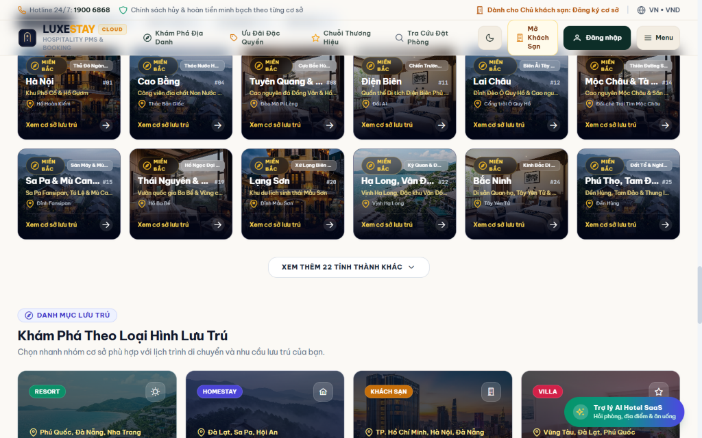
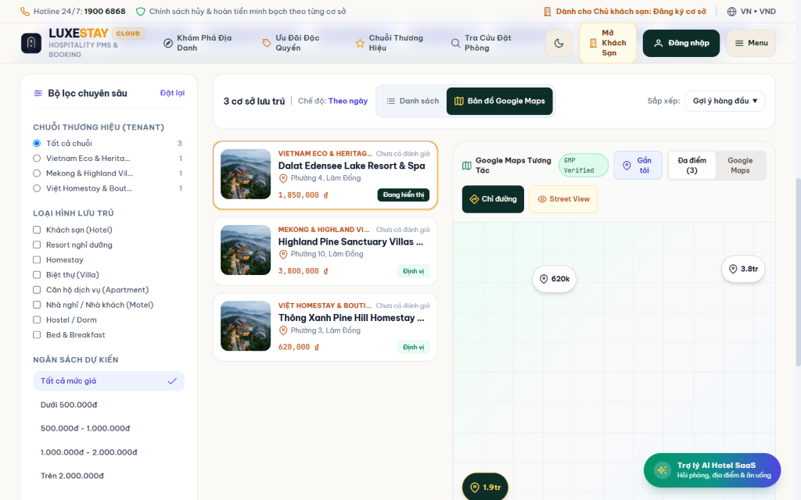
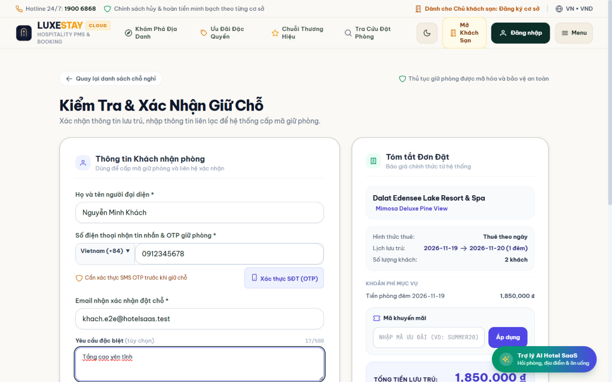
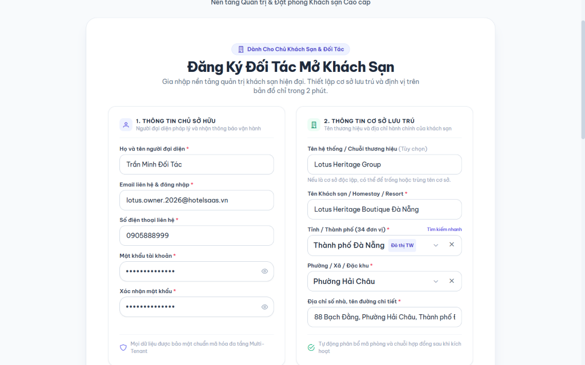
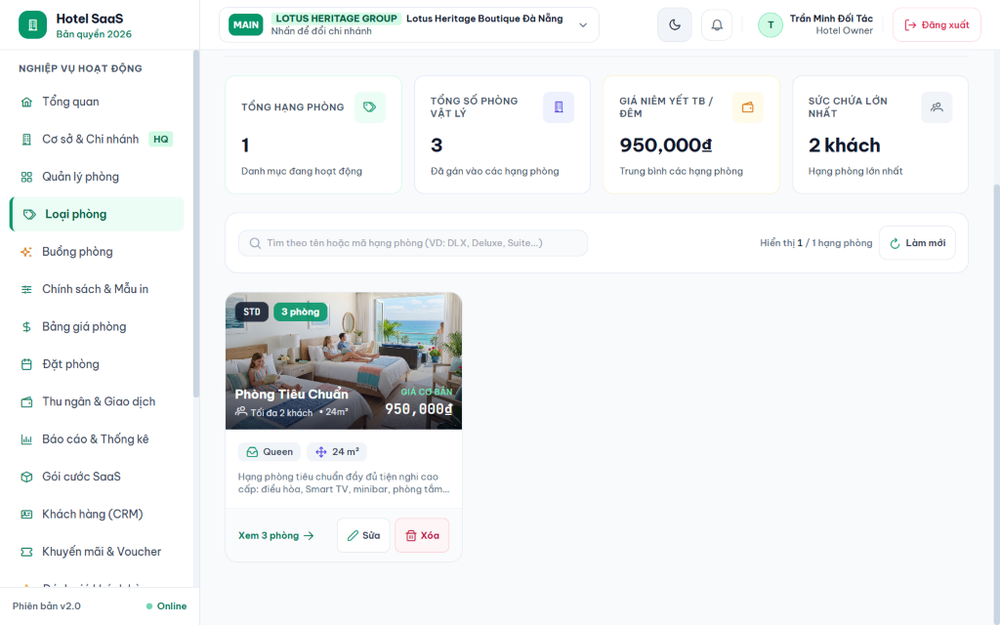
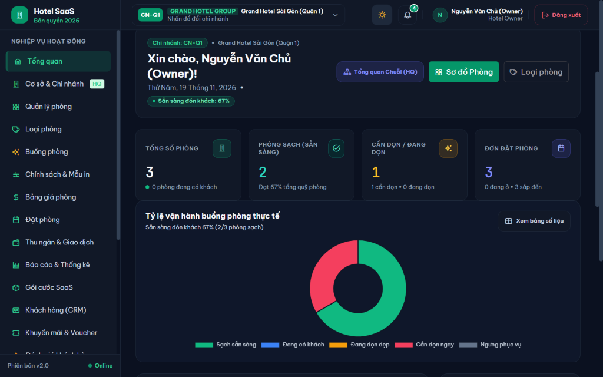
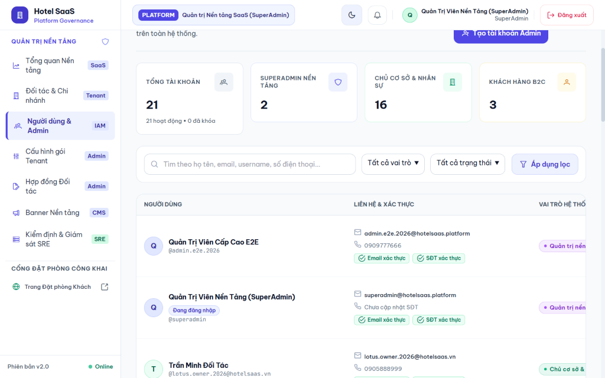
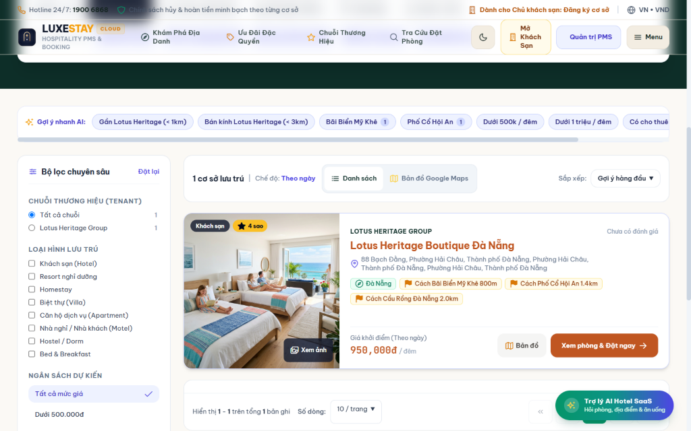

# Báo Cáo Trải Nghiệm Người Dùng Toàn Trình (E2E) & Quản Trị Người Dùng Admin

> **Nhánh triển khai:** `feature/wave5-e2e-ux-platform-users-and-visuals` (nền `feature/wave4-uiux-design-system` @ `76a2c14`)  
> **Môi trường kiểm thử thực tế:** Docker PostgreSQL 17 (`localhost:5435/hotel_saas_dev_ngoc`), ASP.NET Core `.NET 10` API (`http://localhost:5283`), Angular 22 (`http://localhost:3000`)  
> **Phạm vi:** Cổng khách hàng B2C (Tìm kiếm 34 tỉnh, Split Map, Báo giá, Giữ phòng 15 phút) → Tự đăng ký Cơ sở Đối tác & Vận hành CMS/PMS (Gắn ảnh hạng phòng, Sơ đồ phòng, Nhân sự RBAC, Biểu đồ Dark Mode) → Quản trị Nền tảng `SuperAdmin` (`/platform-users` IAM & Xác minh xuất bản lên sàn B2C)

---

## 1. Các Nâng Cấp Trọng Tâm Đã Triển Khai

### 1.1 Khôi Phục Bộ Ảnh Thực Tế Nội Bộ & Giao Diện Chọn Ảnh CMS
- **Cơ sở dữ liệu Seeder (`RealData34ProvincesSeeder.cs`, `LocalDevDataSeeder.cs`):** Gán đồng bộ và idempotent **10/10** bộ ảnh PNG chất lượng cao trong `frontend/public/images/` cho **96** hạng phòng thuộc **56** cơ sở lưu trú khởi tạo (giữ nguyên hợp đồng test `ResolveVisualGallery` trả rỗng đối với hạng phòng chưa có ảnh ngoài thực tế, không dùng `images.unsplash.com`).
- **Danh mục 34 Tỉnh/Thành (`vietnam-provinces.data.ts`) & Bento Grid (`curated-bento-grid.component.ts`):** Điền đủ ảnh `/images/*.png` cho toàn bộ **34/34** tỉnh thành theo mô hình 2 cấp và 4 nhóm phong cách lưu trú (Resort, Homestay, Khách sạn, Villa).
- **Quản trị Hạng phòng CMS (`room-types.page.ts`):** Sửa 2 đường dẫn ảnh fallback 404 cũ thành `/images/danang-ocean-suites.png` và `/images/hanoi-old-quarter-hotel.png`, đồng thời bổ sung thanh chọn nhanh bộ ảnh mẫu kèm preview trực tiếp trong modal chỉnh sửa/tạo hạng phòng.

### 1.2 Phân Hệ Quản Trị Người Dùng & Tài Khoản Admin Nền Tảng (`/platform-users`)
- **Backend CQRS + FluentValidation (`.NET 10`):**
  - `GET /api/platform/users` (`GetPlatformUsersQuery`): Chỉ cho phép `GlobalUserRole.SuperAdmin`, tổng hợp KPI toàn hệ thống (`TotalUsers`, `SuperAdminCount`, `TenantStaffCount`, `CustomerCount`, `ActiveCount`, `LockedCount`), lọc theo từ khóa/vai trò/trạng thái, phân trang và nạp thông tin thuê bao/quyền không lộ `PasswordHash`.
  - `POST /api/platform/users/admins` (`CreatePlatformAdminCommand` + `CreatePlatformAdminCommandValidator`): Tạo tài khoản `SuperAdmin` mới có xác thực email/SĐT, kiểm tra trùng email (`409 Conflict` / `ERR_EMAIL_EXISTS`), băm mật khẩu qua `IPasswordHasher`.
  - `PATCH /api/platform/users/{id}/status` (`TogglePlatformUserStatusCommand`): Khóa/mở khóa tài khoản kèm thu hồi ngay `RefreshTokens` đang hoạt động, chặn tự khóa tài khoản đang đăng nhập (`ERR_SELF_LOCK_FORBIDDEN`) và chặn khóa `SuperAdmin` hoạt động cuối cùng (`ERR_LAST_SUPERADMIN`).
  - `PATCH /api/platform/users/{id}/role` (`UpdatePlatformUserRoleCommand`): Nâng/hạ `GlobalRole` kèm bảo vệ không tự đổi quyền bản thân (`ERR_SELF_ROLE_CHANGE_FORBIDDEN`) và giữ tối thiểu 1 `SuperAdmin` đang hoạt động.
- **Frontend Angular 22 Standalone + OnPush + Signals (`platform-users.page.ts`):**
  - Điều hướng từ sidebar `Quản trị Nền tảng` → `Người dùng & Admin [IAM]` (`platformAdminGuard`), 4 thẻ KPI `<app-stat-card>`, thanh lọc đa tiêu chí, nút tạo SuperAdmin qua modal `cdkTrapFocus` và các nút hành động có xác nhận an toàn qua `AlertService`.

---

## 2. Kết Quả Kiểm Chứng Tự Động (Trước & Trong Phiên E2E)

| Hạng mục kiểm thử | Lệnh / Phạm vi | Kết quả |
| :--- | :--- | :--- |
| **Backend Build** | `dotnet build backend/HotelSaas.slnx --verbosity minimal` | **0 Warning(s), 0 Error(s)** |
| **Backend Unit Tests (Wave 5)** | `dotnet test backend/tests/HotelSaas.Application.Tests/... --filter "PlatformUsersManagementTests\|PublicMarketplaceDiscoveryTests\|LocalDevDataSeederTests"` | **19/19 Passed** (`0 Failed`) |
| **Frontend Build (`C:\Dev\hotel-saas-v2\frontend`)** | `npx ng build --configuration development` | **0 Errors** (`styles.css`, `polyfills.js`, `main.js`) |
| **Frontend Unit Tests (Vitest)** | `npm --prefix frontend test -- --watch=false` | **55/55 files / 692/692 tests Passed** (`0 Failed`) |
| **Kiểm toán độc lập (`wave5-code-verifier`)** | Diff 23 file BE/FE + 72 tham chiếu `/images/*.png` | **PASS** (`0 blockers`, `0 any`, `100% OnPush`) |

---

## 3. Minh Chứng Hình Ảnh Trải Nghiệm E2E Live (8 Lượt Thực Thi Trình Duyệt)

### Hành trình 1 — Khách hàng B2C Tìm kiếm, Khám phá Bản đồ & Giữ chỗ

1. **Trang chủ Marketplace B2C (`/booking`) — Ảnh 34 tỉnh & 4 Bento cards (`29/29` ảnh HTTP 200):**
   
2. **Tìm kiếm "Đà Lạt" & Split Map tương tác (`/booking/explore` — 3 cơ sở + ghim giá GPS):**
   
3. **Chi tiết cơ sở (`Dalat Edensee`), Báo giá `1,850,000 ₫` & Trang giữ phòng 15 phút (`/booking/hold`):**
   

### Hành trình 2 — Đối tác Tự Đăng ký Cơ sở & Quản trị CMS / PMS

4. **Đăng ký Đối tác (`/auth/partner-register`) — Chọn Đà Nẵng (34 tỉnh) & Phường Hải Châu (2 cấp):**
   
5. **Property CMS (`/room-types`) — `Lotus Heritage Boutique Đà Nẵng` gắn ảnh nhanh (`/images/family-ocean-suite.png`, HTTP 200):**
   
6. **Vận hành Chuỗi PMS (`owner@hotelsaas.local`) — Sơ đồ phòng, RBAC Nhân sự & Dashboard Dark Mode + Chart.js:**
   

### Hành trình 3 — Quản trị Nền tảng `SuperAdmin` (`/platform-users`) & Xác minh Sàn B2C

7. **Quản trị Người dùng & Tạo SuperAdmin mới (`/platform-users` — `admin.e2e.2026@hotelsaas.platform`, KPI 2 -> 21 tài khoản):**
   
8. **Đăng nhập bằng Tài khoản Admin mới (`admin.e2e.2026@hotelsaas.platform`), kiểm tra `/platform-tenants` & Cơ sở mới hiển thị Live kèm ảnh trên B2C (`/booking/explore`):**
   

---

## 4. Ghi Nhận Kỹ Thuật Quan Sát Được Trong Phiên Live

1. **Windows Junction (`C:\Projects\hotel-sass-rbac` → `C:\Dev\hotel-saas-v2`) & `fonts.googleapis.com`:** Chạy `ng build` qua đường dẫn Junction khiến `dist/frontend/browser/index.html` bỏ qua bước chèn `<script>`/`<link>` (gây trắng trang trên `prod-server.js`), đồng thời cấu hình `optimization.fonts: true` sẽ lỗi khi không truy cập được `fonts.googleapis.com`. Build trực tiếp tại `C:\Dev\hotel-saas-v2\frontend` với cấu hình `development` khắc phục hoàn toàn.
2. **Hiển thị UX nhỏ phát hiện qua ảnh thực tế:**
   - Khi đối tác tự nhập lặp tên phường/tỉnh vào ô địa chỉ chi tiết trên `/auth/partner-register`, địa chỉ ghép nối hiển thị lặp cụm `"Phường Hải Châu, Thành phố Đà Nẵng"`.
   - Trên thanh điều hướng topbar của `guest-layout` ở độ rộng `1440px`, một số nhãn nút bị xuống 2 dòng do thiếu `whitespace-nowrap`.
   - SignalR `/hubs/notifications` trên `prod-server.js` ghi nhận log đàm phán WebSocket chưa upgrade, và `POST /api/auth/revoke-token` trả `403` khi `SuperAdmin` đăng xuất.
