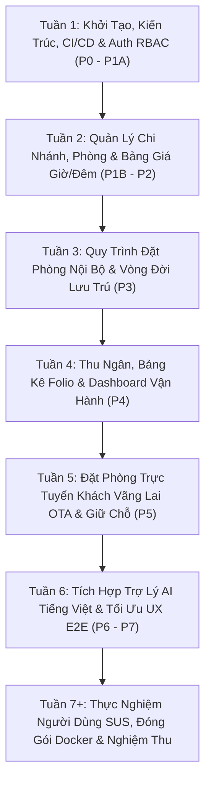

# TRƯỜNG ĐẠI HỌC SƯ PHẠM KỸ THUẬT TP. HỒ CHÍ MINH
## KHOA CÔNG NGHỆ THÔNG TIN — BỘ MÔN CÔNG NGHỆ PHẦN MỀM

---

# BÁO CÁO TIẾN ĐỘ TUẦN 1
### ĐỀ TÀI: XÂY DỰNG HỆ THỐNG QUẢN LÝ KHÁCH SẠN SỬ DỤNG CÔNG NGHỆ WEB (HOTEL SAAS PLATFORM)
- **Mã đề tài trên hệ thống:** Topic 578 ([projects-fit.hcmute.edu.vn](https://projects-fit.hcmute.edu.vn/?view=student-mytopic&topic=578))
- **Giảng viên hướng dẫn (GVHD):** ThS. Phùng Hữu Xuân (`phunghx@hcmute.edu.vn`)
- **Kho lưu trữ mã nguồn (GitHub Repo):** [https://github.com/GinNgo/hotel-saas-v2](https://github.com/GinNgo/hotel-saas-v2)
- **Nhánh làm việc chính thức (Default Branch):** [`develop`](https://github.com/GinNgo/hotel-saas-v2/tree/develop)
- **Thời gian thực hiện Tuần 1:** Từ ngày 03/10/2026 đến ngày 10/10/2026

---

## 1. THÔNG TIN NHÓM SINH VIÊN THỰC HIỆN

| STT | Họ và Tên | Mã số SV | Vai Trò Trong Đề Tài | Nhiệm Vụ Trọng Tâm Tuần 1 |
|:---:|---|:---:|---|---|
| 1 | **Ngô Võ Tuấn An** *(Nhóm trưởng)* | **24TX810001** | Trưởng nhóm, Kiến trúc sư hệ thống & Backend (.NET 10) | Khởi tạo dự án, thiết kế kiến trúc Clean Architecture, xây dựng pipeline CI/CD 6 stages, triển khai Auth, JWT & RBAC đa chi nhánh. |
| 2 | **Nguyễn Khôi Nguyên** *(Thành viên)* | **24TX810011** | Lập trình viên Frontend (Angular 22) | Phụ trách phân hệ Quản lý Danh mục Phòng (`Rooms`) và Hạng phòng (`Room Types`), xây dựng UI/UX bảng dữ liệu, bộ lọc và modal responsive. |
| 3 | **Trần Trọng Tân** *(Thành viên)* | **24TX810025** | Lập trình viên Frontend (Angular 22) | Phụ trách phân hệ Buồng phòng (`Housekeeping`), xây dựng bảng trạng thái phòng thời gian thực, State Machine cập nhật trạng thái phòng, phân trang server-side. |

---

## 2. TỔNG HỢP LỊCH SỬ COMMIT TRÊN GITHUB (TUẦN 1)

Kho lưu trữ GitHub: [https://github.com/GinNgo/hotel-saas-v2](https://github.com/GinNgo/hotel-saas-v2)

| STT | Commit Hash (Viết tắt & Đầy đủ) | Tác Giả (Author) | Thông Điệp Commit (Commit Message) | Nội Dung Chi Tiết Đã Commit Lên GitHub | Link Trực Tiếp Tới Commit Trên GitHub |
|:---:|---|---|---|---|:---:|
| 1 | `677cd99` `677cd99adee6f861886c521699fdc4dd8a1629db` | Ngô Võ Tuấn Anh (`ngovotuananh@gmail.com`) | `feat: Phase 0 complete - docs, scaffold, entities, rules` | - Khởi tạo toàn bộ cấu trúc dự án (.NET 10 Backend + Angular 22 Frontend). - Định nghĩa thực thể miền cốt lõi: `Tenant`, `Property`, `Room`, `RoomType`, `Reservation`, `Payment`, `User`. - Soạn thảo tài liệu đặc tả SRS, SDD, từ điển dữ liệu và 10 quyết định thiết kế cốt lõi (`p0-decisions.md`). | [Xem Commit](https://github.com/GinNgo/hotel-saas-v2/commit/677cd99adee6f861886c521699fdc4dd8a1629db) |
| 2 | `a06ac31` `a06ac31f084606db8de915ddad171091b448f8c3` | Ngô Võ Tuấn Anh (`ngovotuananh@gmail.com`) | `ci: add GitHub Actions 6-stage pipeline` | - Thiết lập tự động hóa CI/CD với GitHub Actions gồm 6 giai đoạn: Build .NET $\to$ Lint $\to$ Chạy Unit Test với PostgreSQL 17 container $\to$ Quét bảo mật (Security audit) $\to$ Build Angular Frontend. - Đảm bảo mọi commit vào `main` và `develop` đều được kiểm tra tự động. | [Xem Commit](https://github.com/GinNgo/hotel-saas-v2/commit/a06ac31f084606db8de915ddad171091b448f8c3) |
| 3 | `3f95339` `3f95339b4f4477ac5d421551d372dfdd5ed31e30` | Ngô Võ Tuấn Anh (`ngovotuananh@gmail.com`) | `feat(auth): implement Auth + RBAC - Phase 1A complete` | - Xây dựng hoàn chỉnh hệ thống xác thực Auth & phân quyền RBAC (Role-Based Access Control). - Middleware kiểm soát ngữ cảnh chi nhánh `TenantPropertyContextMiddleware`. - Đăng ký, đăng nhập, cấp phát JWT Token và cơ chế Refresh Token an toàn. - Dữ liệu mẫu khởi tạo cục bộ `LocalDevDataSeeder` phục vụ phát triển. | [Xem Commit](https://github.com/GinNgo/hotel-saas-v2/commit/3f95339b4f4477ac5d421551d372dfdd5ed31e30) |

---

## 3. BẢNG CHI TIẾT CÁC FILE KẾT QUẢ TRÊN GITHUB THEO TỪNG THÀNH VIÊN

### 3.1. Ngô Võ Tuấn An (MSSV: 24TX810001 — Nhóm trưởng / Backend & Kiến trúc hệ thống)
*Mục tiêu Tuần 1:* Xây dựng nền tảng kiến trúc phần mềm, cơ chế bảo mật xác thực, phân quyền chi nhánh và đường ống tự động hóa kiểm thử CI/CD.

| Hạng Mục | Đường Dẫn File Cụ Thể Trong Repository | Mô Tả Chức Năng Của File | Link Trực Tiếp Tới File Trên GitHub |
|---|---|---|:---:|
| **Quy trình CI/CD** | `.github/workflows/ci.yml` | Tệp cấu hình GitHub Actions tự động hóa build .NET 10, chạy test trên PostgreSQL 17 và build Angular 22. | [ci.yml](https://github.com/GinNgo/hotel-saas-v2/blob/develop/.github/workflows/ci.yml) |
| **Thực thể dữ liệu (Domain)** | `backend/src/HotelSaas.Domain/Entities/Tenant.cs` `backend/src/HotelSaas.Domain/Entities/Property.cs` `backend/src/HotelSaas.Domain/Entities/Room.cs` `backend/src/HotelSaas.Domain/Entities/RoomType.cs` `backend/src/HotelSaas.Domain/Entities/User.cs` | Các thực thể doanh nghiệp đa chi nhánh: Doanh nghiệp (`Tenant`), Chi nhánh (`Property`), Phòng vật lý (`Room`), Hạng phòng (`RoomType`), Người dùng (`User`). | [Thư mục Entities](https://github.com/GinNgo/hotel-saas-v2/tree/develop/backend/src/HotelSaas.Domain/Entities) |
| **Bảo mật & Phân quyền** | `backend/src/HotelSaas.WebApi/Controllers/AuthController.cs` `backend/src/HotelSaas.WebApi/Middleware/TenantPropertyContextMiddleware.cs` `backend/src/HotelSaas.WebApi/Authorization/PermissionAuthorizationHandler.cs` | - `AuthController`: API Đăng ký, Đăng nhập, Refresh Token, Đổi chi nhánh công tác. - `TenantPropertyContextMiddleware`: Bắt buộc header `X-Property-Id`, kiểm soát cách ly dữ liệu chi nhánh fail-closed. - `PermissionAuthorizationHandler`: Xử lý quyền động theo vai trò. | [AuthController.cs](https://github.com/GinNgo/hotel-saas-v2/blob/develop/backend/src/HotelSaas.WebApi/Controllers/AuthController.cs) [Middleware](https://github.com/GinNgo/hotel-saas-v2/blob/develop/backend/src/HotelSaas.WebApi/Middleware/TenantPropertyContextMiddleware.cs) |
| **Seeder Dữ liệu mẫu** | `backend/src/HotelSaas.Infrastructure/Persistence/LocalDevDataSeeder.cs` | Nạp dữ liệu mẫu gồm 2 chi nhánh (Quận 1 và Phú Nhuận), các loại phòng mẫu và các tài khoản demo (Chủ KS, Quản lý, Lễ tân). | [LocalDevDataSeeder.cs](https://github.com/GinNgo/hotel-saas-v2/blob/develop/backend/src/HotelSaas.Infrastructure/Persistence/LocalDevDataSeeder.cs) |
| **Tài liệu đặc tả** | `docs/srs/08-kpi-commitment.md` `docs/implementation-phases.md` `docs/p0-decisions.md` | Bản cam kết 13 KPI định lượng, lộ trình 8 Phase (P0–P7) và 10 quyết định thiết kế nghiệp vụ khách sạn chuẩn. | [implementation-phases.md](https://github.com/GinNgo/hotel-saas-v2/blob/develop/docs/implementation-phases.md) |

---

### 3.2. Nguyễn Khôi Nguyên (MSSV: 24TX810011 — Frontend Developer — Module Quản lý Phòng & Loại phòng)
*Mục tiêu Tuần 1:* Khảo sát API, xây dựng giao diện chuẩn mẫu cho module Quản lý Danh mục Phòng (`Rooms`) và Hạng phòng (`Room Types`), xử lý tìm kiếm debounce, phân trang server-side và form modal nhập liệu.

| Hạng Mục | Đường Dẫn File Cụ Thể Trong Repository | Mô Tả Chức Năng Của File | Link Trực Tiếp Tới File Trên GitHub |
|---|---|---|:---:|
| **Giao diện Phòng** | `frontend/src/app/features/rooms/rooms.page.ts` | Màn hình Quản lý danh sách phòng vật lý, hiển thị bảng phòng theo chi nhánh, bộ lọc tầng lầu, trạng thái phòng, modal thêm/sửa phòng. | [rooms.page.ts](https://github.com/GinNgo/hotel-saas-v2/blob/develop/frontend/src/app/features/rooms/rooms.page.ts) |
| **Giao diện Hạng phòng** | `frontend/src/app/features/room-types/room-types.page.ts` | Màn hình Quản lý danh mục loại phòng (Deluxe, Standard, Suite...), cấu hình giá gốc, sức chứa tối đa, diện tích và mô tả. | [room-types.page.ts](https://github.com/GinNgo/hotel-saas-v2/blob/develop/frontend/src/app/features/room-types/room-types.page.ts) |
| **Dịch vụ gọi API** | `frontend/src/app/core/services/room.service.ts` `frontend/src/app/core/services/room-type.service.ts` | Service Angular gọi API backend: lấy danh sách phòng có phân trang (`getRooms`), thêm phòng mới (`createRoom`), sửa phòng (`updateRoom`), xóa phòng (`deleteRoom`). | [room.service.ts](https://github.com/GinNgo/hotel-saas-v2/blob/develop/frontend/src/app/core/services/room.service.ts) [room-type.service.ts](https://github.com/GinNgo/hotel-saas-v2/blob/develop/frontend/src/app/core/services/room-type.service.ts) |
| **Định nghĩa kiểu (Models)** | `frontend/src/app/core/models/room.model.ts` `frontend/src/app/core/models/room-type.model.ts` | Khai báo các interface TypeScript: `RoomDto`, `CreateRoomRequest`, `UpdateRoomRequest`, `RoomTypeDto`. | [room.model.ts](https://github.com/GinNgo/hotel-saas-v2/blob/develop/frontend/src/app/core/models/room.model.ts) |

---

### 3.3. Trần Trọng Tân (MSSV: 24TX810025 — Frontend Developer — Module Buồng phòng / Housekeeping)
*Mục tiêu Tuần 1:* Xây dựng giao diện bảng điều khiển buồng phòng thời gian thực, tích hợp bộ chuyển đổi trạng thái phòng một chạm tuân thủ máy trạng thái (State Machine) của hệ thống.

| Hạng Mục | Đường Dẫn File Cụ Thể Trong Repository | Mô Tả Chức Năng Của File | Link Trực Tiếp Tới File Trên GitHub |
|---|---|---|:---:|
| **Bảng Buồng phòng** | `frontend/src/app/features/housekeeping/housekeeping.page.ts` | Bảng điều hành buồng phòng trực quan, hiển thị thống kê KPI phòng bẩn/đang dọn/đã sạch trên trang, bộ lọc tầng lầu và trạng thái. | [housekeeping.page.ts](https://github.com/GinNgo/hotel-saas-v2/blob/develop/frontend/src/app/features/housekeeping/housekeeping.page.ts) |
| **Quy trình State Machine** | `frontend/src/app/core/models/enums.ts` | Khai báo Enum `RoomStatus` (`Clean = 1`, `Dirty = 2`, `Cleaning = 3`, `Occupied = 4`, `OutofService = 5`) và nhãn hiển thị màu sắc tương ứng. | [enums.ts](https://github.com/GinNgo/hotel-saas-v2/blob/develop/frontend/src/app/core/models/enums.ts) |
| **API Cập nhật trạng thái** | `frontend/src/app/core/services/room.service.ts` *(phương thức `updateRoomStatus`)* | Gửi yêu cầu `PATCH /api/rooms/{id}/status` kèm `expectedOldStatus` để bảo đảm tính toàn vẹn trạng thái và chống xung đột sửa đồng thời (409 Conflict). | [room.service.ts#L48](https://github.com/GinNgo/hotel-saas-v2/blob/develop/frontend/src/app/core/services/room.service.ts) |
| **Component dùng chung** | `frontend/src/app/shared/components/pagination/pagination.component.ts` `frontend/src/app/shared/components/skeleton-table/skeleton-table.component.ts` | - Phân trang giao diện hỗ trợ chuyển trang, chọn số lượng bản ghi. - Hiệu ứng tải bảng dạng khung xương (Skeleton) mượt mà, không giật màn hình. | [pagination.component.ts](https://github.com/GinNgo/hotel-saas-v2/blob/develop/frontend/src/app/shared/components/pagination/pagination.component.ts) [skeleton-table](https://github.com/GinNgo/hotel-saas-v2/tree/develop/frontend/src/app/shared/components/skeleton-table) |

---

## 4. LỘ TRÌNH TỔNG THỂ CỦA ĐỒ ÁN (PROJECT ROADMAP — TỪ TUẦN 1 ĐẾN TUẦN 7+)

Lộ trình được xây dựng bám sát chuẩn đồ án môn học và rubric đánh giá của Khoa Công nghệ Thông tin — Trường ĐH Sư phạm Kỹ thuật TP.HCM (gồm 8 Phase từ P0 đến P7):

### Chi tiết các giai đoạn thực hiện:
- **Tuần 1 (P0 & P1A) — Khởi tạo nền tảng, thiết kế & Xác thực:**
  - Thiết lập dự án Clean Architecture .NET 10 + Angular 22.
  - Xây dựng quy trình CI/CD với GitHub Actions.
  - Phân tích thiết kế hệ thống (SRS, SDD, ERD, Use Case, Business Rules).
  - Triển khai Auth (Đăng ký, Đăng nhập, JWT, Refresh Token) và phân quyền RBAC đa chi nhánh.
- **Tuần 2 (P1B & P2) — Quản lý chi nhánh, danh mục phòng & Bảng giá:**
  - Hoàn thiện chuyển đổi ngữ cảnh chi nhánh (`switch-context`).
  - Hoàn thiện CRUD Phòng & Loại phòng phía Frontend/Backend.
  - Cấu hình chính sách phụ thu check-in sớm / check-out muộn và bảng giá linh hoạt theo giờ & theo đêm.
- **Tuần 3 (P3) — Đặt phòng nội bộ & Vòng đời lưu trú:**
  - API & Giao diện tạo đơn đặt phòng tại quầy (trực tiếp).
  - Quy trình Check-in (chuyển phòng sang `Occupied`) $\to$ Check-out (chuyển phòng sang `Dirty`) $\to$ Dọn dẹp (`Clean`).
  - Kiểm soát chống trùng phòng đồng thời (Anti-overlap concurrency locking).
- **Tuần 4 (P4) — Thu ngân, Bảng kê Folio & Quản lý thanh toán:**
  - Ghi nhận thanh toán tiền mặt, chuyển khoản, cọc giữ chỗ.
  - Quản lý công nợ hóa đơn (`FolioDto`) minh bạch.
  - Báo cáo tổng thực thu ca trực theo múi giờ Việt Nam (UTC+7).
- **Tuần 5 (P5) — Cổng đặt phòng trực tuyến dành cho khách (Guest OTA):**
  - Giao diện tra cứu cơ sở và loại phòng công khai không cần đăng nhập.
  - Cơ chế giữ phòng tạm thời 15 phút (Room Hold) bảo vệ kho phòng dùng chung.
  - Tra cứu thông tin đặt phòng qua mã bí mật (`lookupToken`).
- **Tuần 6 (P6 & P7A) — Tích hợp Trợ lý AI & Tối ưu UI/UX:**
  - Tích hợp Gemini AI hỗ trợ tìm kiếm phòng bằng ngôn ngữ tự nhiên tiếng Việt.
  - Đảm bảo AI chỉ truy vấn dữ liệu phòng thực tế, không bịa giá hay số lượng phòng.
  - Tối ưu khả năng tiếp cận (Accessibility), điều hướng bàn phím (Keyboard Navigation) và Responsive trên mọi kích thước màn hình.
- **Tuần 7 trở đi (P7B) — Thực nghiệm người dùng & Hoàn thiện đồ án:**
  - Thực hiện khảo sát đo lường trải nghiệm người dùng với thang điểm chuẩn SUS (System Usability Scale $\ge$ 80 điểm).
  - Đóng gói container Docker Compose hoàn chỉnh và triển khai lên môi trường máy chủ thử nghiệm (Staging).
  - Hoàn thiện tài liệu luận văn tốt nghiệp, chuẩn bị Slide và kịch bản thuyết trình bảo vệ đề tài.

---

#---

## 5. KẾ THỪA & NÂNG CẤP TỪ DỰ ÁN CŨ THAM CHIẾU (LEGACY PARITY)

Để đảm bảo tính khả thi cao và tiết kiệm thời gian phân tích nghiệp vụ, nhóm đã chủ động rà soát, khảo sát và kế thừa có chọn lọc các quy trình thực tế từ kho lưu trữ đề tài cũ:
- **Kho lưu trữ cũ tham chiếu:** [https://github.com/GinNgo/He-thong-quan-ly-khach-san](https://github.com/GinNgo/He-thong-quan-ly-khach-san) (Commit: `7e7ed12c0f4149527d46c78aa764b4c2ec88bab9`).
- **Tài liệu tổng hợp đối chiếu của nhóm:** [`docs/legacy-analysis/TONG-HOP-NGHIEP-VU-TU-DU-AN-CU.md`](https://github.com/GinNgo/hotel-saas-v2/blob/develop/docs/legacy-analysis/TONG-HOP-NGHIEP-VU-TU-DU-AN-CU.md).

### Giá trị kế thừa và nâng cấp cụ thể:
1. **Về danh mục phòng (Phụ trách: Nguyên):** Kế thừa 5 hạng phòng chuẩn thực tế (Single, Double, Twin, Family, Suite) từ các migration `V7` và `V8` của bản cũ, đưa vào cấu trúc DTO mới với đầy đủ thuộc tính giá, sức chứa và tiện ích.
2. **Về buồng phòng & vòng đời lưu trú (Phụ trách: Tân):** Kế thừa quy trình vận hành khách sạn thực tế: Khách check-in $\to$ phòng `Occupied`; Khách check-out $\to$ phòng tự động chuyển thành `Dirty`; Nhân viên dọn $\to$ `Cleaning` $\to$ `Clean`. Bổ sung cơ chế chống xung đột đồng thời 409 (`expectedOldStatus`).
3. **Về kiến trúc & bảo mật (Phụ trách: Tuấn Anh):** Nâng cấp toàn diện từ mô hình Monolith khách sạn đơn lẻ lên kiến trúc SaaS đa chi nhánh (.NET 10 Clean Architecture, PostgreSQL 17, JWT, RBAC fail-closed), khắc phục triệt để nguy cơ overbooking dưới tải cao.

---

## 6. BẢNG PHÂN CÔNG NHIỆM VỤ CHI TIẾT CHO 3 THÀNH VIÊN TRONG CÁC TUẦN TIẾP THEO

*(Chi tiết xem tại tài liệu lộ trình nội bộ: [`docs/team/ROADMAP-CHI-TIET-3-THANH-VIEN.md`](https://github.com/GinNgo/hotel-saas-v2/blob/develop/docs/team/ROADMAP-CHI-TIET-3-THANH-VIEN.md))*

| Tuần Thực Hiện | Bạn Ngô Võ Tuấn Anh *(Nhóm trưởng / Full-Stack & System)* | Bạn Nguyên *(Frontend — Danh mục & Bảng giá)* | Bạn Tân *(Frontend — Buồng phòng & Đặt phòng)* |
|:---:|---|---|---|
| **Tuần 1** *(Hiện tại)* | - Khởi tạo kiến trúc .NET 10 + Angular 22. - Xây dựng CI/CD Pipeline 6 stages. - Xây dựng Auth, RBAC, Middleware chi nhánh. - Rà soát nghiệp vụ từ dự án cũ. | - Khảo sát API danh mục. - Xây dựng khung giao diện `rooms.page.ts`. - Xây dựng khung giao diện `room-types.page.ts`. - Kế thừa 5 loại phòng chuẩn từ bản cũ. | - Khảo sát State Machine buồng phòng. - Xây dựng giao diện `housekeeping.page.ts`. - Tích hợp API chuyển trạng thái phòng. - Kế thừa quy trình dọn phòng từ bản cũ. |
| **Tuần 2** | - Phát triển Pricing Engine tính giá giờ và đêm. - API quản lý chính sách chi nhánh và bảng giá. - Viết Unit Test & Integration Test cho Pricing. | - Hoàn thiện các modal Thêm/Sửa/Xóa phòng. - Xử lý kiểm tra dữ liệu form (Validation). - Giao diện hiển thị bảng giá theo loại phòng. | - Hoàn thiện bộ lọc phòng theo tầng lầu. - Xử lý thông báo xác nhận dọn phòng SweetAlert. - Tối ưu responsive giao diện buồng phòng trên tablet/mobile. |
| **Tuần 3** | - Phát triển API đặt phòng nội bộ (Core Booking). - Thuật toán chống đặt trùng phòng concurrency. - API vòng đời lưu trú: Check-in, Check-out, Hủy phòng. | - Giao diện sơ đồ phòng theo dạng lưới (Grid View). - Hiển thị trạng thái phòng trực quan bằng màu sắc. - Modal xem nhanh thông tin phòng và tiện nghi. | - Giao diện danh sách đặt phòng (`reservations.page`). - Nút bấm thao tác nhanh Check-in và Check-out. - Xử lý cập nhật tức thì trạng thái phòng sau check-out (`Dirty`). |
| **Tuần 4** | - Phát triển API thanh toán & quản lý hóa đơn Folio. - API tổng kết thực thu ca trực theo ngày Việt Nam. - Đảm bảo tính bất biến của lịch sử giao dịch (Audit Log). | - Giao diện hiển thị chi tiết hóa đơn đặt phòng (`Folio`). - Hiển thị chi tiết tiền phòng, phụ thu sớm/trễ, dịch vụ. - In hóa đơn tạm tính cho khách hàng. | - Giao diện Thu ngân (`payments.page`). - Form ghi nhận thu tiền mặt và chuyển khoản. - Thẻ thống kê KPI tổng thu ca trực theo thời gian thực. |
| **Tuần 5** | - Phát triển Public API cho khách vãng lai. - Cơ chế giữ phòng 15 phút (Hold) và tự động hoàn trả tồn. - Tạo và bảo mật mã tra cứu `lookupToken`. | - Giao diện tìm kiếm phòng công khai (`booking.page`). - Form chọn ngày nhận/trả phòng và số lượng khách. - Hiển thị thẻ loại phòng, giá ước tính và ảnh minh họa. | - Giao diện giữ chỗ 15 phút (`booking-hold.page`). - Đồng hồ đếm ngược thời gian giữ phòng (Countdown). - Giao diện tra cứu trạng thái đơn phòng (`booking-status`). |
| **Tuần 6** | - Tích hợp Gemini AI API cho tính năng tìm phòng tiếng Việt. - Xây dựng bộ lọc Backend xác thực câu lệnh AI. - Thiết lập môi trường Docker Compose cho cả hệ thống. | - Giao diện khung chat / thanh tìm kiếm thông minh AI. - Hiển thị kết quả gợi ý phòng từ AI trực quan. - Kiểm thử khả năng điều hướng bằng phím (Keyboard Tab/Enter). | - Kiểm thử luồng đặt phòng từ đầu đến cuối (E2E). - Tối ưu giao diện trên màn hình điện thoại di động (Mobile 375px). - Đóng góp kịch bản kiểm thử nghiệm thu. |
| **Tuần 7+** | - Triển khai hệ thống lên máy chủ thử nghiệm (Staging). - Thiết lập giám sát lỗi và hệ thống ghi nhật ký. - Tổng hợp báo cáo kỹ thuật và kiểm tra độ bao phủ mã nguồn. | - Thu thập đánh giá người dùng theo thang đo SUS. - Hoàn thiện chương tài liệu giao diện người dùng. - Chuẩn bị slide thuyết trình bảo vệ đề tài. | - Khảo sát ý kiến nhân viên buồng phòng và lễ tân. - Hoàn thiện chương tài liệu quy trình nghiệp vụ. - Hỗ trợ chuẩn bị kịch bản demo chạy thật hệ thống. |

---

## 7. KẾT LUẬN & ĐỀ XUẤT CHO TUẦN TIẾP THEO

- **Đánh giá chung Tuần 1:** Nhóm đã hoàn thành toàn diện các mục tiêu đề ra cho giai đoạn khởi tạo: thiết lập nền móng kỹ thuật vững chắc (.NET 10, Angular 22, PostgreSQL 17), xây dựng hoàn chỉnh quy trình CI/CD tự động hóa, triển khai thành công phân hệ bảo mật Auth & RBAC đa chi nhánh, rà soát thành công 7 luồng nghiệp vụ từ đề tài cũ, đồng thời đã định hình khung giao diện cho các phân hệ cốt lõi (Phòng, Hạng phòng, Buồng phòng).
- **Đề xuất kế hoạch Tuần 2:** Nhóm sẽ tập trung hoàn thiện module Quản lý Chi nhánh, cấu hình Chính sách phụ thu, hoàn thiện logic tính giá phòng theo giờ và theo đêm, đồng thời hoàn tất 100% các chức năng CRUD danh mục phòng để sẵn sàng bước vào Phase 3 (Đặt phòng cốt lõi).

*Kính mong Thầy xem xét và phê duyệt báo cáo tiến độ Tuần 1 để nhóm tiếp tục triển khai các nhiệm vụ theo đúng lộ trình cam kết!*
