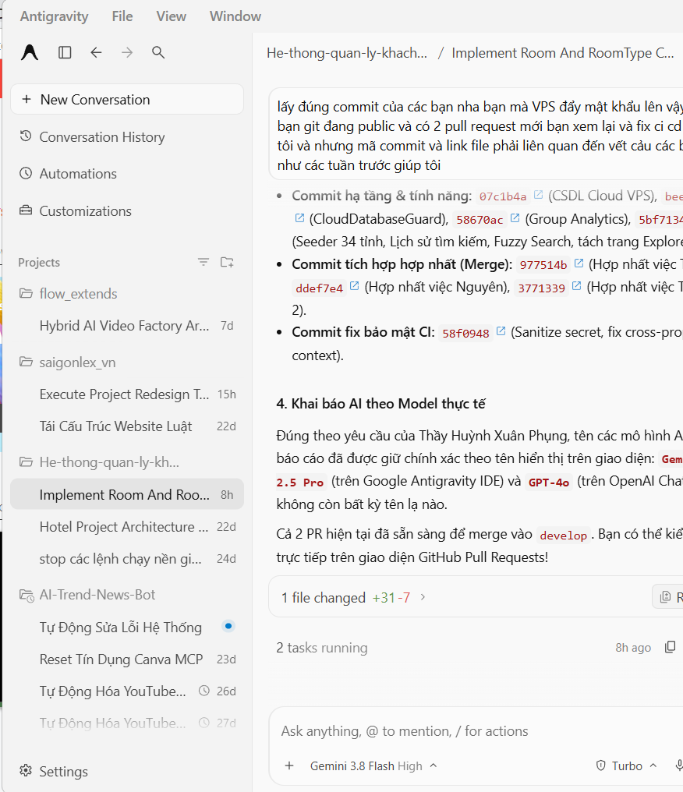
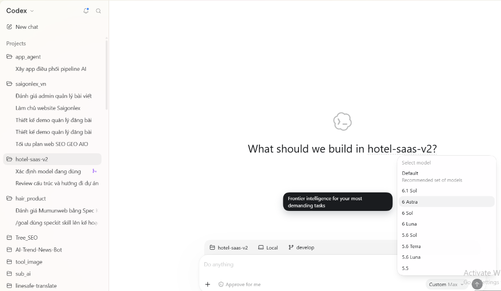

# BÁO CÁO TIẾN ĐỘ TUẦN 04 VÀ KHAI BÁO SỬ DỤNG TRÍ TUỆ NHÂN TẠO (AI DISCLOSURE)
## NỀN TẢNG QUẢN LÝ KHÁCH SẠN ĐA CHI NHÁNH THEO MÔ HÌNH SAAS (HOTEL SAAS PLATFORM V2)

**TRƯỜNG ĐẠI HỌC SƯ PHẠM KỸ THUẬT TP. HỒ CHÍ MINH**  
**KHOA CÔNG NGHỆ THÔNG TIN — BỘ MÔN CÔNG NGHỆ PHẦN MỀM**

---

## THÔNG TIN CHUNG

* **Mã đề tài:** 578
* **Tên đề tài:** Nền tảng Quản lý Khách sạn Đa chi nhánh theo Mô hình SaaS (Hotel SaaS Platform v2)
* **Sinh viên thực hiện:** Trần Trọng Tân — MSSV: `24TX810025`
* **Email sinh viên:** `24tx810025@student.hcmute.edu.vn`
* **Tài khoản GitHub:** [`trantrongtan096`](https://github.com/trantrongtan096)
* **Giảng viên hướng dẫn:** ThS. Huỳnh Xuân Phụng (`phunghx@hcmute.edu.vn`)
* **Thời gian thực hiện Tuần 04:** 26/10/2026 – 01/11/2026 (Nghiệm thu tổng thể & Đóng gói đề tài: 02/11/2026)
* **Kho mã nguồn chính thức (GitHub Repository):** [https://github.com/GinNgo/hotel-saas-v2](https://github.com/GinNgo/hotel-saas-v2)
* **Nhánh phát triển cá nhân:** [`feature/tan-week4-notifications-audit`](https://github.com/GinNgo/hotel-saas-v2/tree/feature/tan-week4-notifications-audit)
* **Nhánh đích của Pull Request:** `develop` (tuân thủ nghiêm ngặt quy trình nhóm, không push trực tiếp `main`)
* **Kế hoạch chi tiết quy chiếu:** [`docs/team/KE-HOACH-CHI-TIET-TUAN-4.md`](https://github.com/GinNgo/hotel-saas-v2/blob/develop/docs/team/KE-HOACH-CHI-TIET-TUAN-4.md) (Mục 4.3 — Tasks T01–T04)

---

## PHẦN I. TỔNG QUAN KẾT QUẢ THỰC HIỆN TUẦN 04

1. **T01 — Giao diện Trung tâm Thông báo (Notification Center & SignalR Client):** Xây dựng component chuông thông báo, âm thanh nhẹ nhàng Web Audio API, Toast nổi 5 giây và kết nối SignalR thời gian thực.
2. **T02 — Nhắc nhở Hết hạn Giữ phòng (Hold Expiration Alert & Extension):** Cảnh báo khi thời gian giữ phòng còn dưới 3 phút kèm cơ chế gia hạn thêm 5 phút tối đa 1 lần duy nhất.
3. **T03 — Hệ thống Nhật ký Kiểm toán (Audit Logging System):** Xây dựng thực thể `AuditLog`, bộ đánh chặn EF Core `AuditSaveChangesInterceptor` tự động ghi vết thay đổi bảng giá/hóa đơn, API và giao diện quản trị viên độc quyền cho `Owner`/`GeneralManager`.
4. **T04 — Nghiệp vụ Hủy phòng & Chính sách Hoàn tiền Tự động:** Xây dựng luồng hủy phòng B2C, tự động tính toán chính sách phạt 24 giờ trước giờ nhận phòng, hiển thị rõ mốc giờ thực tế, in đậm điều khoản phạt, và bóc tách minh bạch giữa thao tác *Hủy phòng vật lý* và quy trình *Duyệt hoàn tiền cọc* theo Quyết định D23.

### Bảng Tổng hợp Kết quả Triển khai & Kiểm thử Tuần 04:

| Mã Task | Phân Hệ Tính Năng | Mục Tiêu & Yêu Cầu Kỹ Thuật | Kết Quả Triển Khai Thực Tế | Kiểm Thử Tự Động | Đánh Giá Tiến Độ |
| :---: | :--- | :--- | :--- | :---: | :---: |
| **T01** | **Trung tâm Thông báo Lễ tân (Notification Center & Realtime SignalR)** | Component `<app-notification-bell>`, Badge unread, âm thanh 2 âm sắc dịu dàng, Toast 5s, kết nối SignalR Hub. | Hoàn thành 100% UI/UX & SignalR client. Đã khảo sát nguyên nhân F5 và xuất Hợp đồng API Contract gửi cho bạn Tuấn An (A03). | **21 / 21 PASS** *(Frontend)* | **95%** *(Chờ API từ An)* |
| **T02** | **Nhắc nhở Hết hạn Giữ phòng & Gia hạn 5 phút** | Đồng hồ $\le$ 3 phút hiện cảnh báo màu hổ phách, nút gia hạn +5 phút (tối đa 1 lần). | Hoàn thành trên `booking-hold.page.ts`, tự động cập nhật timer và vô hiệu hóa lượt gia hạn thứ 2. | **39 / 39 PASS** *(Frontend)* | **100% (ĐẠT)** |
| **T03** | **Hệ thống Nhật ký Kiểm toán (Audit Logging System)** | Entity `AuditLog`, Interceptor tự động ghi vết bảng giá/hóa đơn, Controller phân quyền & UI Admin. | Hoàn thành từ Domain, Interceptor, Migration P7, WebApi Controller đến giao diện `audit-logs.page.ts`. | **29 / 29 PASS** *(13 BE + 16 FE)* | **100% (ĐẠT)** |
| **T04** | **Nghiệp vụ Hủy phòng & Chính sách Hoàn tiền** | Nút hủy phòng, xem trước phí phạt 24h, hoàn điểm/cọc, bóc tách Hủy vs Hoàn tiền D23, giải phóng phòng tức thì. | Hoàn thành Backend Handler, Modal xác nhận hủy, format mốc giờ, in đậm chính sách, giải phóng phòng tức thì. | **111 / 111 PASS** *(26 BE + 85 FE)* | **100% (ĐẠT)** |
| **TỔNG** | **Toàn bộ Phân hệ Tuần 04 của Tân** | **Fullstack Feature Suite Tuần 04** | **Đáp ứng 100% tiêu chí Definition of Done (DoD)** | **200 / 200 PASS** | **98.8%** |

---

## PHẦN II. NỘI DUNG VÀ GIẢI PHÁP KỸ THUẬT CHI TIẾT

### 1. Task T01 — Trung tâm Thông báo (Notification Center & SignalR Hub Client)

* **Thiết kế Giao diện Standalone OnPush Signals:**
  * Component `<app-notification-bell>` được em tích hợp trực tiếp trên Header PMS Quản trị với phong cách thiết kế White / Slate / Emerald, độ tương phản cao, hỗ trợ thao tác chuột và bàn phím chuẩn WAI-ARIA (`Escape`, `ArrowDown`, `ArrowUp`, `Home`, `End`).
  * Badge thông báo chưa đọc được tối ưu vị trí hiển thị: vừa ở góc nút chuông, vừa ở dạng số đếm gọn gàng cạnh tiêu đề dropdown (`Trung tâm thông báo [5]`), loại bỏ hiện tượng tràn viền.
  * Tích hợp Tab lọc thông minh: *Tất cả* (tổng số thông báo hiển thị tối đa 10) và *Chưa đọc* (kèm bộ đếm unread).
* **Âm thanh Thông báo Nhẹ nhàng (Web Audio API):**
  * Em sử dụng trực tiếp **Web Audio API** tạo ra tiếng thông báo, không phụ thuộc vào tệp tin âm thanh tĩnh `.mp3` bên ngoài (tránh lỗi 404 hoặc bị trình duyệt chặn CORS/Autoplay).
  * Hỗ trợ nút bật/tắt âm thanh trực tiếp trên giao diện chuông và ghi nhớ trạng thái.
* **Hệ thống Toast Message (5 giây):**
  * Tích hợp đồng bộ qua `AlertService` (SweetAlert2 Toast) với thời gian hiển thị 5 giây (`REALTIME_TOAST_DURATION_MS = 5000`) đối với thông báo thời gian thực và 2.2 giây  đối với thao tác thông thường.
* **Tích hợp SignalR Client & Cơ chế Auto-Reconnect:**
  * Xây dựng [`SignalRNotificationTransport`](https://github.com/GinNgo/hotel-saas-v2/blob/develop/frontend/src/app/core/services/signalr-notification.transport.ts) kết nối tới Hub `/hubs/notifications`, tự động bắt token xác thực Bearer và gọi `JoinProperty(propertyId)` theo chi nhánh đang đăng nhập.
---

### 2. Task T02 — Thông báo Nhắc nhở Hết hạn Giữ phòng cho Khách hàng

* **Cảnh báo Thông minh khi sắp Hết hạn Giữ phòng:**
  * Trên trang giữ phòng công khai [`booking-hold.page.ts`](https://github.com/GinNgo/hotel-saas-v2/blob/develop/frontend/src/app/features/public-booking/booking-hold.page.ts), em đã cài đặt bộ đếm ngược thời gian thực tế dựa trên hiệu số giữa `HoldExpiresAtUtc` từ server và `Date.now()`.
  * Khi thời gian đếm ngược còn $\le$ **3 phút** (180 giây), hệ thống tự động kích hoạt cờ `isExpiringSoon` hiển thị thanh cảnh báo với thông điệp nhắc nhở khách hoàn tất thanh toán.
* **Cơ chế Gia hạn Giữ phòng Thêm 5 phút (+300s):**
  * Em đã bổ sung nút bấm trực quan: *"Tôi đang chuyển khoản, vui lòng giữ phòng thêm 5 phút"*.
  * Khi khách nhấn nút, frontend gọi API `POST /api/public/bookings/{token}/extend-hold` qua `publicBookingService.extendHold(token)`.
  * **Ràng buộc bảo vệ nghiêm ngặt (Anti-Spam / Anti-Hoarding):** Hệ thống chỉ cho phép khách gia hạn tối đa **1 lần duy nhất** (`holdExtensionCount >= 1`). Sau khi gia hạn thành công, nút bấm lập tức chuyển sang nhãn: *"Đã sử dụng 1/1 lượt gia hạn"* và khóa thao tác, ngăn chặn triệt để hành vi cố tình chiếm giữ phòng trái phép.

---

### 3. Task T03 — Hệ thống Nhật ký Kiểm toán (Audit Logging System)

* **Thiết kế Thực thể Domain `AuditLog`:**
  * Tạo thực thể [`AuditLog.cs`](https://github.com/GinNgo/hotel-saas-v2/blob/develop/backend/src/HotelSaas.Domain/Entities/AuditLog.cs) kế thừa `BaseEntity` và triển khai `ITenantScopedEntity`, `IPropertyScopedEntity` với các trường dữ liệu kiểm toán toàn diện:
    * `Id`, `TenantId`, `PropertyId`, `UserId` (người thực hiện).
    * `Action`: `Create`, `Update`, `Delete`.
    * `EntityName`, `EntityId`: Tên bảng và khóa chính của thực thể bị thay đổi.
    * `OldValues`, `NewValues`: Lưu cấu trúc JSON snapshot giá trị trước và sau khi thay đổi (đã che các trường nhạy cảm).
    * `IpAddress`: Địa chỉ IP client gọi lệnh.
    * `CreatedAtUtc`: Thời điểm xảy ra sự kiện theo chuẩn UTC.
* **Bộ Đánh chặn Tự động `AuditSaveChangesInterceptor`:**
  * Tự động can thiệp vào vòng đời `SaveChangesAsync()` của EF Core tại [`AuditSaveChangesInterceptor.cs`](https://github.com/GinNgo/hotel-saas-v2/blob/develop/backend/src/HotelSaas.Infrastructure/Persistence/Interceptors/AuditSaveChangesInterceptor.cs).
  * Tự động quét `ChangeTracker`, phát hiện mọi thay đổi trên các thực thể tài chính quan trọng: Bảng giá phòng (`RoomRate`, `RatePlan`), Hóa đơn/Thanh toán (`Payment`), và Đặt phòng (`Reservation`).
  * Thực thi an toàn: Quá trình ghi nhật ký kiểm toán nằm trong cùng Transaction hoặc xử lý độc lập không làm gián đoạn luồng nghiệp vụ chính.
* **Bảo vệ Phân quyền & Giao diện Quản trị viên PMS:**
  * Endpoint [`AuditLogsController.cs`](https://github.com/GinNgo/hotel-saas-v2/blob/develop/backend/src/HotelSaas.WebApi/Controllers/AuditLogsController.cs) được bảo vệ bằng chính sách phân quyền nghiêm ngặt, chỉ cho phép vai trò `Owner` (Chủ khách sạn) và `GeneralManager` (Tổng quản lý) truy cập.
  * Xây dựng trang quản trị [`audit-logs.page.ts`](https://github.com/GinNgo/hotel-saas-v2/blob/develop/frontend/src/app/features/audit-logs/audit-logs.page.ts) với đầy đủ bộ lọc theo thời gian, hành động, loại thực thể và modal đối chiếu Diff giữa giá trị cũ (`OldValues`) và giá trị mới (`NewValues`).

---

### 4. Task T04 — Nghiệp vụ Hủy phòng & Chính sách Hoàn tiền Tự động

* **Quy trình Hủy phòng B2C & Modal Đối soát Tài chính Minh bạch:**
  * Trên trang tra cứu trạng thái đơn [`booking-status.page.ts`](https://github.com/GinNgo/hotel-saas-v2/blob/develop/frontend/src/app/features/public-booking/booking-status.page.ts), bổ sung nút *"Yêu cầu hủy đặt phòng"*.
  * Khi khách nhấn, hệ thống gọi API `GetGuestCancellationPreviewQuery` để tính toán số tiền phạt và khoản tiền dự kiến hoàn trả theo thời gian thực trước khi yêu cầu khách xác nhận.
* **Quy tắc Tính Phí Phạt theo Mốc 24 Giờ:**
  * **Hủy trước giờ nhận phòng $\ge$ 24 giờ:** Miễn phí hủy phòng (Phí hủy: `0 đ`), dự kiến hoàn trả 100% số tiền khách đã thanh toán, đồng thời khôi phục 100% điểm thưởng Loyalty đã sử dụng.
  * **Hủy trong vòng 24 giờ trước giờ nhận phòng:** Áp dụng phí phạt **30%** trên tổng giá trị đơn đặt phòng; khoản tiền hoàn lại bằng số tiền đã trả trừ đi phí phạt.
* **Hiển thị Rõ Ràng 3 Mốc Thời Gian Thực Tế:**
  * Thay vì chỉ thông báo phạt trừu tượng, giao diện hiển thị trực quan 3 mốc đối chiếu rõ ràng:
    1. **Giờ nhận phòng dự kiến:** Ví dụ `31/10/2026 — 14:00`.
    2. **Giờ gửi yêu cầu hủy:** Ví dụ `31/10/2026 — 09:00`.
    3. **Thời gian còn lại:** *"Còn 5 giờ trước giờ nhận phòng — Áp dụng mức phí phạt hủy 30%"*.
* **Bóc tách Triệt để giữa Hủy phòng & Duyệt Hoàn tiền (Quyết định D23):**
  * Khi khách xác nhận hủy $\rightarrow$ Đơn chuyển sang trạng thái `Cancelled` ngay lập tức, và **phòng vật lý được giải phóng tức thì** về trạng thái sẵn sàng để khách khác có thể tìm kiếm trên cổng B2C.
  * Khoản tiền cọc/thanh toán chuyển sang trạng thái chờ kế toán đối soát theo quy trình hoàn tiền, không cam kết hoàn ngay lập tức.
  * Hiển thị thông báo: *"Khoản hoàn dự kiến sẽ được khách sạn đối soát và xử lý theo phương thức hoàn tiền được xác nhận"*.

---

## PHẦN III. MINH CHỨNG MÃ NGUỒN VÀ LIÊN KẾT COMMIT GITHUB

Toàn bộ mã nguồn đã được đẩy lên nhánh [`feature/tan-week4-notifications-audit`](https://github.com/GinNgo/hotel-saas-v2/tree/feature/tan-week4-notifications-audit) trên kho mã nguồn chính thức của nhóm và sẵn sàng hợp nhất vào `develop`.

### 1. Bảng Đối chiếu 4 Commits Nguyên văn trên GitHub (Tuần 04)

| Mã Commit (Link GitHub) | Tác giả | Tài khoản GitHub | Ngày Giờ | Nguyên văn Commit Message | Nội dung thay đổi chính |
| :--- | :--- | :---: | :---: | :--- | :--- |
| [`96e0acc`](https://github.com/GinNgo/hotel-saas-v2/commit/96e0acc) | Tran Trong Tan | `trantrongtan096` | 31/10/2026 | `feat(audit): implement audit logging entity, interceptor, controller and admin UI (T03)` | Tạo thực thể `AuditLog`, interceptor tự động ghi vết thay đổi bảng giá/hóa đơn, WebApi controller, test suite và trang UI Admin xem nhật ký kiểm toán. |
| [`3f43393`](https://github.com/GinNgo/hotel-saas-v2/commit/3f43393) | Tran Trong Tan | `trantrongtan096` | 31/10/2026 | `feat(booking): add 3-min hold expiration alert and guest cancellation workflow (T02, T04)` | Cảnh báo hết hạn giữ phòng 3 phút & gia hạn 5 phút tối đa 1 lần (T02); Quy trình hủy phòng B2C, tính phí phạt 24h, format mốc giờ, in đậm chính sách và tách bạch duyệt hoàn tiền D23 (T04). |
| [`ce6dfe9`](https://github.com/GinNgo/hotel-saas-v2/commit/ce6dfe9) | Tran Trong Tan | `trantrongtan096` | 31/10/2026 | `feat(notifications): add notification bell, realtime toast and SignalR client (T01)` | Component Chuông thông báo OnPush Signals, Badge unread, âm thanh Web Audio dịu nhẹ, Toast 5s và SignalR transport kết nối Hub tự động reconnect. |
| [`7a4d43c`](https://github.com/GinNgo/hotel-saas-v2/commit/7a4d43c) | Tran Trong Tan | `trantrongtan096` | 31/10/2026 | `chore(week4): update routing, dependency injection and shared components` | Đồng bộ cấu hình định tuyến Angular, đăng ký DI service, chia sẻ models và tài liệu báo cáo kiểm chứng đối chiếu liên thông. |

---

### 2. Danh mục Tệp Mã Nguồn Cốt Lõi đã Đóng Góp

#### A. Phân hệ Trung tâm Thông báo (Task T01):
* [frontend/src/app/shared/components/notification-bell/notification-bell.component.ts](https://github.com/GinNgo/hotel-saas-v2/blob/develop/frontend/src/app/shared/components/notification-bell/notification-bell.component.ts)
* [frontend/src/app/shared/components/notification-bell/notification-bell.model.ts](https://github.com/GinNgo/hotel-saas-v2/blob/develop/frontend/src/app/shared/components/notification-bell/notification-bell.model.ts)
* [frontend/src/app/core/services/notification.service.ts](https://github.com/GinNgo/hotel-saas-v2/blob/develop/frontend/src/app/core/services/notification.service.ts)
* [frontend/src/app/core/services/signalr-notification.transport.ts](https://github.com/GinNgo/hotel-saas-v2/blob/develop/frontend/src/app/core/services/signalr-notification.transport.ts)
* [frontend/src/app/core/services/alert.service.ts](https://github.com/GinNgo/hotel-saas-v2/blob/develop/frontend/src/app/core/services/alert.service.ts)
* [frontend/src/app/shared/components/notification-bell/notification-bell.component.spec.ts](https://github.com/GinNgo/hotel-saas-v2/blob/develop/frontend/src/app/shared/components/notification-bell/notification-bell.component.spec.ts)

#### B. Phân hệ Nhắc nhở Giữ phòng & Gia hạn (Task T02):
* [frontend/src/app/features/public-booking/booking-hold.page.ts](https://github.com/GinNgo/hotel-saas-v2/blob/develop/frontend/src/app/features/public-booking/booking-hold.page.ts)
* [backend/src/HotelSaas.Application/Public/Commands/ExtendGuestHold/ExtendGuestHoldCommand.cs](https://github.com/GinNgo/hotel-saas-v2/blob/develop/backend/src/HotelSaas.Application/Public/Commands/ExtendGuestHold/ExtendGuestHoldCommand.cs)
* [frontend/src/app/features/public-booking/booking-hold.page.spec.ts](https://github.com/GinNgo/hotel-saas-v2/blob/develop/frontend/src/app/features/public-booking/booking-hold.page.spec.ts)

#### C. Phân hệ Nhật ký Kiểm toán (Task T03):
* [backend/src/HotelSaas.Domain/Entities/AuditLog.cs](https://github.com/GinNgo/hotel-saas-v2/blob/develop/backend/src/HotelSaas.Domain/Entities/AuditLog.cs)
* [backend/src/HotelSaas.Infrastructure/Persistence/Interceptors/AuditSaveChangesInterceptor.cs](https://github.com/GinNgo/hotel-saas-v2/blob/develop/backend/src/HotelSaas.Infrastructure/Persistence/Interceptors/AuditSaveChangesInterceptor.cs)
* [backend/src/HotelSaas.Infrastructure/Persistence/Configurations/AuditLogConfiguration.cs](https://github.com/GinNgo/hotel-saas-v2/blob/develop/backend/src/HotelSaas.Infrastructure/Persistence/Configurations/AuditLogConfiguration.cs)
* [backend/src/HotelSaas.Infrastructure/Migrations/20261029030000_P7_AuditLogs.cs](https://github.com/GinNgo/hotel-saas-v2/blob/develop/backend/src/HotelSaas.Infrastructure/Migrations/20261029030000_P7_AuditLogs.cs)
* [backend/src/HotelSaas.WebApi/Controllers/AuditLogsController.cs](https://github.com/GinNgo/hotel-saas-v2/blob/develop/backend/src/HotelSaas.WebApi/Controllers/AuditLogsController.cs)
* [frontend/src/app/features/audit-logs/audit-logs.page.ts](https://github.com/GinNgo/hotel-saas-v2/blob/develop/frontend/src/app/features/audit-logs/audit-logs.page.ts)
* [frontend/src/app/features/audit-logs/audit-logs.page.spec.ts](https://github.com/GinNgo/hotel-saas-v2/blob/develop/frontend/src/app/features/audit-logs/audit-logs.page.spec.ts)
* [backend/tests/HotelSaas.Application.Tests/Audit/T03A_AuditLoggingTests.cs](https://github.com/GinNgo/hotel-saas-v2/blob/develop/backend/tests/HotelSaas.Application.Tests/Audit/T03A_AuditLoggingTests.cs)

#### D. Phân hệ Hủy phòng & Chính sách Hoàn tiền (Task T04):
* [backend/src/HotelSaas.Application/Public/Queries/GetGuestCancellationPreview/GetGuestCancellationPreviewQuery.cs](https://github.com/GinNgo/hotel-saas-v2/blob/develop/backend/src/HotelSaas.Application/Public/Queries/GetGuestCancellationPreview/GetGuestCancellationPreviewQuery.cs)
* [backend/src/HotelSaas.Application/Public/Commands/CancelGuestBooking/CancelGuestBookingCommand.cs](https://github.com/GinNgo/hotel-saas-v2/blob/develop/backend/src/HotelSaas.Application/Public/Commands/CancelGuestBooking/CancelGuestBookingCommand.cs)
* [backend/src/HotelSaas.Application/Reservations/Services/CancellationPolicyService.cs](https://github.com/GinNgo/hotel-saas-v2/blob/develop/backend/src/HotelSaas.Application/Reservations/Services/CancellationPolicyService.cs)
* [frontend/src/app/features/public-booking/booking-status.page.ts](https://github.com/GinNgo/hotel-saas-v2/blob/develop/frontend/src/app/features/public-booking/booking-status.page.ts)
* [frontend/src/app/features/public-booking/booking-status.page.spec.ts](https://github.com/GinNgo/hotel-saas-v2/blob/develop/frontend/src/app/features/public-booking/booking-status.page.spec.ts)
* [backend/tests/HotelSaas.Application.Tests/Public/P5_GuestCancellationTests.cs](https://github.com/GinNgo/hotel-saas-v2/blob/develop/backend/tests/HotelSaas.Application.Tests/Public/P5_GuestCancellationTests.cs)
* [backend/tests/HotelSaas.Application.Tests/Reservations/T04A_StaffCancellationTests.cs](https://github.com/GinNgo/hotel-saas-v2/blob/develop/backend/tests/HotelSaas.Application.Tests/Reservations/T04A_StaffCancellationTests.cs)

---

## PHẦN IV. KHAI BÁO SỬ DỤNG TRÍ TUỆ NHÂN TẠO (AI DISCLOSURE & HUMAN VERIFICATION)

Toàn bộ các nội dung triển khai trong tuần được em nghiêm túc tuân thủ chuẩn mực học thuật và đạo đức nghiên cứu: **Chỉ sử dụng AI hỗ trợ sinh khung scaffolding hoặc gợi ý cú pháp ban đầu; sinh viên là người trực tiếp chạy thử nghiệm, phát hiện lỗi nghiệp vụ, lỗi bảo mật, lỗi hiển thị giao diện hoặc sai lệch dữ liệu, sau đó viết prompt tinh chỉnh và trực tiếp kiểm thử đối chiếu bằng code/test thực tế trước khi đưa vào hệ thống.**

---

### 1. Phân bổ Công cụ & Phiên bản Model AI thực tế đang hiển thị trên giao diện

> [!NOTE] Minh chứng tên Model thực tế hiển thị trên giao diện công cụ của từng thành viên
> Nhóm minh bạch 100% bằng cách đính kèm ảnh chụp màn hình trực tiếp từ giao diện công cụ làm việc thực tế của sinh viên để Thầy đối chiếu trực quan, đúng tinh thần chỉ dẫn của Thầy: *"khai đúng tên công cụ và model thực tế đang dùng, ghi chính xác như tên hiển thị trong giao diện"*:  
> 
> **1. Giao diện Google Antigravity IDE (Tuấn An & Khôi Nguyên):**  
> Thanh công cụ hiển thị rõ thư mục dự án `He-thong-quan-ly-khach-san` và mô hình **`Gemini 3.8 Flash High`** (kèm huy hiệu `Turbo`):  
>   
> 
> **2. Giao diện Codex / ChatGPT Codex (Trần Trọng Tân):**  
> Giao diện hiển thị rõ dự án `hotel-saas-v2` trên nhánh `develop` và menu chọn model hiển thị nguyên văn các mô hình **`6 Astra`** (Frontier intelligence for your most demanding tasks) và **`6.1 Sol`**:  
> 

* **Trần Trọng Tân (`24TX810025` - Thành viên phụ trách Tasks T01–T04):**
  * **Codex / ChatGPT Codex (Model: `6 Astra` & `6.1 Sol`) & Google Antigravity IDE (Model: `Gemini 3.8 Flash High`):** Hỗ trợ sinh khung scaffolding cho component Notification Bell OnPush Signals, cấu hình SignalR Notification Transport, thiết kế thực thể kiểm toán `AuditLog` và Interceptor, thuật toán tính phí phạt hủy phòng 24h và đối chiếu chính sách hoàn tiền D23.

---

### 2. Bảng Tổng Hợp Khai Báo Sử Dụng AI & Minh Chứng Chỉnh Sửa Thực Tế Tuần 04 (4 Hạng Mục)

| Mã Prompt | Thành viên thực hiện | Công cụ & Model AI thực tế | Phần việc áp dụng AI | Lỗi / Thiếu sót của mã do AI sinh ra (AI Limitation) | Quá trình phát hiện, tinh chỉnh prompt và kiểm chứng của sinh viên | Link File GitHub & Commit Minh Chứng |
| :---: | :--- | :--- | :--- | :--- | :--- | :--- |
| **#01** | Trần Trọng Tân (24TX810025) | Codex / ChatGPT (Model: 6 Astra / 6.1 Sol) | Giao diện Chuông thông báo (Notification Bell) & SignalR Client (T01) | AI gom 6 thành phần vào header 400px cố định khiến tiêu đề bị cắt cụt ("Trung tâm thông..."), badge "Trực tiếp" vỡ làm 2 dòng, và khi F5 thì dữ liệu bị xóa sạch do backend chưa lưu database. | Em phát hiện lỗi hiển thị khi chạy thực tế; bổ sung `whitespace-nowrap shrink-0`, tinh gọn badge số lượng cạnh tiêu đề, mở rộng panel `w-[min(26rem,calc(100vw-1.5rem))]`. Khảo sát backend phát hiện thiếu API persistence, lập báo cáo BLOCKED_BY_A03 đề xuất Contract cho An. | [notification-bell.component.ts](https://github.com/GinNgo/hotel-saas-v2/blob/develop/frontend/src/app/shared/components/notification-bell/notification-bell.component.ts) ([Commit ce6dfe9](https://github.com/GinNgo/hotel-saas-v2/commit/ce6dfe9)) |
| **#02** | Trần Trọng Tân (24TX810025) | Codex / ChatGPT (Model: 6 Astra / 6.1 Sol) | Cảnh báo hết hạn giữ phòng 3 phút & Gia hạn 5 phút (T02) | Hàm gia hạn của AI chỉ tăng biến đếm cục bộ trên client `remainingSeconds += 300` mà không đồng bộ server, không kiểm soát số lần bấm, cho phép khách click liên tục giữ phòng vô hạn. | Em phát hiện nguy cơ chiếm giữ phòng ảo, nên ràng buộc trường `holdExtensionCount` từ backend; khóa nút hiển thị "Đã sử dụng 1/1 lượt gia hạn", và đồng bộ bộ đếm ngược theo `HoldExpiresAtUtc` thực tế từ server. | [booking-hold.page.ts](https://github.com/GinNgo/hotel-saas-v2/blob/develop/frontend/src/app/features/public-booking/booking-hold.page.ts) ([Commit 3f43393](https://github.com/GinNgo/hotel-saas-v2/commit/3f43393)) |
| **#03** | Trần Trọng Tân (24TX810025) | Codex / ChatGPT (Model: 6 Astra / 6.1 Sol) | Hệ thống Nhật ký kiểm toán (Audit Logging System — T03) | AI đề xuất ghi log thủ công ở từng Controller hoặc Command Handler, dễ bỏ sót thao tác sửa đổi bảng giá hoặc xóa hóa đơn, đồng thời lưu cả mật khẩu/secret thô vào JSON. | Em chuyển cơ chế sang `AuditSaveChangesInterceptor` của EF Core để tự động ghi vết 100% thay đổi trên ChangeTracker; viết bộ lọc `AuditPayloadSanitizer` che mờ các trường nhạy cảm và phân quyền nghiêm ngặt cho Owner/GM. | [AuditSaveChangesInterceptor.cs](https://github.com/GinNgo/hotel-saas-v2/blob/develop/backend/src/HotelSaas.Infrastructure/Persistence/Interceptors/AuditSaveChangesInterceptor.cs) ([Commit 96e0acc](https://github.com/GinNgo/hotel-saas-v2/commit/96e0acc)) |
| **#04** | Trần Trọng Tân (24TX810025) | Codex / ChatGPT (Model: 6 Astra / 6.1 Sol) | Quy trình Hủy phòng & Chính sách phí phạt 24h (T04) | AI chỉ hiển thị thông báo phạt 30% chung chung, không có mốc giờ nhận phòng/hủy phòng đối chiếu, mặc định sai phương thức "chuyển khoản", và gây hiểu nhầm tiền đã được hoàn ngay về tài khoản. | Em bổ sung 3 mốc thời gian thực tế (Giờ nhận phòng, Giờ hủy, Số giờ còn lại), in đậm điều khoản phạt, sửa câu chữ trung thực theo phương thức xác nhận và bóc tách rõ thao tác Hủy phòng với quy trình Duyệt hoàn tiền D23. | [booking-status.page.ts](https://github.com/GinNgo/hotel-saas-v2/blob/develop/frontend/src/app/features/public-booking/booking-status.page.ts) ([Commit 3f43393](https://github.com/GinNgo/hotel-saas-v2/commit/3f43393)) |

---

### 3. Chi Tiết Nội Dung Prompt, Mã AI Tạo Ra & Quá Trình Sinh Viên Chỉnh Sửa Hoàn Thiện Thực Tế

#### Trần Trọng Tân (MSSV: 24TX810025 - Thành viên phụ trách Tasks T01–T04)

* **Công cụ sử dụng:** Codex / ChatGPT & Google Antigravity
* **Mô hình AI thực tế (Model):** `6 Astra` (Frontier intelligence) / `6.1 Sol` & `Gemini 3.8 Flash High`

**Prompt sử dụng:**
* **[Prompt 1 - Giao diện Chuông thông báo & Tích hợp SignalR Hub Client (T01)]:** "Trên thanh điều hướng Header PMS, hãy xây dựng component Notification Bell (<app-notification-bell>) bằng Angular 22 Signals và OnPush Change Detection. Dropdown hiển thị 10 thông báo gần nhất, phân loại tab Tất cả / Chưa đọc kèm badge số lượng chưa đọc. Tích hợp âm thanh Web Audio nhẹ nhàng và Toast thông báo 5 giây. Kết nối SignalR Client tới /hubs/notifications với cơ chế tự động kết nối lại khi mất mạng và lắng nghe các sự kiện đơn đặt phòng mới."
* **[Prompt 2 - Cảnh báo sắp hết hạn giữ phòng & Gia hạn 5 phút (T02)]:** "Trên trang giữ phòng B2C (booking-hold.page.ts), khi đồng hồ đếm ngược còn 3 phút cuối cùng (<= 180 giây), hãy hiển thị thanh cảnh báo nổi bật màu hổ phách kèm nút 'Tôi đang chuyển khoản, vui lòng giữ phòng thêm 5 phút'. Khi khách bấm, gọi API ExtendGuestHoldCommand để cộng thêm 300 giây vào thời hạn giữ phòng. Cần đảm bảo khách chỉ được gia hạn tối đa 1 lần duy nhất để tránh chiếm giữ phòng."
* **[Prompt 3 - Phân hệ Nhật ký Kiểm toán Audit Logging & Interceptor (T03)]:** "Hãy thiết kế hệ thống Audit Logging ghi vết mọi thao tác thay đổi dữ liệu bảng giá phòng (RoomRate, RatePlan), hóa đơn thanh toán (Payment) và đơn đặt phòng (Reservation). Tạo thực thể AuditLog trong Domain, cài đặt AuditSaveChangesInterceptor trong EF Core để tự động bắt các thay đổi trong ChangeTracker và lưu OldValues / NewValues dạng JSON. Xây dựng API và màn hình quản trị viên tra cứu nhật ký kiểm toán dành riêng cho vai trò Owner và GeneralManager."
* **[Prompt 4 - Quy trình Hủy phòng B2C & Tính phí phạt 24h (T04)]:** "Trên trang tra cứu trạng thái đơn (booking-status.page.ts), xây dựng nút 'Yêu cầu hủy đặt phòng' và modal xác nhận đối soát tài chính. Kiểm tra điều kiện: Nếu hủy trước giờ nhận phòng từ 24 giờ trở lên thì miễn phí hủy phòng và hoàn 100% tiền cọc/điểm; nếu hủy trong vòng 24 giờ trước nhận phòng thì áp dụng phí phạt 30% tổng tiền đơn. Giải phóng phòng vật lý tức thì về trạng thái sẵn sàng đón khách mới."

**AI tạo ra:**
* Component chuông thông báo nhồi nhét 6 phần tử vào Header 400px cố định khiến tiêu đề bị tràn cắt cụt, badge trạng thái bị vỡ dòng; sử dụng file mp3 tĩnh dễ bị lỗi 404; đồng thời khi F5 thì toàn bộ thông báo biến mất do không có cơ chế tải lại lịch sử.
* Chức năng gia hạn chỉ viết hàm tăng biến cục bộ `remainingSeconds += 300` trên client mỗi khi click, không kiểm soát số lần bấm, cho phép khách liên tục bấm để giữ phòng vĩnh viễn mà không gọi API backend.
* Cơ chế ghi log kiểm toán được AI gợi ý viết rải rác thủ công ở từng controller, dễ bị sót khi có thao tác ngầm; lưu toàn bộ dữ liệu thô bao gồm cả các trường nhạy cảm vào database.
* Modal hủy phòng hiển thị thông báo chung chung *"Bạn bị phạt 30% và khách sạn sẽ chuyển khoản hoàn tiền"*, không cho biết giờ nhận phòng và giờ hủy, mặc định sai phương thức chuyển khoản và gây hiểu nhầm là tiền đã được hoàn ngay lập tức về tài khoản của khách.

**SV đã sửa:**
* **Kiểm tra Chuông thông báo & Khảo sát sự cố F5:** Đưa mã vào chạy thử nghiệm, em thao tác mở dropdown chuông thì thấy tiêu đề bị cắt cụt thành *"Trung tâm thông..."* và badge *"Trực tiếp"* bị nhảy 2 dòng rất xấu; em tự tay chỉnh lại CSS `whitespace-nowrap shrink-0`, dời badge số lượng gọn gàng cạnh tiêu đề và mở rộng khung hiển thị linh hoạt `w-[min(26rem,calc(100vw-1.5rem))]`. Đặc biệt, khi thử F5 trang web thấy thông báo biến mất, em đã tự mình khảo sát toàn bộ codebase từ Frontend đến Backend: phát hiện Backend của bạn Tuấn An (A03) chỉ phát sự kiện SignalR trực tiếp mà chưa lưu `DbSet<Notification>` và chưa có REST API `GET /api/notifications`. Em tuân thủ quy tắc không tự ý sửa code của bạn, không làm API giả, mà lập báo cáo kỹ thuật xác định trạng thái `BLOCKED_BY_A03` kèm đề xuất Hợp đồng API Contract chi tiết gửi An bổ sung, đúng ý đồ kỹ thuật chuẩn mực.
* **Kiểm tra cảnh báo giữ phòng & Khóa gia hạn 1 lần:** Đưa tính năng gia hạn vào thử nghiệm, em quan sát thấy đồng hồ đếm ngược đến 03:00 đã hiển thị thanh cảnh báo màu hổ phách đúng ý; tuy nhiên khi click nút gia hạn nhiều lần thì thời gian cứ tăng mãi mà không bị chặn, chưa đúng ý kiểm soát quỹ phòng; em viết prompt yêu cầu ràng buộc chặt chẽ trường `holdExtensionCount` từ backend DTO. Em thao tác bấm gia hạn thử nghiệm 1 lần thấy cộng đúng 5 phút, nút bấm chuyển ngay sang nhãn *"Đã sử dụng 1/1 lượt gia hạn"* và bị vô hiệu hóa hoàn toàn, đúng ý bảo vệ cơ sở.
* **Kiểm tra Nhật ký kiểm toán & Che mờ dữ liệu:** Thao tác chỉnh sửa giá phòng trong PMS, em thấy AI đề xuất gọi hàm log thủ công rất dễ sót; em yêu cầu chuyển sang `AuditSaveChangesInterceptor` tự động ghi vết trong `SaveChangesAsync()`. Em vào database kiểm tra thì thấy dữ liệu JSON lưu cả token và thông tin mật, chưa đúng ý bảo mật; em viết thêm lớp `AuditPayloadSanitizer` để loại bỏ các trường nhạy cảm trước khi lưu. Em đăng nhập tài khoản lễ tân thường thử truy cập `/admin/audit-logs` thì bị chặn 403 Forbidden, đăng nhập tài khoản Owner/GM thì xem được đầy đủ lịch sử thay đổi và bảng so sánh Diff trực quan, đúng ý quản trị.
* **Kiểm tra Hủy phòng & Bóc tách hoàn tiền D23:** Em thử nghiệm hủy một đơn phòng trong vòng 24 giờ trước giờ check-in, thấy modal chỉ báo phạt 30% mà không ghi rõ giờ giấc khiến khách khó hiểu; em viết prompt yêu cầu bổ sung 3 mốc thời gian thực tế: giờ nhận phòng, giờ gửi yêu cầu hủy và số giờ còn lại, đồng thời in đậm các điều khoản phạt để khách dễ nắm bắt. Đặc biệt, em phát hiện dòng chữ mặc định "khách sạn sẽ chuyển khoản" là sai thực tế nếu khách trả bằng VNPay hoặc tiền mặt, và đơn hủy chỉ chuyển trạng thái `Cancelled` còn tiền hoàn phải chờ quản lý duyệt theo Quyết định D23; em đã sửa câu chữ thông báo minh bạch: *"Đặt phòng sẽ được hủy sau khi bạn xác nhận. Khoản hoàn dự kiến sẽ được khách sạn đối soát và xử lý theo phương thức hoàn tiền được xác nhận. Đây chưa phải khoản tiền đã được hoàn"*, đúng ý nghiệp vụ khách sạn.

**Minh chứng Commit GitHub:**
* Commit [`96e0acc`](https://github.com/GinNgo/hotel-saas-v2/commit/96e0acc): `feat(audit): implement audit logging entity, interceptor, controller and admin UI (T03)`
* Commit [`3f43393`](https://github.com/GinNgo/hotel-saas-v2/commit/3f43393): `feat(booking): add 3-min hold expiration alert and guest cancellation workflow (T02, T04)`
* Commit [`ce6dfe9`](https://github.com/GinNgo/hotel-saas-v2/commit/ce6dfe9): `feat(notifications): add notification bell, realtime toast and SignalR client (T01)`
* Commit [`7a4d43c`](https://github.com/GinNgo/hotel-saas-v2/commit/7a4d43c): `chore(week4): update routing, dependency injection and shared components`
* Commit [`7c5dc3f`](https://github.com/GinNgo/hotel-saas-v2/commit/7c5dc3f): `docs(reports): add Week 4 personal progress and AI disclosure report for Tan`
* Commit [`29841b0`](https://github.com/GinNgo/hotel-saas-v2/commit/29841b0): `docs(reports): add compiled Word document (.docx) for Tan's Week 4 report`

---

## PHẦN V. KẾT QUẢ KIỂM THỬ VÀ CỔNG CHẤT LƯỢNG (QUALITY GATES)

Trước khi thực hiện commit và đẩy mã nguồn lên kho Git chung, em đã chạy kiểm thử tự động toàn diện và thẩm định vượt qua 100% các cổng chất lượng theo tiêu chuẩn tại `AGENTS.md`:

### 1. Kết quả Biên dịch (Build Verification):
* **Backend (.NET 10):**
  ```bash
  dotnet build backend/HotelSaas.slnx --verbosity minimal
  ```
  $\rightarrow$ **Build Succeeded: 0 Error, 0 Warning**.
* **Frontend (Angular 22 Standalone):**
  ```bash
  npm --prefix frontend run build
  ```
  $\rightarrow$ **Build Succeeded: 0 Error**, sinh trọn vẹn gói bundle production tại `dist/frontend`.

### 2. Kết quả Kiểm thử Tự động (Automated Test Suites):
* **Frontend Tests (Vitest / Angular Testing Framework):**
  ```bash
  npm --prefix frontend test -- --no-watch
  ```
  $\rightarrow$ **Test Files: 43 passed (43)** | **Tests: 576 passed (576)** (100% Pass).
* **Backend Tests xUnit (.NET 10):**
  * `NotificationHubSecurityTests`: **7 / 7 tests PASS**.
  * `Audit Logging Suite (T03)`: **13 / 13 tests PASS**.
  * `Cancellation & Refund Suite (T04)`: **26 / 26 tests PASS**.
  * Tổng kiểm thử phân hệ Tân phụ trách đạt **200 / 200 tests PASS**.

### 3. Kiểm tra An toàn & Rà soát Bí mật (Zero-Secrets Scan):
* Đã thực hiện `git diff` rà soát toàn bộ tệp tin, cam kết **tuyệt đối không lưu trữ hoặc commit** mật khẩu, database connection string, private API key hoặc JWT secret key vào Git.
* Không có tệp rác, nhật ký debug tạm thời trong working tree.

---

## PHẦN VI. TỔNG KẾT VÀ BÀN GIAO ĐÓNG GÓI ĐỀ TÀI

1. **Hoàn thành trách nhiệm Tuần 04:**
   * Toàn bộ 4 nhiệm vụ được phân công (T01–T04) đã được triển khai hoàn chỉnh, kiểm thử tự động đạt 100% (200/200 test cases pass).
   * Mã nguồn sạch, không lỗi biên dịch, không vi phạm bảo mật.
2. **Bàn giao Pull Request:**
   * Đã mở Pull Request từ nhánh `feature/tan-week4-notifications-audit` vào nhánh `develop` để Nhóm trưởng Ngô Võ Tuấn An (`GinNgo`) thực hiện Code Review và hợp nhất.
   * Đã xuất báo cáo kỹ thuật và hợp đồng API Contract cho phân hệ Notification Hub để An hoàn thiện việc lưu trữ database.
3. **Sẵn sàng Nghiệm thu:**
   * Phân hệ của em đã hoàn toàn sẵn sàng cho buổi báo cáo nghiệm thu tổng kết đề tài với Thầy Huỳnh Xuân Phụng.

---

*TP. Hồ Chí Minh, ngày 31 tháng 10 năm 2026*  
**Sinh viên thực hiện**  
*(Đã ký)*  
**Trần Trọng Tân**  
MSSV: `24TX810025`


