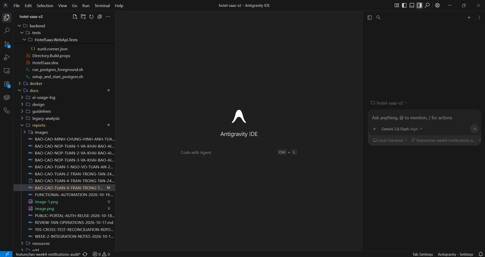
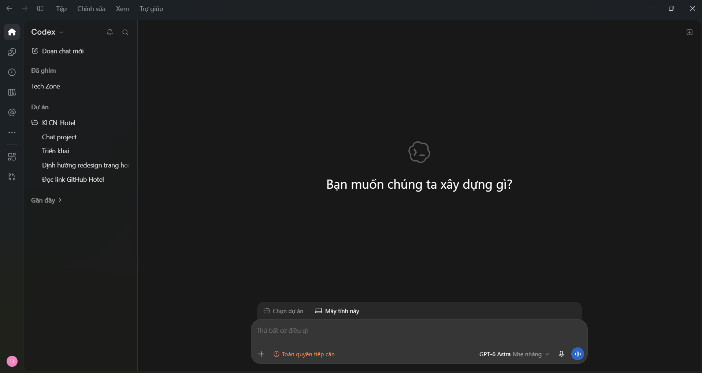

# BÁO CÁO TIẾN ĐỘ TUẦN 05 VÀ KHAI BÁO SỬ DỤNG TRÍ TUỆ NHÂN TẠO (AI DISCLOSURE)
## NỀN TẢNG QUẢN LÝ KHÁCH SẠN ĐA CHI NHÁNH THEO MÔ HÌNH SAAS (HOTEL SAAS PLATFORM V2)

**TRƯỜNG ĐẠI HỌC SƯ PHẠM KỸ THUẬT TP. HỒ CHÍ MINH**
**KHOA CÔNG NGHỆ THÔNG TIN — BỘ MÔN CÔNG NGHỆ PHẦN MỀM**

---

## THÔNG TIN CHUNG

* **Mã đề tài:** 578
* **Tên đề tài:** Nền tảng Quản lý Khách sạn Đa chi nhánh theo Mô hình SaaS (Hotel SaaS Platform v2)
* **Sinh viên thực hiện:** Trần Trọng Tân — MSSV: `24TX810025`
* **Email sinh viên:** `24tx810025@student.hcmute.edu.vn`
* **Tài khoản GitHub:** [`trantrongtan096`](https://github.com/trantrongtan096)
* **Giảng viên hướng dẫn:** ThS. Huỳnh Xuân Phụng (`phunghx@hcmute.edu.vn`)
* **Thời gian thực hiện Tuần 05:** 02/11/2026 – 08/11/2026
* **Kho mã nguồn chính thức (GitHub Repository):** [GinNgo/hotel-saas-v2](https://github.com/GinNgo/hotel-saas-v2)
* **Nhánh phát triển cá nhân:** [`feature/tan-week5-refund-realtime-demo`](https://github.com/GinNgo/hotel-saas-v2/tree/feature/tan-week5-refund-realtime-demo)
* **Nhánh đích của Pull Request:** `develop` (không push trực tiếp `main`)
* **Kế hoạch chi tiết quy chiếu:** [`docs/team/PROMPT-TUAN-5-THUC-THI-NHOM.md`](../team/PROMPT-TUAN-5-THUC-THI-NHOM.md) (Mục 4 — Tasks T01–T03)

---

## PHẦN I. TỔNG QUAN KẾT QUẢ THỰC HIỆN TUẦN 05

1. **T01 — Quản lý và Phê duyệt Hoàn tiền tại quầy thu ngân (Refund Approval — D23):** Tiếp nối chức năng hủy phòng của Tuần 04, em bổ sung màn hình để nhân viên đối chiếu yêu cầu hoàn, duyệt hoặc từ chối, sau đó ghi nhận số tiền thực tế đã trả cho khách.
2. **T02 — Mở rộng Trung tâm Thông báo thời gian thực (SignalR Notifications):** Em bổ sung ba sự kiện cho chuông PMS: thanh toán đã xác nhận, khách yêu cầu hủy phòng và đơn hết hạn giữ chỗ. Mỗi sự kiện được chuyển đến đúng chi nhánh; thông tin tài chính được phân biệt với thông tin tác nghiệp của lễ tân.
3. **T03 — Kịch bản và dữ liệu trình diễn nghiệp vụ (Live Demo Playbook):** Em xây dựng kịch bản trình diễn dự kiến 5 phút trên hai màn hình khách hàng và lễ tân, chuẩn bị dữ liệu mẫu, hướng dẫn xử lý sự cố và script kiểm chứng. Trong quá trình kiểm tra, em đã đối chiếu riêng API tìm phòng công khai và luồng thông báo SignalR phát sinh từ đơn đặt phòng nội bộ. Tuy nhiên, chưa xác nhận được toàn bộ luồng xuyên suốt trên cùng một đơn đặt phòng từ trang khách đến PMS, chưa thực hiện giao dịch VNPay Sandbox bên ngoài và chưa đo thời gian chạy trọn kịch bản.

### Bảng Tổng hợp Kết quả Triển khai & Kiểm thử Tuần 05:

| Mã Task | Phân Hệ Tính Năng | Mục Tiêu & Yêu Cầu Kỹ Thuật | Kết Quả Triển Khai Thực Tế | Kiểm Thử Tự Động | Đánh Giá Tiến Độ |
| :---: | :--- | :--- | :--- | :---: | :--- |
| **T01** | Phê duyệt và chi hoàn tại quầy | Tách bước duyệt khỏi bước chi; không cộng tiền hoàn vào tiền thu. | Có danh sách, chi tiết, thao tác duyệt/từ chối/xác nhận đã chi; báo cáo ca, ngày và Folio tách thu, chi hoàn và thu ròng. | Theo biên bản: 14 test backend và 14 test component đạt. | Đã triển khai; còn kiểm tra hai thu ngân xác nhận đồng thời. |
| **T02** | Thông báo thanh toán, hủy phòng và hết hạn giữ chỗ | Đúng chi nhánh, đúng phạm vi thông tin; lễ tân không cần tải lại trang. | Có ba sự kiện SignalR và tác vụ nền tự quét các đơn hết hạn dù khách đã đóng trang. | Theo biên bản: 16 test backend và 26 test chuông PMS đạt. | Có kết quả local; chưa kết luận chống trùng khi chạy nhiều backend. |
| **T03** | Kịch bản demo hai màn hình | Theo dõi một mã đơn từ trang khách đến PMS, có dữ liệu mẫu và cách xử lý sự cố. | Đã soạn 4 tài liệu và script kiểm tra. TC-02 dùng API công khai; TC-06 tách riêng bước thanh toán sandbox bên ngoài. | TC-02 có kết quả HTTP trong biên bản; TC-06 chưa chạy live. | Đã chuẩn bị kịch bản; chưa nghiệm thu toàn bộ luồng bên ngoài. |
| **TỔNG** | **Ba nhiệm vụ Tuần 05 của Tân** | **Kiểm tra mã nguồn, bản dựng và luồng demo** | **Backend build: 0 lỗi, 0 cảnh báo. Frontend build thành công.** |  Frontend đạt 600/600 bài kiểm thử thuộc 44 tệp. Backend đạt 30/30 bài kiểm thử thuộc hai bộ kiểm thử liên quan đến T01–T02 (14 bài Refund Approval và 16 bài Notification Hub), theo biên bản. Backend build không có lỗi hoặc cảnh báo; frontend build thành công nhưng còn cảnh báo kích thước bundle và thư viện CommonJS. | **Đã triển khai và kiểm tra các chức năng trong phạm vi local. Các tình huống xử lý đồng thời, triển khai nhiều backend và kịch bản thanh toán bên ngoài cần tiếp tục kiểm chứng.** |

*Nguồn số liệu:* [Biên bản kiểm thử T03, mục 3.1](T03-TEST-RESULTS.md). Các test component ở từng dòng nằm trong tổng 600 test frontend, không cộng thêm lần nữa. Trong lần rà soát ngày 08/11, Codex đã chạy lại build và toàn bộ test frontend; không chạy lại bộ test backend có tạo/xóa schema. Frontend còn hai cảnh báo: gói tải ban đầu vượt ngưỡng 60,69 kB và thư viện CommonJS `sweetalert2`.

---

## PHẦN II. NỘI DUNG VÀ GIẢI PHÁP KỸ THUẬT CHI TIẾT

### 1. Task T01 — Giao diện Quản lý và Phê duyệt Hoàn tiền D23 tại Quầy Thu ngân

* **Từ yêu cầu hủy phòng đến hồ sơ chi hoàn:**
  * Ở Tuần 04, khi khách hủy đơn, phòng được giải phóng nhưng khoản hoàn mới ở trạng thái **chờ duyệt**. Sang Tuần 05, em bổ sung [màn hình duyệt hoàn tiền](../../frontend/src/app/features/payments/components/refund-approval/refund-approval.component.ts) để nhân viên xem mã đơn, khoản đã thu, phí hủy và số tiền dự kiến trả khách.
  * Từ chi tiết yêu cầu, người có quyền chọn **Phê duyệt** hoặc **Từ chối**. Nếu từ chối, phải ghi lý do. Nếu duyệt, yêu cầu chuyển sang **Đã duyệt – Chờ chi trả**, chưa được tính là khách đã nhận tiền.
* **Ghi nhận việc chi trả tại quầy:**
  * Sau khi thực sự trả tiền mặt hoặc chuyển khoản, nhân viên chọn phương thức và nhập mã phiếu chi/mã giao dịch. API `confirm-payout` mới chuyển yêu cầu sang `Completed`. Đây là xác nhận một khoản chi **đã thực hiện bên ngoài**, không phải lệnh chuyển tiền tự động qua ngân hàng.
  * API đọc yêu cầu dùng quyền `PAYMENTS:Read`. Các thao tác duyệt, từ chối và xác nhận chi dùng `PAYMENTS:Approve` trong phạm vi chi nhánh; giao diện không thay cho kiểm tra quyền phía server.
* **Đối soát số tiền trên báo cáo ca, ngày và Folio:**
  * Em dùng cùng một trường hợp để đối chiếu cả ba nơi: quầy thu **1.000.000 đồng**, sau đó chi hoàn **300.000 đồng**. Khi mới duyệt, tổng chi hoàn vẫn là **0 đồng**. Sau khi xác nhận chi, tổng thu giữ nguyên **1.000.000 đồng**, tổng chi hoàn là **300.000 đồng**, còn thu ròng là **700.000 đồng**.
  * [Bộ test hoàn tiền](../../backend/tests/HotelSaas.Application.Tests/Payments/RefundApprovalManagementTests.cs) có trường hợp gửi lại yêu cầu sau khi đã chi. Trường hợp đó khác với hai thu ngân cùng bấm xác nhận khi hồ sơ còn chờ chi; phần kiểm tra đồng thời vẫn cần bổ sung.

---

### 2. Task T02 — Mở rộng Thông báo Thời gian thực Toàn hệ thống

* **Phân phối ba sự kiện nghiệp vụ qua SignalR:**
  * `BookingPaymentConfirmed`: sau khi backend xác nhận thanh toán, lễ tân nhận thông báo để mở đúng hồ sơ. Bản tin cho quầy không mang số tiền thực thu và phương thức thanh toán như bản tin dành cho nhóm tài chính.
  * `BookingCancellationRequested`: khi khách gửi yêu cầu hủy, lễ tân nhận thông tin vận hành, còn nhóm quản lý có thông tin để đối chiếu khoản hoàn. Chuông nhận biết cùng một sự kiện qua `EventId`, tránh tăng số chưa đọc hai lần cho cùng bản tin.
  * `HoldExpired`: khi đơn chưa thanh toán hết hạn giữ chỗ, hệ thống gửi thông báo về chi nhánh của đơn. Bản tin không cần chứa mã tra cứu bí mật của khách.
* **Tự động phát hiện đơn giữ chỗ hết hạn:**
  * Em bổ sung [`ExpiredHoldSweepBackgroundService`](../../backend/src/HotelSaas.Infrastructure/Services/ExpiredHoldSweepBackgroundService.cs). Tác vụ chạy trên server, mặc định quét mỗi **15 giây**. Đây là **chu kỳ quét**, không phải thời hạn giữ phòng 15 phút của khách.
  * Hai lượt quét trong cùng một tiến trình được đồng bộ bằng `SemaphoreSlim`. Sau khi phát sự kiện thành công, hệ thống mới lưu mốc đã thông báo. Nếu chạy hai backend hoặc đã gửi sự kiện nhưng lưu mốc thất bại, vẫn cần kiểm tra khả năng phát lại.
* **Hiển thị trên chuông PMS:** Em giữ bộ đếm chưa đọc, toast và tùy chọn âm thanh; khi nhấn thông báo, nhân viên có thể đi tới hồ sơ liên quan thay vì chép mã đơn và tìm lại. Bài kiểm tra theo chi nhánh đối chiếu cả bên **được nhận** và bên **không được nhận**.

---

### 3. Task T03 — Xây dựng Kịch bản và Dữ liệu Trình diễn Nghiệp vụ

* **Kịch bản trình diễn trong 5 phút:**
  1. **Màn hình khách:** ruy cập trang đặt phòng công khai, chọn ngày lưu trú, tìm hạng phòng khả dụng, nhập thông tin khách và tạo yêu cầu giữ phòng.
  2. **Màn hình lễ tân:** Đăng nhập PMS tại đúng chi nhánh, quan sát chuông thông báo khi backend xác nhận thanh toán và mở hồ sơ đặt phòng tương ứng mà không cần tải lại trang.
  3. **Đối chiếu phòng và chứng từ:** Kiểm tra trạng thái phòng trên sơ đồ PMS; đối chiếu thông tin hóa đơn thanh toán có VietQR và phiếu xác nhận đặt phòng có mã QR tra cứu.
  4. **Kiểm chứng kết quả:** Đối chiếu mã đơn, trạng thái và thông tin giữa các màn hình. Những bước chưa thực hiện trên thiết bị thật hoặc chưa có kết quả chạy trực tiếp được ghi nhận riêng, không đánh dấu đã nghiệm thu.
* **Giới hạn nghiệm thu:** API tìm phòng công khai đã có phản hồi HTTP 200. Luồng kiểm thử SignalR sử dụng đơn được tạo qua API nội bộ, nên chưa chứng minh toàn bộ quy trình công khai vận hành xuyên suốt trên cùng một đơn. Việc quét QR trên điện thoại, thanh toán VNPay Sandbox và chạy trọn kịch bản trong 5 phút vẫn cần kiểm chứng thực tế.

---

## PHẦN III. MINH CHỨNG MÃ NGUỒN VÀ LIÊN KẾT COMMIT GITHUB

### 1. Bảng Đối chiếu Commit và Trạng thái Bàn giao (Tuần 05)

| Mã Commit (Link GitHub) | Tác giả | Tài khoản GitHub | Ngày Giờ | Nguyên văn Commit Message | Nội dung thay đổi chính |
| :--- | :--- | :---: | :---: | :--- | :--- |
| [`1e82fb1`](https://github.com/GinNgo/hotel-saas-v2/commit/1e82fb1672278596e15dc57c97d4f61fca595178) | Tan | `trantrongtan096` | 08/11/2026, 09:05 (UTC+7) | `feat(week5): implement D23 refund approval, realtime SignalR notifications, and live demo playbook (T01-T03)` | Triển khai duyệt và chi hoàn D23 (T01), mở rộng thông báo SignalR (T02), bổ sung playbook và script demo (T03). |

Em đã đẩy mã nguồn, các bài kiểm thử và tài liệu của cả ba nhiệm vụ lên nhánh cá nhân trong cùng một commit. Các liên kết dưới đây trỏ đến phiên bản đã push để người đọc có thể đối chiếu đúng nội dung tại thời điểm bàn giao.

---

### 2. Danh mục Tệp Mã Nguồn Cốt Lõi đã Đóng Góp

#### A. Phân hệ Phê duyệt và Chi hoàn tại quầy (Task T01):
* [`refund-approval.component.ts`](https://github.com/GinNgo/hotel-saas-v2/blob/1e82fb1672278596e15dc57c97d4f61fca595178/frontend/src/app/features/payments/components/refund-approval/refund-approval.component.ts) và [`refund-approval.component.spec.ts`](https://github.com/GinNgo/hotel-saas-v2/blob/1e82fb1672278596e15dc57c97d4f61fca595178/frontend/src/app/features/payments/components/refund-approval/refund-approval.component.spec.ts) — giao diện thu ngân và kiểm thử thao tác.
* [`ApproveRefundCommandHandler.cs`](https://github.com/GinNgo/hotel-saas-v2/blob/1e82fb1672278596e15dc57c97d4f61fca595178/backend/src/HotelSaas.Application/Payments/Commands/ApproveRefund/ApproveRefundCommandHandler.cs), [`RejectRefundCommandHandler.cs`](https://github.com/GinNgo/hotel-saas-v2/blob/1e82fb1672278596e15dc57c97d4f61fca595178/backend/src/HotelSaas.Application/Payments/Commands/RejectRefund/RejectRefundCommandHandler.cs) và [`ConfirmRefundPayoutCommandHandler.cs`](https://github.com/GinNgo/hotel-saas-v2/blob/1e82fb1672278596e15dc57c97d4f61fca595178/backend/src/HotelSaas.Application/Payments/Commands/ConfirmRefundPayout/ConfirmRefundPayoutCommandHandler.cs) — ba bước xử lý yêu cầu.
* [`GetShiftReportQueryHandler.cs`](https://github.com/GinNgo/hotel-saas-v2/blob/1e82fb1672278596e15dc57c97d4f61fca595178/backend/src/HotelSaas.Application/Payments/Queries/GetShiftReport/GetShiftReportQueryHandler.cs), [`GetPaymentSummaryQueryHandler.cs`](https://github.com/GinNgo/hotel-saas-v2/blob/1e82fb1672278596e15dc57c97d4f61fca595178/backend/src/HotelSaas.Application/Payments/Queries/GetPaymentSummary/GetPaymentSummaryQueryHandler.cs) và [`GetFolioQueryHandler.cs`](https://github.com/GinNgo/hotel-saas-v2/blob/1e82fb1672278596e15dc57c97d4f61fca595178/backend/src/HotelSaas.Application/Payments/Queries/GetFolio/GetFolioQueryHandler.cs) — đối chiếu số tiền theo ca, ngày và đơn.
* [`RefundApprovalManagementTests.cs`](https://github.com/GinNgo/hotel-saas-v2/blob/1e82fb1672278596e15dc57c97d4f61fca595178/backend/tests/HotelSaas.Application.Tests/Payments/RefundApprovalManagementTests.cs) — kiểm tra quyền, trạng thái hồ sơ và kết quả thu/chi.

#### B. Phân hệ Thông báo Thời gian thực (Task T02):
* [`NotificationHub.cs`](https://github.com/GinNgo/hotel-saas-v2/blob/1e82fb1672278596e15dc57c97d4f61fca595178/backend/src/HotelSaas.Infrastructure/Hubs/NotificationHub.cs) và [`NotificationDispatcher.cs`](https://github.com/GinNgo/hotel-saas-v2/blob/1e82fb1672278596e15dc57c97d4f61fca595178/backend/src/HotelSaas.Infrastructure/Services/NotificationDispatcher.cs) — chia nhóm nhận và phát bản tin nghiệp vụ.
* [`ExpiredHoldSweepBackgroundService.cs`](https://github.com/GinNgo/hotel-saas-v2/blob/1e82fb1672278596e15dc57c97d4f61fca595178/backend/src/HotelSaas.Infrastructure/Services/ExpiredHoldSweepBackgroundService.cs) và [`CheckExpiredHoldsCommand.cs`](https://github.com/GinNgo/hotel-saas-v2/blob/1e82fb1672278596e15dc57c97d4f61fca595178/backend/src/HotelSaas.Application/Public/Commands/CheckExpiredHolds/CheckExpiredHoldsCommand.cs) — quét đơn hết hạn và ghi mốc đã thông báo.
* [`notification.service.ts`](https://github.com/GinNgo/hotel-saas-v2/blob/1e82fb1672278596e15dc57c97d4f61fca595178/frontend/src/app/core/services/notification.service.ts) và [`notification-bell.component.ts`](https://github.com/GinNgo/hotel-saas-v2/blob/1e82fb1672278596e15dc57c97d4f61fca595178/frontend/src/app/shared/components/notification-bell/notification-bell.component.ts) — nhận bản tin, cập nhật badge và hiển thị trên PMS.
* [`NotificationHubSecurityTests.cs`](https://github.com/GinNgo/hotel-saas-v2/blob/1e82fb1672278596e15dc57c97d4f61fca595178/backend/tests/HotelSaas.Application.Tests/Notifications/NotificationHubSecurityTests.cs) — kiểm tra phạm vi chi nhánh và các trường hợp hết hạn giữ chỗ.

#### C. Kịch bản và Dữ liệu Trình diễn (Task T03):
* [Kịch bản demo hai màn hình](https://github.com/GinNgo/hotel-saas-v2/blob/1e82fb1672278596e15dc57c97d4f61fca595178/docs/reports/T03-LIVE-DEMO-PLAYBOOK.md) và [Checklist dữ liệu mẫu](https://github.com/GinNgo/hotel-saas-v2/blob/1e82fb1672278596e15dc57c97d4f61fca595178/docs/reports/T03-SEED-DATA-CHECKLIST.md).
* [Hướng dẫn xử lý sự cố](https://github.com/GinNgo/hotel-saas-v2/blob/1e82fb1672278596e15dc57c97d4f61fca595178/docs/reports/T03-TROUBLESHOOTING.md) và [Bảng kết quả kiểm thử](https://github.com/GinNgo/hotel-saas-v2/blob/1e82fb1672278596e15dc57c97d4f61fca595178/docs/reports/T03-TEST-RESULTS.md).
* [`verify-signalr-e2e.mjs`](https://github.com/GinNgo/hotel-saas-v2/blob/1e82fb1672278596e15dc57c97d4f61fca595178/scripts/verify-signalr-e2e.mjs) — script đối chiếu API và sự kiện nhận được ở phía nhân viên.

---

## PHẦN IV. KHAI BÁO SỬ DỤNG TRÍ TUỆ NHÂN TẠO (AI DISCLOSURE & HUMAN VERIFICATION)

### 1. Phân bổ Công cụ & Phiên bản Model AI thực tế sử dụng trong Tuần 05

Trong Tuần 05, em tiếp tục sử dụng **Antigravity IDE — Gemini 3.8 Flash** và **Codex — GPT-6 Astra**, cùng hai công cụ và model đã khai báo ở Tuần 04. Hai ảnh dưới đây là ảnh giao diện đã lưu trong báo cáo Tuần 04, dùng để nhận diện công cụ; không phải ảnh chụp phiên làm việc mới của Tuần 05.

> **1. Giao diện Antigravity IDE (Trần Trọng Tân) — Model: `Gemini 3.8 Flash`**
>
> 

> **2. Giao diện Codex (Trần Trọng Tân) — Model: `GPT-6 Astra`**
>
> 

* **Trần Trọng Tân (`24TX810025` — phụ trách Tasks T01–T03):**
  * **Antigravity IDE (Model: `Gemini 3.8 Flash`):** Em dùng để triển khai các nhiệm vụ theo prompt, điều chỉnh code/test sau khi rà soát và soạn bản nháp kịch bản, báo cáo.
  * **Codex (Model: `GPT-6 Astra`):** Em dùng để đối chiếu code với kế hoạch, rà công thức thu/chi, kiểm tra đường phát thông báo, chạy build/test local và kiểm tra lại các kết luận trong báo cáo.

---

### 2. Bảng Tổng Hợp Khai Báo Sử Dụng AI & Minh Chứng Chỉnh Sửa Thực Tế Tuần 05

| Mã Prompt | Thành viên thực hiện | Công cụ & Model AI thực tế | Phần việc áp dụng AI | Lỗi / Thiếu sót của bản đầu | Quá trình phát hiện, tinh chỉnh prompt và kiểm chứng của sinh viên | Link File GitHub & Commit Minh Chứng |
| :---: | :--- | :--- | :--- | :--- | :--- | :--- |
| **#01** | Trần Trọng Tân (24TX810025) | Antigravity IDE (`Gemini 3.8 Flash`); Codex (`GPT-6 Astra`) | Duyệt hoàn và đối soát thu/chi (T01) | Khoản đã chi hoàn được cộng vào tổng thu; dữ liệu mẫu dùng `null` khiến test giao diện không biên dịch. | Em yêu cầu đối chiếu một giao dịch thu và một giao dịch hoàn trên cả ba báo cáo, rồi chạy lại suite frontend thay vì chỉ build ứng dụng. | [Test nghiệp vụ](https://github.com/GinNgo/hotel-saas-v2/blob/1e82fb1672278596e15dc57c97d4f61fca595178/backend/tests/HotelSaas.Application.Tests/Payments/RefundApprovalManagementTests.cs) · [Test giao diện](https://github.com/GinNgo/hotel-saas-v2/blob/1e82fb1672278596e15dc57c97d4f61fca595178/frontend/src/app/features/payments/components/refund-approval/refund-approval.component.spec.ts) · [`1e82fb1`](https://github.com/GinNgo/hotel-saas-v2/commit/1e82fb1672278596e15dc57c97d4f61fca595178) |
| **#02** | Trần Trọng Tân (24TX810025) | Antigravity IDE (`Gemini 3.8 Flash`); Codex (`GPT-6 Astra`) | Chuông PMS và sự kiện hết hạn (T02) | Có API quét nhưng nếu không ai gọi thì lễ tân không nhận được thông báo hết hạn. | Em bổ sung vào prompt điều kiện “khách đã đóng trang”, đối chiếu tác vụ nền và test trong đó chi nhánh A được nhận, chi nhánh B không nhận. | [Tác vụ nền](https://github.com/GinNgo/hotel-saas-v2/blob/1e82fb1672278596e15dc57c97d4f61fca595178/backend/src/HotelSaas.Infrastructure/Services/ExpiredHoldSweepBackgroundService.cs) · [Test SignalR](https://github.com/GinNgo/hotel-saas-v2/blob/1e82fb1672278596e15dc57c97d4f61fca595178/backend/tests/HotelSaas.Application.Tests/Notifications/NotificationHubSecurityTests.cs) · [`1e82fb1`](https://github.com/GinNgo/hotel-saas-v2/commit/1e82fb1672278596e15dc57c97d4f61fca595178) |
| **#03** | Trần Trọng Tân (24TX810025) | Antigravity IDE (`Gemini 3.8 Flash`); Codex (`GPT-6 Astra`) | Kịch bản demo, script và biên bản (T03) | Dùng API phòng nội bộ làm bằng chứng cho trang khách; ghi PASS cho sandbox chỉ từ mã xử lý IPN; thông tin đăng nhập nằm trong script. | Em đổi nguồn dữ liệu của TC-02, giữ TC-06 ở trạng thái chưa kiểm chứng và yêu cầu script đọc thông tin đăng nhập từ biến môi trường. | [Biên bản TC-02/TC-06](https://github.com/GinNgo/hotel-saas-v2/blob/1e82fb1672278596e15dc57c97d4f61fca595178/docs/reports/T03-TEST-RESULTS.md) · [Script demo](https://github.com/GinNgo/hotel-saas-v2/blob/1e82fb1672278596e15dc57c97d4f61fca595178/scripts/verify-signalr-e2e.mjs) · [`1e82fb1`](https://github.com/GinNgo/hotel-saas-v2/commit/1e82fb1672278596e15dc57c97d4f61fca595178) |

*Cả ba dòng cùng dẫn commit [`1e82fb1`](https://github.com/GinNgo/hotel-saas-v2/commit/1e82fb1672278596e15dc57c97d4f61fca595178) vì em bàn giao T01–T03 trong một lần push; liên kết tệp ở từng dòng chỉ rõ phần việc tương ứng.*

---

### 3. Chi Tiết Nội Dung Prompt, Mã AI Tạo Ra & Quá Trình Sinh Viên Chỉnh Sửa Hoàn Thiện Thực Tế

#### Trần Trọng Tân (MSSV: 24TX810025 - Thành viên phụ trách Tasks T01–T03)

* **Công cụ sử dụng:** Antigravity IDE và Codex.
* **Mô hình AI thực tế (Model):** `Gemini 3.8 Flash` trên Antigravity IDE; `GPT-6 Astra` trên Codex.

**Prompt sử dụng** *(lược lại nội dung theo từng nhiệm vụ)*:
* **[Prompt 1 — Duyệt và chi hoàn tại quầy (T01)]:** Xây dựng màn hình để nhân viên xem khoản đã thu, phí hủy và số cần trả khách. Tách duyệt khỏi xác nhận đã chi. Kiểm tra trường hợp quầy đã thu 1.000.000 đồng rồi chi hoàn 300.000 đồng: báo cáo ca, ngày và Folio phải phản ánh cùng một kết quả.
* **[Prompt 2 — Thông báo đúng chi nhánh (T02)]:** Bổ sung sự kiện cho thanh toán, yêu cầu hủy và hết hạn giữ chỗ. Nếu khách đã đóng trình duyệt và lễ tân không nhấn F5, server vẫn phải phát thông báo hết hạn. Kiểm tra cả chi nhánh nhận sự kiện lẫn chi nhánh không được phép nhận.
* **[Prompt 3 — Chuẩn bị và kiểm chứng demo (T03)]:** Soạn kịch bản 5 phút cho màn hình khách và lễ tân, kèm checklist và cách xử lý sự cố. Mỗi bước ghi PASS phải có bằng chứng đúng thao tác; nếu mới thử thanh toán nội bộ thì không ghi đã chạy VNPay Sandbox bên ngoài.

### AI tạo ra và những hạn chế phát hiện được

* **T01 – Báo cáo tiền thu:** Bản đầu lọc các giao dịch đã hoàn tất rồi cộng số tiền. Cách này đúng với khoản thu, nhưng khoản chi hoàn cũng có số tiền dương và trạng thái `Completed`. Nếu không phân biệt chiều tiền, trả tiền cho khách lại làm số thu của quầy tăng lên.
* **T02 – Sự kiện hết hạn:** Mã ban đầu có thể phát `HoldExpired` khi gọi API quét. Điều còn thiếu là tác nhân gọi API hoặc chạy lệnh quét khi hết hạn. Vì vậy một lần gọi thử thành công chưa trả lời được câu hỏi “nếu không ai thao tác thì chuông có reo không?”.
* **T03 – Minh chứng demo:** Bản nháp mô tả đúng kết quả mong muốn nhưng có chỗ dùng tên component hoặc handler thay cho kết quả chạy. Một ví dụ là TC-06: có code kiểm tra chữ ký IPN không đồng nghĩa đã có giao dịch sandbox gửi callback về hệ thống.

### Quá trình sinh viên phát hiện, điều chỉnh và kiểm chứng

**T01 – Đối chiếu một khoản hoàn trên ba báo cáo**

Khi nhờ Codex rà phần hoàn tiền, em không chỉ hỏi nút “Xác nhận đã hoàn tiền” có hoạt động hay không. Điều em cần biết là sau khi trả tiền cho khách, con số nào trên màn hình thu ngân sẽ thay đổi. Với ví dụ thu một triệu và trả lại ba trăm nghìn, số thu ban đầu không thể trở thành một triệu ba trăm nghìn. Em dùng đúng ví dụ đó trong prompt yêu cầu Antigravity IDE chỉnh cách tính và bổ sung test.

Lần kiểm tra đầu còn cho thấy build frontend thành công nhưng các test không chạy được vì dữ liệu mẫu không khớp kiểu. Sau khi chỉnh, lần chạy ngày 08/11 ghi nhận 600/600 test frontend đạt. Riêng với thao tác chi tiền, em giữ lại một bước cần thử: mở cùng hồ sơ ở hai phiên thu ngân và xác nhận cùng lúc, thay vì coi việc bấm lại sau khi hồ sơ đã hoàn tất là đủ.

**T02 – Kiểm tra khi khách đã rời trang giữ phòng**

Khi xem lại luồng thông báo, em đặt tình huống khách rời trang trước khi đồng hồ đếm hết. Lúc đó không còn bộ đếm bên trình duyệt để kích hoạt thao tác. Em yêu cầu chuyển phần phát hiện hết hạn về server và kiểm tra kết quả ở hai phía: PMS của đúng chi nhánh có sự kiện, PMS ở chi nhánh khác không có.

Ở lần rà sau, phần triển khai đã có tác vụ nền và bài test cho hai lượt quét chồng nhau trong cùng tiến trình. Em không dùng kết quả đó để khẳng định trường hợp chạy hai máy chủ đã đạt, vì hai máy không dùng chung khóa trong bộ nhớ.

**T03 – Đối chiếu từng dòng PASS với thao tác trong kịch bản**

Khi rà bảng kết quả do Antigravity IDE soạn, em thấy bước “khách tìm phòng” lại dẫn đến API danh sách phòng của nhân viên. Dù API này trả dữ liệu, nó không chứng minh khách tìm được phòng theo ngày đã chọn. Vì vậy em yêu cầu thay bằng API công khai và ghi phản hồi vào TC-02.

Em áp dụng cùng cách đối chiếu cho thanh toán: kết quả thu nội bộ được giữ làm minh chứng local, còn TC-06 chỉ được ghi PASS khi có giao dịch sandbox và IPN thực tế từ bên ngoài. Nhờ tách hai bước, khi báo cáo với giảng viên em có thể chỉ rõ phần nào đã chạy và phần nào mới là kịch bản chuẩn bị.

**Minh chứng Commit GitHub:** [`1e82fb1`](https://github.com/GinNgo/hotel-saas-v2/commit/1e82fb1672278596e15dc57c97d4f61fca595178) — `feat(week5): implement D23 refund approval, realtime SignalR notifications, and live demo playbook (T01-T03)`.

---

**Ngày lập báo cáo:** 08/11/2026
**Sinh viên thực hiện:** Trần Trọng Tân (`24TX810025`)
