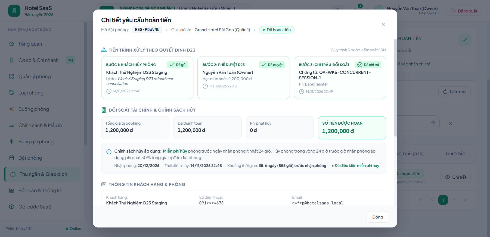
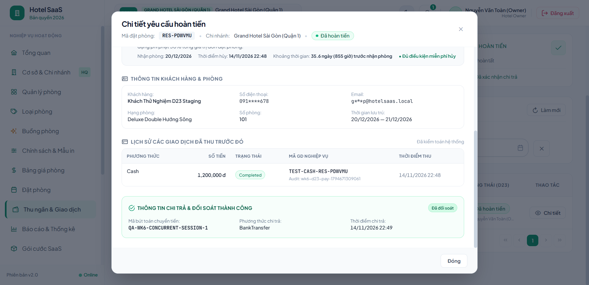
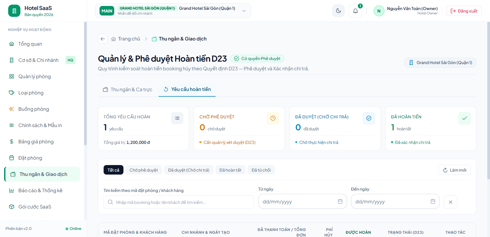
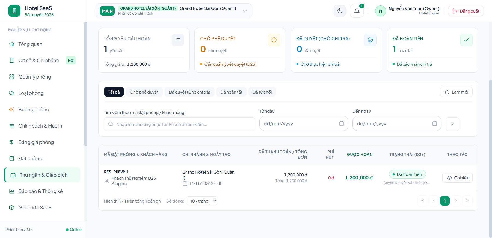
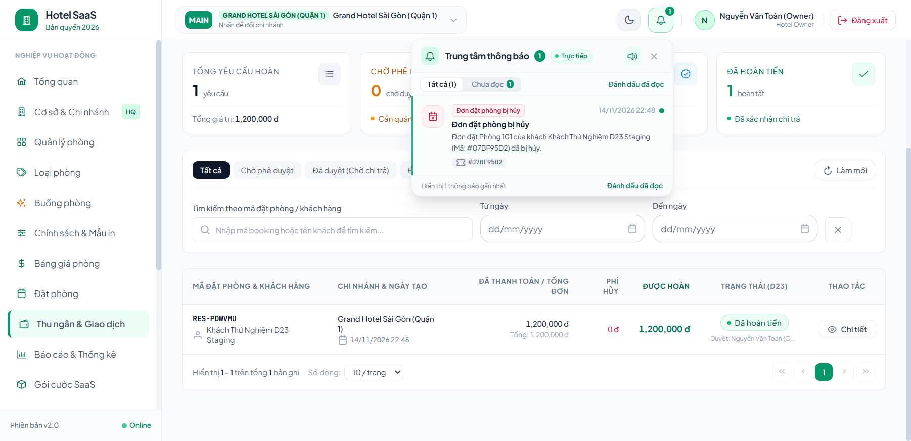
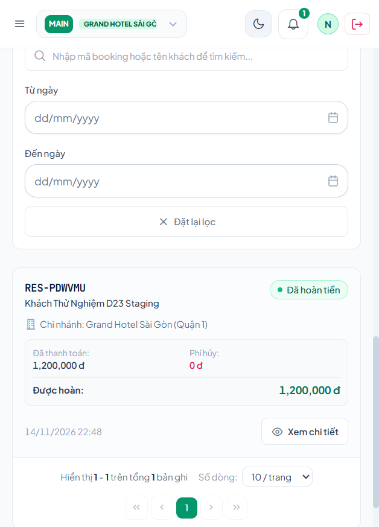
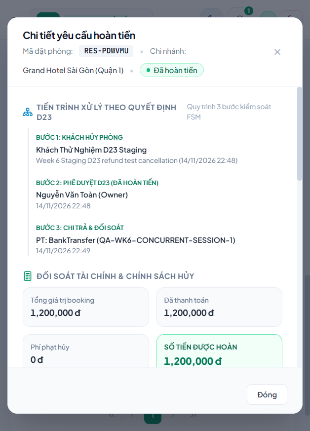
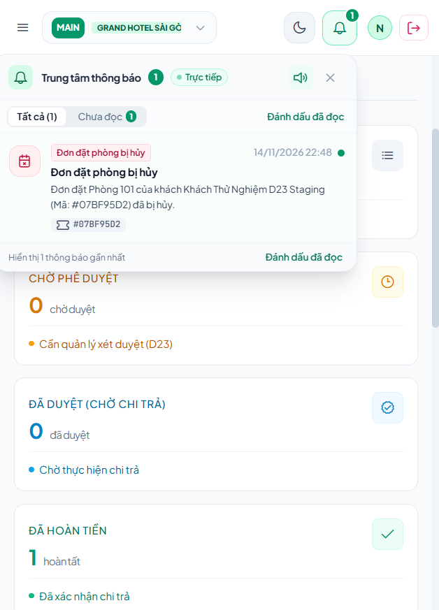

# BÁO CÁO TIẾN ĐỘ TUẦN 06 VÀ KHAI BÁO SỬ DỤNG TRÍ TUỆ NHÂN TẠO (AI DISCLOSURE)
## NỀN TẢNG QUẢN LÝ KHÁCH SẠN ĐA CHI NHÁNH THEO MÔ HÌNH SAAS (HOTEL SAAS PLATFORM V2)

**TRƯỜNG ĐẠI HỌC SƯ PHẠM KỸ THUẬT TP. HỒ CHÍ MINH**
**KHOA CÔNG NGHỆ THÔNG TIN — BỘ MÔN CÔNG NGHỆ PHẦN MỀM**

---

## 1. THÔNG TIN SINH VIÊN, MÃ ĐỀ TÀI VÀ PHÂN HỆ PHỤ TRÁCH

* **Mã đề tài:** 578
* **Tên đề tài:** Nền tảng Quản lý Khách sạn Đa chi nhánh theo Mô hình SaaS (Hotel SaaS Platform v2)
* **Sinh viên thực hiện:** Trần Trọng Tân — MSSV: `24TX810025`
* **Email sinh viên:** `24tx810025@student.hcmute.edu.vn`
* **Tài khoản GitHub:** [`trantrongtan096`](https://github.com/trantrongtan096)
* **Giảng viên hướng dẫn:** ThS. Huỳnh Xuân Phụng (`phunghx@hcmute.edu.vn`)
* **Phân hệ phụ trách Tuần 06:** Vận hành quầy thu ngân & hoàn tiền D23, Thông báo SignalR thời gian thực, Kiểm thử API Bruno và Kiểm thử bảo mật cô lập chéo chi nhánh E2E (`T01`, `T02` theo `GIAO-VIEC-VA-PROMPT-TUAN-6.txt`).
* **Kho mã nguồn:** [GinNgo/hotel-saas-v2](https://github.com/GinNgo/hotel-saas-v2)
* **Nhánh làm việc:** `feature/tan-week6-security-e2e-d23` (được tạo từ `develop` tại commit `9f400b6`). Trong quá trình thực hiện Tuần 6, em đã hoàn thành các nhiệm vụ được phân công và tích hợp thêm 21 file sửa lỗi Backend sau khi được cho phép mở rộng phạm vi. Toàn bộ code, báo cáo và ảnh minh chứng đã được commit và push lên nhánh cá nhân trên GitHub. Hiện em đã bàn giao nhánh để nhóm trưởng kiểm tra và merge vào `develop`.

---

## 2. TỔNG HỢP TRẠNG THÁI NGHIỆM THU (PASS / PARTIAL / BLOCKED)

| Hạng mục nghiệm thu | Phạm vi kiểm tra thực tế | Kết quả | Ghi chú ngắn gọn |
| :--- | :--- | :---: | :--- |
| **T01 — `CrossBranchSecurityE2ETests.cs`** | Full HTTP + SignalR WebSocket E2E với `WebApplicationFactory<Program>`, PostgreSQL schema cô lập, `JwtService` thật, không mock `ICurrentTenantService`/`ICurrentPropertyService`: (1) Baseline + **TC01–TC06** và (2) **Same-Tenant 2 Chi nhánh + SignalR che tài chính + D23 RBAC/2 Cashier đồng thời** | **PASS (Local Isolated E2E)** | **2/2 PASS** (`12 s`): chứng minh đủ Cross-Tenant, Cross-Branch cùng Tenant (`JoinProperty` chặn `ERR_PROPERTY_FORBIDDEN`, Branch B `0` event), che số tiền SignalR (`1.2M` vs `0`), chặn Lễ tân `403` và đua 2 Thu ngân độc lập (`200` + `409`). |
| **Nhiệm vụ A — Xác minh 5 tài khoản Demo Staging** | Kiểm tra thực tế bằng `POST /api/auth/login`, giải mã claims non-secret, `GET /api/auth/me/memberships`, `GET /api/properties`, `GET /api/staff`, `POST /api/auth/switch-context` | **PASS** *(phát hiện lệch cấu trúc seed)* | Cả 5 tài khoản đăng nhập `200 OK`; phát hiện `owner`, `manager.both`, `staff.single` trên Staging đều là `Hotel Owner` của **3 Tenant riêng biệt**, không có Lễ tân thiếu quyền hay Branch B trong cùng Tenant. |
| **T02 / Nhiệm vụ E — Bruno CLI (`@usebruno/cli 4.3.0`)** | Thực thi `--env Staging` sau khi chuẩn hóa `02`–`07` và `Local.bru`/`Staging.bru`: nhóm công khai (`01`–`03`) và nhóm D23 với `owner@hotelsaas.local` (`08` -> `08b` -> `09`, `08` -> `08b` -> `10`) | **PARTIAL (D23 + Public PASS)** | `01`–`03` **PASS** (`3/3`, `7/7` assertions, `1432 ms`); `08 -> 08b -> 09` **PASS** (`3/3`, `200 OK`); `08 -> 08b -> 10` **PASS** (`3/3`, `409 Conflict` duplicate-guard); `04`–`07` chuẩn hóa chặn sớm thiếu token (`ERR_MISSING_STAGING_TOKEN` / `ERR_MISSING_DEPENDENCY`, **BLOCKED/SKIPPED** trên Staging do thiếu OTP/OAuth thật). |
| **T03 — Hoàn thiện nghiệm thu D23** | Staging API đối chiếu `RES-PDWVMU` (`/payments/refunds`, `/refunds/202813bf-...`, `/folio`) + kiểm thử giao diện trực tiếp Chrome tại `/payments` -> `Yêu cầu hoàn tiền` + `CrossBranchSecurityE2ETests` + Vitest (`14/14`) | **PARTIAL** *(UI D23-01..03 PASS; D23-05 thiếu seed Lễ tân)* | Staging API/DB `D23-01`..`D23-04` **PASS** (`searchCount: 1`, `Completed`, `netCollected: 0`, `CancelledSettled`, 0 chi trùng); **Chrome UI `D23-01..03` PASS** (bảng danh sách, modal chi tiết, audit 3 bước & mã `QA-WK6-CONCURRENT-SESSION-1`, không có nút duyệt/chi lại); UI Lễ tân `D23-05` **BLOCKED — MISSING STAGING RECEPTIONIST SEED** (đã PASS ở Local E2E). |
| **T04 — Hoàn thiện kiểm thử SignalR** | Staging `/hubs/notifications` (`JoinProperty`, 4 sự kiện, chặn Cross-Tenant, reconnect `0` replay) + **Chrome UI `<app-notification-bell>`** (`negotiate 200 OK`, `• Trực tiếp`, badge `1`, toggle âm thanh) + Local E2E + Vitest (`26/26`) | **PARTIAL** *(UI Bell & Kết nối PASS; Toast `NOT VERIFIED`; Cross-Branch `BLOCKED`)* | `SIG-01` & `SIG-04` (bell, badge `1`, `• Trực tiếp`, danh sách `0` trùng, bật/tắt âm thanh) **PASS** trên Chrome; Toast realtime **NOT VERIFIED — NO LIVE EVENT** (không phát sinh ghi mới); `SIG-02` Cross-Tenant + Reconnect `0` replay **PASS**; `SIG-02` nội bộ & `SIG-03` **BLOCKED ON STAGING — PASS LOCAL ISOLATED E2E**. |
| **T05 — Nghiệm thu `HoldExpired` & phân tích Background Sweep** | Kiểm tra công khai `RES-HHCRQH`, thăm dò hold bằng `guest.vip`, phân tích luồng [`ExpiredHoldSweepBackgroundService.cs`](../../backend/src/HotelSaas.Infrastructure/Services/ExpiredHoldSweepBackgroundService.cs) -> [`CheckExpiredHoldsCommand.cs`](../../backend/src/HotelSaas.Application/Public/Commands/CheckExpiredHolds/CheckExpiredHoldsCommand.cs) -> [`TenantPropertySaveChangesInterceptor.cs`](../../backend/src/HotelSaas.Infrastructure/Persistence/Interceptors/TenantPropertySaveChangesInterceptor.cs) -> [`NotificationDispatcher.cs`](../../backend/src/HotelSaas.Infrastructure/Services/NotificationDispatcher.cs) và [`GetGuestBookingByTokenQuery.cs`](../../backend/src/HotelSaas.Application/Public/Queries/GetGuestBookingByToken/GetGuestBookingByTokenQuery.cs) | **PARTIAL** *(đã phân tích đầy đủ root cause; bản sửa chưa deploy Staging)* | `RES-HHCRQH` `Expired` (`secondsRemaining: 0`, nhả phòng `2/2`) **PASS**; tạo hold mới trên Staging **BLOCKED — STAGING DEPLOYMENT / VALID OTP REQUIRED** (không bypass OTP, bản sửa đã được commit và push lên nhánh Tuần 6 nhưng chưa được merge vào `develop` và chưa triển khai lên Staging). |
| **T06 — Bruno, Kiểm thử, UI Evidence, Báo cáo & Git** | Audit & chuẩn hóa `tests/bruno/hotel-saas/` (`0` secret, `expectedTotalAmount` động, guard `ERR_MISSING_STAGING_TOKEN`), hợp nhất 21 file sửa lỗi Backend, chạy Full Quality Gate Backend + Frontend, kiểm thử Chrome UI Staging & lưu ảnh PNG vào [`evidence/week6/`](evidence/week6), kiểm tra Git & quét bảo mật | **PARTIAL** *(Local Gate **PASS 100%**; Chrome UI D23 & Bell **PASS**; Staging thiếu seed/OTP)* | Bruno `01`–`03`, `08`–`10` **PASS** (`04`–`07` `BLOCKED/SKIPPED`); **Backend Full Gate trên nhánh `feature/tan-week6-security-e2e-d23`: `617/617 PASS`** (`Domain 1/1`, `WebApi 72/72` gồm `CrossBranchSecurityE2ETests 2/2`, `Application 544/544`); Frontend **628/628 PASS** + build **Exit 0**; đã lưu 9 ảnh PNG minh chứng Chrome tại `docs/reports/evidence/week6/`. |

---

## 2B. ĐỐI CHIẾU TỔNG HỢP THEO TỪNG GIAI ĐOẠN T03 → T06

* **T03 (Hoàn thiện D23):** Kiểm tra lại không ghi nhận giao dịch mới lúc `2026-11-14T16:19:14Z`: `GET /api/payments/refunds?searchTerm=RES-PDWVMU` chỉ có `1` bản ghi (`202813bf-8aed-4832-99a9-f9d8f8581b78`, `status: Completed`, `refundableAmount: 1,200,000`, `bankTransactionRef: QA-WK6-CONCURRENT-SESSION-1`), `GET /folio` khớp `folioPaymentCount: 2`, `totalRefunded: 1,200,000`, `netCollected: 0`, `CancelledSettled`. Ngày `15/11/2026` đã kiểm tra trực tiếp trên trình duyệt Chrome (Mục `9`): `D23-01`..`D23-03` **PASS** (danh sách 1 bản ghi không trùng, modal chi tiết 3 bước FSM, hiển thị chứng từ `QA-WK6-CONCURRENT-SESSION-1`, không có nút Duyệt/Chi trả trên đơn đã hoàn tất); `<app-refund-approval>` cũng đạt `14/14` Vitest unit tests.
* **T04 (Hoàn thiện SignalR):** Kiểm chứng thêm vòng đời ngắt kết nối và kết nối lại (`stop()` -> `start()` -> `JoinProperty`) trực tiếp trên `wss://luxustay.duckdns.org/hubs/notifications` (`Connected` -> `Connected`, `replayedEventsOnReconnect: 0`). Ngày `15/11/2026` đã kiểm tra trực tiếp `<app-notification-bell>` trên Chrome (Mục `9`): `negotiate` `200 OK`, badge `• Trực tiếp`, badge chưa đọc `1`, `1` thông báo không trùng và toggle bật/tắt âm thanh hoạt động đúng (**PASS**); toast realtime tự nhiên `NOT VERIFIED — NO LIVE EVENT` do không tạo giao dịch ghi mới trên Staging. Cơ chế UI cũng đạt `26/26` Vitest unit tests.
* **T05 (`HoldExpired` & Background Service):** Kiểm tra lại `GET /api/public/bookings/RES-HHCRQH` trả `200 OK` với `status: "Expired"`, `secondsRemaining: 0`. Khi dùng JWT thật của `guest.vip@hotelsaas.local` gọi `POST /api/public/bookings/hold` mà không truyền `dev-mock-token`, máy chủ trả `400 ERR_PHONE_VERIFICATION_REQUIRED`. Toàn bộ nguyên nhân lỗi gốc trên `develop` `9f400b6` và kiến trúc sửa 2 pha đã hợp nhất trên nhánh Tuần 6 được trình bày đầy đủ ở **Mục 6B** và **Mục 8.4** *(chưa deploy Staging)*.
* **T06 (Bruno, Build/Test, Báo cáo & Git):** Đã rà soát và cập nhật [`tests/bruno/hotel-saas/`](../../tests/bruno/hotel-saas): `02_Calculate_Quote` xuất động `expectedTotalAmount` sang `03`–`05` (kèm fallback `3200000` trong `Local.bru`/`Staging.bru`); `04`–`07` bổ sung `script:pre-request` chuẩn hóa lỗi `ERR_MISSING_STAGING_TOKEN`, `ERR_MISSING_DEPENDENCY` và `ERR_MOCK_TOKEN_FORBIDDEN_ON_STAGING`, chặn gửi `dev-mock-token` lên Staging khi chưa có OTP/OAuth thật; giữ 0 secret thật trong collection.

---

## 3. NHIỆM VỤ T01 — KIỂM THỬ TỰ ĐỘNG E2E CÔ LẬP CHÉO CHI NHÁNH (`CrossBranchSecurityE2ETests.cs`)

* Tạo tệp [`backend/tests/HotelSaas.WebApi.Tests/Security/CrossBranchSecurityE2ETests.cs`](../../backend/tests/HotelSaas.WebApi.Tests/Security/CrossBranchSecurityE2ETests.cs) dùng `[Collection("RealDatabaseTests")]`, `WebApplicationFactory<Program>`, PostgreSQL schema cô lập `Pooling=false`, không mock `ICurrentTenantService`/`ICurrentPropertyService`, phát hành JWT thật qua `IJwtService` với **2 bài kiểm thử E2E độc lập (chạy trên Local PostgreSQL test schema cô lập — tách biệt rõ với Staging):**
  1. `CrossBranchAndCrossTenant_FullHttpPipeline_EnforcesFailClosedIsolation`: Baseline + **TC01–TC06** HTTP (Cross-Branch cùng Tenant & Cross-Tenant `403`/`404`, bất biến DB sau tấn công).
  2. `MultiBranch_SameTenant_D23RolesAndSignalRIsolation_FullPipeline_EnforcesStrictIsolation`: Bổ sung bù khoảng trống seed trên Staging (nơi 3 tài khoản demo đều là Owner ở 3 Tenant riêng):
     * **SignalR WebSocket thật (`NotificationHub`) đa chi nhánh cùng Tenant:** `ReceptionistA` (`PAYMENTS:3`, thiếu bit `16` `Approve`) tham gia `BranchA` thành công nhưng gọi `JoinProperty(BranchB)` bị từ chối `ERR_PROPERTY_FORBIDDEN`; khi phát sinh thanh toán `Cash 1,200,000 VND` & hủy hoàn tiền `RES-MB-D23-001` tại `BranchA`, `Cashier1A` (`PAYMENTS:127`) nhận payload đầy đủ (`paidAmount: 1200000`, `refundableAmount: 1200000`), `ReceptionistA` cùng chi nhánh nhận payload đã che tài chính (`paidAmount: 0`, `paymentMethod: ""`, `refundableAmount: 0`), còn `ReceptionistB` tại `BranchB` (cùng Tenant) nhận **`0` sự kiện rò rỉ**.
     * **D23 RBAC & 2 Thu ngân độc lập (`D23-05` & `D23-04`):** `ReceptionistA` gọi `/approve` bị chặn **`403 Forbidden`**; `Cashier1A` duyệt `200 OK`; **`Cashier1A` và `Cashier2A`** (2 tài khoản nhân sự tách biệt) gọi đồng thời `/confirm-payout` -> đúng **`1`x `200 OK` + `1`x `409 Conflict` (`ERR_ALREADY_COMPLETED`)**, PostgreSQL chỉ có `1` bản ghi hoàn `Completed` (`1,200,000 VND`).
* **Kết quả kiểm tra sau chỉnh sửa cuối (`15/11/2026`):** `dotnet test backend/HotelSaas.slnx --filter "FullyQualifiedName~CrossBranchSecurity"` -> **`2/2 PASS`** (`12 s`).

---

## 4. NHIỆM VỤ A — KẾT QUẢ XÁC MINH TÀI KHOẢN DEMO TRÊN STAGING

*(Thực hiện bằng `POST https://luxustay.duckdns.org/api/auth/login` sử dụng các tài khoản demo hiển thị tại màn hình Quick Login của [`login.page.ts`](../../frontend/src/app/features/auth/login/login.page.ts) — tuyệt đối không lưu mật khẩu hay JWT vào báo cáo/Git).*

| Tài khoản kiểm tra | Trạng thái Login Staging | `GlobalRole` & Tên hiển thị thực tế | Tenant & Chi nhánh thực tế trên Staging | Vai trò, Scope & Quyền thực tế (JWT + DB) | Khả năng dùng cho D23 / SignalR / `switch-context` |
| :--- | :---: | :--- | :--- | :--- | :--- |
| `owner@hotelsaas.local` | **200 OK** | `TenantStaff` — *Nguyễn Văn Toàn (Owner)* | Tenant `TNT-C292C0` (*Grand Hotel Sài Gòn (Quận 1)*), Property `5e32f217-1834-467e-8bcc-cd4c8c354314` (`MAIN`, có **1 phòng `101`**, `GET /api/staff` `totalCount: 1`) | `Owner` (*Hotel Owner*), `TenantWide`, toàn quyền `*:127` gồm `PAYMENTS:127` (có bit `16` `Approve`) | **Đủ quyền D23** (`Approve` & `ConfirmPayout`), **đủ quyền SignalR** kênh Tenant 1, `POST /api/auth/switch-context` trả **`200 OK`** (`TenantWide`). |
| `manager.both@hotelsaas.local` | **200 OK** | `TenantStaff` — *Lê Minh Quản Lý (Manager)* | Tenant `TNT-2D90A1` (*Saigon Star Boutique Hotel*), Property `c48eaf66-c2b0-435b-a253-4530529cb0a2` (`MAIN`, **0 phòng**, `staff totalCount: 1`) | `Owner` (*Hotel Owner*), `TenantWide`, quyền `PAYMENTS:127` (**không phải** Manager 2 chi nhánh của `Grand Hotel Group` như tên gọi) | Quản lý Tenant 2 độc lập; `switch-context` tới `c48eaf66-...` **`200 OK`**; bị từ chối khi chạm vào Tenant 1 (`404`/`HubException`). |
| `staff.single@hotelsaas.local` | **200 OK** | `TenantStaff` — *Phạm Thu Hà (Lễ tân CN-Q1)* | Tenant `TNT-AF6AB9` (*Grand Hotel Phú Nhuận*), Property `fa445503-8761-40d5-a81d-b07dbbd4eb40` (`MAIN`, **0 phòng**, `staff totalCount: 1`) | `Owner` (*Hotel Owner*), `TenantWide`, quyền `PAYMENTS:127` (**không phải** Lễ tân bị hạn chế quyền của Tenant 1) | Quản lý Tenant 3 độc lập; `switch-context` tới `fa445503-...` **`200 OK`**; bị từ chối khi chạm vào Tenant 1 (`404 ERR_PROPERTY_NOT_FOUND`). |
| `superadmin@hotelsaas.platform` | **200 OK** | `SuperAdmin` | Platform-level (`TenantId = null`, `memberships: 0`) | Quản trị nền tảng (`admin-contracts`, `admin-plans`) | Không phải tài khoản nhân sự chi nhánh để test D23/cô lập chi nhánh. |
| `guest.vip@hotelsaas.local` | **200 OK** | `Customer` — *Trần Hoàng Bảo Ngọc (VIP)* | Không thuộc Tenant/Property PMS (`memberships: 0`, `phone: 0912345678`) | Khách hàng B2C | Bị chặn `401 ERR_TENANT_REQUIRED` ở `/api/payments/refunds`, bị chặn `ERR_PROPERTY_FORBIDDEN` ở SignalR `JoinProperty`; khi giữ phòng công khai không dùng `dev-mock-token` bị chặn `400 ERR_PHONE_VERIFICATION_REQUIRED`. |
| `admin@hotelsaas.local`, `receptionist.sgn@grandhotel.vn` | **401 Fail** | — | Không kích hoạt / sai mật khẩu mẫu trên Staging | Không sử dụng được | Không tồn tại tài khoản Lễ tân trong Tenant 1 trên Staging. |

**Kết luận điều kiện tài khoản thực tế trên Staging:**
1. Tài khoản `owner@hotelsaas.local` **đủ điều kiện thực hiện trọn vẹn quy trình D23 và SignalR cho chi nhánh `Grand Hotel Sài Gòn (Quận 1)`** (sau khi bổ sung bảng giá thử nghiệm `2026-12-18` -> `2026-12-31` cho phòng `101`, vì trước đó chi nhánh này có `0` rate `ERR_PRICING_NOT_CONFIGURED`).
2. **Điều kiện còn thiếu chính xác trên Staging (không suy diễn chung chung):**
   * Không có **2 tài khoản nhân sự/thu ngân khác nhau cùng thuộc Tenant `TNT-C292C0`** (`GET /api/staff` của cả 3 tenant đều trả `totalCount: 1`), nên `D23-04` trên Staging kiểm chứng qua **2 phiên đăng nhập/JWT độc lập đồng thời của `owner@hotelsaas.local`** thay vì 2 nhân sự khác nhau.
   * Không có tài khoản **Lễ tân thiếu bit quyền `PAYMENTS:Approve` trong cùng Tenant `TNT-C292C0`** để kiểm tra `D23-05` & che giấu số tiền `SIG-03` nội bộ chi nhánh.
   * Không có **Chi nhánh thứ 2 (`Branch B`) thuộc cùng Tenant `TNT-C292C0`** (cả 3 tenant demo chỉ có đúng 1 property và cả 3 tài khoản đều là `TenantWide Owner`), nên cách ly đa chi nhánh trên Staging chỉ kiểm chứng được ở cấp **Cross-Tenant** giữa `TNT-C292C0` và `TNT-2D90A1`/`TNT-AF6AB9`, còn cô lập **cùng Tenant `BranchA` vs `BranchB` + che số tiền SignalR + 2 Thu ngân độc lập** được bảo chứng đầy đủ bằng bài E2E thứ 2 trong `CrossBranchSecurityE2ETests` (**`2/2 PASS`**).

---

## 5. NHIỆM VỤ B — KẾT QUẢ NGHIỆM THU D23 TRÊN STAGING (`RES-PDWVMU`)

Không thực hiện chuyển tiền thật; toàn bộ luồng sử dụng phương thức thanh toán tiền mặt/chứng từ kiểm thử nội bộ trên phòng `101` (*Deluxe Double Hướng Sông*, ngày `2026-12-20 -> 2026-12-21`) thuộc `Grand Hotel Sài Gòn (Quận 1)` (`5e32f217-1834-467e-8bcc-cd4c8c354314`):

| Kịch bản | Thao tác thực tế & API đã gọi | HTTP Status & Trạng thái trước -> sau | Kết quả |
| :--- | :--- | :--- | :---: |
| **Chuẩn bị đơn & Hoàn tiền (`D23-01`)** | 1. `POST /api/room-types/.../rates` tạo bảng giá `1,200,000 VND`. 2. `POST /api/reservations` tạo đơn `RES-PDWVMU` (`id: 07bf95d2-34f3-452a-b198-88a146086a17`). 3. `POST /api/payments` thu tiền mặt thử (`id: 86a5a88c-ea7c-4bc3-85e9-ec78688214bb`, `Cash = 2`, `1,200,000 VND`). 4. `POST /api/reservations/{id}/cancel` hủy trước 855 giờ (`cancellationFee: 0`). | • `201 Created` -> Reservation `Confirmed` • `201 Created` -> Payment `Completed` • `200 OK` -> Reservation `Cancelled`, tự sinh hồ sơ hoàn **`202813bf-8aed-4832-99a9-f9d8f8581b78`** ở trạng thái **`PendingApproval`** (`refundableAmount: 1,200,000`) | **PASS** |
| **Chặn trái phép trước khi duyệt (`D23-05`)** | 1. `guest.vip@hotelsaas.local` (`Customer`) gọi `POST /api/payments/refunds/{refId}/approve?propertyId={propA}`. 2. `staff.single@hotelsaas.local` (Owner Tenant 3) gửi `X-Property-Id: {propA}` gọi endpoint duyệt. | • `guest.vip`: **`401 Unauthorized`** (`ERR_TENANT_REQUIRED`) • `staff.single`: **`404 NotFound`** (`ERR_PROPERTY_NOT_FOUND`) • Hồ sơ hoàn vẫn giữ nguyên `PendingApproval` *(ghi chú: thiếu tài khoản Lễ tân cùng chi nhánh `TNT-C292C0` không có `PAYMENTS:Approve` trên Staging)* | **PARTIAL** |
| **Phê duyệt hoàn tiền (`D23-02`)** | Chạy Bruno CLI `08_Staff_Login.bru -> 08b_Staff_Switch_Context.bru -> 09_Refund_Approve.bru --env Staging` với `owner@hotelsaas.local`. | • `08`: **`200 OK`** (`207 ms`) • `08b`: **`200 OK`** (`106 ms`) • `09`: **`200 OK`** (`228 ms`), trạng thái chuyển **`PendingApproval` -> `Approved`** (`Đã duyệt - Chờ chi trả`) | **PASS** |
| **2 phiên xác nhận chi đồng thời (`D23-04` + `D23-03`)** | Mở 2 phiên đăng nhập & `switch-context` độc lập (`tok1`, `tok2` của `owner@hotelsaas.local`) gửi đồng thời `Promise.all` tới `POST /api/payments/refunds/{refId}/confirm-payout`; ngay sau đó chạy tiếp Bruno `10_Refund_Confirm_Payout.bru`. | • **Phiên 1:** **`200 OK`** (`Completed`, `bankTransactionRef: QA-WK6-CONCURRENT-SESSION-1`) • **Phiên 2 (cùng thời điểm):** **`409 Conflict`** (`ERR_ALREADY_COMPLETED`) • **Bruno `10`:** **`409 Conflict`** (`112 ms`, test assertion `[200, 409]` PASS) • **Folio sau chi (`GET /api/reservations/{id}/folio`):** đúng `2` bản ghi thanh toán (`1` thu Cash `1,200,000`, `1` hoàn BankTransfer `1,200,000`), **`totalRefunded: 1,200,000`**, **`netCollected: 0`**, **`refundStatus: Refunded`**, **`financialSettlementStatus: CancelledSettled`** -> **0 chi hoàn trùng** | **PASS** *(2 phiên cùng account `owner` do thiếu Thu ngân thứ 2 cùng Tenant)* |

---

## 6. NHIỆM VỤ C & D — KẾT QUẢ SIGNALR REALTIME & `HOLDEXPIRED` TRÊN STAGING

1. **Kết nối & nhận sự kiện realtime tại `wss://luxustay.duckdns.org/hubs/notifications`:**
   * **Phiên 1 (`owner@hotelsaas.local` -> `JoinProperty("5e32f217-...")`):** Kết nối thành công, nhận đầy đủ 4 sự kiện realtime cho `RES-PDWVMU` với đúng `propertyId`:
     * `ReceiveNewReservation` (`RES-PDWVMU`, `totalAmount: 1200000`)
     * `ReceiveBookingPaymentConfirmed` (`eventId: "evt-pay-RES-PDWVMU"`, `totalAmount: 1200000`)
     * `ReceiveReservationStatusUpdated` (`RES-PDWVMU`)
     * `ReceiveBookingCancellationRequested` (`eventId: "evt-cancel-RES-PDWVMU"`, `refundableAmount: 1200000`)
   * **Phiên 2 (`manager.both@hotelsaas.local` — Tenant 2 `c48eaf66-...`) & `guest.vip@hotelsaas.local` (`Customer`):**
     * Gọi `JoinProperty("5e32f217-...")` bằng token `manager.both` -> Server từ chối **`HubException: ERR_CROSS_TENANT_FORBIDDEN`**.
     * Gọi `JoinProperty("5e32f217-...")` bằng token `guest.vip` -> Server từ chối **`HubException: ERR_PROPERTY_FORBIDDEN`**.
     * Trong suốt thời gian `owner` thao tác `RES-PDWVMU`, kết nối `manager.both` đang lắng nghe tại chi nhánh riêng `c48eaf66-...` nhận **`0` thông báo rò rỉ** (`[]`).
2. **Đánh giá `SIG-01` – `SIG-04` & `HoldExpired`:**
   * `SIG-01`: **PASS (WebSocket Hub API)**.
   * `SIG-02`: **PARTIAL trên Staging / PASS ở Local E2E** — đã chứng minh cách ly Cross-Tenant trực tiếp trên Hub Staging; cách ly **cùng Tenant `BranchA` vs `BranchB`** chưa có 2 chi nhánh cùng Tenant trên Staging, nhưng đã được chứng minh bằng `CrossBranchSecurityE2ETests` (**`2/2 PASS`** trên SignalR WebSocket thật).
   * `SIG-03`: **BLOCKED trên Staging / PASS ở Local E2E** — Tenant 1 trên Staging chỉ có 1 tài khoản `Hotel Owner` (`PAYMENTS:127`), thiếu tài khoản Lễ tân không có quyền tài chính; logic che số tiền (`0 VND` / `""`) qua SignalR WebSocket thật đã PASS trong `CrossBranchSecurityE2ETests` (`MultiBranch_SameTenant_D23RolesAndSignalRIsolation_FullPipeline_EnforcesStrictIsolation`).
   * `SIG-04` (UI Chuông, Danh sách, Âm thanh & Toast): **Đã kiểm tra trực tiếp trên Chrome (`15/11/2026`)** — Chuông hiển thị badge `1`, trạng thái `• Trực tiếp`, danh sách `1` mục không trùng và nút bật/tắt âm thanh hoạt động đúng (**PASS**); phần Toast realtime trực tiếp ghi nhận **`NOT VERIFIED — NO LIVE EVENT`** do phiên kiểm thử chỉ đọc, không phát sinh giao dịch ghi mới trên Staging (chi tiết ở **Mục `9`**).
   * `HoldExpired` (Nhiệm vụ D): **PARTIAL** — đã có bằng chứng Public API Staging trên `RES-HHCRQH` (`Expired`, `secondsRemaining: 0`, nhả phòng `2/2`); khi dùng tài khoản `guest.vip@hotelsaas.local` (JWT hợp lệ, không dùng `dev-mock-token`) gọi `POST /api/public/bookings/hold` cho `Grand Hotel Sài Gòn`, API trả về `400 ERR_PHONE_VERIFICATION_REQUIRED` do số điện thoại `guest.vip` chưa kích hoạt `PhoneVerifiedAtUtc` trên Staging. Vì vậy không thể tạo thêm hold công khai mới trên Staging để bắt sự kiện `ReceiveHoldExpired` mà không dùng OTP thật.

---

## 6B. PHÂN TÍCH NGUYÊN NHÂN `HoldExpired` TRƯỚC KHI SỬA VÀ KẾT QUẢ KHẮC PHỤC

### A. Lỗi ban đầu trên `develop` (trước khi sửa tại base `9f400b6`)
> **Lưu ý ngữ cảnh:** Đây là phân tích nguyên nhân gốc của **phiên bản trước khi sửa tại base `develop` `9f400b6`**, **KHÔNG** phải trạng thái code hiện tại trên nhánh Tuần 6 (`feature/tan-week6-security-e2e-d23`, nơi bản sửa đã được tích hợp và kiểm chứng tại Mục `8.4`).

Tại base `develop` `9f400b6`, luồng `HoldExpired` gặp lỗi ở cả hai đường thực thi:
1. **Background sweep thiếu Tenant/Property context:** `ExpiredHoldSweepBackgroundService` tạo DI scope mới mỗi `15s` và gửi `CheckExpiredHoldsCommand(PropertyId: null)` mà không gán `ICurrentTenantService.TenantId` và `ICurrentPropertyService.PropertyId`.
2. **`SaveChangesAsync` bị fail-closed bởi interceptor:** Khi handler cập nhật `HoldExpiredNotifiedAtUtc` vào `Reservation.Notes` và gọi `SaveChangesAsync()`, [`TenantPropertySaveChangesInterceptor.ValidateEntitiesAsync`](../../backend/src/HotelSaas.Infrastructure/Persistence/Interceptors/TenantPropertySaveChangesInterceptor.cs#L90-L93) phát hiện `_currentTenantService.TenantId == null` nên ném `ForbiddenException("ERR_TENANT_REQUIRED", "Không thể sửa/xóa dữ liệu khi thiếu Tenant context.")` và làm rollback transaction.
3. **SignalR dispatch trước transaction commit:** Handler gọi `NotifyHoldExpiredAsync` đẩy `ReceiveHoldExpired` vào [`NotificationHub.GetPropertyGroupName`](../../backend/src/HotelSaas.Infrastructure/Hubs/NotificationHub.cs#L106) (`Property_{propertyId}`) **trước khi** `SaveChangesAsync()` và `tx.CommitAsync()` thành công.
4. **Public Booking Query có side-effect ghi DB & phát SignalR:** Phiên bản cũ của `GetGuestBookingByTokenQueryHandler` cũng gọi `NotifyHoldExpiredAsync` rồi `SaveChangesAsync()` trong HTTP request ẩn danh không có `TenantId`, tiếp tục kích hoạt `ERR_TENANT_REQUIRED` rồi nuốt lỗi trong `catch`.
5. **Nguy cơ thông báo lặp do transaction rollback:** Vì SignalR đã phát ra client trước khi DB bị rollback, `HoldExpiredNotifiedAtUtc` không được lưu -> chu kỳ quét kế tiếp tiếp tục thấy hold chưa đánh dấu và có nguy cơ phát lặp sự kiện.

### B. Thiết kế đã triển khai thực tế trên nhánh Tuần 6 (`feature/tan-week6-security-e2e-d23`)
Đối chiếu trực tiếp trên 4 tệp mã nguồn hiện tại ([`ExpiredHoldSweepBackgroundService.cs`](../../backend/src/HotelSaas.Infrastructure/Services/ExpiredHoldSweepBackgroundService.cs), [`CheckExpiredHoldsCommand.cs`](../../backend/src/HotelSaas.Application/Public/Commands/CheckExpiredHolds/CheckExpiredHoldsCommand.cs), [`ReservationSnapshot.cs`](../../backend/src/HotelSaas.Application/Reservations/DTOs/ReservationSnapshot.cs), [`GetGuestBookingByTokenQuery.cs`](../../backend/src/HotelSaas.Application/Public/Queries/GetGuestBookingByToken/GetGuestBookingByTokenQuery.cs)):

1. **Sweep theo Tenant/Property scope (`ExpiredHoldSweepBackgroundService`):**
   * `ExecuteSweepIterationAsync` gọi `DiscoverCandidateScopesAsync` (`.IgnoreQueryFilters().AsNoTracking()`, join `Reservations`, `Properties`, `Tenants`, chỉ lấy bản ghi `ReservationStatus.PendingPayment` có `"HoldExpiresAtUtc"` thuộc `PropertyStatus.Active` và `TenantStatus.Active`).
   * Với từng cặp `(TenantId, PropertyId)`, worker tạo DI scope riêng, gán `tenantService.TenantId = targetScope.TenantId`, `propertyService.PropertyId = targetScope.PropertyId`, `IsTenantWide = false`, xóa `HeaderPropertyId`/`TokenPropertyId`/`ExcludedPropertyIds` rồi mới gửi `new CheckExpiredHoldsCommand(PropertyId: targetScope.PropertyId)`.
2. **Kiểm tra fail-closed (`CheckExpiredHoldsCommandHandler`):**
   * `ValidateScopeAndResolveTenantId` & `EnsurePropertyBelongsToTenantAsync` xác thực chặt `TenantId` (`ERR_TENANT_REQUIRED`), scope chi nhánh (`ERR_CROSS_PROPERTY_MUTATION`), header `X-Property-Id` (`ERR_CONTEXT_MISMATCH`), danh sách `ExcludedPropertyIds` (`ERR_MEMBERSHIP_REVOKED`) và quyền sở hữu property theo tenant (`ERR_CROSS_TENANT_ACCESS`).
3. **Claim trong PostgreSQL transaction + Advisory lock & Row lock (`ClaimExpiredHoldsAsync`):**
   * Đồng bộ trong tiến trình qua `SweepLock`, mở DB transaction (`BeginTransactionAsync`) và khóa phân tán cấp scope bằng `LockIdempotencyKeyAsync(lockScopeId, "expired_hold_sweep_distributed_lock", ...)` (PostgreSQL `pg_advisory_xact_lock`).
   * Với từng ứng viên đạt `IsEligibleForClaim` hoặc `NeedsAbandonedMaxAttemptDeadLetter`, khóa từng dòng bằng `LockReservationRowAsync` (`SELECT ... FOR UPDATE`), sau đó đọc lại trạng thái committed mới nhất (`Status == ReservationStatus.PendingPayment`).
4. **Lease 30 giây, Claim ownership & Pre-dispatch fencing:**
   * Hằng số `DefaultDispatchLeaseDuration = TimeSpan.FromSeconds(30)`. Trước khi commit claim, lưu vào `ReservationSnapshot`: `HoldExpiredEventId`, `HoldExpiredClaimedAtUtc`, `HoldExpiredClaimOwner`, `HoldExpiredLastAttemptAtUtc`, tăng `HoldExpiredDispatchAttemptCount`, và đặt `HoldExpiredDispatchLeaseUntilUtc = nowUtc.Add(_dispatchLeaseDuration)`.
   * Trước khi gọi SignalR trong `DispatchPostCommitAsync`, handler đọc lại DB và thực hiện **pre-dispatch fencing**: kiểm tra đơn vẫn là `PendingPayment`, chưa có `HoldExpiredNotifiedAtUtc` / `HoldExpiredDeadLetteredAtUtc`, `HoldExpiredClaimOwner == claimOwner` và lease còn hiệu lực (`HoldExpiredDispatchLeaseUntilUtc > DateTime.UtcNow`).
5. **Commit DB trước khi phát SignalR -> Dispatch sau commit (`DispatchPostCommitAsync`):**
   * Trong Pha 1 (`ClaimExpiredHoldsAsync`), `SaveChangesAsync()` đi qua `TenantPropertySaveChangesInterceptor` hợp lệ với đầy đủ Tenant context và hoàn tất `tx.CommitAsync()` **trước khi** `DispatchPostCommitAsync` gọi `_notificationDispatcher.NotifyHoldExpiredAsync(...)`.
6. **Finalize claims an toàn (`FinalizeClaimsAsync`), Retry tối đa `5` lần & Dead-letter:**
   * Pha 2 mở transaction `tx2`, khóa lại dòng bằng `LockReservationRowAsync`, xác nhận `HoldExpiredClaimOwner == claimOwner` và giải phóng `HoldExpiredDispatchLeaseUntilUtc = null`.
   * Nếu gửi thành công (`Dispatched == true`) và đơn vẫn `PendingPayment`, ghi nhận `HoldExpiredNotifiedAtUtc ??= DateTime.UtcNow`, xóa `HoldExpiredLastError`.
   * Nếu thất bại: giữ `HoldExpiredNotifiedAtUtc = null` để chu kỳ kế tiếp thử lại cho tới ngưỡng `DefaultMaxDispatchAttempts = 5`; khi `HoldExpiredDispatchAttemptCount >= _maxDispatchAttempts` (`5`), đóng dấu `HoldExpiredDeadLetteredAtUtc ??= DateTime.UtcNow` (kèm cơ chế `NeedsAbandonedMaxAttemptDeadLetter` ở lần quét sau để đóng dấu nếu worker sập ở lần thử thứ 5 trước lúc finalize).
   * Nếu đơn đã chuyển khỏi `PendingPayment` (`Confirmed`/`Cancelled`), handler giữ nguyên trạng thái đơn và không ghi đè thành hết hạn.
7. **Xử lý Cancellation & Public Booking Query thuần chỉ đọc:**
   * Cả `ExpiredHoldSweepBackgroundService` và `DispatchPostCommitAsync` bắt `OperationCanceledException` với điều kiện `when (cancellationToken.IsCancellationRequested)` và rethrow đúng chuẩn tắt worker.
   * [`GetGuestBookingByTokenQuery.cs`](../../backend/src/HotelSaas.Application/Public/Queries/GetGuestBookingByToken/GetGuestBookingByTokenQuery.cs) giữ hoàn toàn **chỉ đọc** (`.IgnoreQueryFilters().AsNoTracking()`, tính `isHoldExpired` và `SecondsRemaining` động, không `SaveChangesAsync`, không `NotifyHoldExpiredAsync`).
8. **`EventId` cố định hỗ trợ client chống trùng:**
   * Sinh deterministic `EventId = $"evt-holdexp-{ConfirmationCode}"` lưu vào `HoldExpiredEventId` trong `ReservationSnapshot` và truyền trong `HoldExpiredNotificationPayload`.

### C. Giới hạn vẫn còn tồn tại (đồng bộ với Mục 8.4)
* **Cơ chế thử gửi lại giới hạn & không bảo đảm gửi tuyệt đối:** Hệ thống có cơ chế thử gửi lại với số lần giới hạn (tối đa `5` lần), có thể gửi trùng khi xảy ra crash ở thời điểm đặc biệt (giữa `NotifyHoldExpiredAsync` và `FinalizeClaimsAsync`, được hỗ trợ chống trùng phía client bằng `EventId` cố định `"evt-holdexp-{Code}"` sau khi hết lease `30s`), và có thể chuyển sang dead-letter (`HoldExpiredDeadLetteredAtUtc`) sau khi hết số lần thử. **Không bảo đảm *exactly-once* hoặc *eventual delivery* tuyệt đối.**
* **Chưa có Transactional Outbox bảng riêng:** Trạng thái claim/retry/dead-letter được lưu trong cột JSON `Reservation.Notes` (`ReservationSnapshot`), nên `DiscoverCandidateScopesAsync` vẫn quét các `PendingPayment` chứa `"HoldExpiresAtUtc"` mỗi `15s`.
* **Chưa có cảnh báo dead-letter chuyên biệt:** Chưa gắn kênh alerting/metrics riêng cho ops khi `HoldExpiredDeadLetteredAtUtc != null`.
* **Chưa triển khai lên VPS Staging:** Toàn bộ bản sửa hiện mới được kiểm chứng trên Local Test Suite (`HoldExpiredPipelineTests` `3/3`, `NotificationHubSecurityTests` trong tổng Gate `617/617 PASS`), **chưa deploy lên Staging** và chưa có live verification trên Staging.

---

## 7. NHIỆM VỤ E — RÀ SOÁT VÀ CHUẨN HÓA BRUNO COLLECTION (`tests/bruno/hotel-saas/`)

Đã rà soát và hoàn thiện collection tại [`tests/bruno/hotel-saas/`](../../tests/bruno/hotel-saas):
* Sửa [`08b_Staff_Switch_Context.bru`](../../tests/bruno/hotel-saas/08b_Staff_Switch_Context.bru) để đọc đúng `res.body.data.accessToken`.
* Chuẩn hóa [`02_Calculate_Quote.bru`](../../tests/bruno/hotel-saas/02_Calculate_Quote.bru) truyền động `expectedTotalAmount` sang `03`–`05` (và cấu hình fallback `expectedTotalAmount: 3200000` trong `Local.bru` / `Staging.bru`).
* Chuẩn hóa thông báo lỗi thiếu token & chặn bypass OTP trong `script:pre-request` của [`04_Hold_Anonymous_Mismatched_Token_Rejected.bru`](../../tests/bruno/hotel-saas/04_Hold_Anonymous_Mismatched_Token_Rejected.bru), [`05_Hold_Anonymous_Valid_Token_Success.bru`](../../tests/bruno/hotel-saas/05_Hold_Anonymous_Valid_Token_Success.bru), [`06_Get_Booking_Status_Phone_Verified.bru`](../../tests/bruno/hotel-saas/06_Get_Booking_Status_Phone_Verified.bru) và [`07_Google_Social_Login.bru`](../../tests/bruno/hotel-saas/07_Google_Social_Login.bru):
  * Thiếu `mismatchedToken` / `validToken` / `googleIdToken` -> ném lỗi chuẩn `ERR_MISSING_STAGING_TOKEN` kèm trạng thái `BLOCKED/SKIPPED`.
  * Thiếu `lookupToken` (chạy lẻ `06` khi `05` chưa chạy) -> ném `ERR_MISSING_DEPENDENCY`.
  * Truyền `dev-mock-token:` hoặc `dev-mock-google-token:` khi `baseUrl` không phải `localhost`/`127.0.0.1` -> chặn ngay từ pre-request với `ERR_MOCK_TOKEN_FORBIDDEN_ON_STAGING`.
* Đối chiếu [`FirebaseAuthService.cs`](../../backend/src/HotelSaas.Infrastructure/Services/FirebaseAuthService.cs): chỉ tiền tố `dev-mock-token:` hoạt động nội bộ; Staging gọi `FirebaseAuth.DefaultInstance.VerifyIdTokenAsync(idToken)`, không có OTP/OAuth token thật trong kho mã nguồn.

| STT / File | Mục đích & Thứ tự (`seq`) | Ngày động / Biến & Pre-request Guard | `--env Staging` | `--env Local` | Lý do / Ghi chú thực tế |
| :--- | :--- | :---: | :---: | :---: | :--- |
| `01_Public_Properties.bru` (`seq: 1`) | Lấy danh sách khách sạn công khai (`200`, array > 0) | Không cần ngày / không secret | **PASS** | READY | Đạt `438 ms`, `3/3` assertions PASS trong lượt chạy cuối `15/11/2026` (`01`–`03` tổng `1432 ms`). |
| `02_Calculate_Quote.bru` (`seq: 2`) | Tính báo giá phòng & lưu động `expectedTotalAmount` | Động `+7/+8` ngày (UTC+7), `script:post-response` | **PASS** | READY | Đạt `109 ms`, `totalAmount > 0` PASS. |
| `03_Hold_Anonymous_Without_Token_Rejected.bru` (`seq: 3`) | Chặn hold ẩn danh thiếu Firebase OTP (`400 ERR_PHONE_VERIFICATION_REQUIRED`) | Động `+7/+8` ngày, dùng `{{expectedTotalAmount}}` | **PASS** | READY | Đạt `101 ms`, `2/2` assertions PASS. |
| `04_Hold_Anonymous_Mismatched_Token_Rejected.bru` (`seq: 4`) | Kiểm tra lệch SĐT giữa token và payload (`400 ERR_PHONE_MISMATCH`) | Động `+7/+8` ngày, chặn `ERR_MISSING_STAGING_TOKEN` & `ERR_MOCK_TOKEN_FORBIDDEN_ON_STAGING` | **BLOCKED/SKIPPED** | READY | Chặn sớm bằng `ERR_MISSING_STAGING_TOKEN` do không có token OTP thực; chỉ cần điền `mismatchedToken` là chạy được ngay. |
| `05_Hold_Anonymous_Valid_Token_Success.bru` (`seq: 5`) | Tạo hold hợp lệ có SĐT xác thực (`200/201`, xuất `lookupToken`) | Động `+7/+8` ngày (`checkInDate`, `checkOutDate`, `startAtUtc`, `endAtUtc`), chặn thiếu token / `dev-mock-` | **BLOCKED/SKIPPED** | READY | Chặn sớm bằng `ERR_MISSING_STAGING_TOKEN` do thiếu `validToken` OTP thực; chỉ cần điền `validToken` là chạy được ngay. |
| `06_Get_Booking_Status_Phone_Verified.bru` (`seq: 6`) | Tra cứu `{{lookupToken}}` từ `05` (`isPhoneVerified: true`, `PendingPayment`) | Chặn `ERR_MISSING_DEPENDENCY` nếu thiếu `lookupToken` | **BLOCKED/SKIPPED** | READY | Phụ thuộc `lookupToken` từ `05` (`ERR_MISSING_DEPENDENCY`). |
| `07_Google_Social_Login.bru` (`seq: 7`) | Đăng nhập khách qua Google OAuth ID token | Chặn `ERR_MISSING_STAGING_TOKEN` & `ERR_MOCK_TOKEN_FORBIDDEN_ON_STAGING` | **BLOCKED/SKIPPED** | READY | Thiếu Google OAuth `idToken` thật để gọi `POST /api/auth/google-login` trên Staging. |
| `08_Staff_Login.bru` (`seq: 8`) | Đăng nhập nhân sự PMS, lưu JWT tạm vào `staffJwt` | `vars:secret` runtime env | **PASS** | READY | `200 OK` (`207 ms`) với `owner@hotelsaas.local`. |
| `08b_Staff_Switch_Context.bru` (`seq: 9`) | Đổi context chi nhánh lấy scoped JWT (`res.body.data.accessToken`) | Dùng `staffJwt` từ `08` | **PASS** | READY | `200 OK` (`106 ms`), xác nhận `currentContext.propertyId`. |
| `09_Refund_Approve.bru` (`seq: 10`) | Duyệt yêu cầu hoàn tiền D23 (`POST /api/payments/refunds/{id}/approve`) | Tham số runtime `refundRequestId` | **PASS** | READY | `200 OK` (`228 ms`) trên đơn thử `RES-PDWVMU`; không chạy lặp để tránh mutate dữ liệu mới. |
| `10_Refund_Confirm_Payout.bru` (`seq: 11`) | Xác nhận chi hoàn / kiểm tra guard trùng (`200` hoặc `409 Conflict`) | Tự sinh `BRUNO-REFUND-<ts>` | **PASS** | READY | `409 Conflict` (`112 ms`) sau phiên chi thành công -> assertion `[200, 409]` PASS, guard chống chi trùng hoạt động đúng. |
| `environments/Local.bru`, `environments/Staging.bru` | Cấu hình biến môi trường, placeholder & danh sách `vars:secret` | `0` password/JWT cứng | **PASS** | READY | Quét toàn collection xác nhận `0` secret thật, dùng placeholder `<LOCAL_STAFF_PASSWORD>`, `<STAGING_STAFF_EMAIL>`, `<STAGING_STAFF_PASSWORD>`, `<STAGING_REFUND_REQUEST_UUID>`. |

---

## 8. KẾT QUẢ BUILD, TEST TOÀN DIỆN, PHÂN TÍCH LỖI NGOÀI PHẠM VI & ĐỀ XUẤT SỬA

### 1. Kết quả Build & Test sau hợp nhất toàn bộ code vào nhánh `feature/tan-week6-security-e2e-d23` (`15/11/2026`)
| Lệnh kiểm tra | Loại | Kết quả cuối cùng | Ghi chú phạm vi |
| :--- | :--- | :---: | :--- |
| `dotnet build backend/HotelSaas.slnx --verbosity minimal` | Build Backend (sau hợp nhất) | **0 Warning(s), 0 Error(s)** (`22.16 s`) | Đã bao gồm T01 + 21 file Backend sửa lỗi |
| `dotnet test backend/HotelSaas.slnx --no-build --verbosity minimal` | Full Backend Gate (nhánh Tuần 6 sau hợp nhất) | • `Domain.Tests`: **1/1 PASS** (`12 ms`) • `WebApi.Tests`: **72/72 PASS** (`50 s`) • `Application.Tests`: **544/544 PASS** (`3 m 51 s`) • **Tổng Backend: `617/617 PASS` (`0 Failed, 0 Skipped`)** | Đạt **617/617 PASS** trên nhánh `feature/tan-week6-security-e2e-d23` (`0` lỗi `53300`, gồm `BookingHttpPipelineTests` ngày động, `HoldExpiredPipelineTests` `3/3` & `CrossBranchSecurityE2ETests` `2/2`); **chưa merge vào `develop` hay deploy Staging** |
| `dotnet test backend/HotelSaas.slnx --no-build --filter "FullyQualifiedName~CrossBranchSecurity"` | Local Isolated E2E (`T01`, sau hợp nhất) | **`2/2 PASS` (`9 s`)** | PostgreSQL schema cô lập + `JwtService` + SignalR Hub thật |
| `npm --prefix frontend run build` | Frontend Production Build (sau hợp nhất) | **Exit code 0** (`dist/frontend`) | Angular 22 production build |
| `npx --prefix frontend ng test --watch=false --progress=false` | Frontend Unit Tests (sau hợp nhất) | **51/51 files, 628/628 PASS** (`14.64 s`) | Gồm `refund-approval` **14/14** & `notification-bell` **26/26** |
| *(Tham chiếu lịch sử trên nền `develop` `9f400b6` trước hợp nhất)* | Historical Baseline trên `develop` | `65 Failed` (`1` WebApi ngày quá khứ + `64` Application `53300`) | Bằng chứng lỗi gốc trên `develop`; trên `develop` hiện vẫn chưa có các bản sửa này cho tới khi nhóm trưởng review và merge nhánh vào `develop` |

### 2. Bảng phân tích chi tiết các lỗi Backend ngoài `ALLOWED FILES` (trên nhánh nền `develop`)
* **Bằng chứng Git đối chiếu `develop` (`9f400b6` / `7e39d93`):** `git diff develop -- backend/src backend/tests/HotelSaas.Application.Tests backend/tests/HotelSaas.WebApi.Tests/BookingHttpPipelineTests.cs` trả rỗng (**0 byte khác biệt** -> `100%` lỗi xuất phát từ `develop`, không phải code của Tuần 06 nhánh hiện tại).

#### A. Nhóm 1 — `1` lỗi `WebApi.Tests` tại base `develop` `9f400b6` ([`BookingHttpPipelineTests.cs`](../../backend/tests/HotelSaas.WebApi.Tests/BookingHttpPipelineTests.cs))
* **Triệu chứng trên `develop` `9f400b6`:** `HttpPipeline_Reservations_FullLifecycle_And_Security` fails tại điểm assert `201 Created` (dòng `445` trên bản `develop` cũ): `Expected: Created, Actual: BadRequest`.
* **Nguyên nhân chính xác:** [`CalculateQuoteQueryValidator.cs`](../../backend/src/HotelSaas.Application/Quotes/Queries/CalculateQuote/CalculateQuoteQueryValidator.cs) ràng buộc `RuleFor(x => x.StartAtUtc).GreaterThanOrEqualTo(DateTime.UtcNow.AddMinutes(-30)).WithErrorCode("ERR_PAST_DATE")`. Trên `develop` `9f400b6`, `BookingHttpPipelineTests.cs` từng hardcode cứng tháng `2026-11` (`2026-11-12` / `2026-11-14` bị quá khứ tại ngày chạy `2026-11-14`).
* **Đã khắc phục trên nhánh Tuần 6 (đối chiếu [`BookingHttpPipelineTests.cs`](../../backend/tests/HotelSaas.WebApi.Tests/BookingHttpPipelineTests.cs)):** Khởi tạo `baseDayUtc = DateTime.UtcNow.Date.AddDays(1)`; cấu hình bảng giá `RoomTypeRate` theo khoảng `EffectiveFrom = DateOnly.FromDateTime(baseDayUtc.AddDays(-2))` đến `EffectiveTo = DateOnly.FromDateTime(baseDayUtc.AddDays(30))`; chuyển toàn bộ ngày đặt phòng theo `baseDayUtc` (`overnightCheckInDay = baseDayUtc`, `overnightCheckOutDay = +2`, `forbiddenDay = +3`, `hourlyDay = +6`, `raceDay = +8`, `sameKeyDay = +9`, `replayDay = +13`, `conflictDay = +14`) và đặt `Pooling = false` trong connection string -> **PASS** trong Full Gate `72/72` `WebApi.Tests`.

#### B. Nhóm 2 — Lỗi PostgreSQL `53300: sorry, too many clients already` trong `Application.Tests`
* **Nguyên nhân chính xác:** PostgreSQL test instance (`localhost:5435`) có `SHOW max_connections = 100`. Có **13 file fixture** trong `HotelSaas.Application.Tests` gọi `UseNpgsql` với `SearchPath = <testSchema>` nhưng **không đặt `Pooling = false`** (`LocalDevDataSeederTests.cs` đã đặt `Pooling = false` ở `GetConnectionString()` nhưng 13 file sau chưa đặt):
  1. [`GoogleLoginAndDualVerificationPolicyTests.cs`](../../backend/tests/HotelSaas.Application.Tests/Auth/GoogleLoginAndDualVerificationPolicyTests.cs)
  2. [`SocialLoginTests.cs`](../../backend/tests/HotelSaas.Application.Tests/Auth/SocialLoginTests.cs)
  3. [`VerifyPhoneFirebaseTests.cs`](../../backend/tests/HotelSaas.Application.Tests/Auth/VerifyPhoneFirebaseTests.cs)
  4. [`LoyaltyLifecycleFsmTests.cs`](../../backend/tests/HotelSaas.Application.Tests/Loyalty/LoyaltyLifecycleFsmTests.cs)
  5. [`FolioItemTests.cs`](../../backend/tests/HotelSaas.Application.Tests/Payments/FolioItemTests.cs)
  6. [`P4_CashFolioTests.cs`](../../backend/tests/HotelSaas.Application.Tests/Payments/P4_CashFolioTests.cs)
  7. [`RefundApprovalManagementTests.cs`](../../backend/tests/HotelSaas.Application.Tests/Payments/RefundApprovalManagementTests.cs)
  8. [`VnpayIntegrationTests.cs`](../../backend/tests/HotelSaas.Application.Tests/Payments/VnpayIntegrationTests.cs)
  9. [`DynamicPricingTests.cs`](../../backend/tests/HotelSaas.Application.Tests/Pricing/DynamicPricingTests.cs)
  10. [`GetPublicPropertiesQueryTests.cs`](../../backend/tests/HotelSaas.Application.Tests/Public/GetPublicPropertiesQueryTests.cs)
  11. [`P5_GuestBookingTests.cs`](../../backend/tests/HotelSaas.Application.Tests/Public/P5_GuestBookingTests.cs)
  12. [`P5_GuestCancellationTests.cs`](../../backend/tests/HotelSaas.Application.Tests/Public/P5_GuestCancellationTests.cs)
  13. [`P3_StayLifecycleFsmTests.cs`](../../backend/tests/HotelSaas.Application.Tests/Reservations/P3_StayLifecycleFsmTests.cs)
* **Cơ chế gây lỗi:** Mỗi connection string có `SearchPath` khác nhau sinh ra một `NpgsqlDataSource` pool riêng giữ socket idle mở sẵn tới Postgres, khiến cả suite `532` tests chạm ngưỡng `100` kết nối vào nửa sau lượt chạy (vì vậy chỉ riêng trong cùng ngày chạy: `39` -> `64` ca `53300` tùy tải đóng kết nối).
* **Phương án đã triển khai trên nhánh Tuần 6:**
  * Đã đặt `Pooling = false` trong các test fixture PostgreSQL cần thiết (`13` fixture nêu trên).
  * Đã bổ sung xử lý `Pooling = false` tương ứng cho [`QuoteEngineCalculationTests.cs`](../../backend/tests/HotelSaas.Application.Tests/Pricing/QuoteEngineCalculationTests.cs) và [`BookingHttpPipelineTests.cs`](../../backend/tests/HotelSaas.WebApi.Tests/BookingHttpPipelineTests.cs).
  * Không thay đổi cấu hình PostgreSQL Production (`max_connections`).
  * Không làm mất cơ chế schema isolation theo từng test class/run.
  * Đã kiểm chứng toàn bộ Application Tests **`544/544 PASS`** và WebApi Tests **`72/72 PASS`**, **không còn lỗi `53300`** trong full test gate.

### 3. Bàn giao A02 (`dev-mock-token` trên Staging) & Quyết định Hợp nhất một Nhánh
* **Bàn giao Ngô Võ Tuấn An (A02):** Ghi nhận `POST https://luxustay.duckdns.org/api/public/bookings/hold` với `"firebaseIdToken": "dev-mock-token:+84123456789"` từng trả `201 Created` (`RES-HHCRQH`, `req-aff572e1e4724ddf8e2e575efc89c615`) — đề nghị kiểm tra cấu hình thực tế của Staging environment (`ASPNETCORE_ENVIRONMENT`).
* **Tích hợp các bản sửa Backend:** Trong quá trình làm Tuần 6, em phát hiện một số lỗi Backend ảnh hưởng đến kết quả kiểm thử chung. Sau khi trao đổi và thống nhất mở rộng phạm vi công việc, em đã tích hợp 21 file sửa lỗi từ workspace `D:\hotel-saas-v2-integration-fixes` vào nhánh `feature/tan-week6-security-e2e-d23`. Các thay đổi này không ảnh hưởng đến những file được phân công riêng cho các thành viên khác trong nhóm. Hiện code đã được push lên GitHub nhưng chưa merge vào `develop` hoặc triển khai trên Staging.

### 4. Chi tiết `21` File Backend Bổ sung đã Hợp nhất trực tiếp vào Nhánh Tuần 6 *(chưa merge `develop` / chưa deploy Staging)*
> **Lưu ý phạm vi và trạng thái:** Trong quá trình kiểm thử Tuần 6, em phát hiện thêm một số lỗi Backend ảnh hưởng đến kết quả kiểm thử chung. Sau khi được cho phép mở rộng phạm vi, em đã tích hợp 21 file sửa lỗi Backend vào nhánh `feature/tan-week6-security-e2e-d23`. Các thay đổi này đã được kiểm thử thành công trên môi trường Local và đã được commit, push lên GitHub cùng với các nhiệm vụ T01/T02. Tại thời điểm lập báo cáo, nhánh vẫn chưa được merge vào `develop` và bản sửa chưa được triển khai lên Staging.

1. **Danh sách `21` file Backend bổ sung (ngoài `ALLOWED FILES` ban đầu):**
   * **Nhóm `HoldExpired` (`4` file source production):**
     1. [`backend/src/HotelSaas.Application/Public/Commands/CheckExpiredHolds/CheckExpiredHoldsCommand.cs`](../../backend/src/HotelSaas.Application/Public/Commands/CheckExpiredHolds/CheckExpiredHoldsCommand.cs)
     2. [`backend/src/HotelSaas.Application/Public/Queries/GetGuestBookingByToken/GetGuestBookingByTokenQuery.cs`](../../backend/src/HotelSaas.Application/Public/Queries/GetGuestBookingByToken/GetGuestBookingByTokenQuery.cs)
     3. [`backend/src/HotelSaas.Application/Reservations/DTOs/ReservationSnapshot.cs`](../../backend/src/HotelSaas.Application/Reservations/DTOs/ReservationSnapshot.cs)
     4. [`backend/src/HotelSaas.Infrastructure/Services/ExpiredHoldSweepBackgroundService.cs`](../../backend/src/HotelSaas.Infrastructure/Services/ExpiredHoldSweepBackgroundService.cs)
   * **Nhóm `BookingHttpPipelineTests` (`1` file):**
     5. [`backend/tests/HotelSaas.WebApi.Tests/BookingHttpPipelineTests.cs`](../../backend/tests/HotelSaas.WebApi.Tests/BookingHttpPipelineTests.cs) (`Pooling = false` + ngày UTC động)
   * **Nhóm PostgreSQL `53300` (`14` file test fixture `Pooling = false` trong `HotelSaas.Application.Tests`):**
     6–19. `13` file fixture đã liệt kê tại Mục `8.2.B` (`GoogleLoginAndDualVerificationPolicyTests.cs`, `SocialLoginTests.cs`, `VerifyPhoneFirebaseTests.cs`, `LoyaltyLifecycleFsmTests.cs`, `FolioItemTests.cs`, `P4_CashFolioTests.cs`, `RefundApprovalManagementTests.cs`, `VnpayIntegrationTests.cs`, `DynamicPricingTests.cs`, `GetPublicPropertiesQueryTests.cs`, `P5_GuestBookingTests.cs`, `P5_GuestCancellationTests.cs`, `P3_StayLifecycleFsmTests.cs`) cộng thêm [`QuoteEngineCalculationTests.cs`](../../backend/tests/HotelSaas.Application.Tests/Pricing/QuoteEngineCalculationTests.cs).
   * **Nhóm Regression Tests `HoldExpired` (`2` file):**
     20. [`backend/tests/HotelSaas.Application.Tests/Notifications/NotificationHubSecurityTests.cs`](../../backend/tests/HotelSaas.Application.Tests/Notifications/NotificationHubSecurityTests.cs) *(bổ sung đầy đủ các ca race/crash/lease/retry 5 lần/dead-letter/status transition/scope)*
     21. [`backend/tests/HotelSaas.WebApi.Tests/Notifications/HoldExpiredPipelineTests.cs`](../../backend/tests/HotelSaas.WebApi.Tests/Notifications/HoldExpiredPipelineTests.cs) *(file mới — E2E WebSocket + PostgreSQL + BackgroundService concurrency + Public lookup read-only)*
2. **Các lỗi đã được khắc phục và kiểm chứng trên nhánh `feature/tan-week6-security-e2e-d23`:**
   * Đã khắc phục lỗi PostgreSQL `53300` liên quan đến connection pooling trong môi trường kiểm thử. Sau khi sửa, toàn bộ 617 bài kiểm thử Backend đều PASS và không còn ghi nhận lỗi `53300` trong lượt chạy này. Phần cấu hình PostgreSQL Production được giữ nguyên.
   * Sửa `BookingHttpPipelineTests.cs` dùng ngày động UTC (`baseDayUtc`) -> **PASS**.
   * Sửa `HoldExpired`: quét 2 pha theo `(TenantId, PropertyId)` active, quy trình **Claim & Commit DB trước -> Post-Commit SignalR Dispatch -> Finalize Claims** (`pg_advisory_xact_lock` + `FOR UPDATE`, lease `30s`, fencing trước & sau dispatch, `DefaultMaxDispatchAttempts = 5`, dead-lettering + dọn Attempt 5 bị gián đoạn, xử lý `OperationCanceledException`, giữ nguyên trạng thái nếu chuyển `Confirmed`/`Cancelled`, và `GetGuestBookingByTokenQuery` thuần read-only).
   * **Kết quả Full Quality Gate trực tiếp trên `feature/tan-week6-security-e2e-d23`:** Backend **`617/617 PASS`** (`Domain 1/1`, `WebApi 72/72` gồm `CrossBranchSecurityE2ETests 2/2` & `HoldExpiredPipelineTests 3/3`, `Application 544/544`), Build **`0 Warning(s), 0 Error(s)`**, Frontend **`51/51 files, 628/628 PASS`** + build **Exit 0**.
3. **Các giới hạn hiện tại của `HoldExpired` & các phần Staging còn `BLOCKED`:**
   * **Giới hạn cơ chế `HoldExpired`:** Hệ thống có cơ chế thử gửi lại với số lần giới hạn (tối đa `5` lần, lease `30s`), có thể gửi trùng khi xảy ra crash ở thời điểm đặc biệt (giữa `NotifyHoldExpiredAsync` và `FinalizeClaimsAsync`, hỗ trợ chống trùng phía client bằng `EventId` cố định `"evt-holdexp-{Code}"`), và có thể chuyển dead-letter (`HoldExpiredDeadLetteredAtUtc`) sau khi hết số lần thử — **không bảo đảm *exactly-once* hoặc *eventual delivery* tuyệt đối**; chưa có Transactional Outbox bảng riêng (dùng chung cột JSON `Reservation.Notes` nên `DiscoverCandidateScopesAsync` vẫn quét lại `PendingPayment` chứa `"HoldExpiresAtUtc"` mỗi `15s`); chưa có cảnh báo ops chuyên biệt cho dead-letter; **chưa triển khai và chưa có live verification trên VPS Staging**.
   * **Các kiểm thử Staging còn `BLOCKED` / `NOT VERIFIED`:** Bruno `04`–`07` (`BLOCKED/SKIPPED` do thiếu Firebase OTP / Google OAuth ID token thật); `HoldExpired` tạo mới trên Staging (`BLOCKED — STAGING DEPLOYMENT / VALID OTP REQUIRED`); `D23-05` Lễ tân (`BLOCKED — MISSING STAGING RECEPTIONIST SEED`); `SIG-02` nội bộ / `SIG-03` cùng Tenant (`BLOCKED ON STAGING — PASS LOCAL ISOLATED E2E`); Toast realtime live trên Chrome (`NOT VERIFIED — NO LIVE EVENT`). Toàn bộ hạng mục kiểm tra giao diện Chrome khả thi trên Staging đã hoàn tất với minh chứng PNG tại **Mục `9`**.

---

## 9. MINH CHỨNG & KẾT QUẢ KIỂM THỬ GIAO DIỆN THỰC TẾ TRÊN CHROME (15/11/2026)

> **Phạm vi & phiên kiểm thử thực tế:** Kiểm tra trực tiếp trên Google Chrome (`157.0.8103.52`) kết nối qua Chrome DevTools MCP (`127.0.0.1:9222`) tại `https://luxustay.duckdns.org` lúc `15/11/2026 10:14–10:17` bằng tài khoản **Nguyễn Văn Toàn (Owner)** (`owner@hotelsaas.local`, `Hotel Owner`, chi nhánh `Grand Hotel Sài Gòn (Quận 1)` — `MAIN`). Phiên chỉ thực hiện thao tác đọc (không nhấn Duyệt/Chi trả, không tạo giao dịch hay booking mới, không đưa JWT/password vào ảnh).

### 9.1. Bảng kết quả nghiệm thu từng kịch bản UI

> **Xác nhận Network & SignalR trực tiếp từ log phiên Chrome (`step_index=128`, `129`):** Toàn bộ `114/114` HTTP request trong phiên kiểm thử đều đạt `[200]`, `0` Console `[error]` (`15` dòng chỉ gồm cảnh báo/gợi ý chuẩn Chromium). Đối với SignalR: `POST /hubs/notifications/negotiate?negotiateVersion=1` đạt `200 OK` và giao diện hiển thị `• Trực tiếp`, còn `list_network_requests` chỉ liệt kê HTTP/XHR nên chưa ghi nhận frame `wss:// 101` trong phiên này; toast realtime mới giữ nguyên `NOT VERIFIED — NO LIVE EVENT`.

| Mã test | Môi trường kiểm thử | Thao tác đã thực hiện | Kết quả quan sát thực tế | Trạng thái | Ảnh minh chứng | Giới hạn / Lỗi thực tế |
| :--- | :--- | :--- | :--- | :---: | :--- | :--- |
| **`D23-01`** | Staging Chrome `1440x900` (`/payments` -> tab `Yêu cầu hoàn tiền`) | Đăng nhập `owner@hotelsaas.local` bằng Quick Login PMS (`200 OK`), mở `/payments`, chọn tab `Yêu cầu hoàn tiền`, đối chiếu KPI & bảng danh sách | KPI hiển thị `1 yêu cầu` (`Tổng giá trị: 1,200,000 đ`), `0 chờ duyệt`, `0 đã duyệt`, `1 hoàn tất`. Bảng hiển thị duy nhất `1` bản ghi (`Hiển thị 1 - 1 trên tổng 1 bản ghi`) cho `RES-PDWVMU` (`Khách Thử Nghiệm D23 Staging`, `14/11/2026 22:48`, đã thanh toán `1,200,000 đ`, phí hủy `0 đ`, được hoàn `1,200,000 đ`, trạng thái `• Đã hoàn tiền`). Không có bản ghi trùng. | **PASS** | [D23-01-refund-list.png](evidence/week6/D23-01-refund-list.png) | Có 1 điểm cắt chữ thẩm mỹ nhẹ ở cột trạng thái: `Duyệt: Nguyễn Văn Toàn (O...` tại màn hình `1440px`. |
| **`D23-02`** | Staging Chrome `1440x900` (Modal chi tiết `RES-PDWVMU`) | Nhấn `Chi tiết` trên dòng `RES-PDWVMU` (`GET /api/payments/refunds/202813bf-8aed-4832-99a9-f9d8f8581b78?...` -> `200 OK`) | Modal `Chi tiết yêu cầu hoàn tiền` hiển thị `RES-PDWVMU`, `Grand Hotel Sài Gòn (Quận 1)`, badge `• Đã hoàn tiền`, đối soát tài chính (`1,200,000 đ` / `0 đ` / `SỐ TIỀN ĐƯỢC HOÀN: 1,200,000 đ`), chính sách `Miễn phí hủy` (`35.6 ngày (855 giờ)`). Footer chỉ có duy nhất nút **`Đóng`** (`X` ở góc), **không có** nút Duyệt hay Xác nhận chi trả. | **PASS** | [D23-02-refund-detail.png](evidence/week6/D23-02-refund-detail.png) | Không có. |
| **`D23-03`** | Staging Chrome `1440x900` (Audit Stepper & Cuối modal) | Kiểm tra cụm `TIẾN TRÌNH XỬ LÝ THEO QUYẾT ĐỊNH D23` và cuộn xuống phần `THÔNG TIN CHI TRẢ & ĐỐI SOÁT THÀNH CÔNG` | Stepper 3 bước hiển thị đầy đủ: Bước 1 `Đã gửi` (`14/11/2026 22:48`), Bước 2 `Đã duyệt` (`Nguyễn Văn Toàn (Owner)`, `14/11/2026 22:48`), Bước 3 `Đã chi trả` (`Chứng từ: QA-WK6-CONCURRENT-SESSION-1`, `PT: BankTransfer`, `14/11/2026 22:49`). Phần lịch sử thu trước đó khớp `Cash 1,200,000 đ` (`TEST-CASH-RES-PDWVMU`) và khối `Đã đối soát` cuối modal hiển thị rõ **`Mã bút toán chuyển tiền: QA-WK6-CONCURRENT-SESSION-1`**. | **PASS** | [D23-03-audit-reconciliation.png](evidence/week6/D23-03-audit-reconciliation.png) | Không có. |
| **`D23-05`** | Staging Chrome (`/payments`) + đối chiếu seed `TNT-C292C0` | Xác minh dấu hiệu phân quyền Owner trên UI (`Quản lý & Phê duyệt Hoàn tiền D23`, badge `Có quyền Phê duyệt`, badge `HQ`). Không dùng Owner Tenant khác giả làm Lễ tân | Phần UI Owner hiển thị đúng quyền; tuy nhiên Staging **chưa có tài khoản Lễ tân không có quyền `PAYMENTS:Approve` trong cùng Tenant `TNT-C292C0`** nên không kiểm tra được UI ẩn nút Duyệt của Lễ tân trên Staging (Local E2E đã chứng minh API chặn `403`, Vitest `<app-refund-approval>` `14/14` đã test logic ẩn nút). | **BLOCKED — MISSING STAGING RECEPTIONIST SEED** | [D23-05-owner-permissions-header.png](evidence/week6/D23-05-owner-permissions-header.png) | Thiếu seed tài khoản Lễ tân trong Tenant `TNT-C292C0` trên Staging. |
| **`SIG-01`** | Staging Chrome (Header `<app-notification-bell>` & Network) | Kiểm tra icon chuông, trạng thái kết nối SignalR khi mở trang `/payments`, đối chiếu Network `POST /hubs/notifications/negotiate` | Chuông hiển thị rõ trên thanh tiêu đề với badge xanh `1`; `POST /hubs/notifications/negotiate?negotiateVersion=1` trả `200 OK` (`availableTransports: ["WebSockets", "ServerSentEvents", "LongPolling"]`); mở popover hiển thị badge **`• Trực tiếp`** (sidebar dưới góc trái hiển thị `• Online`); `0` lỗi Console. | **PASS** | [SIG-01-bell-header-online.png](evidence/week6/SIG-01-bell-header-online.png) | `list_network_requests` chỉ liệt kê HTTP/XHR nên chưa kiểm tra trực tiếp handshake `101 Switching Protocols` hay frame `wss://` trong phiên Chrome; `negotiate 200 OK` + `• Trực tiếp` chỉ chứng minh giao diện & pha negotiate, chưa thay cho kiểm chứng phát event live (xem `SIG-04-TOAST`). |
| **`SIG-04-LIST`** | Staging Chrome (Popover `Trung tâm thông báo`) | Mở popover chuông, kiểm tra tab `Tất cả (1)` / `Chưa đọc 1`, nội dung card, timestamp, kiểm tra trùng lặp và bấm thử nút toggle âm thanh rồi khôi phục | Hiển thị đúng `1` thông báo chưa đọc (`Đơn đặt phòng bị hủy`, `14/11/2026 22:48`, `Đơn đặt Phòng 101 của khách Khách Thử Nghiệm D23 Staging (Mã: #07BF95D2) đã bị hủy.`, tag `#07BF95D2`), **0 mục trùng**; nút âm thanh chuyển chính xác trạng thái aria/label `Tắt âm thanh thông báo` <-> `Bật âm thanh thông báo` khi bấm. | **PASS** | [SIG-04-bell-popover-live-sound.png](evidence/week6/SIG-04-bell-popover-live-sound.png) | Nội dung thẻ thông báo hiển thị `Phòng 101` và `#07BF95D2` (khớp đơn chi nhánh hiện tại), chưa in tên chi nhánh trong text thẻ; chưa kiểm tra tắt tiếng thực tế khi phát sinh sự kiện live vì không tạo giao dịch ghi mới. |
| **`SIG-04-TOAST`** | Staging Chrome (quan sát thụ động `6000 ms`) | Quan sát màn hình sau khi mở/đóng Notification Bell xem có sự kiện realtime tự nhiên hay không (không tạo ghi/booking/refund mới) | Không có sự kiện SignalR mới nào phát sinh trong phiên quan sát (`unread` giữ nguyên `1`, không có toast mới xuất hiện). | **NOT VERIFIED — NO LIVE EVENT** | — | Không tạo giao dịch tài chính trên Staging nên không đánh dấu PASS chỉ dựa trên Vitest. |
| **`SIG-02 / SIG-03`** | Staging vs Local Isolated E2E (`CrossBranchSecurityE2ETests`) | Xác minh cấu hình seed `TNT-C292C0` trên Staging (không tự tạo Branch B hoặc nhân viên mới) | Staging thiếu `Branch B` cùng Tenant `TNT-C292C0` và tài khoản Lễ tân không có quyền tài chính để kiểm tra trực quan 2 trình duyệt cùng Tenant; hành vi cách ly `BranchA` vs `BranchB` + che số tiền (`0 đ`/`""`) đã PASS trên WebSocket thật trong `CrossBranchSecurityE2ETests` (`2/2`). | **BLOCKED ON STAGING — PASS LOCAL ISOLATED E2E** | — | Thiếu seed Branch B & Lễ tân cùng Tenant trên Staging. |
| **`HOLDEXPIRED-LIVE`** | Staging và nhánh Tuần 6 đã push lên GitHub | Kiểm tra trạng thái triển khai bản sửa `HoldExpired` và khả năng tạo hold hợp lệ trên Staging | Phần sửa lỗi `HoldExpired` theo cơ chế 2-phase đã hoàn thành, kiểm thử PASS trên Local và được push lên nhánh `feature/tan-week6-security-e2e-d23`. Tuy nhiên, bản sửa chưa được merge vào `develop` và chưa triển khai lên Staging. Việc tạo hold mới trên Staging vẫn cần Firebase OTP hợp lệ (`400 ERR_PHONE_VERIFICATION_REQUIRED` khi thiếu token). | **BLOCKED — STAGING DEPLOYMENT / VALID OTP REQUIRED** | — | Chờ nhóm trưởng merge, triển khai bản sửa Backend và có dữ liệu OTP hợp lệ để kiểm thử trực tiếp. |
| **`UI-UX-RESP`** | Staging Chrome `1440x900` & `390x844` + Console/Network | Kiểm tra Console JS, Network HTTP (`114` requests) và chuyển viewport sang `390x844` kiểm tra popover chuông, card danh sách hoàn tiền & modal chi tiết | **0 Console `[error]`**, **0 HTTP request >= 400** (`114/114` `200 OK`); desktop và mobile `390x844` không tràn ngang màn hình, bảng chuyển sang dạng card mobile và stepper 3 bước tự xếp dọc gọn gàng. | **PASS** *(2 điểm cắt chữ thẩm mỹ nhẹ)* | [RESP-01](evidence/week6/RESP-01-mobile-refund-card.png), [RESP-02](evidence/week6/RESP-02-mobile-detail-modal.png), [RESP-03](evidence/week6/RESP-03-mobile-bell-popover.png) | Mobile `390x844`: pill chi nhánh header cắt thành `GRAND HOTEL SÀI GÒ` trong nút hẹp; Desktop `1440px`: `Duyệt: Nguyễn Văn Toàn (O...`. Cả 2 là lỗi thẩm mỹ mức thấp, không chặn thao tác. |

### 9.2. Danh sách tệp ảnh minh chứng đã lưu (không chứa JWT/mật khẩu)
* [`evidence/week6/D23-01-refund-list.png`](evidence/week6/D23-01-refund-list.png) — Danh sách yêu cầu hoàn tiền `RES-PDWVMU` (`1,200,000 đ`, `• Đã hoàn tiền`).
* [`evidence/week6/D23-02-refund-detail.png`](evidence/week6/D23-02-refund-detail.png) — Chi tiết hoàn tiền `RES-PDWVMU`, 3 bước D23, đối soát tài chính & footer chỉ có `Đóng`.
* [`evidence/week6/D23-03-audit-reconciliation.png`](evidence/week6/D23-03-audit-reconciliation.png) — Lịch sử thanh toán trước đó & khối `Đã đối soát` hiển thị `QA-WK6-CONCURRENT-SESSION-1`.
* [`evidence/week6/D23-05-owner-permissions-header.png`](evidence/week6/D23-05-owner-permissions-header.png) — Banner `Quản lý & Phê duyệt Hoàn tiền D23` & badge `Có quyền Phê duyệt` của Owner.
* [`evidence/week6/SIG-01-bell-header-online.png`](evidence/week6/SIG-01-bell-header-online.png) — Icon `<app-notification-bell>` với badge chưa đọc `1` và trạng thái `• Online`.
* [`evidence/week6/SIG-04-bell-popover-live-sound.png`](evidence/week6/SIG-04-bell-popover-live-sound.png) — Popover `Trung tâm thông báo`, trạng thái `• Trực tiếp`, `1` thông báo `#07BF95D2` và nút âm thanh.
* [`evidence/week6/RESP-01-mobile-refund-card.png`](evidence/week6/RESP-01-mobile-refund-card.png), [`evidence/week6/RESP-02-mobile-detail-modal.png`](evidence/week6/RESP-02-mobile-detail-modal.png), [`evidence/week6/RESP-03-mobile-bell-popover.png`](evidence/week6/RESP-03-mobile-bell-popover.png) — Kiểm tra responsive ở kích thước `390x844`.

### 9.3. Hình ảnh minh chứng giao diện thực tế

#### Nhóm 1 — D23: Quản lý & Phê duyệt Hoàn tiền

##### 1. Danh sách hoàn tiền (`D23-01` — **PASS**)
* **Mã kiểm thử & kết quả thực tế:** `D23-01` **PASS** trên Staging Chrome (`1440x900`) — hiển thị đúng `1` hồ sơ `RES-PDWVMU` (`1,200,000 đ`, phí hủy `0 đ`, trạng thái `• Đã hoàn tiền`), không có bản ghi trùng lặp.

*Hình 9.1: Danh sách hoàn tiền `/payments` tab `Yêu cầu hoàn tiền` cho thấy hồ sơ `RES-PDWVMU` đã hoàn tất (`1,200,000 đ`).*

##### 2. Chi tiết hoàn tiền & khóa nút thao tác (`D23-02` — **PASS**)
* **Mã kiểm thử & kết quả thực tế:** `D23-02` **PASS** — modal chi tiết hiển thị đủ đối soát tài chính (`1,200,000 đ`), chính sách `Miễn phí hủy` (`35.6 ngày / 855 giờ`), bước 1–3 FSM D23 và footer chỉ có nút **`Đóng`** (không hiển thị nút Duyệt hoặc Xác nhận chi trả).

*Hình 9.2: Modal chi tiết `RES-PDWVMU` ở trạng thái `• Đã hoàn tiền`, xác nhận không còn nút thao tác duyệt/chi trả.*

##### 3. Lịch sử thu tiền & Đối soát chi trả (`D23-03` — **PASS**)
* **Mã kiểm thử & kết quả thực tế:** `D23-03` **PASS** — hiển thị lịch sử giao dịch thu trước đó (`Cash`, `1,200,000 đ`, `Completed`, `TEST-CASH-RES-PDWVMU`) và khối `Đã đối soát` cuối modal ghi rõ mã bút toán **`QA-WK6-CONCURRENT-SESSION-1`** (`BankTransfer`, `14/11/2026 22:49`).

*Hình 9.3: Phần cuối modal chi tiết xác nhận đối soát chi trả thành công với chứng từ `QA-WK6-CONCURRENT-SESSION-1`.*

##### 4. Dấu hiệu phân quyền Owner trên giao diện D23 (`D23-05` — Owner UI **PASS** / Lễ tân **BLOCKED — MISSING STAGING RECEPTIONIST SEED**)
* **Mã kiểm thử & kết quả thực tế:** `D23-05` ghi nhận UI Owner hiển thị đúng `Quản lý & Phê duyệt Hoàn tiền D23`, badge `Có quyền Phê duyệt`, badge `HQ` và tab `Yêu cầu hoàn tiền`; phần kiểm tra giao diện ẩn nút với tài khoản Lễ tân không có quyền `PAYMENTS:Approve` trên Staging bị **BLOCKED** do thiếu seed Lễ tân trong Tenant `TNT-C292C0` (đã PASS API `403` trên Local E2E).

*Hình 9.4: Giao diện phân hệ Thu ngân & Giao dịch thể hiện rõ badge phân quyền `Có quyền Phê duyệt` của tài khoản Owner.*

#### Nhóm 2 — SignalR: Chuông thông báo & Notification Bell

##### 5. Chuông thông báo & trạng thái online trên thanh tiêu đề (`SIG-01` — **PASS**)
* **Mã kiểm thử & kết quả thực tế:** `SIG-01` **PASS** (giao diện & negotiate) — icon `<app-notification-bell>` hiển thị badge chưa đọc `1`, `POST /hubs/notifications/negotiate?negotiateVersion=1` đạt `200 OK`, sidebar dưới góc trái hiển thị `• Online`, `0` Console `[error]`.

*Hình 9.5: Chuông thông báo `<app-notification-bell>` trên thanh tiêu đề hiển thị badge số lượng chưa đọc `1`.*

##### 6. Popover `Trung tâm thông báo`, trạng thái `• Trực tiếp` & toggle âm thanh (`SIG-04-LIST` — **PASS** / Toast: **NOT VERIFIED — NO LIVE EVENT**)
* **Mã kiểm thử & kết quả thực tế:** `SIG-04-LIST` **PASS** — popover hiển thị badge **`• Trực tiếp`**, tab `Tất cả (1)` / `Chưa đọc 1`, đúng `1` thông báo `Đơn đặt phòng bị hủy` (`14/11/2026 22:48`, `Phòng 101`, `#07BF95D2`) không trùng lặp và toggle bật/tắt âm thanh hoạt động đúng. Phần toast realtime mới giữ nguyên `NOT VERIFIED — NO LIVE EVENT`.

*Hình 9.6: Popover `Trung tâm thông báo` mở ra với trạng thái `• Trực tiếp`, `1` thông báo chưa đọc và nút bật/tắt âm thanh.*

#### Nhóm 3 — Responsive Mobile (`390x844`)

##### 7. Danh sách hoàn tiền dạng card trên Mobile (`UI-UX-RESP` — **PASS**)
* **Mã kiểm thử & kết quả thực tế:** `UI-UX-RESP` **PASS** trên viewport `390x844` — bảng chuyển sang dạng card mobile cho `RES-PDWVMU` (`1,200,000 đ`, `• Đã hoàn tiền`), không tràn ngang trang (`GRAND HOTEL SÀI GÒ` chỉ rút gọn nhẹ bên trong pill header).

*Hình 9.7: Giao diện responsive mobile (`390x844`) hiển thị hồ sơ `RES-PDWVMU` dưới dạng card đầy đủ chức năng.*

##### 8. Modal chi tiết & 3 bước D23 xếp dọc trên Mobile (`UI-UX-RESP` — **PASS**)
* **Mã kiểm thử & kết quả thực tế:** `UI-UX-RESP` **PASS** trên viewport `390x844` — 3 bước kiểm soát FSM D23 tự động xếp dọc theo timeline, số tiền và nút `Đóng` hiển thị trọn vẹn, không tràn ngang.

*Hình 9.8: Modal chi tiết `RES-PDWVMU` trên mobile (`390x844`) tự động xếp dọc tiến trình 3 bước D23 và khối đối soát.*

##### 9. Popover Notification Bell trên Mobile (`UI-UX-RESP` — **PASS**)
* **Mã kiểm thử & kết quả thực tế:** `UI-UX-RESP` **PASS** trên viewport `390x844` — popover `Trung tâm thông báo` căn vừa khung hình hẹp, giữ nguyên badge `1`, `• Trực tiếp`, nút âm thanh và thẻ thông báo `#07BF95D2`.

*Hình 9.9: Popover `Trung tâm thông báo` trên mobile (`390x844`) hiển thị rõ ràng, không tràn viền.*

---

## 10. ĐÁNH GIÁ SẴN SÀNG GIT, BÀN GIAO NHÁNH CHO NHÓM TRƯỞNG & KHAI BÁO AI (AI DISCLOSURE)

* **Quy trình Git của nhóm:** Em thực hiện công việc trên nhánh cá nhân `feature/tan-week6-security-e2e-d23` và đã commit, push các thay đổi lên GitHub. Theo phân công của nhóm, em sẽ bàn giao nhánh để nhóm trưởng kiểm tra và merge vào `develop`. Em không trực tiếp thực hiện merge hoặc triển khai lên Staging.
  * Bao gồm trọn vẹn phần việc Tuần 6 ban đầu (`CrossBranchSecurityE2ETests.cs`, `tests/bruno/hotel-saas/**`, `docs/reports/BAO-CAO-TUAN-6-TRAN-TRONG-TAN-24TX810025.md`, `docs/reports/evidence/week6/*.png`) **và** `21` file sửa lỗi Backend đã hợp nhất từ `D:\hotel-saas-v2-integration-fixes` (không chạm file phân công riêng của An hoặc Nguyên).
  * `git diff --check` sạch (0 lỗi trailing whitespace); quét toàn bộ file tracked và untracked (kể cả ảnh minh chứng PNG) xác nhận **0 mật khẩu thật, 0 JWT, 0 API key** (`CrossBranchSecurityE2ETests.cs` chỉ dùng dữ liệu kiểm thử cục bộ tách schema).
  * **Kết quả hoàn thành và bàn giao:** Em đã hoàn thành các công việc kỹ thuật thuộc phạm vi Tuần 6 và đã commit, push toàn bộ thay đổi lên GitHub. Kết quả kiểm thử Local đạt **617/617 Backend Tests PASS**, **628/628 Frontend Tests PASS**; các chức năng D23 và Notification Bell chính đã được kiểm tra trên Chrome Staging. Báo cáo cũng đã bổ sung đầy đủ 9 ảnh minh chứng giao diện. Hiện tại, phần code của em đã được đưa lên nhánh cá nhân để nhóm trưởng review và merge vào `develop`. Một số trường hợp kiểm thử trên Staging vẫn chưa thể thực hiện đầy đủ do thiếu Firebase OTP/OAuth, dữ liệu nhiều chi nhánh cùng Tenant hoặc chưa triển khai bản sửa Backend mới. Em đã ghi rõ những trường hợp này trong báo cáo để nhóm tiếp tục kiểm tra sau.
* **Thông tin commit và bàn giao GitHub:**
  * **Repository:** [GinNgo/hotel-saas-v2](https://github.com/GinNgo/hotel-saas-v2)
  * **Nhánh đã push:** [`feature/tan-week6-security-e2e-d23`](https://github.com/GinNgo/hotel-saas-v2/tree/feature/tan-week6-security-e2e-d23)
  * **Commit bàn giao ban đầu:** [`807a3ae53b85d17ab5db0023c347b24b3ce38de6`](https://github.com/GinNgo/hotel-saas-v2/commit/807a3ae53b85d17ab5db0023c347b24b3ce38de6)
  * **Số file trong commit:** 44 file, bao gồm 21 file sửa lỗi Backend, các file Security E2E, Bruno, báo cáo Tuần 6 và 9 ảnh PNG minh chứng.
  * **Ngày bàn giao:** 15/11/2026.
  * **Trạng thái:** Đã commit và push thành công lên GitHub, đang chờ nhóm trưởng review và merge vào `develop`. Em không tự merge hoặc triển khai lên Staging.
  * **Tóm tắt bàn giao cho nhóm trưởng (nhánh `feature/tan-week6-security-e2e-d23` -> `develop`):**
    1. **T01 Security E2E:** `CrossBranchSecurityE2ETests` (`2/2 PASS` — HTTP Cross-Branch/Cross-Tenant + Same-Tenant Multi-Branch SignalR & D23 RBAC/concurrency).
    2. **T02 Bruno Staging/Local:** Chuẩn hóa `02`–`07`, `08`–`10`, `Local.bru`, `Staging.bru` (`0` secret; `01`–`03` & `08`–`10` Staging PASS; `04`–`07` guard `ERR_MISSING_STAGING_TOKEN`).
    3. **Tích hợp sửa lỗi Backend (`21` file):** Khắc phục `HoldExpired` 2-phase scoped sweep + claim-commit trước dispatch (`CheckExpiredHoldsCommand`, `ExpiredHoldSweepBackgroundService`, `GetGuestBookingByTokenQuery`, `ReservationSnapshot`), sửa `BookingHttpPipelineTests` ngày động UTC, khắc phục triệt để PostgreSQL `53300` (`Pooling = false`), và bổ sung regression tests (`HoldExpiredPipelineTests` `3/3`, `NotificationHubSecurityTests`).
    4. **Chất lượng sau hợp nhất & Minh chứng UI Chrome:** Backend Build `0 Warning / 0 Error`, Backend Tests `617/617 PASS` (`Domain 1/1`, `WebApi 72/72`, `Application 544/544`), Frontend Build Exit `0`, Frontend Unit Tests `628/628 PASS`, cộng `9` ảnh PNG kiểm chứng trực tiếp Chrome D23 + Notification Bell tại `docs/reports/evidence/week6/`.
    5. **Lưu ý khi merge vào `develop`:** Chưa deploy Staging; các ca Staging phụ thuộc OTP/OAuth (`04`–`07`, `HoldExpired Live`), seed `TNT-C292C0` đa chi nhánh/Lễ tân (`D23-05`, `SIG-02/03`) và toast live giữ nguyên trạng thái `BLOCKED` / `NOT VERIFIED` trong Mục `9`.
* **Công cụ AI hỗ trợ:** Google Antigravity IDE (`Gemini`), OpenAI Codex.
* **Các điểm sinh viên đã trực tiếp kiểm chứng & phân tích:**
* **Khai báo sử dụng AI:** Trong quá trình thực hiện Tuần 6, em có sử dụng Google Antigravity IDE (Gemini) và OpenAI Codex để hỗ trợ phân tích mã nguồn, xây dựng các kịch bản kiểm thử, tìm nguyên nhân lỗi và hoàn thiện báo cáo.

* **Quá trình kiểm tra và đối chiếu kết quả:**
  * Đối chiếu kết quả kiểm thử Security E2E, Bruno và các bài kiểm thử Backend/Frontend với yêu cầu được giao.
  * Kiểm tra các chức năng D23 và Notification Bell trên môi trường Staging, đồng thời bổ sung 9 ảnh minh chứng giao diện vào báo cáo.
  * Rà soát các thay đổi Backend, đặc biệt là lỗi PostgreSQL `53300` và cơ chế xử lý `HoldExpired`.
  * Kiểm tra nội dung báo cáo, các trường hợp chưa thể nghiệm thu và trạng thái commit/push trên GitHub.

* **Trách nhiệm đối với kết quả:** Em sử dụng AI như một công cụ hỗ trợ trong quá trình phát triển và kiểm thử. Những kết quả được ghi trong báo cáo dựa trên mã nguồn, log kiểm thử và minh chứng đã thu thập. Em chịu trách nhiệm về nội dung báo cáo và các phần công việc đã bàn giao.
**Ngày cập nhật báo cáo:** 15/11/2026  
**Sinh viên thực hiện:** Trần Trọng Tân (`24TX810025`)
