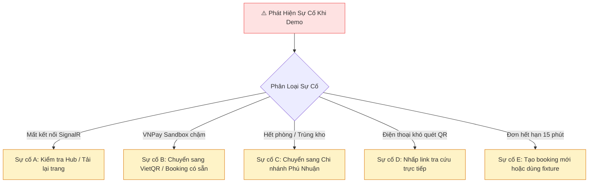

# PHƯƠNG ÁN XỬ LÝ SỰ CỐ TRÌNH DIỄN (T03 — DEMO TROUBLESHOOTING GUIDE)
## LuxeStay Cloud — Hotel SaaS Platform v2 (.NET 10 + Angular 22 Signals + PostgreSQL 17)

---

## 1. MỤC ĐÍCH & NGUYÊN TẮC ỨNG PHÓ SỰ CỐ TRỰC TIẾP

* **Mã tài liệu:** `T03-TROUBLESHOOTING`
* **Vị trí phụ trách:** Technical Demo Coordinator & Solutions Architect
* **Mục tiêu:** Cung cấp quy trình phản ứng nhanh chuẩn hóa (*Standard Operating Procedures - SOP*) cho người thuyết trình khi gặp phải các tình huống bất khả kháng trong buổi báo cáo trực tiếp (như mạng chập chờn, cổng thanh toán bên thứ ba phản hồi chậm, hoặc lỗi thiết bị).
* **Nguyên tắc cốt lõi của Người trình bày:**
  1. **Bình tĩnh & Minh bạch:** Tuyệt đối không làm giả dữ liệu, không nói dối hoặc giả vờ hệ thống đã nhận khi thực tế chưa nhận.
  2. **Giải thích chuyên môn:** Giải thích ngay cho Hội đồng dưới góc độ kỹ thuật (ví dụ: *"Cổng Sandbox của ngân hàng đang gặp độ trễ mạng..."*) và kích hoạt phương án dự phòng (*Fallback Plan*) đã chuẩn bị sẵn.
  3. **Bảo toàn thời gian 5 phút:** Không dừng lại quá 30 giây tại một bước gặp sự cố ngoại cảnh; chuyển ngay sang bước tiếp theo bằng dữ liệu mẫu dự phòng.

---

## 2. BẢNG MA TRẬN XỬ LÝ SỰ CỐ CHI TIẾT (INCIDENT RESPONSE MATRIX)

---

### SỰ CỐ A: SignalR WebSocket Bị Mất Kết Nối Hoặc Bị Ngắt
* **Biểu hiện:** Chuông thông báo trên màn hình PMS không reo, không thấy pop-up toast khi khách thanh toán thành công.
* **Nguyên nhân khả dĩ:**
  - Token JWT của Lễ tân hết hạn sau thời gian dài không thao tác.
  - Server Kestrel khởi động lại làm đứt kết nối socket cũ.
  - Bộ chuyển ngữ cảnh chi nhánh đang bị lệch so với PropertyId của đơn hàng.
* **Cách phát hiện nhanh:** Nhìn vào biểu tượng chuông: nếu có chấm đỏ báo mất kết nối hoặc Console báo `WebSocket closed`.
* **Xử lý kỹ thuật tức thời:**
  - Nhấn F5 trên màn hình Lễ tân (SignalR client tự động kết nối lại và gia nhập lại Property Channel).
  - Hoặc đăng nhập lại tài khoản `staff.single@hotelsaas.local`.
* **Lời thoại ứng biến của Người trình bày:**
  > *"Thưa Thầy, do phiên làm việc trên trình duyệt vừa được làm mới, em xin phép tải lại trang lễ tân. Ngay khi trang tải xong, cơ chế State Reconciliation qua HTTP API của hệ thống đã tự động đồng bộ đầy đủ các giao dịch mới nhất vào danh sách mà không làm thất lạc dữ liệu."*

---

### SỰ CỐ B: Cổng VNPay Sandbox Không Phản Hồi Hoặc Mạng Chậm
* **Biểu hiện:** Khách hàng bấm "Thanh toán ngay" nhưng trang cổng thanh toán VNPay xoay vòng hoặc không gửi callback IPN về máy chủ.
* **Nguyên nhân khả dĩ:** Máy chủ thử nghiệm Sandbox của VNPay bảo trì đột xuất hoặc đường truyền Internet tới VNPay bị nghẽn.
* **Xử lý kỹ thuật tức thời:**
  - Chuyển ngay sang phương thức **Chuyển khoản VietQR**.
  - Hoặc sử dụng một đơn đặt phòng mẫu đã được xác nhận thanh toán sẵn trong cơ sở dữ liệu (`RES-ZAPENN`).
* **Lời thoại ứng biến của Người trình bày:**
  > *"Thưa Thầy, cổng Sandbox thử nghiệm của VNPay hiện đang có độ trễ phản hồi từ phía đối tác thứ ba. Để đảm bảo đúng tiến độ báo cáo, em xin phép chuyển sang phương thức thanh toán VietQR với mã xác thực có sẵn của đơn RES-ZAPENN để tiếp tục minh họa luồng xử lý tiền sảnh."*

---

### SỰ CỐ C: Hạng Phòng Suite Bị Trùng Lịch Hoặc Hết Phòng Trống
* **Biểu hiện:** Khi tìm kiếm phòng tại chi nhánh Quận 1, hệ thống báo *"Hết phòng trong khoảng thời gian đã chọn"*.
* **Nguyên nhân khả dĩ:** Một bài test tự động trước đó đã tạo đơn chiếm giữ inventory của phòng `101` hoặc `201`.
* **Xử lý kỹ thuật tức thời:**
  - Chọn ngày lưu trú lùi lại 3 ngày (ví dụ: chuyển từ 15/11 sang 18/11).
  - Hoặc chuyển dropdown cơ sở sang **Grand Hotel Phú Nhuận** (nơi có sẵn 2 phòng Suite `301` và `401` luôn sạch sẽ).
* **Lời thoại ứng biến của Người trình bày:**
  > *"Hệ thống kiểm soát tồn kho phòng theo thời gian thực rất chặt chẽ. Do phòng tại cơ sở 1 vừa được ghi nhận đặt trước trong khoảng ngày này, em xin phép chuyển sang cơ sở Phú Nhuận để tiếp tục kịch bản đặt phòng hạng Suite."*

---

### SỰ CỐ D: Điện Thoại Không Quét Được Mã QR Trên Màn Hình Máy Chiếu
* **Biểu hiện:** Camera điện thoại của người thuyết trình bị lóa sáng do đèn máy chiếu, không nhận diện được mã QR trên phiếu Voucher.
* **Nguyên nhân khả dĩ:** Độ tương phản màn hình máy chiếu thấp hoặc góc nghiêng camera quá lớn.
* **Xử lý kỹ thuật tức thời:**
  - Phóng to phiếu in voucher bằng phím tắt `Ctrl + lăn chuột`.
  - Nếu vẫn không nhận, copy trực tiếp mã đặt phòng (`ConfirmationCode`) dán vào ô tìm kiếm của trang `/booking/lookup`.
* **Lời thoại ứng biến của Người trình bày:**
  > *"Do ánh sáng máy chiếu tại hội trường gây chói camera, em xin phép nhập trực tiếp mã đặt phòng RES-XXXXXX vào Cổng tra cứu điện tử của khách hàng để đối chiếu trạng thái vé."*

---

### SỰ CỐ E: Khách Hàng Thao Tác Chậm Khiến Đơn Hết Hạn Giữ Chỗ (Hold Expired)
* **Biểu hiện:** Người thuyết trình nói quá nhiều ở bước giải thích khiến bộ đếm 15 phút về 00:00, màn hình báo đơn đã hết hạn.
* **Nguyên nhân khả dĩ:** Thời gian giữ phòng TTL đã trôi qua.
* **Xử lý kỹ thuật tức thời:**
  - Tận dụng ngay sự cố này để biến thành màn trình diễn tính năng: **Cơ chế tự động giải phóng kho phòng của LuxeStay Cloud**!
  - Mở sơ đồ phòng cho Thầy thấy phòng đã tự động trả về trạng thái Khả dụng bán.
  - Bấm tạo nhanh một đơn mới trong 15 giây.
* **Lời thoại ứng biến của Người trình bày:**
  > *"Rất tuyệt vời thưa Thầy! Chiếc đồng hồ giữ phòng vừa hết hạn 15 phút và chúng ta đang được chứng kiến tính năng an toàn tự động của hệ thống: Đơn chưa thanh toán lập tức bị hủy và phòng được giải phóng ngay lập tức về kho trống để khách hàng khác có thể tiếp tục đặt."*

---

### SỰ CỐ F: Trình Duyệt Chặn Âm Thanh Thông Báo (Autoplay Audio Blocked)
* **Biểu hiện:** Chuông NotificationBell có nhảy số và có Toast xuất hiện nhưng không nghe thấy tiếng chuông `chime`.
* **Nguyên nhân khả dĩ:** Chính sách bảo mật Autoplay Policy của Google Chrome / Microsoft Edge chặn phát âm thanh khi người dùng chưa tương tác chuột với trang web sau khi mở tab mới.
* **Xử lý kỹ thuật tức thời:** Nhấp chuột một lần vào bất kỳ vị trí nào trên trang PMS để cấp quyền AudioContext cho trình duyệt.
* **Lời thoại ứng biến của Người trình bày:**
  > *"Trình duyệt Chrome áp dụng chính sách chặn tự động phát âm thanh khi chưa có tương tác người dùng. Tuy nhiên, quý Thầy có thể thấy rõ huy hiệu thông báo đã lập tức nhảy số 1 màu đỏ và thanh Toast đã xuất hiện ở góc phải màn hình."*

---

## 3. CHECKLIST SẴN SÀNG THIẾT BỊ TRƯỚC BUỔI BÁO CÁO (HARDWARE CHECKLIST)

1. [x] **Pin laptop:** Cắm sạc trực tiếp, không dùng chế độ tiết kiệm pin (Battery Saver) tránh bóp nghẽn CPU của Kestrel và Node.js.
2. [x] **Mạng Internet:** Sử dụng mạng dây LAN hoặc phát Wi-Fi 4G/5G cá nhân ổn định, hạn chế dùng Wi-Fi công cộng có cổng chặn WebSockets (Port 5283).
3. [x] **Độ phân giải màn hình:** Đặt màn hình ở độ phân giải tiêu chuẩn 1920x1080 (100% scale) để chia đôi hai cửa sổ trình duyệt cân đối, chữ không bị tràn dòng.
4. [x] **Điện thoại di động:** Kiểm tra camera hoạt động tốt, đã kết nối cùng mạng Wi-Fi và có sẵn trình duyệt web để sẵn sàng quét mã QR.
