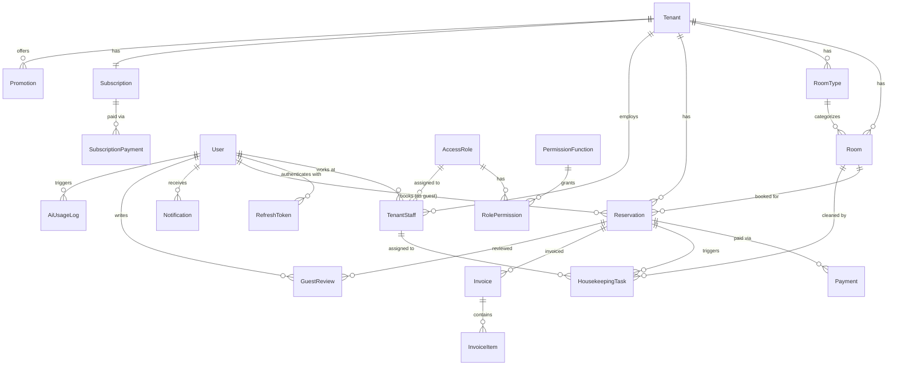
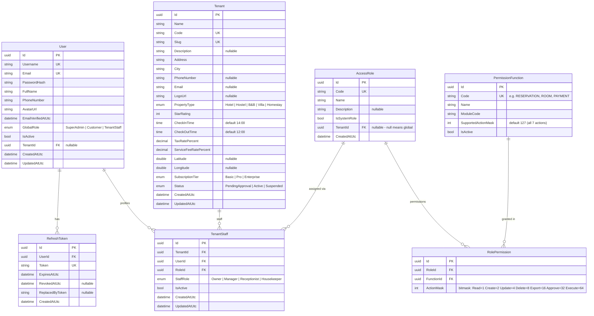
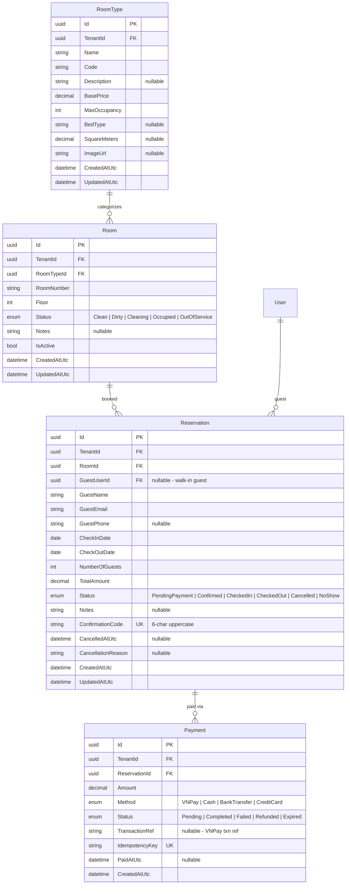
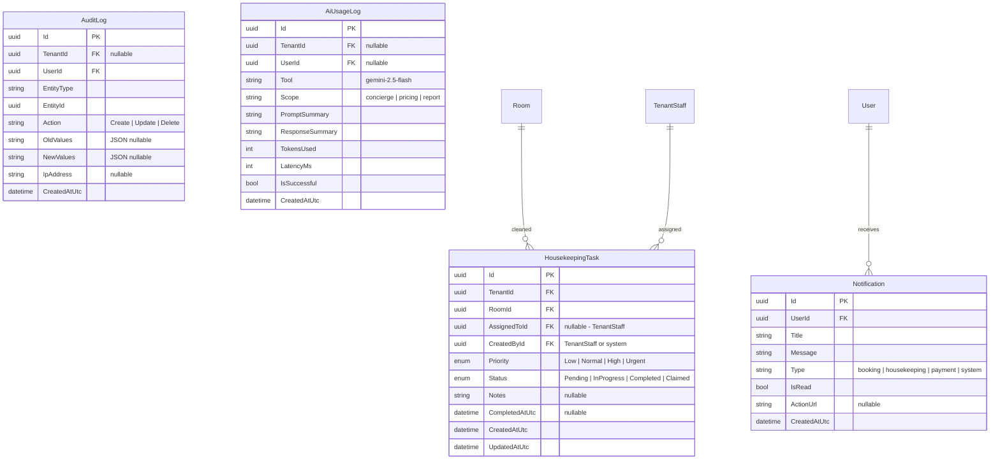

# 📊 Entity Relationship Diagram (ERD)

> **Tài liệu:** SDD-01 | **Phiên bản:** 1.0 | **Ngày:** 2026-10-03
> **Rubric mapping:** TC2.1 Mức 5 (≥4 loại sơ đồ — ERD là loại thứ 1)

---

## 1. ERD Tổng quan

---

## 2. ERD Module: Authentication & RBAC

---

## 3. ERD Module: Room & Reservation

---

## 4. ERD Module: Operations

---

## 6. Quan hệ tổng hợp

| Quan hệ | Kiểu | Mô tả |
|---------|------|-------|
| Tenant → Room | 1:N | Mỗi property có nhiều phòng |
| Tenant → RoomType | 1:N | Mỗi property có nhiều loại phòng |
| Tenant → TenantStaff | 1:N | Mỗi property có nhiều nhân viên |
| Tenant → Reservation | 1:N | Mỗi property có nhiều booking |
| RoomType → Room | 1:N | Mỗi loại phòng có nhiều phòng thực tế |
| Room → Reservation | 1:N | Mỗi phòng có nhiều booking (theo thời gian) |
| Reservation → Payment | 1:N | Mỗi booking có thể có nhiều payment attempts |
| User → TenantStaff | 1:N | 1 user có thể làm ở nhiều property |
| User → Reservation | 1:N | 1 guest có thể đặt nhiều booking |
| User → RefreshToken | 1:N | 1 user có nhiều refresh tokens (multi-device) |
| AccessRole → RolePermission | 1:N | 1 role có nhiều permissions |
| PermissionFunction → RolePermission | 1:N | 1 function được gán cho nhiều roles |
| AccessRole → TenantStaff | 1:N | 1 role được gán cho nhiều staff |
| Room → HousekeepingTask | 1:N | 1 phòng có nhiều task theo thời gian |
| Tenant → Subscription | 1:1 | Mỗi property có 1 subscription |
| Subscription → SubscriptionPayment | 1:N | Mỗi subscription có nhiều thanh toán |
| Reservation → Invoice | 1:N | Mỗi booking có thể có nhiều hóa đơn |
| Invoice → InvoiceItem | 1:N | Mỗi hóa đơn có nhiều line items |
| User → HousekeepingTask | 1:N | 1 user được gán nhiều task dọn phòng |
| User → Notification | 1:N | 1 user nhận nhiều thông báo |
| Tenant → Promotion | 1:N | Mỗi property có nhiều khuyến mãi |
| Reservation → GuestReview | 1:N | Mỗi booking có thể có đánh giá |
| User → GuestReview | 1:N | 1 khách viết nhiều đánh giá |
| User → AiUsageLog | 1:N | 1 user có nhiều AI usage logs |

---

## 7. Index Strategy

| Table | Index | Columns | Type | Lý do |
|-------|-------|---------|------|-------|
| Reservation | IX_Reservation_TenantId | TenantId | Non-clustered | Multi-tenant filter |
| Reservation | IX_Reservation_RoomId_Dates | RoomId, CheckInDate, CheckOutDate | Composite | Overlap check |
| Reservation | IX_Reservation_ConfirmCode | ConfirmationCode | Unique | Quick lookup |
| Room | IX_Room_TenantId_Status | TenantId, Status | Composite | Available rooms query |
| Payment | IX_Payment_IdempotencyKey | IdempotencyKey | Unique | Prevent duplicate |
| User | IX_User_Email | Email | Unique | Login lookup |
| TenantStaff | IX_Staff_TenantId_UserId | TenantId, UserId | Unique | Prevent duplicate staff |

---

*Tài liệu này chứa 5 ERD diagrams (tổng quan + 4 module), phục vụ TC2.1 Mức 5. Tổng 23 entities, 56 quan hệ.*

## 5. ERD — Payment, Subscription & Operations

```mermaid
erDiagram
    Subscription {
        uuid Id PK
        uuid TenantId FK "UK — one per tenant"
        enum Plan "Basic | Pro | Enterprise"
        enum Status "Trial | Active | PastDue | Cancelled | Expired"
        enum BillingCycle "Monthly | Yearly"
        date CurrentPeriodStart
        date CurrentPeriodEnd
        date TrialEndsAt "nullable"
        datetime CancelledAtUtc "nullable"
        datetime CreatedAtUtc
        datetime UpdatedAtUtc
    }

    SubscriptionPayment {
        uuid Id PK
        uuid SubscriptionId FK
        decimal Amount
        string Currency "default VND"
        enum Status "Pending | Completed | Failed | Refunded"
        enum Method "VNPay | BankTransfer | CreditCard"
        string TransactionRef "nullable"
        string IdempotencyKey UK
        date PeriodStart
        date PeriodEnd
        datetime PaidAtUtc "nullable"
        datetime CreatedAtUtc
    }

    Invoice {
        uuid Id PK
        uuid TenantId FK
        uuid ReservationId FK
        string InvoiceNumber UK "auto-generated"
        decimal SubTotal
        decimal TaxAmount
        decimal ServiceFeeAmount
        decimal TotalAmount
        enum Status "Draft | Issued | Paid | Void | Refunded"
        datetime IssuedAtUtc "nullable"
        datetime PaidAtUtc "nullable"
        string Notes "nullable"
        datetime CreatedAtUtc
        datetime UpdatedAtUtc
    }

    InvoiceItem {
        uuid Id PK
        uuid InvoiceId FK
        string Description
        int Quantity
        decimal UnitPrice
        decimal LineTotal
        string Category "RoomCharge | Minibar | Laundry | Tax | ServiceFee | Discount"
        int SortOrder
        datetime CreatedAtUtc
    }

    HousekeepingTask {
        uuid Id PK
        uuid TenantId FK
        uuid RoomId FK
        uuid AssignedToId FK "nullable — User (housekeeper)"
        uuid CreatedById FK "User (manager/system)"
        enum Priority "Low | Normal | High | Urgent"
        enum Status "Pending | InProgress | Completed | Claimed"
        string Notes "nullable"
        datetime CompletedAtUtc "nullable"
        datetime CreatedAtUtc
        datetime UpdatedAtUtc
    }

    Notification {
        uuid Id PK
        uuid UserId FK
        uuid TenantId FK "nullable"
        string Title
        string Message
        enum Type "Booking | Housekeeping | Payment | Subscription | Review | System"
        bool IsRead
        string ActionUrl "nullable"
        datetime ReadAtUtc "nullable"
        datetime CreatedAtUtc
    }

    Promotion {
        uuid Id PK
        uuid TenantId FK
        string Code UK "per tenant"
        string Name
        string Description "nullable"
        enum PromotionType "Percentage | FixedAmount | FreeNight"
        decimal DiscountValue
        decimal MinOrderAmount "nullable"
        int MaxUsageCount "nullable"
        int CurrentUsageCount "default 0"
        date ValidFrom
        date ValidTo
        bool IsActive
        datetime CreatedAtUtc
        datetime UpdatedAtUtc
    }

    GuestReview {
        uuid Id PK
        uuid TenantId FK
        uuid ReservationId FK
        uuid UserId FK "guest user"
        int Rating "1-5"
        string Comment "nullable"
        string OwnerReply "nullable"
        datetime RepliedAtUtc "nullable"
        bool IsPublished
        datetime CreatedAtUtc
        datetime UpdatedAtUtc
    }

    AiUsageLog {
        uuid Id PK
        uuid TenantId FK "nullable"
        uuid UserId FK "nullable"
        string Tool "gemini-2.5-flash"
        string Scope "concierge | pricing | report"
        string PromptSummary
        string ResponseSummary
        int TokensUsed
        int LatencyMs
        bool IsSuccessful
        datetime CreatedAtUtc
    }

    %% Relationships
    Tenant ||--|| Subscription : "has"
    Subscription ||--o{ SubscriptionPayment : "paid via"
    Reservation ||--o{ Invoice : "invoiced"
    Invoice ||--o{ InvoiceItem : "contains"
    Room ||--o{ HousekeepingTask : "cleaned"
    User ||--o{ HousekeepingTask : "assigned to"
    User ||--o{ Notification : "receives"
    Tenant ||--o{ Promotion : "offers"
    Reservation ||--o{ GuestReview : "reviewed"
    User ||--o{ GuestReview : "writes"
    User ||--o{ AiUsageLog : "triggers"
```

