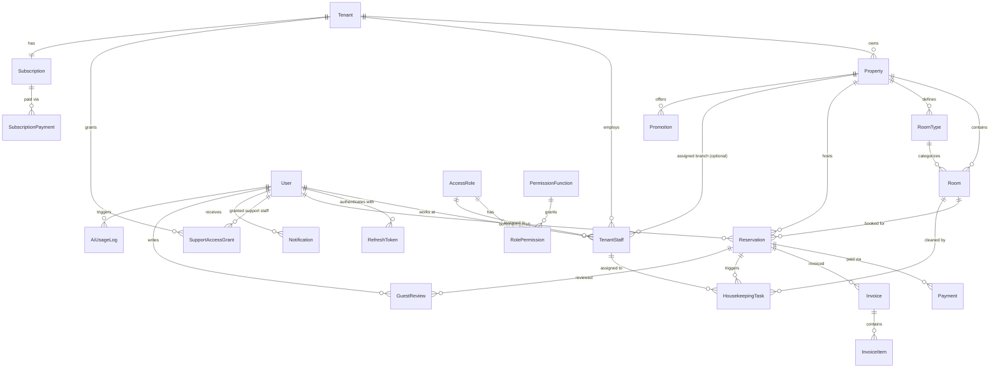
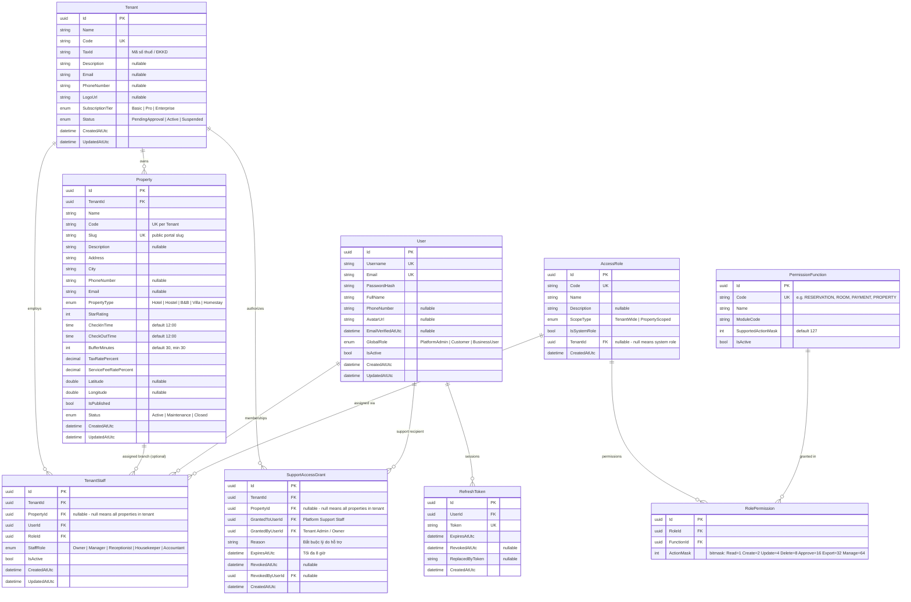
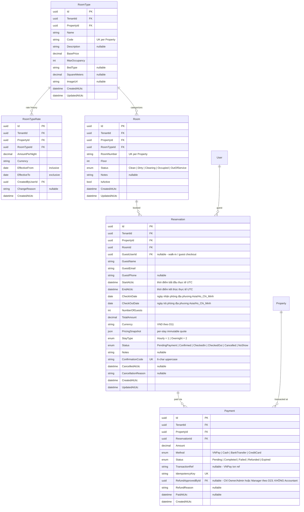
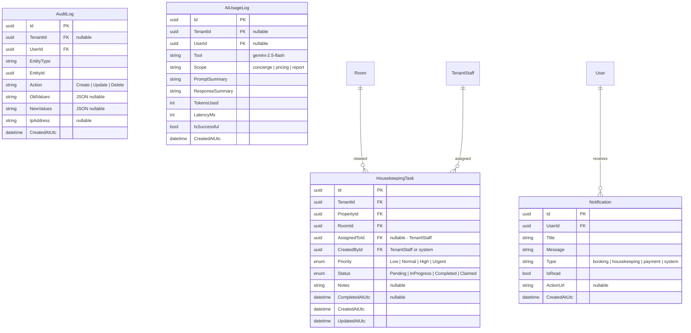

# 📊 Entity Relationship Diagram (ERD)

> **Tài liệu:** SDD-01 | **Phiên bản:** 1.0 | **Ngày:** 2026-10-03
> **Rubric mapping:** TC2.1 Mức 5 (≥4 loại sơ đồ — ERD là loại thứ 1)

---

## 1. ERD Tổng quan

---

## 2. ERD Module: Doanh nghiệp, Chi nhánh & RBAC

---

## 3. ERD Module: Phòng & Đặt phòng (Property-Scoped)

---

## 4. ERD Module: Operations

---

## 6. Quan hệ tổng hợp

| Quan hệ | Kiểu | Mô tả |
|---------|------|-------|
| Tenant → Property | 1:N | Doanh nghiệp sở hữu 1 hoặc nhiều chi nhánh (khách sạn độc lập có đúng 1 chi nhánh) |
| Property → RoomType | 1:N | Chi nhánh định nghĩa danh mục các loại phòng riêng biệt |
| Property → Room | 1:N | Chi nhánh quản lý các phòng vật lý cụ thể |
| Property → Reservation | 1:N | Chi nhánh tiếp nhận và phục vụ các đơn đặt phòng |
| Property → Payment | 1:N | Giao dịch thanh toán phát sinh và hạch toán tại chi nhánh |
| Property → Invoice | 1:N | Hóa đơn lưu trú phát hành gắn với chi nhánh |
| Property → HousekeepingTask | 1:N | Công việc buồng phòng thực hiện tại chi nhánh |
| Tenant → TenantStaff | 1:N | Doanh nghiệp quản lý hồ sơ nhân sự (Tenant-wide hoặc gán chi nhánh) |
| Property → TenantStaff | 1:N | Chi nhánh tiếp nhận nhân sự được phân công cụ thể (`PropertyId != null`) |
| Tenant → SupportAccessGrant | 1:N | Doanh nghiệp cấp quyền hỗ trợ kỹ thuật có thời hạn |
| RoomType → Room | 1:N | Mỗi loại phòng có nhiều phòng thực tế |
| Room → Reservation | 1:N | Mỗi phòng có nhiều booking theo các mốc thời gian |
| Reservation → Payment | 1:N | Mỗi booking có thể có nhiều lượt thanh toán/cọc/hoàn tiền |
| User → TenantStaff | 1:N | 1 user có thể tham gia nhiều chi nhánh hoặc doanh nghiệp khác nhau |
| User → Reservation | 1:N | 1 khách hàng có thể đặt nhiều đơn đặt phòng |
| User → RefreshToken | 1:N | 1 user có nhiều refresh tokens (đa thiết bị, bảo mật cao) |
| AccessRole → RolePermission | 1:N | 1 role có nhiều permissions qua bitmask |
| PermissionFunction → RolePermission | 1:N | 1 function được phân quyền trong nhiều roles |
| AccessRole → TenantStaff | 1:N | 1 role được gán cho nhân sự |
| Room → HousekeepingTask | 1:N | 1 phòng có nhiều task dọn dẹp theo thời gian |
| Tenant → Subscription | 1:1 | Mỗi doanh nghiệp duy trì 1 gói cước SaaS |
| Subscription → SubscriptionPayment | 1:N | Mỗi gói cước có lịch sử thanh toán định kỳ |
| Reservation → Invoice | 1:N | Mỗi booking có thể xuất hóa đơn tương ứng |
| Invoice → InvoiceItem | 1:N | Mỗi hóa đơn có nhiều dòng mục chi phí |
| User → HousekeepingTask | 1:N | Nhân viên buồng phòng được phân công task |
| User → Notification | 1:N | Người dùng nhận các thông báo riêng tư |
| Tenant → Promotion | 1:N | Doanh nghiệp thiết lập các chương trình khuyến mãi |
| Reservation → GuestReview | 1:N | Khách hàng đánh giá sau khi trả phòng |
| User → GuestReview | 1:N | Người dùng viết đánh giá |
| User → AiUsageLog | 1:N | Ghi nhận telemetry sử dụng AI (nặc danh hóa PII) |

---

## 7. Index Strategy

> Đây là danh sách thiết kế ban đầu cần đối chiếu với truy vấn thật và `EXPLAIN (ANALYZE, BUFFERS)`. Tạo index qua migration, đo cả tốc độ đọc lẫn chi phí ghi; không thêm index trùng hoặc index chưa có truy vấn cần dùng.

| Table | Index | Columns | Type | Lý do |
|-------|-------|---------|------|-------|
| Reservation | IX_Reservation_TenantId | TenantId | B-tree | Multi-tenant filter |
| Reservation | IX_Reservation_RoomId_Dates | TenantId, RoomId, CheckInDate, CheckOutDate | Composite | Overlap/availability lookup |
| Reservation | UX_Reservation_ConfirmCode | ConfirmationCode | Unique | Tra cứu mã xác nhận (global theo rule hiện tại) |
| Reservation | IX_Reservation_Property_Status_CheckIn | PropertyId, Status, StartAtUtc | Composite | Tra cứu booking theo chi nhánh & thời gian |
| Reservation | IX_Reservation_Tenant_CreatedAt | TenantId, CreatedAtUtc | Composite | Lọc booking cấp doanh nghiệp theo thời gian |
| Room | IX_Room_Property_Status | PropertyId, Status | Composite | Available rooms query theo chi nhánh |
| Room | IX_Room_Property_RoomType_Active | PropertyId, RoomTypeId, IsActive | Composite | Inventory theo loại phòng tại chi nhánh |
| RoomTypeRate | IX_RoomTypeRate_Tenant_RoomType_Effective | TenantId, RoomTypeId, EffectiveFrom, EffectiveTo | Composite | Tìm giá áp dụng theo khoảng lưu trú |
| Tenant | UX_Tenant_Slug | Slug | Unique | Public tenant lookup |
| Property | UX_Property_TenantId_Code | TenantId, Code | Unique | Mã chi nhánh duy nhất trong doanh nghiệp |
| Property | UX_Property_Slug | Slug | Unique | Public property lookup |
| Tenant | IX_Tenant_PublicCatalog | Status, IsPublished, City | Composite/partial candidate | Public catalog; xác nhận với query plan |
| Payment | UX_Payment_IdempotencyKey | IdempotencyKey | Unique | Prevent duplicate |
| User | UX_User_Email | Email | Unique | Login lookup |
| TenantStaff | uq_tenant_staff_tenant_wide | TenantId, UserId (WHERE PropertyId IS NULL) | Partial Unique | Mỗi user tối đa 1 vai trò Tenant-wide trên 1 doanh nghiệp |
| TenantStaff | uq_tenant_staff_property_scoped | TenantId, UserId, PropertyId (WHERE PropertyId IS NOT NULL) | Partial Unique | Mỗi user tối đa 1 vai trò trên mỗi chi nhánh cụ thể |
| SupportAccessGrant | IX_SupportGrant_ActiveLookup | TenantId, GrantedToUserId, ExpiresAtUtc, RevokedAtUtc | Composite | Tra cứu thẩm định quyền hỗ trợ realtime |

Đối với tìm kiếm tiếng Việt không dấu và truy vấn bán kính, chọn index riêng sau khi xác định provider/dữ liệu và đo query. B-tree thông thường không thay thế full-text hoặc spatial indexing.

### Partitioning decision

- MVP: không partition; chưa có volume/latency evidence để bù chi phí vận hành, migration và constraint phức tạp.
- Revisit khi có số liệu tăng trưởng, kích thước bảng, tỉ lệ ghi/đọc, retention và query plans. Audit/event/notification/payment theo thời gian là các ứng viên để đánh giá.
- Không partition `Reservation` theo ngày tạo/check-in nếu chưa giải quyết unique confirmation code, FK từ payment/invoice/review, overlap booking và yêu cầu partition key cho các truy vấn.
- Nếu partition được duyệt, ADR phải nêu key/granularity, pruning, unique/FK constraints, retention, migration/backfill, rollback và giám sát.

---

*Tài liệu này chứa 5 ERD diagrams (tổng quan + 4 module), phục vụ TC2.1 Mức 5. Tổng 23 entities, 56 quan hệ.*

## 5. ERD — Payment, Subscription & Operations

```mermaid
erDiagram
    Subscription {
        uuid Id PK
        uuid TenantId FK "UK — one per tenant"
        enum Plan "Basic | Pro | Enterprise"
        enum Status "Trial | Active | PastDue | Cancelled | Expired"
        enum BillingCycle "Monthly | Yearly"
        date CurrentPeriodStart
        date CurrentPeriodEnd
        date TrialEndsAt "nullable"
        datetime CancelledAtUtc "nullable"
        datetime CreatedAtUtc
        datetime UpdatedAtUtc
    }

    SubscriptionPayment {
        uuid Id PK
        uuid SubscriptionId FK
        decimal Amount
        string Currency "default VND"
        enum Status "Pending | Completed | Failed | Refunded"
        enum Method "VNPay | BankTransfer | CreditCard"
        string TransactionRef "nullable"
        string IdempotencyKey UK
        date PeriodStart
        date PeriodEnd
        datetime PaidAtUtc "nullable"
        datetime CreatedAtUtc
    }

    Invoice {
        uuid Id PK
        uuid TenantId FK
        uuid PropertyId FK
        uuid ReservationId FK
        string InvoiceNumber UK "auto-generated"
        decimal SubTotal
        decimal TaxAmount
        decimal ServiceFeeAmount
        decimal TotalAmount
        enum Status "Draft | Issued | Paid | Void | Refunded"
        datetime IssuedAtUtc "nullable"
        datetime PaidAtUtc "nullable"
        string Notes "nullable"
        datetime CreatedAtUtc
        datetime UpdatedAtUtc
    }

    InvoiceItem {
        uuid Id PK
        uuid InvoiceId FK
        string Description
        int Quantity
        decimal UnitPrice
        decimal LineTotal
        string Category "RoomCharge | Minibar | Laundry | Tax | ServiceFee | Discount"
        int SortOrder
        datetime CreatedAtUtc
    }

    HousekeepingTask {
        uuid Id PK
        uuid TenantId FK
        uuid RoomId FK
        uuid AssignedToId FK "nullable — User (housekeeper)"
        uuid CreatedById FK "User (manager/system)"
        enum Priority "Low | Normal | High | Urgent"
        enum Status "Pending | InProgress | Completed | Claimed"
        string Notes "nullable"
        datetime CompletedAtUtc "nullable"
        datetime CreatedAtUtc
        datetime UpdatedAtUtc
    }

    Notification {
        uuid Id PK
        uuid UserId FK
        uuid TenantId FK "nullable"
        string Title
        string Message
        enum Type "Booking | Housekeeping | Payment | Subscription | Review | System"
        bool IsRead
        string ActionUrl "nullable"
        datetime ReadAtUtc "nullable"
        datetime CreatedAtUtc
    }

    Promotion {
        uuid Id PK
        uuid TenantId FK
        string Code UK "per tenant"
        string Name
        string Description "nullable"
        enum PromotionType "Percentage | FixedAmount | FreeNight"
        decimal DiscountValue
        decimal MinOrderAmount "nullable"
        int MaxUsageCount "nullable"
        int CurrentUsageCount "default 0"
        date ValidFrom
        date ValidTo
        bool IsActive
        datetime CreatedAtUtc
        datetime UpdatedAtUtc
    }

    GuestReview {
        uuid Id PK
        uuid TenantId FK
        uuid ReservationId FK
        uuid UserId FK "guest user"
        int Rating "1-5"
        string Comment "nullable"
        string OwnerReply "nullable"
        datetime RepliedAtUtc "nullable"
        bool IsPublished
        datetime CreatedAtUtc
        datetime UpdatedAtUtc
    }

    AiUsageLog {
        uuid Id PK
        uuid TenantId FK "nullable"
        uuid UserId FK "nullable"
        string Tool "gemini-2.5-flash"
        string Scope "concierge | pricing | report"
        string PromptSummary
        string ResponseSummary
        int TokensUsed
        int LatencyMs
        bool IsSuccessful
        datetime CreatedAtUtc
    }

    %% Relationships
    Tenant ||--|| Subscription : "has"
    Subscription ||--o{ SubscriptionPayment : "paid via"
    Reservation ||--o{ Invoice : "invoiced"
    Invoice ||--o{ InvoiceItem : "contains"
    Room ||--o{ HousekeepingTask : "cleaned"
    User ||--o{ HousekeepingTask : "assigned to"
    User ||--o{ Notification : "receives"
    Tenant ||--o{ Promotion : "offers"
    Reservation ||--o{ GuestReview : "reviewed"
    User ||--o{ GuestReview : "writes"
    User ||--o{ AiUsageLog : "triggers"
```

