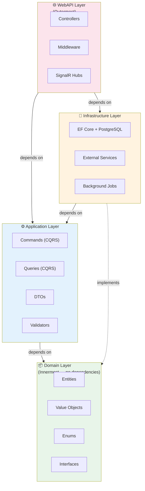
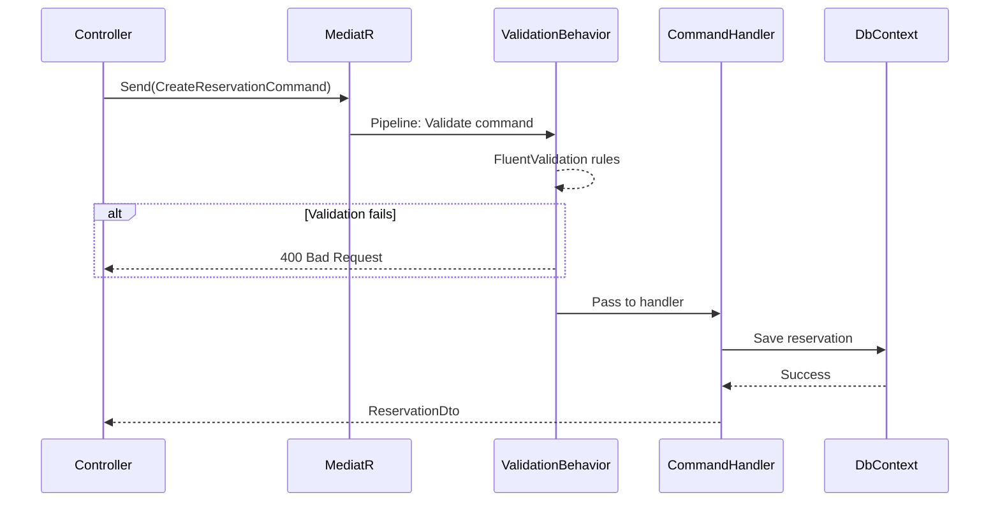

# 🏛️ Architecture Overview & Technology Justification

> **Tài liệu:** SDD-02 | **Phiên bản:** 1.0 | **Ngày:** 2026-10-03
> **Rubric mapping:** TC2.1 Mức 5 (giải thích phương án đã cân nhắc)

---

## Cập nhật phạm vi 2026-10-05

Lộ trình thực hiện hiện hành: [implementation-phases.md](../implementation-phases.md). Tenant được định hướng là doanh nghiệp, Property là chi nhánh; thuê giờ/đêm dùng chung lịch phòng theo thời điểm; nội bộ và online dùng chung tồn/hold; AI tìm phòng nằm trong MVP ở P6. Giữ modular monolith và stack hiện có. Các mô tả catalog-first, tenant=cơ sở hoặc AI chỉ sau MVP bên dưới là thiết kế trước đó, cần đồng bộ ở P0 trước triển khai; không dùng chúng để ghi đè phạm vi mới. Migration phải bảo toàn dữ liệu hiện có, và mọi phase cần evidence nghiệm thu.

## 1. Clean Architecture — Tại sao?

### Các phương án đã cân nhắc

| Kiến trúc | Ưu điểm | Nhược điểm | Quyết định |
|----------|---------|-----------|-----------|
| **Clean Architecture (4 layers)** | Tách biệt concerns rõ ràng, testable, domain-centric | Nhiều project/folder hơn, boilerplate | ✅ **CHỌN** |
| N-Layer (3 tiers) | Đơn giản, ít code | Domain logic lẫn infrastructure | ❌ |
| Vertical Slice | Feature-centric, ít coupling | Khó enforce consistency, unfamiliar | ❌ |
| Microservices | Scale tốt, tech diversity | Quá phức tạp cho đồ án, ops overhead | ❌ |

### Lý do chọn Clean Architecture

**Dependency Rule:** Dependencies chỉ đi vào trong (API → Application → Domain). Infrastructure implements interfaces của Domain/Application — **không** phụ thuộc ngược.

---

## 2. CQRS + MediatR — Tại sao?

| Phương án | Ưu điểm | Nhược điểm | Quyết định |
|----------|---------|-----------|-----------|
| **CQRS + MediatR** | Tách read/write, pipeline behaviors (validation, logging), thin controllers | Learning curve, boilerplate | ✅ **CHỌN** |
| Service Layer (truyền thống) | Đơn giản, quen thuộc | Fat services, khó test riêng | ❌ |
| Repository + Unit of Work | Abstraction tốt | Thêm layer không cần (EF Core đã là UoW) | ❌ |

### Flow: Controller → MediatR → Handler

---

## 3. Technology Justification — Bảng so sánh đầy đủ

| Thành phần | **Chọn** | Thay thế 1 | Thay thế 2 | Lý do chọn |
|-----------|---------|-----------|-----------|-----------|
| Backend | **.NET 10** | Spring Boot | NestJS | Type-safe, hiệu năng, EF Core mạnh, đề tài yêu cầu |
| Frontend | **Angular 22** | React 19 | Vue 3 | DI system, built-in routing/forms/i18n, enterprise SPA, đề tài yêu cầu |
| Database | **PostgreSQL 17** | SQL Server Express | MySQL 8 | Free mọi feature, JSONB, free hosting (Supabase/Neon), Docker nhẹ |
| ORM | **EF Core 10** | Dapper | Raw SQL | Code-first, Global Query Filter (multi-tenant), LINQ, migrations |
| CQRS | **MediatR 14** | Custom mediator | No CQRS | Mature, pipeline behaviors, thin controllers |
| Validation | **FluentValidation 12** | Data Annotations | Custom | Fluent API, testable, complex rules |
| Auth | **JWT + Refresh Token** | Cookie session | Keycloak | Stateless, SPA-friendly, simple, đã proven |
| RBAC | **Custom Bitmask** | ASP.NET Identity Roles | Casbin | O(1) check, tenant-scoped, linh hoạt |
| Realtime | **SignalR** | Socket.io | SSE | Native .NET, auto-reconnect, Hub pattern |
| UI Library | **PrimeNG 21** | Angular Material | Tailwind UI | 90+ components, theming, enterprise-grade |
| Charts | **Chart.js** | D3.js | ApexCharts | Đơn giản, đẹp, có Angular wrapper |
| Maps | **Chưa chốt** | Có thể đánh giá Leaflet cùng nguồn tile phù hợp, Google Maps, Mapbox và lựa chọn khác | — | Chọn sau khi kiểm tra bao phủ Việt Nam, địa giới/địa danh, quota và chi phí, giấy phép/attribution, privacy và điều kiện vận hành. Không coi thư viện hiển thị bản đồ là nguồn geocoding/tìm kiếm địa chỉ. |
| i18n | **ngx-translate** | Angular i18n | Transloco | Runtime switching, JSON files, dễ dùng |
| Testing BE | **xUnit** | NUnit | MSTest | .NET standard, fixture-based, assertive |
| Testing FE | **Playwright** | Cypress | Selenium | Cross-browser, auto-wait, codegen, Microsoft |
| CI/CD | **GitHub Actions** | GitLab CI | Jenkins | Free, native GitHub, marketplace |
| Container | **Docker Compose** | Podman | K8s | Đơn giản, phù hợp team nhỏ |
| Logging | **Serilog → Seq** | NLog | log4net | Structured logging, rich UI, .NET standard |
| AI | **Gemini API** | OpenAI GPT | Claude API | Free tier generous, multimodal, Google ecosystem |

---

## 4. Multi-tenant Strategy

| Strategy | Ưu điểm | Nhược điểm | Quyết định |
|----------|---------|-----------|-----------|
| **Shared DB + Shared Schema** | Đơn giản, cost-effective, 1 deployment | Data isolation qua code | ✅ **CHỌN** |
| Shared DB + Separate Schema | Isolation tốt hơn | Migration phức tạp | ❌ |
| Separate DB per Tenant | Isolation tốt nhất | Cost cao, ops phức tạp | ❌ |

**Implementation:** EF Core Global Query Filters tự động append `WHERE TenantId = @current` cho mọi query trên ITenantScopedEntity.

### Public catalog và tìm kiếm địa lý tại Việt Nam (định hướng MVP)

- Tenant vẫn là ranh giới sở hữu dữ liệu vận hành; guest search là luồng public cross-tenant có chủ đích, chỉ đọc các tenant đang hoạt động và property đã xuất bản.
- Tạo public projection/DTO giới hạn các trường được công khai. Không tắt tenant filter tổng quát để phục vụ search; phải có query riêng có điều kiện trạng thái/công khai.
- Địa chỉ lưu các trường hiển thị (tỉnh/thành, phường/xã nếu có, địa chỉ chi tiết), vĩ độ/kinh độ do owner xác nhận. Chưa phụ thuộc vào một nhà cung cấp địa giới/geocoding cụ thể.
- Bản đồ và danh sách dùng chung kết quả tìm kiếm. Search theo địa danh/địa chỉ là chính; truy vấn bán kính và định vị thiết bị tùy chọn, có đồng ý của guest.
- Chưa thêm GIS extension hoặc dịch vụ tìm kiếm chuyên biệt trước khi có nhu cầu/đo hiệu năng. Bắt đầu bằng PostgreSQL và truy vấn theo tỉnh/thành, từ khóa, tọa độ; đánh giá truy vấn địa lý chuyên dụng sau khi có dữ liệu mẫu và yêu cầu latency.
- Tạo index theo workload MVP và đo bằng query plan; không bật partitioning chỉ vì dự đoán scale. Revisit khi có số liệu dung lượng, tăng trưởng, latency và retention; xem chi tiết trong ERD Index Strategy.
- Agent tìm chỗ ở nằm sau MVP; agent chuẩn hóa yêu cầu thành filter và gọi search contract hiện có, không tự quyết định availability/price.

---

## 5. ADR (Architecture Decision Records)

### ADR-001: Clean Architecture

| Mục | Nội dung |
|-----|---------|
| **Status** | Accepted |
| **Context** | Cần kiến trúc tách biệt business logic khỏi infrastructure |
| **Decision** | Áp dụng Clean Architecture 4 layers: Domain → Application → Infrastructure → WebAPI |
| **Consequences** | (+) Testable, maintainable, domain-centric. (−) Nhiều project, boilerplate |

### ADR-002: PostgreSQL over SQL Server

| Mục | Nội dung |
|-----|---------|
| **Status** | Accepted |
| **Context** | Cần database cho staging deploy miễn phí, Docker CI nhanh |
| **Decision** | PostgreSQL 17 qua Npgsql provider |
| **Consequences** | (+) Free hosting (Supabase), Docker nhẹ 200MB, JSONB. (−) Team cần học pgAdmin |

### ADR-003: Bitmask RBAC

| Mục | Nội dung |
|-----|---------|
| **Status** | Accepted |
| **Context** | Cần RBAC linh hoạt, tenant-scoped, hiệu năng cao |
| **Decision** | Custom bitmask permissions (14 functions × 7 actions = int mask) |
| **Consequences** | (+) O(1) check, tùy biến, proven từ v1. (−) Custom code, không dùng Identity Roles |

### ADR-004: CQRS + MediatR

| Mục | Nội dung |
|-----|---------|
| **Status** | Accepted |
| **Context** | Controllers v1 quá fat, business logic trong controller |
| **Decision** | MediatR cho CQRS pattern, 1 handler per use case |
| **Consequences** | (+) Thin controllers, testable, pipeline behaviors. (−) Boilerplate, learning curve |

### ADR-005: Gemini API for AI

| Mục | Nội dung |
|-----|---------|
| **Status** | Accepted |
| **Context** | Cần AI cho chatbot + dynamic pricing, budget hạn chế |
| **Decision** | Gemini 2.5 Flash qua google-genai SDK |
| **Consequences** | (+) Free tier generous, function calling, multimodal. (−) Google dependency |

---

*Tài liệu này phục vụ TC2.1 Mức 5 (giải thích phương án đã cân nhắc) + 5 ADR records.*
