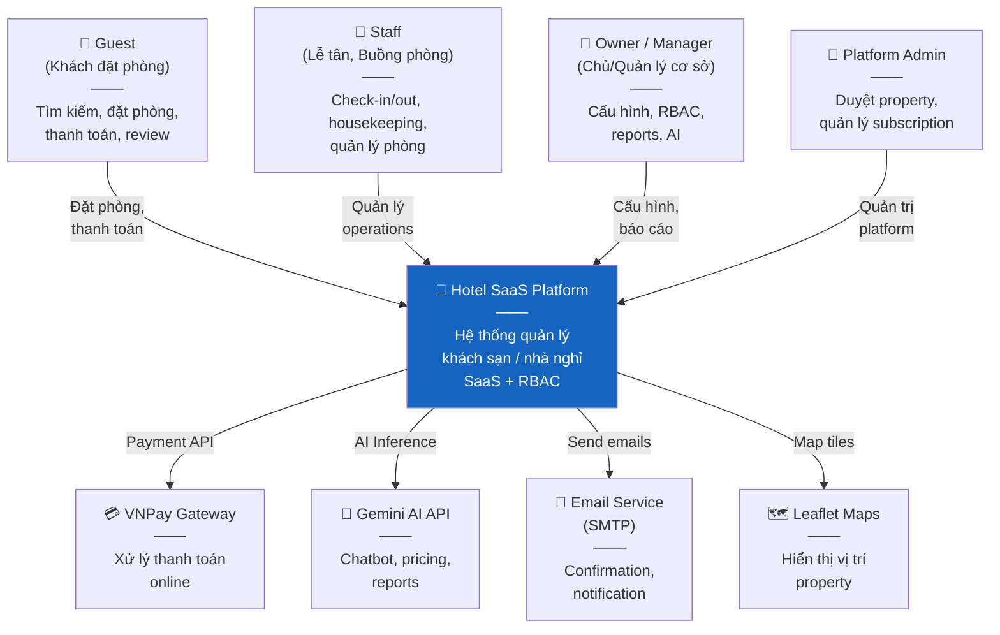
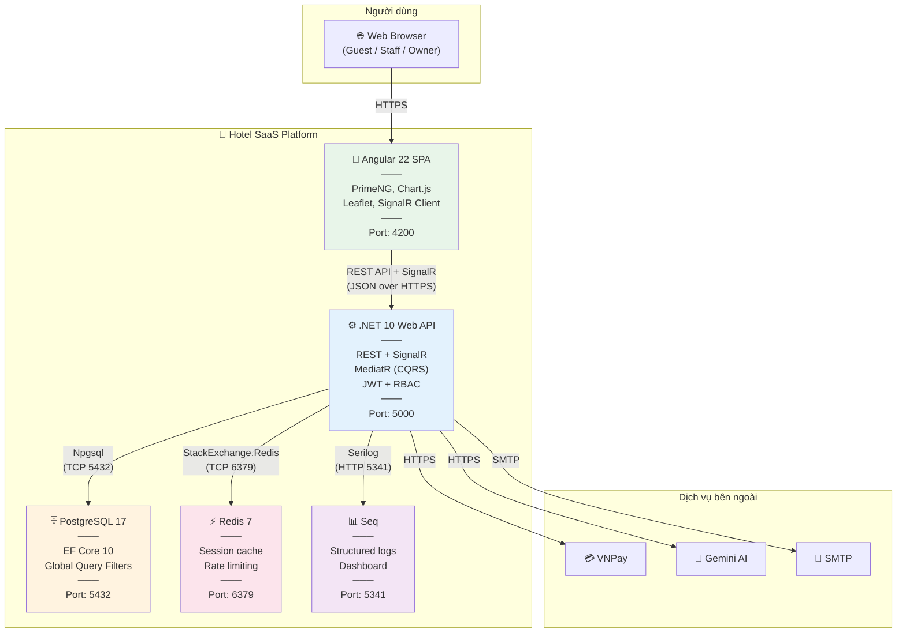
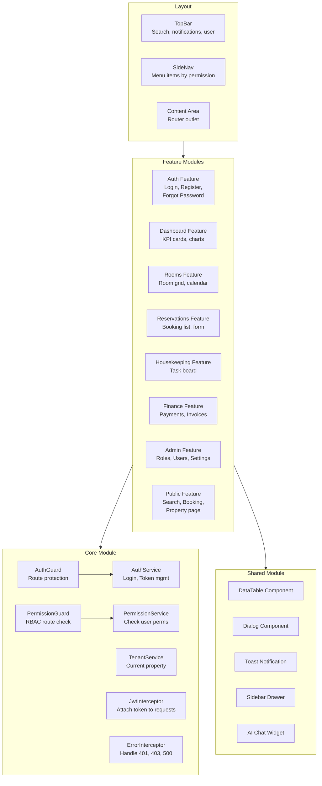

# 📐 C4 Model Diagrams

> **Tài liệu:** SDD-03 | **Phiên bản:** 1.0 | **Ngày:** 2026-10-03
> **Rubric mapping:** TC2.1 Mức 5 (context + component diagram)
> **Loại sơ đồ:** Context Diagram, Container Diagram, Component Diagram

---

## Level 1: System Context Diagram

> Ai tương tác với hệ thống? Hệ thống tích hợp với cái gì?

---

## Level 2: Container Diagram

> Hệ thống gồm những container (process/deployment unit) nào?

---

## Level 3: Component Diagram — API (bên trong .NET 10 Web API)

> Bên trong API container có những component nào?

```mermaid
flowchart TD
    subgraph WebAPI["🌐 WebAPI Layer"]
        AuthCtrl["AuthController<br/>Login, Register,<br/>Refresh, Logout"]
        RoomCtrl["RoomController<br/>CRUD Rooms,<br/>Room Status"]
        ResCtrl["ReservationController<br/>CRUD Bookings,<br/>Check-in/out"]
        PayCtrl["PaymentController<br/>VNPay, Cash,<br/>Refund"]
        HKCtrl["HousekeepingController<br/>Tasks CRUD"]
        ReportCtrl["ReportController<br/>Revenue, Analytics"]
        AICtrl["AiController<br/>Chatbot, Pricing"]
        AdminCtrl["AdminController<br/>Platform mgmt"]

        MW["Middleware Pipeline"]
        MW --> TenantMW["TenantMiddleware<br/>Extract TenantId"]
        MW --> AuthMW["JwtBearerAuth<br/>Validate token"]
        MW --> RBACHandler["PermissionHandler<br/>Bitmask check"]
        MW --> ErrMW["ErrorHandling<br/>Global exception"]

        Hubs["SignalR Hubs"]
        Hubs --> RoomHub["RoomStatusHub<br/>Broadcast changes"]
        Hubs --> NotifHub["NotificationHub<br/>Push notifications"]
    end

    subgraph Application["⚙️ Application Layer"]
        AuthHandlers["Auth Handlers<br/>RegisterCommand<br/>LoginQuery"]
        RoomHandlers["Room Handlers<br/>CreateRoomCommand<br/>GetRoomsQuery"]
        ResHandlers["Reservation Handlers<br/>CreateBookingCommand<br/>CheckInCommand"]
        PayHandlers["Payment Handlers<br/>ProcessPaymentCommand<br/>VNPayCallbackCommand"]
        HKHandlers["Housekeeping Handlers<br/>CreateTaskCommand<br/>CompleteTaskCommand"]
        Validators["FluentValidation<br/>Validators"]
    end

    subgraph Infra["🔧 Infrastructure Layer"]
        DbCtx["ApplicationDbContext<br/>EF Core 10<br/>Global Query Filters"]
        TenantSvc["CurrentTenantService"]
        EmailSvc["EmailService"]
        AISvc["GeminiAiService"]
        VNPaySvc["VNPayService"]
        BgJobs["Background Workers<br/>BookingHoldCleanup<br/>NotificationRetention"]
    end

    AuthCtrl --> AuthHandlers
    RoomCtrl --> RoomHandlers
    ResCtrl --> ResHandlers
    PayCtrl --> PayHandlers
    HKCtrl --> HKHandlers

    AuthHandlers --> DbCtx
    RoomHandlers --> DbCtx
    ResHandlers --> DbCtx
    PayHandlers --> VNPaySvc
    HKHandlers --> DbCtx

    ResHandlers --> RoomHub
    AISvc --> Gemini["🤖 Gemini API"]

    style WebAPI fill:#fce4ec
    style Application fill:#e3f2fd
    style Infra fill:#fff3e0
```

---

## Level 3: Component Diagram — Frontend (bên trong Angular 22 SPA)

---

*Tài liệu này chứa 4 C4 diagrams (Context + Container + 2 Component), phục vụ TC2.1 Mức 5.*
