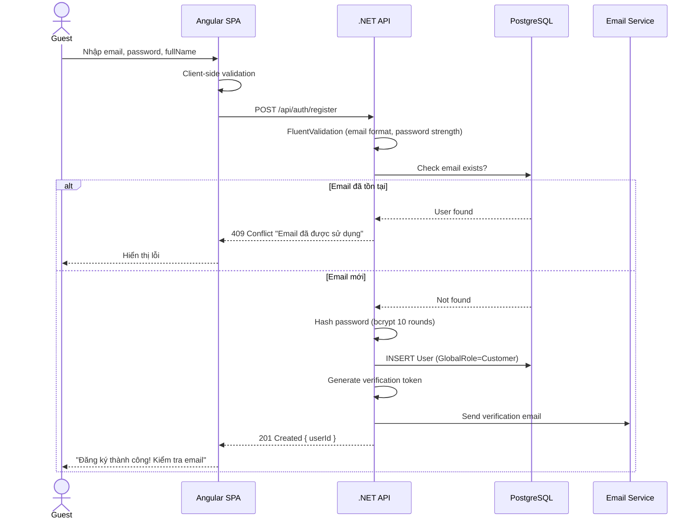
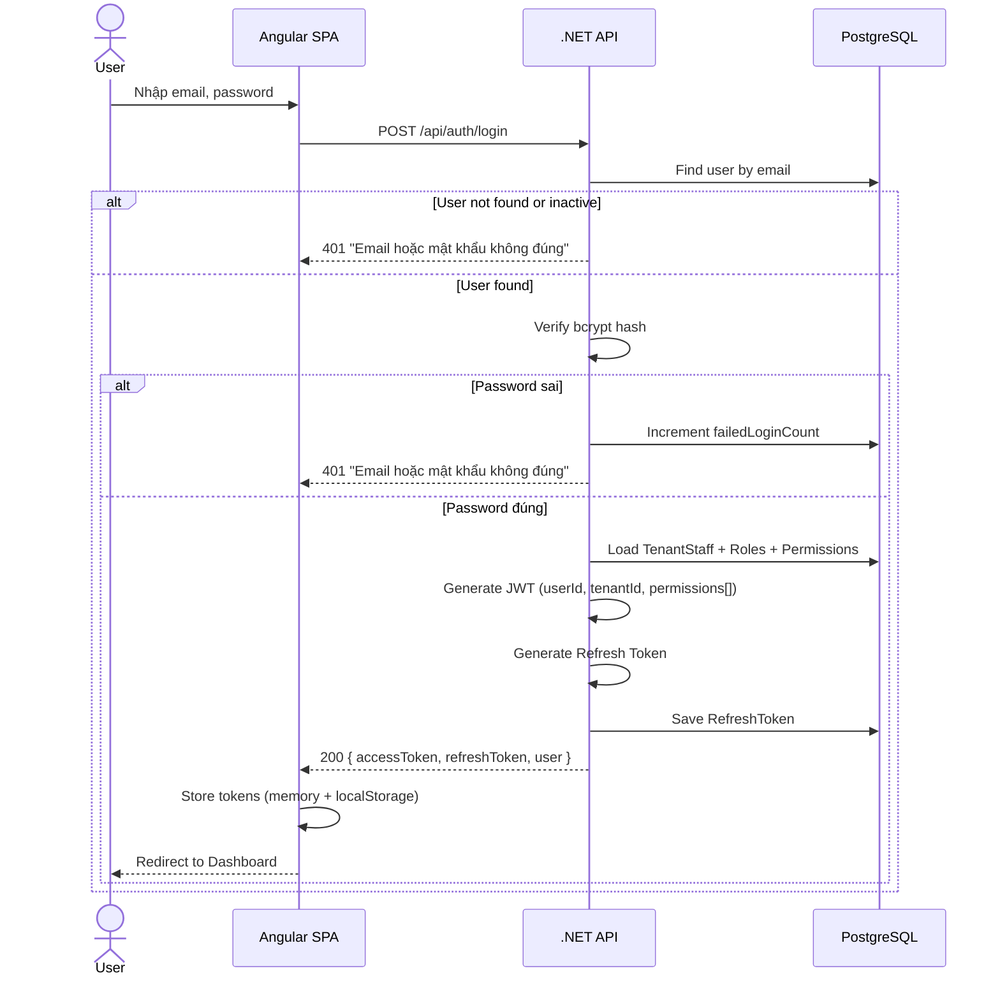
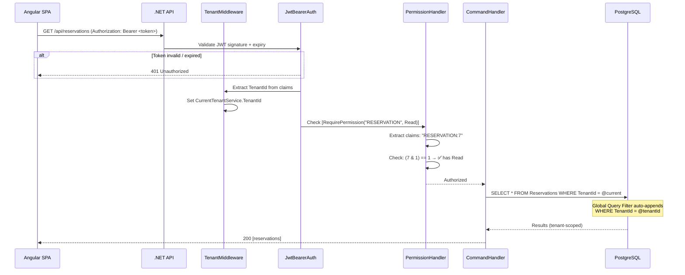
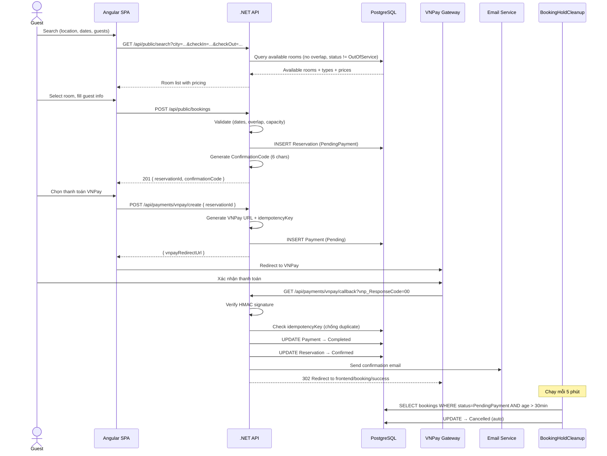
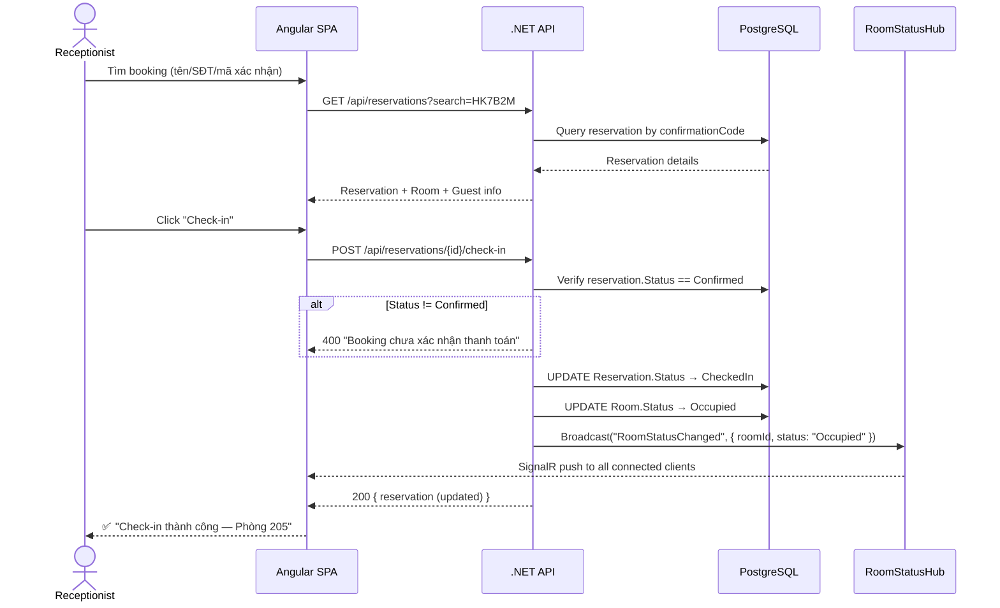
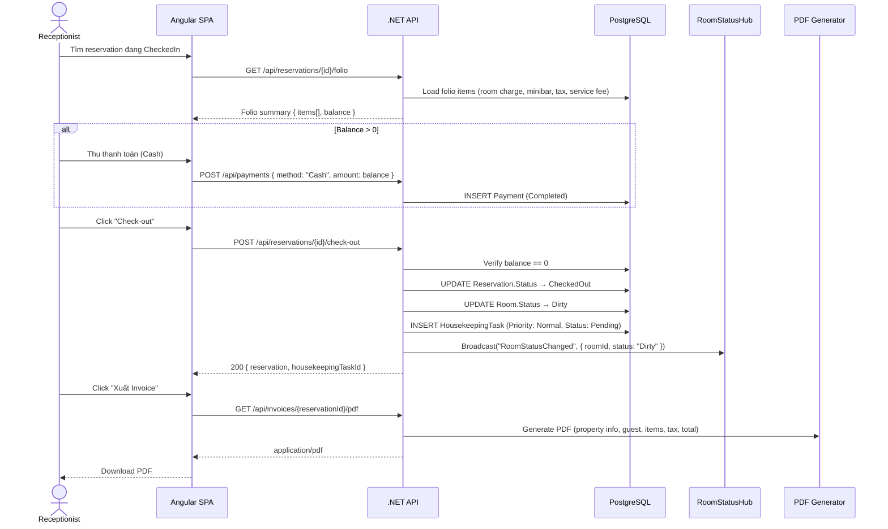
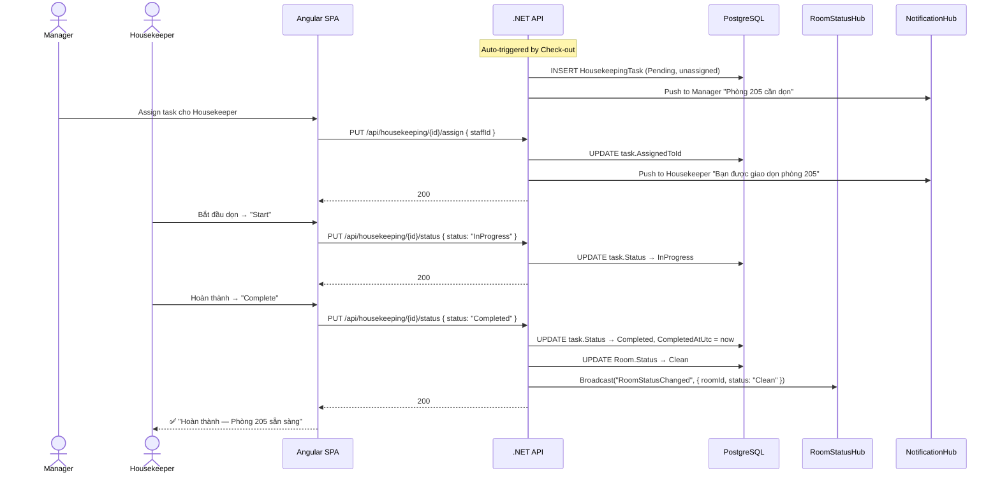
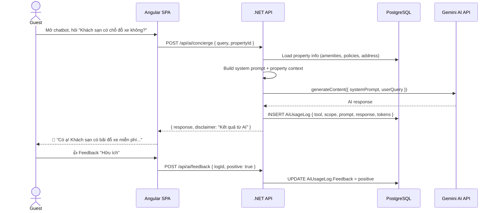

# 🔀 Sequence Diagrams

> **Tài liệu:** SDD-04 | **Phiên bản:** 1.0 | **Ngày:** 2026-10-03
> **Rubric mapping:** TC2.1 Mức 5 (≥4 loại sơ đồ — Sequence là loại thứ 4)

---

## SEQ-01: User Registration

---

## SEQ-02: Login + JWT Flow

---

## SEQ-03: RBAC Permission Check

---

## SEQ-04: Guest Booking Flow (Online)

---

## SEQ-05: Check-in Flow

---

## SEQ-06: Check-out + Invoice

---

## SEQ-07: Housekeeping Task Lifecycle

---

## SEQ-08: AI Concierge Query

---

## Tổng hợp Sequence Diagrams

| # | Flow | Actors | Hệ thống tương tác |
|---|------|--------|-------------------|
| SEQ-01 | Registration | Guest | SPA → API → DB → Email |
| SEQ-02 | Login + JWT | User | SPA → API → DB |
| SEQ-03 | RBAC Check | Any | SPA → API (Middleware pipeline) → DB |
| SEQ-04 | Guest Booking | Guest | SPA → API → DB → VNPay → Email |
| SEQ-05 | Check-in | Receptionist | SPA → API → DB → SignalR |
| SEQ-06 | Check-out + Invoice | Receptionist | SPA → API → DB → SignalR → PDF |
| SEQ-07 | Housekeeping | Manager, Housekeeper | SPA → API → DB → SignalR → Notification |
| SEQ-08 | AI Concierge | Guest | SPA → API → DB → Gemini AI |

> ✅ **8 sequence diagrams** bao phủ tất cả core flows

---

*Tài liệu này phục vụ TC2.1 Mức 5 (sequence diagram — loại sơ đồ thứ 4+).*
