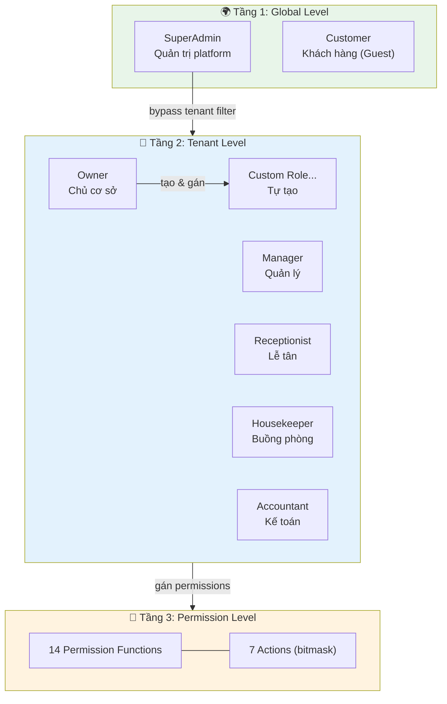
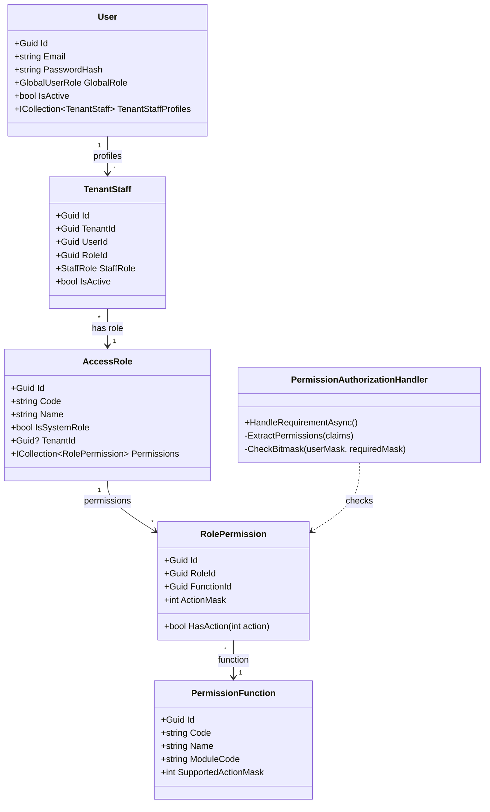
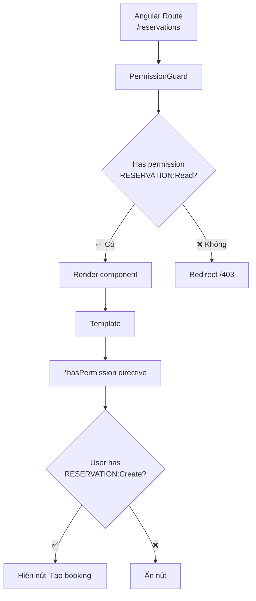

# 🔐 RBAC Design (Phân quyền chi tiết)

> **Tài liệu:** SDD-05 | **Phiên bản:** 1.0 | **Ngày:** 2026-10-03
> **Rubric mapping:** TC2.1 Mức 5 (class diagram — loại sơ đồ thứ 5)

---

## 1. Mô hình RBAC 3 tầng



---

## 2. Class Diagram — RBAC Entities



---

## 3. Permission Matrix đầy đủ

### Actions (Bitmask)

| Bit | Value | Action | Mô tả |
|:---:|:-----:|--------|-------|
| 0 | 1 | **Read** | Xem danh sách, chi tiết |
| 1 | 2 | **Create** | Tạo mới |
| 2 | 4 | **Update** | Sửa, cập nhật |
| 3 | 8 | **Delete** | Xóa |
| 4 | 16 | **Export** | Xuất PDF, Excel |
| 5 | 32 | **Approve** | Duyệt, phê duyệt |
| 6 | 64 | **Execute** | Thực thi action đặc biệt |

### Permission Functions × Default Roles

| Function | Module | Owner | Manager | Receptionist | Housekeeper | Accountant |
|----------|--------|:-----:|:-------:|:------------:|:-----------:|:----------:|
| **RESERVATION** | Booking | 127 | 127 | 7 (R,C,U) | 1 (R) | 1 (R) |
| **ROOM** | Rooms | 127 | 15 (R,C,U,D) | 1 (R) | 1 (R) | — |
| **ROOM_TYPE** | Rooms | 127 | 15 | 1 (R) | — | — |
| **HOUSEKEEPING** | Operations | 127 | 71 (R,C,U,Exec) | 1 (R) | 65 (R,Exec) | — |
| **PAYMENT** | Finance | 127 | 51 (R,C,Export) | 3 (R,C) | — | 49 (R,Export,Approve) |
| **INVOICE** | Finance | 127 | 17 (R,Export) | 1 (R) | — | 17 (R,Export) |
| **REPORT** | Analytics | 127 | 17 (R,Export) | — | — | 17 (R,Export) |
| **PRICING** | Revenue | 127 | 37 (R,U,Approve) | 1 (R) | — | 1 (R) |
| **NOTIFICATION** | System | 127 | 7 (R,C,U) | 1 (R) | 1 (R) | 1 (R) |
| **USER** | Admin | 127 | 7 (R,C,U) | — | — | — |
| **ROLE** | Admin | 127 | 1 (R) | — | — | — |
| **ROLE_PERMISSION** | Admin | 127 | — | — | — | — |
| **CHECKIN** | FrontDesk | 64 | 64 (Exec) | 64 (Exec) | — | — |
| **CHECKOUT** | FrontDesk | 64 | 64 (Exec) | 64 (Exec) | — | — |
| **PROMOTION** | Marketing | 127 | 39 (R,C,U,Approve) | 1 (R) | — | — |
| **AI_TASK** | AI | 127 | 35 (R,C,Approve) | — | — | — |
| **SETTINGS** | Admin | 127 | 5 (R,U) | — | — | — |

### Ví dụ bitmask calculation

```
Owner cho RESERVATION: Read(1) + Create(2) + Update(4) + Delete(8) +
                        Export(16) + Approve(32) + Execute(64) = 127

Receptionist cho RESERVATION: Read(1) + Create(2) + Update(4) = 7

Check: Does Receptionist have Delete?
  userMask = 7, requiredMask = 8 (Delete)
  (7 & 8) == 8 → (0) == 8 → FALSE → ❌ Denied
```

---

## 4. Frontend Permission Guard Strategy



### Implementation pattern

```typescript
// Route guard (functional)
export const reservationGuard = () =>
  inject(PermissionService).hasPermission('RESERVATION', Action.Read);

// Template directive
<button *hasPermission="['RESERVATION', 'Create']">
  Tạo đặt phòng
</button>

// Service check
if (permissionService.hasPermission('PRICING', Action.Update)) {
  // Show pricing editor
}
```

---

*Tài liệu này phục vụ TC2.1 Mức 5 (class diagram + RBAC design). Gồm 17 permission functions × 7 actions × 5 default roles.*
