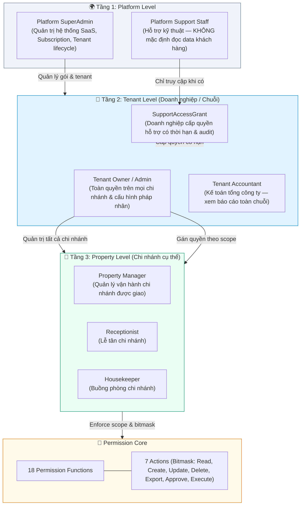
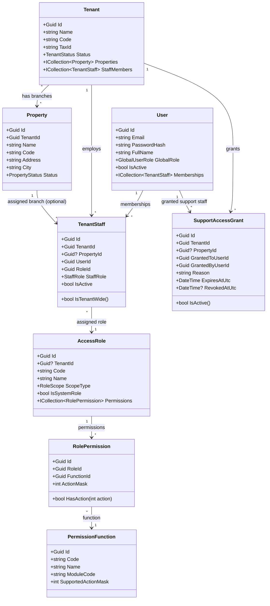

# 🔐 RBAC Design (Phân quyền chi tiết: Doanh nghiệp – Chi nhánh – Hỗ trợ)

> **Tài liệu:** SDD-05 | **Phiên bản:** 2.0 (Cập nhật P1A - 2026-10-06)  
> **Quy chuẩn:** Phân tầng Doanh nghiệp (Tenant) – Chi nhánh (Property), Membership đa phạm vi, Fail-closed & Platform Support Grant theo yêu cầu P0/P1A.

---

## 1. Mô hình Phân quyền Đa tầng (3 Levels & Scopes)



---

## 2. Class Diagram — Thực thể RBAC & Membership



---

## 3. Hệ thống Hành động (Bitmask Actions) & Khớp nối C# Code

### 3.1. Định nghĩa Bitmask Actions (Khớp 1:1 với `PermissionAction.cs`)
Bảng giá trị bitmask chuẩn hóa theo mã nguồn thực tế tại `HotelSaas.WebApi.Authorization.PermissionAction`:

| Bit | Giá trị (`int`) | Hằng số C# | Ý nghĩa nghiệp vụ |
|:---:|:---:|------------|-------------------|
| 0 | **1** | `PermissionAction.Read` | Xem danh sách, tra cứu chi tiết, đọc dữ liệu |
| 1 | **2** | `PermissionAction.Create` | Tạo mới bản ghi, thêm mới tài nguyên |
| 2 | **4** | `PermissionAction.Update` | Sửa đổi, cập nhật thông tin, Check-in/Check-out |
| 3 | **8** | `PermissionAction.Delete` | Xóa dữ liệu (xóa cứng hoặc đánh dấu xóa mềm) |
| 4 | **16** | `PermissionAction.Approve` | Phê duyệt yêu cầu (Duyệt hoàn tiền, duyệt cọc, duyệt giảm giá) |
| 5 | **32** | `PermissionAction.Export` | Xuất dữ liệu ra file (Excel, CSV, PDF), in hóa đơn |
| 6 | **64** | `PermissionAction.Manage` | Cấu hình nâng cao, gán vai trò, quản lý thiết lập hệ thống |
| — | **127** | *All Actions (1+2+4+8+16+32+64)* | Toàn quyền thao tác trên chức năng |

> **Lưu ý đối chiếu:** Trước đây tài liệu nhầm lẫn giữa Bit 4 (Export) và Bit 5 (Approve), đồng thời định nghĩa action `Execute` (64) không tồn tại trong code. Nay đã chuẩn hóa 100% khớp với `PermissionAction.cs`: Bit 4 (16) là `Approve`, Bit 5 (32) là `Export`, Bit 6 (64) là `Manage`.

---

### 3.2. Danh mục Mã chức năng (`PermissionFunction.Code`) chuẩn hóa
Khớp 1:1 với dữ liệu khởi tạo tại `HotelSaas.Infrastructure.Persistence.SeedData` và bổ sung các chức năng nền tảng mới:

| Mã Function (`Code`) | Phân hệ | Tên chức năng | Phạm vi áp dụng mặc định |
|---|---|---|---|
| `DASHBOARD` | TỔNG QUAN | Bảng điều khiển vận hành & chỉ số | [T], [P] |
| `TENANTS` | DOANH NGHIỆP | Quản lý thông tin doanh nghiệp, pháp nhân, gói cước | [T], [PL] |
| `PROPERTIES` | CHI NHÁNH | Quản lý danh sách & cấu hình chi nhánh | [T], [P] |
| `ROOMS` | PHÒNG | Quản lý danh sách phòng vật lý, trạng thái phòng | [P] |
| `ROOM_TYPES` | LOẠI PHÒNG | Quản lý danh mục loại phòng, tiện ích | [P] (hoặc [T] nếu PO duyệt) |
| `RESERVATIONS` | ĐẶT PHÒNG | Quản lý đơn đặt phòng, lịch booking | [P] |
| `GUESTS` | KHÁCH HÀNG | Quản lý hồ sơ khách lưu trú | [T], [P] |
| `CHECK_IN_OUT` | TIỀN SẢNH | Nghiệp vụ nhận phòng (Check-in), trả phòng (Check-out) | [P] |
| `HOUSEKEEPING` | VẬN HÀNH | Quản lý buồng phòng, phân công dọn dẹp | [P] |
| `PAYMENTS` | TÀI CHÍNH | Thanh toán đơn đặt, thu tiền, duyệt hoàn tiền (`Approve`) | [P] |
| `INVOICES` | TÀI CHÍNH | Xuất hóa đơn, quản lý chứng từ thanh toán | [P] |
| `REPORTS` | BÁO CÁO | Báo cáo doanh thu, công suất, tài chính | [T], [P] |
| `STAFF` | NHÂN SỰ | Quản lý nhân viên, gán chi nhánh | [T], [P] |
| `ROLES` | PHÂN QUYỀN | Quản lý vai trò và phân quyền nhân sự | [T] |
| `SETTINGS` | THIẾT LẬP | Cấu hình chính sách, giờ nhận/trả phòng, buffer | [T], [P] |
| `SUBSCRIPTIONS`| GÓI DỊCH VỤ | Quản lý đăng ký gói SaaS, thanh toán phí nền tảng | [T], [PL] |
| `PROMOTIONS` | KHUYẾN MÃI | Quản lý chương trình khuyến mãi, voucher | [T], [P] |
| `REVIEWS` | ĐÁNH GIÁ | Quản lý đánh giá và phản hồi của khách | [P] |
| `AI_FEATURES` | TRỢ LÝ AI | Sử dụng tính năng phân tích giá, chatbot AI | [T], [P] |
| `SUPPORT_GRANTS`| HỖ TRỢ | Quản lý cấp/thu hồi quyền hỗ trợ kỹ thuật | [T] |

---

### 3.3. Ma trận Quyền chi tiết theo Vai trò (Actor × Function × Bitmask)

*Quy ước Scope:*
- `[T]` **Tenant-wide:** Toàn quyền kiểm soát trên mọi chi nhánh của Tenant.
- `[P]` **Property-scoped:** Bắt buộc có ngữ cảnh chi nhánh (`PropertyId`), chỉ thao tác trong chi nhánh được phân công.
- `[PL]` **Platform-level:** Quản trị SaaS, không được mặc định đọc dữ liệu vận hành nếu không có `SupportAccessGrant`.

| Mã Function | Tenant Owner `[T]` | Property Manager `[P]` | Receptionist `[P]` | Housekeeper `[P]` | Tenant Accountant `[T]` | Platform Support `[Grant]` |
|---|:---:|:---:|:---:|:---:|:---:|:---:|
| `DASHBOARD` | 127 (All) | 1 (R) | 1 (R) | 1 (R) | 1 (R) | 1 (R) |
| `TENANTS` | 127 (All) | 1 (R) | — | — | 1 (R) | 1 (R) |
| `PROPERTIES` | 127 (All) | 5 (R,U) | 1 (R) | 1 (R) | 1 (R) | 1 (R) |
| `ROOMS` | 127 (All) | 15 (R,C,U,D) | 1 (R) | 5 (R,U) | — | 1 (R) |
| `ROOM_TYPES` | 127 (All) | 15 (R,C,U,D) | 1 (R) | — | — | 1 (R) |
| `RESERVATIONS` | 127 (All) | 127 (All) | 7 (R,C,U) | 1 (R) | 1 (R) | 1 (R) |
| `CHECK_IN_OUT` | 127 (All) | 127 (All) | 7 (R,C,U) | — | — | — |
| `HOUSEKEEPING` | 127 (All) | 127 (All) | 1 (R) | 5 (R,U) | — | — |
| `PAYMENTS` | 127 (All) | 51 (R,C,Appr,Exp)* | 3 (R,C) | — | 33 (R,Exp)* | 1 (R) |
| `INVOICES` | 127 (All) | 33 (R,Exp) | 33 (R,Exp) | — | 33 (R,Exp) | 1 (R) |
| `REPORTS` | 127 (All) | 33 (R,Exp) | — | — | 33 (R,Exp) | — |
| `STAFF` | 127 (All) | 3 (R,C) | — | — | — | — |
| `ROLES` | 127 (All) | 1 (R) | — | — | — | — |
| `SETTINGS` | 127 (All) | 5 (R,U) | — | — | — | — |
| `SUBSCRIPTIONS`| 33 (R,Exp) | — | — | — | 33 (R,Exp) | 127 (All)* |
| `PROMOTIONS` | 127 (All) | 7 (R,C,U) | 1 (R) | — | 1 (R) | — |
| `REVIEWS` | 127 (All) | 5 (R,U) | 1 (R) | — | — | — |
| `AI_FEATURES` | 127 (All) | 1 (R) | 1 (R) | — | 1 (R) | — |
| `SUPPORT_GRANTS`| 127 (All) | — | — | — | — | 1 (R) |

*Ghi chú Nghiệp vụ Phân quyền Tài chính & Hoàn tiền (Theo Quyết định D23):*
- **Quy tắc D23:** Lễ tân (`Receptionist`) chỉ được tạo yêu cầu hoàn tiền (`PAYMENTS:Create`, bitmask 2).
- **Thẩm quyền duyệt hoàn tiền (`PAYMENTS:Approve`, bitmask 16):** CHỈ DUY NHẤT **Tenant Owner / Admin** (127) và **Property Manager** (51 = 1+2+16+32) có quyền duyệt.
- **Tenant Accountant (Kế toán doanh nghiệp):** Theo đúng quyết định D23, Accountant **KHÔNG CÓ QUYỀN DUYỆT HOÀN TIỀN** (chỉ có quyền `Read=1 + Export=32 = 33` để đối soát và xuất báo cáo).

---

## 4. Thiết kế Membership Đa Chi nhánh & Ràng buộc Duy nhất (Uniqueness)

### 4.1. Cấu trúc Thực thể `TenantStaff`
Một người dùng (`User`) sở hữu một tài khoản danh tính toàn cầu. Khi tham gia vào một Tenant, mối quan hệ được quản lý qua thực thể `TenantStaff`:
- `TenantId` (UUID, NOT NULL): Định danh doanh nghiệp.
- `UserId` (UUID, NOT NULL): Định danh tài khoản người dùng.
- `PropertyId` (UUID, NULLABLE):
  - `PropertyId IS NULL`: Phân quyền cấp **Doanh nghiệp (Tenant-wide)**. Áp dụng cho: `Owner`, `Admin`, `Tenant Accountant`. Có hiệu lực xuyên suốt tất cả các chi nhánh trực thuộc Tenant.
  - `PropertyId IS NOT NULL`: Phân quyền cấp **Chi nhánh cụ thể (Property-scoped)**. Áp dụng cho: `Property Manager`, `Receptionist`, `Housekeeper`. Chỉ có hiệu lực trên chi nhánh được chỉ định.
- `RoleId` (UUID, NOT NULL): Vai trò RBAC tương ứng.
- `IsActive` (bool): Trạng thái hoạt động của liên kết nhân sự.

### 4.2. Quy tắc Uniqueness & Thiết kế Chỉ mục Cơ sở dữ liệu (PostgreSQL DDL)
Để vừa hỗ trợ nhân viên làm việc tại nhiều chi nhánh, vừa ngăn ngừa xung đột dữ liệu (đã gỡ bỏ ràng buộc unique cũ `(TenantId, UserId)`):
1. **Một người dùng chỉ có tối đa 1 vai trò Tenant-wide trong cùng một Tenant:**
   ```sql
   CREATE UNIQUE INDEX uq_tenant_staff_tenant_wide
   ON "TenantStaffMembers" ("TenantId", "UserId")
   WHERE "PropertyId" IS NULL;
   ```
2. **Một người dùng chỉ có tối đa 1 vai trò trên mỗi Chi nhánh cụ thể:**
   ```sql
   CREATE UNIQUE INDEX uq_tenant_staff_property_scoped
   ON "TenantStaffMembers" ("TenantId", "UserId", "PropertyId")
   WHERE "PropertyId" IS NOT NULL;
   ```
3. **Quy tắc Nghiệp vụ (Business Rule):**
   - Nếu một `User` đã có bản ghi Tenant-wide (`PropertyId IS NULL`), người đó mặc định quản trị tất cả các chi nhánh thuộc Tenant. Không cho phép tạo thêm bản ghi chi nhánh lẻ (`PropertyId != NULL`) cho cùng một vai trò để tránh mâu thuẫn quyền.
   - Khi gán nhân viên vào một `PropertyId`, hệ thống bắt buộc kiểm tra `Property.TenantId == TenantStaff.TenantId`. Nếu sai lệch, ném lỗi `ERR_PROPERTY_NOT_IN_TENANT`.

---

## 5. Quy chế Ngữ cảnh: Headers vs JWT Claims & Nguyên tắc Fail-Closed

### 5.1. Cấu trúc Claims trong JWT Token
- `sub`: UserId (UUID)
- `email`: Email người dùng
- `fullName`: Họ tên
- `globalRole`: `Customer` | `SuperAdmin`
- `tenantId` (hoặc `tid`): Tenant hiện tại đang chọn làm việc (UUID, optional)
- `propertyId` (hoặc `pid`): Chi nhánh hiện tại đang chọn làm việc (UUID, optional)
- `permissions`: Danh sách chuỗi quyền dạng `FUNCTION:ACTION_BITMASK` tính toán theo context hiện tại.

### 5.2. Thứ tự Ưu tiên & Xử lý Xung đột giữa Header và JWT
Khi client gửi request:
1. **Trường hợp Token đã chứa `propertyId`:**
   - Nếu client gửi kèm header `X-Property-Id`:
     - Nếu `header.X-Property-Id == jwt.propertyId`: Hợp lệ, xử lý bình thường.
     - Nếu `header.X-Property-Id != jwt.propertyId`: **FAIL-CLOSED NGAY LẬP TỨC**, trả HTTP 400 với mã lỗi `ERR_CONTEXT_MISMATCH`. Tuyệt đối không tự ý ghi đè hay chọn một trong hai.
2. **Trường hợp Token là Tenant-wide (`propertyId` trong JWT là NULL):**
   - Áp dụng khi Tenant Owner hoặc Tenant Admin đang đăng nhập và gọi API thuộc Property-scoped:
   - Client **BẮT BUỘC** phải truyền header `X-Property-Id: <Guid>`.
   - Backend kiểm tra `X-Property-Id` có thuộc về `tenantId` trong Token hay không:
     - Nếu thuộc: Thiết lập `ICurrentPropertyService.PropertyId = X-Property-Id`.
     - Nếu không thuộc: Trả HTTP 403 với mã lỗi `ERR_PROPERTY_NOT_IN_TENANT`.
3. **Trường hợp API Property-scoped nhưng thiếu cả Claim lẫn Header:**
   - Trả HTTP 400 Bad Request với mã lỗi `ERR_MISSING_PROPERTY_CONTEXT`.

---

## 6. Cơ chế Platform Support: Allowlist Người nhận, Allowlist Hành động & Thu hồi tức thì (Real-time Revoke)

### 6.1. Nguyên tắc Zero-Trust đối với Platform Staff & Thiết kế Loại bỏ Bypass
- **Nguyên tắc cốt lõi (D24):** Mặc định, `PlatformSuperAdmin` và toàn bộ nhân viên hỗ trợ của SaaS **BỊ CHẶN HOÀN TOÀN** khỏi việc đọc/ghi dữ liệu vận hành của khách hàng (danh sách phòng, giá cả, đơn đặt, thông tin PII khách lưu trú).
- **Lưu ý hiện trạng kỹ thuật:** Trong mã nguồn hiện tại (`PermissionAuthorizationHandler.cs`), tồn tại đoạn code tự động bypass permission cho `GlobalRole == SuperAdmin`. 
  - **Trạng thái P1A:** Nhóm kỹ thuật đã **thiết kế phương án bãi bỏ bypass** và thay thế bằng middleware kiểm soát `SupportAuthorizationMiddleware`.
  - **Cam kết thực hiện:** Việc xóa bỏ code bypass trong `PermissionAuthorizationHandler.cs` sẽ được **triển khai trong gói code P1B-01**. Trong vòng P1A này, toàn bộ tài liệu đã đồng bộ theo hướng bãi bỏ bypass, **chưa sửa code ứng dụng**.

### 6.2. Allowlist Người nhận Hỗ trợ (Support Recipient Allowlist)
Hệ thống phân định độc lập giữa **Ai được nhận quyền** (`SupportRecipientAllowlist`) và **Được làm những gì** (`SupportActionAllowlist`):

1. **Khái niệm:** Hệ thống duy trì danh mục nhân viên kỹ thuật / CSKH của Platform đã qua xác minh an ninh (`PlatformSupportRecipientAllowlist`):
   - `UserId`: UUID của nhân viên kỹ thuật (FK -> `User`).
   - `StaffEmail`: Email nội bộ @hotelplatform.com.
   - `Department`: Bộ phận kỹ thuật / CSKH (`L2_Support`, `L3_CoreEngineering`).
   - `SecurityClearedAtUtc`: Thời điểm hoàn thành xác minh lý lịch an ninh.
   - `IsActive`: Trạng thái sẵn sàng tiếp nhận hỗ trợ.
2. **Quy tắc Kiểm tra khi Tạo Grant:**
   - Khi `Tenant Owner` gửi yêu cầu cấp quyền hỗ trợ (`POST /api/v1/tenants/current/support-grants`), trường `GrantedToUserId` **BẮT BUỘC** phải tồn tại trong `PlatformSupportRecipientAllowlist` và có `IsActive = true`.
   - Nếu `GrantedToUserId` không có trong danh sách hoặc bị khóa, hệ thống từ chối ngay lập tức với lỗi `400 Bad Request` (`ERR_SUPPORT_USER_NOT_IN_ALLOWLIST`).

### 6.3. Allowlist Hành động Hỗ trợ (Support Action Allowlist) & Danh mục Hành vi Bị cấm
Nhân viên hỗ trợ dù có grant hợp lệ cũng chỉ được thao tác trong phạm vi các hành động cho phép (Action Allowlist). Mọi hành động nằm ngoài danh mục đều bị chặn đứng:

| Phạm vi Cấp quyền (`Scope`) | Các Hành động ĐƯỢC PHÉP (Action Allowlist) | Mục đích Kỹ thuật |
|---|---|---|
| **`READ_ONLY`** | • `GET /room-types`, `GET /room-types/{id}`<br/>• `GET /rooms`, `GET /rooms/{id}`<br/>• `GET /housekeeping`<br/>• `GET /reservations/{id}` (chỉ đọc thông tin đơn cần hỗ trợ) | Đọc cấu hình buồng phòng và thông tin booking cụ thể để giải thích thắc mắc hoặc hỗ trợ khách vận hành. |
| **`DIAGNOSTIC`** | • Toàn bộ quyền của `READ_ONLY`<br/>• `GET /telemetry/sync-logs` (nhật ký đồng bộ)<br/>• `GET /payments/{id}/metadata` (chỉ log mã phản hồi gateway, không có PII/thẻ)<br/>• `GET /audit-logs/system` | Chẩn đoán lỗi kỹ thuật, lỗi kết nối webhook cổng thanh toán hoặc xung đột dữ liệu. |

#### Danh mục Hành vi BỊ CẤM TUYỆT ĐỐI (Blacklisted Operations — Mọi Scope):
Nhân viên Platform Support **KHÔNG BAO GIỜ** được thực hiện các thao tác sau, kể cả khi đang có Support Grant hiệu lực:
1. ❌ **CẤM ĐỘT BIẾN NGHIỆP VỤ (No Mutation):** Nghiêm cấm tất cả các lệnh HTTP `POST`, `PUT`, `PATCH`, `DELETE` trên dữ liệu kinh doanh của khách: không tạo/sửa/hủy phòng, không tạo/hủy booking, không tạo hóa đơn.
2. ❌ **CẤM DUYỆT TÀI CHÍNH / HOÀN TIỀN (No Financial Actions):** Tuyệt đối cấm thao tác duyệt hoàn tiền (`POST /payments/{id}/refund`), xuất phiếu chi hoặc thay đổi trạng thái thanh toán.
3. ❌ **CẤM XUẤT DỮ LIỆU HÀNG LOẠT (No Bulk Export):** Bị chặn toàn bộ các API có bitmask `Export` (32) (VD: `/reports/export-excel`, `/invoices/monthly-summary`, `/customers/export`) để ngăn ngừa rò rỉ dữ liệu (data exfiltration).
4. ❌ **CẤM TRUY CẬP DỮ LIỆU BẢO MẬT & PII NHẠY CẢM:** Không được truy cập bảng `RefreshToken`, trường mật khẩu `PasswordHash`, mã cấu hình Secret Key cổng thanh toán hoặc danh sách nhân sự nội bộ (`/staff`).
5. ❌ **CẤM THAY ĐỔI CẤU HÌNH BẢO MẬT & TÀI KHOẢN:** Không được đổi thông tin chủ sở hữu, số tài khoản ngân hàng thụ hưởng hoặc thay đổi phân quyền nhân viên.

> **Cơ chế cưỡng chế (Enforcement):** Nếu nhân sự Support cố tình gọi endpoint ngoài Action Allowlist hoặc thuộc danh mục cấm, `SupportAuthorizationMiddleware` trả về **`403 Forbidden`** với mã lỗi `ERR_SUPPORT_ACTION_NOT_PERMITTED` và kích hoạt cảnh báo an ninh nội bộ.

### 6.4. Vòng đời Support Grant & Thẩm quyền
1. **Thẩm quyền cấp (Grant):** Duy nhất `Tenant Owner` (Role `OWNER`) của Tenant mới có quyền tạo `SupportAccessGrant`.
2. **Thông tin cấp phép:**
   - `TenantId`: Doanh nghiệp được hỗ trợ.
   - `PropertyId`: Chi nhánh được hỗ trợ (hoặc null nếu hỗ trợ toàn doanh nghiệp).
   - `GrantedToUserId`: ID nhân viên kỹ thuật thuộc Support Recipient Allowlist.
   - `Reason`: Lý do cấp quyền (bắt buộc, tối thiểu 20 ký tự).
   - `ExpiresAtUtc`: Thời điểm hết hạn (tối đa 480 phút = 8 giờ).
   - `Scope`: `READ_ONLY` hoặc `DIAGNOSTIC`.
3. **Thẩm quyền thu hồi (Revoke):**
   - `Tenant Owner`: Có thể thu hồi bất cứ lúc nào qua portal quản trị.
   - `Platform SuperAdmin`: Có quyền khẩn cấp thu hồi grant (Emergency Kill-Switch) nếu phát hiện nhân viên vi phạm quy chế an ninh.

### 6.5. Cơ chế Thu hồi Tức thì (Real-time Revocation Enforcement)
- Do JWT là stateless, request của Platform Support **BẮT BUỘC** phải truyền header `X-Support-Grant-Id: <Guid>`.
- `SupportAuthorizationMiddleware` sẽ kiểm tra trạng thái grant trong Database/Distributed Cache (Redis) trên **TỪNG REQUEST**:
  - Nếu `RevokedAtUtc != null`: Chặn ngay lập tức với HTTP 403 `ERR_SUPPORT_GRANT_REVOKED`.
  - Nếu `ExpiresAtUtc < DateTime.UtcNow`: Chặn với HTTP 403 `ERR_SUPPORT_GRANT_EXPIRED`.
- Mọi request thực hiện dưới Support Grant đều được ghi vết Audit Log bất biến (`SupportAuditLogs`: GrantId, ActorUserId, Endpoint, Method, ActionName, ClientIp, RequestPayload, Timestamp).

