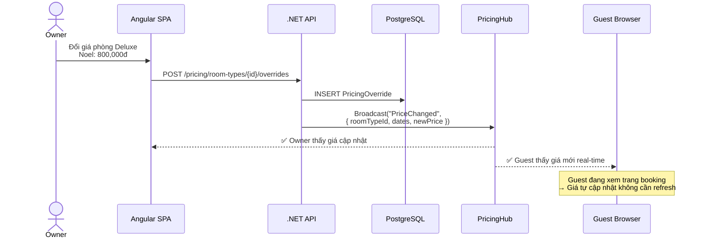

# 🌐 API Design & Endpoint Catalog

> **Tài liệu:** SDD-06 | **Phiên bản:** 1.0 | **Ngày:** 2026-10-03
> **Rubric mapping:** TC2.1 (thiết kế giải pháp)
> **Bao gồm:** Real-time pricing, Notifications, Invoice, Reports

---

## 1. API Convention

| Quy tắc | Chi tiết |
|---------|---------|
| Base URL | `/api/v1/` |
| URL format | `kebab-case` (ví dụ: `/room-types`) |
| JSON format | `camelCase` |
| Auth header | `Authorization: Bearer <JWT>` |
| Tenant header | Auto từ JWT claim (hoặc `X-Tenant-Id` cho SuperAdmin) |
| Pagination | `?page=1&pageSize=20` |
| Sort | `?sortBy=createdAt&sortDir=desc` |
| Filter | `?status=confirmed&search=keyword` |
| Date format | ISO 8601 (`2026-10-03T14:00:00Z`) |
| Error format | `{ "type": "...", "title": "...", "status": 400, "errors": {} }` |

---

## 2. Endpoint Catalog

### 2.1 Authentication (`/api/v1/auth`)

| Method | Endpoint | Permission | Mô tả |
|--------|----------|-----------|-------|
| POST | `/auth/register` | Public | Đăng ký Guest |
| POST | `/auth/login` | Public | Đăng nhập → JWT |
| POST | `/auth/refresh-token` | Public | Refresh access token |
| POST | `/auth/logout` | Authenticated | Revoke refresh token |
| POST | `/auth/forgot-password` | Public | Gửi email reset |
| POST | `/auth/reset-password` | Public | Reset password bằng token |
| GET | `/auth/me` | Authenticated | Profile hiện tại |
| PUT | `/auth/me` | Authenticated | Cập nhật profile |

### 2.2 Properties / Tenants (`/api/v1/properties`)

| Method | Endpoint | Permission | Mô tả |
|--------|----------|-----------|-------|
| POST | `/properties` | Authenticated | Tạo property mới |
| GET | `/properties/{id}` | SETTINGS:Read | Chi tiết property |
| PUT | `/properties/{id}` | SETTINGS:Update | Cập nhật property info |
| PUT | `/properties/{id}/policies` | SETTINGS:Update | Cập nhật chính sách (cancel, children, pet, check-in/out times) |
| PUT | `/properties/{id}/subscription` | Owner only | Thay đổi subscription tier |

### 2.3 Room Types (`/api/v1/room-types`)

| Method | Endpoint | Permission | Mô tả |
|--------|----------|-----------|-------|
| GET | `/room-types` | ROOM_TYPE:Read | Danh sách loại phòng |
| POST | `/room-types` | ROOM_TYPE:Create | Tạo loại phòng mới |
| PUT | `/room-types/{id}` | ROOM_TYPE:Update | Cập nhật |
| DELETE | `/room-types/{id}` | ROOM_TYPE:Delete | Xóa (kiểm tra có rooms không) |

### 2.4 Rooms (`/api/v1/rooms`)

| Method | Endpoint | Permission | Mô tả |
|--------|----------|-----------|-------|
| GET | `/rooms` | ROOM:Read | Danh sách phòng + status |
| GET | `/rooms/{id}` | ROOM:Read | Chi tiết phòng |
| POST | `/rooms` | ROOM:Create | Tạo phòng mới |
| PUT | `/rooms/{id}` | ROOM:Update | Cập nhật |
| PUT | `/rooms/{id}/status` | ROOM:Update | Đổi status (Clean/Dirty/OutOfService) |
| DELETE | `/rooms/{id}` | ROOM:Delete | Disable phòng |
| GET | `/rooms/availability` | ROOM:Read | Phòng trống theo date range |

### 2.5 Reservations (`/api/v1/reservations`)

| Method | Endpoint | Permission | Mô tả |
|--------|----------|-----------|-------|
| GET | `/reservations` | RESERVATION:Read | Danh sách booking (filter by status, date) |
| GET | `/reservations/{id}` | RESERVATION:Read | Chi tiết booking |
| POST | `/reservations` | RESERVATION:Create | Tạo booking (staff) |
| PUT | `/reservations/{id}` | RESERVATION:Update | Cập nhật booking |
| POST | `/reservations/{id}/check-in` | CHECKIN:Execute | Check-in |
| POST | `/reservations/{id}/check-out` | CHECKOUT:Execute | Check-out |
| POST | `/reservations/{id}/cancel` | RESERVATION:Update | Hủy booking (áp dụng cancellation policy) |
| GET | `/reservations/{id}/folio` | RESERVATION:Read | Xem folio (chi tiết bill) |
| POST | `/reservations/{id}/folio/items` | RESERVATION:Update | Thêm folio item (minibar, laundry...) |
| GET | `/reservations/calendar` | RESERVATION:Read | Calendar view (room × date grid) |
| GET | `/reservations/today` | RESERVATION:Read | Arrivals + Departures hôm nay |

### 2.6 💳 Payments (`/api/v1/payments`)

| Method | Endpoint | Permission | Mô tả |
|--------|----------|-----------|-------|
| GET | `/payments` | PAYMENT:Read | Lịch sử thanh toán |
| POST | `/payments` | PAYMENT:Create | Tạo payment (Cash / Transfer) |
| POST | `/payments/vnpay/create` | PAYMENT:Create | Tạo VNPay payment URL |
| GET | `/payments/vnpay/callback` | Public | VNPay callback (IPN) |
| POST | `/payments/{id}/refund` | PAYMENT:Approve | Yêu cầu hoàn tiền |
| GET | `/payments/summary` | PAYMENT:Read | Tổng hợp thu/chi hôm nay |

### 2.7 🧾 Invoices (`/api/v1/invoices`)

| Method | Endpoint | Permission | Mô tả |
|--------|----------|-----------|-------|
| GET | `/invoices` | INVOICE:Read | Danh sách hóa đơn |
| GET | `/invoices/{id}` | INVOICE:Read | Chi tiết hóa đơn |
| GET | `/invoices/{id}/pdf` | INVOICE:Export | **Xuất PDF hóa đơn** (bản in) |
| GET | `/invoices/{id}/print` | INVOICE:Export | **HTML print-friendly** (in trực tiếp) |
| POST | `/invoices/generate` | INVOICE:Create | Tạo hóa đơn từ reservation |
| GET | `/invoices/monthly-summary` | INVOICE:Export | Tổng hợp hóa đơn tháng |

**Cấu trúc hóa đơn (Invoice):**

```json
{
  "invoiceNumber": "INV-2026-100315-001",
  "issuedAt": "2026-10-03T15:30:00Z",
  "property": {
    "name": "Nhà Nghỉ Hoa Đào",
    "address": "12 Trần Phú, Phường 3, TP. Đà Lạt",
    "phone": "0263-123-4567",
    "taxCode": "1234567890"
  },
  "guest": {
    "name": "Lê Thùy Linh",
    "idNumber": "012345678901",
    "phone": "0912-345-678"
  },
  "items": [
    { "description": "Phòng Deluxe 205 (2 đêm × 500,000đ)", "amount": 1000000 },
    { "description": "Minibar", "amount": 150000 },
    { "description": "Giặt ủi", "amount": 80000 }
  ],
  "subtotal": 1230000,
  "taxRate": 10,
  "taxAmount": 123000,
  "serviceFeeRate": 5,
  "serviceFeeAmount": 61500,
  "totalAmount": 1414500,
  "payments": [
    { "method": "VNPay", "amount": 500000, "paidAt": "2026-10-01T10:00:00Z" },
    { "method": "Cash", "amount": 914500, "paidAt": "2026-10-03T15:25:00Z" }
  ],
  "balance": 0,
  "notes": "Cảm ơn quý khách!"
}
```

### 2.8 💰 Real-time Pricing (`/api/v1/pricing`)

| Method | Endpoint | Permission | Mô tả |
|--------|----------|-----------|-------|
| GET | `/pricing/room-types` | PRICING:Read | Giá hiện tại tất cả room types |
| GET | `/pricing/room-types/{id}/calendar` | PRICING:Read | **Giá theo ngày** (30 ngày tới) — calendar view |
| PUT | `/pricing/room-types/{id}/base` | PRICING:Update | Cập nhật giá cơ bản |
| POST | `/pricing/room-types/{id}/overrides` | PRICING:Update | **Đặt giá theo ngày/mùa** (date range + price) |
| DELETE | `/pricing/overrides/{id}` | PRICING:Update | Xóa price override |
| GET | `/pricing/room-types/{id}/ai-suggest` | AI_TASK:Read | **AI gợi ý giá** (occupancy, demand, season) |
| POST | `/pricing/room-types/{id}/ai-apply` | PRICING:Approve | **Áp dụng giá AI đề xuất** |
| GET | `/pricing/seasons` | PRICING:Read | Danh sách mùa (cao/thấp/lễ) |
| POST | `/pricing/seasons` | PRICING:Create | Tạo mùa mới + bảng giá |
| PUT | `/pricing/seasons/{id}` | PRICING:Update | Cập nhật mùa + giá |

**Cấu trúc Pricing Override:**

```json
{
  "roomTypeId": "uuid",
  "startDate": "2026-12-24",
  "endDate": "2026-12-31",
  "seasonName": "Giáng sinh & Tết Tây",
  "priceOverride": 800000,
  "reason": "Mùa cao điểm lễ hội",
  "createdBy": "owner",
  "isAiSuggested": false
}
```

**Real-time pricing flow:**



### 2.9 📊 Reports & Statistics (`/api/v1/reports`)

| Method | Endpoint | Permission | Mô tả |
|--------|----------|-----------|-------|
| GET | `/reports/dashboard` | REPORT:Read | **Dashboard tổng quan** (KPIs hôm nay) |
| GET | `/reports/revenue` | REPORT:Read | **Doanh thu** theo ngày/tuần/tháng/năm |
| GET | `/reports/occupancy` | REPORT:Read | **Tỷ lệ lấp đầy** theo ngày/tuần/tháng |
| GET | `/reports/adr` | REPORT:Read | **ADR** (Average Daily Rate) |
| GET | `/reports/revpar` | REPORT:Read | **RevPAR** (Revenue Per Available Room) |
| GET | `/reports/room-revenue` | REPORT:Read | Doanh thu **theo loại phòng** |
| GET | `/reports/source-analysis` | REPORT:Read | Phân tích nguồn booking (online/walk-in/OTA) |
| GET | `/reports/guest-demographics` | REPORT:Read | Thống kê khách (quốc tịch, loại khách) |
| GET | `/reports/housekeeping-performance` | REPORT:Read | **Hiệu suất housekeeping** (avg turnaround) |
| GET | `/reports/cancellation-rate` | REPORT:Read | **Tỷ lệ hủy** booking |
| GET | `/reports/payment-summary` | REPORT:Read | **Thu chi tổng hợp** (method breakdown) |
| GET | `/reports/ai-narrative` | AI_TASK:Read | **AI tự viết báo cáo** tự nhiên (narrative) |
| GET | `/reports/export/excel` | REPORT:Export | **Xuất Excel** báo cáo tổng hợp |
| GET | `/reports/export/pdf` | REPORT:Export | **Xuất PDF** báo cáo tổng hợp |

**Dashboard response example:**

```json
{
  "date": "2026-10-03",
  "kpis": {
    "todayRevenue": 12500000,
    "revenueChangePercent": 15.3,
    "occupancyRate": 78.5,
    "occupancyChangePercent": 5.2,
    "adr": 450000,
    "revpar": 353250,
    "todayCheckIns": 8,
    "todayCheckOuts": 5,
    "pendingHousekeeping": 3,
    "upcomingArrivals7d": 22
  },
  "revenueChart": {
    "labels": ["Mon", "Tue", "Wed", "Thu", "Fri", "Sat", "Sun"],
    "datasets": [
      { "label": "Tuần này", "data": [1800000, 2100000, 1950000, 2300000, 2800000, 3500000, 0] },
      { "label": "Tuần trước", "data": [1600000, 1900000, 1750000, 2000000, 2500000, 3200000, 2800000] }
    ]
  },
  "occupancyChart": {
    "labels": ["Mon", "Tue", "Wed", "Thu", "Fri", "Sat", "Sun"],
    "data": [65, 72, 68, 78, 85, 95, 0]
  },
  "roomStatusBreakdown": {
    "clean": 15,
    "occupied": 22,
    "dirty": 5,
    "outOfService": 2,
    "cleaning": 1
  }
}
```

### 2.10 🔔 Real-time Notifications (`/api/v1/notifications`)

| Method | Endpoint | Permission | Mô tả |
|--------|----------|-----------|-------|
| GET | `/notifications` | Authenticated | Danh sách notification (paginated) |
| GET | `/notifications/unread-count` | Authenticated | Số notification chưa đọc |
| PUT | `/notifications/{id}/read` | Authenticated | Đánh dấu đã đọc |
| PUT | `/notifications/read-all` | Authenticated | Đánh dấu tất cả đã đọc |
| DELETE | `/notifications/{id}` | Authenticated | Xóa notification |

**Loại notification & đối tượng nhận:**

| Event | Nhận bởi | Channel | Mô tả |
|-------|---------|---------|-------|
| Booking mới (online) | Owner, Manager, Receptionist | SignalR + In-app | "Đặt phòng mới #HK7B2M — Phòng 205, 2 đêm" |
| Booking confirmed | Guest | Email + In-app | "Booking xác nhận — Mã: HK7B2M" |
| Booking cancelled | Owner, Guest | Email + In-app | "Booking #HK7B2M đã hủy" |
| Payment received | Owner, Accountant | SignalR + In-app | "Thanh toán 500,000đ — VNPay" |
| Check-in | Owner, Manager | SignalR | "Khách check-in — Phòng 205" |
| Check-out | Owner, Manager, Housekeeper | SignalR | "Check-out Phòng 205 — Cần dọn" |
| Housekeeping assigned | Housekeeper | SignalR + In-app | "Bạn được giao dọn Phòng 205" |
| Housekeeping completed | Manager, Receptionist | SignalR | "Phòng 205 đã dọn xong ✅" |
| Room status changed | All staff (current property) | SignalR | Real-time room board update |
| Price changed | Receptionist, Guest (đang xem) | SignalR | "Giá phòng Deluxe đã cập nhật" |
| AI pricing suggestion | Owner, Manager | In-app | "AI đề xuất tăng giá Deluxe +20% (mùa cao điểm)" |
| Subscription expiring | Owner | Email + In-app | "Gói Pro sắp hết hạn trong 7 ngày" |
| Low inventory alert | Owner, Manager | In-app | "Chỉ còn 2 phòng Standard trống tuần tới" |
| Review mới | Owner, Manager | In-app | "Khách Linh đánh giá 4.5⭐" |

### 2.11 Housekeeping (`/api/v1/housekeeping`)

| Method | Endpoint | Permission | Mô tả |
|--------|----------|-----------|-------|
| GET | `/housekeeping` | HOUSEKEEPING:Read | Danh sách tasks |
| POST | `/housekeeping` | HOUSEKEEPING:Create | Tạo task thủ công |
| PUT | `/housekeeping/{id}/assign` | HOUSEKEEPING:Update | Gán task cho housekeeper |
| PUT | `/housekeeping/{id}/claim` | HOUSEKEEPING:Execute | Housekeeper tự nhận task |
| PUT | `/housekeeping/{id}/status` | HOUSEKEEPING:Execute | Cập nhật status (InProgress/Completed) |
| GET | `/housekeeping/board` | HOUSEKEEPING:Read | Board view (Kanban: Pending → InProgress → Done) |

### 2.12 Roles & Users (Admin) (`/api/v1/admin`)

| Method | Endpoint | Permission | Mô tả |
|--------|----------|-----------|-------|
| GET | `/admin/roles` | ROLE:Read | Danh sách roles |
| POST | `/admin/roles` | ROLE:Create | Tạo custom role |
| PUT | `/admin/roles/{id}` | ROLE:Update | Cập nhật role |
| DELETE | `/admin/roles/{id}` | ROLE:Delete | Xóa role |
| PUT | `/admin/roles/{id}/permissions` | ROLE_PERMISSION:Update | Cập nhật permissions |
| GET | `/admin/users` | USER:Read | Danh sách staff |
| POST | `/admin/users/invite` | USER:Create | Mời staff qua email |
| PUT | `/admin/users/{id}/role` | USER:Update | Đổi role staff |
| DELETE | `/admin/users/{id}` | USER:Delete | Remove staff |

### 2.13 AI Features (`/api/v1/ai`)

| Method | Endpoint | Permission | Mô tả |
|--------|----------|-----------|-------|
| POST | `/ai/concierge` | Public (guest) | Chatbot query |
| POST | `/ai/concierge/feedback` | Public | Feedback (👍/👎) |
| GET | `/ai/pricing/suggest/{roomTypeId}` | AI_TASK:Read | AI pricing suggestion |
| POST | `/ai/pricing/apply` | PRICING:Approve | Apply AI price |
| GET | `/ai/report-narrative` | AI_TASK:Read | AI viết báo cáo tự nhiên |
| GET | `/ai/usage-log` | AI_TASK:Read | Lịch sử sử dụng AI |

### 2.14 Public APIs (Guest-facing, no auth)

| Method | Endpoint | Permission | Mô tả |
|--------|----------|-----------|-------|
| GET | `/public/search` | Public | Tìm kiếm property (city, dates, guests) |
| GET | `/public/properties/{slug}` | Public | Trang property |
| GET | `/public/properties/{slug}/rooms` | Public | Phòng khả dụng + giá real-time |
| POST | `/public/bookings` | Public/Guest | Đặt phòng |
| GET | `/public/bookings/{code}` | Public | Tra cứu booking bằng ConfirmationCode |
| POST | `/public/reviews` | Authenticated Guest | Viết review |
| GET | `/public/properties/{slug}/reviews` | Public | Danh sách reviews |

---

## 3. SignalR Hubs (Real-time)

| Hub | URL | Events | Mô tả |
|-----|-----|--------|-------|
| **RoomStatusHub** | `/hubs/room-status` | `RoomStatusChanged`, `RoomCreated` | Real-time room board |
| **NotificationHub** | `/hubs/notifications` | `NewNotification`, `NotificationRead` | Push notifications |
| **PricingHub** | `/hubs/pricing` | `PriceChanged`, `AiPricingSuggestion` | Real-time price updates |
| **BookingHub** | `/hubs/bookings` | `NewBooking`, `BookingCancelled`, `BookingStatusChanged` | Real-time booking updates |
| **DashboardHub** | `/hubs/dashboard` | `RevenueUpdated`, `OccupancyChanged` | Live dashboard KPIs |

---

## 4. Error Response Format

```json
{
  "type": "https://tools.ietf.org/html/rfc7231#section-6.5.1",
  "title": "Validation Error",
  "status": 400,
  "traceId": "00-abc123-def456-00",
  "errors": {
    "checkInDate": ["Check-in date must be in the future"],
    "numberOfGuests": ["Number of guests exceeds room capacity (max: 3)"]
  }
}
```

| Status | Khi nào |
|--------|---------|
| 200 | Success (GET, PUT) |
| 201 | Created (POST) |
| 204 | No Content (DELETE) |
| 400 | Validation error |
| 401 | Not authenticated (JWT missing/expired) |
| 403 | Not authorized (RBAC denied) |
| 404 | Resource not found |
| 409 | Conflict (duplicate email, room overlap) |
| 429 | Rate limited |
| 500 | Server error |

---

*Tài liệu này chứa ~80 API endpoints, 5 SignalR hubs, bao gồm Real-time Pricing, Notifications, Invoice, và Reports. Phục vụ TC2.1.*
