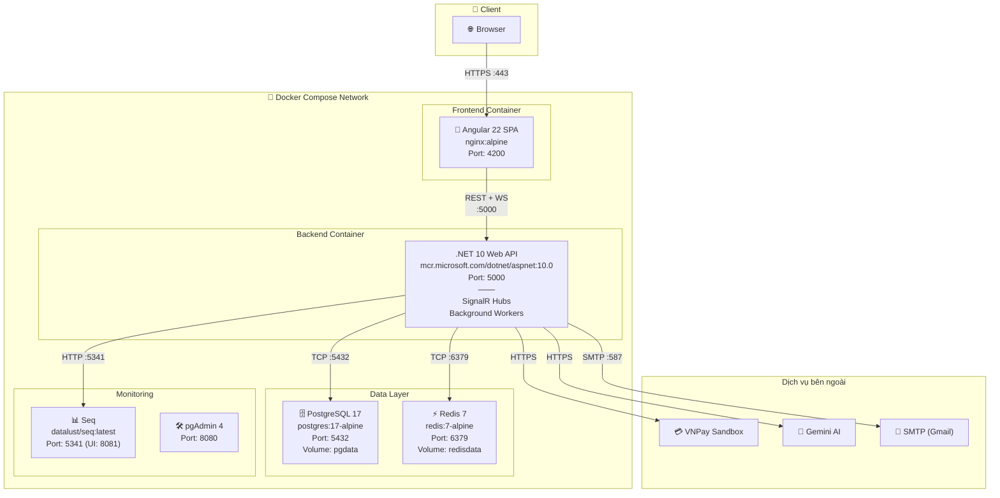

# 🚀 Deployment Diagram & CI/CD Pipeline

> **Tài liệu:** SDD-08 | **Phiên bản:** 1.0 | **Ngày:** 2026-10-03
> **Rubric mapping:** TC2.1 (deployment diagram), TC2.6 (CI/CD ≥4 stages)

---

## 1. Deployment Topology — Docker Compose (Development & Staging)



---

## 2. CI/CD Pipeline — 6 Stages

```mermaid
flowchart LR
    subgraph Trigger["🔔 Trigger"]
        Push["Push to<br/>main/develop"]
        PR["Pull Request"]
    end

    subgraph S1["Stage 1<br/>🔨 Build"]
        BE_Build["Backend<br/>dotnet build"]
        FE_Build["Frontend<br/>npm run build"]
    end

    subgraph S2["Stage 2<br/>🔍 Lint & Analyze"]
        BE_Lint["Roslyn<br/>Analyzers"]
        FE_Lint["ESLint +<br/>Prettier"]
    end

    subgraph S3["Stage 3<br/>🧪 Test"]
        Unit["Unit Tests<br/>(xUnit)"]
        Cover["Coverage<br/>Report"]
    end

    subgraph S4["Stage 4<br/>🔒 Security"]
        Secrets["Gitleaks<br/>(secret scan)"]
        Deps["dotnet audit<br/>npm audit"]
    end

    subgraph S5["Stage 5<br/>🐳 Docker"]
        Build_Image["Build<br/>Docker Images"]
        Push_Registry["Push to<br/>Registry"]
    end

    subgraph S6["Stage 6<br/>🚀 Deploy"]
        Staging["Deploy<br/>Staging"]
        Smoke["Smoke<br/>Tests"]
    end

    Trigger --> S1 --> S2 --> S3 --> S4
    S4 -->|"main only"| S5 --> S6

    style S1 fill:#e8f5e9
    style S2 fill:#e3f2fd
    style S3 fill:#fff3e0
    style S4 fill:#fce4ec
    style S5 fill:#f3e5f5
    style S6 fill:#e0f7fa
```



---

## 3. Docker Configuration chi tiết

### Backend Dockerfile

```dockerfile
# Build stage
FROM mcr.microsoft.com/dotnet/sdk:10.0 AS build
WORKDIR /src
COPY *.sln .
COPY src/HotelSaas.Domain/*.csproj src/HotelSaas.Domain/
COPY src/HotelSaas.Application/*.csproj src/HotelSaas.Application/
COPY src/HotelSaas.Infrastructure/*.csproj src/HotelSaas.Infrastructure/
COPY src/HotelSaas.WebApi/*.csproj src/HotelSaas.WebApi/
RUN dotnet restore
COPY . .
RUN dotnet publish src/HotelSaas.WebApi -c Release -o /app

# Runtime stage
FROM mcr.microsoft.com/dotnet/aspnet:10.0 AS runtime
WORKDIR /app
COPY --from=build /app .
EXPOSE 5000
ENTRYPOINT ["dotnet", "HotelSaas.WebApi.dll"]
```

### Frontend Dockerfile

```dockerfile
# Build stage
FROM node:22-alpine AS build
WORKDIR /app
COPY package*.json ./
RUN npm ci
COPY . .
RUN npm run build -- --configuration production

# Runtime stage
FROM nginx:alpine
COPY --from=build /app/dist/hotel-saas/browser /usr/share/nginx/html
COPY nginx.conf /etc/nginx/conf.d/default.conf
EXPOSE 80
```

---

## 4. Environment Strategy

| Environment | Database | Mục đích | URL |
|------------|---------|---------|-----|
| **Local** | Docker PostgreSQL | Development | localhost:4200 |
| **Staging** | Supabase / Neon (free) | Demo, user testing | staging.hotelsaas.dev |
| **Production** | Managed PostgreSQL | Live | hotelsaas.dev |

### Secret Management

```
Local:      .env file (gitignored) + dotnet user-secrets
Staging:    GitHub Secrets → docker-compose env
Production: Cloud secret manager (Azure Key Vault / GCP Secret Manager)
```

---

*Tài liệu này phục vụ TC2.1 (deployment diagram) và TC2.6 Mức 5 (CI/CD ≥4 stages — chúng ta có 6).*
