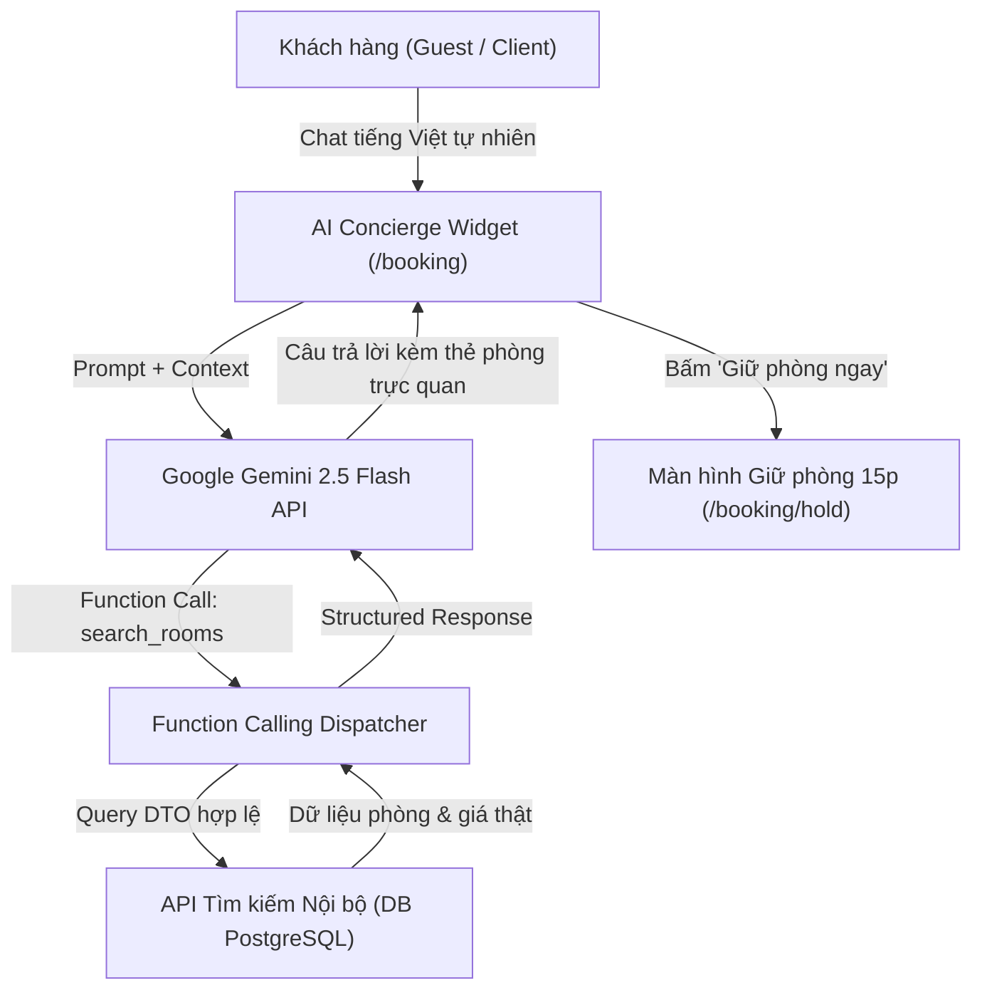
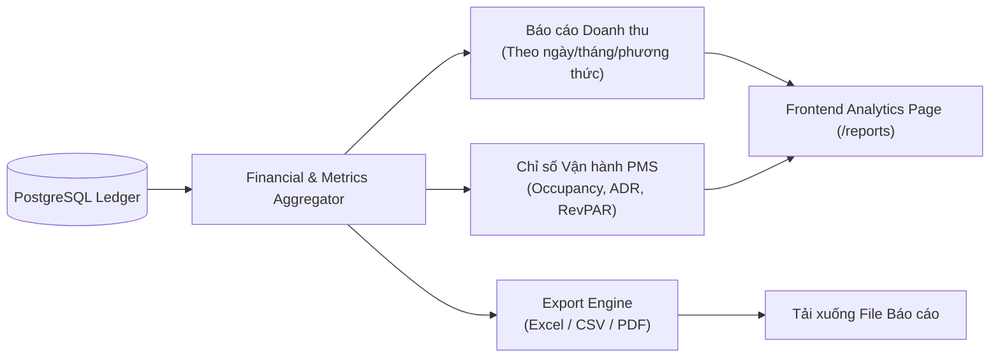

# 🏨 BÁO CÁO ĐÁNH GIÁ CHỨC NĂNG & KẾ HOẠCH ĐẶC TẢ THỰC HIỆN TOÀN DIỆN (SPEC KIT)
## HỆ THỐNG QUẢN TRỊ KHÁCH SẠN ĐA CHI NHÁNH — HOTEL SAAS V2
**Ngày lập kế hoạch:** 14/10/2026  
**Chủ nhiệm kỹ thuật & System Architect:** Ngô Võ Tuấn An (MSSV: 24TX810001)  
**Nhánh Git làm việc:** `develop` | **Phiên bản kiến trúc:** v2.5 Enterprise  
**Quy chuẩn áp dụng:** `design-taste-frontend-v1`, `spec-kit`, `ui-ux-pro-max`, `gemini-api-dev`, Clean Architecture .NET 9 + Angular 22

---

## PHẦN 1: ĐÁNH GIÁ TOÀN DIỆN HỆ THỐNG & PHÂN TÍCH LỖ HỔNG (GAP ANALYSIS)

Đối chiếu với các hệ sinh thái Quản lý Khách sạn / PMS thương mại tiêu chuẩn quốc tế (Cloudbeds, Mews, Odoo Hotel, KiotViet Khách sạn), hệ thống **Hotel SaaS v2** hiện tại đã đạt độ hoàn thiện cao ở tầng lõi nền tảng nhưng vẫn còn các khoảng trống chức năng (Gaps) cần bổ sung để trở thành một sản phẩm thương mại hoàn chỉnh.

### Bảng Ma trận Đối chiếu Hiện trạng & Khoảng trống Chức năng (Gap Matrix)

| Phân hệ nghiệp vụ | Hiện trạng trong Codebase v2 | Mức độ hoàn thiện | Khoảng trống chức năng cần bổ sung (Gaps) | Độ ưu tiên |
|:---|:---|:---:|:---|:---:|
| **1. Multi-Tenant & Onboarding** | Đã xong: Multi-Property, Global Query Filter, JWT Auth, Onboarding Tỉnh/Xã 2 cấp, Nâng cấp Khách hàng $\to$ Đối tác. | **95%** | Quản lý Profile khách sạn, tải lên nhiều ảnh (Gallery), bản đồ tọa độ Google Maps. | P2 |
| **2. Quản lý Gói cước SaaS (Subscriptions)** | Domain đã có `Subscription`, `SubscriptionPlan`, `SubscriptionPayment`. Đăng ký đối tác tự gán gói dùng thử (`Free Trial`). | **40%** | **Thiếu hoàn toàn UI & API kiểm soát:** Chưa có màn hình quản lý gói cước (`/subscriptions`), chưa có middleware chặn tạo vượt số phòng theo gói (`Quota Enforcement`), chưa có cổng thanh toán gia hạn gói SaaS. | **CRITICAL (P1)** |
| **3. Cổng Đặt phòng Online (Guest Portal)** | Đã xong: Tìm phòng theo giờ/đêm, 3-step OTA, Hold 15 phút, tra cứu token, ký hiệu `₫`, bảo mật PII. | **95%** | **Thiếu Trợ lý AI Concierge:** Khách chưa thể tìm phòng bằng ngôn ngữ tự nhiên tiếng Việt hoặc hỏi đáp trực tiếp. | **HIGH (P1)** |
| **4. Bảng điều khiển & Báo cáo (Analytics)** | Đã xong: Dashboard KPI mẫu phòng, Room Readiness Bar 3 màu, Giờ Việt Nam trực tiếp. | **60%** | **Thiếu Module Báo cáo Chuyên sâu (`/reports`):** Chưa có báo cáo doanh thu theo kênh (OTA vs Walk-in), thiếu các chỉ số tài chính PMS chuẩn: **ADR** (Giá bình quân), **RevPAR** (Doanh thu/phòng sẵn có), chưa có tính năng **Xuất Excel / PDF**. | **HIGH (P1)** |
| **5. Thu ngân & Sổ cái Folio** | Đã xong: Kiến trúc luồng kép (Thực thu ngày VN vs Nhật ký UTC), lọc đa tiêu chí, bảo vệ quyền 403. | **90%** | **Thiếu Quản lý Ca Lễ tân (Shift Handover):** Mở ca, chốt két tiền mặt đầu/cuối ca, bàn giao ca trực có đối soát chênh lệch. | P2 |
| **6. Khuyến mãi & Khách hàng (CRM)** | Domain đã có `Promotion`, `GuestReview`. | **30%** | **Thiếu Engine Voucher / Coupon:** Nhập mã giảm giá khi đặt phòng, chiết khấu phần trăm / số tiền, phân hạng hội viên tích điểm (Loyalty). | P2 |
| **7. Quản lý Kho phòng & Buồng phòng** | Backend đã có model; Frontend đang phát triển độc lập trên `feature/nguyen-rooms` và `feature/tan-housekeeping`. | **75%** | Chờ merge 2 PR tuần 2 từ Nguyên (CRUD phòng, Batch generator) và Tân (Floor Grid Kanban, FSM 1 chạm). | **IN PROGRESS** |

---

## PHẦN 2: THIẾT KẾ CHI TIẾT CÁC TÍNH NĂNG CÒN THIẾU

---

### I. THIẾT KẾ TÍCH HỢP AI (AI-POWERED HOSPITALITY ENGINE)

Thay vì tích hợp AI hời hợt hoặc bịa đặt dữ liệu (AI Hallucination), Hotel SaaS v2 thiết kế 3 thành phần AI tương tác với backend thông qua **Function Calling có Schema bảo vệ nghiêm ngặt** sử dụng mô hình **Google Gemini 2.5 Flash / Gemini 3.8**:



#### 1. AI Semantic Room Search (Tìm phòng bằng giọng nói / câu hỏi tự nhiên)
- **Ví dụ prompt của khách:** *"Tìm giúp tôi 1 phòng đôi view đẹp ở Vũng Tàu tối thứ 7 này cho 2 vợ chồng và 1 bé nhỏ, ngân sách tầm 700k đổ lại."*
- **Quy trình xử lý an toàn:**
  1. Gemini trích xuất tham số:
     ```json
     {
       "destination": "Vũng Tàu",
       "stayType": "Overnight",
       "checkInDate": "2026-10-17",
       "checkOutDate": "2026-10-18",
       "minOccupancy": 3,
       "maxPrice": 700000
     }
     ```
  2. Backend gọi service tìm kiếm có sẵn (`IPublicBookingService.SearchAvailabilityAsync`), trả về danh sách phòng thật.
  3. AI trả lời tự nhiên kèm danh sách thẻ phòng hiển thị giá chính thức, tuyệt đối không tự bịa giá.

#### 2. AI Smart Pricing Advisor (Dành cho Chủ khách sạn / Quản lý)
- Đặt tại trang `/rates` của Admin.
- AI phân tích tỷ lệ lấp đầy phòng (`Occupancy Rate`) trong 14 ngày tới:
  * Nếu công suất $> 85\%$: Gợi ý tăng nhẹ giá qua đêm $10\% - 15\%$ để tối ưu hóa biên lợi nhuận.
  * Nếu công suất $< 30\%$ vào ngày thường: Gợi ý tạo gói khuyến mãi hoặc giảm giá giờ đầu để kích cầu.

---

### II. THIẾT KẾ THỐNG KÊ & BÁO CÁO TÀI CHÍNH PMS (`/reports`)

Nâng cấp Dashboard và xây dựng phân hệ Báo cáo chuyên nghiệp phục vụ chủ doanh nghiệp:



#### 1. Bộ chỉ số Tài chính Khách sạn Quốc tế:
- **Tỷ lệ lấp đầy (Occupancy Rate - %):**
  $$\text{Occupancy Rate} = \frac{\text{Số đêm phòng đã bán}}{\text{Tổng số đêm phòng sẵn có}} \times 100\%$$
- **Giá phòng bình quân mỗi ngày (Average Daily Rate - ADR):**
  $$\text{ADR} = \frac{\text{Tổng doanh thu tiền phòng}}{\text{Số phòng đã bán thực tế}}$$
- **Doanh thu trên mỗi phòng sẵn có (RevPAR):**
  $$\text{RevPAR} = \text{ADR} \times \text{Occupancy Rate} = \frac{\text{Tổng doanh thu tiền phòng}}{\text{Tổng số phòng hiện có}}$$

#### 2. Tính năng Xuất Báo cáo (Export Engine):
- Xuất bảng kê giao dịch ra file **Excel (.xlsx)** hoặc **CSV** chuẩn tiếng Việt có dấu (UTF-8 with BOM).
- In hóa đơn thanh toán / Phiếu thu tiền phòng chuẩn A4/A5 định dạng PDF.

---

### III. THIẾT KẾ QUẢN LÝ GÓI CƯỚC SAAS (SUBSCRIPTION MANAGEMENT)

Mô hình kiếm tiền (Monetization) B2B của nền tảng Hotel SaaS dựa trên hạn ngạch tài nguyên:

| Thuộc tính gói | Gói Khởi nghiệp (Starter) | Gói Tiêu chuẩn (Pro) ⭐ | Gói Doanh nghiệp (Enterprise) |
|:---|:---:|:---:|:---:|
| **Giá cước** | 290.000 ₫ / tháng | 690.000 ₫ / tháng | 1.490.000 ₫ / tháng |
| **Giới hạn số phòng** | Tối đa **15 phòng** | Tối đa **50 phòng** | **Không giới hạn** |
| **Số lượng chi nhánh** | 1 chi nhánh | Tối đa 3 chi nhánh | Không giới hạn cơ sở |
| **Tài khoản nhân viên** | 3 tài khoản | 10 tài khoản | Không giới hạn |
| **Báo cáo chuyên sâu** | Cơ bản | Chi tiết (ADR, RevPAR, Excel) | Toàn diện + Phân tích AI |
| **Tính năng AI Concierge** | Không hỗ trợ | 200 lượt tìm kiếm/tháng | Không giới hạn + Chatbot riêng |
| **Hỗ trợ kỹ thuật** | Qua Email | 24/7 Hotline | Chuyên viên hỗ trợ riêng |

#### Cơ chế Chặn Hạn ngạch (Quota Enforcement Middleware):
Khi Owner tạo thêm phòng vật lý qua `POST /api/rooms`:
```csharp
var currentRoomCount = await _context.Rooms.CountAsync(r => r.TenantId == tenantId);
var maxAllowed = currentSubscription.Plan.MaxRooms;

if (currentRoomCount >= maxAllowed)
{
    return BadRequest(new ProblemDetails {
        Title = "Vượt quá hạn ngạch gói cước",
        Detail = $"Gói hiện tại ({currentSubscription.Plan.Name}) chỉ cho phép tối đa {maxAllowed} phòng. Vui lòng nâng cấp gói để thêm phòng mới."
    });
}
```

---

## PHẦN 3: KẾ HOẠCH TRIỂN KHAI CHUẨN SPEC KIT (SPECKIT IMPLEMENTATION PLAN)

Theo phương pháp luận **Spec Kit**, toàn bộ quá trình bổ sung tính năng được chia thành 4 Milestone rõ ràng với đầy đủ kiểm thử và tiêu chí chấp nhận (DoD):

```mermaid
gantt
    title LỘ TRÌNH THỰC HIỆN CÁC PHÂN HỆ MỚI (HOTEL SAAS V2)
    dateFormat  YYYY-MM-DD
    section Sprint Tuần 2 (Hiện tại)
    Hoàn thiện Pricing Engine & Onboarding 2 cấp :done, m1, 2026-10-13, 2026-10-15
    Merge nhánh Rooms & Housekeeping của Nguyên, Tân :active, m2, 2026-10-15, 2026-10-17
    section Sprint Tuần 3 (Mở rộng SaaS)
    Epic 1: SaaS Subscriptions & Quota Enforcement :m3, 2026-10-17, 2026-10-20
    Epic 2: Financial Reports & Analytics (ADR, RevPAR) :m4, 2026-10-20, 2026-10-23
    section Sprint Tuần 4 (AI & Hoàn thiện)
    Epic 3: Gemini AI Concierge & Natural Room Search :m5, 2026-10-23, 2026-10-27
    Epic 4: Shift Handover, Loyalty & UAT Hoàn chỉnh :m6, 2026-10-27, 2026-10-31
```

### Chi tiết 4 Epics Thực Hiện:

#### 🔹 EPIC 1: SaaS Subscriptions & Quota Enforcement
- **Backend Tasks:**
  * `SubscriptionsController.cs`: `GET /api/subscriptions/current`, `GET /api/subscriptions/plans`, `POST /api/subscriptions/upgrade`.
  * Thêm `SubscriptionQuotaBehavior` (MediatR Pipeline Behavior) tự động chặn tạo phòng hoặc chi nhánh khi vượt hạn ngạch.
- **Frontend Tasks:**
  * Xây dựng trang `/subscriptions`: Hiển thị thẻ gói cước hiện tại, thanh phần trăm sử dụng tài nguyên (vd: `12/15 phòng`), bảng so sánh 3 gói và nút nâng cấp.
- **DoD:** Tạo phòng thứ 16 trên gói Starter bị trả mã `400 Bad Request` có thông báo rõ ràng; nâng cấp lên gói Pro cho phép tạo bình thường.

#### 🔹 EPIC 2: Financial Reports & Analytics Engine
- **Backend Tasks:**
  * `ReportsController.cs`: `GET /api/reports/revenue-summary`, `GET /api/reports/pms-kpi`, `GET /api/reports/export-excel`.
  * Service tính toán ADR, RevPAR, công suất phòng theo mốc thời gian lọc (Ngày, Tuần, Tháng).
- **Frontend Tasks:**
  * Xây dựng trang `/reports`: Biểu đồ doanh thu thực thu, thẻ chỉ số ADR & RevPAR, bộ lọc ngày tháng và nút "Xuất file Excel".
- **DoD:** Dữ liệu khớp 100% với Sổ cái Thu ngân Folio (`/payments`); tải file Excel mở đúng định dạng và có tiếng Việt.

#### 🔹 EPIC 3: Gemini AI Hospitality Concierge
- **Backend Tasks:**
  * Cài đặt gói `Google.GenAI` SDK (.NET).
  * `AiConciergeService.cs`: Tích hợp mô hình `gemini-2.5-flash`, định nghĩa Tool Function `SearchAvailableRooms(city, checkIn, checkOut, rentalType, guests)`.
  * `AiController.cs`: `POST /api/ai/chat`. Ghi nhận lượt sử dụng vào bảng `AiUsageLogs`.
- **Frontend Tasks:**
  * Floating Chat Widget góc dưới bên phải trang `/booking`.
  * Hỗ trợ gõ câu hỏi hoặc chọn các câu hỏi mẫu gợi ý (Quick Prompts).
- **DoD:** Trả lời chính xác giá và phòng trống; không bao giờ bịa đặt phòng không tồn tại; không lộ thông tin bí mật hệ thống.

#### 🔹 EPIC 4: Lễ tân Giao ca & Khuyến mãi (Shift Handover & Promotions)
- **Backend & Frontend:**
  * Quản lý số dư két tiền mặt đầu/cuối ca làm việc.
  * Ô nhập mã giảm giá (Voucher) trên form tính báo giá giữ phòng.

---

## PHẦN 4: HÌNH ẢNH TỔNG THỂ & BẢN ĐỒ CHỨC NĂNG (VISUAL SITEMAP)

Dưới đây là bản đồ cấu trúc không gian giao diện từ phân hệ Khách vãng lai (Client Guest) đến Ban quản trị (Admin / Tenant Portal):

```
┌────────────────────────────────────────────────────────────────────────────────────────┐
│                        CỔNG KHÁCH HÀNG & CÔNG KHAI (CLIENT GUEST)                      │
├────────────────────────────────────────────────────────────────────────────────────────┤
│ 1. Trang Đặt phòng Công khai (/booking)                                                │
│    ├── [Luxury Hero Banner] Tagline + Huy hiệu bảo chứng uy tín                        │
│    ├── [Booking Stepper Tracker] 1. Chọn cơ sở ➔ 2. Chọn loại phòng ➔ 3. Báo giá       │
│    ├── [Unified Search Card] Bộ lọc Giờ/Đêm + Địa điểm Combobox + Lịch + Số khách      │
│    ├── [Property Grid] Danh sách cơ sở + SVG tòa nhà hoàng hôn                         │
│    ├── [Room Types Cards] Hạng phòng + Giá thực + Tiện ích                             │
│    ├── [Quote & Hold Panel] Bảng kê chi phí minh bạch + Form đặt phòng                 │
│    ├── [Sticky Bottom Bar] Tóm tắt tổng tiền + Nút 'Giữ phòng 15 phút'                 │
│    └── [AI Concierge Widget] Trợ lý ảo tìm phòng thông minh góc màn hình               │
│                                                                                        │
│ 2. Trang Tạm giữ phòng 15 phút (/booking/hold/:token)                                  │
│    ├── Đồng hồ đếm ngược số lớn (Digital Countdown)                                    │
│    ├── Thông tin đặt phòng & Mã giữ chỗ bảo mật                                        │
│    ├── Bảng tính tiền cọc 30% chuẩn tiền tệ ₫                                          │
│    └── Hướng dẫn chuyển khoản ngân hàng & Cú pháp nộp cọc                              │
│                                                                                        │
│ 3. Trang Tra cứu Đơn đặt phòng (/booking/lookup & /status/:token)                      │
│    └── Nhập mã token / CCCD để tra cứu trạng thái phòng và thời gian check-in          │
└───────────────────────────────────────────┬────────────────────────────────────────────┘
                                            │
                                            ▼
┌────────────────────────────────────────────────────────────────────────────────────────┐
│                     CỔNG XÁC THỰC & ĐỐI TÁC (AUTHENTICATION & ONBOARDING)              │
├────────────────────────────────────────────────────────────────────────────────────────┤
│ 1. Đăng nhập (/login)                 │ 2. Đăng ký Khách lẻ (/register)                │
│    ├── Nhập Email & Mật khẩu          │    ├── Đo độ mạnh mật khẩu (p-password)        │
│    ├── Phím Quick Fill tài khoản mẫu  │    └── Liên kết chuyển sang mở khách sạn       │
│    └── Tự động mở Context Switcher    │                                                │
│ ──────────────────────────────────────┴─────────────────────────────────────────────── │
│ 3. Đăng ký Đối tác Mở Khách sạn (/partner-register)                                    │
│    ├── [Value Proposition Bar] 3 Trụ cột: Khởi tạo tức thì - Đa cơ sở - Giá thông minh │
│    ├── Cascading Dropdown Tỉnh/Thành ➔ Phường/Xã 2 cấp chuẩn Việt Nam (< 1ms)          │
│    ├── Form 2 cột rộng rãi (max-w-4xl) + Nhập chính sách giờ nhận/trả                  │
│    └── Tự động nhận diện & Nâng cấp tài khoản Khách hàng (Customer ➔ Owner)            │
│                                                                                        │
│ 4. Trang Báo lỗi Truy cập Phân quyền (/forbidden - 403 Forbidden)                      │
│    └── Icon khiên bảo mật + Thông báo lý do + Phím quay về Dashboard / Đăng nhập       │
└───────────────────────────────────────────┬────────────────────────────────────────────┘
                                            │
                                            ▼
┌────────────────────────────────────────────────────────────────────────────────────────┐
│                       CỔNG QUẢN TRỊ NỘI BỘ (ADMIN & TENANT PORTAL)                     │
├────────────────────────────────────────────────────────────────────────────────────────┤
│ * Layout: Sidebar thu gọn + Header chuyển đổi chi nhánh tức thì (Context Switcher)     │
│                                                                                        │
│ 1. Bảng điều khiển Tổng quan (/dashboard)                                              │
│    ├── Giờ Việt Nam thực tế + Tỷ lệ sẵn sàng đón khách (% Ready Rate)                  │
│    ├── [Readiness Bar] Thanh tiến trình 3 màu: Xanh (Sạch) - Vàng (Dọn) - Đỏ (Bẩn)     │
│    ├── 4 Thẻ KPI: Tổng phòng, Phòng sạch, Cần dọn, Bảo trì                             │
│    └── Lưới xem nhanh hiện trạng phòng + Cảnh báo dữ liệu minh bạch                    │
│                                                                                        │
│ 2. Bảng giá & Chính sách Khách sạn                                                     │
│    ├── [/rates] Bảng giá đa khung giờ: Gói giờ đầu, lũy tiến 60p, qua đêm, ngày lễ    │
│    ├── [/rates - Audit Tab] Lịch sử chia khoảng ngày hiệu lực + Skeleton Table         │
│    └── [/policies] Cấu hình phụ thu Check-in sớm, Check-out trễ, Buffer dọn >= 30p     │
│                                                                                        │
│ 3. Quản lý Buồng phòng & Kho phòng                                                     │
│    ├── [/rooms] Sơ đồ phòng theo tầng + Batch Room Generator (Tạo dải 201-215)         │
│    ├── [/room-types] Quản lý danh mục hạng phòng & sức chứa tiêu chuẩn                 │
│    └── [/housekeeping] Bảng điều hành FSM 1 chạm: Clean ↔ Dirty ↔ Inspecting ↔ OOO     │
│                                                                                        │
│ 4. Thu ngân, Tài chính & Gói cước SaaS                                                 │
│    ├── [/payments] Sổ cái Folio luồng kép: Thực thu trong ngày (VN) vs Nhật ký (UTC)   │
│    ├── [/reports] (Mới) Báo cáo Doanh thu, Chỉ số ADR, RevPAR, Công suất & Xuất Excel  │
│    └── [/subscriptions] (Mới) Quản lý gói cước SaaS: Starter, Pro, Enterprise & Quota │
└────────────────────────────────────────────────────────────────────────────────────────┘
```

---

## PHẦN 5: KẾT LUẬN & ĐỀ XUẤT HÀNH ĐỘNG TIẾP THEO

1. **Khẳng định năng lực nền tảng:** Kiến trúc hiện tại của `Hotel SaaS v2` đã rất vững chắc (Clean Architecture, Multi-Tenant triệt để, Angular 22 Signals hiện đại, 193 Tests passed, 0 lỗi build).
2. **Hành động ưu tiên số 1:** Hoàn tất việc merge 2 nhánh `feature/nguyen-rooms` và `feature/tan-housekeeping` để hoàn thiện 100% hai màn hình Kho phòng và Buồng phòng.
3. **Hành động ưu tiên số 2:** Triển khai **Epic 1 (Gói cước SaaS & Quota)** và **Epic 2 (Báo cáo Doanh thu & ADR/RevPAR)** để hoàn tất chu trình kinh doanh B2B cho chủ khách sạn.
4. **Hành động ưu tiên số 3:** Tích hợp **Gemini AI Concierge** trên cổng đặt phòng công khai để tạo điểm nhấn đột phá cho đồ án.
