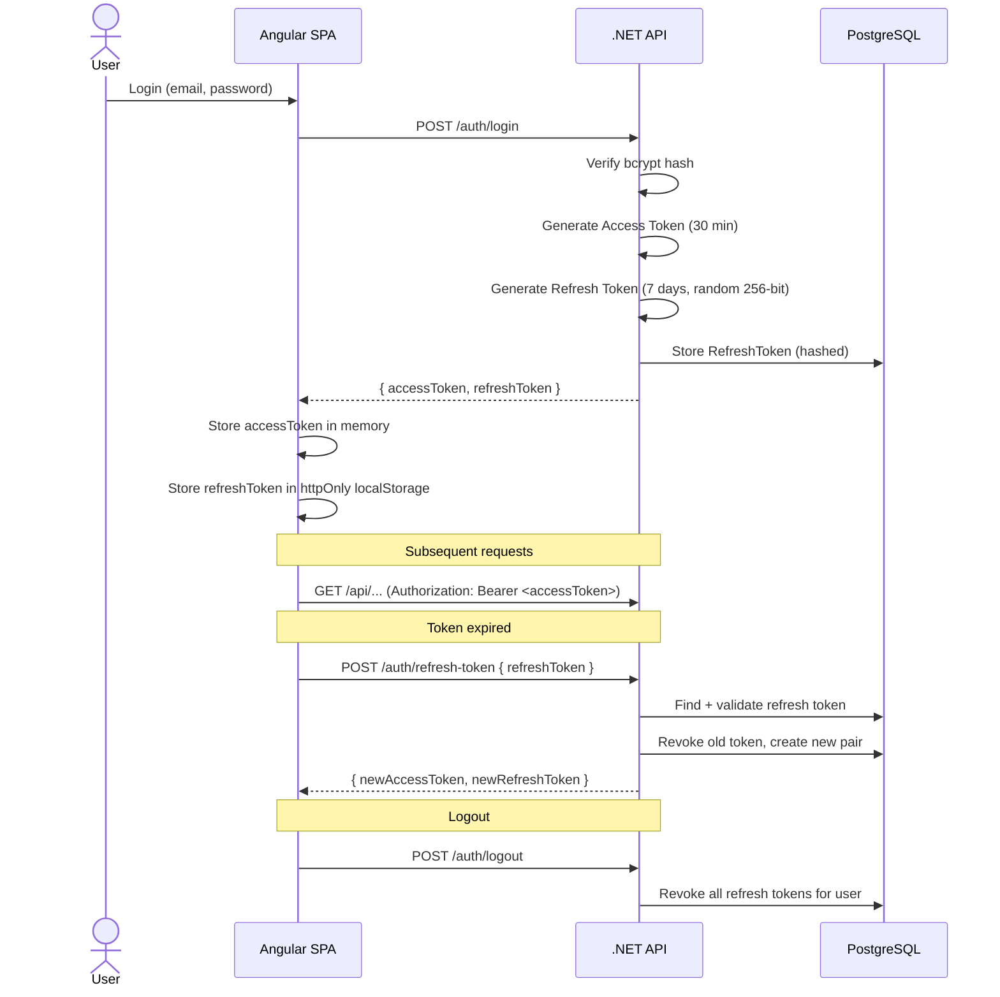
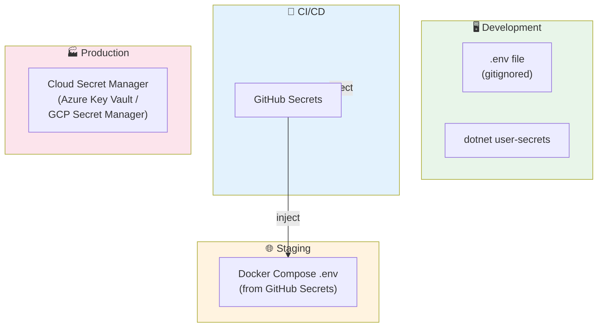

# 🔒 Security Design

> **Tài liệu:** SDD-09 | **Phiên bản:** 1.0 | **Ngày:** 2026-10-03
> **Rubric mapping:** TC2.1 (NFR bảo mật), TC2.4 (0 secret lộ)

---

## 1. Authentication Flow — JWT + Refresh Token



---

## 2. Security Controls

### 2.1 Password Security

| Control | Implementation |
|---------|---------------|
| Hashing | bcrypt with cost factor ≥ 10 |
| Requirements | ≥ 8 chars, ≥ 1 uppercase, ≥ 1 number, ≥ 1 special |
| Brute force | Lock account after 5 failed attempts → 15 min cooldown |
| Storage | Hash only — raw password never stored or logged |

### 2.2 JWT Token

| Setting | Value | Lý do |
|---------|-------|-------|
| Algorithm | HS256 | Symmetric, đủ cho single-server |
| Access token expiry | 30 phút | Giảm risk nếu token bị lộ |
| Refresh token expiry | 7 ngày | Balance UX vs security |
| Token rotation | Mỗi refresh → old token revoked | Phát hiện token theft |

### 2.3 API Security

| Control | Implementation |
|---------|---------------|
| CORS | Whitelist origins (SPA domain only) |
| Rate limiting | Auth endpoints: 100 req/min/IP |
| Input validation | FluentValidation on all commands |
| SQL injection | EF Core parameterized queries (no raw SQL) |
| XSS | Angular auto-sanitize + CSP headers |
| CSRF | Not needed (JWT in Authorization header, not cookies) |
| HTTPS | Required — redirect HTTP → HTTPS |
| Helmet headers | X-Content-Type-Options, X-Frame-Options, CSP |

### 2.4 Data Protection

| Data | Protection | Level |
|------|-----------|-------|
| Password | bcrypt hash | At rest |
| CCCD/Passport | AES-256 encryption | At rest |
| API communication | TLS 1.2+ | In transit |
| Database connection | SSL mode=require | In transit |
| Refresh tokens | SHA-256 hash in DB | At rest |
| .env, secrets | .gitignore + dotnet user-secrets | Dev |
| Production secrets | Cloud Secret Manager | Prod |

### 2.5 Multi-tenant Isolation

```
Level 1: JWT claim "tenantId" → CurrentTenantService
Level 2: EF Core Global Query Filters → auto WHERE TenantId = @current
Level 3: Every API endpoint requires tenant context (except public + SuperAdmin)
Level 4: Audit log records all cross-tenant access by SuperAdmin
```

---

## 3. OWASP Top 10 Mapping

| # | OWASP Risk | Mitigation | Status |
|---|-----------|-----------|:------:|
| A01 | Broken Access Control | RBAC bitmask + Global Query Filters | ✅ |
| A02 | Cryptographic Failures | bcrypt, TLS 1.2+, AES-256 | ✅ |
| A03 | Injection | EF Core parameterized, FluentValidation | ✅ |
| A04 | Insecure Design | Threat model, security review | ✅ |
| A05 | Security Misconfiguration | Hardened Docker, no default creds | ✅ |
| A06 | Vulnerable Components | npm audit, dotnet audit in CI | ✅ |
| A07 | Auth Failures | JWT rotation, brute-force lock | ✅ |
| A08 | Software Integrity | Gitleaks, signed commits | ✅ |
| A09 | Logging Failures | Serilog structured logging (no PII) | ✅ |
| A10 | SSRF | No user-controlled URLs to internal services | ✅ |

---

## 4. Secret Management



### Secrets inventory

| Secret | Dev source | CI/Staging source |
|--------|-----------|------------------|
| DB connection string | .env | GitHub Secret `DB_CONNECTION` |
| JWT signing key | .env | GitHub Secret `JWT_SECRET` |
| VNPay hash secret | .env | GitHub Secret `VNPAY_HASH_SECRET` |
| Gemini API key | .env | GitHub Secret `GEMINI_API_KEY` |
| SMTP password | .env | GitHub Secret `SMTP_PASSWORD` |
| Redis password | .env | GitHub Secret `REDIS_PASSWORD` |

---

*Tài liệu này phục vụ TC2.1 (NFR bảo mật) và TC2.4 (0 secret lộ). Bao phủ OWASP Top 10.*
