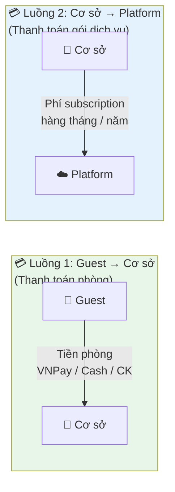
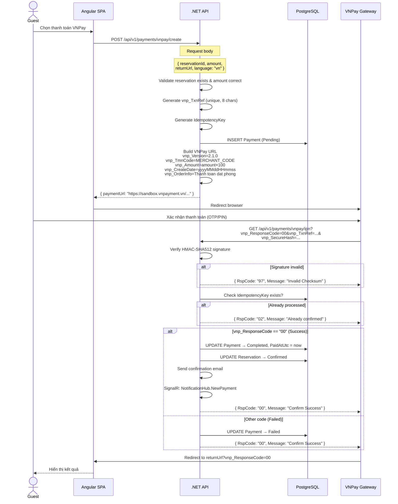
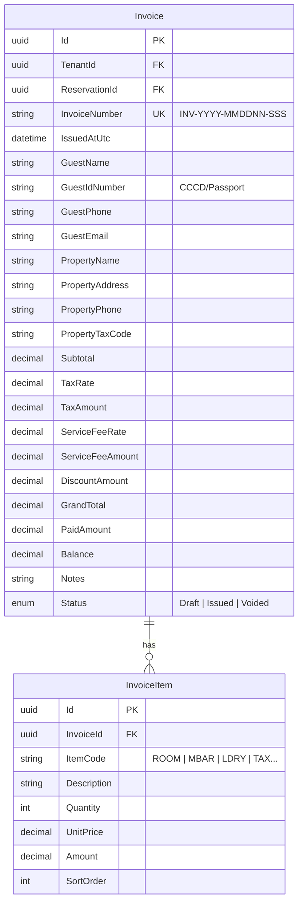
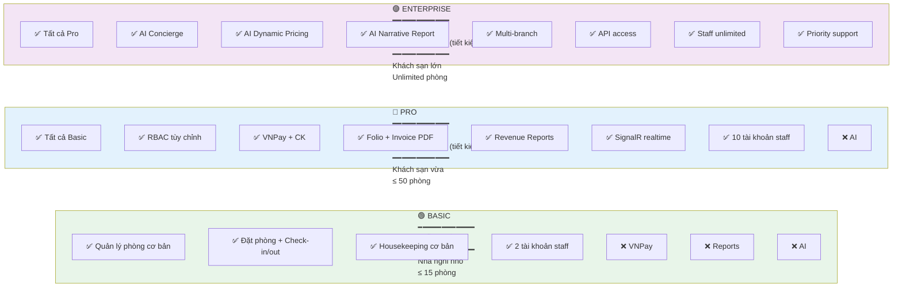
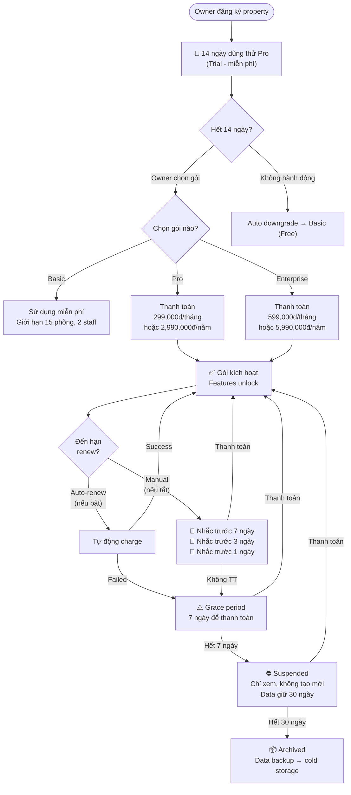
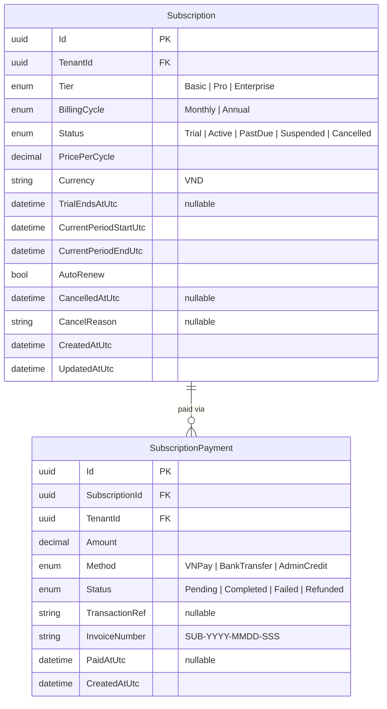
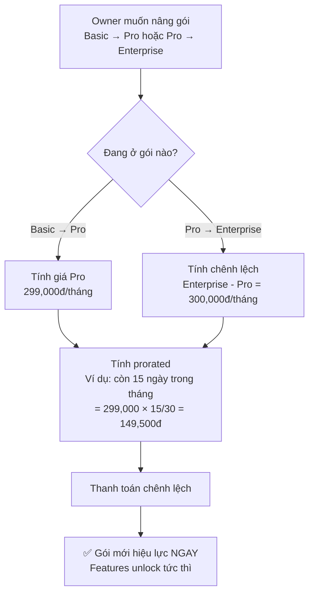
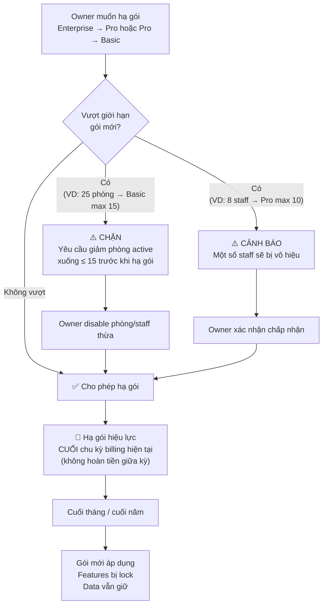

# 💳 Thiết kế hệ thống Thanh toán & Gói dịch vụ (Subscription)

> **Tài liệu:** SDD-10 | **Phiên bản:** 1.0 | **Ngày:** 2026-10-03
> **Phạm vi:** Thanh toán phòng (Guest → Cơ sở) + Thanh toán gói (Cơ sở → Platform)

---

## 📌 Hai luồng thanh toán trong hệ thống



---

# PHẦN A: THANH TOÁN PHÒNG (Guest → Cơ sở)

## A1. Phương thức thanh toán

### Bảng phương thức

| # | Phương thức | Khi nào | Subscription cần | Quy trình |
|---|-----------|---------|:---------:|----------|
| 1 | **VNPay QR / Thẻ ATM nội địa** | Đặt online, tại quầy | Pro+ | Redirect → VNPay → Callback |
| 2 | **VNPay thẻ quốc tế** (Visa/Master/JCB) | Đặt online | Enterprise | Redirect → VNPay → Callback |
| 3 | **Tiền mặt (Cash)** | Tại quầy lễ tân | Tất cả | Staff ghi nhận trên hệ thống |
| 4 | **Chuyển khoản ngân hàng** | Trước check-in | Tất cả | Khách CK → Staff xác nhận |
| 5 | **Ví điện tử** (MoMo, ZaloPay) | Tương lai | Enterprise | Phase sau |

### Flow thanh toán VNPay chi tiết



### VNPay Response Codes

| Code | Ý nghĩa | Xử lý |
|------|---------|-------|
| `00` | Giao dịch thành công | Payment → Completed |
| `07` | Trừ tiền thành công, giao dịch bị nghi ngờ | Payment → Completed + Flag review |
| `09` | Thẻ chưa đăng ký InternetBanking | Payment → Failed |
| `10` | Xác thực thông tin thẻ/tài khoản không đúng quá 3 lần | Payment → Failed |
| `11` | Đã hết hạn chờ thanh toán | Payment → Expired |
| `12` | Thẻ/Tài khoản bị khóa | Payment → Failed |
| `13` | Sai mật khẩu xác thực giao dịch (OTP) | Payment → Failed |
| `24` | Khách hủy giao dịch | Payment → Failed |
| `51` | Tài khoản không đủ số dư | Payment → Failed |
| `65` | Tài khoản đã vượt quá hạn mức giao dịch trong ngày | Payment → Failed |
| `75` | Ngân hàng thanh toán đang bảo trì | Payment → Failed |
| `79` | Nhập sai mật khẩu quá số lần quy định | Payment → Failed |
| `99` | Lỗi khác (không thuộc các mã trên) | Payment → Failed |

---

## A2. Cấu trúc giá phòng & tính tiền

### Công thức tính tổng

```
TotalAmount = (RoomPrice × NumberOfNights)
            + ExtraCharges (minibar, laundry, restaurant...)
            + ChildSurcharge (nếu có)
            + ExtraBedCharge (nếu có)
            + Tax (VAT %)
            + ServiceFee (%)
            - Discount (promotion, nếu có)
```

### Ví dụ chi tiết

```
Phòng Deluxe Double — 2 đêm
├── Giá phòng: 500,000 × 2 đêm         = 1,000,000 đ
├── Minibar                               =   150,000 đ
├── Giặt ủi (2 bộ × 40,000)             =    80,000 đ
├── Giường phụ (200,000 × 2 đêm)        =   400,000 đ
├──────────────────────────────────────────────────────
│   Tạm tính (Subtotal)                  = 1,630,000 đ
├── Thuế VAT 10%                         =   163,000 đ
├── Phí dịch vụ 5%                       =    81,500 đ
├── Khuyến mãi "Early bird -10%"         =  -163,000 đ
├──────────────────────────────────────────────────────
│   TỔNG CỘNG (Grand Total)              = 1,711,500 đ
├──────────────────────────────────────────────────────
│   Đã thanh toán (VNPay 01/10)          =  -500,000 đ
│   Đã thanh toán (Cash 03/10)           =  -1,211,500 đ
├──────────────────────────────────────────────────────
│   CÒN LẠI (Balance)                    =         0 đ
```

### Folio Items (chi tiết bill)

| Type | Mã | Mô tả | Tính thuế? |
|------|------|-------|:----------:|
| RoomCharge | `ROOM` | Tiền phòng × đêm | ✅ |
| ExtraBed | `EBED` | Giường phụ × đêm | ✅ |
| Minibar | `MBAR` | Đồ uống minibar | ✅ |
| Laundry | `LDRY` | Giặt ủi | ✅ |
| Restaurant | `REST` | Ăn uống nhà hàng | ✅ |
| Spa | `SPA` | Dịch vụ spa | ✅ |
| Parking | `PARK` | Phí gửi xe | ✅ |
| Surcharge | `SRCH` | Phụ thu (late checkout, damage...) | ✅ |
| ChildSurcharge | `CHLD` | Phụ thu trẻ em | ✅ |
| Deposit | `DPST` | Đặt cọc (trừ khi checkout) | ❌ |
| Tax | `TAX` | Thuế VAT | — |
| ServiceCharge | `SVFEE` | Phí dịch vụ | — |
| Discount | `DISC` | Giảm giá / Khuyến mãi (số âm) | ❌ |
| Payment | `PAY` | Thanh toán (số âm) | ❌ |
| Refund | `RFND` | Hoàn tiền (số dương) | ❌ |

---

## A3. Hóa đơn (Invoice)

### Cấu trúc Entity



### Quy tắc đánh số hóa đơn

```
Format: INV-{YYYY}-{MMDD}{NN}-{SSS}

Trong đó:
  YYYY = Năm (2026)
  MMDD = Tháng ngày (1003 = 03/10)
  NN   = Giờ (15 = 15:00)
  SSS  = Số thứ tự trong ngày (001, 002, 003...)

Ví dụ: INV-2026-100315-001
       = Hóa đơn ngày 03/10/2026, lúc 15h, thứ tự 001

Quy tắc:
- Không được xóa hóa đơn đã phát hành → chỉ Void
- Void hóa đơn → tạo hóa đơn điều chỉnh
- Số thứ tự tăng liên tục trong ngày, reset mỗi ngày mới
```

### Print template (HTML → PDF)

```
╔══════════════════════════════════════════════════════════╗
║                    HÓA ĐƠN THANH TOÁN                   ║
║                    PAYMENT INVOICE                        ║
║                                                          ║
║  Số / No: INV-2026-100315-001                            ║
║  Ngày / Date: 03/10/2026 15:30                           ║
╠══════════════════════════════════════════════════════════╣
║  ĐƠN VỊ CUNG CẤP DỊCH VỤ / SERVICE PROVIDER            ║
║  Tên: Nhà Nghỉ Hoa Đào                                  ║
║  Địa chỉ: 12 Trần Phú, P.3, TP. Đà Lạt, Lâm Đồng      ║
║  ĐT: 0263-123-4567                                      ║
║  Mã số thuế / Tax ID: 1234567890                         ║
╠══════════════════════════════════════════════════════════╣
║  KHÁCH HÀNG / CUSTOMER                                   ║
║  Họ tên: Lê Thùy Linh                                   ║
║  CCCD: 012345678901                                       ║
║  ĐT: 0912-345-678                                       ║
║  Email: linh@email.com                                   ║
╠══════════════════════════════════════════════════════════╣
║  Phòng / Room: 205 (Deluxe Double)                       ║
║  Check-in: 01/10/2026 14:00                              ║
║  Check-out: 03/10/2026 12:00                             ║
║  Số đêm / Nights: 2                                      ║
╠══════════════════════════════════════════════════════════╣
║                                                          ║
║  STT │ Mô tả                    │ SL │ Đơn giá │ T.Tiền ║
║  ────┼──────────────────────────┼────┼─────────┼────────║
║   1  │ Tiền phòng Deluxe Double │  2 │ 500,000 │1,000,000║
║   2  │ Giường phụ               │  2 │ 200,000 │  400,000║
║   3  │ Minibar                  │  1 │ 150,000 │  150,000║
║   4  │ Giặt ủi (2 bộ)          │  2 │  40,000 │   80,000║
║  ────┼──────────────────────────┼────┼─────────┼────────║
║      │ Tạm tính / Subtotal      │    │         │1,630,000║
║      │ Thuế VAT 10%             │    │         │  163,000║
║      │ Phí dịch vụ 5%           │    │         │   81,500║
║      │ KM Early Bird -10%       │    │         │ -163,000║
║  ════╪══════════════════════════╪════╪═════════╪════════║
║      │ TỔNG CỘNG / GRAND TOTAL  │    │         │1,711,500║
║  ════╪══════════════════════════╪════╪═════════╪════════║
║                                                          ║
║  THANH TOÁN / PAYMENTS                                   ║
║  ────┬──────────────────────────┬────────────────────────║
║   1  │ VNPay (01/10/2026 10:00) │              -500,000  ║
║   2  │ Cash  (03/10/2026 15:25) │            -1,211,500  ║
║  ────┼──────────────────────────┼────────────────────────║
║      │ CÒN LẠI / BALANCE       │                     0  ║
║                                                          ║
╠══════════════════════════════════════════════════════════╣
║  Cảm ơn quý khách! / Thank you for staying with us!     ║
║                                                          ║
║  Chữ ký lễ tân                    Chữ ký khách hàng     ║
║  _______________                  _______________         ║
╚══════════════════════════════════════════════════════════╝
```

---

# PHẦN B: GÓI DỊCH VỤ SUBSCRIPTION (Cơ sở → Platform)

## B1. Bảng giá gói dịch vụ chi tiết

### Ba gói chính



### Bảng so sánh chi tiết

| Feature | Basic (Free) | Pro (299k/tháng) | Enterprise (599k/tháng) |
|---------|:------------:|:-----------------:|:----------------------:|
| **Giới hạn** | | | |
| Số phòng tối đa | 15 | 50 | Unlimited |
| Số tài khoản staff | 2 | 10 | Unlimited |
| Dung lượng ảnh | 500 MB | 5 GB | 50 GB |
| Lưu trữ data | 1 năm | 3 năm | 5 năm |
| **Quản lý phòng** | | | |
| Room CRUD | ✅ | ✅ | ✅ |
| Room Status Board | ✅ (cơ bản) | ✅ (realtime) | ✅ (realtime) |
| Room Type management | ✅ (3 types max) | ✅ (unlimited) | ✅ (unlimited) |
| Booking Calendar view | ❌ | ✅ | ✅ |
| **Đặt phòng** | | | |
| Tạo booking (staff) | ✅ | ✅ | ✅ |
| Public booking page | ❌ | ✅ | ✅ |
| Guest self-booking | ❌ | ✅ | ✅ |
| Walk-in quick booking | ✅ | ✅ | ✅ |
| Check-in / Check-out | ✅ | ✅ | ✅ |
| Confirmation email | ❌ | ✅ | ✅ |
| **Thanh toán** | | | |
| Cash recording | ✅ | ✅ | ✅ |
| Bank transfer confirm | ✅ | ✅ | ✅ |
| VNPay QR / ATM nội địa | ❌ | ✅ | ✅ |
| VNPay thẻ quốc tế | ❌ | ❌ | ✅ |
| Folio management | ❌ | ✅ | ✅ |
| Invoice PDF | ❌ | ✅ | ✅ |
| Invoice HTML Print | ❌ | ✅ | ✅ |
| Refund management | ❌ | ✅ | ✅ |
| **Giá phòng** | | | |
| Giá cơ bản | ✅ | ✅ | ✅ |
| Giá theo mùa (season) | ❌ | ✅ | ✅ |
| Giá theo ngày (override) | ❌ | ✅ | ✅ |
| Khuyến mãi / Promotions | ❌ | ✅ (3 active) | ✅ (unlimited) |
| AI Dynamic Pricing | ❌ | ❌ | ✅ |
| **RBAC** | | | |
| System roles (Owner, Receptionist, Housekeeper) | ✅ | ✅ | ✅ |
| Custom roles | ❌ | ✅ (5 roles max) | ✅ (unlimited) |
| Permission matrix tùy chỉnh | ❌ | ✅ | ✅ |
| **Housekeeping** | | | |
| Task management cơ bản | ✅ | ✅ | ✅ |
| Auto-create on checkout | ✅ | ✅ | ✅ |
| Assignment + notification | ❌ | ✅ | ✅ |
| Kanban board | ❌ | ✅ | ✅ |
| Performance tracking | ❌ | ❌ | ✅ |
| **Real-time** | | | |
| SignalR room status | ❌ | ✅ | ✅ |
| SignalR notifications | ❌ | ✅ | ✅ |
| SignalR pricing | ❌ | ❌ | ✅ |
| SignalR dashboard KPIs | ❌ | ✅ | ✅ |
| **Báo cáo** | | | |
| Dashboard cơ bản | ✅ (today only) | ✅ (full) | ✅ (full) |
| Revenue report | ❌ | ✅ | ✅ |
| Occupancy report | ❌ | ✅ | ✅ |
| ADR / RevPAR | ❌ | ❌ | ✅ |
| Room revenue breakdown | ❌ | ✅ | ✅ |
| Payment summary | ❌ | ✅ | ✅ |
| Export Excel | ❌ | ✅ | ✅ |
| Export PDF | ❌ | ✅ | ✅ |
| AI Narrative Report | ❌ | ❌ | ✅ |
| **AI** | | | |
| AI calls / tháng | 0 | 0 | 500 |
| AI Concierge Chatbot | ❌ | ❌ | ✅ |
| AI Dynamic Pricing | ❌ | ❌ | ✅ |
| AI Auto Report | ❌ | ❌ | ✅ |
| Review Sentiment Analysis | ❌ | ❌ | ✅ |
| **Khác** | | | |
| Đa ngôn ngữ (VI/EN) | ✅ | ✅ | ✅ |
| Dark mode | ✅ | ✅ | ✅ |
| Guest reviews | ❌ | ✅ | ✅ |
| Multi-property (multi-branch) | ❌ | ❌ | ✅ |
| API access (programmatic) | ❌ | ❌ | ✅ |
| Webhook notifications | ❌ | ❌ | ✅ |
| Priority email support | ❌ | ❌ | ✅ |
| Custom branding (logo, colors) | ❌ | ✅ | ✅ |

---

## B2. Billing & Subscription Lifecycle

### Quy trình đăng ký gói



### Subscription Entity



---

## B3. Quy tắc nâng / hạ gói

### Nâng gói (Upgrade)



### Hạ gói (Downgrade)



### Bảng giới hạn khi hạ gói

| Khi hạ từ | Xuống | Kiểm tra |
|----------|-------|---------|
| Enterprise → Pro | Rooms ≤ 50, Staff ≤ 10, Custom roles ≤ 5 | Block nếu vượt |
| Enterprise → Basic | Rooms ≤ 15, Staff ≤ 2, No custom roles | Block nếu vượt |
| Pro → Basic | Rooms ≤ 15, Staff ≤ 2, No custom roles | Block nếu vượt |

### Quy tắc hủy gói

```
BR-SUB-CANCEL01: Hủy gói → hiệu lực cuối chu kỳ (không hoàn tiền)
BR-SUB-CANCEL02: Sau hủy → tự động downgrade về Basic
BR-SUB-CANCEL03: Data vẫn giữ (theo giới hạn Basic: 1 năm)
BR-SUB-CANCEL04: Có thể reactivate bất kỳ lúc nào
BR-SUB-CANCEL05: Gói Annual hủy giữa năm → vẫn dùng hết năm
```

---

## B4. Feature Gating Implementation

### Backend (Middleware)

```csharp
// SubscriptionGuard attribute
[SubscriptionTier(MinimumTier = SubscriptionTier.Pro)]
[HttpPost("vnpay/create")]
public async Task<IActionResult> CreateVNPayPayment(...)
{
    // Chỉ Pro+ mới gọi được endpoint này
}

// Middleware kiểm tra
public class SubscriptionMiddleware
{
    // 1. Lấy tenant subscription từ cache/DB
    // 2. So sánh RequiredTier vs CurrentTier
    // 3. Nếu không đủ → 402 Payment Required
    //    { "error": "Tính năng này yêu cầu gói Pro",
    //      "upgradeUrl": "/settings/subscription" }
}
```

### Frontend (Guard + Directive)

```typescript
// Route guard
export const proTierGuard = () =>
  inject(SubscriptionService).hasTier('Pro');

// Template directive
<button *requireTier="'Pro'"
        [tierFallback]="'Nâng cấp lên Pro để dùng VNPay'">
  Thanh toán VNPay
</button>

// Hiển thị: nếu Basic → nút disabled + tooltip "Nâng cấp"
//           nếu Pro+  → nút hoạt động bình thường
```

---

## B5. Hóa đơn Subscription (Platform → Cơ sở)

```
╔══════════════════════════════════════════════════════════╗
║         HÓA ĐƠN DỊCH VỤ PHẦN MỀM                       ║
║         SOFTWARE SERVICE INVOICE                          ║
╠══════════════════════════════════════════════════════════╣
║  NHÀ CUNG CẤP / PROVIDER                                ║
║  Công ty TNHH Hotel SaaS Platform                        ║
║  Địa chỉ: [Địa chỉ công ty]                             ║
║  MST: [Mã số thuế]                                      ║
╠══════════════════════════════════════════════════════════╣
║  Số: SUB-2026-1001-001                                   ║
║  Ngày: 01/10/2026                                        ║
╠══════════════════════════════════════════════════════════╣
║  KHÁCH HÀNG / CUSTOMER                                   ║
║  Tên cơ sở: Nhà Nghỉ Hoa Đào                            ║
║  Đại diện: Nguyễn Thị Hằng                               ║
║  MST: 1234567890                                         ║
╠══════════════════════════════════════════════════════════╣
║                                                          ║
║  STT │ Dịch vụ              │ Kỳ hạn      │ Thành tiền  ║
║  ────┼──────────────────────┼─────────────┼─────────────║
║   1  │ Gói Pro              │ 10/2026     │    299,000  ║
║  ────┼──────────────────────┼─────────────┼─────────────║
║      │ TỔNG CỘNG            │             │    299,000  ║
║                                                          ║
║  Bằng chữ: Hai trăm chín mươi chín nghìn đồng           ║
║                                                          ║
╚══════════════════════════════════════════════════════════╝
```

---

## B6. API Endpoints — Subscription Management

| Method | Endpoint | Permission | Mô tả |
|--------|----------|-----------|-------|
| GET | `/api/v1/subscription` | Owner | Xem gói hiện tại + usage |
| GET | `/api/v1/subscription/plans` | Authenticated | Danh sách gói + giá |
| POST | `/api/v1/subscription/upgrade` | Owner | Nâng gói |
| POST | `/api/v1/subscription/downgrade` | Owner | Hạ gói (cuối kỳ) |
| POST | `/api/v1/subscription/cancel` | Owner | Hủy gói (cuối kỳ) |
| POST | `/api/v1/subscription/reactivate` | Owner | Kích hoạt lại |
| GET | `/api/v1/subscription/invoices` | Owner | Lịch sử hóa đơn subscription |
| GET | `/api/v1/subscription/usage` | Owner | Sử dụng hiện tại vs giới hạn |
| POST | `/api/v1/subscription/pay` | Owner | Thanh toán gói (VNPay/CK) |

### Usage response example

```json
{
  "tier": "Pro",
  "status": "Active",
  "billingCycle": "Monthly",
  "pricePerCycle": 299000,
  "currentPeriod": {
    "start": "2026-10-01",
    "end": "2026-10-31"
  },
  "usage": {
    "rooms": { "used": 22, "limit": 50, "percent": 44 },
    "staff": { "used": 6, "limit": 10, "percent": 60 },
    "storage": { "usedMB": 1200, "limitMB": 5120, "percent": 23 },
    "customRoles": { "used": 3, "limit": 5, "percent": 60 },
    "activePromotions": { "used": 1, "limit": 3, "percent": 33 }
  },
  "autoRenew": true,
  "nextBillingDate": "2026-11-01",
  "nextBillingAmount": 299000
}
```

---

## B7. Notification cho Subscription

| Event | Channel | Timing | Message |
|-------|---------|--------|---------|
| Trial sắp hết | Email + In-app | 3 ngày, 1 ngày trước | "Trial Pro còn 3 ngày. Chọn gói để tiếp tục" |
| Trial hết | Email + In-app | Ngày hết | "Trial đã hết. Đã chuyển về Basic. Nâng cấp?" |
| Sắp hết hạn thanh toán | Email | 7, 3, 1 ngày trước | "Gói Pro sắp hết hạn ngày 31/10. Gia hạn?" |
| Thanh toán thành công | Email + In-app | Ngay | "Thanh toán gói Pro tháng 10/2026 thành công" |
| Thanh toán thất bại | Email + In-app | Ngay | "Thanh toán gói Pro thất bại. Thử lại?" |
| Bắt đầu Grace period | Email + In-app | Ngay | "Gói Pro chưa thanh toán. Còn 7 ngày grace" |
| Sắp Suspended | Email | 3, 1 ngày trước | "Cơ sở sắp bị tạm khóa. Thanh toán ngay" |
| Đã Suspended | Email + In-app | Ngay | "Cơ sở đã bị tạm khóa. Data giữ 30 ngày" |
| Gần đạt giới hạn (80%) | In-app | Khi đạt 80% | "Đã dùng 40/50 phòng (80%). Nâng cấp Enterprise?" |
| Đạt giới hạn (100%) | In-app + Email | Khi đạt 100% | "Đã đạt giới hạn 50 phòng. Không thể thêm phòng mới" |

---

*Tài liệu này bổ sung chi tiết cho hệ thống thanh toán (VNPay flow, VNPay codes, tính tiền, hóa đơn) và gói subscription (3 tiers, billing lifecycle, nâng/hạ gói, feature gating, notifications). Tổng thêm ~50 business rules.*
