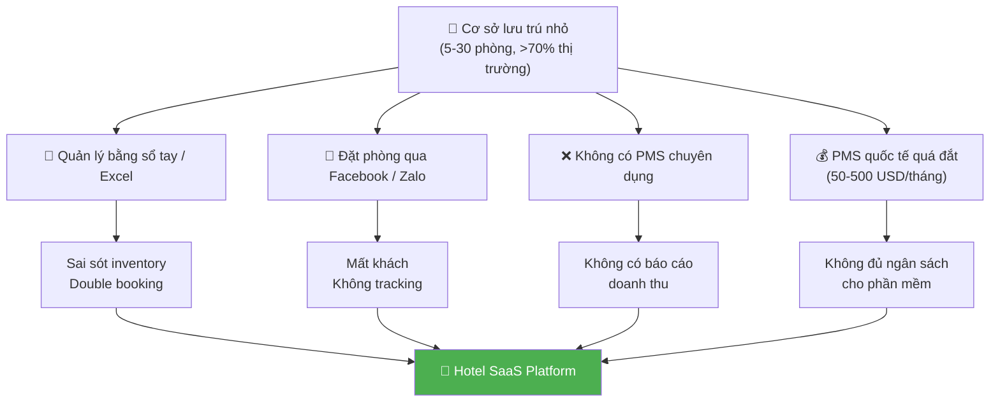
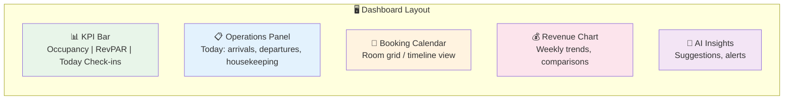

# 📊 Nghiên cứu thị trường & Xu hướng UI/UX

> **Tài liệu:** SRS-01 | **Phiên bản:** 1.0 | **Ngày:** 2026-10-03
> **Rubric mapping:** TC1 (Tính thực tiễn — cần so sánh ≥3 giải pháp)

---

## 1. Bối cảnh thị trường Việt Nam

### 1.1 Quy mô ngành lưu trú

| Chỉ số | Dữ liệu | Nguồn |
|--------|---------|-------|
| Khách quốc tế 2025 | ~21.2 triệu lượt | Cục Du lịch Quốc gia VN |
| Cơ sở lưu trú Hà Nội | 3,761 cơ sở / 71,256 phòng | Sở Du lịch Hà Nội 2025 |
| Cơ sở lưu trú TP.HCM | 4,849 cơ sở / 102,137 phòng | Sở Du lịch TP.HCM 2025 |
| Tỷ lệ nhà nghỉ/mini hotel | >70% tổng cơ sở lưu trú | Ước tính ngành |
| Khách sạn 4-5 sao TP.HCM | 84 cơ sở / 17,730 phòng | Sở Du lịch TP.HCM 2025 |

### 1.2 Vấn đề hiện tại

---

## 2. So sánh giải pháp hiện có (≥5 giải pháp — TC1 Mức 5)

### 2.1 Bảng so sánh chi tiết

| Tiêu chí | **Cloudbeds** | **Mews** | **Hotelogix** | **eZee Frontdesk** | **RoomRaccoon** | **Đề tài này** |
|----------|:---:|:---:|:---:|:---:|:---:|:---:|
| **Đối tượng** | Boutique, B&B | Mid-size, tech-forward | Budget hotels | Mọi quy mô | Small hotels EU | Nhà nghỉ nhỏ VN |
| **Kiến trúc** | Cloud SaaS | Cloud-native, API-first | Cloud | Cloud / On-premise | Cloud | Cloud SaaS |
| **Multi-tenant** | ✅ | ✅ | ✅ | ✅ | ✅ | ✅ |
| **Channel Manager** | ✅ 450+ OTA | ✅ 1000+ | ✅ | ✅ | ✅ | ⚠️ Phase sau |
| **RBAC tùy biến** | ⚠️ Fixed roles | ✅ Granular | ⚠️ Fixed | ⚠️ Fixed | ⚠️ Basic | ✅ Bitmask tùy biến |
| **AI tích hợp** | ⚠️ Limited | ✅ Guest AI | ❌ | ❌ | ⚠️ Basic | ✅ Gemini AI |
| **Dynamic Pricing AI** | ✅ Smart pricing | ✅ AI-powered | ❌ | ⚠️ Rules | ✅ Yield mgmt | ✅ AI suggestion |
| **Tiếng Việt** | ❌ | ❌ | ❌ | ⚠️ Hạn chế | ❌ | ✅ Native VI/EN |
| **VNPay native** | ❌ | ❌ | ❌ | ❌ | ❌ | ✅ |
| **Offline mode** | ❌ | ❌ | ✅ | ❌ | ❌ | ❌ |
| **Open source** | ❌ | ❌ | ❌ | ❌ | ❌ | ✅ |
| **Free tier** | ❌ | ❌ | ❌ | ❌ | ❌ | ✅ Basic tier |
| **Giá/tháng** | $150-500 | $200-600 | $50-200 | $30-150 | $100-350 | Free → $30 |

### 2.2 Phân tích chi tiết từng giải pháp

#### Cloudbeds (cloudbeds.com)
- **Điểm mạnh:** All-in-one (PMS + Booking Engine + Channel Manager), dễ dùng, 450+ integrations
- **Điểm yếu:** Giá cao, không có tiếng Việt, RBAC cơ bản
- **Đối tượng:** Boutique hotels và independent properties có ngân sách

#### Mews (mews.com)
- **Điểm mạnh:** Cloud-native API-first, 1000+ integrations, UI hiện đại, AI guest profiles
- **Điểm yếu:** Giá rất cao, phức tạp cho cơ sở nhỏ
- **Đối tượng:** Tech-forward hotels, chuỗi khách sạn trung bình

#### Hotelogix (hotelogix.com)
- **Điểm mạnh:** Offline mode (unique), multi-property, giá vừa phải, mạnh ở emerging markets
- **Điểm yếu:** UI cũ, không có AI, RBAC cố định
- **Đối tượng:** Budget hotels, thị trường đang phát triển

#### eZee Frontdesk (ezeeabsolute.com)
- **Điểm mạnh:** Full-featured, giá cạnh tranh nhất, có phiên bản on-premise
- **Điểm yếu:** UI không hiện đại, không AI, RBAC cơ bản
- **Đối tượng:** Hotels cần giải pháp toàn diện với chi phí thấp

#### RoomRaccoon (roomraccoon.com)
- **Điểm mạnh:** Yield management tốt, auto pricing, dễ setup
- **Điểm yếu:** Chủ yếu thị trường EU, không hỗ trợ VN
- **Đối tượng:** Small hotels châu Âu

### 2.3 Khoảng trống mà đề tài giải quyết

| # | Khoảng trống | Giải pháp của đề tài |
|---|-------------|---------------------|
| 1 | **Chi phí cao** — PMS quốc tế 50-600 USD/tháng, không phù hợp nhà nghỉ nhỏ VN | Free tier (Basic), Pro ~$15, Enterprise ~$30 |
| 2 | **RBAC cứng nhắc** — Hầu hết chỉ có 3-4 role cố định | Bitmask RBAC: chủ cơ sở tự tạo role, tùy chỉnh 14 functions × 7 actions |
| 3 | **Thiếu AI tích hợp sâu** — Chỉ Mews có AI cơ bản | AI Concierge chatbot, Dynamic Pricing, Auto Report, Sentiment Analysis |
| 4 | **Không hỗ trợ tiếng Việt** — Barrier cho nhân viên VN | Native Vietnamese + English (i18n) |
| 5 | **Không tích hợp VNPay** — Cổng thanh toán phổ biến nhất VN | VNPay native integration |
| 6 | **Không open source** — Không customize được | Open source, self-host hoặc SaaS |

---

## 3. Xu hướng thiết kế UI/UX cho Hotel PMS 2025-2026

### 3.1 Xu hướng chính

| Xu hướng | Mô tả | Áp dụng cho đề tài |
|----------|-------|-------------------|
| **Adaptive Interfaces** | Dashboard tự điều chỉnh theo role người dùng | ✅ RBAC-driven layout: Receptionist thấy booking, Housekeeper thấy tasks |
| **Bento Box Layout** | Grid modular, widget-based, dễ scan | ✅ Dashboard dùng PrimeNG card grid |
| **Functional Motion** | Animation phục vụ UX (state changes, transitions) | ✅ Angular Animations cho status updates |
| **Algorithmic Transparency** | AI giải thích lý do đề xuất | ✅ AI pricing show reasoning |
| **Side-panel Drawers** | Actions trong drawer, không navigate away | ✅ PrimeNG Sidebar cho quick actions |
| **5-second Rule** | Thông tin quan trọng nhất trong 5 giây đầu | ✅ KPI cards on top, action list below |
| **Mobile-first Operations** | Housekeeping/check-in trên tablet | ✅ Responsive PrimeNG + PWA ready |
| **Dark Mode** | Giảm mỏi mắt cho staff ca đêm | ✅ PrimeNG theme switching |

### 3.2 Dashboard Surfaces chuẩn 2026

### 3.3 AI trong ngành khách sạn 2025-2026

| Ứng dụng AI | Tác động | Nguồn |
|------------|---------|-------|
| **Dynamic Pricing** | Tăng doanh thu 15-30% | Hotel Tech Report, PriceLabs |
| **AI Chatbot** | Giảm 60% tải front desk | AI Makers, HTL International |
| **Predictive Intelligence** | Dự đoán demand trước đối thủ | Mehman.io, Aiosell |
| **Review Sentiment** | Phát hiện vấn đề sớm | RevFine |
| **Agentic AI** | Tự thực hiện actions (book spa, route housekeeping) | Xu hướng mới nhất 2026 |

---

## 4. Tài liệu tham khảo ngoại ngữ (TC4 — cần ≥5)

| # | Tài liệu | Ngôn ngữ | Loại |
|---|---------|----------|------|
| 1 | Cloudbeds — "What is a PMS?" Guide | EN | Tài liệu kỹ thuật |
| 2 | Mews — "Cloud-Native PMS Architecture" | EN | Whitepaper |
| 3 | Hotel Tech Report — "Best PMS Comparison 2025" | EN | Báo cáo ngành |
| 4 | Microsoft — "Multi-tenant SaaS patterns" (Azure Architecture Center) | EN | Tài liệu kỹ thuật chính thức |
| 5 | OWASP — "Top 10 Web Application Security Risks" | EN | Tiêu chuẩn bảo mật |
| 6 | IEEE 830-1998 — "Software Requirements Specifications" | EN | Tiêu chuẩn IEEE |
| 7 | Martin Fowler — "Patterns of Enterprise Application Architecture" | EN | Sách chuyên khảo |

---

*Tài liệu này là phần của bộ SRS (Software Requirements Specification), phục vụ tiêu chí TC1 và TC4 của rubric.*
