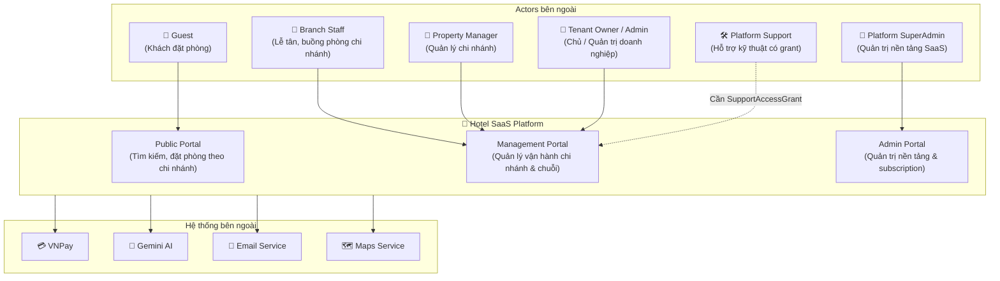

# 👤 Actors & User Personas

> **Tài liệu:** SRS-02 | **Phiên bản:** 1.0 | **Ngày:** 2026-10-03
> **Rubric mapping:** TC1 (chân dung người dùng, bối cảnh)

---

## 1. System Actors



---

## 2. Actor Definitions

| Actor | Mô tả | Ngữ cảnh & Quyền hạn | Authentication |
|-------|--------|----------------------|---------------|
| **Guest** | Người tìm kiếm và đặt phòng trực tuyến. | Truy cập cổng công khai, tìm loại phòng theo chi nhánh | Optional login / Guest checkout qua token bảo mật |
| **Branch Staff** | Nhân viên chi nhánh (lễ tân, buồng phòng). | Thao tác trong phạm vi chi nhánh được giao (Property-scoped) | Required login + Property-scoped RBAC |
| **Property Manager** | Quản lý vận hành chi nhánh. | Quản lý phòng, giá, nhân sự, đơn đặt của chi nhánh được giao | Required login + Property Manager role |
| **Tenant Owner / Admin** | Chủ / Quản trị viên doanh nghiệp. | Quản lý pháp nhân, gói cước, tất cả chi nhánh thuộc doanh nghiệp | Required login + Tenant Owner role (Tenant-wide) |
| **Platform SuperAdmin** | Quản trị viên nền tảng SaaS. | Quản lý tenant lifecycle, subscription plans, system banner. Không mặc định đọc data khách | Required login + SuperAdmin role |
| **Platform Support** | Kỹ thuật viên hỗ trợ nền tảng. | Chỉ truy cập khi doanh nghiệp cấp `SupportAccessGrant` có thời hạn và lý do | Required login + Valid Support Grant + Audit logging |
| **VNPay** | Cổng thanh toán trực tuyến. | Gửi callback IPN xác nhận giao dịch | API key / HMAC signature |
| **Gemini AI** | Dịch vụ AI đa phương thức. | Xử lý truy vấn tìm phòng tiếng Việt, gợi ý giá | Server-to-server API key |

---

## 3. User Personas chi tiết

### Persona 1: Chị Hằng — Chủ nhà nghỉ nhỏ

```
┌─────────────────────────────────────────────────────┐
│  👤 PERSONA: Chị Nguyễn Thị Hằng                   │
│  ─────────────────────────────────────────────────  │
│  Tuổi: 42 | Nơi ở: Đà Lạt | Vai trò: Owner        │
│  Cơ sở: Nhà nghỉ Hoa Đào — 12 phòng, 2 nhân viên  │
├─────────────────────────────────────────────────────┤
│  📌 BỐI CẢNH                                       │
│  • Kinh doanh nhà nghỉ 8 năm                       │
│  • Quản lý bằng sổ tay và tin nhắn Zalo            │
│  • Dùng smartphone thành thạo, laptop cơ bản       │
│  • Tự quản lý, có 2 nhân viên part-time            │
├─────────────────────────────────────────────────────┤
│  😤 PAIN POINTS                                     │
│  1. Bị double booking 2-3 lần/tháng (mùa cao điểm) │
│  2. Không biết revenue tháng này so tháng trước     │
│  3. Khách gọi hỏi phòng trống → phải lật sổ        │
│  4. Phần mềm quốc tế quá đắt và phức tạp           │
│  5. Nhân viên không biết phòng nào cần dọn          │
├─────────────────────────────────────────────────────┤
│  🎯 GOALS                                           │
│  1. Xem phòng trống / phòng bận real-time           │
│  2. Khách tự đặt phòng online                       │
│  3. Biết doanh thu ngay trên điện thoại             │
│  4. Nhân viên tự biết việc phải làm                 │
│  5. Giá phải chăng (≤500k/tháng)                    │
├─────────────────────────────────────────────────────┤
│  📱 KỊC BẢN SỬ DỤNG                               │
│  • Sáng: Mở app xem today check-in/check-out        │
│  • Trưa: Kiểm tra housekeeping status               │
│  • Tối: Xem revenue hôm nay, tuần này               │
│  • Khi có booking mới: Nhận notification             │
└─────────────────────────────────────────────────────┘
```

### Persona 2: Anh Tuấn — Quản lý khách sạn 2 sao

```
┌─────────────────────────────────────────────────────┐
│  👤 PERSONA: Trần Minh Tuấn                         │
│  ─────────────────────────────────────────────────  │
│  Tuổi: 35 | Nơi ở: Nha Trang | Vai trò: Manager    │
│  Cơ sở: Khách sạn Biển Xanh — 45 phòng, 8 NV       │
├─────────────────────────────────────────────────────┤
│  📌 BỐI CẢNH                                       │
│  • Quản lý khách sạn cho chủ đầu tư                 │
│  • Có kinh nghiệm dùng PMS (eZee trước đó)         │
│  • Team: 3 lễ tân, 3 buồng phòng, 1 kế toán, 1 bảo vệ │
│  • Cần phân quyền rõ ràng cho từng nhân viên        │
├─────────────────────────────────────────────────────┤
│  😤 PAIN POINTS                                     │
│  1. PMS cũ hết hạn, cần thay thế giá rẻ hơn       │
│  2. Lễ tân ca đêm check-in sai phòng               │
│  3. Housekeeping không update kịp trạng thái         │
│  4. Kế toán phải tổng hợp revenue thủ công          │
│  5. Chủ đầu tư muốn xem báo cáo realtime           │
├─────────────────────────────────────────────────────┤
│  🎯 GOALS                                           │
│  1. RBAC phân quyền chi tiết cho 8 nhân viên        │
│  2. Dashboard realtime cho chủ đầu tư (read-only)   │
│  3. Housekeeping task assignment tự động             │
│  4. Revenue reports auto-generated                   │
│  5. VNPay cho khách thanh toán online                │
└─────────────────────────────────────────────────────┘
```

### Persona 3: Bạn Linh — Khách du lịch

```
┌─────────────────────────────────────────────────────┐
│  👤 PERSONA: Lê Thùy Linh                           │
│  ─────────────────────────────────────────────────  │
│  Tuổi: 28 | Nơi ở: Hà Nội | Vai trò: Guest         │
│  Du lịch: 3-4 chuyến/năm, ưu tiên nhà nghỉ local  │
├─────────────────────────────────────────────────────┤
│  📌 BỐI CẢNH                                       │
│  • Thích khám phá nhà nghỉ/homestay local           │
│  • Đặt phòng qua OTA (Booking, Agoda) hoặc trực tiếp │
│  • Thanh toán bằng VNPay / chuyển khoản             │
│  • Muốn biết phòng có sẵn hay không ngay lập tức    │
├─────────────────────────────────────────────────────┤
│  😤 PAIN POINTS                                     │
│  1. Gọi/nhắn hỏi phòng → chờ reply nửa ngày       │
│  2. Không biết phòng thực tế trông thế nào          │
│  3. Thanh toán cash tại quầy — bất tiện             │
│  4. Không có confirmation email / receipt            │
├─────────────────────────────────────────────────────┤
│  🎯 GOALS                                           │
│  1. Tìm kiếm → Xem phòng → Đặt phòng trong 3 phút │
│  2. Thanh toán online (VNPay)                        │
│  3. Nhận confirmation email tự động                  │
│  4. Xem ảnh thực tế, đánh giá từ khách khác         │
│  5. Hỏi chatbot về dịch vụ xung quanh               │
└─────────────────────────────────────────────────────┘
```

### Persona 4: Bạn Phương — Lễ tân ca đêm

```
┌─────────────────────────────────────────────────────┐
│  👤 PERSONA: Võ Thanh Phương                         │
│  ─────────────────────────────────────────────────  │
│  Tuổi: 24 | Nơi ở: Nha Trang | Vai trò: Receptionist │
│  Ca làm: 22:00 - 06:00 | Một mình trực              │
├─────────────────────────────────────────────────────┤
│  📌 BỐI CẢNH                                       │
│  • Sinh viên mới ra trường, làm part-time           │
│  • Chỉ được phép check-in, check-out, xem phòng    │
│  • Không được thay đổi giá, xóa booking             │
│  • Dùng máy tính tại quầy lễ tân                     │
├─────────────────────────────────────────────────────┤
│  😤 PAIN POINTS                                     │
│  1. Khách đến late-night → không tìm được booking   │
│  2. Không biết phòng nào clean, phòng nào dirty     │
│  3. Phải gọi manager khi có vấn đề                  │
│  4. Sợ check-in nhầm phòng → bị trách              │
├─────────────────────────────────────────────────────┤
│  🎯 GOALS                                           │
│  1. Tìm booking nhanh (theo tên / SĐT / mã)        │
│  2. Thấy room status realtime (clean/dirty/occupied) │
│  3. Check-in 1 click (đã có booking)                 │
│  4. Giao diện đơn giản, rõ ràng                      │
└─────────────────────────────────────────────────────┘
```

---

## 4. Actor-Feature Matrix

| Feature | Guest | Receptionist | Housekeeper | Manager | Owner | Platform Admin |
|---------|:-----:|:------------:|:-----------:|:-------:|:-----:|:--------------:|
| Tìm kiếm phòng | ✅ | - | - | - | - | - |
| Đặt phòng online | ✅ | ✅ | - | ✅ | ✅ | - |
| Check-in | - | ✅ | - | ✅ | ✅ | - |
| Check-out | - | ✅ | - | ✅ | ✅ | - |
| Xem room status | - | ✅ | ✅ | ✅ | ✅ | - |
| Cập nhật housekeeping | - | - | ✅ | ✅ | ✅ | - |
| Thanh toán VNPay | ✅ | ✅ | - | ✅ | ✅ | - |
| Xem invoice | ✅ | ✅ | - | ✅ | ✅ | - |
| Revenue reports | - | - | - | ✅ | ✅ | - |
| Quản lý rooms/types | - | - | - | ✅ | ✅ | - |
| Quản lý nhân viên | - | - | - | - | ✅ | - |
| RBAC: Tạo/sửa roles | - | - | - | - | ✅ | - |
| Cấu hình property | - | - | - | - | ✅ | - |
| AI Chatbot (hỏi đáp) | ✅ | - | - | - | - | - |
| AI Dynamic Pricing | - | - | - | ✅ | ✅ | - |
| Duyệt property mới | - | - | - | - | - | ✅ |
| Quản lý subscription | - | - | - | - | - | ✅ |
| Support chat | - | - | - | ✅ | ✅ | ✅ |
| Viết review | ✅ | - | - | - | - | - |
| Quản lý promotions | - | - | - | ✅ | ✅ | - |

---

*Tài liệu này là phần của bộ SRS, phục vụ tiêu chí TC1 (chân dung người dùng, bối cảnh).*
