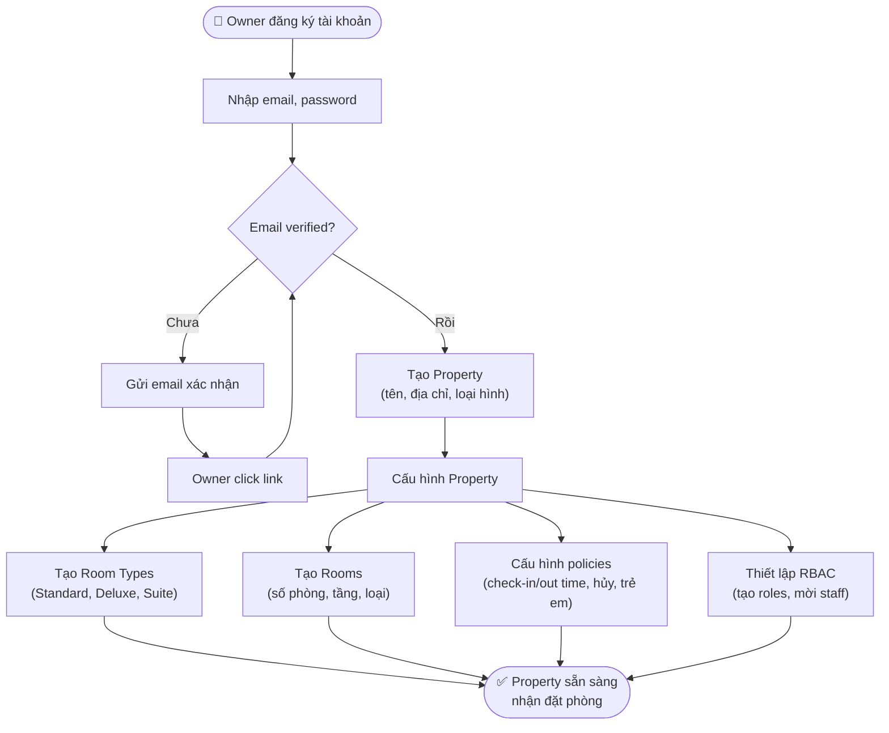
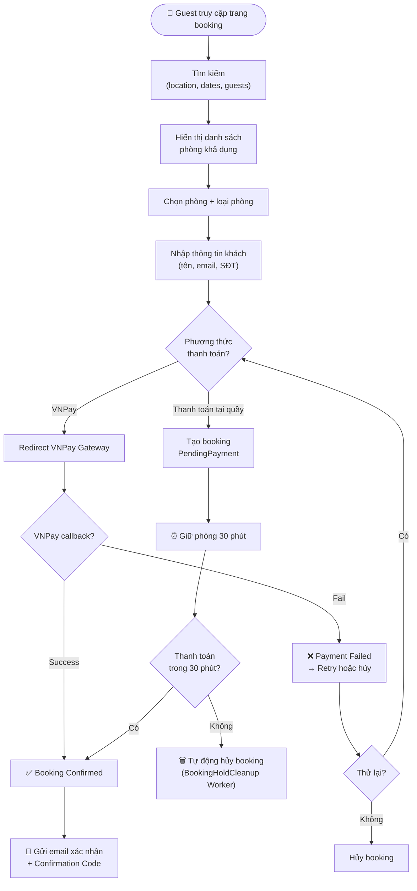
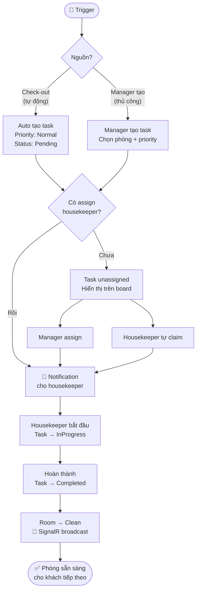
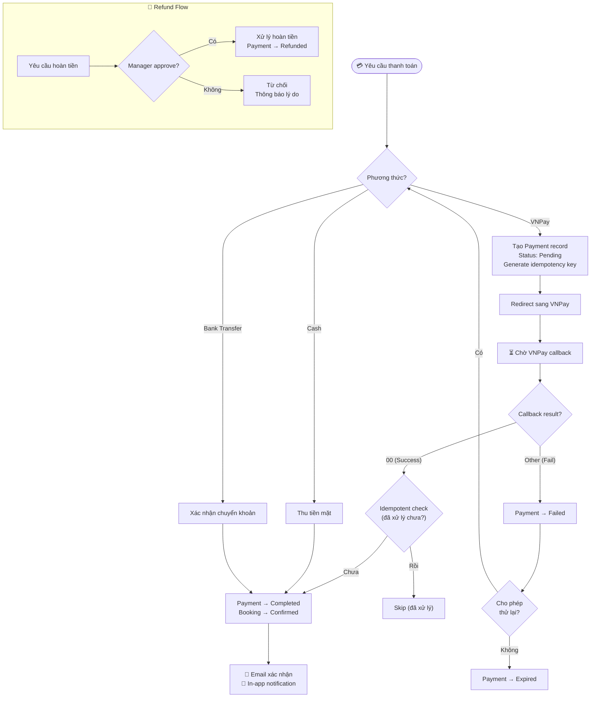
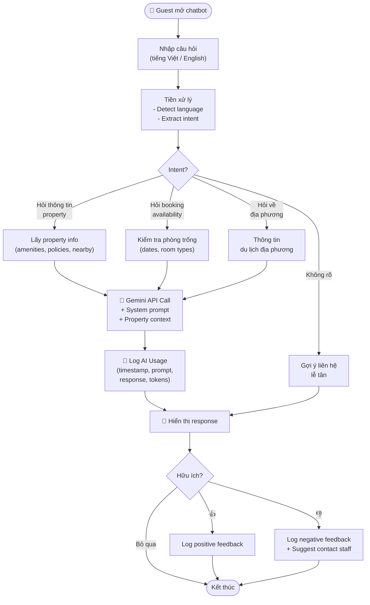

# 🔄 Business Process Diagrams

> **Tài liệu:** SRS-04 | **Phiên bản:** 1.0 | **Ngày:** 2026-10-03
> **Rubric mapping:** TC2.1 Mức 5 (mô hình quy trình nghiệp vụ)
> **Công cụ:** Mermaid flowcharts

---

## Flow 1: Đăng ký Property → Cấu hình → Hoạt động



---

## Flow 2: Khách đặt phòng Online



---

## Flow 3: Check-in → Lưu trú → Folio → Check-out

```mermaid
flowchart TD
    Start(["👷 Lễ tân nhận khách"]) --> FindBooking{"Có booking<br/>trước?"}

    FindBooking -->|Có| SearchBooking["Tìm booking<br/>(tên / SĐT / mã)"]
    FindBooking -->|Không (walk-in)| WalkIn["Tạo booking mới<br/>+ chọn phòng trống"]

    SearchBooking --> VerifyGuest["Xác minh thông tin khách"]
    WalkIn --> VerifyGuest

    VerifyGuest --> PayCheck{"Đã thanh toán<br/>deposit?"}
    PayCheck -->|Chưa| CollectPayment["Thu deposit<br/>(Cash/VNPay/Transfer)"]
    PayCheck -->|Rồi| CheckIn["✅ CHECK-IN<br/>Reservation → CheckedIn<br/>Room → Occupied"]
    CollectPayment --> CheckIn

    CheckIn --> SignalR["📡 SignalR broadcast<br/>room status change"]
    CheckIn --> Stay["🏨 Khách lưu trú"]

    Stay --> AddFolio["Thêm Folio items<br/>(minibar, laundry, extras)"]
    AddFolio --> Stay
    Stay --> CheckOutReq["Khách yêu cầu check-out"]

    CheckOutReq --> ReviewFolio["📋 Review Folio<br/>(room charge + extras + tax)"]
    ReviewFolio --> BalanceCheck{"Balance = 0?"}
    BalanceCheck -->|Chưa| FinalPayment["Thu thanh toán cuối"]
    BalanceCheck -->|Rồi| CheckOut["✅ CHECK-OUT<br/>Reservation → CheckedOut<br/>Room → Dirty"]
    FinalPayment --> CheckOut

    CheckOut --> AutoTask["🧹 Auto tạo<br/>Housekeeping Task"]
    CheckOut --> Invoice["🧾 Tạo Invoice"]
    CheckOut --> SignalR2["📡 SignalR broadcast"]
```

---

## Flow 4: Housekeeping Lifecycle



---

## Flow 5: Payment Lifecycle



---

## Flow 6: AI Concierge Query



---

## Tổng hợp

| # | Flow | Actors | Trigger | Kết quả |
|---|------|--------|---------|---------|
| 1 | Đăng ký Property | Owner | User action | Property hoạt động |
| 2 | Đặt phòng Online | Guest | User action | Booking Confirmed |
| 3 | Check-in → Check-out | Receptionist, Guest | Booking arrival | Invoice created |
| 4 | Housekeeping | Manager, Housekeeper | Check-out / Manual | Room Clean |
| 5 | Payment | Guest, Receptionist, VNPay | Booking / Folio | Payment Completed |
| 6 | AI Concierge | Guest, Gemini AI | User query | AI Response |

---

*Tài liệu này chứa 6 business process diagrams, phục vụ TC2.1 Mức 5 (mô hình quy trình nghiệp vụ).*
