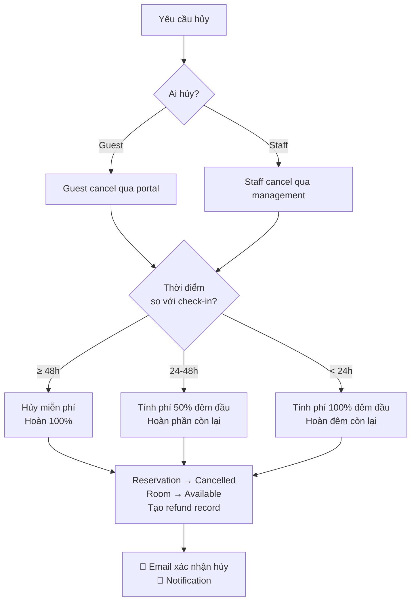
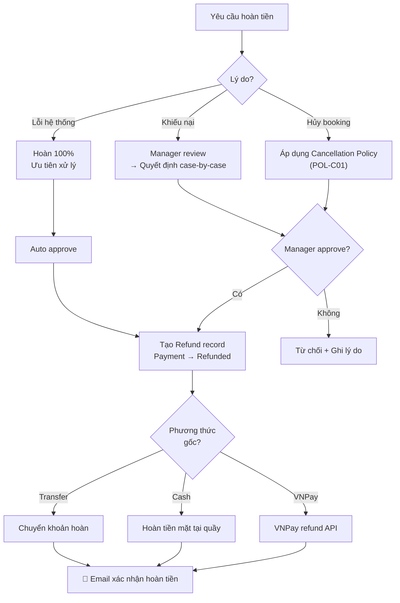

# 📜 Business Rules & Chính sách nghiệp vụ

> **Tài liệu:** SRS-05 | **Phiên bản:** 1.0 | **Ngày:** 2026-10-03
> **Rubric mapping:** TC2.1 Mức 5 (business rules, ràng buộc nghiệp vụ)

---

## 1. Quy tắc đặt phòng (Reservation Rules)

### BR-R01: Kiểm tra chồng lịch (Overlap Check)

```
Rule:    Một phòng KHÔNG thể có 2 booking active chồng ngày
         Active = status IN (PendingPayment, Confirmed, CheckedIn)
Logic:   new.CheckInDate < existing.CheckOutDate
         AND new.CheckOutDate > existing.CheckInDate
         → REJECT with "Phòng không khả dụng trong khoảng thời gian này"
```

### BR-R02: Thời gian đặt phòng tối thiểu

```
Rule:    CheckOutDate - CheckInDate ≥ 1 ngày (tối thiểu 1 đêm)
         CheckOutDate > CheckInDate
```

### BR-R03: Đặt trước tối đa

```
Rule:    CheckInDate ≤ Today + 365 ngày (đặt trước tối đa 1 năm)
         CheckInDate ≥ Today (không đặt ngày quá khứ)
```

### BR-R04: Số khách tối đa

```
Rule:    NumberOfGuests ≤ Room.RoomType.MaxOccupancy
         NumberOfGuests ≥ 1
```

### BR-R05: Mã xác nhận

```
Rule:    ConfirmationCode = 6 ký tự uppercase alphanumeric
         Auto-generate, unique trong toàn hệ thống
         Format: [A-Z0-9]{6} (ví dụ: HK7B2M)
```

### BR-R06: Tự động hủy booking chưa thanh toán

```
Rule:    Booking có status PendingPayment quá 30 phút → auto cancel
         Thực hiện bởi: BookingHoldCleanup BackgroundWorker
         Interval: chạy mỗi 5 phút
```

---

## 2. Chính sách hủy phòng (Cancellation Policy)

### POL-C01: Chính sách hủy mặc định (Property-level configurable)

| Thời điểm hủy | Phí hủy | Hoàn tiền |
|---------------|---------|----------|
| ≥ 48h trước check-in | 0% | Hoàn 100% |
| 24h - 48h trước check-in | 50% giá phòng đêm đầu | Hoàn 50% đêm đầu |
| < 24h trước check-in | 100% giá phòng đêm đầu | Hoàn các đêm còn lại |
| Sau check-in (early checkout) | Không hoàn tiền đêm đã ở | Hoàn đêm chưa ở (tùy policy) |
| No-show | 100% tổng tiền | Không hoàn |

### POL-C02: Quy trình hủy



### POL-C03: Chính sách tùy chỉnh (Owner configurable)

```
Property owner có thể cấu hình:
- cancellation_free_hours: int (default 48)
- cancellation_partial_hours: int (default 24)
- cancellation_partial_percent: decimal (default 50%)
- no_show_charge_percent: decimal (default 100%)
- allow_guest_cancel: bool (default true)
```

---

## 3. Chính sách thanh toán (Payment Policy)

### POL-P01: Phương thức thanh toán

| Phương thức | Khi nào | Xử lý |
|------------|---------|-------|
| **VNPay** | Đặt phòng online | Redirect → VNPay sandbox → Callback |
| **Cash** | Tại quầy lễ tân | Staff ghi nhận → Payment record |
| **Bank Transfer** | Trước check-in | Khách chuyển → Staff xác nhận |
| **Credit Card** | Tương lai (Phase sau) | Stripe / VNPay token |

### POL-P02: Quy tắc thanh toán

```
BR-P01: Mỗi payment có IdempotencyKey unique → tránh duplicate charge
BR-P02: VNPay callback timeout = 15 phút
BR-P03: Booking online bắt buộc thanh toán 100% trước
BR-P04: Booking walk-in cho phép thanh toán khi check-out
BR-P05: Refund chỉ Manager/Owner approve được
BR-P06: Currency mặc định: VND (đ)
BR-P07: Giá phòng đã bao gồm thuế VAT (hiển thị riêng trên invoice)
```

### POL-P03: Chính sách hoàn tiền (Refund Policy)



---

## 4. Chính sách check-in / check-out

### POL-IO01: Giờ check-in / check-out mặc định

```
Check-in time:  14:00 (configurable per property)
Check-out time: 12:00 (configurable per property)
Early check-in: Tùy thuộc phòng trống, không tính phí thêm
Late check-out: Sau 12:00 → tính phí:
  - 12:00 - 15:00: +30% giá phòng 1 đêm
  - 15:00 - 18:00: +50% giá phòng 1 đêm
  - Sau 18:00: +100% (tính thêm 1 đêm)
```

### POL-IO02: Quy trình check-in

```
1. Khách đến quầy → Lễ tân tìm booking (tên/SĐT/mã)
2. Xác minh CCCD/Passport (ghi nhận số giấy tờ)
3. Xác nhận thanh toán deposit (nếu chưa thanh toán)
4. Click Check-in → Reservation → CheckedIn, Room → Occupied
5. Phát key card / chìa khóa
6. Hướng dẫn khách (wifi, tiện ích, quy định)
Target: ≤ 2 phút toàn bộ flow trên hệ thống
```

### POL-IO03: Quy trình check-out

```
1. Khách thông báo check-out
2. Lễ tân kiểm tra Folio (room charge + minibar + extras)
3. Thu thanh toán còn lại (nếu có balance > 0)
4. Click Check-out → Reservation → CheckedOut, Room → Dirty
5. Auto tạo HousekeepingTask cho phòng
6. Xuất Invoice (PDF hoặc email)
```

---

## 5. Chính sách trẻ em & giường phụ

### POL-KID01

```
- Trẻ em < 6 tuổi: MIỄN PHÍ (nằm chung giường bố mẹ)
- Trẻ em 6-12 tuổi: +30% giá phòng (nếu cần giường phụ)
- Trẻ em > 12 tuổi: Tính như người lớn
- Giường phụ: tùy property cấu hình (ví dụ +200,000 VND/đêm)
- Configurable per property: childFreeAge, childDiscountAge,
  childDiscountPercent, extraBedPrice
```

---

## 6. Chính sách vật nuôi (Pet Policy)

### POL-PET01

```
- Mặc định: KHÔNG cho phép vật nuôi
- Nếu property cho phép: cấu hình petPolicy field
  + Phí vật nuôi / đêm (configurable)
  + Loại vật nuôi cho phép (chó, mèo...)
  + Giới hạn cân nặng (ví dụ: < 10kg)
```

---

## 7. Chính sách subscription (SaaS Tier)

### POL-SUB01: Feature Gating theo Subscription Tier

| Feature | Basic (Free) | Pro | Enterprise |
|---------|:----:|:---:|:----------:|
| Số phòng tối đa | 15 | 50 | Unlimited |
| Quản lý booking | ✅ | ✅ | ✅ |
| Check-in / Check-out | ✅ | ✅ | ✅ |
| Housekeeping cơ bản | ✅ | ✅ | ✅ |
| RBAC tùy chỉnh (custom roles) | ❌ | ✅ | ✅ |
| VNPay integration | ❌ | ✅ | ✅ |
| Folio management | ❌ | ✅ | ✅ |
| Realtime (SignalR) | ❌ | ✅ | ✅ |
| Revenue Reports | ❌ | ✅ | ✅ |
| AI Concierge | ❌ | ❌ | ✅ |
| AI Dynamic Pricing | ❌ | ❌ | ✅ |
| Multi-branch | ❌ | ❌ | ✅ |
| Số staff accounts | 2 | 10 | Unlimited |
| API access | ❌ | ❌ | ✅ |
| Priority support | ❌ | ❌ | ✅ |

### POL-SUB02: Quy tắc nâng/hạ gói

```
BR-SUB01: Nâng gói → hiệu lực ngay, tính prorated
BR-SUB02: Hạ gói → hiệu lực cuối chu kỳ billing
BR-SUB03: Hạ gói khi đang vượt giới hạn (ví dụ 20 phòng → Basic max 15)
           → Cảnh báo + yêu cầu giảm phòng active trước
BR-SUB04: Trial period: 14 ngày Pro miễn phí cho property mới
BR-SUB05: Suspend sau 30 ngày quá hạn thanh toán
```

---

## 8. Quy tắc RBAC (Authorization Rules)

### BR-AUTH01: Permission Check Flow

```
1. JWT token → extract claims (userId, tenantId, permissions[])
2. Permission claim format: "FUNCTION_CODE:ACTION_MASK"
   Ví dụ: "RESERVATION:7" = Read(1) + Create(2) + Update(4) = 7
3. Authorization check: (userMask & requiredMask) == requiredMask
4. Tenant scope: mọi query tự động filter by tenantId (Global Query Filter)
```

### BR-AUTH02: Quy tắc Role

```
BR-ROLE01: Owner LUÔN có full permissions (không thể thu hồi)
BR-ROLE02: Mỗi property phải có ít nhất 1 Owner
BR-ROLE03: Không thể xóa role đang được gán cho staff
BR-ROLE04: System roles (Owner, default roles) không thể xóa
BR-ROLE05: Custom role chỉ visible trong tenant tạo ra nó
BR-ROLE06: SuperAdmin bypass tenant filter (xem tất cả)
```

---

## 9. Quy tắc Housekeeping

### BR-HK01

```
BR-HK01: Check-out → auto tạo HousekeepingTask (Priority: Normal)
BR-HK02: Phòng OutOfService → không tạo task, không available cho booking
BR-HK03: Task Completed → Room status auto → Clean
BR-HK04: Housekeeper chỉ thấy tasks của property mình
BR-HK05: Manager có thể reassign task
BR-HK06: Housekeeper có thể self-claim task unassigned
```

---

## 10. Quy tắc AI

### BR-AI01

```
BR-AI01: Mọi AI call PHẢI log vào AiUsageLog table
BR-AI02: AI fail → hệ thống vẫn hoạt động (graceful degradation)
BR-AI03: AI response PHẢI có disclaimer "Kết quả từ AI, cần kiểm tra"
BR-AI04: Dynamic Pricing → chỉ GỢI Ý, Owner/Manager phải approve
BR-AI05: Chatbot không được tiết lộ thông tin khách khác
BR-AI06: Rate limit AI calls: 10 calls/phút/tenant (Basic), 50 (Pro), 200 (Enterprise)
```

---

## 11. Quy tắc bảo mật dữ liệu

### BR-SEC01

```
BR-SEC01: Password hash bằng bcrypt, ≥ 10 rounds
BR-SEC02: Refresh token rotate mỗi lần sử dụng (old token invalidate)
BR-SEC03: 5 lần login sai → lock 15 phút
BR-SEC04: Sensitive data (CCCD, passport) encrypt at rest
BR-SEC05: Audit log cho mọi thao tác CUD (Create, Update, Delete)
BR-SEC06: Không log raw password, token, hoặc PII trong application logs
BR-SEC07: Session timeout: 30 phút không hoạt động → yêu cầu re-authenticate
```

---

*Tài liệu này chứa 60+ business rules và 11 chính sách, phục vụ TC2.1 (business rules, ràng buộc nghiệp vụ).*
