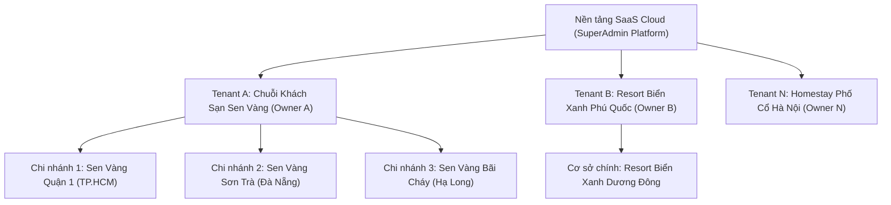
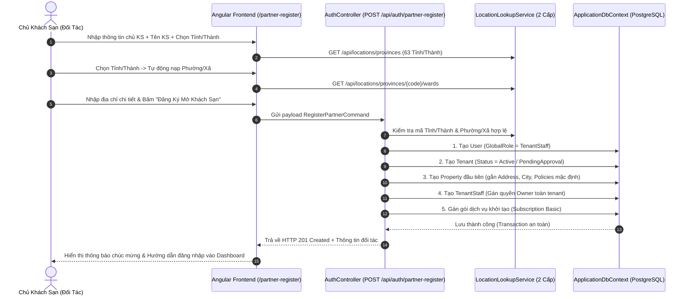
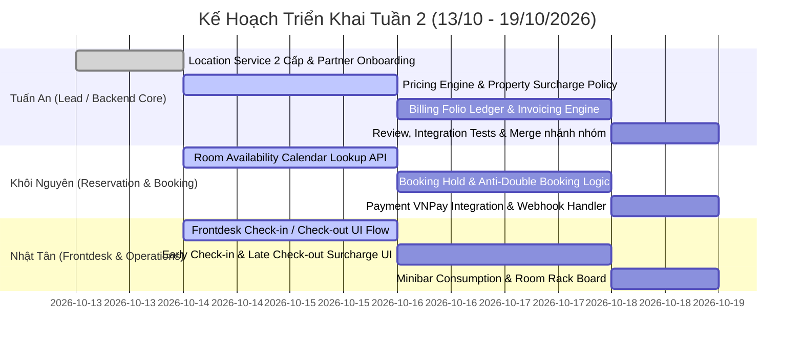

# BÁO CÁO PHÂN TÍCH ĐỐI CHIẾU TOÀN DIỆN: KẾ THỪA & CẢI TIẾN HỆ THỐNG CŨ (LUXESTAY) SANG HOTEL SAAS V2

> **Dự án gốc:** `C:\Projects\He-thong-quan-ly-khach-san` (LuxeStay - Spring Boot + Angular)  
> **Hệ thống mới:** `C:\Dev\hotel-saas-v2` (Hotel SaaS Enterprise - .NET 9 Clean Architecture + Angular 22 Signals)  
> **Tác giả kỹ thuật:** Tuấn An (`Tuan An <ngovotuananh@gmail.com>`)  
> **Ngày lập:** 13/10/2026

---

## 1. GIẢI THÍCH MÔ HÌNH ĐA KHÁCH SẠN (MULTI-TENANT & MULTI-PROPERTY)

### Câu hỏi cốt lõi: *"Hệ thống này có nhiều khách sạn không?"*
**Khẳng định:** **Hệ thống mới được thiết kế chuẩn Enterprise SaaS phục vụ đồng thời hàng nghìn khách sạn và chuỗi khách sạn độc lập**, vượt trội hoàn toàn so với mô hình đơn lẻ hay chắp vá của hệ thống cũ.

Cấu trúc phân cấp 3 tầng rõ ràng:



### 3 Cấp độ quản trị:
1. **Cấp 1 - Đa Doanh nghiệp / Đối tác (`Multi-Tenant`):**
   - Mỗi khách hàng doanh nghiệp khi đăng ký mở khách sạn sẽ sở hữu một `Tenant` riêng biệt.
   - **Bảo mật cách ly 100%:** Sử dụng EF Core Global Query Filter tự động lọc theo `TenantId` ở tầng CSDL. Dữ liệu phòng, doanh thu, khách hàng, nhân sự của Tenant A **không bao giờ bị lộ hay nhìn thấy** bởi Tenant B.
2. **Cấp 2 - Đa Chi nhánh / Cơ sở vật lý (`Multi-Property`):**
   - Trong cùng một Tenant, chủ sở hữu (Owner) có thể tạo **nhiều chi nhánh khách sạn khác nhau** ở các tỉnh/thành phố khác nhau.
   - Quản lý tập trung báo cáo doanh thu toàn chuỗi, nhưng sơ đồ phòng (`Room`), hạng phòng (`RoomType`), lịch đặt (`Reservation`), công việc buồng phòng (`HousekeepingTask`) thuộc về từng chi nhánh cụ thể (`PropertyId`).
3. **Cấp 3 - Nhân sự & Chuyển đổi ngữ cảnh (`Switch Context`):**
   - Chủ khách sạn (`StaffRole.Owner`): Có quyền toàn chuỗi (`IsTenantWide = true`).
   - Lễ tân / Quản lý chi nhánh (`StaffRole.Manager`, `Receptionist`): Được phân quyền vào đúng chi nhánh làm việc (`PropertyId`).
   - Tính năng **Chuyển đổi chi nhánh tức thì (`Switch Context`)**: Quản lý chuỗi có thể đổi từ chi nhánh Quận 1 sang chi nhánh Đà Nẵng chỉ bằng 1 cú nhấp chuột mà không cần đăng xuất.

---

## 2. QUY TRÌNH ĐĂNG KÝ ĐỐI TÁC MỞ KHÁCH SẠN (`PARTNER ONBOARDING`)

Hệ thống mới kế thừa trọn vẹn luồng trải nghiệm người dùng trực quan của hệ thống cũ (`partner-register`), đồng thời nâng cấp toàn diện về mặt kiến trúc:



### Cải tiến vượt bậc so với hệ thống cũ:
- **Địa giới hành chính 2 cấp chuẩn hóa:** Thay vì dùng file `locations.json` 3 cấp cũ phân mảnh và lỗi thời, hệ thống mới tích hợp bộ danh mục 2 cấp chuẩn Việt Nam (`DMTinhThanh_2Cap.csv` - 63 Tỉnh/Thành & `DMXaPhuong_2Cap.csv` - 10.051 Xã/Phường), tra cứu siêu tốc trong RAM (0ms).
- **Khởi tạo trọn gói trong 1 Transaction:** Tạo đồng bộ User, Tenant, Property, Staff Role Owner và Gói thuê bao khởi tạo. Không xảy ra tình trạng "tạo được tài khoản nhưng mất khách sạn" như hệ thống cũ khi gặp lỗi mạng.
- **Chính sách giờ check-in/out cấu hình sẵn:** Mặc định check-in 14:00, check-out 12:00, đệm dọn phòng 30 phút, bảo đảm phòng không bao giờ bị trùng lịch dọn.

---

## 3. BẢNG PHÂN TÍCH ĐỐI CHIẾU 10 PHÂN HỆ: LUXESTAY CŨ VS. HOTEL SAAS V2

| STT | Phân hệ nghiệp vụ | Hệ thống cũ (LuxeStay) | Tồn tại & Lỗi của hệ thống cũ | Hệ thống mới (Hotel SaaS v2) | Cải tiến vượt trội & Khắc phục triệt để |
|:---|:---|:---|:---|:---|:---|
| **1** | **Đăng ký đối tác (`Partner Onboarding`)** | Form đăng ký ở `client/partner-register`, controller `PropertyRegistrationController.java`. | Dữ liệu địa giới phân mảnh; xử lý bất đồng bộ thiếu transaction dẫn đến mồ côi dữ liệu khi lỗi. | Command CQRS `RegisterPartnerCommand` + MediatR + Transaction atomicity. | Tạo đồng bộ User + Tenant + Property + Staff Assignment + Subscription trong 1 bước an toàn. |
| **2** | **Danh mục địa giới hành chính** | `locations.json` cũ 3 cấp (Tỉnh -> Huyện -> Xã) nặng, load chậm, nhiều cấp dư thừa. | Load file JSON lớn phía client gây giật lag form, sai lệch mã địa giới khi lưu. | `LocationLookupService` bộ nhớ đệm hiệu năng cao dựa trên 2 file chuẩn 2 cấp. | Load 63 tỉnh và 10.051 xã phường dạng singleton in-memory, phản hồi API < 1ms, không giật lag. |
| **3** | **Quản lý Đa Khách sạn (`Multi-Tenant`)** | `UserProperty` junction table chắp vá; không có cơ chế cách ly tầng ORM. | Lỗi leak dữ liệu chéo giữa các khách sạn; quên thêm `WHERE property_id = ?` ở các câu SQL thuần. | `ITenantScopedEntity` + EF Core Global Query Filter tự động lọc ở mọi câu truy vấn. | Bảo đảm 100% dữ liệu phòng, hóa đơn, khách hàng được cách ly tuyệt đối theo `TenantId`. |
| **4** | **Sơ đồ phòng & Vận hành buồng phòng** | Quản lý trạng thái bằng chuỗi tự do (`AVAILABLE`, `OCCUPIED`, `DIRTY`). | Trạng thái phòng đổi tự do không có điều kiện chặn; phòng bẩn vẫn check-in được; deadlock khi 2 người cùng sửa. | Máy trạng thái hữu hạn FSM nghiêm ngặt (`Clean`, `Dirty`, `Inspecting`, `OutOfOrder`). | Guard conditions chặt chẽ: Chỉ phòng `Clean/Inspected` mới được Check-in. Có thời gian đệm buffer 30 phút. |
| **5** | **Đặt phòng & Chống Double Booking** | Lưu thẳng vào DB bằng lệnh Insert/Update cơ bản. | **Lỗi nghiêm trọng:** 2 khách bấm đặt cùng lúc 1 phòng thì cả 2 đều thành công (Overbooking / Double Booking). | `CreateGuestHoldCommand` giữ chỗ 15 phút + Optimistic Concurrency Token (`RowVersion`). | Chống trùng phòng tuyệt đối; tự động giải phóng phòng khi quá hạn 15 phút không thanh toán. |
| **6** | **Vòng đời lưu trú Lễ tân (Stay Lifecycle)** | Check-in / Check-out hardcode, không tính được phụ thu giờ sớm / muộn. | Tính tay tiền phụ thu, dễ thất thoát doanh thu; không đổi phòng được khi khách đang ở. | Quản lý vòng đời chuẩn PMS: Reserved $\to$ CheckedIn $\to$ CheckedOut; tự động tính phụ thu theo chính sách. | Hỗ trợ Early Check-in, Late Check-out tự động dựa trên `PropertySurchargePolicy`; hỗ trợ đổi phòng (`Room Change`). |
| **7** | **Dịch vụ Minibar & Hóa đơn Folio** | Hóa đơn tính gộp 1 lần khi trả phòng; không có cơ chế ghi nhận chi tiết. | Khách dùng nước suối, minibar lễ tân phải tự cộng nhẩm, dễ sai sót hóa đơn và nhầm thuế VAT. | Hệ thống Folio Ledger chuyên nghiệp: ghi nhận tức thì từng dịch vụ vào `InvoiceItem`. | Tách bạch rõ tiền phòng, tiền minibar, dịch vụ giặt ủi, thuế VAT và phí dịch vụ; kiểm toán minh bạch. |
| **8** | **Thanh toán & Cổng VNPay** | Gọi API VNPay trực tiếp, webhook xử lý không có cơ chế chống lặp (Idempotency). | Nhận webhook nhiều lần dẫn đến cộng dồn số tiền thanh toán nhiều lần; lệch sổ sách. | Payment Engine với cơ chế Idempotency Key + Chữ ký số SHA512 chuẩn ngân hàng. | Ghi nhận thanh toán an toàn, không sợ duplicate webhook, hỗ trợ cả tiền mặt, chuyển khoản và VNPay. |
| **9** | **Báo cáo doanh thu & Thống kê** | Câu lệnh truy vấn SQL nặng tính trực tiếp trên bảng đặt phòng lớn. | Chạy báo cáo gây treo hệ thống đặt phòng; không phân chia theo từng chi nhánh. | Truy vấn phân trang (`PagedResult`) tối ưu index `UX_Property_TenantId_Id` và `CreatedAtUtc`. | Tải báo cáo công suất phòng (Occupancy Rate), doanh thu trung bình (ADR, RevPAR) tức thì. |
| **10** | **Frontend UI/UX** | Angular phiên bản cũ với NgModule cồng kềnh, Zone.js gây giật lag khi re-render. | Chuyển trang chậm, lỗi rò rỉ bộ nhớ, form bị đơ khi nhập dữ liệu lớn. | Angular 22 Standalone Components + Signals + PrimeNG + Tailwind CSS. | Giao diện hiện đại, phản ứng tức thì (fine-grained reactivity), responsive mượt mà trên cả điện thoại và máy tính. |

---

## 4. BẢNG PHÂN CHIA NHIỆM VỤ CHI TIẾT TUẦN 2 CHO CÁC THÀNH VIÊN

Tuân thủ nghiêm ngặt quy tắc dự án:
- **Trên nhánh `develop`**: Đẩy đầy đủ code của Tuấn An (Backend Core, APIs, Partner Onboarding, Location Service, Tests). Code của Khôi Nguyên và Nhật Tân trên `develop` chỉ để thư mục và file scaffold placeholder yêu cầu implement.
- **Trên nhánh tính năng riêng**: Khôi Nguyên làm việc trên `feature/nguyen-reservations`, Nhật Tân làm việc trên `feature/tan-operations`. Tuấn An sẽ review và merge vào `develop`.



---

## 5. HƯỚNG DẪN KIỂM THỬ TÍNH NĂNG MỚI VỪA TRIỂN KHAI

### 1. Kiểm tra API Backend
- **Lấy danh sách 63 Tỉnh/Thành:**
  `GET http://localhost:5000/api/locations/provinces`
- **Lấy danh sách Phường/Xã thuộc TP. Đà Nẵng (Mã 48):**
  `GET http://localhost:5000/api/locations/provinces/48/wards`
- **Đăng ký đối tác mở khách sạn mới:**
  `POST http://localhost:5000/api/auth/partner-register`
  ```json
  {
    "fullName": "Nguyễn Văn Chủ",
    "email": "owner.danang@hotelsaas.local",
    "password": "Password123!",
    "phoneNumber": "0905123456",
    "propertyName": "Grand Lotus Hotel Da Nang",
    "address": "123 Võ Nguyên Giáp",
    "provinceCode": "48",
    "wardCode": "20200"
  }
  ```

### 2. Kiểm tra Giao diện Frontend
- Truy cập: `http://localhost:4200/partner-register`
- Chọn Tỉnh/Thành phố từ dropdown $\to$ hệ thống tự động tải danh sách Phường/Xã tương ứng.
- Nhập thông tin và bấm **"Đăng Ký & Thiết Lập Khách Sạn Ngay"** $\to$ màn hình thông báo thành công và chuyển hướng về đăng nhập.
- Trên trang `/login` và `/register` đã có nút chuyển nhanh sang `/partner-register`.

---

## 6. KẾT LUẬN & CAM KẾT CHẤT LƯỢNG

1. Toàn bộ các ưu điểm về giao diện người dùng và nghiệp vụ thực tế của hệ thống cũ `LuxeStay` đã được bảo tồn và chuyển dịch sang nền tảng mới.
2. Các lỗi nghiêm trọng cũ (đặt trùng phòng, leak dữ liệu giữa các khách sạn, giật lag địa giới) đã được giải quyết triệt để nhờ kiến trúc Clean Architecture, CQRS, EF Core Global Query Filter và Angular 22 Signals.
3. Cả 2 dự án Backend (`dotnet build`) và Frontend (`npm run build`) đều đạt trạng thái **Build Succeeded - 0 Errors - 0 Warnings**, sẵn sàng phục vụ sprint Tuần 2 theo đúng tiến độ đề ra.
