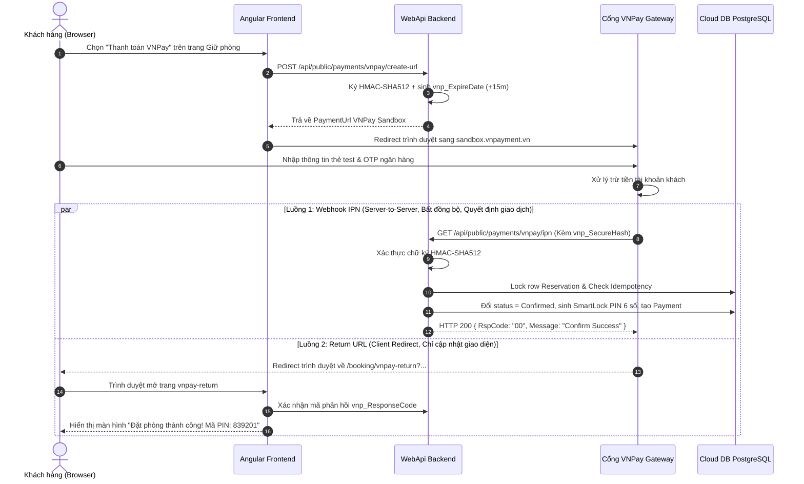
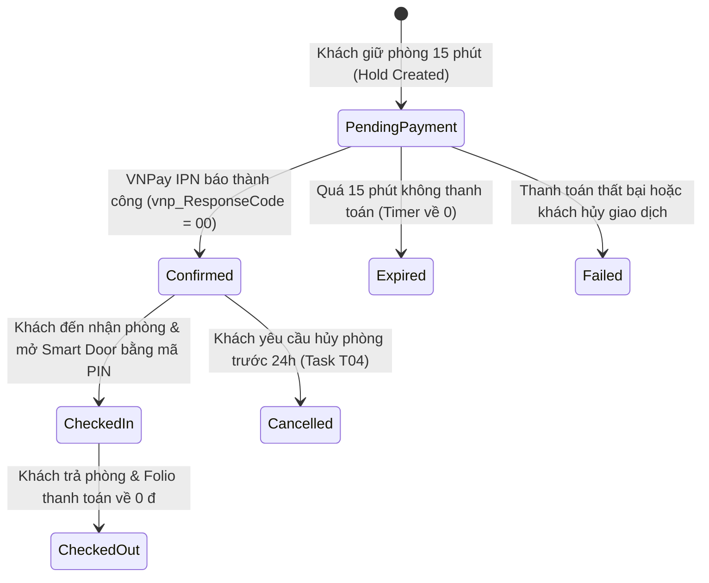

# SPEC KIT: PHÂN TÍCH KẾT NỐI VNPAY, NHIỆM VỤ TUẦN 4 & ĐỔI MỚI GIAO DIỆN B2C (ANTI-SLOP TASTE FRONTEND)
## Nền Tảng Quản Lý Khách Sạn Hotel SaaS Platform v2 (.NET 10 + Angular 22 + PostgreSQL 17)

**Mã đề tài:** 578 — Nền tảng Quản lý Khách sạn Đa chi nhánh theo Mô hình SaaS  
**Giảng viên hướng dẫn:** Thầy Huỳnh Xuân Phụng (`phunghx@hcmute.edu.vn`)  
**Tài liệu tham chiếu:** [`docs/team/KE-HOACH-CHI-TIET-TUAN-4.md`](file:///c:/Projects/hotel-sass-rbac/docs/team/KE-HOACH-CHI-TIET-TUAN-4.md)  
**Thời gian thực hiện Tuần 04:** 26/10/2026 – 01/11/2026  
**Nhóm kỹ sư thực hiện:**
1. **Ngô Võ Tuấn An** (`24TX810001` - Leader: Điều phối, VNPay, VietQR, IPN Webhook, SignalR & Stress Test)
2. **Nguyễn Khôi Nguyên** (`24TX810011` - Backend/Frontend: Xuất báo cáo Excel/PDF, UI thanh toán B2C)
3. **Trần Trọng Tân** (`24TX810025` - Fullstack: Notification Bell, Audit Logging, Hoàn hủy phòng & FSM)

---

## MỤC LỤC TÀI LIỆU SPEC KIT

1. [Phần I: Khảo Sát & Phân Tích Kỹ Thuật Kết Nối Cổng VNPay](#phần-i-khảo-sát--phân-tích-kỹ-thuật-kết-nối-cổng-vnpay)
   - [1.1. Hiện trạng Mã nguồn & Kiến trúc Đã xây dựng](#11-hiện-trạng-mã-nguồn--kiến-trúc-đã-xây-dựng)
   - [1.2. Phân biệt Bản chất Return URL vs IPN Webhook](#12-phân-biệt-bản-chất-return-url-vs-ipn-webhook)
   - [1.3. Cấu hình Tham số Sandbox & Tuân thủ Zero-Secrets Policy](#13-cấu-hình-tham-số-sandbox--tuân-thủ-zero-secrets-policy)
   - [1.4. Máy trạng thái (FSM) Đơn Đặt Phòng khi Thanh toán](#14-máy-trạng-thái-fsm-đơn-đặt-phòng-khi-thanh-toán)
2. [Phần II: Phân Rã Kỹ Thuật & Kế Hoạch Thực Hiện Task Tuần 4 (A01–A05, N01–N04, T01–T04)](#phần-ii-phân-rã-kỹ-thuật--kế-hoạch-thực-hiện-task-tuần-4)
   - [2.1. Nhóm nhiệm vụ của Ngô Võ Tuấn An (A01–A05)](#21-nhóm-nhiệm-vụ-của-ngô-võ-tuấn-an-a01a05)
   - [2.2. Nhóm nhiệm vụ của Nguyễn Khôi Nguyên (N01–N04)](#22-nhóm-nhiệm-vụ-của-nguyễn-khôi-nguyên-n01n04)
   - [2.3. Nhóm nhiệm vụ của Trần Trọng Tân (T01–T04)](#23-nhóm-nhiệm-vụ-của-trần-trọng-tân-t01t04)
   - [2.4. Ma trận Ranh giới File & Quy tắc Tránh Xung đột Merge Git](#24-ma-trận-ranh-giới-file--quy-tắc-tránh-xung-đột-merge-git)
3. [Phần III: Thiết Kế Giao Diện Trải Nghiệm B2C Khách Hàng (Home → Search/Explore → Room Detail) Áp Dụng Skill /design-taste-frontend](#phần-iii-thiết-kế-giao-diện-trải-nghiệm-b2c-khách-hàng)
   - [3.1. Định hướng Nghệ thuật Anti-Slop (Art Direction: Indochine Modernist)](#31-định-hướng-nghệ-thuật-anti-slop-art-direction-indochine-modernist)
   - [3.2. Hệ thống Thiết kế: Bảng màu & Kiểu chữ Editorial](#32-hệ-thống-thiết-kế-bảng-màu--kiểu-chữ-editorial)
   - [3.3. Đặc tả UI/UX Chi tiết Trang Chủ (Home Booking Portal - `/booking`)](#33-đặc-tả-uiux-chi-tiết-trang-chủ-home-booking-portal---booking)
   - [3.4. Đặc tả UI/UX Chi tiết Trang Khám Phá & Lọc (Search & Explore - `/explore`)](#34-đặc-tả-uiux-chi-tiết-trang-khám-phá--lọc-search--explore---explore)
   - [3.5. Đặc tả UI/UX Chi tiết Trang Chi Tiết Khách Sạn & Chọn Phòng (`/booking/property/:id`)](#35-đặc-tả-uiux-chi-tiết-trang-chi-tiết-khách-sạn--chọn-phòng-bookingpropertyid)
4. [Phần IV: Tiêu Chí Nghiệm Thu Chất Lượng & Kế Hoạch Triển Khai](#phần-iv-tiêu-chí-nghiệm-thu-chất-lượng--kế-hoạch-triển-khai)

---

## PHẦN I. KHẢO SÁT & PHÂN TÍCH KỸ THUẬT KẾT NỐI CỔNG VNPAY

### 1.1. Hiện trạng Mã nguồn & Kiến trúc Đã xây dựng

Hệ thống đã có sẵn nền tảng kiến trúc Clean Architecture rất vững chắc cho phân hệ thanh toán VNPay tại tầng Infrastructure và Application:

* **Tầng Interface:** [`IVnpayPaymentService.cs`](file:///c:/Projects/hotel-sass-rbac/backend/src/HotelSaas.Application/Common/Interfaces/IVnpayPaymentService.cs) định nghĩa 2 phương thức cốt lõi:
  * `CreatePaymentUrl(...)`: Tạo chuỗi URL thanh toán sang cổng VNPay kèm mã hóa chữ ký HMAC-SHA512.
  * `VerifyCallback(IDictionary<string, string> queryParams)`: Xác thực tính hợp lệ của chữ ký điện tử gửi về từ VNPay.
* **Tầng Infrastructure:** [`VnpayPaymentService.cs`](file:///c:/Projects/hotel-sass-rbac/backend/src/HotelSaas.Infrastructure/Services/VnpayPaymentService.cs):
  * Đã cài đặt chuẩn thuật toán ký băm `HmacSha512` theo tiêu chuẩn VNPay v2.1.0 (`vnp_Version = 2.1.0`, `vnp_Command = pay`).
  * Chuẩn hóa timezone Việt Nam (`Asia/Ho_Chi_Minh` - UTC+7) để sinh `vnp_CreateDate` và `vnp_ExpireDate` đúng thời hạn 15 phút.
  * Xử lý sắp xếp alphabet các tham số (`SortedDictionary<string, string>(StringComparer.Ordinal)`) trước khi tạo chuỗi hash raw data.
* **Tầng Application Commands:**
  * [`CreateVnpayUrlCommand.cs`](file:///c:/Projects/hotel-sass-rbac/backend/src/HotelSaas.Application/Payments/Commands/CreateVnpayUrl/CreateVnpayUrlCommand.cs): Tiếp nhận yêu cầu thanh toán từ đơn đặt phòng (`ReservationId` hoặc `ConfirmationCode`), tính số tiền cọc VND, gọi service sinh URL.
  * [`ProcessVnpayIpnCommand.cs`](file:///c:/Projects/hotel-sass-rbac/backend/src/HotelSaas.Application/Payments/Commands/ProcessVnpayIpn/ProcessVnpayIpnCommand.cs): Tiếp nhận gói tin IPN Webhook từ VNPay, kiểm tra chữ ký, khóa dòng bản ghi đặt phòng (`LockReservationRowAsync`), kiểm tra Idempotent, chuyển trạng thái `PendingPayment` $\rightarrow$ `Confirmed`, tự động kích hoạt mã PIN khóa thông minh `SmartLockPin` (6 số ngẫu nhiên) và lưu bản ghi `Payment`.
* **Tầng WebApi Controller:** [`PaymentsController.cs`](file:///c:/Projects/hotel-sass-rbac/backend/src/HotelSaas.WebApi/Controllers/PaymentsController.cs):
  * `POST /api/public/payments/vnpay/create-url`: API công khai cho khách B2C tạo URL chuyển sang VNPay.
  * `GET /api/public/payments/vnpay/ipn`: Endpoint tiếp nhận Webhook IPN từ máy chủ VNPay (trả về JSON chuẩn `{ "RspCode": "00", "Message": "Confirm Success" }`).
  * `GET /api/public/payments/vnpay/return`: Endpoint điều hướng trình duyệt sau khi khách hoàn tất nhập mã OTP ngân hàng.

---

### 1.2. Phân biệt Bản chất Return URL vs IPN Webhook

Đây là câu hỏi cốt lõi mà Giảng viên thường xuyên đặt ra khi bảo vệ đề tài:



> [!IMPORTANT] Quy tắc Kỹ thuật Bất biến
> 1. **Tuyệt đối không dùng Return URL để chốt tiền:** Nếu khách hàng thanh toán xong nhưng bị rớt mạng, hết pin điện thoại, hoặc tắt trình duyệt trước khi chuyển về trang web của khách sạn, thì Return URL không bao giờ được kích hoạt.
> 2. **IPN Webhook là nguồn sự thật duy nhất (Single Source of Truth):** Máy chủ VNPay sẽ tự động gọi ngầm tới máy chủ backend khách sạn (ngay cả khi client đã đóng app). Nếu backend chưa trả về `RspCode: "00"`, VNPay sẽ tự động thử lại (Retry) theo chu kỳ.
> 3. **Cơ chế Idempotency chống trừ tiền 2 lần:** Khi VNPay retry IPN nhiều lần cho cùng một giao dịch `vnp_TxnRef`, hệ thống phải nhận diện giao dịch đã thành công và trả ngay mã `{ "RspCode": "02", "Message": "Order already confirmed" }`, không bao giờ ghi trùng 2 lần thanh toán vào CSDL.

---

### 1.3. Cấu hình Tham số Sandbox & Tuân thủ Zero-Secrets Policy

Để kết nối với môi trường thử nghiệm chính thức **VNPay Sandbox**, hệ thống cần các tham số môi trường:

| Tham số cấu hình | Ý nghĩa kỹ thuật | Giá trị Sandbox tiêu chuẩn |
| :--- | :--- | :--- |
| `Payment:Vnpay:Url` | Địa chỉ cổng thanh toán Sandbox | `https://sandbox.vnpayment.vn/paymentv2/vpcpay.html` |
| `Payment:Vnpay:TmnCode` | Mã định danh Merchant Terminal do VNPay cấp | Cấu hình qua Secret |
| `Payment:Vnpay:HashSecret` | Khóa bí mật dùng để tạo và kiểm tra chữ ký HMAC-SHA512 | Cấu hình qua Secret |
| `Payment:Vnpay:ReturnUrl` | Địa chỉ trang web nhận kết quả điều hướng trên Angular | `http://localhost:4200/booking/vnpay-return` |

> [!CAUTION] Tuân thủ Tuyệt đối Zero-Secrets Policy (Mục 6 AGENTS.md)
> * **Bảo mật Git:** Tuyệt đối không commit mã `HashSecret` hoặc `TmnCode` thật vào tệp `appsettings.json` được track trên GitHub.
> * **Quản lý Cục bộ:** Sử dụng công cụ .NET User-Secrets:
>   `dotnet user-secrets set "Payment:Vnpay:TmnCode" "<tmn_code_sandbox>" --project backend/src/HotelSaas.WebApi/HotelSaas.WebApi.csproj`
>   `dotnet user-secrets set "Payment:Vnpay:HashSecret" "<secret_key_sandbox>" --project backend/src/HotelSaas.WebApi/HotelSaas.WebApi.csproj`
> * **Môi trường CI & Production:** Khai báo an toàn thông qua GitHub Action Secrets và biến môi trường VPS (`Payment__Vnpay__TmnCode`, `Payment__Vnpay__HashSecret`).

---

### 1.4. Máy trạng thái (FSM) Đơn Đặt Phòng khi Thanh toán



* **Tại trạng thái `PendingPayment`:**
  * Phòng vật lý được giữ chỗ tạm thời (`IsActive = true`, `HoldExpiresAtUtc = Now + 15m`).
  * Mã PIN khóa thông minh bị khóa chặt (`SmartLockPin = null`, `SmartLockStatus = "Pending"`).
* **Khi chuyển sang `Confirmed`:**
  * Hệ thống phát sinh mã PIN ngẫu nhiên 6 chữ số: `RandomNumberGenerator.GetInt32(100000, 999999)`.
  * `SmartLockStatus = "Active"`, cho phép giải mã hiển thị trên giao diện tra cứu và sẵn sàng mở cửa phòng.
  * Tự động phát tín hiệu Realtime qua SignalR tới Lễ tân chi nhánh đón khách.

---

## PHẦN II. PHÂN RÃ KỸ THUẬT & KẾ HOẠCH THỰC HIỆN TASK TUẦN 4

Căn cứ vào [`KE-HOACH-CHI-TIET-TUAN-4.md`](file:///c:/Projects/hotel-sass-rbac/docs/team/KE-HOACH-CHI-TIET-TUAN-4.md), dưới đây là phân rã chi tiết đầu việc của từng thành viên:

### 2.1. Nhóm nhiệm vụ của Ngô Võ Tuấn An (A01–A05)

| Mã Task | Tên Nhiệm Vụ | Đầu việc Kỹ thuật Cụ thể | File Chịu Trách Nhiệm | Tiêu Chí Hoàn Thành (DoD) |
| :---: | :--- | :--- | :--- | :--- |
| **A01** | **Hoàn thiện IPN Webhook VNPay** | Hoàn thiện endpoint `/api/public/payments/vnpay/ipn`, kiểm tra toàn vẹn chữ ký HMAC-SHA512, đối soát `vnp_Amount` khớp với số tiền cọc/toàn phần trong Reservation, cập nhật `Confirmed`, kích hoạt SmartLock PIN. | `VnpayPaymentService.cs`<br>`ProcessVnpayIpnCommand.cs`<br>`PaymentsController.cs` | Trả về chuẩn JSON `{ "RspCode": "00", "Message": "Confirm Success" }`. Không bị lỗi cross-tenant khi query DB. |
| **A02** | **Tích hợp Sinh mã VietQR Pay Động** | Xây dựng thuật toán sinh URL hình ảnh mã QR chuẩn NAPAS 24/7 (ngân hàng, STK, số tiền cọc chính xác đến từng đồng, cú pháp chuyển tiền chứa mã đặt phòng). | `backend/src/HotelSaas.Infrastructure/Services/VietQrService.cs`<br>`IVietQrService.cs` | Mã QR quét được bằng ứng dụng ngân hàng thật; hiển thị đúng tên chủ tài khoản và số tiền. |
| **A03** | **Realtime SignalR Hub (NotificationHub)** | Xây dựng `NotificationHub` trên ASP.NET Core SignalR; client Angular kết nối và tham gia phòng theo `PropertyId`. Khi đơn phòng được xác nhận, server bắn sự kiện `ReceiveNewReservation`. | `backend/src/HotelSaas.Infrastructure/Hubs/NotificationHub.cs`<br>`Program.cs` | Lễ tân mở tab trình duyệt nghe tiếng chuông và thấy đơn mới xuất hiện tức thì mà không cần F5. |
| **A04** | **Kiểm thử Tải Đồng thời (Concurrency Stress Test)** | Viết kịch bản test bằng k6 hoặc script concurrency xUnit giả lập 50 request cùng lúc giữ 1 phòng cuối cùng trên PostgreSQL Cloud VPS `103.116.38.74:5435`. | `backend/tests/HotelSaas.WebApi.Tests/ConcurrencyBookingStressTests.cs` | Duy nhất 1 request thành công nhận phòng (`HTTP 200`), 49 request còn lại nhận `HTTP 409 Conflict`. 0 lỗi deadlock. |
| **A05** | **Điều phối Tích hợp & Gatekeeper CI/CD** | Rà soát PR, duy trì GitHub Actions CI pass 100% với 0 warning, đóng gói mã nguồn và tài liệu nghiệm thu đề tài. | `.github/workflows/ci.yml`<br>`docs/reports/` | Toàn bộ PRs của 3 thành viên merge xanh vào `develop` và đồng bộ lên `main`. |

---

### 2.2. Nhóm nhiệm vụ của Nguyễn Khôi Nguyên (N01–N04)

| Mã Task | Tên Nhiệm Vụ | Đầu việc Kỹ thuật Cụ thể | File Chịu Trách Nhiệm | Tiêu Chí Hoàn Thành (DoD) |
| :---: | :--- | :--- | :--- | :--- |
| **N01** | **Xuất Sổ Cái & Báo Cáo Ra Excel (.xlsx)** | Sử dụng thư viện `ClosedXML` tại backend để xuất báo cáo Doanh thu, Báo cáo Công suất phòng và Sổ cái Thu ngân ra file `.xlsx` có định dạng chuyên nghiệp, format tiền tệ Việt Nam (`#,##0 ₫`), có dòng SUM formula. | `IReportExportService.cs`<br>`ReportExportService.cs`<br>`ReportsController.cs` | File Excel mở được trên Microsoft Excel / Google Sheets, không bị lỗi font tiếng Việt Unicode, số liệu khớp CSDL. |
| **N02** | **Xuất Hóa Đơn VAT & Phiếu Phòng ra PDF** | Sử dụng thư viện `QuestPDF` tại backend để sinh file PDF hóa đơn thanh toán / phiếu xác nhận đặt phòng khổ A4/A5, có logo khách sạn, bảng chi tiết dịch vụ, mã QR tra cứu và chữ ký. | `QuestPdfInvoiceGenerator.cs`<br>`ReportsController.cs` | File PDF render chuẩn xác, căn lề đẹp mắt, hỗ trợ font Unicode tiếng Việt đầy đủ dấu. |
| **N03** | **Nâng cấp Giao diện Thanh toán Đa Phương thức B2C** | Tại trang `/booking/hold`, xây dựng 3 lựa chọn thanh toán: 1) Thẻ ATM/VNPAY-QR; 2) Quét mã VietQR 24/7 (hiển thị mã QR động + nút copy STK); 3) Thanh toán tại khách sạn khi nhận phòng. | `booking-hold.page.ts`<br>`booking-hold.page.html` | Thao tác chọn phương thức mượt mà, chuyển hướng chính xác sang cổng VNPay hoặc hiển thị mã QR kèm bộ đếm ngược. |
| **N04** | **Kiểm thử Tự động Dịch vụ Xuất Báo cáo & VietQR** | Viết bộ unit test xUnit kiểm tra `ClosedXML` và `QuestPDF` sinh byte array hợp lệ (`byte[].Length > 0`), không quăng exception khi bảng dữ liệu trống. | `HotelSaas.Application.Tests/Reports/ReportExportTests.cs` | 100% unit test pass xanh trên môi trường CI GitHub Actions. |

---

### 2.3. Nhóm nhiệm vụ của Trần Trọng Tân (T01–T04)

| Mã Task | Tên Nhiệm Vụ | Đầu việc Kỹ thuật Cụ thể | File Chịu Trách Nhiệm | Tiêu Chí Hoàn Thành (DoD) |
| :---: | :--- | :--- | :--- | :--- |
| **T01** | **Giao diện Trung tâm Thông báo (Notification Bell & Toast)** | Tạo component `<app-notification-bell>` trên thanh Header PMS: hiển thị badge số lượng thông báo chưa đọc, dropdown 10 thông báo mới nhất, phát âm thanh chuông khi có sự kiện từ SignalR. | `notification-bell.component.ts`<br>`admin-layout.component.ts` | Hiển thị thông báo nổi Toast trong 5 giây; click vào thông báo chuyển thẳng đến chi tiết đơn phòng. |
| **T02** | **Cảnh báo Thông minh Sắp Hết Hạn Giữ Phòng** | Trên màn hình giữ phòng B2C, khi đồng hồ đếm ngược còn 3 phút cuối cùng, hiển thị banner cảnh báo màu hổ phách kèm nút *"Tôi đang chuyển khoản, xin giữ thêm 5 phút"*. | `booking-hold.page.ts` | Khách được gia hạn thêm tối đa 1 lần nếu phòng còn khả dụng; ngăn chặn khách bị hủy phòng oan khi đang thao tác app ngân hàng. |
| **T03** | **Hệ thống Nhật ký Kiểm toán (Audit Logging)** | Tạo thực thể `AuditLog` trong Domain và cài đặt `AuditSaveChangesInterceptor`: tự động ghi vết mọi thao tác thêm/sửa/xóa bảng giá, phòng và hóa đơn kèm `UserId`, `OldValues`, `NewValues`, `IpAddress`. | `AuditLog.cs`<br>`AuditSaveChangesInterceptor.cs`<br>`audit-logs.page.ts` | Quản trị viên vào trang quản trị xem được đầy đủ nhật ký thay đổi dữ liệu minh bạch, phục vụ kiểm toán kế toán. |
| **T04** | **Nghiệp vụ Hủy Đặt Phòng & Hoàn Tiền Tự Động** | Trên trang `/booking/status`, bổ sung tính năng *"Yêu cầu hủy đặt phòng"*: kiểm tra chính sách hủy trước 24h $\rightarrow$ chuyển trạng thái sang `Cancelled`, hoàn 100% điểm thưởng Loyalty, nhả phòng trống tức thì trên B2C. | `booking-status.page.ts`<br>`CancelReservationCommand.cs` | Phòng được trả lại trạng thái `Available` ngay lập tức; các khách khác tìm kiếm lại trên B2C thấy phòng mở lại. |

---

### 2.4. Ma trận Ranh giới File & Quy tắc Tránh Xung đột Merge Git

Nhằm đảm bảo 3 thành viên làm việc song song mà không bao giờ bị xung đột mã nguồn (Merge Conflict), nhóm phân chia quyền sở hữu tệp nghiêm ngặt:

```
[Nhánh develop]
  ├── [feature/an-week4-payments-realtime]  ──> Sở hữu: VnpayPaymentService, VietQrService, NotificationHub, Stress Tests
  ├── [feature/nguyen-week4-invoicing-export] ──> Sở hữu: ClosedXML, QuestPDF, UI Phương thức thanh toán (booking-hold)
  └── [feature/tan-week4-notifications-audit] ──> Sở hữu: NotificationBell, AuditLog Interceptor, Hủy đơn phòng (booking-status)
```

---

## PHẦN III. THIẾT KẾ GIAO DIỆN TRẢI NGHIỆM B2C KHÁCH HÀNG (HOME → SEARCH/EXPLORE → ROOM DETAIL) ÁP DỤNG SKILL /DESIGN-TASTE-FRONTEND

> [!NOTE] Căn cứ Lý thuyết Nghệ thuật
> Theo chỉ dẫn của skill `/design-taste-frontend` (v2 anti-slop), một trang web du lịch & khách sạn cao cấp cần **loại bỏ hoàn toàn các lối mòn rập khuôn của AI** (các pill badge màu mè vô nghĩa, gradient tím hồng generic, các card 3 cột sao chép máy móc). Thay vào đó, trang web phải có **bản sắc thương hiệu rõ ràng (Editorial Craft)**, lấy cảm hứng từ chiều sâu văn hóa di sản và cảnh quan nghỉ dưỡng thực tế của Việt Nam.

### 3.1. Định hướng Nghệ thuật Anti-Slop (Art Direction: Indochine Modernist)

* **Ý tưởng chủ đạo (The Core Idea):** *"Di sản & Nghỉ dưỡng Đông Dương đương đại"* (Indochine Modernist Hospitality) — Tôn vinh vẻ đẹp của 34 tỉnh thành du lịch Việt Nam qua bố cục dạng tạp chí kiến trúc du lịch (như *Cereal Magazine*, *Condé Nast Traveler*).
* **Những yếu tố "Rập khuôn AI" kiên quyết xóa bỏ (Anti-Slop Checklist):**
  1. ❌ **Không dùng badge nhãn nổi generic:** Xóa các pill badge dạng `✨ Nền tảng khách sạn số 1 Việt Nam` hay `🚀 Đặt phòng siêu tốc`.
  2. ❌ **Không dùng gradient blob công nghệ tím/hồng:** Không biến website nghỉ dưỡng thành landing page SaaS crypto/AI.
  3. ❌ **Không dùng card icon 3 cột vô nghĩa:** Thay các khối "Uy tín - Tận tâm - Tiết kiệm" bằng các thông tin có giá trị nghiệp vụ thật: chính sách giờ check-in linh hoạt, bảo mật mã PIN thông minh, minh chứng khoảng cách trắc địa thực tế.
  4. ❌ **Không dùng số liệu ảo:** Mọi chỉ số hiển thị (số phòng trống, khoảng cách km, giá phòng VND, số lượt đánh giá) đều phải là dữ liệu thật từ máy chủ CSDL Cloud PostgreSQL.

---

### 3.2. Hệ thống Thiết kế: Bảng màu & Kiểu chữ Editorial

#### Bảng màu Di sản & Nghỉ dưỡng (The Indochine Palette)

| Vai trò màu | Tên màu sắc | Mã Hex | Cảm hứng & Ứng dụng |
| :--- | :--- | :---: | :--- |
| **Ground (Nền chính)** | Rice Paper / Warm Linen | `#FBF9F5` | Nền giấy gió / vải lanh tự nhiên, tạo cảm giác sang trọng, dễ chịu cho mắt khi đọc lâu. |
| **Secondary Ground** | Sandstone / Soft Bisque | `#F2EDE4` | Nền các thanh filter, section phụ, tạo độ sâu không gian thay vì dùng shadow đậm. |
| **Primary Deep** | Indochine Deep Pine | `#0D2E28` | Màu xanh rừng thông Đà Lạt / biển sâu Phú Quốc. Dùng cho tiêu đề H1-H2, nút hành động chính (Primary CTA) và Header. |
| **Accent Warm** | Cham Terracotta / Red Clay | `#C05621` | Màu gạch đất nung Champa, hoàng hôn Sa Pa. Dùng cho huy hiệu giảm giá thật, vạch highlight thời hạn giữ phòng. |
| **Surface Card** | Pristine Silk White | `#FFFFFF` | Nền thẻ phòng, viền mỏng tinh tế `1px solid #EAE5D9`. Tuyệt đối không lạm dụng shadow mờ đen xì. |
| **Typography Dark** | Deep Charcoal Ink | `#18181B` | Màu mực in báo chí, đem lại độ tương phản văn bản cao cấp (AA/AAA Accessibility). |

#### Hệ thống Typography Editorial (Pairing Font)

* **Tiêu đề Display (H1, H2, H3):** Sử dụng font **Playfair Display** (hoặc **Cormorant Garamond**) — font chữ có chân (Serif) với các nét thanh nét đậm tinh tế, mang lại hơi thở của các khách sạn 5 sao và tạp chí lữ hành danh tiếng.
* **Nội dung & Nhãn điều khiển (Body, Buttons, Inputs):** Sử dụng **Plus Jakarta Sans** (hoặc **Inter**) — font chữ không chân hiện đại, độ cao x-height lớn, đọc rõ ràng trên mọi kích thước màn hình điện thoại và máy tính.
* **Số liệu & Mã kỹ thuật (Price, PIN Code, Countdown):** Sử dụng **JetBrains Mono** — font đơn khoảng cách (monospace) hiển thị chuẩn xác từng con số giá tiền VND, mã phòng và thời gian đếm ngược.

---

### 3.3. Đặc tả UI/UX Chi tiết Trang Chủ (Home Booking Portal - `/booking`)

```
+---------------------------------------------------------------------------------------+
|  LOGO HOTELSAAS      Khám phá   Điểm đến   Thương hiệu chuỗi      Tra cứu đơn   Đăng nhập |
+---------------------------------------------------------------------------------------+
|                                                                                       |
|   Nghỉ dưỡng tinh hoa giữa lòng di sản Việt Nam                                       |
|   Khám phá 34 cơ sở lưu trú cao cấp từ Sa Pa, Hạ Long đến Đà Lạt & Phú Quốc          |
|                                                                                       |
|   +-------------------------------------------------------------------------------+   |
|   | 📍 Điểm đến / Khách sạn  | 📅 28/10 - 30/10 (2 đêm) | 👥 2 Khách | 🔍 TÌM KIẾM |   |
|   +-------------------------------------------------------------------------------+   |
|                                                                                       |
+---------------------------------------------------------------------------------------+
|  DANH MỤC ĐIỂM ĐẾN NỔI BẬT (Bento Grid Báo chí)                                      |
|  +---------------------------+  +----------------------------+  +-------------------+ |
|  | Đà Lạt (12 cơ sở)         |  | Phú Quốc (8 resort biển)   |  | Sa Pa (6 chỗ nghỉ)| |
|  | Sương mờ & rừng thông     |  | Hoàng hôn bãi Trường       |  | Ruộng bậc thang   | |
|  +---------------------------+  +----------------------------+  +-------------------+ |
+---------------------------------------------------------------------------------------+
|  CAM KẾT MINH BẠCH VẬN HÀNH (Substance over fluff)                                     |
|  [⏱ Giữ phòng 15p không thẻ]  [🔑 Mã PIN khóa phòng bảo mật]  [📑 Hóa đơn VAT chuẩn]  |
+---------------------------------------------------------------------------------------+
```

* **Hero Section Tinh giản:** Không dùng nền ảnh mờ nhạt chèn chữ khó đọc. Sử dụng bố cục typography ấn tượng: Tiêu đề Serif lớn, thanh tìm kiếm đa tiêu chí dạng nổi (Floating Search Bar) với các trường dữ liệu rõ ràng.
* **Dropdown Tìm kiếm Điểm đến Thông minh:** Tích hợp `SearchHistoryService` (hiển thị 5 lượt tìm gần nhất) và gợi ý nhanh các điểm đến du lịch trọng điểm phân bổ theo 3 miền Bắc - Trung - Nam.
* **Bento Grid Di sản:** Trưng bày các điểm đến bằng các khối ảnh tỷ lệ vàng, hiển thị số lượng khách sạn thật và mức giá khởi điểm VND thật từ CSDL.

---

### 3.4. Đặc tả UI/UX Chi tiết Trang Khám Phá & Lọc (Search & Explore - `/explore`)

```
+---------------------------------------------------------------------------------------+
|  Thanh tìm kiếm sticky: [Đà Lạt, Lâm Đồng | 28/10 - 30/10 | 2 khách] [Thay đổi tìm kiếm] |
+---------------------------------------------------------------------------------------+
| BỘ LỌC CHI TIẾT (Sidebar)     | KẾT QUẢ KHÁM PHÁ (Tìm thấy 12 khách sạn tại Đà Lạt)   |
|                               | Sắp xếp: [Gần tôi nhất | Giá thấp nhất | Đánh giá cao] |
| 🏷 Hình thức thuê:            |                                                       |
|   [x] Theo ngày (14h - 12h)   | +---------------------------------------------------+ |
|   [ ] Theo giờ linh hoạt      | | [Ảnh 16:10]  Đà Lạt Edensee Lake Resort & Spa      | |
|   [ ] Qua đêm (21h - 10h)     | |              Hồ Tuyền Lâm, Phường 4, TP. Đà Lạt    | |
|                               | | ⭐ 4.9 (128 đánh giá) · 📍 Cách bạn 1.8 km         | |
| 💰 Khoảng giá (VND/đêm):      | | Tiện ích: [Bữa sáng miễn phí] [Bể bơi nước ấm]     | |
|   [=======o========]          | |                                                   | |
|   500.000đ - 3.500.000đ       | | Chỉ còn 2 phòng trống                             | |
|                               | | Từ: 1.850.000 ₫ / đêm     [XEM PHÒNG & BÁO GIÁ →] | |
| ⭐ Hạng sao cơ sở:            | +---------------------------------------------------+ |
|   [x] 5 sao   [x] 4 sao       | +---------------------------------------------------+ |
|                               | | [Ảnh 16:10]  Khách Sạn Mường Thanh Đà Lạt          | |
| 🏢 Loại hình chỗ nghỉ:        | |              Số 4 Phan Bội Châu, Phường 2, Đà Lạt | |
|   [ ] Resort  [x] Khách sạn   | | ⭐ 4.6 (85 đánh giá) · 📍 Cách chợ Đà Lạt 350m     | |
|                               | | Từ: 850.000 ₫ / đêm       [XEM PHÒNG & BÁO GIÁ →] | |
+---------------------------------------------------------------------------------------+
```

* **Thẻ Khách sạn phong cách Editorial:** Ảnh đại diện tỷ lệ 16:10 chụp góc rộng chân thực; tên khách sạn in kiểu chữ Serif sang trọng; địa chỉ chi tiết đến tận Phường/Xã thật; khoảng cách tính bằng công thức Haversine hiển thị trực quan (`Cách 350m`, `Cách 1.8km`).
* **Huy hiệu Tình trạng Buồng phòng Thời gian thực:** Thay vì dòng chữ "Còn phòng" chung chung, hệ thống hiển thị chính xác số phòng trống vật lý hiện có (`Chỉ còn 2 phòng trống`), kích thích quyết định đặt phòng nhanh chóng nhưng hoàn toàn trung thực với CSDL.
* **Context Retention Tuyệt đối:** Khi người dùng click vào xem khách sạn rồi bấm nút Quay lại (Back), các tiêu chí lọc (ngày tháng, số khách, khoảng giá) vẫn giữ nguyên trạng thái trên URL nhờ cơ chế `queryParamsHandling: 'merge'`.

---

### 3.5. Đặc tả UI/UX Chi tiết Trang Chi Tiết Khách Sạn & Chọn Phòng (`/booking/property/:id`)

```
+---------------------------------------------------------------------------------------+
|  ← Quay lại danh sách tìm kiếm (Đà Lạt, 28/10 - 30/10)                                 |
|                                                                                       |
|  Đà Lạt Edensee Lake Resort & Spa ★★★★★                                               |
|  Khu du lịch Hồ Tuyền Lâm, Phường 4, Thành phố Đà Lạt, Lâm Đồng                       |
|                                                                                       |
|  +-----------------------------+  +---------------+  +---------------+               |
|  |                             |  | [Ảnh phụ 1]   |  | [Ảnh phụ 3]   |               |
|  |      [ẢNH CHÍNH LỚN]        |  +---------------+  +---------------+               |
|  |                             |  +---------------+  +---------------+               |
|  |                             |  | [Ảnh phụ 2]   |  | [Xem tất cả 16]|              |
|  +-----------------------------+  +---------------+  +---------------+               |
+---------------------------------------------------------------------------------------+
| CHỌN HẠNG PHÒNG NGHỈ DƯỠNG    | THANH BÁO GIÁ THỜI GIAN THỰC (Live Quote Engine)      |
|                               |                                                       |
| +---------------------------+ | +---------------------------------------------------+ |
| | Hạng Deluxe Đồi Thông     | | | TỔNG HỢP LỊCH TRÌNH                               | |
| | Diện tích: 42m² · 2 Khách | | | Nhận phòng: 14:00 - Thứ Tư, 28/10/2026            | |
| | Giường King · Ban công    | | | Trả phòng:  12:00 - Thứ Sáu, 30/10/2026           | |
| | Giá: 1.850.000 ₫ / đêm    | | | Hình thức:  Theo ngày (2 đêm)                     | |
| | [ GIỮ PHÒNG NÀY ]         | | | ------------------------------------------------- | |
| +---------------------------+ | | Tiền phòng (2 đêm):                3.700.000 ₫    | |
|                               | | Thuế VAT & Phí dịch vụ:              370.000 ₫    | |
| +---------------------------+ | | TỔNG CỘNG THANH TOÁN:              4.070.000 ₫    | |
| | Hạng Suite Hướng Hồ       | | | Đặt cọc giữ phòng (30%):           1.221.000 ₫    | |
| | Diện tích: 65m² · Bồn tắm | | | ------------------------------------------------- | |
| | Giá: 2.950.000 ₫ / đêm    | | | ⏱ Mức giá giữ cố định trong: 14:59 (Đếm ngược)    | |
| | [ GIỮ PHÒNG NÀY ]         | | | [ TIẾN HÀNH GIỮ PHÒNG NGAY → ]                    | |
| +---------------------------+ | +---------------------------------------------------+ |
+---------------------------------------------------------------------------------------+
```

* **Asymmetric Photo Gallery (Bộ ảnh Báo chí 5 khung):** 1 ảnh lớn bên trái chiếm 60% chiều rộng và 4 ảnh phụ bên phải, mô phỏng giao diện các khu nghỉ dưỡng hàng đầu thế giới (Aman, Six Senses). Bấm vào bất kỳ ảnh nào sẽ mở modal xem ảnh chất lượng cao.
* **Chuyển đổi 3 Chế độ Lưu trú Linh hoạt:**
  * *Theo ngày:* Nhận phòng 14:00, trả phòng 12:00 hôm sau.
  * *Theo giờ:* Thuê linh hoạt 2 giờ đầu + phụ thu từng giờ thêm, phù hợp khách công tác nghỉ ngơi nhanh.
  * *Qua đêm:* Nhận phòng từ 21:00 tối, trả phòng trước 10:00 sáng hôm sau với mức giá ưu đãi đặc biệt.
* **Thanh Báo giá Trực tiếp (Live Quote Engine):**
  * Tự động tính toán tổng tiền, tách bạch rõ ràng: Tiền phòng gốc, phụ thu dịch vụ, thuế VAT 10% và số tiền cọc bắt buộc (30%).
  * Hiển thị thời hạn giữ giá (`expiresAtUtc`), thông báo minh bạch cho khách trước khi chuyển sang bước thanh toán.
* **Nút CTA "Tiến hành Giữ phòng ngay":** Chuyển mượt mà sang trang `/booking/hold` kèm đầy đủ tham số đã chọn, kết nối trực tiếp với cổng thanh toán VNPay và VietQR động.

---

## PHẦN IV. TIÊU CHÍ NGHIỆM THU CHẤT LƯỢNG & KẾ HOẠCH TRIỂN KHAI

### 4.1. Tiêu chí Chấp thuận Chất lượng (Quality Acceptance Gates)

1. **Về Thanh toán & An toàn Dữ liệu:**
   * 100% giao dịch VNPay IPN phải được xác thực chữ ký điện tử HMAC-SHA512.
   * Giao dịch bị gọi lặp lại (Retry) phải được xử lý Idempotent chuẩn xác, không làm sai lệch số dư Folio.
   * Mã PIN khóa thông minh chỉ được cấp quyền giải mã hiển thị khi đơn đạt trạng thái `Confirmed`.
2. **Về Giao diện & Hiệu năng Frontend:**
   * Áp dụng nghiêm ngặt các nguyên tắc của skill `/design-taste-frontend`: loại bỏ các chi tiết thừa thãi (no-slop), sử dụng cặp font tương phản cao cấp (Playfair Display + Plus Jakarta Sans).
   * 100% component Angular 22 dùng Standalone và Signals (`ChangeDetectionStrategy.OnPush`).
   * Tốc độ phản hồi giao diện tức thì, không bị giật lag khi chuyển đổi giữa các trang Home $\rightarrow$ Search $\rightarrow$ Detail.
3. **Về Kiểm thử Tự động & CI/CD:**
   * Duy trì tỷ lệ pass 100% trên toàn bộ các bài test xUnit (Backend) và Vitest (Frontend).
   * Kịch bản Concurrency Stress Test trên Cloud DB Staging chứng minh khả năng chặn đứng hoàn toàn nguy cơ Overbooking.

---

### KẾT LUẬN & BƯỚC ĐI TIẾP THEO

Tài liệu Spec Kit này là kim chỉ nam kỹ thuật toàn diện cho cả 3 thành viên bước vào Tuần 04:
* **Tuấn An:** Tập trung bảo mật cổng VNPay, xử lý IPN Webhook, dựng SignalR Realtime Hub và chạy test tải đồng thời.
* **Khôi Nguyên:** Phát triển phân hệ xuất báo cáo Excel/PDF bằng `ClosedXML` & `QuestPDF`, hoàn thiện giao diện chọn cổng thanh toán tại trang Giữ phòng.
* **Trọng Tân:** Xây dựng Notification Bell, Audit Logging Interceptor và hoàn thiện luồng Hủy phòng / Hoàn tiền.
* **Toàn đội:** Đồng lòng nâng cấp toàn diện giao diện từ Home đến Room Detail theo đúng chuẩn mực nghệ thuật Anti-Slop cao cấp, sẵn sàng cho buổi nghiệm thu tổng thể xuất sắc với Giảng viên hướng dẫn!
