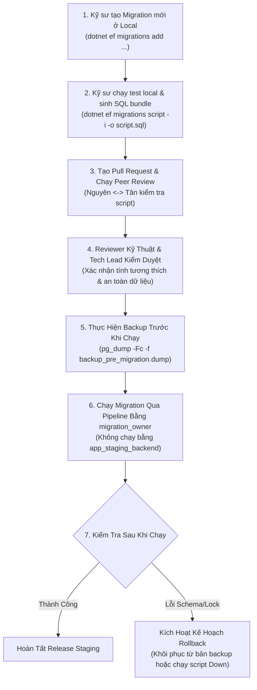

# 🗄️ Hướng Dẫn Kiến Trúc & Vận Hành Cơ Sở Dữ Liệu (Database Architecture & Operations Guide)
## Dự Án: Hotel SaaS Platform v2 (PostgreSQL 17 Multi-Tenant)

> **Mã tài liệu:** `TEAM-DOC-DATABASE` | **Phiên bản:** 1.1 (Hiệu chỉnh an ninh quyền PostgreSQL & Checklist Staging)  
> **Áp dụng cho:** Toàn bộ kỹ sư (Nguyên, Tân), DevOps, Database Administrator và Reviewer.  
> **Ranh giới thực thi:** **CHỈ THIẾT KẾ ĐẶC TẢ TÀI LIỆU**. Tuyệt đối chưa tạo database, chưa chạy migration và chưa cấp quyền thực tế trên máy chủ staging cho đến khi PO và Reviewer phê duyệt.

---

## 1. MÔ HÌNH PHÂN TẦNG VÀ CÔ LẬP CƠ SỞ DỮ LIỆU (FOUR-TIER ISOLATION MODEL)

Hệ thống Hotel SaaS Platform áp dụng mô hình phân tách 4 cấp độ nghiêm ngặt để đảm bảo an toàn dữ liệu, chống rò rỉ bí mật và ngăn ngừa xung đột:

```mermaid
graph TD
    subgraph Tier1["1. Local Development (Cá Nhân Kỹ Sư)"]
        DB_DevNguyen[("hotel_saas_dev_nguyen")]
        DB_DevTan[("hotel_saas_dev_tan")]
        App_DevLocal["Backend Dev Local (Port 5283)"]
    end

    subgraph Tier2["2. Automated Testing Harness (CI / Unit / Integration)"]
        DB_CanonicalTest[("hotel_saas_p1b01a_test<br/>(Shared Test DB)")]
        DB_EphemeralTest[("hotel_saas_tmp_{guid}<br/>(Temporary Test DBs)")]
        App_TestRunner["xUnit Test Runners (Parallel)"]
    end

    subgraph Tier3["3. Shared Staging (Tích Hợp & Demo Chung)"]
        DB_Staging[("hotel_saas_staging<br/>(Dedicated Staging DB)")]
        App_Staging["Backend Staging App"]
        MigOwner["Role: migration_owner<br/>(DDL Owner Only)"]
        SvcAcc["Service Account: app_staging_backend<br/>(DML Only)"]
        DevReadOnly["Developer Accounts: dev_nguyen, dev_tan<br/>(Read-Only Audit)"]
    end

    subgraph Tier4["4. Production (Vận Hành Khách Hàng Thật)"]
        DB_Prod[("hotel_saas_prod<br/>(High Availability / Strict Lock)")]
    end

    App_DevLocal --> DB_DevNguyen
    App_DevLocal --> DB_DevTan
    App_TestRunner --> DB_CanonicalTest
    App_TestRunner --> DB_EphemeralTest
    MigOwner -.->|Run Schema Migrations| DB_Staging
    App_Staging --> SvcAcc --> DB_Staging
    DevReadOnly -.->|Read-Only Inspection| DB_Staging

    classDef dev fill:#e0f2fe,stroke:#0284c7,stroke-width:2px;
    classDef test fill:#fef3c7,stroke:#d97706,stroke-width:2px;
    classDef staging fill:#dcfce7,stroke:#16a34a,stroke-width:2px;
    classDef prod fill:#fee2e2,stroke:#dc2626,stroke-width:2px;

    class Tier1 dev;
    class Tier2 test;
    class Tier3 staging;
    class Tier4 prod;
```



### Bảng So Sánh Các Môi Trường CSDL:

| Môi Trường | Tên CSDL Quy Ước | Mục Đích Sử Dụng | Quyền Hạn Kỹ Sư | Tự Động Init / Migrate? |
| :--- | :--- | :--- | :--- | :--- |
| **Local Dev** | `hotel_saas_dev_{username}` | Viết code, debug tính năng cá nhân | Toàn quyền trên DB cá nhân | ❌ Tắt (`SkipStartupDatabaseInit=true`). Chạy thủ công qua EF CLI. |
| **Test Suite** | `hotel_saas_p1b01a_test` & `hotel_saas_tmp_{guid}` | Chạy automated tests (xUnit) | Test runner tự động tạo/dọn | Tự động trong test harness qua transactional dynamic schemas. |
| **Staging** | `hotel_saas_staging` | Tích hợp full-stack, demo cho PO/khách | **Read-Only** (truy vết cá nhân) | ❌ Tắt (`SkipStartupDatabaseInit=true`). Pipeline CI/CD chạy script có duyệt. |
| **Production** | `hotel_saas_prod` | Chạy hệ thống thực tế | ⛔ Tuyệt đối không truy cập trực tiếp | ❌ Tắt. Quy trình release khắt khe có CAB phê duyệt. |

---

## 2. RÀ SOÁT THIẾT KẾ PHÂN QUYỀN POSTGRESQL TRÊN STAGING (`hotel_saas_staging`)

> [!IMPORTANT]
> **Rà Soát An Ninh Quyền Đối Tượng (PostgreSQL Privileges Hardening):**  
> 1. **Migration Owner Role:** Phải tách biệt rõ vai trò thực thi DDL (`migration_owner`) khỏi tài khoản chạy backend (`app_staging_backend`).  
> 2. **Phạm vi `ALTER DEFAULT PRIVILEGES`:** Trong PostgreSQL, nếu không chỉ định `FOR ROLE <migration_owner>`, các quyền mặc định chỉ áp dụng cho đối tượng do chính user chạy lệnh tạo ra! Khi migration được chạy bởi `migration_owner`, bắt buộc phải khai báo `FOR ROLE migration_owner`.  
> 3. **Thu hồi quyền kế thừa ngầm từ `PUBLIC`:** Mặc định trong PostgreSQL, pseudo-role `PUBLIC` có quyền `USAGE` trên schema `public` và trong một số cấu hình có quyền `CREATE`. Để bảo đảm chắc chắn service account và dev account **hoàn toàn không thể CREATE bảng/schema**, ta bắt buộc phải thu hồi quyền `CREATE` từ `PUBLIC` và từ chính các role này trước.

### Thiết Kế Kịch Bản Phân Quyền Dự Kiến (Chỉ Thiết Kế — Chưa Chạy SQL):

```sql
-- ============================================================================
-- [BẢN THẢO THIẾT KẾ DỰ KIẾN - CHỜ PHÊ DUYỆT - KHÔNG CHẠY TRỰC TIẾP]
-- Database Target: hotel_saas_staging
-- ============================================================================

-- BƯỚC 1: THU HỒI QUYỀN MẶC ĐỊNH TỪ PUBLIC TRÊN DATABASE VÀ SCHEMA
REVOKE ALL ON DATABASE hotel_saas_staging FROM PUBLIC;
REVOKE CREATE ON SCHEMA public FROM PUBLIC;

-- BƯỚC 2: TẠO ROLE MIGRATION OWNER (CHUYÊN TRÁCH DDL VÀ SỞ HỮU SCHEMA)
CREATE ROLE migration_owner WITH LOGIN PASSWORD '<MIGRATION_OWNER_PW_FROM_VAULT>' NOSUPERUSER NOCREATEDB NOCREATEROLE;
GRANT CONNECT, TEMPORARY ON DATABASE hotel_saas_staging TO migration_owner;

\c hotel_saas_staging;
GRANT USAGE, CREATE ON SCHEMA public TO migration_owner;
ALTER SCHEMA public OWNER TO migration_owner;

-- BƯỚC 3: TẠO SERVICE ACCOUNT CHO BACKEND RUNTIME (CHỈ DML - KHÔNG DDL)
CREATE ROLE app_staging_backend WITH LOGIN PASSWORD '<STAGING_BACKEND_PW_FROM_VAULT>' NOSUPERUSER NOCREATEDB NOCREATEROLE;
GRANT CONNECT ON DATABASE hotel_saas_staging TO app_staging_backend;
GRANT USAGE ON SCHEMA public TO app_staging_backend;

-- Thu hồi quyền CREATE tường minh để bảo đảm app_staging_backend không thể CREATE table
REVOKE CREATE ON SCHEMA public FROM app_staging_backend;

-- BƯỚC 4: TẠO TÀI KHOẢN CÁ NHÂN READ-ONLY CÓ TRUY VẾT CHO KỸ SƯ
CREATE ROLE dev_nguyen WITH LOGIN PASSWORD '<DEV_NGUYEN_PW_FROM_VAULT>' NOSUPERUSER NOCREATEDB NOCREATEROLE;
CREATE ROLE dev_tan WITH LOGIN PASSWORD '<DEV_TAN_PW_FROM_VAULT>' NOSUPERUSER NOCREATEDB NOCREATEROLE;

GRANT CONNECT ON DATABASE hotel_saas_staging TO dev_nguyen, dev_tan;
GRANT USAGE ON SCHEMA public TO dev_nguyen, dev_tan;

-- Thu hồi quyền CREATE tường minh từ dev accounts
REVOKE CREATE ON SCHEMA public FROM dev_nguyen, dev_tan;

-- BƯỚC 5: THIẾT LẬP DEFAULT PRIVILEGES CHÍNH XÁC THEO ROLE MIGRATION_OWNER
-- Khi migration_owner tạo bảng mới qua EF Migration:
-- 1. app_staging_backend tự động có quyền DML (SELECT, INSERT, UPDATE, DELETE):
ALTER DEFAULT PRIVILEGES FOR ROLE migration_owner IN SCHEMA public 
    GRANT SELECT, INSERT, UPDATE, DELETE ON TABLES TO app_staging_backend;
ALTER DEFAULT PRIVILEGES FOR ROLE migration_owner IN SCHEMA public 
    GRANT USAGE, SELECT ON SEQUENCES TO app_staging_backend;

-- 2. dev_nguyen và dev_tan tự động CHỈ CÓ QUYỀN READ-ONLY (SELECT):
ALTER DEFAULT PRIVILEGES FOR ROLE migration_owner IN SCHEMA public 
    GRANT SELECT ON TABLES TO dev_nguyen, dev_tan;
ALTER DEFAULT PRIVILEGES FOR ROLE migration_owner IN SCHEMA public 
    GRANT USAGE, SELECT ON SEQUENCES TO dev_nguyen, dev_tan;
```

---

## 3. QUY TRÌNH CẤP PHÁT THÔNG TIN ĐĂNG NHẬP & KẾT NỐI AN TOÀN

> [!CAUTION]
> **QUY TẮC AN TOÀN BẤT BIẾN:**  
> 1. Nghiêm cấm ghi mật khẩu thật vào file tài liệu này, mã nguồn, commit log, file Markdown, hoặc nhắn qua các kênh chat công cộng.  
> 2. Mọi thông tin mật cho môi trường Staging bắt buộc phải được cấp phát thông qua Enterprise Password Manager (1Password / Bitwarden / KeyVault).

#### Bảng Tham Số Kết Nối Staging Dành Cho Kỹ Sư (Sử dụng Placeholders):

| Thuộc Tính Kết Nối | Giá Trị Cấu Hình | Hướng Dẫn & Ghi Chú |
| :--- | :--- | :--- |
| **Host** | `<STAGING_HOST>` | *(IP nội bộ máy chủ Staging hoặc domain nội bộ, do DevOps cung cấp)* |
| **Port** | `<STAGING_PORT>` | Mặc định `5432` (hoặc cổng tunnel) |
| **Database** | `hotel_saas_staging` | Cơ sở dữ liệu Staging dùng chung |
| **Username** | `dev_nguyen` hoặc `dev_tan` | Tài khoản cá nhân định danh riêng của bạn |
| **Password** | `<NHẬN_QUA_ENTERPRISE_VAULT>` | Mở 1Password / Bitwarden Vault dự án để lấy mật khẩu cá nhân |
| **SSL Mode** | `require` hoặc `verify-full` | **Bắt buộc kích hoạt SSL mã hóa đường truyền** |

---

## 4. AN NINH MẠNG: KẾT NỐI QUA VPN NỘI BỘ HOẶC SSH BASTION TUNNEL

> [!IMPORTANT]
> **YÊU CẦU AN NINH HẠ TẦNG:**  
> Cổng 5432 của PostgreSQL Staging **TUYỆT ĐỐI KHÔNG ĐƯỢC MỞ TRỰC TIẾP RA INTERNET**.  
> Tất cả các kết nối từ máy kỹ sư vào CSDL Staging phải đi qua một trong hai phương thức an toàn sau:

#### Phương Án 1: Kết Nối Qua VPN Nội Bộ (Khuyến Nghị Cao Nhất)
Kỹ sư bật VPN công ty (WireGuard hoặc OpenVPN có xác thực 2 lớp MFA) trước khi kết nối. Máy tính của kỹ sư sẽ nằm trong dải IP nội bộ và kết nối trực tiếp tới `<STAGING_HOST>`.

#### Phương Án 2: Kết Nối Qua SSH Bastion Tunnel (Port Forwarding)
Nếu hạ tầng Staging đặt trong mạng VPC có máy chủ Bastion:
```bash
# Mở một đường hầm SSH từ máy cục bộ (port 5433) tới PostgreSQL Staging (port 5432)
ssh -L 5433:<STAGING_INTERNAL_IP>:5432 <SSH_USER>@<BASTION_HOST> -N -f
```
Khi đó, trong DBeaver/pgAdmin, kỹ sư trỏ Host về `localhost` và Port về `5433`.

---

## 5. QUY TRÌNH MIGRATION CÓ KIỂM SOÁT & SAO LƯU DỰ PHÒNG



1. **Một đầu mối duy nhất:** Chỉ có Pipeline CI/CD chuyên trách (hoặc Tech Lead) sử dụng tài khoản `migration_owner` mới có quyền thực thi migration lên staging.
2. **Tắt Startup Auto-Migration:** File `appsettings.Staging.json` bắt buộc có:
   ```json
   "SkipStartupDatabaseInit": true
   ```
3. **Sao lưu trước khi nâng cấp (Pre-Migration Backup):**
   ```bash
   pg_dump -h <STAGING_HOST> -p 5432 -U migration_owner -d hotel_saas_staging -Fc -f "staging_backup_$(date +%Y%m%d_%H%M%S).dump"
   ```
4. **Kiểm tra Script Idempotent:** Xuất file SQL migration bằng lệnh:
   ```bash
   dotnet ef migrations script -i --project src/HotelSaas.Infrastructure --startup-project src/HotelSaas.WebApi -o migration_staging.sql
   ```
5. **Kế hoạch Rollback (Rollback Plan):** Mọi migration PR bắt buộc phải kèm theo script `Down()` tương ứng và được xác minh chạy thử thành công trên database kiểm thử cô lập trước khi áp dụng lên staging.
6. **Bảo toàn Guard của `BE-SEED-01`:** Giữ nguyên guard chặn staging của `BE-SEED-01`. Đề xuất ticket riêng `BE-SEED-STAGING-01` để chuẩn bị bộ dữ liệu giả lập chuyên biệt cho staging khi PO duyệt.

---

## 6. CHECKLIST THIẾT LẬP HẠ TẦNG STAGING (`STAGING-SETUP-01`)

Tất cả các hạng mục dưới đây đang ở trạng thái **Pending / Chờ phê duyệt** từ Product Owner và Technical Reviewer. **Chưa thực hiện triển khai hay tạo CSDL thực tế**:

| STT | Hạng Mục Thiết Lập | Tiêu Chuẩn Kỹ Thuật Yêu Cầu | Trạng Thái Hiện Tại | Đầu Mối Chịu Trách Nhiệm |
| :---: | :--- | :--- | :---: | :--- |
| **1** | **Hạ tầng Máy chủ / Host** | Máy chủ chuyên dụng, PostgreSQL v17, cấu hình tài nguyên (RAM $\ge$ 4GB, CPU $\ge$ 2 cores, SSD), IP nội bộ cô lập. | 🟡 **Pending (Chờ duyệt)** | DevOps / SysAdmin |
| **2** | **Truy cập Mạng An toàn** | Cổng 5432 bị chặn bởi Firewall; bắt buộc kết nối qua VPN nội bộ (MFA) hoặc SSH Bastion Tunnel. | 🟡 **Pending (Chờ duyệt)** | Network Admin |
| **3** | **Mã hóa Đường truyền (TLS/SSL)** | Máy chủ PostgreSQL cài đặt chứng chỉ SSL hợp lệ; ép buộc kết nối từ client phải dùng `sslmode=require` hoặc `verify-full`. | 🟡 **Pending (Chờ duyệt)** | DevOps / SecOps |
| **4** | **Quản lý Bí mật (Secrets Management)** | Sinh mật khẩu mạnh ngẫu nhiên ($\ge 32$ ký tự) cho `migration_owner`, `app_staging_backend`, `dev_nguyen`, `dev_tan`; lưu trữ trên Enterprise Vault. | 🟡 **Pending (Chờ duyệt)** | IT Security / Tech Lead |
| **5** | **Sao lưu Dự phòng (Backup Policy)** | Lập lịch sao lưu tự động hàng ngày (`pg_dump -Fc`) lưu trữ tại storage riêng biệt; quy trình snapshot trước migration. | 🟡 **Pending (Chờ duyệt)** | DBA / DevOps |
| **6** | **Quyền hạn Migration Owner** | Tạo role `migration_owner` riêng biệt; thu hồi quyền `CREATE` từ `PUBLIC`; cấu hình `ALTER DEFAULT PRIVILEGES FOR ROLE migration_owner`. | 🟡 **Pending (Chờ duyệt)** | DBA / Tech Lead |
| **7** | **Provisioning Dữ liệu Giả lập** | Phê duyệt đặc tả `BE-SEED-STAGING-01`; cam kết 100% dữ liệu nhân tạo (synthetic), không chứa PII của khách hàng thật. | 🟡 **Pending (Chờ duyệt)** | PO / Tech Lead |
| **8** | **Kiểm thử Kiểm chứng (Smoke Tests)** | Chạy bộ smoke test kiểm tra kết nối từ backend staging, kiểm tra quyền read-only của dev accounts và health check endpoint. | 🟡 **Pending (Chờ duyệt)** | QA / Full-Stack Team |
