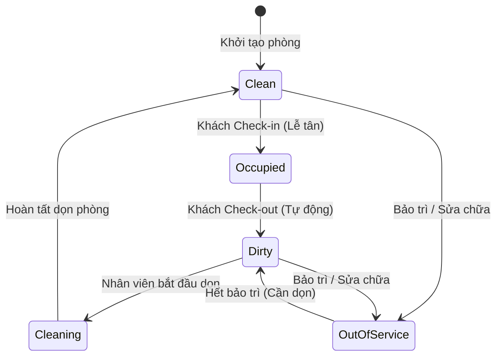

# TÀI LIỆU HƯỚNG DẪN DÀNH CHO TÂN
### MODULE: QUẢN LÝ BUỒNG PHÒNG & TRẠNG THÁI PHÒNG (HOUSEKEEPING BOARD)
- **Người thực hiện:** Tân (Frontend Developer)
- **Hỗ trợ Backend & Kiến trúc:** Ngô Võ Tuấn Anh (Nhóm trưởng)
- **Kho lưu trữ:** [https://github.com/GinNgo/hotel-saas-v2](https://github.com/GinNgo/hotel-saas-v2)
- **Nhánh làm việc đề xuất:** `feature/tan-housekeeping-states` (tách từ `develop`)

---

## 1. CÁC TỆP NGUỒN THUỘC PHẠM VI QUẢN LÝ CỦA TÂN

Tân chịu trách nhiệm chính trên các tệp sau (đảm bảo không bị trùng lặp với Nguyên hay Tuấn Anh):

| STT | Đường Dẫn File Trong Project | Vai Trò & Chức Năng | Link Trực Tiếp Trên GitHub |
|:---:|---|---|:---:|
| 1 | `frontend/src/app/features/housekeeping/housekeeping.page.ts` | Bảng điều hành buồng phòng, hiển thị danh sách phòng theo tầng, thanh KPI trạng thái, nút thao tác đổi trạng thái nhanh | [housekeeping.page.ts](https://github.com/GinNgo/hotel-saas-v2/blob/develop/frontend/src/app/features/housekeeping/housekeeping.page.ts) |
| 2 | `frontend/src/app/core/models/enums.ts` | Khai báo Enum `RoomStatus` và đối tượng nhãn màu sắc `ROOM_STATUS_LABELS` | [enums.ts](https://github.com/GinNgo/hotel-saas-v2/blob/develop/frontend/src/app/core/models/enums.ts) |
| 3 | `frontend/src/app/core/services/room.service.ts` | Gọi hàm cập nhật trạng thái phòng `updateRoomStatus(id, newStatus, expectedOldStatus)` | [room.service.ts#L48](https://github.com/GinNgo/hotel-saas-v2/blob/develop/frontend/src/app/core/services/room.service.ts) |
| 4 | `frontend/src/app/shared/components/pagination/pagination.component.ts` | Component phân trang dùng chung cho bảng buồng phòng | [pagination.component.ts](https://github.com/GinNgo/hotel-saas-v2/blob/develop/frontend/src/app/shared/components/pagination/pagination.component.ts) |
| 5 | `frontend/src/app/shared/components/skeleton-table/skeleton-table.component.ts` | Hiệu ứng tải khung xương (Skeleton) mượt mà khi đổi tầng hoặc chuyển trang | [skeleton-table](https://github.com/GinNgo/hotel-saas-v2/tree/develop/frontend/src/app/shared/components/skeleton-table) |

---

## 2. QUY TRÌNH CHUYỂN TRẠNG THÁI BUỒNG PHÒNG (STATE MACHINE)

Backend .NET 10 kiểm soát chặt chẽ máy trạng thái buồng phòng để bảo đảm an toàn dữ liệu khách sạn:



### Các quy tắc chuyển đổi bắt buộc:
1. **Phòng Bẩn (`Dirty = 2`):** Chỉ có thể chuyển sang Đang dọn (`Cleaning = 3`) hoặc Bảo trì (`OutOfService = 5`).
2. **Phòng Đang dọn (`Cleaning = 3`):** Chỉ có thể chuyển sang Đã sạch (`Clean = 1`).
3. **Phòng Đang có khách (`Occupied = 4`):** Thuộc nghiệp vụ Lễ tân check-in/out, nhân viên buồng phòng **không được tự chuyển sang Clean**. Khi khách check-out, hệ thống sẽ tự động chuyển phòng về `Dirty`.

---

## 3. API CẬP NHẬT TRẠNG THÁI & CƠ CHẾ CHỐNG XUNG ĐỘT (409 CONFLICT)

### API: `PATCH /api/rooms/{id}/status`
- **Header:** `Authorization: Bearer <token>` và `X-Property-Id: <id-chi-nhánh>`
- **Body JSON:**
  ```json
  {
    "status": 3,
    "expectedOldStatus": 2
  }
  ```
  *(Ví dụ: chuyển từ 2 - Dirty sang 3 - Cleaning)*

### Cơ chế chống xung đột đồng thời (Concurrency Safety):
- Khi Tân gửi request, **bắt buộc phải truyền `expectedOldStatus`** (trạng thái hiện tại mà màn hình đang nhìn thấy).
- **Trường hợp xung đột:** Nếu hai nhân viên cùng mở app, nhân viên A bấm "Bắt đầu dọn" trước, nhân viên B bấm sau:
  - Backend sẽ phát hiện trạng thái phòng trong database không còn khớp với `expectedOldStatus` của B.
  - Backend lập tức trả về mã `409 Conflict` với mã lỗi `ERR_STALE_STATE` và thông báo: *"Trạng thái phòng đã bị thay đổi bởi người khác, vui lòng làm mới lại trang!"*.
- **Xử lý trên Frontend của Tân:**
  - Bắt lỗi `err.status === 409`:
  - Hiển thị Toast cảnh báo qua `AlertService`: `this.alertService.toastError('Phòng này đã được người khác cập nhật!');`
  - Tự động gọi lại `this.loadRooms()` để cập nhật lại bảng theo dữ liệu mới nhất trên server.

---

## 4. CHECKLIST CÔNG VIỆC CỦA TÂN TRONG TUẦN 2 & TUẦN 3

- [ ] **Bảng Thống kê KPI Thời gian thực:**
  - Trên đầu trang `housekeeping.page.ts`, hiển thị 4 thẻ KPI:
    - 🧹 Cần dọn (`Dirty`) — Màu cam/đỏ
    - ⏳ Đang dọn (`Cleaning`) — Màu vàng
    - ✨ Đã sạch sẵn sàng (`Clean`) — Màu xanh lá
    - 🔒 Đang có khách (`Occupied`) — Màu xám/tím
  - Ghi chú rõ ràng: *(Số liệu thống kê trên trang hiện tại)* để bảo đảm tính chính xác.
- [ ] **Bộ lọc phòng theo Tầng lầu (Floor Filter):**
  - Dropdown chọn: *Tất cả các tầng*, *Tầng 1*, *Tầng 2*, *Tầng 3*, *Tầng 4*.
  - Khi đổi tầng, tự động đưa trang hiện tại về trang 1 và tải lại danh sách.
- [ ] **Nút bấm chuyển trạng thái 1 chạm (One-click Action Buttons):**
  - Với phòng `Dirty`: Hiển thị nút "Bắt đầu dọn" $\to$ bấm vào chuyển sang `Cleaning`.
  - Với phòng `Cleaning`: Hiển thị nút "Hoàn tất dọn" $\to$ bấm vào chuyển sang `Clean`.
  - Trong lúc request đang gửi lên server, disable nút và hiển thị spinner nhỏ để chống nhân viên bấm double-click liên tục.
- [ ] **Tối ưu Mobile (Responsive cho điện thoại):**
  - Thử nghiệm trên màn hình điện thoại (F12 chọn kích thước iPhone 375px):
  - Bảng phòng hiển thị gọn gàng, thẻ phòng dễ nhìn, nút bấm đủ to để chạm ngón tay không bị bấm nhầm.

---

## 5. HƯỚNG DẪN CHẠY THỬ VÀ KIỂM TRA MÃ NGUỒN CỤC BỘ

Tân mở terminal tại thư mục `frontend` và chạy các lệnh:

```bash
# 1. Chuyển vào thư mục frontend
cd frontend

# 2. Cài đặt thư viện (nếu chưa cài)
npm install

# 3. Khởi chạy ứng dụng chạy thử
npm start
# -> Truy cập trình duyệt tại: http://localhost:4200/housekeeping

# 4. Kiểm tra mã nguồn có lỗi build không
npm run build
```

*Nếu Tân cần test với dữ liệu phòng bẩn/sạch thật hoặc cần hỗ trợ về API, cứ ping nhóm trưởng Tuấn Anh hỗ trợ ngay nhé!*
