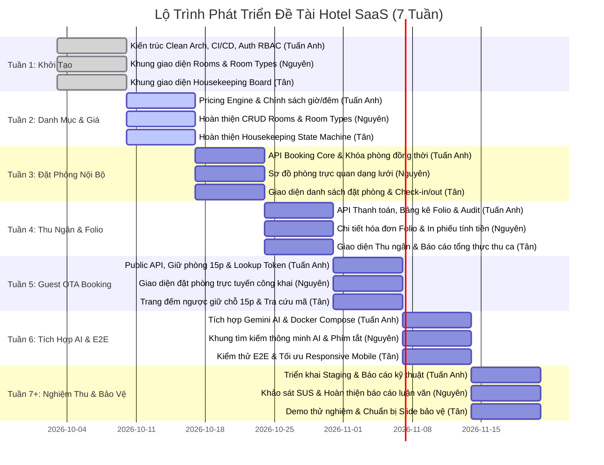

# LỘ TRÌNH DỰ ÁN & PHÂN CÔNG NHIỆM VỤ NHÓM 3 THÀNH VIÊN
### ĐỀ TÀI: XÂY DỰNG HỆ THỐNG QUẢN LÝ KHÁCH SẠN (HOTEL SAAS PLATFORM)
- **Kho lưu trữ GitHub:** [https://github.com/GinNgo/hotel-saas-v2](https://github.com/GinNgo/hotel-saas-v2)
- **Nhánh làm việc chung:** `develop`
- **Thành viên:**
  1. **Ngô Võ Tuấn Anh** (Nhóm trưởng / Full-Stack & System Architect)
  2. **Nguyên** (Frontend Developer — Phụ trách module Phòng & Hạng phòng)
  3. **Tân** (Frontend Developer — Phụ trách module Buồng phòng & Đặt phòng)

---

## 1. QUY ƯỚC LÀM VIỆC NHÓM (TEAM CONVENTIONS)

1. **Quy tắc Phân nhánh Git (Git Branching):**
   - Nhánh `main`: Nhánh ổn định, chỉ merge khi có bản release nghiệm thu.
   - Nhánh `develop`: Nhánh tích hợp chính của cả nhóm.
   - Nhánh tính năng cá nhân: Tạo nhánh từ `develop` theo định dạng:
     - `feature/nguyen-rooms-crud`
     - `feature/tan-housekeeping-states`
     - `feature/tuananh-pricing-engine`
2. **Quy tắc Commit Message (Chuẩn Conventional Commits):**
   - `feat(rooms): thêm modal tạo mới phòng và validation số phòng`
   - `fix(housekeeping): xử lý lỗi 409 khi hai người cùng cập nhật trạng thái`
   - `style(ui): tinh chỉnh responsive bảng phòng trên mobile 375px`
   - `test(rooms): bổ sung test kiểm tra phân trang`
3. **Quy tắc Review chéo & Tránh xung đột code:**
   - Nguyên phụ trách thư mục: `frontend/src/app/features/rooms` và `frontend/src/app/features/room-types`.
   - Tân phụ trách thư mục: `frontend/src/app/features/housekeeping`.
   - Tuấn Anh phụ trách Backend: `backend/` và các thành phần cốt lõi dùng chung (`core/`, `layouts/`).
   - Tuyệt đối không chỉnh sửa đè vào file của nhau; nếu cần sửa các file dùng chung (`shared/` hoặc `app.routes.ts`), phải trao đổi trước với nhóm trưởng.
4. **Định nghĩa Hoàn thành (Definition of Done — DoD):**
   - Mỗi tính năng khi hoàn thành phải:
     1. Chạy được trên giao diện thực tế, không có lỗi console.
     2. Giao diện responsive tốt từ mobile (375px), tablet (768px) đến desktop (1440px).
     3. Có xử lý đủ 4 trạng thái: Đang tải (Loading), Dữ liệu rỗng (Empty), Có dữ liệu (Data), Lỗi và thử lại (Error/Retry).
     4. Build thành công bằng lệnh `npm run build` không phát sinh lỗi TypeScript.

---

## 2. LỘ TRÌNH TỔNG THỂ CỦA ĐỒ ÁN (ROADMAP TỪ TUẦN 1 ĐẾN TUẦN 7+)

---

## 3. PHÂN CHIA NHIỆM VỤ CHI TIẾT THEO TỪNG TUẦN

### Tuần 1 (Hiện tại — Đã hoàn thành):
- **Tuấn Anh:** Thiết lập Clean Architecture .NET 10, Entity Framework Core, PostgreSQL 17, thiết lập quy trình CI/CD GitHub Actions 6 giai đoạn, triển khai hệ thống xác thực Auth & RBAC đa chi nhánh, viết tài liệu SRS & SDD.
- **Nguyên:** Tạo khung giao diện Danh mục Phòng (`rooms.page.ts`) và Hạng phòng (`room-types.page.ts`), tạo models TypeScript và service gọi API.
- **Tân:** Tạo khung giao diện Bảng buồng phòng (`housekeeping.page.ts`), khai báo Enum trạng thái phòng, tích hợp phân trang và skeleton table.

---

### Tuần 2 (Trọng tâm: Hoàn thiện CRUD & Bảng giá):
- **Tuấn Anh:**
  - Viết Pricing Engine tính tiền phòng theo giờ (giờ đầu + phụ thu mỗi giờ làm tròn lên 60 phút) và theo đêm (12:00 hôm trước đến 12:00 hôm sau).
  - API quản lý chính sách chi nhánh (`/api/properties/{id}/policies`) và bảng giá (`/api/room-types/{id}/rates`).
  - Viết Unit Tests tự động kiểm tra tính đúng đắn của phép tính giá.
- **Nguyên:**
  - Hoàn thiện form modal Thêm phòng và Sửa phòng: chọn tầng, số phòng, chọn loại phòng tương ứng.
  - Xử lý kiểm tra dữ liệu form (Validation): số phòng không được để trống, không được trùng trong cùng một chi nhánh.
  - Hiển thị thông báo Toast thành công hoặc lỗi xung đột 409 bằng AlertService.
- **Tân:**
  - Hoàn thiện thao tác chuyển trạng thái phòng: Bẩn (`Dirty`) $\to$ Đang dọn (`Cleaning`) $\to$ Đã sạch (`Clean`).
  - Xử lý gửi kèm `expectedOldStatus` lên backend để chống lỗi ghi đè đồng thời.
  - Hoàn thiện bộ lọc buồng phòng theo tầng lầu và trạng thái.

---

### Tuần 3 (Trọng tâm: Quy trình Đặt phòng nội bộ & Vòng đời lưu trú):
- **Tuấn Anh:**
  - Phát triển API Đặt phòng nội bộ: kiểm tra phòng trống theo khoảng thời gian `[StartAt, EndAt)`.
  - Thuật toán khóa chống đặt trùng phòng đồng thời (Anti-overlap concurrency locking ở tầng Database transaction).
  - API Check-in (chuyển phòng sang `Occupied`) và Check-out (tự động chuyển phòng sang `Dirty`).
- **Nguyên:**
  - Xây dựng giao diện Sơ đồ phòng trực quan dạng lưới (Room Matrix / Grid View).
  - Thể hiện màu sắc trực quan: Xanh (Phòng sạch/Sẵn sàng), Đỏ (Đang có khách), Vàng (Đang dọn), Xám (Chưa dọn).
  - Modal xem nhanh thông tin phòng và tạo đơn đặt phòng trực tiếp từ sơ đồ.
- **Tân:**
  - Xây dựng giao diện Danh sách đơn đặt phòng (`reservations.page.ts`).
  - Tích hợp các nút thao tác nhanh: Check-in cho khách đến nhận phòng, Check-out cho khách trả phòng, Hủy phòng có lưu lý do.
  - Tự động kích hoạt thông báo cập nhật bảng buồng phòng khi có thao tác Check-out.

---

### Tuần 4 (Trọng tâm: Thu ngân, Bảng kê Folio & Thanh toán):
- **Tuấn Anh:**
  - API Quản lý thanh toán: Ghi nhận phiếu thu tiền mặt, chuyển khoản, tiền cọc.
  - API Bảng kê công nợ hóa đơn (`FolioDto`): tổng tiền, tiền đã thanh toán, số dư còn nợ.
  - API Tổng kết thực thu ca trực (`PaymentSummaryDto`) tính theo ngày địa phương Việt Nam (UTC+7).
- **Nguyên:**
  - Giao diện Bảng kê công nợ (`Folio`): hiển thị chi tiết tiền phòng, phụ thu check-in sớm / check-out muộn, dịch vụ phát sinh.
  - Nút bấm xem trước và in hóa đơn tạm tính cho khách hàng.
- **Tân:**
  - Giao diện Báo cáo thu ngân (`payments.page.ts`): thống kê tiền mặt, chuyển khoản, thẻ tín dụng trong ca.
  - Form ghi nhận thu tiền tại quầy cho lễ tân với các phương thức thanh toán.

---

### Tuần 5 (Trọng tâm: Đặt phòng trực tuyến cho khách — Guest OTA):
- **Tuấn Anh:**
  - Public API không yêu cầu đăng nhập: tra cứu danh sách khách sạn và kiểm tra tồn phòng công khai.
  - Cơ chế Giữ phòng 15 phút (Room Hold) chia sẻ tồn kho chung với hệ thống nội bộ.
  - Tự động giải phóng phòng khi hết hạn 15 phút mà khách chưa thanh toán cọc.
  - Sinh mã tra cứu bí mật (`lookupToken`) bảo vệ thông tin cá nhân của khách.
- **Nguyên:**
  - Giao diện Đặt phòng trực tuyến dành cho khách (`booking.page.ts`): thiết kế hiện đại, thanh tìm kiếm chọn ngày nhận/trả phòng, số khách.
  - Hiển thị danh sách hạng phòng còn trống, giá ước tính, tiện ích và hình ảnh phòng.
- **Tân:**
  - Giao diện Giữ chỗ 15 phút (`booking-hold.page.ts`): đồng hồ đếm ngược thời gian thực, hướng dẫn chuyển khoản cọc.
  - Giao diện Tra cứu trạng thái đơn phòng (`booking-status.page.ts`) qua mã token hoặc số điện thoại.

---

### Tuần 6 (Trọng tâm: Trợ lý AI & Tối ưu UI/UX):
- **Tuấn Anh:**
  - Tích hợp Gemini API hỗ trợ tính năng Trợ lý AI tìm phòng thông minh bằng tiếng Việt.
  - Bộ tiền xử lý câu hỏi và bộ lọc dữ liệu thực tế: AI chỉ trả về phòng thực sự có trong hệ thống, tuyệt đối không bịa giá hoặc số lượng phòng.
  - Đóng gói toàn bộ hệ thống bằng Docker Compose (Backend, Frontend, PostgreSQL).
- **Nguyên:**
  - Giao diện Hộp thoại Trợ lý ảo AI: nhận câu lệnh bằng giọng nói hoặc văn bản (ví dụ: *"Tìm phòng đôi cho 2 người ở Quận 1 từ ngày mai"*).
  - Tối ưu khả năng tiếp cận (Accessibility), điều hướng bàn phím hoàn chỉnh (phím Tab, Enter, Escape).
- **Tân:**
  - Thực hiện kiểm thử toàn diện luồng đặt phòng từ đầu đến cuối (End-to-End Testing).
  - Tối ưu giao diện trên thiết bị di động (Mobile Responsive 375px), đảm bảo các nút bấm thao tác dễ dàng.

---

### Tuần 7 trở đi (Trọng tâm: Thực nghiệm người dùng & Bảo vệ đề tài):
- **Tuấn Anh:**
  - Triển khai hệ thống lên máy chủ thử nghiệm (Staging Server) có domain công khai để demo trực tiếp.
  - Rà soát toàn diện bảo mật, kiểm tra chất lượng mã nguồn bằng SonarQube / Roslyn Analyzers.
- **Nguyên:**
  - Thiết kế và phát phiếu khảo sát đo lường trải nghiệm người dùng theo tiêu chuẩn SUS (System Usability Scale) cho $\ge$ 10 người dùng thực tế.
  - Hoàn thiện tài liệu thuyết minh đồ án phần Phân tích thiết kế và Giao diện người dùng.
- **Tân:**
  - Tổng hợp kết quả thực nghiệm người dùng, đề xuất cải tiến cho hệ thống.
  - Hoàn thiện tài liệu đồ án phần Nghiệp vụ buồng phòng và Kiểm thử phần mềm.
  - Cùng nhóm chuẩn bị Slide thuyết trình và kịch bản demo chạy thật phục vụ buổi bảo vệ.
