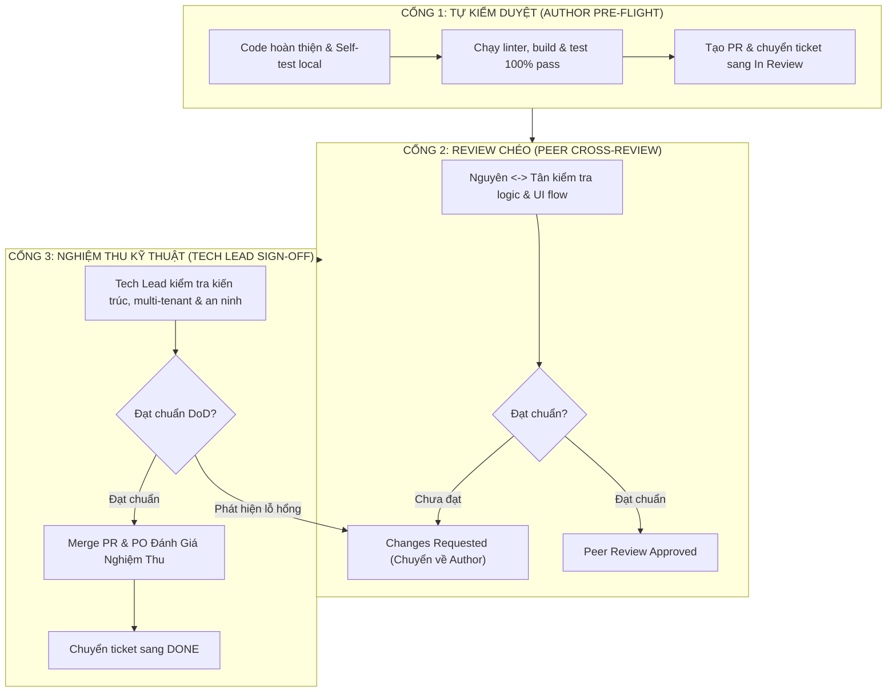

# ✅ Quy Trình Kiểm Duyệt & Nghiệm Thu Kỹ Thuật (Review & Sign-Off Checklist)
## Dự Án: Hotel SaaS Platform v2 (.NET 10 + PostgreSQL 17 + Angular 22)

> **Mã tài liệu:** `TEAM-DOC-REVIEW-CHECKLIST` | **Phiên bản:** 1.0  
> **Áp dụng cho:** Kỹ sư tác giả (Author), Kỹ sư review chéo (Peer Reviewer: Nguyên <-> Tân), Reviewer Kỹ Thuật (Tech Lead) và Product Owner (PO).  
> **Nguyên tắc cốt lõi:**  
> - Kỹ sư chỉ đưa ticket tối đa tới trạng thái `In Review`.  
> - Bắt buộc vượt qua 3 tầng cổng kiểm soát (Gates): Tự kiểm tra (Author) $\to$ Review chéo (Peer) $\to$ Nghiệm thu kỹ thuật (Tech Lead).  
> - Chỉ có Tech Lead và PO mới có thẩm quyền chuyển ticket sang `Done`.

---

## 1. QUY TRÌNH KIỂM DUYỆT 3 CẤP (THREE-GATE REVIEW WORKFLOW)

---

## 2. CHECKLIST CỔNG 1: TỰ KIỂM DUYỆT CỦA KỸ SƯ (AUTHOR PRE-FLIGHT CHECKLIST)

Trước khi gửi Pull Request và chuyển trạng thái ticket sang `In Review`, kỹ sư tác giả bắt buộc phải tự tích chọn và xác nhận:

- [ ] **1. Tuân thủ phạm vi file (Allowed Files Only):**
  - Chỉ chỉnh sửa các file thuộc danh mục được phép trong mô tả Ticket.
  - Tuyệt đối không chạm vào các file core bị cấm (như `Program.cs`, các controller backend không liên quan).
- [ ] **2. Không vi phạm đóng băng hợp đồng (Contract Freeze):**
  - Không tự ý sửa đổi tham số, kiểu dữ liệu hay cấu trúc JSON trả về của backend API nếu giao diện có thể thích ứng được.
- [ ] **3. Sạch mã nguồn & Không rò rỉ thông tin mật:**
  - Đã xóa sạch các dòng `console.log`, mã debug tạm bợ, hoặc code bị chú thích (commented-out code).
  - Không hardcode mật khẩu, email thật, API key hay JWT secret vào mã nguồn hoặc commit message.
- [ ] **4. Kiểm thử tự động cục bộ đạt 100%:**
  - Frontend: `npm run build` không có lỗi TypeScript; `npm test` pass toàn bộ.
  - Backend: `dotnet test HotelSaas.slnx` đạt **100% PASS (0 warning, 0 error)**.
- [ ] **5. Viết mô tả Pull Request rõ ràng:**
  - Ghi rõ mã Ticket (ví dụ: `Resolves #FE-AUTH-01`).
  - Đính kèm tóm tắt thay đổi và ảnh chụp màn hình / video demo thao tác trên local.

---

## 3. CHECKLIST CỔNG 2: REVIEW CHÉO GIỮA HAI THÀNH VIÊN (PEER CROSS-REVIEW)

*(Kỹ sư Nguyên review cho Tân; Kỹ sư Tân review cho Nguyên)*

### 3.1. Tiêu Chí Frontend (Angular & UI/UX):
- [ ] **Khả năng sử dụng & Trải nghiệm (UX):**
  - Luồng giao diện mượt mà, không bị giật lag khi chuyển trang hoặc đổi chi nhánh.
  - Có loading indicator (spinner / skeleton) khi gọi API bất đồng bộ.
  - Các thông báo thành công (Toast success) và thông báo lỗi hiển thị bằng tiếng Việt rõ ràng, dễ hiểu.
- [ ] **Xử lý mã lỗi API toàn diện:**
  - Form hiển thị lỗi validation dưới ô nhập liệu khi nhận HTTP 400.
  - Hiển thị thông báo khi token hết hạn (HTTP 401) hoặc không có quyền (HTTP 403).
  - Xử lý xung đột (HTTP 409): hiển thị thông báo trùng dữ liệu hoặc tranh chấp đồng thời mà không làm crash màn hình.
- [ ] **Chuẩn mực mã nguồn Angular:**
  - Sử dụng Standalone Components, Signals, và Reactive Forms.
  - Không subscribe lồng nhau (tránh memory leak; sử dụng RxJS operators hoặc takeUntilDestroyed).
  - Sử dụng Tailwind CSS và PrimeNG đồng bộ với hệ thống thiết kế hiện có.

### 3.2. Tiêu Chí Backend & Tích Hợp:
- [ ] **Tương thích DTO & Serialization:**
  - DTO frontend khớp chính xác các trường dữ liệu của backend (lưu ý trường hợp `propertyId` có thể bị omit khi null do `WhenWritingNull`).
  - Request headers luôn đính kèm đầy đủ `Authorization: Bearer <token>` và `X-Property-Id: <guid>`.
- [ ] **Bảo vệ ranh giới chi nhánh:**
  - Dữ liệu hiển thị trên bảng phòng/loại phòng phải được cô lập tuyệt đối theo chi nhánh đang làm việc; không hiển thị lẫn lộn dữ liệu của chi nhánh khác.

---

## 4. CHECKLIST CỔNG 3: NGHIỆM THU KỸ THUẬT CUỐI CÙNG (TECHNICAL REVIEWER SIGN-OFF)

Reviewer Kỹ Thuật (Tech Lead) kiểm tra độc lập các yếu tố an toàn hệ thống cấp doanh nghiệp trước khi phê duyệt merge và chuyển `Done`:

- [ ] **1. An toàn cách ly Multi-Tenant & RBAC:**
  - Mọi query EF Core hoặc DML raw SQL đều tuân thủ nguyên tắc cách ly ngữ cảnh (`TenantId`, `PropertyId`).
  - Không có kịch bản nào cho phép tài khoản chi nhánh A đọc hoặc ghi dữ liệu của chi nhánh B.
  - Quyền hạn người dùng (Owner vs Manager vs Receptionist) được kiểm tra chặt chẽ ở cả client router guard và backend authorization middleware.
- [ ] **2. An toàn đồng thời & Máy trạng thái (Concurrency & State Machine):**
  - Các thao tác nhạy cảm (như đổi trạng thái buồng phòng) bắt buộc kiểm tra `ExpectedOldStatus` để phát hiện tranh chấp đồng thời.
  - Trạng thái `Occupied` được bảo vệ tuyệt đối không cho phép đổi thủ công.
- [ ] **3. An toàn cơ sở dữ liệu (Database Guard):**
  - Không chứa bất kỳ câu lệnh DDL nguy hiểm nào có khả năng làm mất dữ liệu (`DROP TABLE`, `TRUNCATE`).
  - Các migration mới (nếu có) phải có tính lũy kế (`idempotent`), có script rollback `Down()` và được kiểm thử trên test schema cô lập.
- [ ] **4. Hồi quy toàn hệ thống (Zero Regression):**
  - Toàn bộ 220 bài test hệ thống (bao gồm P1B01B composite keys, P2B02 concurrency barrier, và BE-SEED-01 pipeline) tiếp tục đạt **100% PASS**.
- [ ] **5. Nghiệm thu Definition of Done (DoD):**
  - Toàn bộ tiêu chí chấp nhận trong ticket đã được chứng minh bằng bằng chứng kiểm thử thực tế.

---

## 5. QUY TẮC PHÊ DUYỆT HOẶC YÊU CẦU SỬA ĐỔI

1. **Khi phát hiện vi phạm (Changes Requested):**
   - Reviewer ghi rõ: (a) Vị trí file và dòng code vi phạm, (b) Rủi ro kỹ thuật (ví dụ: rò rỉ dữ liệu giữa 2 chi nhánh, thiếu xử lý lỗi 409), (c) Hướng khắc phục khuyến nghị.
   - Trạng thái ticket được chuyển về `Changes Requested`.
2. **Khi nghiệm thu thành công (Approved & Done):**
   - Tech Lead merge Pull Request vào nhánh chính.
   - Tech Lead và PO ký duyệt nghiệm thu bằng văn bản/comment trên issue và chính thức đánh dấu ticket là **`Done`**.
