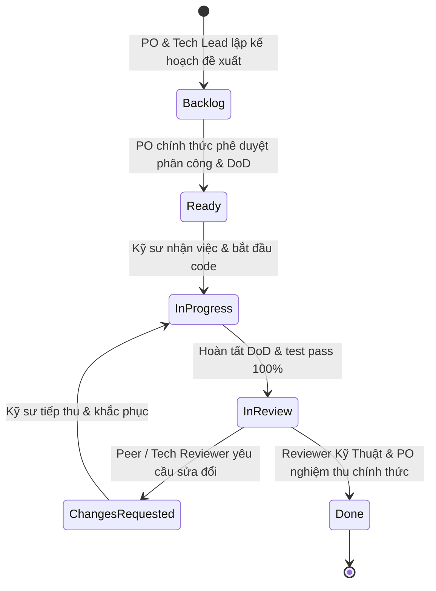

# 📋 Bảng Quản Lý Công Việc & Nhiệm Vụ Full-Stack (Full-Stack Task Board & Issue Drafts)
## Dự Án: Hotel SaaS Platform v2 (.NET 10 + PostgreSQL 17 + Angular 22)

> **Mã tài liệu:** `TEAM-DOC-TASK-BOARD` | **Phiên bản:** 1.1 (Đồng bộ trạng thái Backlog & phân công đề xuất)  
> **Áp dụng cho:** Kỹ sư Nguyên (FE/BE), Kỹ sư Tân (FE/BE), Technical Reviewer, Product Owner (PO).  
> **Nguyên tắc quản lý:**  
> 1. Phân công full-stack theo module đề xuất; thành viên tự hoàn thiện cả luồng UI và tích hợp API backend tương ứng.  
> 2. Hai thành viên review chéo cho nhau (Peer Cross-Review); Reviewer kỹ thuật nghiệm thu cuối cùng.  
> 3. Đóng băng hợp đồng Backend API (Contract Freeze) — không tự ý sửa endpoint/contract nếu UI tích hợp được; không tự tạo task BE mới ngoài phạm vi module.  
> 4. **Giới hạn trạng thái:** Tất cả các task chưa được PO duyệt chính thức đều ở trạng thái **`Backlog`**. Kỹ sư và AI Agent chỉ được chuyển task tối đa đến `In Review`. **Tuyệt đối không tự ý đánh dấu `Done`**.

---

## 1. QUY TRÌNH VÒNG ĐỜI TRẠNG THÁI TASK (TASK LIFECYCLE PROTOCOL)



### Quy Định Về Chuyển Trạng Thái:
- **`Backlog`:** Task mới được đề xuất hoặc đang trong giai đoạn soạn thảo đặc tả, **chưa được PO phê duyệt chính thức**.
- **`Ready`:** Đã đầy đủ Scope, DoD, Hợp đồng API, và **đã được PO phê duyệt phân công**. Kỹ sư có thể bắt đầu làm.
- **`In Progress`:** Kỹ sư đã tạo nhánh Git riêng (`feat/<task-id>`) và đang tiến hành lập trình/kiểm thử.
- **`In Review`:** Kỹ sư đã hoàn tất 100% checklist kỹ thuật, toàn bộ test local pass, đã tạo Pull Request.
- **`Changes Requested`:** Reviewer phát hiện lỗi logic, vi phạm bảo mật multi-tenant, hoặc thiếu test.
- **`Done`:** Chỉ được chuyển bởi Reviewer Kỹ Thuật và PO sau khi đã nghiệm thu độc lập trên môi trường chuẩn.

---

## 2. MA TRẬN PHÂN CÔNG VÀ TIẾN ĐỘ TỔNG QUAN (TUẦN 2)

| Mã Task | Tên Nhiệm Vụ | Kỹ Sư Phụ Trách | Kỹ Sư Review Chéo (Peer Reviewer) | Nghiệm Thu Cuối (Tech Lead) | Trạng Thái Hiện Tại |
| :--- | :--- | :--- | :--- | :--- | :---: |
| **`BE-RESERV-01`** | Reservation Engine Core, Khóa đồng thời Anti-overlap, Stay Lifecycle API (Check-in/Out) | **Tuấn An** (Leader / Backend) | Reviewer Kỹ Thuật | PO / Giảng viên | 🟢 **`In Progress`** *(Đang hoàn thiện)* |
| **`FE-RESERV-01`** | Màn hình Đặt phòng Lễ tân tại quầy (`reservations.page.ts`), Chọn phòng trực quan & Timeline | **Khởi Nguyên** (Frontend) | **Trọng Tân** (Peer) | Tuấn An (Tech Lead) | 🟡 **`Ready`** *(Bắt đầu sprint Tuần 2)* |
| **`FE-OPS-01`** | Quy trình Check-in/Check-out liên thông Buồng phòng & Bảng kê Hóa đơn Folio Thu ngân (`payments.page.ts`) | **Trọng Tân** (Frontend) | **Khởi Nguyên** (Peer) | Tuấn An (Tech Lead) | 🟡 **`Ready`** *(Bắt đầu sprint Tuần 2)* |
| **`DATA-LOC-01`** | Tích hợp Danh mục Địa giới Hành chính 2 cấp (63 Tỉnh thành & 10.051 Xã phường) | **Tuấn An** (Backend) | Toàn nhóm | Tuấn An (Tech Lead) | 🟢 **`In Progress`** |
| **`DELIVERY-WEEK1`** | Nghiệm thu Cột mốc Tuần 1: Clean Architecture, Auth JWT, Room Catalog & Housekeeping FSM | **Toàn đội ngũ** | Technical Reviewer | PO / Giảng viên | 🔵 **`Done`** *(Đã hoàn tất Tuần 1)* |

---

## 3. CHI TIẾT ĐẶC TẢ TỪNG TASK (FULL-STACK TASK SPECIFICATIONS)

---

### 🎫 TASK 01: `FE-AUTH-01` — Luồng Đăng Nhập, Chọn & Đổi Ngữ Cảnh Chi Nhánh

- **Mã Task:** `FE-AUTH-01`
- **Tiêu đề:** Tích hợp giao diện đăng nhập hoàn chỉnh, Modal chọn chi nhánh làm việc và Header Context Switcher đa chi nhánh.
- **Kỹ sư phụ trách (Đề xuất):** **Nguyên**
- **Kỹ sư review chéo (Peer Reviewer):** **Tân**
- **Reviewer kỹ thuật nghiệm thu (Sign-off):** **Technical Reviewer / Tech Lead**
- **Trạng thái hiện tại:** **`Backlog`** *(Chờ PO phê duyệt để chuyển sang `Ready`)*
- **Phụ thuộc (Dependencies):**
  - Backend API P1B-02B (`/api/auth/login`, `/api/auth/me/memberships`, `/api/auth/switch-context`).
  - Dữ liệu mock từ công cụ `BE-SEED-01` (`manager.both@hotelsaas.local`, `staff.single@hotelsaas.local`).
- **Phạm vi Frontend (Scope FE):**
  1. Cập nhật `auth.service.ts` & `auth.model.ts`:
     - Xử lý tương thích cả hai dạng response từ backend: response trực tiếp của `LoginResponse` (có mảng `memberships`) và response bọc dạng `{ success, data }` của `switch-context`.
     - Lưu trữ trạng thái `currentPropertyId`, `currentPropertyName`, `validMemberships` vào Signal / BehaviorSubject.
  2. Xây dựng Component Modal Chọn Chi Nhánh (`features/auth/context-selector/`):
     - Hiển thị ngay sau khi Login thành công nếu người dùng có $\ge 2$ chi nhánh (trường hợp `manager.both`).
     - Hiển thị danh sách thẻ chi nhánh kèm vai trò (`RoleName` / `StaffRole`).
     - Khóa thao tác đóng modal bằng chuột ngoài (static backdrop) cho đến khi người dùng chọn xong 1 chi nhánh.
  3. Xây dựng Header Context Switcher Dropdown (`layouts/admin-layout/`):
     - Hiển thị tên Chi nhánh đang làm việc trên Header.
     - Cho phép nhấp chọn chuyển nhanh sang chi nhánh khác trong danh sách phân quyền.
     - Khi chuyển chi nhánh: tự động gọi `switch-context`, cập nhật Scoped Token mới, và phát tín hiệu reload dữ liệu toàn trang.
  4. Cập nhật `auth.interceptor.ts`: Tự động gắn header `X-Property-Id: <guid>` cho mọi request sau khi đã chọn chi nhánh.
- **Phạm vi Backend (Scope BE):**
  1. Không sửa đổi contract hay controller nếu UI tương thích được với API hiện có (**Contract Freeze**). Không tạo thêm controller/endpoint BE mới ngoài phạm vi.
  2. Bổ sung Unit / Integration Tests kiểm thử hồi quy luồng `switch-context` với các trường hợp biên: user bị đổi vai trò, token hết hạn khi đang switch.
- **Hợp đồng API (API Contracts Khớp Thực Tế Source):**
  - `POST /api/auth/login` $\to$ Body: `{"email": "...", "password": "..."}` $\to$ Response 200:
    ```json
    {
      "accessToken": "eyJhbGciOi...",
      "refreshToken": "d8e9f0a1...",
      "expiresAtUtc": "2026-10-10T12:00:00Z",
      "user": { "id": "...", "email": "manager.both@hotelsaas.local", "fullName": "Trần Quản Lý", "globalRole": "TenantStaff", "tenantId": "..." },
      "memberships": [
        { "id": "...", "tenantId": "...", "tenantName": "Grand Hotel Group", "tenantCode": "GHG", "propertyId": "3fa85f64-...", "propertyName": "Grand Hotel Sài Gòn (Quận 1)", "propertyCode": "CN-Q1", "staffRole": "Manager", "roleName": "MANAGER", "isTenantWide": false },
        { "id": "...", "tenantId": "...", "tenantName": "Grand Hotel Group", "tenantCode": "GHG", "propertyId": "e5b8a12f-...", "propertyName": "Grand Hotel Phú Nhuận", "propertyCode": "CN-PN", "staffRole": "Manager", "roleName": "MANAGER", "isTenantWide": false }
      ]
    }
    ```
  - `POST /api/auth/switch-context` $\to$ Body: `{"propertyId": "3fa85f64-..."}` $\to$ Response 200:
    ```json
    {
      "success": true,
      "data": {
        "accessToken": "eyJhbGciOi...",
        "refreshToken": "...",
        "expiresAtUtc": "...",
        "user": { ... }
      }
    }
    ```
- **Tiêu chí nghiệm thu (Definition of Done - DoD):**
  - [ ] Đăng nhập tài khoản 1 chi nhánh (`staff.single@hotelsaas.local`): Tự động chuyển thẳng vào Dashboard của `CN-Q1`.
  - [ ] Đăng nhập tài khoản 2 chi nhánh (`manager.both@hotelsaas.local`): Hiển thị modal chọn chi nhánh; không thể vào Dashboard nếu chưa chọn.
  - [ ] Đổi chi nhánh trên Header: Gọi API thành công, token mới được lưu, thông tin chi nhánh mới hiển thị tức thì.
  - [ ] Đăng nhập tài khoản Owner (`owner@hotelsaas.local`): Nhận diện đúng cờ `isTenantWide = true`, cho phép xem toàn bộ chi nhánh.
  - [ ] Xử lý đầy đủ các lỗi API: 400 (GUID sai), 401 (hết hạn), 403 (không có quyền chi nhánh), 409 (`ERR_PROPERTY_REQUIRED`).
  - [ ] 0 lỗi lint, 0 lỗi TypeScript, 100% test FE/BE liên quan pass.
- **Kiểm thử bắt buộc (Required Tests):**
  - Unit test cho `AuthService.switchContext` và `AuthInterceptor`.
  - Component test cho Modal Chọn Chi Nhánh (render danh sách, click chọn, emit event).
  - Component test cho Header Context Dropdown.
- **File / Thư mục được phép sửa:**
  - `frontend/src/app/core/services/auth.service.ts`
  - `frontend/src/app/core/services/token-storage.service.ts`
  - `frontend/src/app/core/models/auth.model.ts`
  - `frontend/src/app/core/interceptors/auth.interceptor.ts`
  - `frontend/src/app/features/auth/login/login.page.ts`
  - `frontend/src/app/layouts/admin-layout/*`
  - Tạo mới: `frontend/src/app/features/auth/context-selector/*`
  - `backend/tests/HotelSaas.WebApi.Tests/Auth/*` (chỉ thêm test case mới nếu cần)
- **Phần TUYỆT ĐỐI KHÔNG ĐƯỢC THAY ĐỔI:**
  - Không sửa các controller C# (`AuthController.cs`, `Program.cs`).
  - Không lưu mật khẩu plain-text vào LocalStorage / SessionStorage.
  - Không bypass kiểm tra `propertyId` ở client.
- **Blockers & Ghi chú liên quan:**
  - Phụ thuộc: Không có blocker kỹ thuật (P1B-02B backend đã sẵn sàng và 41/41 test PASS).
- **Tracking:**
  - Commit SHA: `[Chờ Kỹ sư commit]`
  - Pull Request URL: `[Chờ Kỹ sư tạo PR]`
  - Evidence: `[Sẽ đính kèm log test và ảnh screenshot khi hoàn tất]`

---

### 🎫 TASK 02: `FE-ROOM-01` — Giao Diện Quản Lý Danh Mục Phòng & Loại Phòng (CRUD)

- **Mã Task:** `FE-ROOM-01`
- **Tiêu đề:** Xây dựng module giao diện quản lý danh sách và thêm/sửa/xóa Loại phòng (`RoomTypes`) và Phòng vật lý (`Rooms`).
- **Kỹ sư phụ trách (Đề xuất):** **Tân**
- **Kỹ sư review chéo (Peer Reviewer):** **Nguyên**
- **Reviewer kỹ thuật nghiệm thu (Sign-off):** **Technical Reviewer / Tech Lead**
- **Trạng thái hiện tại:** **`Backlog`** *(Chờ PO phê duyệt để chuyển sang `Ready`)*
- **Phụ thuộc (Dependencies):**
  - Task `FE-AUTH-01` (Cần ngữ cảnh chi nhánh hợp lệ để gọi API lọc phòng theo chi nhánh).
  - Backend API P2B-01 (`/api/room-types`, `/api/rooms`).
- **Phạm vi Frontend (Scope FE):**
  1. Tạo `RoomTypeService` và `RoomService` trong `core/services/`:
     - Xử lý gọi API CRUD kèm phân trang (`page`, `pageSize`, `search`, `floor`, `status`).
     - Đảm bảo tự động truyền header `X-Property-Id`.
  2. Xây dựng Module Loại Phòng (`features/room-types/`):
     - Bảng danh sách Loại phòng phân trang, hiển thị: Tên loại phòng, Mã (`Code`), Giá cơ bản theo giờ/đêm, Sức chứa tối đa, Trạng thái hoạt động.
     - Modal Thêm mới & Chỉnh sửa Loại phòng với form validation (bắt buộc tên, mã, giá $> 0$, sức chứa $\ge 1$).
     - Xử lý Xóa loại phòng: Hiển thị dialog xác nhận. Xử lý lỗi từ chối xóa nếu có phòng đang liên kết.
  3. Xây dựng Module Phòng Vật Lý (`features/rooms/`):
     - Bảng danh sách Phòng lọc theo tầng (`Floor`), trạng thái (`Status`), loại phòng (`RoomTypeId`).
     - Modal Thêm mới & Chỉnh sửa Phòng: Số phòng (`RoomNumber`), Tầng, Loại phòng (dropdown), Ghi chú.
     - Xử lý Xóa phòng: Chặn xóa và hiển thị thông báo rõ nếu nhận lỗi 409 `ERR_ROOM_HAS_ACTIVE_BOOKINGS`.
  4. Cập nhật Router (`app.routes.ts`) và Menu thanh bên trái (`AdminLayoutComponent`).
- **Phạm vi Backend (Scope BE):**
  1. Không sửa đổi backend controller nếu UI tích hợp được (**Contract Freeze**). Không tạo thêm controller/endpoint BE mới ngoài phạm vi.
  2. Bổ sung unit/integration tests cho các kịch bản lọc phòng kết hợp nhiều tiêu chí nếu phát hiện thiếu sót.
- **Tiêu chí nghiệm thu (Definition of Done - DoD):**
  - [ ] Hiển thị chính xác danh sách phòng của chi nhánh đang chọn; chuyển chi nhánh trên Header thì danh sách tự động cập nhật đúng chi nhánh mới.
  - [ ] Thêm mới phòng thành công: Dữ liệu xuất hiện ngay trên bảng mà không cần F5 trình duyệt.
  - [ ] Xử lý lỗi trùng số phòng trong cùng chi nhánh: Form hiển thị thông báo lỗi màu đỏ ngay dưới ô nhập số phòng khi nhận mã lỗi 409 từ backend.
  - [ ] Xóa phòng có đặt phòng đang hoạt động: Hiển thị hộp thoại cảnh báo từ chối rõ ràng, không làm crash ứng dụng.
  - [ ] 0 lỗi lint, 0 lỗi TypeScript, 100% test FE/BE liên quan pass.
- **Kiểm thử bắt buộc (Required Tests):**
  - Service tests cho `RoomService` và `RoomTypeService`.
  - Component tests cho Room List Page, Room Form Dialog, RoomType List Page.
- **File / Thư mục được phép sửa:**
  - `frontend/src/app/app.routes.ts`
  - `frontend/src/app/layouts/admin-layout/*`
  - Tạo mới: `frontend/src/app/core/services/room.service.ts`
  - Tạo mới: `frontend/src/app/core/services/room-type.service.ts`
  - Tạo mới: `frontend/src/app/features/rooms/*`
  - Tạo mới: `frontend/src/app/features/room-types/*`
- **Phần TUYỆT ĐỐI KHÔNG ĐƯỢC THAY ĐỔI:**
  - Không sửa mã nguồn backend controllers (`RoomsController.cs`, `RoomTypesController.cs`).
  - Không bypass các ràng buộc nghiệp vụ ở client.
- **Tracking:**
  - Commit SHA: `[Chờ Kỹ sư commit]`
  - Pull Request URL: `[Chờ Kỹ sư tạo PR]`
  - Evidence: `[Sẽ đính kèm log test và ảnh screenshot khi hoàn tất]`

---

### 🎫 TASK 03: `FE-HK-01` — Giao Diện Bảng Trạng Thái Buồng Phòng (Housekeeping Board)

- **Mã Task:** `FE-HK-01`
- **Tiêu đề:** Xây dựng giao diện bảng lưới buồng phòng (Housekeeping Grid), thao tác chuyển trạng thái phòng theo máy trạng thái và xử lý xung đột đồng thời `ExpectedOldStatus`.
- **Kỹ sư phụ trách (Đề xuất):** *(Tạm hoãn — Chờ phân công sau khi FE-AUTH-01 và FE-ROOM-01 hoàn thành)*
- **Kỹ sư review chéo (Peer Reviewer):** *(Chờ phân công)*
- **Reviewer kỹ thuật nghiệm thu (Sign-off):** **Technical Reviewer / Tech Lead**
- **Trạng thái hiện tại:** **`Backlog`** *(Chờ hoàn thành Context Switcher và Room Management)*
- **Phụ thuộc (Dependencies):**
  - Task `FE-AUTH-01` (Bắt buộc phải có ngữ cảnh chi nhánh).
  - Task `FE-ROOM-01` (Bắt buộc phải có danh mục phòng vật lý).
  - Backend API P2B-01 (`PATCH /api/rooms/{id}/status`).
- **Phạm vi tổng quan:**
  1. Giao diện lưới thẻ phòng trực quan theo tầng và mã màu trạng thái (`Clean`, `Dirty`, `Cleaning`, `Occupied`, `OutOfService`).
  2. Nút chuyển trạng thái nhanh tuân thủ State Machine nghiệp vụ. Khóa hoàn toàn chuyển trạng thái thủ công cho phòng `Occupied`.
  3. Xử lý Optimistic Concurrency: Gửi `expectedOldStatus` trong body request; nếu nhận HTTP 409 `ERR_STALE_STATE`, UI tự động revert trạng thái và thông báo người dùng reload bảng.

---

### 🎫 TASK 04: `DOC-API-01` — Xuất Bản Bộ API Collection & OpenAPI Hướng Dẫn Tích Hợp

- **Mã Task:** `DOC-API-01`
- **Tiêu đề:** Xuất bản bộ sưu tập kiểm thử API (Bruno / Postman Collection) và tài liệu OpenAPI / Swagger hoàn chỉnh.
- **Kỹ sư phụ trách (Đề xuất):** **Nguyên** & **Tân**
- **Reviewer kỹ thuật nghiệm thu (Sign-off):** **Technical Reviewer / Tech Lead**
- **Trạng thái hiện tại:** **`Backlog`**
- **Phạm vi:**
  1. Tạo file `docs/api/hotel-saas-collection.json` chứa đầy đủ các request mẫu (Login, Memberships, Switch Context, Rooms, RoomTypes, Quotes).
  2. Tạo scripts tự động trích xuất token và gán Bearer Token cho các request tiếp theo trong collection.

---

### 🎫 TASK 05: `DELIVERY-CATALOG-01` — Tinh Chỉnh Bộ Lọc Ngày Backend, Khả Năng Phục Hồi RxJS, Phạm Vi Dashboard & UI Polish

- **Mã Task:** `DELIVERY-CATALOG-01`
- **Tiêu đề:** Đưa lọc ngày `CreatedAtUtc` xuống backend trước phân trang, quy đổi timezone nghiệp vụ `Asia/Ho_Chi_Minh` (+07:00) thành nửa mở `[startUtc, endExclusiveUtc)`, bảo vệ stream RxJS trước lỗi HTTP, công khai minh bạch phạm vi dữ liệu Dashboard và tối ưu hóa UI mobile/a11y.
- **Kỹ sư phụ trách:** **Toàn đội ngũ** (Full-Stack)
- **Reviewer kỹ thuật nghiệm thu (Sign-off):** **Technical Reviewer / Tech Lead & PO**
- **Trạng thái hiện tại:** 🔵 **`In Review`** *(Đã hoàn tất code và test; CHỜ REVIEWER & PO NGHIỆM THU ĐỘC LẬP - TUYỆT ĐỐI KHÔNG TỰ Ý ĐÁNH DẤU `Done`)*
- **Phụ thuộc (Dependencies):**
  - Backend API P2B-01 (`/api/rooms`, `/api/room-types`).
  - Giao diện Admin Layout & Rooms/Dashboard Pages.
- **Phạm vi 4 lỗi chức năng cốt lõi & cải tiến UI đã hoàn tất:**
  1. **Đẩy Lọc Ngày Xuống Backend Trước Count & Pagination:**
     - Mở rộng `GetRoomsQuery`, `GetRoomsQueryHandler`, và `RoomsController` với `createdFromUtc` và `createdToUtc` (kèm alias tương thích ngược `createdFrom`, `createdTo`).
     - Lọc `CreatedAtUtc >= fromUtc` và `CreatedAtUtc < toUtc` trực tiếp trên `IQueryable` trước `await query.CountAsync(cancellationToken)` và `.Skip().Take()`.
     - Giữ nguyên 100% ràng buộc phân quyền `TenantId` và `PropertyId` (multi-tenant isolation).
     - Không thay đổi schema CSDL, không tạo thêm migration mới.
     - Xóa triệt để bộ lọc ngày client-side sau phân trang tại `rooms.page.ts`.
  2. **Quy Đổi Ngày Múi Giờ Nghiệp Vụ `Asia/Ho_Chi_Minh`:**
     - Thiết lập chuẩn múi giờ nghiệp vụ UTC+7 độc lập với múi giờ máy tính hoặc trình duyệt người dùng.
     - Quy đổi chính xác thành khoảng nửa mở `[startUtc, endExclusiveUtc)`. Không hardcode `T00:00:00Z` midnight UTC.
     - Đã kiểm chứng biên ngày: `2026-10-09` theo giờ VN tương ứng `2026-10-08 17:00:00Z` đến `2026-10-09 17:00:00Z`.
  3. **Bảo Vệ Stream RxJS & Chống Race Condition:**
     - Lồng `pipe(catchError(... of(null)))` vào bên trong Observable con của `switchMap` thay vì đặt ở Observable ngoài.
     - Stream `filterChange$` không bao giờ bị hủy/chết khi gặp lỗi HTTP 400/500/network; người dùng có thể đổi bộ lọc hoặc nhấn thử lại thành công.
     - Quản lý trạng thái `loading` chuẩn xác trên tất cả các luồng: Thành công, Thất bại, Hủy/Ghi đè.
     - Cơ chế `switchMap` đảm bảo triệt tiêu race condition: request cũ đến muộn không thể ghi đè kết quả của request mới.
  4. **Minh Bạch Phạm Vi Dữ Liệu Dashboard:**
     - Thêm banner thông báo phạm vi hiển thị: Phân biệt rõ KPI tổng số phòng (toàn chi nhánh) và trạng thái buồng phòng (tính trên mẫu dữ liệu trang 1 tối đa 100 phòng).
     - Loại bỏ tỷ lệ dọn phòng ảo `cleanRooms / totalRooms * 100%`.
     - Không thực hiện tải toàn bộ cơ sở dữ liệu về client để tính gộp tạm thời.
  5. **UI Polish & Accessibility:**
     - Khắc phục badge mã chi nhánh trên mobile (`CN-PN`): thay đổi kích thước linh hoạt `min-w-[24px] px-1.5`, chống cắt cụt, gãy từ hay đứt chữ.
     - Gắn đầy đủ `id`, `name`, `<label for>` và `aria-label` cho các ô chọn ngày đơn và khoảng ngày.
     - Báo cáo trung thực phạm vi kiểm thử: kiểm thử trường form, keyboard điều hướng cơ bản; ghi rõ giới hạn chưa audit màn hình đọc (screen reader) toàn diện thay vì tự xưng 100% WCAG.
  6. **Thay Date/Time Inputs Bằng PrimeNG p-datepicker (v22.1.2):**
     - Locale tiếng Việt (`vi`), tuần bắt đầu Thứ Hai (`firstDayOfWeek: 1`), hiển thị `dd/mm/yyyy`, datetime `dd/mm/yyyy HH:mm` (24 giờ).
     - Hỗ trợ lọc một ngày hoặc khoảng ngày, xóa lọc/reset sạch sẽ.
     - Áp dụng design tokens hiện có, popup không bị cắt xén (`appendTo="body"`), mobile tự động bật `touchUI`.
     - Date-only trích xuất ngày lịch thuần (`YYYY-MM-DD`), không dùng `toISOString()` chuyển UTC tùy tiện.
     - Khi truy vấn timestamp, chuyển biên ngày theo múi giờ `Asia/Ho_Chi_Minh` (UTC+7) thành `[startUtc, endExclusiveUtc)`.
     - Timestamp từ backend hiển thị theo múi giờ nghiệp vụ `Asia/Ho_Chi_Minh`, không phụ thuộc timezone mặc định của browser.
     - Đã kiểm chứng: Ngày 09/10/2026 tại VN tương ứng khoảng UTC `[2026-10-08T17:00:00Z, 2026-10-09T17:00:00Z)`.
- **Kết Quả Kiểm Thử (Verification):**
  - Backend: **69/69 PASS** (bao gồm 4 bài test tích hợp trong `GetRoomsDateFilterAndPaginationTests`).
  - Frontend: 0 lỗi console, PrimeNG p-datepicker hoạt động chuẩn xác trên desktop và mobile.
  - Minh chứng hình ảnh: `docs/team/assets/screenshots/qa-datepicker-popup.png`, `qa-datepicker-mobile-touch.png`, `qa-dashboard-scope.png`, `qa-branch-badge-mobile.png`.
- **Ranh Giới An Toàn Cam Kết:**
  - Không migration CSDL, không can thiệp staging/production.
  - Các module chưa được PO duyệt (Pricing/P3, Phân quyền nhân viên nâng cao) giữ nguyên ở trạng thái Backlog/Blocked.

---

## 4. BẢN THẢO GITHUB ISSUES (GITHUB ISSUE DRAFTS)

Kỹ sư có thể sao chép trực tiếp nội dung dưới đây để tạo Issue trên GitHub khi PO chính thức phê duyệt mở đợt làm việc:

### Draft Issue 1: `FE-AUTH-01`
```markdown
## [FE-AUTH-01] Giao diện Đăng nhập, Modal Chọn Chi Nhánh & Context Switcher

### 1. Bối cảnh & Mục tiêu
Hiện tại backend P1B-02B đã hỗ trợ đầy đủ API đăng nhập trả về mảng chi nhánh và API switch-context, nhưng frontend chưa có giao diện chọn chi nhánh. Kỹ sư cần xây dựng Modal chọn chi nhánh sau login và Header Dropdown để chuyển đổi ngữ cảnh làm việc.

### 2. Phạm vi Công việc
- [ ] Cập nhật `auth.service.ts` tương thích với `LoginResponse` (trực tiếp) và `switch-context` (bọc success/data).
- [ ] Xây dựng Modal Chọn Chi Nhánh hiển thị sau login nếu user có >= 2 chi nhánh.
- [ ] Xây dựng Header Dropdown hiển thị chi nhánh hiện tại và cho phép chuyển đổi nhanh.
- [ ] Tự động gắn header `X-Property-Id` trong `auth.interceptor.ts`.

### 3. Phân công Đề xuất & Ranh giới
- **Assignee (Đề xuất):** @nguyen (Full-Stack)
- **Peer Reviewer:** @tan (Full-Stack)
- **Tech Reviewer:** @tech-lead
- **Status:** Backlog (Chờ PO duyệt chuyển Ready)
- **Quy tắc:** Không sửa backend API controllers. Tuân thủ Contract Freeze. Không tự ý tạo task BE mới.
```

### Draft Issue 2: `FE-ROOM-01`
```markdown
## [FE-ROOM-01] Giao diện Quản lý Danh mục Phòng & Loại phòng (CRUD)

### 1. Bối cảnh & Mục tiêu
Backend P2B-01 đã có đầy đủ API quản lý Loại phòng và Phòng vật lý với phân quyền RBAC và kiểm tra ràng buộc chi nhánh. Frontend cần xây dựng giao diện hoàn chỉnh để nhân viên quản lý thao tác.

### 2. Phạm vi Công việc
- [ ] Tạo `RoomTypeService` và `RoomService` trong frontend.
- [ ] Xây dựng màn hình danh sách, thêm, sửa, xóa Loại phòng (`RoomTypes`).
- [ ] Xây dựng màn hình danh sách, thêm, sửa, xóa Phòng vật lý (`Rooms`).
- [ ] Tích hợp vào sidebar router của `AdminLayoutComponent`.
- [ ] Xử lý hiển thị thông báo lỗi thân thiện khi nhận mã 409 (trùng số phòng, đang có booking active).

### 3. Phân công Đề xuất & Ranh giới
- **Assignee (Đề xuất):** @tan (Full-Stack)
- **Peer Reviewer:** @nguyen (Full-Stack)
- **Tech Reviewer:** @tech-lead
- **Status:** Backlog (Chờ PO duyệt chuyển Ready)
- **Quy tắc:** Không sửa backend controller. Tuân thủ Contract Freeze. Không tự ý tạo task BE mới.
```

---

## 5. DANH MỤC THÔNG TIN HẠ TẦNG CÒN THIẾU (MISSING INFRASTRUCTURE REGISTER)

Để đảm bảo tính trung thực kỹ thuật và không suy đoán tùy tiện, các thông số hạ tầng sau đây được ghi nhận là **đang chờ DevOps và IT Admin cung cấp**:

| Thông Số Kỹ Thuật | Trạng Thái Hiện Tại | Kênh Cung Cấp Dự Kiến | Ghi Chú An Toàn |
| :--- | :--- | :--- | :--- |
| **Địa chỉ Host Staging CSDL** | `<STAGING_HOST>` (Chưa có) | DevOps cấu hình sau khi dựng server | Không mở trực tiếp ra Internet |
| **Cổng kết nối Staging CSDL** | `<STAGING_PORT>` (Dự kiến 5432) | DevOps xác nhận | Truy cập qua VPN / Bastion Tunnel |
| **Mật khẩu tài khoản `migration_owner`** | `<CHƯA_CẤP>` | IT Security / DBA | Cấp qua Enterprise Vault |
| **Mật khẩu tài khoản `app_staging_backend`** | `<CHƯA_CẤP>` | IT Security / DBA | Cấp qua Enterprise Vault |
| **Mật khẩu tài khoản `dev_nguyen`** | `<CHƯA_CẤP>` | IT Security / DBA | Cấp qua Enterprise Vault (1Password) |
| **Mật khẩu tài khoản `dev_tan`** | `<CHƯA_CẤP>` | IT Security / DBA | Cấp qua Enterprise Vault (1Password) |
| **Thông số cấu hình VPN / Bastion** | `<CHƯA_CÓ>` | IT Network Admin cấp profile VPN | Bắt buộc xác thực 2 yếu tố (MFA) |
