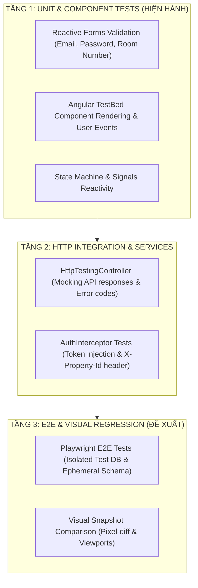

# 🧪 Kế Hoạch & Chiến Lược Kiểm Thử Giao Diện (UI Testing Strategy & Test Plan)
## Dự Án: Hotel SaaS Platform v2 (Angular 22 + Vitest + Playwright Proposal)

> **Mã tài liệu:** `TEAM-DOC-UI-TEST-PLAN` | **Phiên bản:** 1.0  
> **Áp dụng cho:** Kỹ sư phát triển (Nguyên, Tân), QA/Tester, Technical Reviewer và Product Owner (PO).  
> **Ranh giới thực thi:**  
> 1. Hiện tại chỉ sử dụng các công cụ Unit/Component Test sẵn có trong repository (`vitest`, `jsdom`, `@angular/core/testing`).  
> 2. **Chưa cài đặt thêm dependencies** (như `@playwright/test`) và **chưa thiết lập lịch chạy tự động** trên CI cho đến khi PO chính thức phê duyệt đề xuất này.  
> 3. Mọi bài kiểm thử E2E tương lai bắt buộc phải chạy trên **Môi trường Test Cô Lập** (Database test riêng, ephemeral schema), tuyệt đối không chạy trên Staging hay Dev.

---

## 1. MÔ HÌNH KIM TỰ THÁP KIỂM THỬ GIAO DIỆN (UI TEST PYRAMID)

---

## 2. MA TRẬN KỊCH BẢN KIỂM THỬ CHI TIẾT (TEST SCENARIO MATRIX)

### 2.1. Module Xác Thực & Chuyển Đổi Ngữ Cảnh (`FE-AUTH-01`)

| Mã Test | Phân Loại | Kịch Bản & Hành Vi Kiểm Thử | Dữ Liệu Đầu Vào | Kết Quả Kỳ Vọng (Assertions) |
| :--- | :--- | :--- | :--- | :--- |
| **`TC-AUTH-01`** | Unit / Form | Kiểm tra validation form đăng nhập | Email trống, mật khẩu trống | Form invalid; hiển thị lỗi `Email không được để trống`, `Mật khẩu không được để trống`. Nút Đăng nhập bị disabled. |
| **`TC-AUTH-02`** | Unit / Form | Kiểm tra định dạng email | `email: "invalid-email"` | Form invalid; hiển thị lỗi `Email không đúng định dạng`. |
| **`TC-AUTH-03`** | Component | Đăng nhập tài khoản 1 chi nhánh | `staff.single@hotelsaas.local` | Nhận 1 membership; tự động gọi `switch-context` sang `CN-Q1`; chuyển thẳng vào `/dashboard`, **không hiện modal**. |
| **`TC-AUTH-04`** | Component | Đăng nhập tài khoản 2 chi nhánh | `manager.both@hotelsaas.local` | Nhận 2 memberships; **hiển thị Modal Chọn Chi Nhánh**; backdrop static không cho đóng; liệt kê đúng `CN-Q1` và `CN-PN`. |
| **`TC-AUTH-05`** | Component | Chọn chi nhánh từ Modal | Nhấp chọn `Grand Hotel Sài Gòn (CN-Q1)` | Gọi `POST /api/auth/switch-context` với GUID của Q1; lưu Scoped Token; đóng modal; chuyển vào `/dashboard`. |
| **`TC-AUTH-06`** | Component | Đổi chi nhánh từ Header Dropdown | Đang ở Q1, nhấp Header chọn `Phú Nhuận (CN-PN)` | Gọi `POST /api/auth/switch-context` với GUID của PN; cập nhật token; reload dữ liệu phòng tương ứng với PN. |
| **`TC-AUTH-07`** | Integration | Interceptor tự động gắn header | Mọi HTTP request sau khi chọn chi nhánh | Header request có `Authorization: Bearer <token>` và `X-Property-Id: <guid>`. |
| **`TC-AUTH-08`** | Negative | Xử lý lỗi sai mật khẩu | `email: "owner@...", pass: "WrongPass"` | Backend trả 401; hiển thị Alert thông báo: `Email hoặc mật khẩu không chính xác`. |
| **`TC-AUTH-09`** | Negative | Xử lý lỗi token hết hạn khi gọi API | Token expired (HTTP 401) | Tự động gọi `POST /api/auth/refresh-token`; nếu refresh thành công thì retry request; nếu thất bại thì chuyển hướng về `/login`. |

---

### 2.2. Module Quản Lý Phòng & Loại Phòng (`FE-ROOM-01`)

| Mã Test | Phân Loại | Kịch Bản & Hành Vi Kiểm Thử | Dữ Liệu Đầu Vào | Kết Quả Kỳ Vọng (Assertions) |
| :--- | :--- | :--- | :--- | :--- |
| **`TC-ROOM-01`** | Component | Hiển thị danh sách phòng theo chi nhánh | Đang chọn chi nhánh `CN-Q1` | Bảng hiển thị chính xác 3 phòng của Q1 (`101`, `102`, `201`); hoàn toàn không thấy phòng `301`, `302` của Phú Nhuận. |
| **`TC-ROOM-02`** | Component | Thêm mới phòng thành công | `roomNumber: "103"`, `floor: 1`, `roomTypeId: <guid>` | Gọi `POST /api/rooms` thành công; đóng form; bảng phòng xuất hiện thêm dòng phòng 103; hiển thị Toast success. |
| **`TC-ROOM-03`** | Negative | Thêm mới phòng bị trùng số phòng | `roomNumber: "101"` (đã tồn tại ở Q1) | Backend trả HTTP 409 `ERR_CONFLICT`; hiển thị thông báo lỗi màu đỏ ngay dưới ô `Số phòng`: *Số phòng 101 đã tồn tại trong chi nhánh này*. |
| **`TC-ROOM-04`** | Component | Thêm mới Loại phòng với validation | `name: "VIP Suite"`, `code: "VIP"`, `basePrice: 1500000`, `capacity: 2` | Gọi `POST /api/room-types` thành công; hiển thị trên danh mục loại phòng. |
| **`TC-ROOM-05`** | Negative | Xóa phòng đang có booking hoạt động | Nhấn Xóa phòng `101` đang có khách | Backend trả HTTP 409 `ERR_ROOM_HAS_ACTIVE_BOOKINGS`; hiển thị hộp thoại cảnh báo từ chối xóa; không crash ứng dụng. |

---

### 2.3. Module Bảng Trạng Thái Buồng Phòng (`FE-HK-01`)

| Mã Test | Phân Loại | Kịch Bản & Hành Vi Kiểm Thử | Dữ Liệu Đầu Vào | Kết Quả Kỳ Vọng (Assertions) |
| :--- | :--- | :--- | :--- | :--- |
| **`TC-HK-01`** | Component | Hiển thị bảng lưới buồng phòng | Chi nhánh `CN-Q1` | Hiển thị các thẻ phòng với màu sắc chuẩn: `101` (Xanh lá - Clean), `102` (Đỏ - Dirty), `201` (Xanh lá - Clean). |
| **`TC-HK-02`** | Component | Chuyển trạng thái hợp lệ | Phòng 102 (`Dirty` $\to$ `Cleaning`) | Gửi `PATCH /api/rooms/{id}/status` kèm `expectedOldStatus: "Dirty"`; badge phòng chuyển sang màu Vàng (Cleaning). |
| **`TC-HK-03`** | Negative | Chặn chuyển trạng thái sai máy trạng thái | Cố đổi trực tiếp từ `Dirty` sang `Clean` | Nút bấm hoặc tùy chọn `Clean` bị disabled; hoặc backend chặn 400 `ERR_INVALID_STATUS_TRANSITION`. |
| **`TC-HK-04`** | Negative | Tranh chấp đồng thời (Optimistic Stale) | Người khác đã đổi phòng 102 sang `Cleaning` trước bạn | Gửi request nhận HTTP 409 `ERR_STALE_STATE`; UI tự động revert trạng thái cũ, hiển thị Toast cảnh báo: *Trạng thái phòng đã bị thay đổi bởi người dùng khác. Vui lòng làm mới.* và tự động reload dữ liệu. |
| **`TC-HK-05`** | Security | Phòng đang có khách (`Occupied`) | Thẻ phòng `Occupied` | Bị khóa hoàn toàn các nút đổi trạng thái buồng phòng thủ công. |

---

## 3. ĐỀ XUẤT TRIỂN KHAI E2E & VISUAL REGRESSION TESTING (CHỜ PO PHÊ DUYỆT)

Nhóm phát triển đề xuất kế hoạch triển khai kiểm thử tự động toàn diện cấp giao diện như sau:

### 3.1. Lựa Chọn Công Cụ: [Playwright](https://playwright.dev/)
- **Lý do lựa chọn:** Tốc độ thực thi vượt trội, hỗ trợ native các cơ chế auto-wait của Angular, hỗ trợ chụp và so sánh ảnh chụp màn hình (Visual Snapshots) với độ sai lệch pixel chính xác.

### 3.2. Kiến Trúc Môi Trường Kiểm Thử Cô Lập (Isolated Test Harness)
- **Database Test Riêng Biệt:** E2E tests tuyệt đối không chạy trên Staging hay Dev. E2E tests kết nối vào database test riêng (`hotel_saas_p1b01a_test`) và sử dụng các dynamic schema độc lập (tương tự cơ chế của `LocalDevDataSeederWebApiPipelineTests`).
- **Khởi tạo dữ liệu sạch tự động:** Mỗi suite E2E sẽ kích hoạt `LocalDevDataSeeder` để tạo môi trường sạch và xóa sạch schema sau khi test kết thúc (`DROP SCHEMA ... CASCADE`).

### 3.3. So Sánh Visual Snapshots & Độ Phân Giải (Responsive Viewports)
- **Ngưỡng sai lệch (Threshold):** `maxDiffPixelRatio: 0.02` (cho phép sai lệch tối đa 2% để tránh ảnh hưởng bởi font rendering khác biệt giữa các hệ điều hành).
- **Các kích thước màn hình kiểm thử:**
  1. **Desktop:** `1920 x 1080` (Màn hình làm việc chuẩn của Quản lý và Lễ tân).
  2. **Tablet:** `768 x 1024` (Máy tính bảng dành cho Giám sát buồng phòng khi đi kiểm tra phòng).
  3. **Mobile:** `375 x 812` (Điện thoại di động của nhân viên dọn phòng).

---

## 4. CHECKLIST PHÊ DUYỆT CỦA PRODUCT OWNER (PO GATEWAY)

Trước khi tiến hành cài đặt bất kỳ công cụ E2E nào, PO cần xem xét và phê duyệt:

- [ ] **1. Phê duyệt ma trận kiểm thử:** Đồng ý bộ 19 ca kiểm thử chi tiết tại Mục 2 làm tiêu chuẩn chất lượng UI.
- [ ] **2. Phê duyệt đề xuất Playwright:** Cho phép bổ sung `@playwright/test` vào `devDependencies` khi bước vào giai đoạn kiểm thử E2E.
- [ ] **3. Phê duyệt ranh giới môi trường:** Xác nhận E2E chỉ chạy trên môi trường test cô lập, không ảnh hưởng tới Staging.
