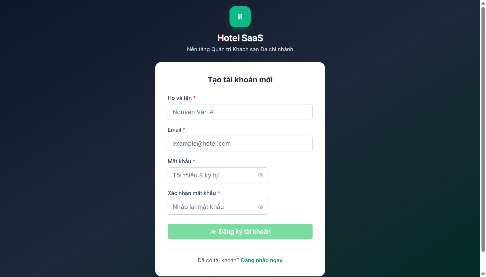
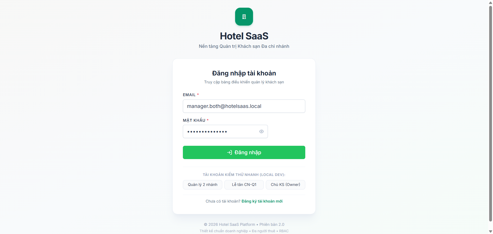
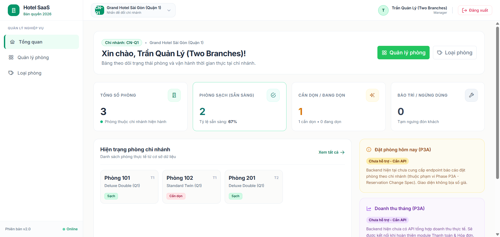
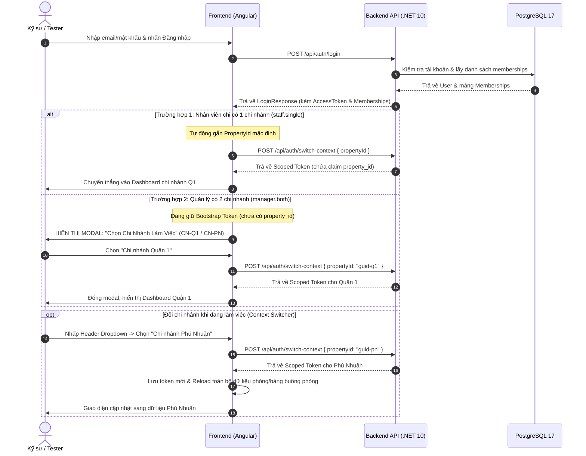

# 📖 Hướng Dẫn Sử Dụng & Thao Tác Giao Diện (User & Tester Operations Guide)
## Dự Án: Hotel SaaS Platform v2 (Angular 22 + PrimeNG + Tailwind CSS)

> **Mã tài liệu:** `TEAM-DOC-USER-GUIDE` | **Phiên bản:** 1.1 (Cập nhật relative assets & an toàn credentials)  
> **Áp dụng cho:** Kỹ sư phát triển (Nguyên, Tân), Tester/QA, Product Owner và người dùng thử nghiệm.  
> **Nguyên tắc minh bạch:** Các màn hình đã chạy được trên thực tế sẽ đính kèm ảnh chụp thực tế từ thư mục tài nguyên tương đối `./assets/screenshots/`. Các màn hình chưa xây dựng giao diện được ghi rõ là **"Chưa có evidence"** (tuyệt đối không tạo mockup hay ảnh giả).

---

## 1. MA TRẬN HIỆN TRẠNG CÁC TÍNH NĂNG GIAO DIỆN (UI FEATURE STATUS MATRIX)

| STT | Phân Hệ / Chức Năng | Trạng Thái Giao Diện (UI) | Trạng Thái Backend API | Phụ Trách Đề Xuất / Ticket |
| :---: | :--- | :---: | :---: | :--- |
| **1** | **Đăng nhập (`/login`)** | ✅ **ĐÃ CÓ (Hoạt động tốt)** | ✅ Hoàn thiện (`/api/auth/login`) | Đã triển khai tại `features/auth/login` |
| **2** | **Đăng ký tài khoản (`/register`)** | ✅ **ĐÃ CÓ (Hoạt động tốt)** | ✅ Hoàn thiện (`/api/auth/register`) | Đã triển khai tại `features/auth/register` |
| **3** | **Dashboard Tổng quan (`/dashboard`)** | ✅ **ĐÃ CÓ (Gắn API & Phạm vi rõ)** | ✅ Kết nối phòng mẫu & số lượng | Đã triển khai tại `features/dashboard` |
| **4** | **Modal Chọn Chi Nhánh (Sau Login)** | ✅ **ĐÃ CÓ (Hoạt động tốt)** | ✅ Hoàn thiện (`/api/auth/me/memberships`) | Đã triển khai tại `features/auth/context-selector` |
| **5** | **Dropdown Đổi Chi Nhánh (Header)** | ✅ **ĐÃ CÓ (Hoạt động tốt)** | ✅ Hoàn thiện (`/api/auth/switch-context`) | Đã triển khai tại `layouts/admin-layout` |
| **6** | **Quản lý Danh mục Loại phòng** | ✅ **ĐÃ CÓ (Hoạt động tốt)** | ✅ Hoàn thiện (`/api/room-types`) | Đã triển khai tại `features/room-types` |
| **7** | **Quản lý Danh sách Phòng vật lý** | ✅ **ĐÃ CÓ (Hoạt động tốt)** | ✅ Hoàn thiện (`/api/rooms`) | Đã triển khai tại `features/rooms` (`DELIVERY-CATALOG-01`) |
| **8** | **Bảng Trạng thái Buồng phòng (Grid)** | ❌ **CHƯA CÓ EVIDENCE** | ✅ Hoàn thiện (`PATCH /api/rooms/{id}/status`) | Chờ phân công (`FE-HK-01`) |

---

## 2. HƯỚNG DẪN THAO TÁC CÁC CHỨC NĂNG ĐÃ TRIỂN KHAI THỰC TẾ

### 2.1. Đăng Ký Tài Khoản Mới (`/register`)

- **Địa chỉ truy cập:** `http://localhost:4200/register`
- **Mục đích:** Đăng ký tài khoản người dùng cá nhân (vai trò `Customer`).
- **Các bước thực hiện:**
  1. Nhập **Họ và tên** (ví dụ: `Nguyễn Văn A`).
  2. Nhập **Email** hợp lệ (ví dụ: `customer@hotel.com`).
  3. Nhập **Mật khẩu** (tối thiểu 8 ký tự).
  4. Nhập lại mật khẩu để xác nhận.
  5. Nhấn nút **Đăng ký tài khoản**.

> [!NOTE]
> **Lưu ý nghiệp vụ quan trọng:**  
> Endpoint đăng ký này chỉ tạo tài khoản khách hàng thông thường (`Customer`), **hoàn toàn không tạo Khách sạn, Chi nhánh hay phân quyền quản lý**.  
> Để có tài khoản Quản trị viên/Nhân viên phục vụ kiểm thử, vui lòng sử dụng tài khoản đã được khởi tạo bởi công cụ `BE-SEED-01` (xem Mục 2.2).

---

### 2.2. Đăng Nhập Hệ Thống (`/login`)

- **Địa chỉ truy cập:** `http://localhost:4200/login`
- **Mục đích:** Xác thực người dùng và nhận JWT Token.
- **Các bước thực hiện:**
  1. Nhập **Email** và **Mật khẩu** (mật khẩu bạn đã truyền khi chạy lệnh seed ở máy local).
  2. Nhấn nút **Đăng nhập**.
  3. Hệ thống kiểm tra thông tin và chuyển tiếp vào hệ thống.

#### Danh Sách Tài Khoản Mẫu Đã Kiểm Chứng (Sau Khi Chạy Seeder Local):
> [!IMPORTANT]
> Mật khẩu đăng nhập của các tài khoản local dưới đây chính là **mật khẩu do bạn tự cung cấp khi chạy lệnh seed** (không có mật khẩu hardcode cố định). Chạy lại seed không làm đổi mật khẩu đã có.

1. **Chủ khách sạn (Owner):**
   - Email: `owner@hotelsaas.local`
   - Mật khẩu: *(Mật khẩu bạn truyền khi chạy seed)*
   - Quyền hạn: Quản trị toàn bộ chuỗi (Tenant-wide).
2. **Quản lý đa chi nhánh (Manager):**
   - Email: `manager.both@hotelsaas.local`
   - Mật khẩu: *(Mật khẩu bạn truyền khi chạy seed)*
   - Quyền hạn: Thuộc cả 2 chi nhánh `CN-Q1` (Quận 1) và `CN-PN` (Phú Nhuận).
3. **Nhân viên lễ tân 1 chi nhánh (Receptionist):**
   - Email: `staff.single@hotelsaas.local`
   - Mật khẩu: *(Mật khẩu bạn truyền khi chạy seed)*
   - Quyền hạn: Nhân viên tại riêng chi nhánh `CN-Q1`.

*Lưu ý: Môi trường Staging hiện tại **chưa được provision** tài khoản.*

---

### 2.3. Màn Hình Tổng Quan (`/dashboard`)

- **Địa chỉ truy cập:** `http://localhost:4200/dashboard` (yêu cầu đã đăng nhập).
- **Hiện trạng:** Hiển thị bố cục khung quản trị `AdminLayoutComponent` bao gồm:
  - Menu thanh bên trái (Sidebar): Tổng quan, Quản lý phòng, Loại phòng.
  - Thanh tiêu đề trên cùng (Header): Tiêu đề hệ thống, Tên người dùng và nút Đăng xuất.
  - Các thẻ chỉ số thống kê (Cards): Tổng số phòng (48), Phòng sẵn sàng (32), Đặt phòng hôm nay (12), Doanh thu tháng (128.5M đ).

> [!WARNING]
> **Hiện trạng kỹ thuật quan sát được:**  
> 1. Trên thanh Header hiện tại **chưa có bộ chọn chi nhánh (Context Dropdown)**.  
> 2. Các mục menu "Quản lý phòng" và "Loại phòng" khi nhấp vào chưa hiển thị dữ liệu vì chưa có route và view component (thuộc phạm vi triển khai của Ticket `FE-ROOM-01`).

---

## 3. ĐẶC TẢ NGHIỆP VỤ CÁC LUỒNG SẮP TRIỂN KHAI (SPECIFIED WORKFLOWS)

Dưới đây là thiết kế chi tiết các luồng nghiệp vụ đang chờ thực thi theo ticket, dành cho kỹ sư và tester nắm rõ trước khi code:

### 3.1. Luồng Chọn Ngữ Cảnh Chi Nhánh Sau Khi Đăng Nhập (`FE-AUTH-01`)
- **Hiện trạng giao diện:** **CHƯA CÓ EVIDENCE** (mới có thiết kế đặc tả).
- **Hành vi quy chuẩn:**
  - Nếu `memberships.length == 1`: Tự động gọi `switch-context` sang chi nhánh đó và chuyển vào Dashboard.
  - Nếu `memberships.length > 1`: Hiển thị Modal/Dialog không thể tắt (backdrop static) yêu cầu người dùng chọn 1 trong các chi nhánh được phân công.
  - Sau khi chọn, lưu `propertyId` vào session và gắn header `X-Property-Id` vào tất cả request tiếp theo qua `auth.interceptor.ts`.

### 3.2. Luồng Quản Lý Phòng & Loại Phòng (`FE-ROOM-01`)
- **Hiện trạng giao diện:** **CHƯA CÓ EVIDENCE** (mới có thiết kế đặc tả).
- **Hành vi quy chuẩn:**
  - Trang Loại phòng: Hiển thị bảng phân trang, nút Thêm loại phòng mới (mã, tên, giá cơ bản, sức chứa). Chặn xóa loại phòng nếu đã có phòng vật lý liên kết.
  - Trang Phòng vật lý: Hiển thị bảng danh sách lọc theo tầng (`floor`), trạng thái (`Clean`, `Dirty`, `Cleaning`, `Occupied`, `OutOfService`).

### 3.3. Luồng Bảng Trạng Thái Buồng Phòng (`FE-HK-01`)
- **Hiện trạng giao diện:** **CHƯA CÓ EVIDENCE** (chờ phân công sau).
- **Hành vi quy chuẩn:**
  - Giao diện lưới thẻ phòng trực quan theo tầng và mã màu trạng thái.
  - Chuyển trạng thái tuân thủ nghiêm ngặt State Machine:
    - `Dirty` $\to$ `Cleaning` / `OutOfService`
    - `Cleaning` $\to$ `Clean` / `Dirty` / `OutOfService`
    - `Occupied` bị khóa (chỉ đổi khi Check-in / Check-out).
  - Gửi kèm `expectedOldStatus` để bảo vệ đồng thời (Optimistic Concurrency). Nếu có người khác đổi trước, nhận lỗi 409 `ERR_STALE_STATE`, UI lập tức revert và báo người dùng làm mới bảng.

---

## 4. HƯỚNG DẪN XỬ LÝ CÁC MÃ LỖI THƯỜNG GẶP (ERROR CODES & RESOLUTION)

| Mã Lỗi HTTP | Error Code Backend | Mô Tả & Tình Huống Gặp Phải | Cách Khắc Phục / Hướng Dẫn Tester |
| :---: | :--- | :--- | :--- |
| **400** | `ERR_VALIDATION` | Dữ liệu gửi lên thiếu trường bắt buộc hoặc sai định dạng (ví dụ: GUID sai, để trống tên phòng, số tầng $\le 0$). | Kiểm tra các thông báo lỗi màu đỏ ngay dưới ô nhập liệu của form. |
| **401** | `ERR_UNAUTHORIZED` | Token hết hạn hoặc thông tin đăng nhập sai. | Đăng nhập lại để nhận token mới. Hệ thống sẽ tự động gọi Refresh Token nếu token hết hạn trong phiên. |
| **403** | `ERR_FORBIDDEN` | Tài khoản không có quyền thao tác trên chi nhánh này hoặc membership bị vô hiệu hóa (`Inactive`). | Kiểm tra quyền của tài khoản bằng `owner@hotelsaas.local` hoặc đổi sang chi nhánh bạn có quyền. |
| **403** | `ERR_PROPERTY_REQUIRED` | Đang cố gọi API phòng/đặt phòng bằng Bootstrap Token (chưa chọn chi nhánh). | Chọn chi nhánh làm việc từ Header hoặc Modal trước khi thực hiện thao tác. |
| **404** | `ERR_NOT_FOUND` | Bản ghi phòng hoặc loại phòng không tồn tại (có thể đã bị xóa bởi nhân viên khác). | Làm mới lại danh sách (Reload trang) để cập nhật dữ liệu mới nhất. |
| **409** | `ERR_CONFLICT` | Trùng số phòng trong cùng chi nhánh hoặc trùng mã loại phòng. | Đổi số phòng hoặc mã loại phòng khác không bị trùng. |
| **409** | `ERR_STALE_STATE` | Xung đột cập nhật buồng phòng đồng thời: Một nhân viên khác vừa đổi trạng thái của phòng này trước bạn 1 tích tắc. | Hệ thống sẽ tự động cập nhật lại trạng thái mới nhất lên màn hình. Thao tác lại nếu cần thiết. |

---

## 5. ĐỀ XUẤT CHIẾN LƯỢC KIỂM THỬ GIAO DIỆN TỰ ĐỘNG (UI TESTING STRATEGY)

Nhằm đảm bảo chất lượng giao diện khi tích hợp full-stack, nhóm đề xuất chiến lược kiểm thử như sau:

1. **Unit & Component Testing (Thực thi ngay trong Module):**
   - Sử dụng Vitest + Angular TestBed sẵn có trong `frontend/package.json`.
   - Kiểm thử Reactive Forms, Validation logic, State transitions và Mocking HTTP responses qua `HttpTestingController`.
2. **Đề xuất End-to-End (E2E) & Visual Snapshot Testing (Chờ PO Phê Duyệt):**
   - **Công cụ đề xuất:** [Playwright](https://playwright.dev/) chuyên dụng cho Angular.
   - **Nguyên tắc môi trường:** E2E và Visual regression tests bắt buộc chạy trên **Môi trường Test Cô Lập** (Database test riêng có search_path tách biệt), tuyệt đối không chạy trên Staging hay Dev dùng chung.
   - **Ranh giới cam kết:** Hiện tại **CHƯA cài đặt thêm thư viện** và **CHƯA thiết lập cron/lịch chạy tự động nào**. Nhóm đã trình kế hoạch chi tiết trong tài liệu [`ui-test-plan.md`](./ui-test-plan.md) để PO phê duyệt trước khi áp dụng.
