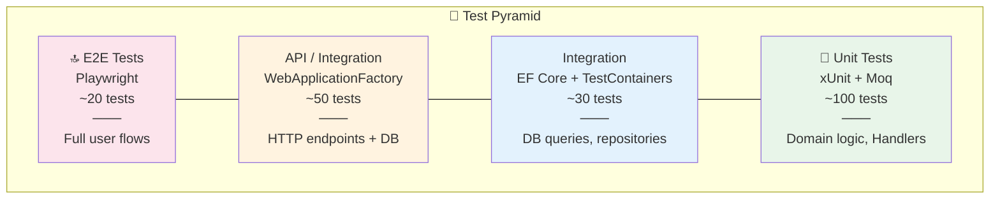

# 🧪 Test Strategy (Kế hoạch kiểm thử)

> **Tài liệu:** TEST-01 | **Phiên bản:** 1.0 | **Ngày:** 2026-10-03
> **Rubric mapping:** TC2.5 Mức 5 (kế hoạch kiểm thử, ≥4 tầng)

---

## 1. Test Pyramid — 4 tầng



---

## 2. Chi tiết từng tầng

### Tầng 1: Unit Tests (~100 tests)

| Layer | Đối tượng test | Tool | Ví dụ |
|-------|---------------|------|-------|
| Domain | Entity validation, value objects | xUnit | Reservation.CanCancel(), Room.ChangeStatus() |
| Application | Command/Query Handlers | xUnit + Moq | CreateReservationHandler, CheckInHandler |
| Application | Validators | xUnit | ReservationValidator (overlap, dates, capacity) |
| RBAC | Bitmask logic | xUnit | PermissionCheck(mask=7, required=4) == true |
| Domain | Enums & business rules | xUnit | CancellationPolicy fee calculation |

**Coverage target:** ≥ 80% cho Domain + Application layers

### Tầng 2: Integration Tests (~30 tests)

| Đối tượng | Tool | Ví dụ |
|----------|------|-------|
| DbContext + PostgreSQL | TestContainers | Global Query Filter hoạt động đúng tenant |
| Repositories/Queries | TestContainers | Overlap check query trả đúng kết quả |
| Migrations | TestContainers | Migrate + Seed → clean state |

### Tầng 3: API Tests (~50 tests)

| Đối tượng | Tool | Ví dụ |
|----------|------|-------|
| Auth endpoints | WebApplicationFactory | Register → Login → Get JWT → Access protected |
| RBAC enforcement | WebApplicationFactory | Receptionist call DELETE /rooms → 403 |
| Reservation flow | WebApplicationFactory | POST /reservations → GET → Check-in → Check-out |
| Payment callback | WebApplicationFactory | VNPay IPN → verify idempotency |
| Error handling | WebApplicationFactory | Invalid input → 400 với error details |

### Tầng 4: E2E Tests (~20 tests)

| Đối tượng | Tool | Ví dụ |
|----------|------|-------|
| Login flow | Playwright | Enter credentials → redirect dashboard |
| Booking flow | Playwright | Search → Select room → Fill info → Confirm |
| Check-in flow | Playwright | Find booking → Click check-in → Room status changes |
| RBAC UI | Playwright | Login as Receptionist → Menu items limited |
| Responsive | Playwright | Mobile viewport → menu hamburger |

---

## 3. Test Case Template

```markdown
### TC-XXX: [Tên test case]

| Mục | Chi tiết |
|-----|---------|
| **ID** | TC-001 |
| **User Story** | US-4.3 Check-in |
| **Precondition** | Có booking status=Confirmed |
| **Steps** | 1. Tìm booking<br/>2. Click Check-in |
| **Expected** | Reservation → CheckedIn, Room → Occupied |
| **Priority** | P0 |
| **Type** | Integration |
```

---

## 4. Defect Tracking

| Severity | Mô tả | SLA |
|----------|-------|-----|
| **Critical** | Hệ thống crash, mất data, security breach | Fix ngay |
| **High** | Chức năng chính không hoạt động | Fix trong 24h |
| **Medium** | Chức năng phụ lỗi, workaround có | Fix trong sprint |
| **Low** | UI cosmetic, typo | Backlog |

**Tool:** GitHub Issues với labels `bug`, `severity:critical/high/medium/low`

---

## 5. Coverage Targets

| Module | Target | Tool |
|--------|--------|------|
| HotelSaas.Domain | ≥ 80% | Coverlet |
| HotelSaas.Application | ≥ 80% | Coverlet |
| HotelSaas.Infrastructure | ≥ 50% | Coverlet |
| HotelSaas.WebApi | ≥ 60% | Coverlet |
| Angular (core/services) | ≥ 70% | Istanbul |
| **Overall** | **≥ 70%** | |

---

*Tài liệu này phục vụ TC2.5 Mức 5 (kế hoạch kiểm thử ≥4 tầng, coverage targets).*
